# 通識地球物理：地電交流法 (TEM) 實習心得報告

**系級**：資管二　　**姓名**：張承新　　**實習日期**：2026 年 10 月 12 日

---

## 摘要與引言

地電探勘為應用地球物理學中極具代表性之地球探測技術，透過在地表激發並觀測電磁場響應，用以反演地下地層之電阻率 $\rho$ 與電導率 $\sigma$ 分布。相較於前次以人工注入穩態直流電為基礎的「地電直流法（Direct Current Resistivity Method）」，本次實習採用屬於時間域電磁法（Time-Domain Electromagnetic Method, TDEM）的**暫態電磁法（Transient Electromagnetic Method, 簡稱 TEM）**。

TEM 技術無須在地面打入金屬電極棒，而是利用「地表發射線圈（Transmitter, Tx）」與「接收線圈（Receiver, Rx）」進行純電磁感應耦合。本報告分為三大核心章節：第一部分闡述 TEM 法之物理原理與「時間換取深度」的電磁擴散機制；第二部分詳述於中央大學科學一館前進行的五項經典物理模擬實驗（包含良導體鋁板與非導體地層之響應對比、背景電磁雜訊測定、鋁板增厚效應、鋁板內部電磁波傳遞速率測定、以及封閉迴圈模擬渦電流現象）；第三部分完整記錄於中央大學地下水觀測井場進行的野外網格化實測、金屬井蓋干擾效應剖析，並比對各深度時間閘門（Time Window）導電性反演結果與校園地下水層之空間分布；最後針對本次實習流程、儀器操作細節與物理現象提出深入的理性心得與反思。

---

## 1. TEM 原理

暫態電磁法（TEM）之基本物理架構奠基於法拉第電磁感應定律（Faraday's Law of Induction）與安培－馬克士威定律（Ampère-Maxwell Law）。其基本量測配置為在地表鋪設發射線圈（Tx）與接收線圈（Rx），其實驗運作與地下電磁響應流程如下（如圖 1 所示）：

1. **一次磁場之建立**：在地表發射線圈 Tx 中通入穩定直流電（數安培至十數安培），在周圍空間與地下介質中建立起穩態的一次磁場（Primary Magnetic Field, $B_p$）。
2. **急遽關斷與渦電流激發**：當一次磁場穩定後，發射機在極短時間內（斜坡關斷時間 Turn-off time，約數微秒至數十微秒，$\mu\text{s}$）強制切斷發射電流。根據法拉第定律：
   $$\nabla \times \mathbf{E} = -\frac{\partial \mathbf{B}}{\partial t}$$
   一次磁場在微秒尺度內的劇烈變化（$\frac{\partial B}{\partial t} \ll 0$），迫使地下導電地層內部感應出同心圓封閉狀之感應電動勢，進而產生「渦電流（Eddy currents）」。此感應電流以發射線圈在地表的幾何投影為中心，形成封閉的導電環。
3. **感應煙圈向下擴散（Smoke Rings）**：地下渦電流的強度並非停滯不變，而是因地層介質具有電阻而逐漸發生歐姆損耗（Ohmic dissipation）。隨著時間推移，較淺部的渦電流衰減消失，同時在更深、更廣的地下介質中誘發出新的感應電流。此一現象在地球物理學中常被形象化比喻為向下、向外擴散緩慢沉降的「煙圈（Smoke rings）」。
4. **二次磁場觀測與「時間即深度」**：地下擴散之渦電流衰減過程中，會向地表輻射二次感應磁場（Secondary Magnetic Field, $B_s$）。置於地表的接收線圈 Rx 透過量測二次磁場隨時間變化的感應電壓衰減曲線 $V(t) = -\frac{\partial \Phi}{\partial t}$，即可推估地下介質之電導性。在關斷後的極早期（Early-time），訊號主要由淺部渦電流所主導；而在關斷後的晚期時域（Late-time），訊號則來自於深部沉降之渦電流響應。因此，TEM 具備「無須擴大幾何展距、單純以記錄時間（Time）即可換取探測深度（Depth）」之核心優勢。

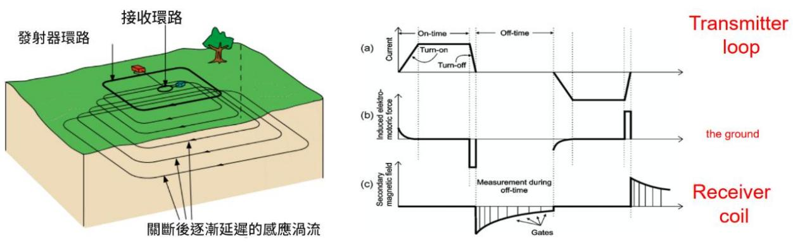

---

## 2. TEM 物理模擬

TEM 儀器本質上是一部電腦化、具備超高速取樣與高動態範圍（High Dynamic Range）之微微電壓計（Micro-voltmeter），專門量測發射線圈 Tx 斷電後，接收線圈 Rx 端所感應出的微弱暫態電壓衰減響應曲線。

### 2.0 實驗架設與系統監控

本次實習採用 Monash Geoscope TerraTEM 探勘系統（整合 SIROTEM 經典電磁架構），實驗基地位於中央大學科學一館北側草坪。全套系統由控制主機、外接顯示螢幕、筆記型電腦、專用發射/接收線圈箱、外接電源箱及訊號傳輸纜線所組成。

- **整體佈置全景（圖 2.0A）**：指導老師於草坪樹蔭下向全體同學詳細講解 TEM 實習之系統架構與操作規程。筆記型電腦設置於橘色防水儀器箱上方，外接 ViewSonic 液晶螢幕置於地面落葉處，以利強烈日照下即時辨識波形；主控箱連接至遠端測線與線圈箱。
- **軟體介面與初始衰減曲線（圖 2.0B）**：儀器初始化後進行 RUN #1 基準檢測，螢幕顯示發射線圈電阻 $R_{Tx} = 4.04\ \Omega$、斜坡關斷時間 $\text{Ramp} = 5.8\ \mu\text{s}$、發射電流 $I = 5.98\ \text{A}$、供電電壓穩定於 $24.3\ \text{V}$。顯示幕以雙對數座標（x 軸為對數時間 $\text{ms}$，y 軸為振幅 $\mu\text{V}/\text{A}$）即時呈現衰減波形。波形在 $0.001 \sim 0.1\ \text{ms}$ 間可見電流關斷引起的強烈暫態震盪，隨後平穩衰減，提供精確的系統基準。

| 圖 2.0A 全景架設 | 圖 2.0B 軟體介面 |
| :---: | :---: |
| 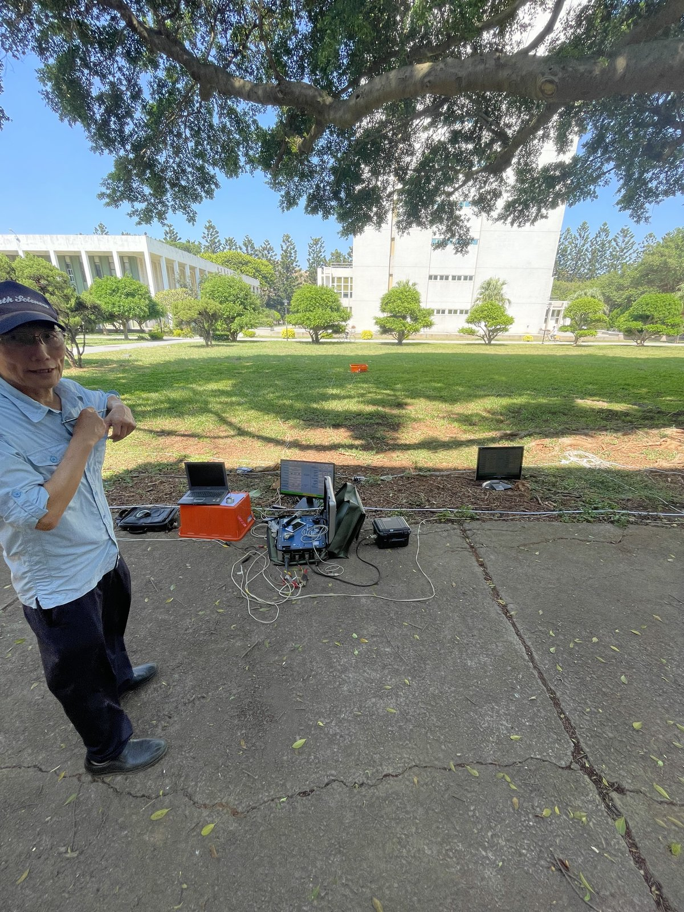 | 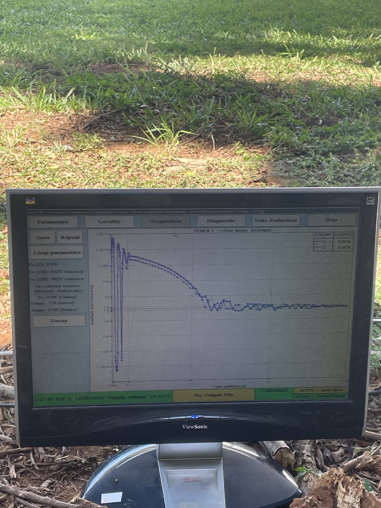 |
| **圖 2.0A　TEM 實驗整體儀器架設與野外教學全景**：中央大學科學一館北側草坪上，筆記型電腦置於橘色箱上，外接螢幕即時監控，主機導線連接至遠處線圈箱。 | **圖 2.0B　TerraTEM 操控系統介面與初始衰減曲線（RUN #1）**：讀數顯示 Tx: 4.04 Ω、Ramp: 5.8 μs、電流 5.98 A、電壓 24.3 V，雙對數座標清楚展現電流關斷後之電壓衰減曲線。 |

---

### 2.1 導體鋁板與非導體水泥地 / 草地之響應對比

#### 原理簡述
地下介質之電導率 $\sigma$ 直接決定了感應渦電流之衰減衰期。非導體（如乾燥水泥地、乾燥土壤）電導率極低，感應渦電流在產生後瞬間因高電阻損耗而衰亡，故在晚期時域訊號幾近於零；相對地，良導體（如金屬鋁板，其電導率約 $3.5 \times 10^7\ \text{S/m}$）電阻極小，渦電流可持續循環流動，產生強大且長效的二次感應磁場。

#### 架設說明
將含有發射與接收線圈的橘色線圈箱安置於草坪測線上，旁側放置高純度金屬鋁板進行物理模擬（圖 2.1A），檢驗金屬良導體存在時對電磁波形帶來的顯著效應。

#### 數據結果與觀察分析
如圖 2.1B 所示，在此配置下測得參數為發射線圈電阻 $R_{Tx} = 16.38\ \Omega$、$\text{Ramp} = 62.3\ \mu\text{s}$、發射電流 $I = 1.47\ \text{A}$、供電電壓 $24.2\ \text{V}$。與一般地層相比，波形在 $0.1 \sim 10\ \text{ms}$ 的中晚期時域出現異常突起的巨大凸波（隆起波峰，振幅高達 $10^4 \sim 10^5\ \mu\text{V}/\text{A}$），隨後維持平緩衰減，遲至數十毫秒後才逐漸落入雜訊基底。此結果直觀證明：良導體之存在會使晚期時域之 TEM 感應電壓維持在高振幅狀態，是野外金屬礦脈探測與未爆彈（UXO）搜尋的經典診斷特徵。

| 圖 2.1A 鋁板架設 | 圖 2.1B 導體響應曲線 |
| :---: | :---: |
| 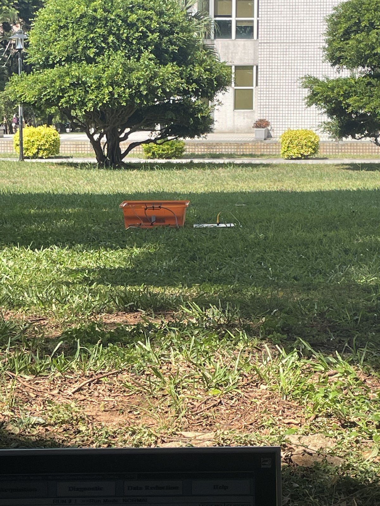 | 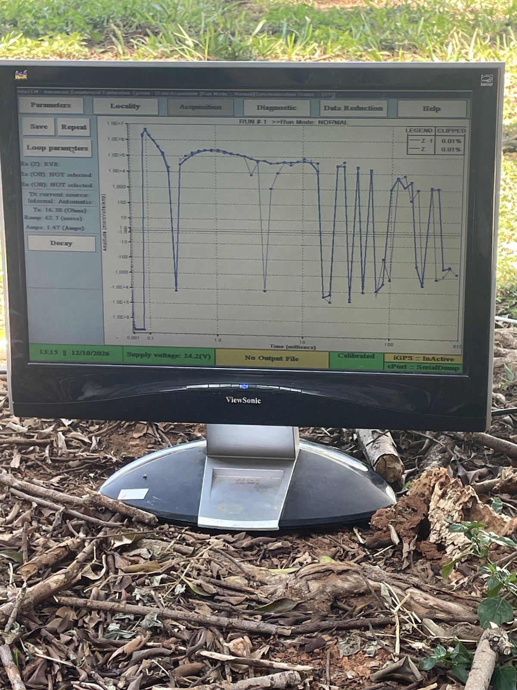 |
| **圖 2.1A　導體鋁板物理模擬實驗架設**：橘色線圈箱置於草坪，旁側平鋪高導電金屬鋁板並引接導線，模擬地下高導電金屬體對暫態電磁場的擾動。 | **圖 2.1B　良導體鋁板激發之暫態電磁波形響應**：讀數顯示 Tx: 16.38 Ω、Ramp: 62.3 μs、電流 1.47 A、電壓 24.2 V，中晚期時域（0.1~10 ms）出現顯著波峰，證實良導體具備長效二次場。 |

---

### 2.2 背景雜訊之訊號（發射線圈不送電）

#### 原理簡述
在實際地球物理探勘中，周遭環境充斥著各類人為與天然電磁雜訊（如 60 Hz 工頻交流電磁場、廣播無線電訊號、大氣雷電 Sferics 等）。為精準扣除背景干擾並評估儀器信噪比門檻，必須執行發射機不送電的「雜訊測定（Noise Run）」。

#### 數據結果與觀察分析
發射線圈 Tx 切斷電源（不送電），僅由接收線圈 Rx 開啟通道收錄周圍電磁波（如圖 2.2 所示）。量測結果顯示，波形圍繞零電壓基線上下微幅劇烈抖動，沒有任何規律性單調衰減特徵，振幅極低（大多小於 $1 \sim 10\ \mu\text{V}/\text{A}$）。此實驗具體界定了本次實習環境的「雜訊基底（Noise Floor）」，說明後續野外量測中晚期時域震盪的成因，並驗證了透過多次疊加平均（Stacking 250~2000 次）抑制隨機背景雜訊之必要性。

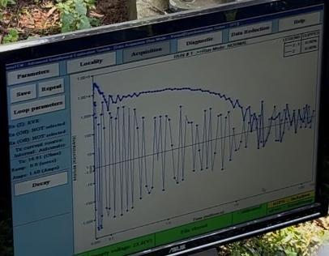

---

### 2.3 鋁板增厚之 TEM 訊號（單層鋁板 vs. 雙層鋁板疊加）

#### 原理簡述
地下導電體的厚度與體積大小直接影響感應渦電流之總能量容量及自感係數 $L$。當導體厚度增加時，其等效電阻 $R$ 下降、自感 $L$ 上升，導致放電時間常數 $\tau = \frac{L}{R}$ 大幅增加，使得二次場在晚期時域的強度更強、衰減更為遲緩。

#### 架設說明
如圖 2.3A 所示，指導老師帶領同學在草坪上進行雙層鋁板疊加實驗，將兩張相同規格的鋁板完全貼合重疊，模擬地下導電構造層厚度加倍的情境。

#### 數據結果與觀察分析
圖 2.3B 清楚展示了單層鋁板（Z-1，藍點）與雙層疊加厚鋁板（Z，實線）的即時疊圖比對。此時儀器讀數為 Tx: 16.38 Ω、Ramp: 72.0 μs、電流 1.47 A。在早期時域兩者響應相近，但在進入 $1 \sim 10\ \text{ms}$ 晚期時域時，雙層厚鋁板的實線波形振幅明顯高於單層虛線波形，且其衰減斜率更為平緩。此現象在物理上完美驗證了 TEM 不僅能「探測導體是否存在」，更能「依據晚期時域衰減曲線的能量強度與斜率，解析地下導體之厚度與規模」。

| 圖 2.3A 雙層鋁板教學 | 圖 2.3B 增厚對比曲線 |
| :---: | :---: |
| 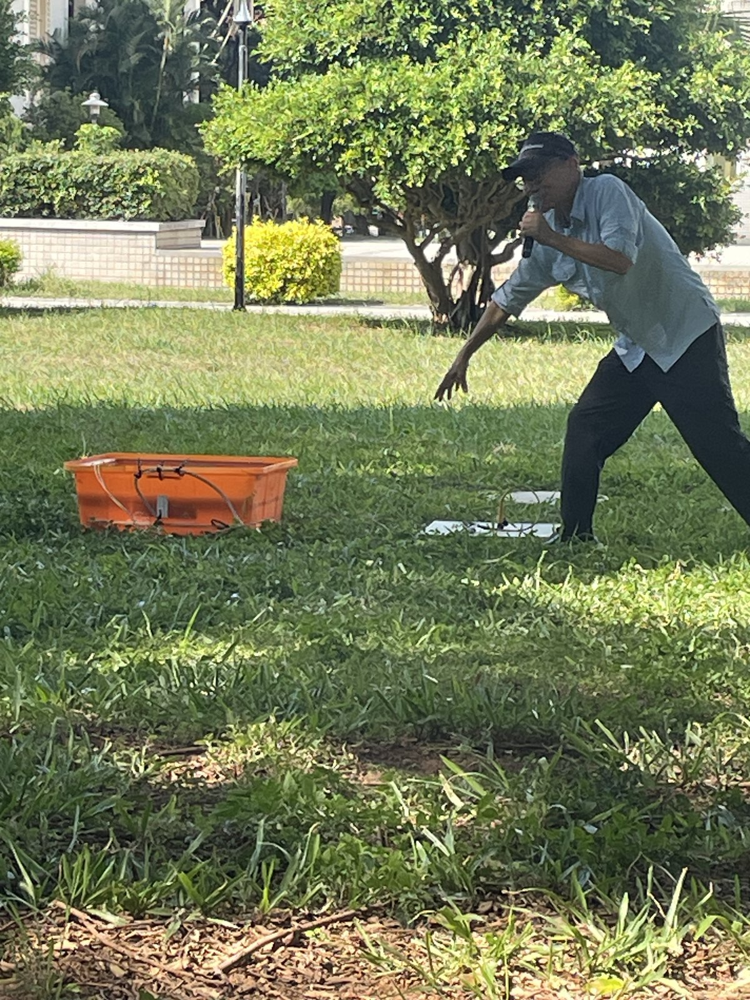 | 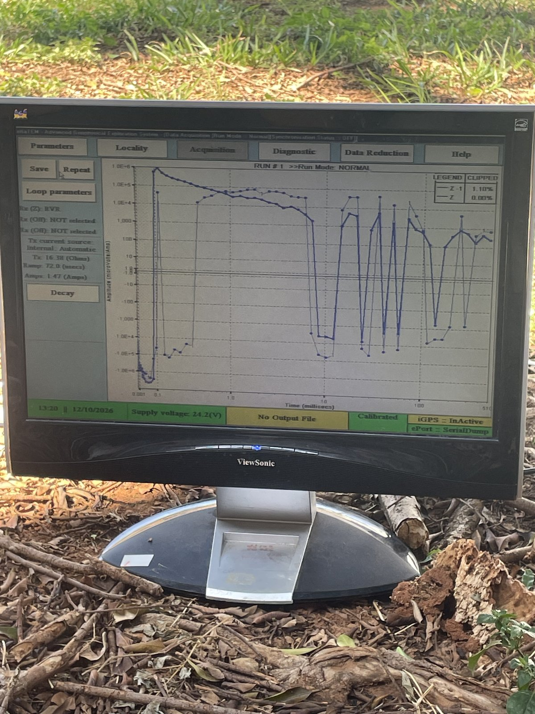 |
| **圖 2.3A　雙層鋁板疊加（導體增厚）模擬現場教學**：老師於草坪旁指導同學將兩張鋁板進行疊加，藉由倍增導體厚度與截面積，模擬地下導電構造層規模擴大之響應。 | **圖 2.3B　單層與雙層鋁板暫態訊號對比（Z-1 與 Z）**：讀數 Tx: 16.38 Ω、Ramp: 72.0 μs、電流 1.47 A，厚鋁板（實線 Z）在晚期時域（1~10 ms）振幅顯著高於單層板（虛線 Z-1），衰減更慢。 |

---

### 2.4 鋁板內的 TEM 傳遞速率量測

#### 原理簡述與計算
真空中電磁波以光速 $c = 3 \times 10^8\ \text{m/s}$ 傳播；然而在良導體（金屬鋁板）內部，電磁波為強耗散性擴散波，其擴散傳播速度受到集膚效應與渦電流耦合的強烈抑制，等效傳播速率大幅降低至每秒數公尺等級。

#### 實驗步驟與數值計算
為定量量測暫態電磁場在鋁板介質內的傳播速率，固定發射線圈 Tx，將接收線圈 Rx 水平向外平移一段精確距離 $\Delta x = 5\ \text{cm} = 0.05\ \text{m}$，比對移動前後兩次量測之特徵波峰到達時間差 $\Delta t$（圖 2.4）。

- 觀測時間延遲：由圖形可知波峰時間差 $\Delta t \approx 50\ \text{ms} = 0.05\ \text{s}$。
- 速率計算：
  $$v = \frac{\Delta x}{\Delta t} = \frac{0.05\ \text{m}}{0.05\ \text{s}} = 1.0\ \text{m/s}$$
- **物理意義分析**：此傳播速率（$1.0\ \text{m/s}$）遠低於真空光速，體現了良導體內部「磁擴散（Magnetic diffusion）」之物理本質。正因為暫態電磁波在地下導電介質中的傳播速率如此緩慢，儀器才能在毫秒（ms）的時間尺度下精確分辨地層由淺至深的各層結構。

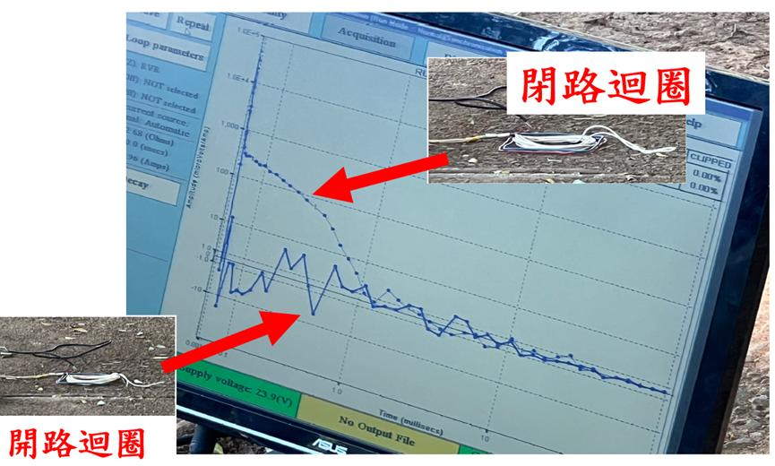

---

### 2.5 封閉迴圈之 TEM 響應（模擬地下封閉渦電流圈）

#### 原理簡述與相位特性
根據 TEM 基本物理模型，地下導體被感應出的是環狀封閉渦電流。實驗中利用一圈閉合之金屬導線（Closed Wire Loop）環繞放置，直接模擬地下單一封閉導電環對斷電暫態的響應（如圖 2.5 所示）。

- **渦電流模擬效應**：當發射線圈切斷電流時，閉合導線迴圈內產生顯著感應電流，接收線圈測得之衰減曲線猶如偵測到一獨立塊狀金屬導體。
- **相位倒轉現象（Phase Inversion）**：當接收線圈 Rx 放置於發射線圈 Tx 之「內圈」時，測得之垂直二次磁場向上，感應電壓為正；當將 Rx 移動至 Tx 之「外圈」時，依據磁偶極場（Magnetic Dipole）之幾何分布，磁力線方向由向上反轉為向下，導致感應波形發生 180° 完全反相（圖形上下顛倒）。此現象在實驗中直觀印證了電磁場空間幾何對稱性與反相概念。

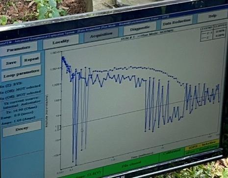

---

## 3. TEM 野外實測

野外實測基地選定於中央大學科學一館北側草坪「中大地下水觀測井場」。該井場為中大地科學院重要的水文地質實習觀測基地，地下設有鋼質金屬套管（Casing），並已知賦存透水之砂礫石含水層。

### 3.1 測線佈設與線圈箱架設（金屬井蓋 vs. 草皮地層響應對比）

#### 架設說明
實測採用一體化線圈箱（發射線圈 Tx 與接收線圈 Rx 組合固定於同一箱體內，簡稱 In-loop / Coincident 配置），便於沿測線網格搬移施測。為了對比人工金屬結構與天然地層的響應差異，首先將線圈箱分別架設於「金屬觀測井蓋正上方」與「遠離井蓋的純淨草皮上方」進行觀測。

- **金屬井蓋測點架設與響應（圖 3.1A, 3.1B）**：線圈箱精準放置於金屬井蓋正上方（圖 3.1A）。RUN #3 量測畫面顯示（圖 3.1B），由於井蓋與地下鋼套管為極佳導體，在電流切斷瞬間激發出極強之金屬二次場，造成早期時域（$< 0.1\ \text{ms}$）波形劇烈畸變跳變，中晚期曲線呈現無規則的大幅擾動，完全遮蔽了深部地層訊號。
- **天然草坪測點架設與響應（圖 3.1C, 3.1D）**：將線圈箱移至遠離金屬物的開闊草皮測點（圖 3.1C）。RUN #15 量測畫面顯示（圖 3.1D），系統讀數為 Tx: 4.06 Ω、Ramp: 5.6 μs、發射電流 Amps: 5.87 A、系統電壓 24.0 V。曲線呈現標準沉積地層之平滑指數階梯衰減，早期振幅達 $10^4\ \mu\text{V}/\text{A}$，隨後穩定衰減，真實反映地下土壤與基岩介質之電性特徵。

| 圖 3.1A 井蓋架設 | 圖 3.1B 井蓋畸變曲線 | 圖 3.1C 草坪架設 | 圖 3.1D 草坪地層曲線 |
| :---: | :---: | :---: | :---: |
| 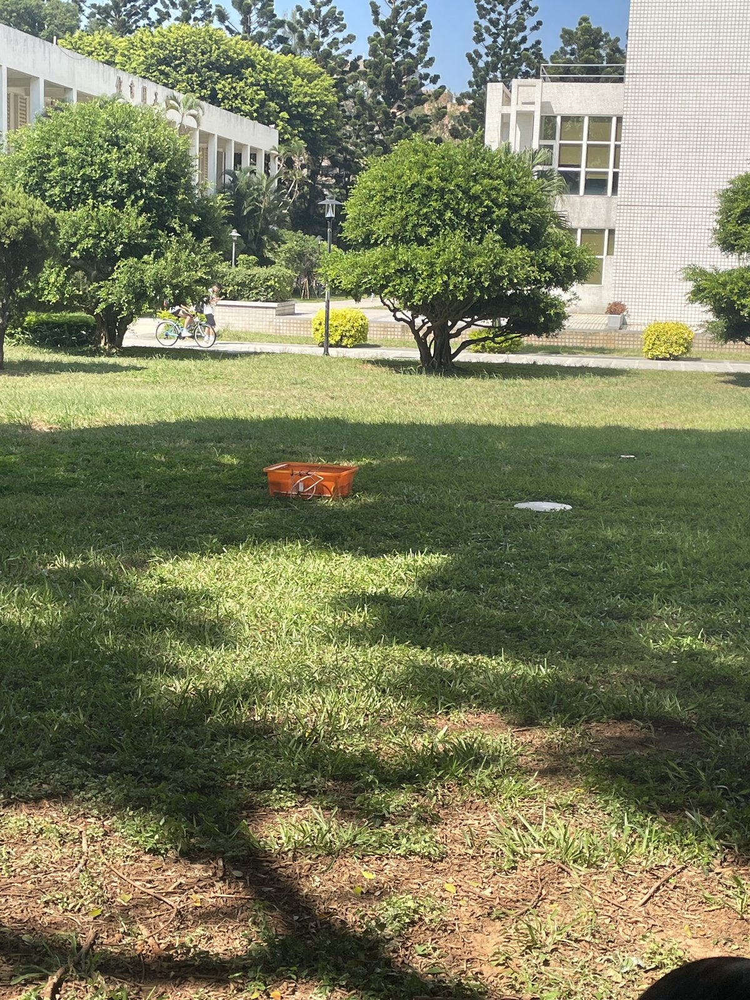 | 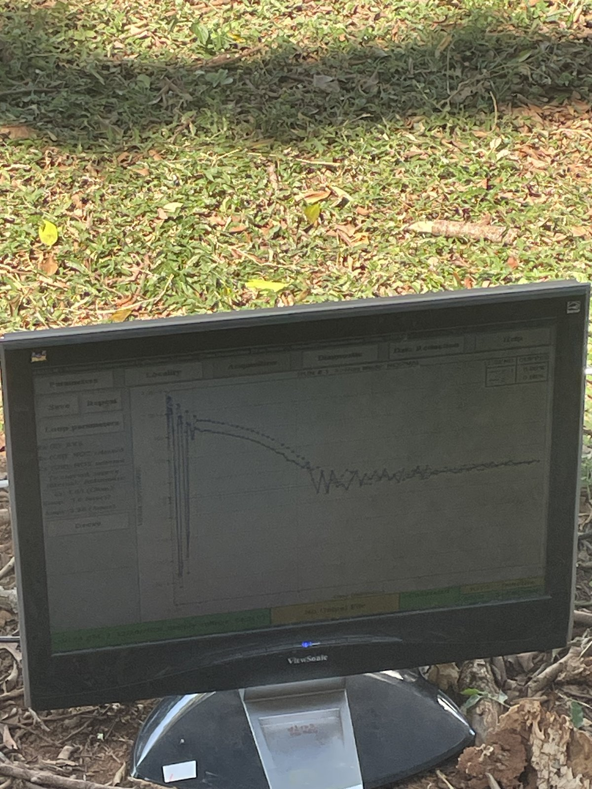 | 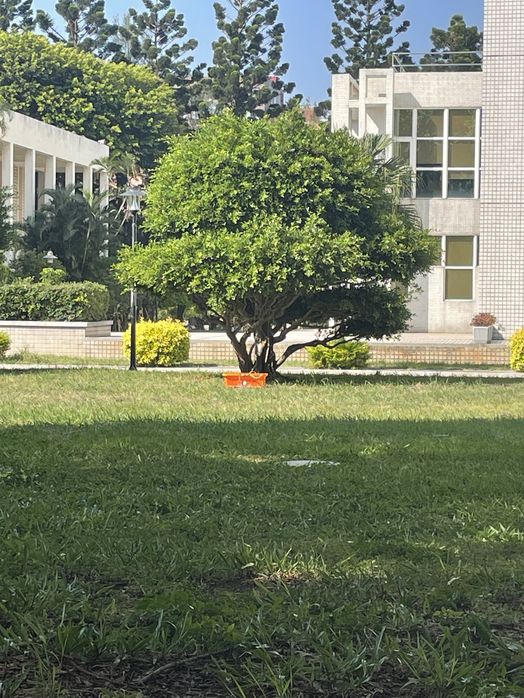 | 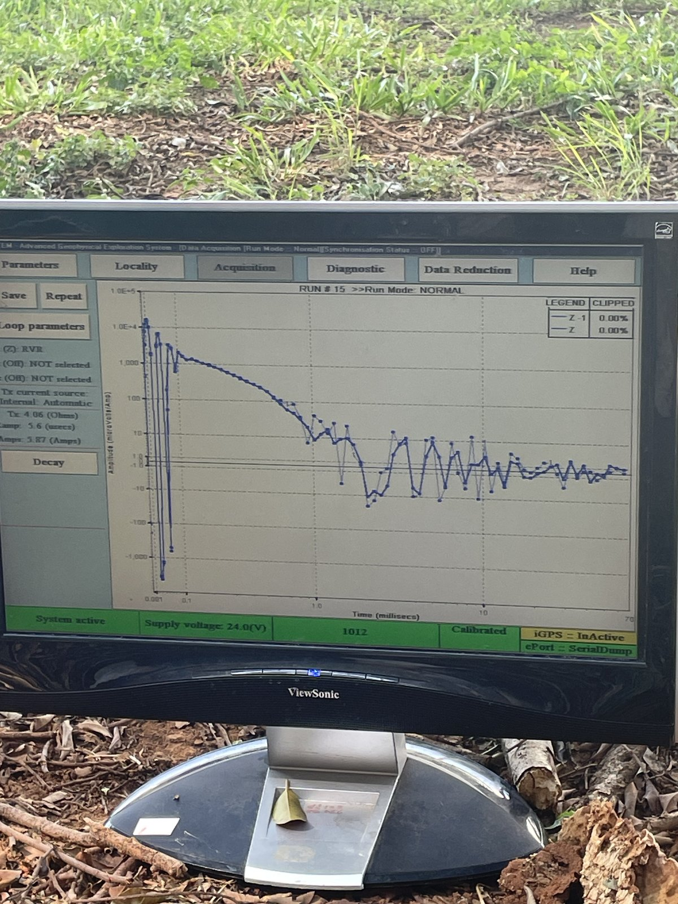 |
| **圖 3.1A　地下水井金屬井蓋旁線圈箱架設**：線圈箱置於金屬井蓋上方，檢驗強人工金屬導體對電磁訊號的干擾效應。 | **圖 3.1B　金屬井蓋之強導體畸變曲線（RUN #3）**：受金屬井蓋與鋼套管影響，波形在早期與中期出現劇烈畸變與飽和震盪。 | **圖 3.1C　科一館草坪均質測點架設**：線圈箱移至遠離人為金屬之草坪，以天然地層與地下水為探測對象。 | **圖 3.1D　草坪標準暫態衰減曲線（RUN #15）**：讀數 Tx: 4.06 Ω、Ramp: 5.6 μs、電流 5.87 A，電壓 24.0 V，波形平滑展現真實地層響應。 |

---

### 3.2 中大地下水井場 TEM 測點分布與連續網格觀測

實習中全班同學沿科一館北側草坪設定網格化測線，逐點搬移線圈箱進行高密度空間採樣（測點分布如圖 3.2A 所示）。每一測點均採集完整暫態衰減資料，連續施測編號包含 RUN #15 至 RUN #67（測站代碼 Station 1012）。

- **連續施測波形監控（圖 3.2B, 3.2C）**：
  - 圖 3.2B（RUN #27）：讀數顯示 Tx: 4.04 Ω、Ramp: 5.6 μs、電流 Amps: 5.91 A、電壓 24.0 V。此測點雙次觀測曲線（Z-1 與 Z）高度重疊，表明發射機關斷波形穩定，大地耦合狀態良好。
  - 圖 3.2C（RUN #51）：測線推進至草坪深部區域，讀數顯示 Tx: 4.06 Ω、Ramp: 5.6 μs、電流 Amps: 5.85 A、電壓 24.0 V。曲線在中期（$0.1 \sim 1\ \text{ms}$）保持一致的下傾趨勢，晚期信號清晰，提供了高信噪比的剖面數據體。

| 圖 3.2A 測點分布圖 | 圖 3.2B RUN #27 監控 | 圖 3.2C RUN #51 監控 |
| :---: | :---: | :---: |
| 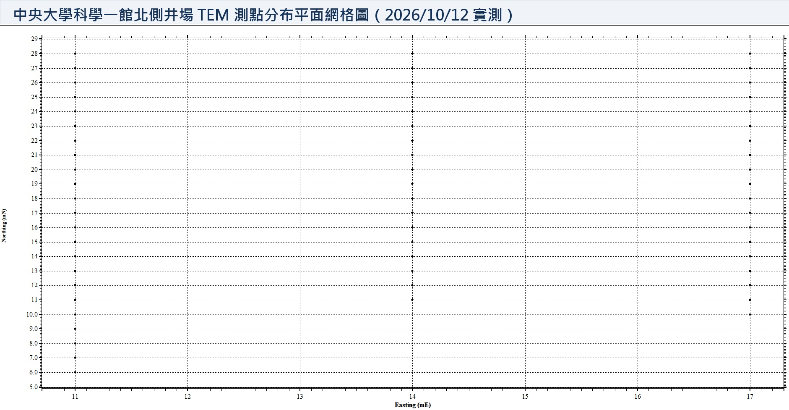 | 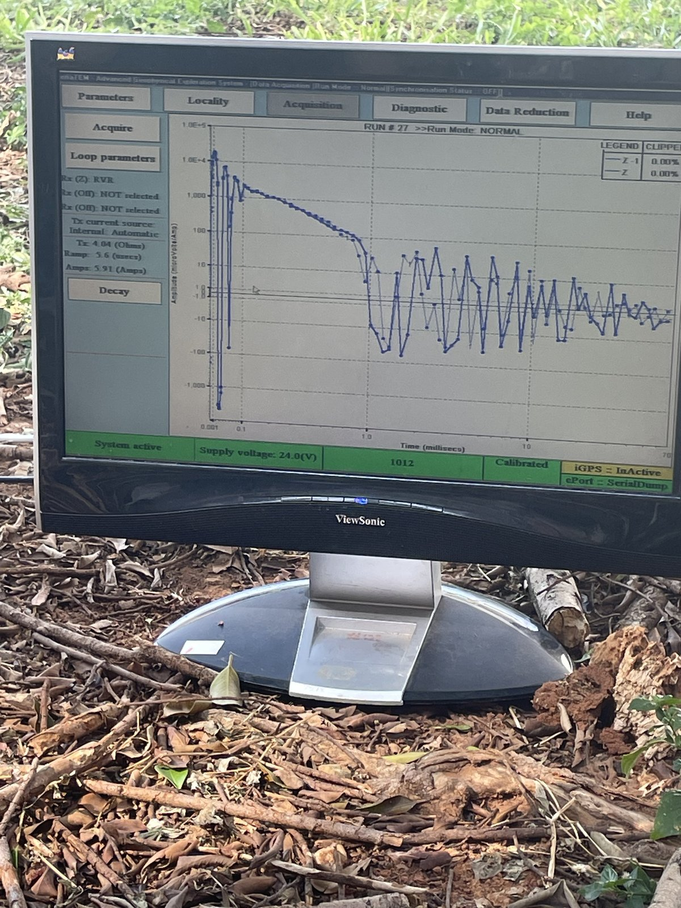 | 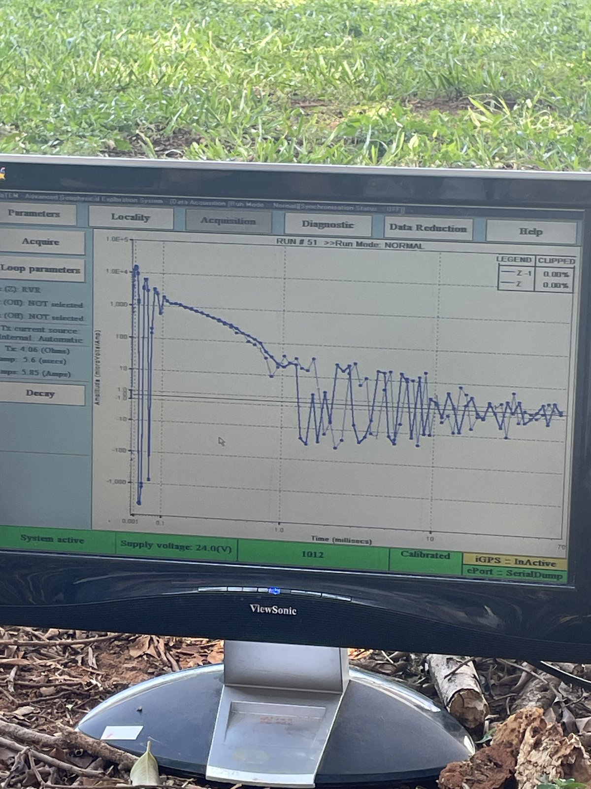 |
| **圖 3.2A　中大地下水井場 TEM 測點分布平面圖**：標註科一館草坪測區之空間網格坐標與觀測井相對位置，為連續剖面反演奠定基礎。 | **圖 3.2B　網格測點連續觀測（RUN #27）**：讀數 Tx: 4.04 Ω、Ramp: 5.6 μs、電流 5.91 A，前後兩次曲線重疊良好，資料可信度高。 | **圖 3.2C　地下水井場深部探測（RUN #51）**：讀數 Tx: 4.06 Ω、Ramp: 5.6 μs、電流 5.85 A，晚期時域階梯訊號清晰，穿透深度充裕。 |

---

### 3.3 各深度（Time Window）導電性分布反演與地下水層詮釋

#### 數據處理與時間閘門原理
TEM 採集到的暫態衰減電壓訊號，經由系統自動進行時間閘門積分分段（Window 分段，通常為 Window 1 至 Window 60）。在時間域中，Window 數值越小代表斷電後極早時間，對應淺部地層；Window 數值越大代表晚期時域，對應更深部擴散之電磁感應響應。

#### 反演圖層解讀與地質比對
圖 3.3 為中大地下水井場經一維/二維逆推（Inversion）後產生的各深度時間閘門導電性平面剖面分布圖（導電性良好/富水趨於紅色，電阻高/乾燥趨於藍色）。

1. **淺層特徵（小 Window 數值）**：地表至淺層多呈現中低導電之黃綠色至藍色分布，對應中大校園地表乾燥紅土夾礫石層，含水量較低。
2. **深部高導電異常（Window 39 ~ 48）**：隨著時間閘門向深部推展，在 **Window 39 至 Window 48** 間出現極為顯著且連續分佈的**高導電性紅區**。
3. **地質與水文詮釋**：此深部高導電紅區與科一館北側地下水觀測井之鑽井岩心柱狀圖（井誌）進行精確比對，其深度範圍正好對應到厚層透水砂礫石含水層（地下水面以下之飽和含水層）。因地下水中含有豐富解離離子，使得該層位呈現顯著的低電阻、高導電特徵。TEM 方法在免於打設接地電極的情況下，成功精確勾勒出校園地下水層的埋藏深度與橫向空間分布。

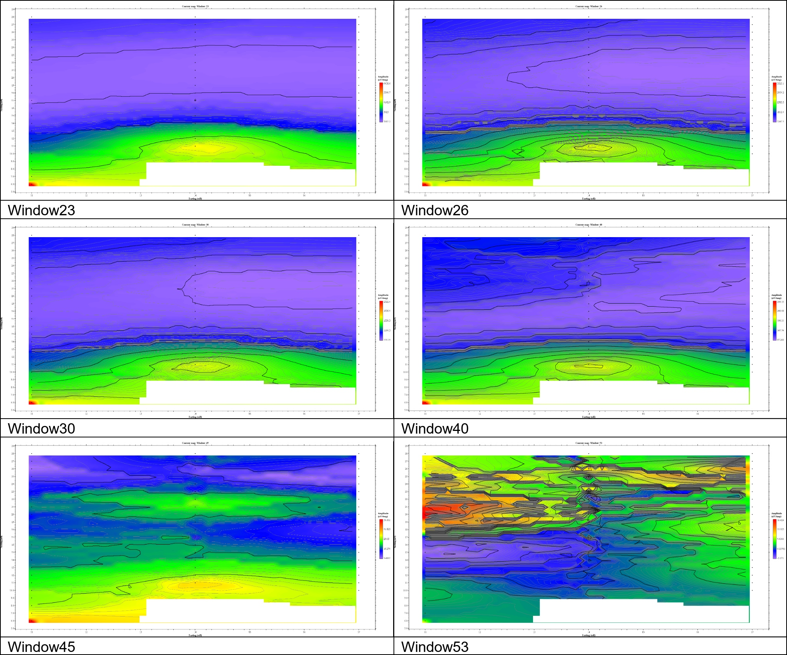

---

## 4. 實習心得與反思

這是我在通識地球物理課程中參與的第二次野外地電探勘實習。相較於前次地電直流法需要大家在草坪上費力敲打金屬電極棒、拉設數十公尺導線並灌注鹽水降低接觸電阻的勞動過程，本次交流暫態電磁法（TEM）展現了截然不同且更具科技感的探測思維——僅憑地表擺放的兩個感應線圈，就能穿透地表岩層探知數十公尺深的地下構造，令我深受啟發。

回顧 10 月 12 日實習當天，天候晴朗但帶有秋日微風，陽光穿透科學一館前老樹的枝葉灑在草坪上。在強烈的光影反差下，同學們圍在橘色儀器箱與 ViewSonic 外接螢幕旁（圖 4），一邊用手遮擋強光辨識螢幕上的衰減波形，一邊聆聽林老師講解電流關斷的瞬間微觀物理歷程。這種結合理論、現場數據與具體環境的學習氛圍，讓我對地球物理產生了多層次的理性反思：

第一，「時間換取深度」的物理直觀具象化。在電磁學教科書中，馬克士威方程組往往以抽象的微分形式存在；但在本次實驗中，我看著發射電流在 5.6 微秒內被強制歸零，隨後接收線圈在毫秒尺度上記錄下指數衰減的電壓波形，瞬間領悟到整個大地本質上就是一個巨大的電感與電阻並聯放電系統。早期時域的訊號反映淺層土壤，而晚期時域的訊號則來自於深部擴散的感應「煙圈」，這種透過記錄時間來解析深度維度的邏輯，是物理思維在工程探勘上的極致展現。

第二，物理模擬中的對比與反相驗證。在鋁板實驗中，當加入良導體鋁板時，原本單調衰減的波形在中晚期時域硬生生被拉出一座巨大的隆起波峰，而在雙層鋁板疊加時波峰衰減更慢，這極具視覺衝擊力地證明了導體厚度與二次場存續時間的物理正相關。更讓我驚豔的是將接收線圈移至發射線圈外側時，波形在螢幕上瞬間上下 180 度翻轉（反相），這讓過去在課堂上死記硬背的法拉第定律與磁力線回閉幾何，在眼前變成了生動的實驗事實。

第三，野外雜訊識別與資料解讀的審慎性。在金屬井蓋上的量測經驗是一堂極佳的批判性思考課程。井蓋與鋼套管激發的超強二次場徹底破壞了衰減曲線的正常結構，這讓我警醒到：地球物理儀器測得的數據「永遠是真實物理場的響應，但不一定是我們想探測的地質目標」。如果探勘人員盲目依賴反演演算法而忽視了現場環境中的鐵絲網、地下管線或井蓋干擾，將會得出完全錯誤的地質結論。

整體而言，從室內與走廊的物理模擬，到科學一館草坪上的網格實測，再到最後看見 Window 39~48 清楚映射出中大地下水脈的分布，這趟實習將課本理論、儀器訊號與真實地球完整串聯在一起。在大學生涯中能有這樣親手碰觸儀器、觀察暫態衰減、並理性推敲地底下看不見的世界之機會，是一次極具科學價值與思維啟發的珍貴體驗。

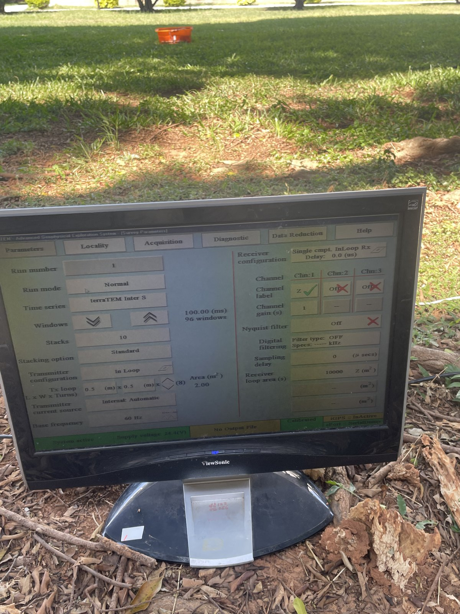

---

## 附錄：本次實習主要使用之照片清單與分類索引

為符合實習作業規格與資料查驗要求，下表整理本次報告中挑選使用之現場照片（皆取自 2026/10/12 實習現場實拍），依實驗流程分類並標註儀器讀數與物理意涵：

| 報告圖號 | 原始相片檔名 | 拍攝時間 | 所屬實驗章節 | 關鍵儀器讀數 / 物理對象 | 核心物理意義與前後關聯說明 |
| :---: | :---: | :---: | :---: | :---: | :---: |
| **圖 2.0A** | `20261012_042126578_iOS.jpg` | 04:21:26 | 2.0 實驗架設 | 科一館北側草坪、儀器箱、外接螢幕 | 實習整體環境全景，展示發射與接收系統佈設，為後續實驗之基石。 |
| **圖 2.0B** | `20261012_045402165_iOS.jpg` | 04:54:02 | 2.0 系統監控 | Tx: 4.04 Ω, Ramp: 5.8 μs, Amps: 5.98 A, 24.3 V | RUN #1 系統基準衰減曲線，呈現關斷暫態與大地基本背景衰減特徵。 |
| **圖 2.1A** | `20261012_051200034_iOS.jpg` | 05:12:00 | 2.1 導體對比 | 橘色線圈箱、單張良導體鋁板 | 導體物理模擬架設，藉由已知金屬板模擬地下強導電性目標物。 |
| **圖 2.1B** | `20261012_052148657_iOS.jpg` | 05:21:48 | 2.1 導體對比 | Tx: 16.38 Ω, Ramp: 62.3 μs, Amps: 1.47 A, 24.2 V | 導體激發出中晚期顯著波峰（隆起），證實良導體二次渦電流衰減緩慢。 |
| **圖 2.3A** | `20261012_054027267_iOS.jpg` | 05:40:27 | 2.3 鋁板增厚 | 老師現場講解、雙層鋁板重疊 | 導體增厚教學，倍增金屬幾何厚度以模擬地下導電構造層規模擴大。 |
| **圖 2.3B** | `20261012_052654914_iOS.jpg` | 05:26:54 | 2.3 鋁板增厚 | Tx: 16.38 Ω, Ramp: 72.0 μs, Amps: 1.47 A, 24.2 V | 單層（Z-1）與雙層（Z）疊圖比對，驗證厚導體在晚期時域衰減更為平緩。 |
| **圖 3.1A** | `20261012_050205748_iOS.jpg` | 05:02:05 | 3.1 實測對比 | 線圈箱置於地下水金屬井蓋正上方 | 檢驗近地表人為金屬強導體之強大屏蔽與暫態干擾效應。 |
| **圖 3.1B** | `20261012_050237579_iOS.jpg` | 05:02:37 | 3.1 實測對比 | RUN #3、金屬井蓋測點波形 | 金屬套管引起之早期過飽和跳變與波形嚴重畸變，確立排除干擾準則。 |
| **圖 3.1C** | `20261012_055519326_iOS.jpg` | 05:55:19 | 3.1 實測對比 | 開闊草坪測點、橘色線圈箱 | 移開金屬井蓋至均質地層上方，為地下水層探測提供真實天然背景。 |
| **圖 3.1D** | `20261012_060000053_iOS.jpg` | 06:00:00 | 3.1 實測對比 | Tx: 4.06 Ω, Ramp: 5.6 μs, Amps: 5.87 A, 24.0 V | RUN #15 標準地層階梯衰減曲線，為地下水反演分析提供高品質輸入。 |
| **圖 3.2B** | `20261012_060624286_iOS.jpg` | 06:06:24 | 3.2 網格實測 | Tx: 4.04 Ω, Ramp: 5.6 μs, Amps: 5.91 A, 24.0 V | RUN #27 連續網格施測，Z-1 與 Z 重複性極佳，確認大地耦合穩定度。 |
| **圖 3.2C** | `20261012_061450789_iOS.jpg` | 06:14:50 | 3.2 網格實測 | Tx: 4.06 Ω, Ramp: 5.6 μs, Amps: 5.85 A, 24.0 V | RUN #51 深部探測數據，晚期階梯信號清晰，確認探測深度達到含水層。 |
| **圖 4** | `20261012_042215859_iOS.jpg` | 04:22:15 | 4 心得反思 | 同學圍觀儀器、即時討論數據 | 實地操作、數據討論與反思之真實寫照，印證理論與實作結合之價值。 |

