# 通識地球物理：地電直流法實習心得報告

---

地電探勘是藉由量測地表上之電磁場，以導出與地下有關之參數，其中最常使用的參數為電阻率 ρ（rho）。本次實習採用直流電法量測電阻率 ρ，此方法可用於描繪地下深層結構、尋找地下水層、偵測礦脈分布，以及了解地質構造等。以下依實驗順序，分別記錄「直流電阻測深法」、「非極化電極」與「樹根之生物電位」三部分的實驗過程、數據與觀察心得。

---

## 1. 直流電阻測深法

### 1.1 實驗架設

本實驗採用四電極法（Four-electrode method），以電源供應器產生直流電流，透過電流極（Current electrodes, A 與 B）將電流注入地下，再由電壓極（Potential electrodes, C 與 D）量測地表電位差。量測到的電壓 V 與電流 I 送入電腦端的數位三用電表（Digital Multi-Meter）軟體進行即時記錄與歸算。

現場的儀器架設包含以下主要設備：
- **電源供應器**（Phoenix 品牌，白色箱體）：負責產生穩定的直流電流並送入地下
- **數位三用電表（DMM）**：透過 USB 介面與筆記型電腦連線，即時擷取電壓、電流數值
- **筆記型電腦與外接螢幕**：用於顯示量測軟體介面，即時監控電壓（藍色 CH1）、電流（紅色 CH2）與視電阻率（綠色 CH1×CH2）三組數值
- **電極棒與導線**：金屬電極棒插入地面，以鱷魚夾與導線連接至儀器

圖 1 為實驗儀器的整體架設情形，可以看到筆記型電腦放置在橘色防水儀器箱上，外接 ASUS 螢幕放在一旁，螢幕上正顯示即時量測軟體的介面，電源供應器（白色箱體）擺放在青色塑膠托盤上，各設備之間以導線相互連接。

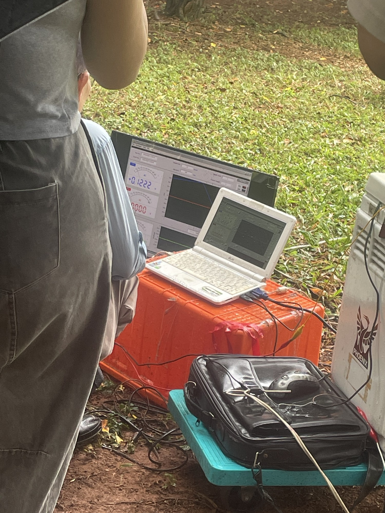

圖 2 為另一個角度拍攝的現場全景，可以看到電源供應器上方有紅色端子接線，老師手持麥克風正在向同學們講解實驗原理與操作步驟，旁邊地面上散佈著連接至遠處電極的導線。

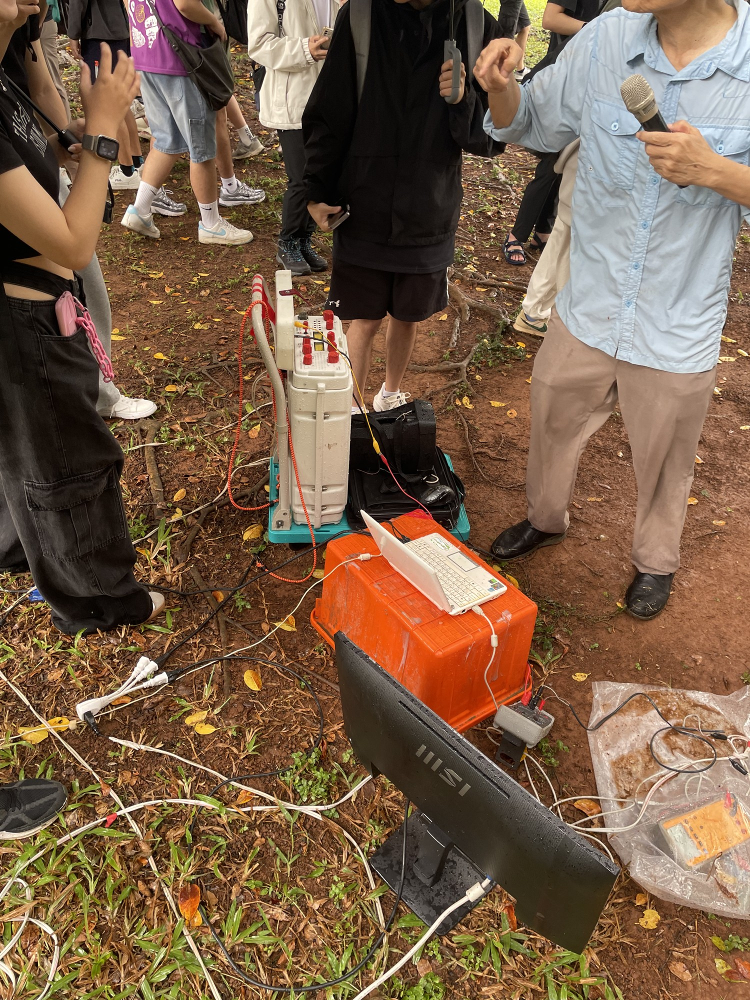

圖 3 為現場教學情境，老師蹲在儀器旁操作，同學們撐傘圍觀（當日有間歇性陣雨），可以感受到戶外實習的真實氛圍。

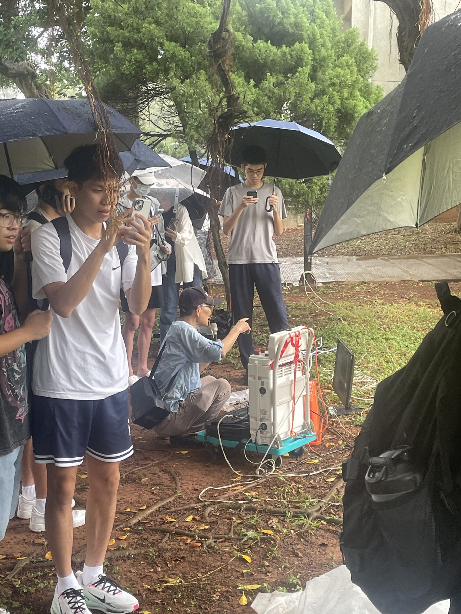

圖 4 與圖 5 分別為電壓極與電流極的佈置情形。電壓極（圖 4）使用金屬電極棒插入草地中，以鱷魚夾連接導線回到儀器端，兩支電壓極相距較近，佈置於測線內側。電流極（圖 5）同樣為金屬棒，但佈置於測線外側，距離中心點較遠。

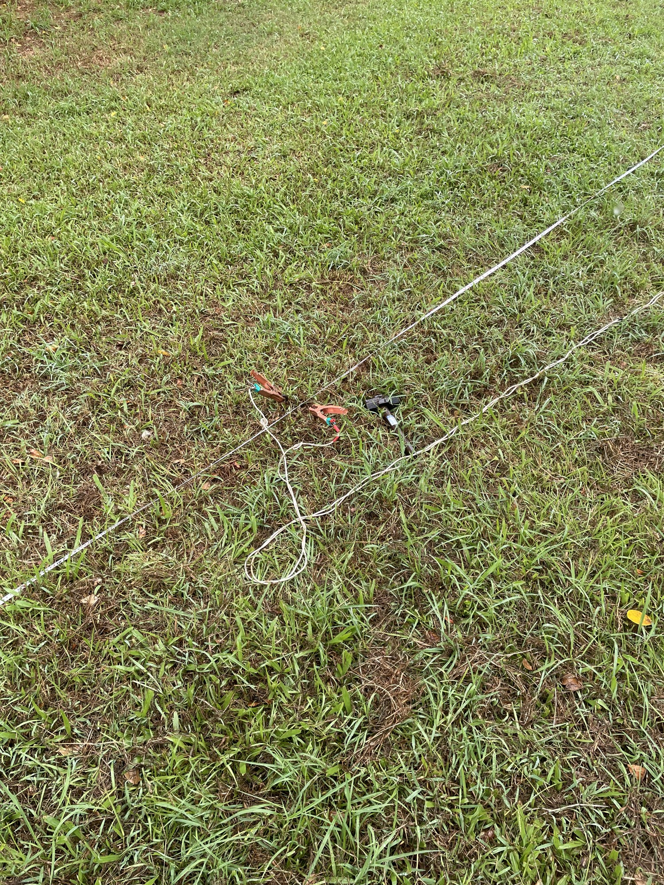

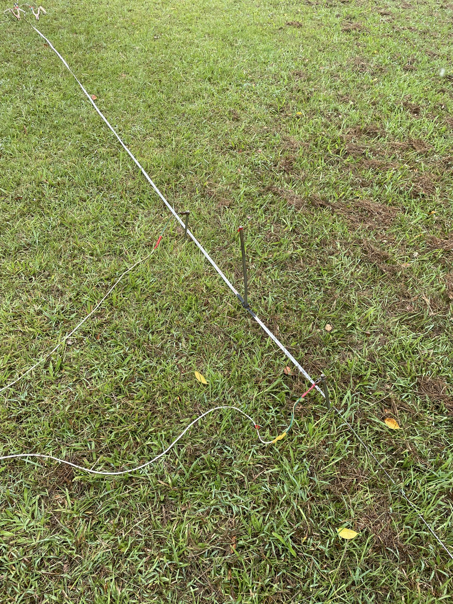

### 1.2 實驗原理

根據四電極排列法，當電流極展距 L 較小時，電流線集中分布於淺層，量測到的是淺層訊號；當 L 增大時，電流線向下層擴散，此時量測到的訊號來自更深處，此即「大展距測深」（Schlumberger sounding）的核心概念。因此，藉由系統性地改變電流極距離，即可量測到不同深度的視電阻率 ρₐ（apparent resistivity），其計算公式為：

> **ρₐ = (V / I) × K**
>
> 其中 K 為幾何因子：**K = 2π / [(1/r_AC − 1/r_CB) − (1/r_AD − 1/r_DB)]**

### 1.3 實驗結果

**尚未通電時的觀測：**

圖 6 為尚未送電時的螢幕畫面。此時可以觀察到電壓欄（藍色 CH1）顯示 **+0.1165 V**，而電流欄（紅色 CH2）與電阻率欄（綠色）皆顯示 **+0.0000**，表示尚未注入人工電流。值得注意的是，雖然未送電，電壓仍有約 0.12 V 的讀數，這就是地下本身存在的**自然電位（Self Potential, SP）**，可能來源包括地下水流動產生的流動電位、礦物氧化還原反應、或樹根等生物活動所致。

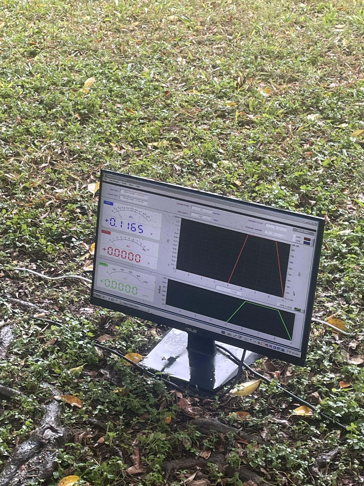

**通電量測時的觀測：**

施測時固定電壓極位置，逐步改變電流極展距，分別為 25 m、20 m、18 m、15 m、12 m、10 m、8 m 及 5 m 等多組展距。各展距量測一組電壓、電流值，再依歐姆定律及幾何因子歸算其視電阻率。

圖 7 與圖 8 分別為兩組不同展距下的量測畫面。圖 7 顯示電壓（藍色）為 **+088.07 V**、電流（紅色）為 **+1.3034 A**，歸算視電阻率（綠色）為 **114.79 Ω·m**；右方波形圖中，紅色線呈現 V 字型的正反向電流切換波形，綠色線呈現對應的方波電壓響應。圖 8 為另一組展距的量測結果，電壓為 **+088.20 V**，電流為 **+1.3041 A**，視電阻率為 **115.02 Ω·m**，兩組數據非常接近，顯示量測的重複性良好。

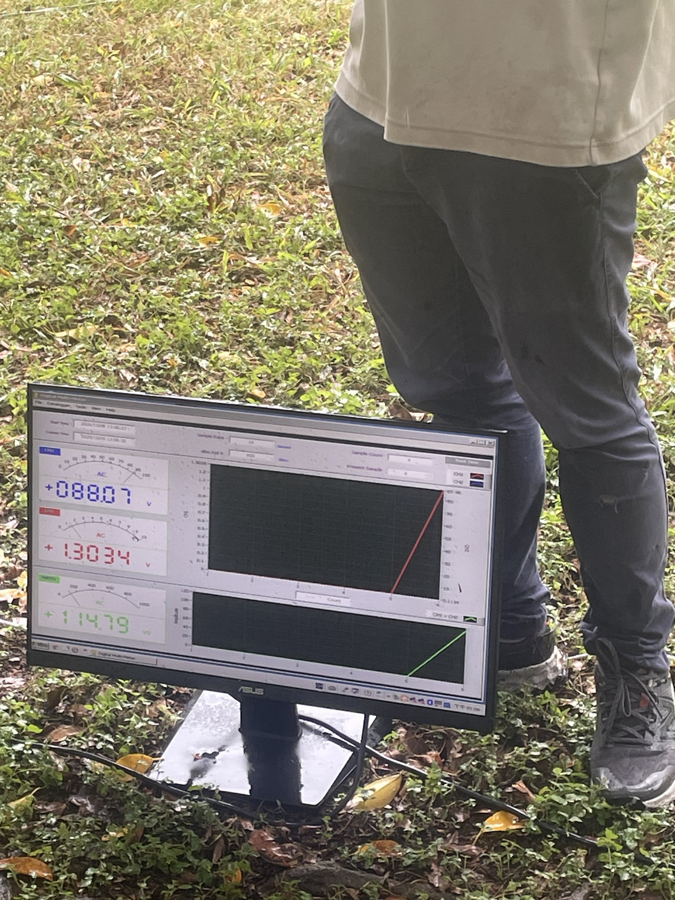

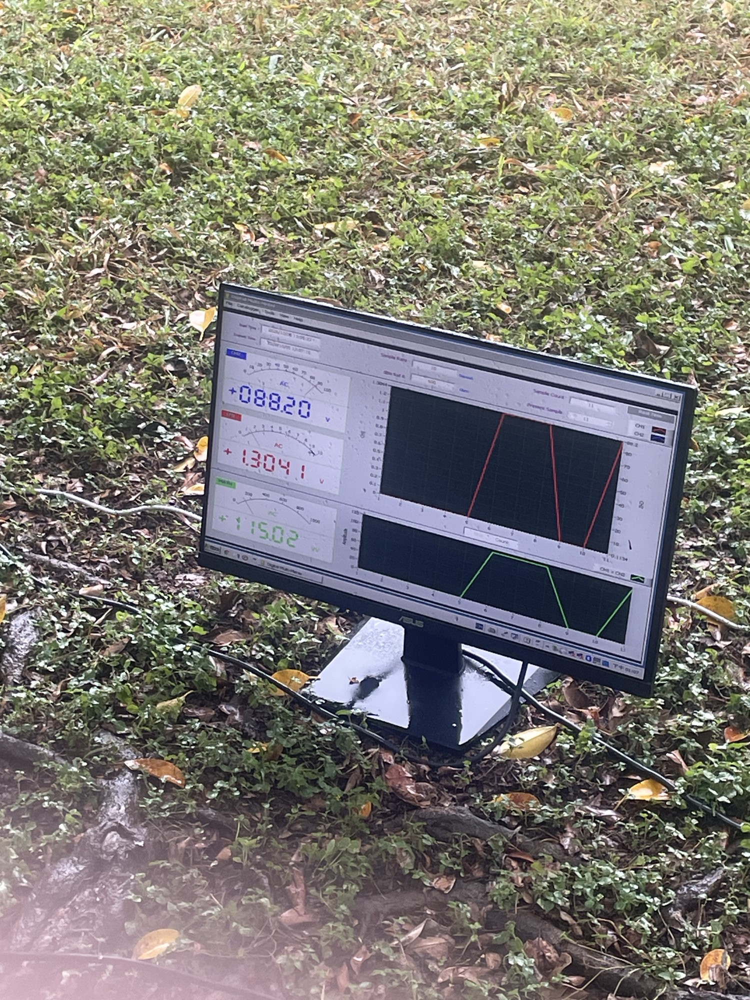

---

## 2. 非極化電極

### 2.1 實驗原理與架設

金屬電極棒插入含水土壤時，會因金屬離子與土壤水中離子之間的氧化還原反應而產生**極化現象**（Polarization），形成接觸電位差，其數值通常在 mV 甚至 μV 等級。在前述直流電阻法施測中，由於主動注入的電流所產生之電位（數十至數百伏特）遠大於極化電位，因此極化效應造成的誤差可以忽略不計。

然而，若要精確量測地下的微弱自然電位（如礦體電位、地下水流電位、生物電位等，其量值約在 mV 等級），使用一般金屬電極就會產生不可忽略的極化誤差。此時必須使用**非極化電極**（Non-polarizable electrode），其構造為銅棒浸泡在飽和硫酸銅溶液（CuSO₄）中（或鉛棒浸泡在飽和氯化鉛溶液 PbCl₂ 中），透過離子交換機制消除接觸極化效應。

### 2.2 實驗結果

圖 9 顯示非極化電極量測實驗的螢幕畫面。此時電壓（藍色）讀數為 **+0.1203 V**，電流與電阻率欄位仍為零（因為此階段不主動送電）。右側波形圖中，紅色線呈現清晰的鋸齒形波動——這正是非極化電極一開始接觸溶液時的**暫態極化反應**：溶液離子與電極表面產生初始的化學反應，造成電位震盪；隨著反應趨於平衡，極化效應逐漸被抵銷，波形幅度漸減，最終電壓讀數趨於穩定值。

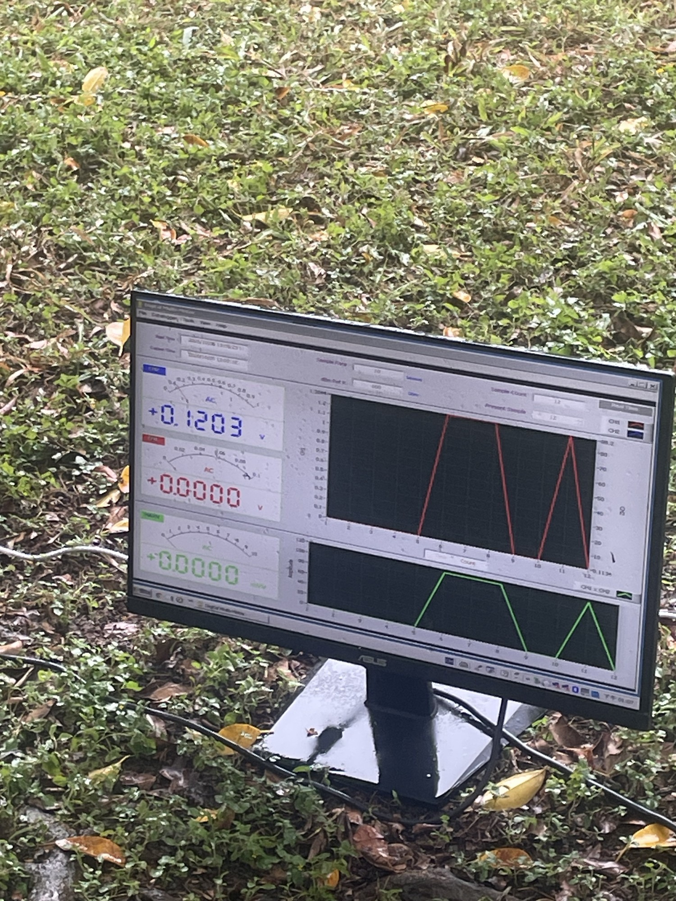

圖 10 為實驗持續進行一段時間後的畫面，電壓讀數穩定在 **+0.1257 V**，右側紅色波形已轉變為相當規則的**方波形狀**，表示極化效應已完全被抵銷，量測值趨於穩定。下方綠色波形亦呈現整齊的方波，代表電壓與電流的對應關係已達穩態。這個從「鋸齒暫態→方波穩態」的過程，具體展示了非極化電極消除極化效應的實際效果。

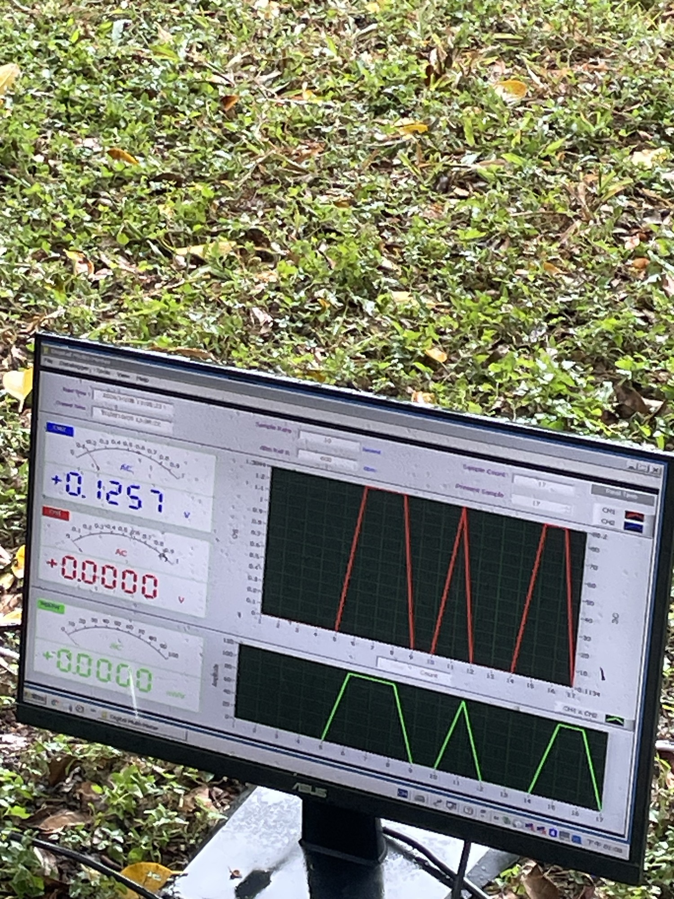

---

## 3. 樹根之生物電位

### 3.1 實驗原理與架設

植物根系在進行養分吸收、水分輸送等生理代謝活動時，會與周遭土壤環境產生離子交換，進而形成**生物電位**（Bio-potential）。本實驗選擇校園內一棵榕樹，由主幹向兩側依序移動量測電位值，量測間距為 1 m，每個量測位置均須埋設非極化電極以確保量測精度。

### 3.2 實驗結果

圖 11 為靠近樹幹位置的量測畫面，電壓讀數為 **+0.3089 V**，明顯高於前述遠離樹幹處的自然電位值（約 0.12 V）。右側紅色波形呈現特殊的脈衝式訊號——短暫的尖峰脈衝之後回到基線——這反映了樹根處的生物電化學活動具有間歇性特徵。下方綠色波形亦呈現對應的脈衝式變化。

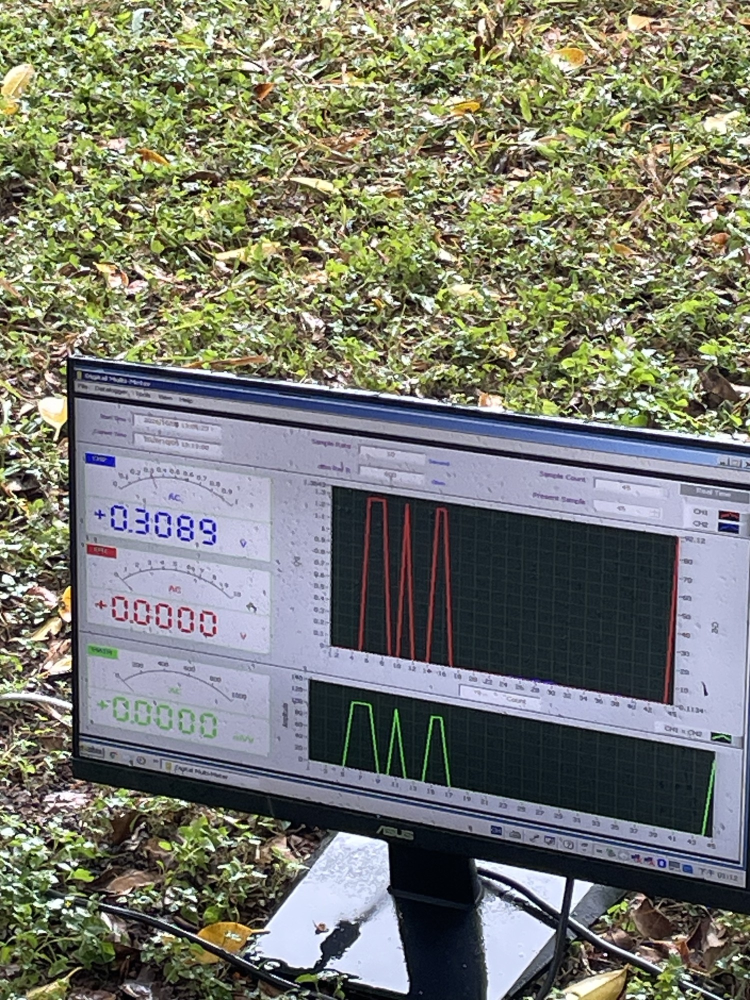

圖 12 與圖 13 為不同展距配合生物電位量測時的螢幕畫面，分別顯示了不同深度層位對應的電壓與電阻率變化。圖 12 中電壓為 **+098.69 V**、電流為 **+1.4681 A**、視電阻率為 **144.88 Ω·m**；圖 13 中電壓為 **+098.89 V**、電流為 **+1.0042 A**、視電阻率為 **99.305 Ω·m**。兩組數據在電壓相近的情況下，因電流不同而導致電阻率出現差異，可能與不同深度的地質結構（如紅土層含水量差異）有關。

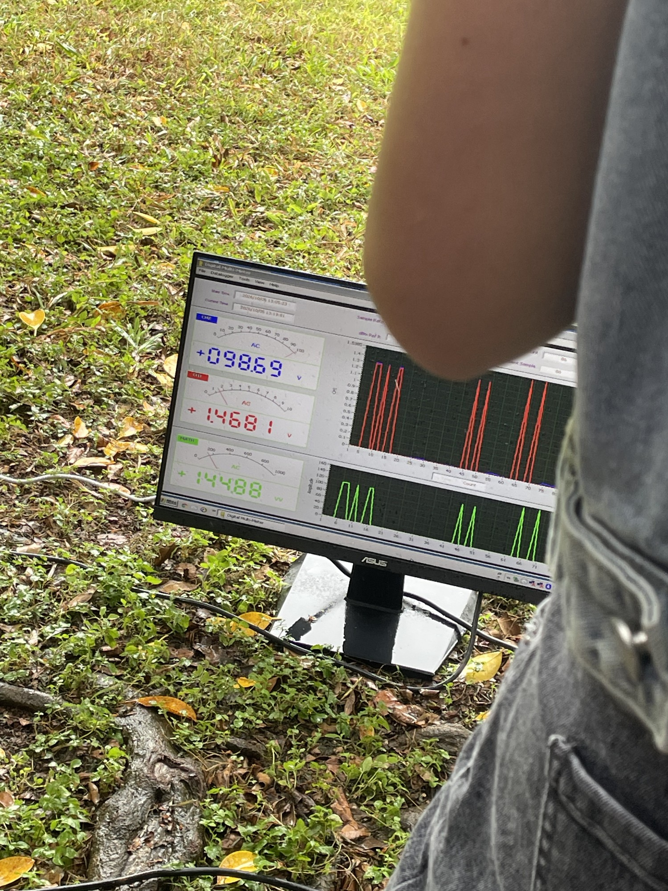

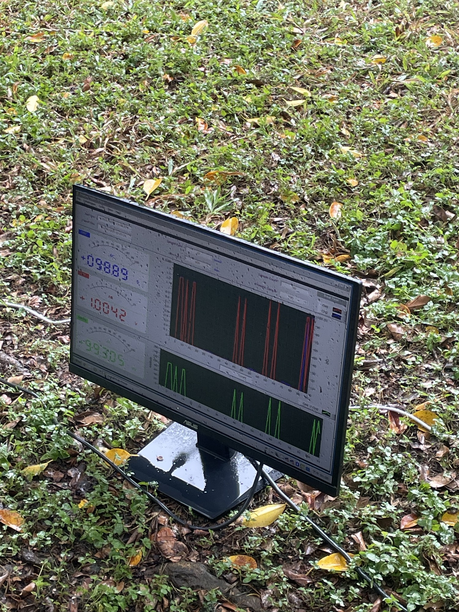

觀察結果顯示：**越靠近樹幹位置之根部，其電位值越大**，這與樹根在主幹附近的密度較高、生理代謝活動較旺盛的預期一致。

---

## 4. 心得

這次地電直流法的校園實習，讓我對於「如何用電學方法探測地下結構」有了從理論到實務的完整認識。在課堂上學到的歐姆定律與電阻率概念，透過實際將電極棒插入草地、注入電流、再從螢幕上即時看到數據的跳動，變得具體而真實。

最讓我印象深刻的有兩個部分。第一是「自然電位」的概念——在尚未送電的情況下，螢幕上就已經有約 0.12 V 的電壓讀數，這讓我理解到地底下其實一直存在著由地下水流動、礦物分解等自然過程所驅動的微弱電場。第二是非極化電極的實驗，從螢幕上能夠清楚看到波形從一開始的鋸齒暫態逐漸收斂到穩定方波的過程，這不只是教科書上的理論描述，而是真的能夠用眼睛觀察到「極化效應被消除」的物理現象，對我而言是很有說服力的科學展示。

此外，樹根生物電位的量測也帶給我不小的衝擊。在實驗前，「生物電位」對我而言只是一個抽象名詞；但在實驗中，當非極化電極逐步靠近榕樹主幹時，電壓值確實逐漸攀升，讓我意識到植物的根系其實時時刻刻都在與土壤進行離子交換、吸收養分，這些看不見的化學活動竟然能透過地球物理的量測手段被偵測到，令人深感自然現象之間的相互關聯。

整體而言，這次實習的天氣雖然不太理想（陣雨斷斷續續），但老師仍堅持帶我們完成所有實驗環節。在雨中撐傘操作儀器的過程反而讓我對「野外工作」有了更務實的體會——地球科學的研究不是在實驗室裡就能完成的，許多資料必須在現場取得，而現場的條件往往不盡如人意。這種對不確定性的耐受力，或許也是地球物理學訓練中重要的一環。
