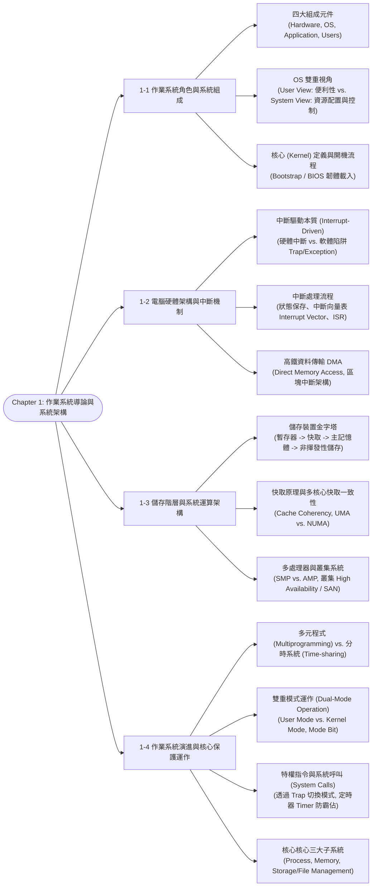

# Chapter 1: Operating System Introduction & System Structure

> 📚 **課程名稱**：作業系統 (Operating Systems)  
> 📖 **對應章節**：Chapter 1 OS Introduction (What OS Does ~ Kernel Data Structures)  
> 👨‍🏫 **授課教師**：NCU CSIE / IM 恐龍書經典教材體系  
> 📄 **參考講義**：[OS-ch01.ppt](file:///c:/Users/Cupid/Downloads/Study-space/Reference/NCU_Classes/作業系統/OS-ch01.ppt)  
> 🔖 **先修觀念**：計算機概論、組合語言基本概念（暫存器、程式計數器 PC、堆疊）、C 語言指標

---

## 🗺️ 知識架構心智圖 (Mermaid Tree Diagram)



<a id="tree-diagram"></a>

### 🎯 本章學習進度檢核 (完成後打勾，建立成就反饋)

- [ ] [1-1 作業系統角色與系統組成](#sec-1)
- [ ] [1-2 電腦硬體架構與中斷機制](#sec-2)
- [ ] [1-3 儲存階層與系統運算架構](#sec-3)
- [ ] [1-4 作業系統演進與核心保護運作](#sec-4)

---

## 📖 核心觀念與理論精解

<a id="sec-1"></a>

### 1-1 作業系統的角色與系統架構

作業系統（Operating System, OS）是作為**電腦硬體與電腦使用者之間的媒介程式（Intermediary Program）**。其首要核心目標包含：

1. 協助使用者更方便地執行使用者程式並解決實際運算問題。
2. 讓電腦系統具備友善、直覺且方便的使用介面（Convenience）。
3. 以高效率且公正的方式使用電腦硬體資源（Efficiency）。

#### 1. 電腦系統的四大構成要素

```
       ┌────────────────────────────────────────────────────────┐
       │                   使用者 (Users)                       │
       │           (程式設計師、一般大眾、其他聯網主機)         │
       └───────────────────────────┬────────────────────────────┘
                                   │ 操作
       ┌───────────────────────────▼────────────────────────────┐
       │             應用程式 (Application Programs)             │
       │         (文字編輯器、編譯器、Web瀏覽器、資料庫)        │
       └───────────────────────────┬────────────────────────────┘
                                   │ 呼叫 API / 系統呼叫
       ┌───────────────────────────▼────────────────────────────┐
       │                 作業系統 (Operating System)             │
       │              (統籌、排程與控制硬體資源使用)            │
       └───────────────────────────┬────────────────────────────┘
                                   │ 控制與驅動
       ┌───────────────────────────▼────────────────────────────┐
       │                    硬體 (Hardware)                     │
       │                 (CPU、記憶體、I/O 裝置)                │
       └────────────────────────────────────────────────────────┘
```

#### 2. 作業系統的雙重視角 (Views of OS)

* **使用者觀點 (User View)**：
  * 個人電腦（PC）使用者：追求**最大便利性（Convenience）與即時互動反應**，不在乎資源利用率（Resource Utilization）。
  * 伺服器主機使用者：追求多使用者之間的**公平資源分配（Fairness）**與滿意度。
  * 嵌入式 / 手持裝置使用者：追求**續航力（電池最佳化）、輕量與可用性**。
* **系統觀點 (System View)**：
  * **資源配置者 (Resource Allocator)**：硬體資源（CPU 時間、記憶體空間、I/O 通道、檔案儲存）有限，面對眾多競爭程式的衝突請求，OS 必須公正、有效率地仲裁分配。
  * **控制程式 (Control Program)**：監控與掌控程式執行，防止錯誤操作（如存取未授權記憶體）以及硬體不當濫用。

#### 3. 核心 (Kernel) 定義與電腦開機程序 (Bootstrap Process)

* **什麼是作業系統？** 電腦科學界普遍公認的精確定義為：  
  > **核心 (Kernel)** 是**電腦開機後無時無刻都在記憶體中常駐運行的單一核心程式（The one program running at all times on the computer）**。其他附帶的工具程式稱為系統程式（System Programs）或應用程式（Application Programs）。
* **電腦啟動流程 (Startup / Booting)**：
  1. 電腦通電或重新啟動（Reboot）時，CPU 自動自特定固定位址執行 **Bootstrap Program（初始導引程式）**。
  2. 該程式儲存於非揮發性唯讀記憶體中（ROM 或 EPROM，即傳統的 **BIOS** 或現代 **UEFI** 韌體 Firmware）。
  3. Bootstrap 程式負責執行自我檢測（POST）、初始化所有硬體暫存器與控制器。
  4. 從硬碟的引導磁區（Boot Sector）將作業系統核心載入主記憶體，並跳轉至核心入口點，啟動第一個使用者行程（如 Linux 的 `init` 或 `systemd`）。

---

<a id="sec-2"></a>

### 1-2 電腦硬體架構與中斷機制 (Interrupts & DMA)

現代作業系統本質上是**中斷驅動（Interrupt Driven）**的。如果系統沒有程式要跑，也沒有硬體事件發生，OS 會進入閒置狀態（Idle），靜候下一個中斷事件觸發。

#### 1. 中斷分類：硬體中斷 vs. 軟體陷阱

* **硬體中斷 (Hardware Interrupt)**：由外部硬體裝置（如鍵盤按下、網路封包抵達、硬碟讀取完成）透過發送電器訊號至系統匯流排所引發。
* **軟體中斷 (Trap / Exception / 軟體陷阱)**：由軟體執行過程中所產生的中斷事件，主要包含：
  1. **運算錯誤 (Error)**：如除以零（Division by zero）、記憶體非法越界（Segmentation Fault）。
  2. **作業系統服務請求 (User Request)**：使用者程式主動呼叫 **系統呼叫 (System Call)** 請求核心服務（如讀檔 `read()`、開檔 `open()`）。

#### 2. 中斷處理完整流程 (Interrupt Handling Process)

1. 硬體控制器觸發中斷線，CPU 暫停目前正在執行的指令。
2. **保存現場 (State Preservation)**：硬體架構立即將被中斷程式的狀態（包含**程式計數器 Program Counter (PC)** 以及當前**暫存器狀態**）壓入核心堆疊（Kernel Stack）。
3. **分發中斷 (Dispatching)**：
   * 透過 **中斷向量表 (Interrupt Vector Table)**：這是一張常駐在記憶體低位址的指標陣列，存放各個中斷型號所對應的 **中斷服務常式 (Interrupt Service Routine, ISR)** 的起始記憶體位址。
   * CPU 根據中斷號碼查表，直接跳轉至相應的 ISR 執行。
4. **執行 ISR**：完成特定的硬體資料轉移或狀態更新。
5. **恢復現場 (State Restoration)**：執行完成後，還原先前保存的暫存器與 PC，CPU 恢復執行原先被中斷的程式。

#### 3. 直接記憶體存取 (DMA, Direct Memory Access)

* **傳統中斷 I/O 困境**：對於高速傳輸裝置（如磁碟機、千兆網卡），如果每讀取一個位元組（Byte）就引發一次 CPU 中斷，CPU 將完全被中斷處理淹沒，無法處理常態運算。
* **DMA 機制**：
  * 為高速裝置配置專用的 **DMA 控制器**。
  * CPU 僅需向 DMA 發出一次傳輸指令（提供：來源位址、目的位址、傳輸位元組大小）。
  * **DMA 控制器直接在週邊裝置緩衝區與主記憶體之間大批量搬移資料塊，全程無需 CPU 介入**。
  * **整塊資料（Block）傳輸完成後，DMA 僅引發一次中斷（One interrupt per block）** 通知 CPU。

---

<a id="sec-3"></a>

### 1-3 儲存階層、多處理器與叢集系統架構

#### 1. 儲存階層金字塔 (Storage Hierarchy)

電腦儲存系統依「存取速度、每位元成本、容量大小、揮發性」形成嚴謹的金字塔層次架構：

```
                    ▲  [ 暫存器 Registers ]    (最快、成本最高、容量最小、揮發性)
                   / \
                  /   \  [ 快取記憶體 Cache ]   (L1 / L2 / L3 快取，SRAM)
                 /     \
                /       \  [ 主記憶體 Main Memory ] (DRAM，CPU可直接定址，揮發性)
               /─────────\
              /           \  [ 固態硬碟 Solid-State Disk ] (快閃記憶體，非揮發性)
             /             \
            /               \  [ 傳統機械硬碟 Magnetic Disks ] (磁軌與磁區，非揮發性)
           /─────────────────\
          /                   \  [ 光學光碟 / 磁帶 Optical & Tape ] (第三級儲存，極慢)
```

#### 2. 快取原理與快取一致性 (Caching & Cache Coherency)

* **快取原理**：將近期最常被存取的資料從低速儲存體暫存至高速快取中。當 CPU 欲讀取資料時，先檢查快取（Cache Hit 則立即高速回傳；Cache Miss 則從主記憶體複製到快取再傳給 CPU）。
* **快取一致性 (Cache Coherency)**：
  * 在多核心 / 多處理器環境中，每個 CPU 核心各自擁有獨立的 L1/L2 快取。
  * 若 CPU-A 在其本地快取中修改了變數 $X$（例如由 5 改為 10），若尚未寫回主記憶體，而 CPU-B 試圖讀取其本地快取中的 $X$（依然為舊值 5），就會造成嚴重的資料衝突！
  * **硬體架構必須提供快取一致性協定（如 MESI 協定）**，確保任一處理器更新資料時，其他處理器快取中的同一副本立即失效或同步更新。

#### 3. 對稱多處理 (SMP) vs. 非對稱多處理 (AMP)

* **對稱多處理 (Symmetric Multiprocessing, SMP)**：
  * 所有處理器地位完全平等，共同共享系統匯流排與主記憶體。
  * 每個處理器皆能運行作業系統核心程式碼與使用者應用程式，是現代作業系統（Windows, Linux, macOS）的絕對主流標準。
* **非對稱多處理 (Asymmetric Multiprocessing, AMP)**：
  * 主從架構（Master-Slave）：由單一「主處理器（Master）」負責執行作業系統核心並分配工作，其餘「從處理器（Slave）」僅負責執行指派的使用者運算。

#### 4. 叢集系統 (Clustered Systems)

* 由多台完全獨立的主機（Nodes）透過高速網路與**儲存區域網路 (Storage-Area Network, SAN)** 連結而成的鬆散耦合系統（Loosely-coupled）。
* 核心目標：**高可用性 (High Availability, HA)**。即使其中一台節點硬體損毀，服務可自動容錯轉移（Failover）至其他節點。
* **架構形式**：
  * **非對稱叢集 (Asymmetric Clustering)**：一台主機處於熱備援模式（Hot-standby），不處理常態業務，僅待命監控作用中主機。
  * **對稱叢集 (Symmetric Clustering)**：所有主機同時運行應用程式並相互監控，資源利用率最高。

---

<a id="sec-4"></a>

### 1-4 作業系統演化與核心保護操作 (Dual-Mode & System Calls)

早期的批次系統單一時刻僅能執行單一程式，當該程式進行漫長慢速的 I/O 等待時，高昂的 CPU 完全處於閒置浪費狀態。

#### 1. 多元程式規劃 vs. 分時多工系統

| 比較特性 | 多元程式規劃 (Multiprogramming) | 分時系統 (Time-sharing / Multitasking) |
| :--- | :--- | :--- |
| **誕生主要目標** | **極大化 CPU 使用率 (Maximize CPU Utilization)** | **最小化互動回應時間 (Minimize Response Time < 1s)** |
| **工作切換時機** | 當目前執行的 Job **必須等待 I/O** 時，OS 才切換給另一個 Job | 依據**微小時間片（Time Quantum）**強制高頻率切換（排程輪轉） |
| **使用者互動性** | **無互動性**（純批次處理，丟入工作後等候輸出） | **具備高度即時互動性 (Interactive Computing)** |
| **行程存在形式** | 多個 Job 同時載入記憶體中 | 多個使用者同時在線上，每位使用者至少有一個活躍行程 |
| **虛擬記憶體需求** | 基礎保護與分區 | 強烈需要**虛擬記憶體 (Virtual Memory)** 支援行程換入換出 |

#### 2. 雙重模式運作 (Dual-Mode Operation)

為確保作業系統不受惡意或錯誤的使用者程式摧毀，現代 CPU 硬體必須提供**模式位元 (Mode Bit)** 支援雙重模式運作：

* **使用者模式 (User Mode, Mode Bit = 1)**：執行一般應用程式。CPU 會攔截並禁止執行可能危及系統安全的指令。
* **核心模式 (Kernel Mode / Supervisor / Privileged Mode, Mode Bit = 0)**：作業系統核心代碼執行的模式，擁有存取全部硬體與記憶體的完全特權。

```
              使用者模式 (User Mode: Mode Bit = 1)
        ┌────────────────────────────────────────────────────────┐
        │ 使用者程式執行: 呼叫 printf() -> 觸發 write() 系統呼叫 │
        └───────────────────────────┬────────────────────────────┘
                                    │ 1. 執行 Trap 指令
                                    │ 2. 硬體將 Mode Bit 切換為 0
              核心模式 (Kernel Mode: Mode Bit = 0)
        ┌───────────────────────────▼────────────────────────────┐
        │ OS 核心接管: 查 System Call Table, 執行 sys_write()    │
        │ 存取終端機或磁碟硬體                                   │
        └───────────────────────────┬────────────────────────────┘
                                    │ 3. 執行 Return-from-trap
                                    │ 4. 硬體將 Mode Bit 重設為 1
              使用者模式 (User Mode: Mode Bit = 1)
        ┌───────────────────────────▼────────────────────────────┐
        │ 使用者程式自系統呼叫返回，接續執行下一道指令           │
        └────────────────────────────────────────────────────────┘
```

#### 3. 特權指令 (Privileged Instructions)

特權指令是指**可能損害系統完整性、竄改記憶體配置或獨佔週邊硬體的特殊指令**。CPU 規定**特權指令僅允許在核心模式（Kernel Mode）下執行**！若在 User Mode 下擅自嘗試執行特權指令，CPU 硬體會立即引發 Trap 異常，OS 隨即強制終止（Abort）該惡意程式。

* **常見特權指令清單**：
  * 修改模式位元（Mode Bit）或停用/啟用中斷（Disable/Enable Interrupts）。
  * 載入基底暫存器（Base Register）或限制暫存器（Limit Register）以變更記憶體對映。
  * 執行直接 I/O 指令（如 x86 的 `in`, `out`）。
  * 設定硬體定時器（Timer）。
  * 清除主記憶體或停機（Halt 指令）。

#### 4. 定時器 (Timer) —— 防止無窮迴圈的終極守護者

* 若一個使用者程式寫入無窮迴圈（如 `while(1);`），若無硬體防護，CPU 將永遠無法回到作業系統手中！
* **防禦機制**：OS 在將 CPU 控制權交給使用者程式之前，**必定先設定硬體定時器（Set Timer）**。定時器隨時間遞減計數，一旦數值歸零，定時器自動觸發硬體中斷，強制奪回 CPU 控制權，確保 OS 擁有終極主導權。

---

## 💻 經典架構流程演算詳解

<a id="sec-5"></a>

### 範例：從使用者空間發動系統呼叫的完整低階追蹤

以 C 語言呼叫 `read(fd, buffer, nbytes)` 為例：

1. **使用者空間包裝函式 (API Wrapper)**：標準 C 程式庫（glibc）將系統呼叫代號（如 x86_64 架構下 `SYS_read` 為 0）填入暫存器 `rax`，並將引數填入 `rdi`, `rsi`, `rdx`。
2. **觸發軟體陷阱**：執行組合語言指令 `syscall`（或舊式 `int 0x80`）。
3. **硬體狀態跳轉**：
   * CPU 硬體自動將當前執行緒的狀態（PC, SP, Flags）儲存至核心堆疊。
   * **硬體將 Mode Bit 由 1 改為 0**（切入核心模式）。
   * CPU 跳轉至預先註冊在 MSR 暫存器的核心系統呼叫分發器位址（System Call Handler）。
4. **核心執行服務**：分發器根據 `rax` 的系統呼叫號碼，查閱系統呼叫表（System Call Table），跳轉至對應核心實作函式 `sys_read()`。
5. **返回使用者空間**：
   * 核心將讀取結果填入 `rax`。
   * 執行特權指令 `sysret`（或 `iret`）。
   * **硬體自動將 Mode Bit 由 0 改回 1**，恢復使用者堆疊與暫存器，程式接續執行。

---

## 📝 實戰練習題 (三層遞進式強化測驗)

### 🟢 Tier 1：必懂基礎 (Must-Know Fundamentals)

> 💡 **學習目標**：確認自己「會算、會辨識」——給數字就能做對、給名稱就能配對。

<a id="q1"></a>

#### Q1. (基礎模式切換) 雙重模式 (Dual-Mode) 與 Mode Bit 轉換

現代作業系統為了防止使用者程式破壞系統核心，利用硬體支援將 CPU 運作區分為「使用者模式 (User Mode)」與「核心模式 (Kernel Mode / Supervisor Mode)」。設 Mode Bit = 1 代表使用者模式，Mode Bit = 0 代表核心模式。
當使用者行程呼叫 `fork()` 產生系統呼叫（System Call），且作業系統處理完畢返回使用者行程時，Mode Bit 的變化歷程為何？

(A) $1 \to 0 \to 1$  
(B) $0 \to 1 \to 0$  
(C) 全程維持為 1  
(D) 全程維持為 0  

👉 [查看 Q1 答案與詳細解析](#ans-q1)

---

<a id="q2"></a>

#### Q2. (基礎特權指令辨識) 特權指令 (Privileged Instructions) 的判定

下列各項電腦硬體操作指令中，何者**不屬於**特權指令（即使用者模式下的行程亦可自由執行）？

(A) 修改記憶體基底與界限暫存器（Base and Limit Registers）  
(B) 清除並重新設定硬體計時器（Reset Hardware Timer）  
(C) 執行關閉硬體中斷指令（Clear Interrupt Flag / Disable Interrupts）  
(D) 執行兩個暫存器數值相加的算術指令（Add Registers）  

👉 [查看 Q2 答案與詳細解析](#ans-q2)

---

<a id="q3"></a>

#### Q3. (基礎儲存階層排序) 儲存階層的速度與成本遞減序列

請將下列電腦儲存裝置，依據「**存取速度由最快到最慢**（同時也是每單位位元組成本由最高到最低）」依序排列：
(1) 主記憶體 (Main Memory / DRAM)  
(2) CPU 暫存器 (Registers)  
(3) 固態硬碟 (Solid-State Drive, SSD / NVMe)  
(4) 高速快取 (SRAM Cache, L1/L2/L3)  
(5) 機械硬碟 (Magnetic Hard Disk, HDD)  

(A) (2) > (4) > (1) > (3) > (5)  
(B) (4) > (2) > (1) > (3) > (5)  
(C) (2) > (1) > (4) > (3) > (5)  
(D) (2) > (4) > (3) > (1) > (5)  

👉 [查看 Q3 答案與詳細解析](#ans-q3)

---

<a id="q4"></a>

#### Q4. (基礎資料傳輸機制) DMA (Direct Memory Access) 的工作特徵

關於直接記憶體存取（DMA）控制器在高速 I/O 傳輸中的行為，下列敘述何者最為精確？

(A) 每當裝置傳輸 1 個 Byte 的資料，DMA 控制器就必須向 CPU 發出一次硬體中斷  
(B) DMA 控制器在傳輸一整個資料區塊（Block）時，CPU 完全不需要介入，僅在整批資料傳輸完成時向 CPU 發出一次中斷通知  
(C) DMA 運作時完全不需要經過系統匯流排（System Bus）  
(D) DMA 控制器可以直接取代 CPU 執行算術運算與邏輯判斷  

👉 [查看 Q4 答案與詳細解析](#ans-q4)

---

<a id="q5"></a>

#### Q5. (基礎參數傳遞方式) 系統呼叫 (System Call) 的參數傳遞機制

當使用者行程需要向作業系統核心傳遞大量參數時，受限於 CPU 內部暫存器數量有限，最通用的標準傳遞策略為何？

(A) 將所有參數以廣播方式發送到系統匯流排  
(B) 將參數存放在記憶體中的區塊或表格（Block/Table）中，僅將該區塊的記憶體起始位址存入暫存器傳遞給核心  
(C) 強制作業系統擴充硬體暫存器數量至 1024 個  
(D) 將參數寫入外部機械硬碟的暫存磁區  

👉 [查看 Q5 答案與詳細解析](#ans-q5)

---

### 🟡 Tier 2：基礎 + 實際應用 (Application & Scenario Matching)

> 💡 **學習目標**：確認自己「會用」——能分析硬體保護機制的成因、在極端效能情境下做架構抉擇。

<a id="q6"></a>

#### Q6. (安全保護場景) 為什麼 HLT (停機) 指令必須是特權指令？

在 x86 架構中，`HLT` (Halt) 指令會使 CPU 暫停執行並進入低功耗休眠狀態，直到下一次外部中斷發生。請問作業系統架構師為何**絕對禁止**使用者模式執行 `HLT` 指令？

(A) 因為使用者模式執行 `HLT` 會導致 CPU 晶片物理燒毀  
(B) 若允許非特權程式執行 `HLT`，任何惡意或寫錯的使用者行程皆可隨意使 CPU 停擺，徹底摧毀多工作業系統的保護與公平調度性  
(C) 因為使用者模式程式碼無法被編譯為機器碼  
(D) 因為 HLT 指令需要消耗過多記憶體頻寬  

👉 [查看 Q6 答案與詳細解析](#ans-q6)

---

<a id="q7"></a>

#### Q7. (高吞吐量 I/O 情境) 中斷風暴 (Interrupt Storm) 與 NAPI 混合輪詢

在高階資料中心中，伺服器配備 100 Gbps 超高速光纖網路卡。如果作業系統對每一個抵達的網路封包都使用標準「硬體中斷驅動」方式處理，會引發什麼嚴重系統病態？現代 OS（如 Linux NAPI）採取何種實務策略予以解決？

(A) 系統會因 CPU 運算能力過剩而自動降頻  
(B) 頻繁的中斷處理會佔據 100% 的 CPU 時間（產生中斷風暴/活結 Livelock），現代 OS 採用「中斷觸發 + 輪詢批次收包 (Polling)」的混合機制  
(C) 網路卡會自動將資料轉存至快顯記憶體 (Flash)  
(D) 作業系統會直接關閉網路卡以求自保  

👉 [查看 Q7 答案與詳細解析](#ans-q7)

---

<a id="q8"></a>

#### Q8. (核心架構選型) 微核心 (Microkernel) vs. 單核心 (Monolithic Kernel)

某航太無人載具控制系統要求「極高的系統容錯性與模組隔離」，即使檔案系統或網路協定驅動程式發生記憶體存取錯誤崩潰，整個飛控核心系統亦絕對不可當機重開。針對此應用情境，架構師應優先選用何種作業系統架構？

(A) 單核心架構（Monolithic Kernel），因為所有模組皆運行在 Ring 0 核心模式下，通訊速度最快  
(B) 微核心架構（Microkernel），因為檔案系統與網路等非核心服務皆移至使用者空間作為獨立伺服行程運行，單一驅動崩潰僅需重啟該行程而不影響微核心本體  
(C) 批次處理系統（Batch System），因為完全不支援多工  
(D) 分時系統（Time-Sharing System），因為優先權固定  

👉 [查看 Q8 答案與詳細解析](#ans-q8)

---

<a id="q9"></a>

#### Q9. (異常分類辨析) 軟體中斷 (Trap / Exception) vs. 外部硬體中斷 (Interrupt)

關於「中斷 (Interrupt)」與「設陷 (Trap / 異常 Exception)」的觸發來源與同步特性，下列配對辨識何者**完全正確**？

(A) 除以零錯誤（Divide by zero）屬於非同步的硬體中斷  
(B) 硬體計時器到期（Timer expired）屬於同步的內部 Trap  
(C) 行程執行 Illegal Opcode 屬於由 CPU 內部運算引發的同步 Trap，而鍵盤按鍵觸發屬於來自外部裝置的非同步 Interrupt  
(D) 系統呼叫屬於來自外部周邊裝置的非同步中斷  

👉 [查看 Q9 答案與詳細解析](#ans-q9)

---

### 🔴 Tier 3：概念講述與深度分析 (Conceptual & Analytical)

> 💡 **學習目標**：確認自己「會講」——能闡述中斷驅動哲學、推導系統呼叫六大底層步驟與快取一致性。

<a id="q10"></a>

#### Q10. (設計哲學問答題) 為什麼現代作業系統被稱為「中斷驅動 (Interrupt-Driven)」？

作業系統教科書第一章開宗明義指出：「Modern operating systems are interrupt driven.」  
請從以下三個面向，深入論述為什麼中斷是整個作業系統的「心臟與生命線」：
(1) **CPU 閒置時的等待機制**（與傳統忙碌等待 Busy Waiting 相比）  
(2) **多工防衛機制：計時器中斷 (Timer Interrupt) 如何奪回 CPU 控制權？**  
(3) **非同步 I/O 與 CPU 平行化運作**

👉 [查看 Q10 答案與詳細解析](#ans-q10)

---

<a id="q11"></a>

#### Q11. (底層機制推導題) 系統呼叫 (System Call) 執行的六大底層硬體步驟

當使用者寫的一段 C 語言程式執行 `int bytes = read(fd, buf, 1024);` 時，從硬體 CPU 指令層級到核心處理再返回，究竟經歷了哪六大關鍵階段？請依序詳細推導其暫存器、中斷向量表（Interrupt Vector Table）與模式切換流程。

👉 [查看 Q11 答案與詳細解析](#ans-q11)

---

<a id="q12"></a>

#### Q12. (硬體與系統協調題) 多核心與 DMA 架構下的快取一致性 (Cache Coherence) 難題

在現代配備多 CPU 核心與 DMA 控制器的計算機架構中：
(1) 何謂「快取一致性問題（Cache Coherence Problem）」？請舉出一個多核心並行寫入同一變數的具體衝突情境。  
(2) 當 DMA 控制器直接將磁碟資料寫入主記憶體（DRAM）時，若某 CPU 核心的快取（L1/L2 Cache）中仍保留該記憶體位址的舊資料，會引發什麼嚴重錯誤（Stale Data）？硬體與作業系統通常如何通力合作解決此問題？

👉 [查看 Q12 答案與詳細解析](#ans-q12)

---

## 🔑 本章練習題答案與詳細解析 (Answer Key)

### 🟢 Tier 1 解析

<a id="ans-q1"></a>

### Q1 答案與詳細解析

* **正確答案**：**(A)**
* **逐步歷程剖析**：
  1. 使用者行程初始運行於使用者空間，硬體 Mode Bit = 1（User Mode）。
  2. 行程執行軟體設陷（Trap 指令或 `syscall` / `int 0x80`），硬體架構自動將 Mode Bit 從 $1 \to 0$，CPU 切換至核心模式（Kernel Mode）並進入中斷向量所指向的系統呼叫分發器。
  3. 作業系統核心完成服務後，執行特權指令（如 `sysret` 或 `iret`），硬體將 Mode Bit 從 $0 \to 1$，返回使用者程式接續執行。
  * 故整體歷程為 $1 \to 0 \to 1$。選項 (A) 正確。

[🔙 返回題目 Q1](#q1) ｜ [🔝 返回知識架構圖](#tree-diagram)

---

<a id="ans-q2"></a>

### Q2 答案與詳細解析

* **正確答案**：**(D)**
* **特權指令判斷準則**：
  * 任何**可能危及系統穩定、竄改硬體配置、破壞記憶體隔離或壟斷 CPU** 的指令，都必須是特權指令（Privileged Instruction），僅允許在 Kernel Mode 執行。
  * 選項 (A)、(B)、(C) 若允許使用者自由執行，行程可隨意修改記憶體邊界存取他人資料、關閉計時器防止被換出、或關閉中斷使系統無法響應外部事件。
  * 選項 (D)「暫存器加法指令」純粹是用戶程式計算所需，不影響系統安全，屬於標準的非特權指令（Non-privileged Instruction）。

[🔙 返回題目 Q2](#q2) ｜ [🔝 返回知識架構圖](#tree-diagram)

---

<a id="ans-q3"></a>

### Q3 答案與詳細解析

* **正確答案**：**(A)**
* **儲存階層金字塔對比**：
  * **Registers（暫存器）**：位於 CPU 核心內部，存取時間 $< 1\text{ ns}$，速度最快、成本最高。
  * **Cache（SRAM 快取）**：包括 L1/L2/L3 快取，存取時間約 $1 \sim 10\text{ ns}$。
  * **Main Memory（DRAM 主記憶體）**：存取時間約 $50 \sim 100\text{ ns}$。
  * **SSD / NVMe（固態硬碟）**：以快閃記憶體為基礎，存取時間約 $10 \sim 100\ \mu\text{s}$。
  * **HDD（機械硬碟）**：受限於磁頭尋道與碟片轉速，存取時間約 $5 \sim 10\text{ ms}$（最慢）。
  * 排序為 (2) > (4) > (1) > (3) > (5)。選項 (A) 完全正確。

[🔙 返回題目 Q3](#q3) ｜ [🔝 返回知識架構圖](#tree-diagram)

---

<a id="ans-q4"></a>

### Q4 答案與詳細解析

* **正確答案**：**(B)**
* **DMA 核心原理**：
  * 在沒有 DMA 的早期系統中，CPU 必須透過中斷驅動 I/O 一個字元一個字元（Byte by Byte）地搬運資料，使 CPU 耗費極高比例的時間在搬移資料上。
  * DMA 控制器具備直接存取系統匯流排與記憶體的能力。CPU 僅需向 DMA 指派「資料來源位址、記憶體目的地位址、傳輸長度」並下達啟動指令，DMA 即可全自動高速傳輸一整塊 Block 的資料。
  * 只有在**整個資料區塊全部傳輸完成**時，DMA 控制器才會觸發一次硬體中斷通知 CPU。選項 (B) 正確。

[🔙 返回題目 Q4](#q4) ｜ [🔝 返回知識架構圖](#tree-diagram)

---

<a id="ans-q5"></a>

### Q5 答案與詳細解析

* **正確答案**：**(B)**
* **參數傳遞三方式分析**：
  1. **暫存器直接傳遞 (Registers)**：速度最快，但暫存器數量有限（通常僅有 6~8 個）。
  2. **區塊 / 表格傳遞 (Block / Table Method)**：當參數數量過多或為複合資料結構時，使用者行程將參數連續存放在自己的記憶體區塊中，僅將該區塊的記憶體指標放入單一暫存器傳給核心。此法是 Linux 等作業系統最通用且無限制的傳遞機制。
  3. **堆疊傳遞 (Stack)**：將參數壓入使用者堆疊中由核心取出。
  * 選項 (B) 正確。

[🔙 返回題目 Q5](#q5) ｜ [🔝 返回知識架構圖](#tree-diagram)

---

### 🟡 Tier 2 解析

<a id="ans-q6"></a>

### Q6 答案與詳細解析

* **正確答案**：**(B)**
* **安全機制剖析**：
  * 在多工環境（Multiprogramming / Time-Sharing）中，CPU 是全體行程共用的最核心資源。作業系統依靠時鐘中斷進行排程換手。
  * 若 `HLT` 為非特權指令，任一無權限的使用者行程只需寫一行包含 `hlt` 的迴圈，即可強行將 CPU 關閉停擺，其他正常行程將永久無法取得 CPU 執行權，整個多工保護機制全面瓦解。
  * 因此 `HLT` 必須被嚴格限制為特權指令，只有作業系統核心的閒置執行緒（Idle Thread）在確認沒有任何就緒行程需要運算時，方可合法執行 `HLT` 進入省電狀態。

[🔙 返回題目 Q6](#q6) ｜ [🔝 返回知識架構圖](#tree-diagram)

---

<a id="ans-q7"></a>

### Q7 答案與詳細解析

* **正確答案**：**(B)**
* **實務系統工程解析**：
  * **中斷風暴 (Interrupt Storm / Receive Livelock)**：在 100 Gbps 網路下，每秒可能湧入上千萬個封包。若每到一個封包就觸發一次硬體中斷，CPU 將會 $100\%$ 陷入「儲存上下文 $\to$ 進入中斷服務常式 $\to$ 恢復上下文」的無限循環中，完全無暇執行實際處理網路協定的軟體中斷或使用者程式，導致封包全部溢出丟失，系統陷入活結（Livelock）。
  * **現代解決方案 (NAPI - New API in Linux)**：
    1. 首個封包抵達時，觸發一次硬體中斷。
    2. 核心在中斷服務程式中立即關閉該網卡的硬體中斷，並將網卡加入輪詢佇列。
    3. 核心底層以輪詢（Polling）方式批次收取數百個封包。
    4. 當封包全數收完且佇列為空時，重新開啟硬體中斷，等待下一次事件。此混合架構完美兼顧了低延遲與高吞吐量。

[🔙 返回題目 Q7](#q7) ｜ [🔝 返回知識架構圖](#tree-diagram)

---

<a id="ans-q8"></a>

### Q8 答案與詳細解析

* **正確答案**：**(B)**
* **作業系統架構對比**：
  * **單核心架構 (Monolithic)**：檔案系統、驅動程式、記憶體管理、排程器全部編譯進同一份巨大核心影像檔並運行在 Ring 0。任何第三方驅動程式中的單一指標越界或記憶體損壞（Null pointer dereference），會直接引發 Kernel Panic / 藍屏當機（BSOD）。
  * **微核心架構 (Microkernel)**：微核心（如 QNX、seL4）只保留最極簡的 IPC、虛擬記憶體與排程在 Ring 0；檔案系統、網路協定堆疊與硬體驅動全部被移出核心，作為 User Mode 下的獨立伺服行程。
  * 容錯效果：若檔案系統崩潰，微核心本體毫髮無傷，只需由系統監督器（Watchdog）殺死崩潰行程並原地重啟，即可在幾毫秒內恢復服務，具備極高的航太級可靠度。

[🔙 返回題目 Q8](#q8) ｜ [🔝 返回知識架構圖](#tree-diagram)

---

<a id="ans-q9"></a>

### Q9 答案與詳細解析

* **正確答案**：**(C)**
* **中斷與設陷精確對比**：
  * **設陷 / 異常 (Trap / Exception)**：
    * **來源**：由 CPU 內部正在執行的指令所引發。
    * **同步性**：**同步 (Synchronous)**。若以相同資料重複執行該指令，在相同位置必定再度發生（如除以零、頁面缺失 Page Fault、非法指令 Illegal Opcode、執行 `syscall` 指令）。
  * **硬體中斷 (Hardware Interrupt)**：
    * **來源**：由 CPU 外部的硬體周邊裝置（如計時晶片、鍵盤控制器、網路卡、磁碟控制器）發出電子訊號。
    * **同步性**：**非同步 (Asynchronous)**。何時發生完全與目前 CPU 正在執行的指令無關。選項 (C) 描述完全精確。

[🔙 返回題目 Q9](#q9) ｜ [🔝 返回知識架構圖](#tree-diagram)

---

### 🔴 Tier 3 解析

<a id="ans-q10"></a>

### Q10 答案與詳細解析

* **(1) CPU 閒置等待機制（消滅忙碌等待）**：
  * 若無中斷機制，CPU 必須透過不斷執行檢查迴圈（Busy-waiting Polling）來得知 I/O 或事件是否發生，白白耗費 $100\%$ 電能與處理資源。
  * 在中斷驅動架構下，當沒有任何行程就緒時，OS 排程執行 `idle` 迴圈並執行 `HLT` 指令使 CPU 核心進入極低功耗睡眠。直到外部裝置或時鐘發出電子訊號喚醒中斷線，CPU 才被瞬間啟動處理事件，實現極致能效。

* **(2) 多工防衛機制（搶佔與公平排程）**：
  * 在分時作業系統中，若某使用者行程撰寫無窮迴圈 `while(1);` 且不呼叫任何系統呼叫，若無外力介入，該行程將永遠獨佔 CPU，造成其他行程「餓死」。
  * 作業系統藉助硬體週期性產生的**計時器中斷（Timer Interrupt）**。每隔數毫秒（如 1ms 或 10ms），計時器硬體強制剝奪當前執行行程的控制權，硬體自動切換為核心模式並跳轉至排程器。排程器藉此檢查時間配額（Time Quantum），並強制執行上下文切換（Context Switch），確保系統掌握絕對控制權。

* **(3) 非同步 I/O 與 CPU 平行化**：
  * 當行程請求讀取磁碟時，作業系統向硬體下達命令後立即將該行程置入「等待狀態（Waiting）」，並將 CPU 切換給另一個就緒行程計算。
  * 磁碟讀取可能耗時數毫秒（相當於數百萬個 CPU 週期）。當磁碟讀取完成，硬體發出中斷通知 OS，OS 再將該行程移回就緒佇列。中斷使得慢速周邊裝置與超高速 CPU 得以完全平行重疊運作。

[🔙 返回題目 Q10](#q10) ｜ [🔝 返回知識架構圖](#tree-diagram)

---

<a id="ans-q11"></a>

### Q11 答案與詳細解析

當應用程式呼叫 `read(fd, buf, 1024)` 時，系統經歷的六大關鍵階段如下：

1. **使用者函式庫封裝 (User API Wrapper)**：
   * 應用程式呼叫 C 標準函式庫（glibc）的 `read()` 封裝函式。該函式將三個參數（`fd`, `buf`, `1024`）分別填入約定的 CPU 通用暫存器（例如 x86-64 架構下的 `%rdi`, `%rsi`, `%rdx`），並將 `read` 對應的系統呼叫號碼（Syscall Number，例如 0）存入暫存器 `%rax`。

2. **指令觸發與模式硬體切換 (Trap / Syscall Instruction)**：
   * 封裝函式執行 CPU 特殊指令 `syscall`（或舊式 `int 0x80`）。硬體微架構自動完成：
     * 將當前指令指標暫存器 `%rip` 與旗標暫存器 `%rflags` 儲存至暫存器 `%rcx` 與 `%r11`。
     * 將 CPU Mode Bit 由 1 切換為 0（進入 Kernel Mode）。
     * 將 `%rip` 強制跳轉至預先配置於 Model Specific Register (MSR) 中的核心系統呼叫統一入口位址（如 `entry_SYSCALL_64`）。

3. **核心堆疊切換與上下文保存 (Save Context to Kernel Stack)**：
   * 核心將硬體堆疊指標暫存器 `%rsp` 切換為該行程專屬的**核心空間堆疊（Kernel Stack）**。
   * 核心發出指令將使用者的通用暫存器狀態壓入核心堆疊（保存 Pt_regs），防止使用者環境被破壞。

4. **系統呼叫分發器分發 (Syscall Dispatcher Table Lookup)**：
   * 核心檢查暫存器 `%rax` 中的系統呼叫編號是否在合法範圍內。
   * 依據編號查詢核心內部的**系統呼叫分發表 (System Call Table)**，取得真實核心函式 `sys_read()` 的位址並執行跳轉。

5. **核心服務具體執行 (Kernel Service Execution)**：
   * 核心執行 `sys_read()`，檢查傳入的指標安全範圍（防止使用者空間傳入核心記憶體指標攻擊），接著查詢 VFS（虛擬檔案系統）與底層裝置驅動，啟動資料讀取。

6. **狀態恢復與模式返回 (Restore Context & Sysret)**：
   * 執行完畢後，核心將讀取結果（讀取成功之位元組數或錯誤代碼）寫入 `%rax`。
   * 核心自核心堆疊彈出還原先前的使用者暫存器狀態。
   * 執行特權指令 `sysretq`（或 `iret`），硬體自動將 Mode Bit 由 0 切換回 1，還原使用者 `%rip` 與堆疊指標，無縫返回使用者程式繼續執行。

[🔙 返回題目 Q11](#q11) ｜ [🔝 返回知識架構圖](#tree-diagram)

---

<a id="ans-q12"></a>

### Q12 答案與詳細解析

* **(1) 多核心快取一致性難題 (Cache Coherence)**：
  * **情境**：Core A 與 Core B 同時快取了主記憶體位址 `0x1000` 處的變數 $X = 10$。Core A 執行 $X = X + 5$，並將其 L1 Cache 更新為 $15$（採用 Write-Back 策略尚未寫回 DRAM）。此時 Core B 讀取其私有 L1 Cache 中的 $X$，讀到的仍然是舊值 $10$。兩核心看到的資料發生分歧。
  * **硬體協同機制**：現代硬體晶片在匯流排層級實作**窺探協定 (Snooping Protocol)**，例如 **MESI 協定**（Modified, Exclusive, Shared, Invalid）。當 Core A 欲寫入時，必須先在匯流排廣播「使無效訊號（Invalidate）」，Core B 收到後強制將其私有快取行標記為 `Invalid`，下次讀取時被迫從 Core A 抓取最新資料，由硬體自動維持快取一致性。

* **(2) DMA 與快取之衝突與 Stale Data 問題**：
  * **錯誤成因**：DMA 控制器繞過 CPU 直接讀寫 DRAM 主記憶體。
    * **情境 1 (DMA Write)**：網路卡透過 DMA 將新封包寫入記憶體區塊 $B$。但 CPU 的快取中先前已載入過區塊 $B$ 的舊資料。若 CPU 接著讀取 $B$，會直接命中快取，讀到過時舊資料（Stale Data）！
    * **情境 2 (DMA Read)**：CPU 剛將新資料寫入快取（尚未寫回 DRAM），此時啟動 DMA 將記憶體資料發送至磁碟，DMA 從 DRAM 讀出的將是未更新的髒資料。
  * **解決策略（硬體與 OS 協同）**：
    1. **快取一致性 DMA 硬體 (Cache-Coherent DMA)**：高階晶片組（如 x86）提供匯流排窺探硬體，DMA 存取主記憶體時會自動檢查 CPU 快取，若快取有 Dirty Line 則強制觸發寫回。
    2. **軟體清除與失效 (Explicit Cache Invalidation & Flushing)**：在嵌入式或 ARM 架構中，硬體不提供自動維護時，作業系統在啟動 DMA 接收前，必須明確執行組合語言指令將該記憶體對應的 CPU Cache Line 宣告失效（Invalidate）；在啟動 DMA 發送前，強制將 Cache 內容刷寫回 DRAM（Flush / Clean）。
    3. **非快取記憶體配置 (Non-cacheable DMA Buffers)**：作業系統在頁表（Page Table）中將專門用於 DMA 傳輸的緩衝區標記為「不可快取（Uncached）」，使 CPU 存取該區域時完全繞過快取直接讀寫 DRAM。

[🔙 返回題目 Q12](#q12) ｜ [🔝 返回知識架構圖](#tree-diagram)

---
## 📊 重點速記表 (Summary Table)

| 架構 / 機制 | 核心定義與特徵 | 關鍵目的與效益 | 潛在限制或注意事項 |
| :--- | :--- | :--- | :--- |
| **作業系統核心 (Kernel)** | 開機後始終常駐執行的單一程式 | 資源配置與硬體控制管理 | 核心代碼崩潰將導致全系統當機 (BSOD/Panic) |
| **引導程式 (Bootstrap)** | 儲存在 ROM/EPROM (BIOS/UEFI) 的韌體 | 初始化硬體並載入 OS 核心 | 需依賴非揮發性儲存儲存開機代碼 |
| **中斷機制 (Interrupt)** | 硬體訊號或軟體 Trap 暫停 CPU 流程 | 讓 OS 保持事件驅動、即時回應 | 必須保存被中斷行程之 PC 與暫存器現場 |
| **直接記憶體存取 (DMA)** | 控制器直接在週邊緩衝區與 RAM 間搬資料 | 一個區塊僅需一次中斷，大幅解放 CPU | 需硬體 DMA 控制器支援與快取一致維護 |
| **雙重模式 (Dual-Mode)** | Mode Bit: 0 為 Kernel、1 為 User | 保護系統與硬體不受使用者程式破壞 | 模式切換有上下文暫存器開銷 |
| **特權指令** | 僅限在 Kernel Mode 執行的特殊指令 | 阻止使用者直接操作 I/O、定時器與模式位元 | User Mode 執行時會引發非法 Trap 強制終止 |
| **硬體定時器 (Timer)** | 固定週期觸發時鐘中斷 | 防止無窮迴圈霸佔 CPU，提供排程基準 | 必須由 OS 核心在切換行程前特權設定 |
| **快取一致性 (Coherency)** | 確保多核心私有快取中資料完全同步 | 防止核心讀到過期舊資料導致競態錯誤 | 需硬體 MESI 等協定監聽支援 |

---

## 🗂️ 考前速查卡片 (Flashcards)

<div style="display: grid; grid-template-columns: repeat(auto-fit, minmax(280px, 1fr)); gap: 1rem;">

<div style="border: 1px solid #e2e8f0; border-radius: 8px; padding: 1rem; background-color: #f8fafc;">
  <strong style="color: #2563eb;">Q: 什麼是 Trap（或 Exception）？與硬體中斷有何不同？</strong>
  <hr style="margin: 0.5rem 0;" />
  <p><strong>A:</strong> Trap 是由軟體執行過程引發的內部中斷（如除以零、系統呼叫）；硬體中斷是由外部週邊設備透過電器訊號引發的非同步事件。</p>
</div>

<div style="border: 1px solid #e2e8f0; border-radius: 8px; padding: 1rem; background-color: #f8fafc;">
  <strong style="color: #2563eb;">Q: 為什麼作業系統需要雙重模式 (Dual-Mode) 運作？</strong>
  <hr style="margin: 0.5rem 0;" />
  <p><strong>A:</strong> 透過硬體 Mode Bit 區隔 User Mode 與 Kernel Mode，限制特權指令僅限核心執行，保護作業系統與其他程式免受惡意或錯誤代碼破壞。</p>
</div>

<div style="border: 1px solid #e2e8f0; border-radius: 8px; padding: 1rem; background-color: #f8fafc;">
  <strong style="color: #2563eb;">Q: 多元程式規劃與分時系統的核心追求有何不同？</strong>
  <hr style="margin: 0.5rem 0;" />
  <p><strong>A:</strong> 多元程式規劃以極大化 CPU 使用率為目標（等 I/O 時切換）；分時系統以最小化互動回應時間（&lt;1s）為目標（以微小時間片快速輪轉）。</p>
</div>

<div style="border: 1px solid #e2e8f0; border-radius: 8px; padding: 1rem; background-color: #f8fafc;">
  <strong style="color: #2563eb;">Q: 系統如何保證作業系統一定能奪回 CPU 控制權？</strong>
  <hr style="margin: 0.5rem 0;" />
  <p><strong>A:</strong> 透過硬體定時器（Timer）。OS 在讓使用者程式執行前先設定定時器計數，歸零時強制發出硬體中斷，奪回 CPU 控制權。</p>
</div>

</div>

---

## ⚠️ 考試常見陷阱題 (Common Traps)

1. **陷阱一：誤以為編譯器與桌面圖形環境屬於作業系統核心 (Kernel)**  
   * *防坑秘笈*：編譯器、Shell、檔案總管都是系統程式或應用程式。核心僅指記憶體中無時無刻常駐執行的核心管理程式。
2. **陷阱二：誤以為使用者程式可以直接透過組合語言把 Mode Bit 改為 0**  
   * *防坑秘笈*：修改 Mode Bit 本身就是特權指令！使用者程式若直接執行修改指令會立刻引發非法操作 Trap 崩潰。必須透過發動 Trap/Syscall，由硬體電路自動受控切換。
3. **陷阱三：分不清中斷向量表 (Interrupt Vector) 與中斷服務常式 (ISR)**  
   * *防坑秘笈*：中斷向量表是一張「存放位址的陣列（指標清單）」；中斷服務常式（ISR）是「具體處理該中斷的程式碼區塊」。
4. **陷阱四：計算 DMA 中斷次數時以為仍是一個 Byte 一次中斷**  
   * *防坑秘笈*：牢記 DMA 是「One interrupt per block」，非「per byte」。計算中斷次數請將總位元組數除以區塊大小（Block Size）。

---

## 🔗 相關章節索引與導航

* 🔙 **課程教材總覽**：[作業系統教材目錄 (_INDEX.md)](./_INDEX.md)
* ⏭️ **下一章節**：[Chapter 2: 行程觀念與行程間通訊 (Process Concept & IPC)](./Chapter_2_教材.md)
* 📂 **原始講義檔案**：[OS-ch01.ppt](file:///c:/Users/Cupid/Downloads/Study-space/Reference/NCU_Classes/作業系統/OS-ch01.ppt)
