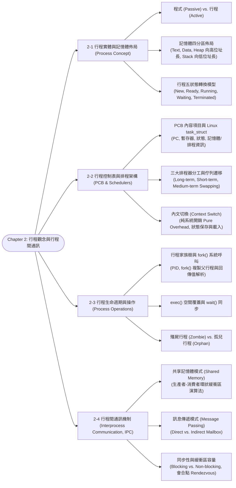
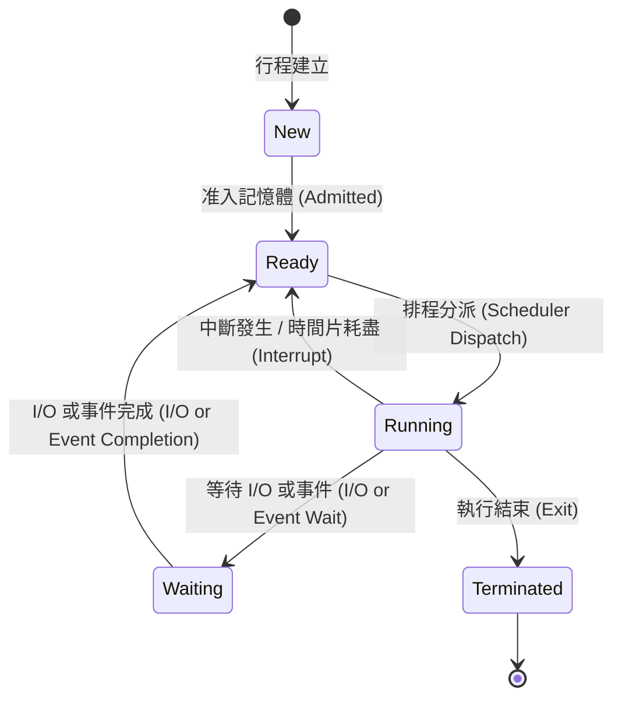

# Chapter 2: Process Concept & Interprocess Communication (IPC)

> 📚 **課程名稱**：作業系統 (Operating Systems)  
> 📖 **對應章節**：Chapter 2 Process Concept (Process Concept ~ Interprocess Communication)  
> 👨‍🏫 **授課教師**：NCU CSIE / IM 恐龍書經典教材體系  
> 📄 **參考講義**：[OS-ch02.ppt](file:///c:/Users/Cupid/Downloads/Study-space/Reference/NCU_Classes/作業系統/OS-ch02.ppt)  
> 🔖 **先修觀念**：[Chapter 1 作業系統導論與雙重模式](./Chapter_1_教材.md)、虛擬記憶體概念、C 語言系統呼叫 (`fork()`, `exec()`, `wait()`)

---

## 🗺️ 知識架構心智圖 (Mermaid Tree Diagram)



<a id="tree-diagram"></a>

### 🎯 本章學習進度檢核 (完成後打勾，建立成就反饋)

- [ ] [2-1 行程實體與記憶體佈局 (Process Concept)](#sec-1)
- [ ] [2-2 行程控制表與排程架構 (PCB & Schedulers)](#sec-2)
- [ ] [2-3 行程生命週期與操作 (Process Operations)](#sec-3)
- [ ] [2-4 行程間通訊機制 (Interprocess Communication, IPC)](#sec-4)

---

## 📖 核心觀念與理論精解

<a id="sec-1"></a>

### 2-1 行程概念 (Process Concept) 與記憶體佈局

作業系統執行各種類型的程式：批次系統執行「工作 (Jobs)」，分時多工系統執行「使用者程式 (Tasks / Processes)」。在現代教科書中，Job 與 Process 兩詞經常交替通用。

#### 1. 程式 (Program) vs. 行程 (Process) 的根本差別

* **程式 (Program)**：存放在磁碟儲存體中的可執行二進位檔案，屬於**被動實體（Passive Entity）**。
* **行程 (Process)**：當可執行檔被載入主記憶體並開始執行時，便成為一個**主動實體（Active Entity）**。
* **一對多對應關係**：同一個程式可以被多個使用者同時執行，或者被同一個使用者多次執行，此時在記憶體中會產生**多個完全獨立的行程**。

#### 2. 行程在主記憶體中的四大配置分區 (Process in Memory Layout)

當行程載入記憶體時，其專屬位址空間由低位址向高位址劃分為四個主要區段：

```
       高位址 (0xFFFFFFFF)
       ┌────────────────────────────────────────────────────────┐
       │                       堆疊區 (Stack)                   │
       │     (存放函式區域變數、參數、返回位址；向低位址動態生長) │
       │                          │                             │
       │                          ▼                             │
       │                                                        │
       │                          ▲                             │
       │                          │                             │
       │                       堆積區 (Heap)                    │
       │     (執行階段動態配置 malloc/new；向高位址動態生長)    │
       ├────────────────────────────────────────────────────────┤
       │                       資料區 (Data)                    │
       │     (存放全域變數 Global 與靜態變數 Static)            │
       ├────────────────────────────────────────────────────────┤
       │                       程式碼區 (Text)                  │
       │     (編譯後的二進位機器碼指令，唯讀保護)               │
       └────────────────────────────────────────────────────────┘
       低位址 (0x00000000)
```

* **Text Section**：存放可執行機器指令，通常設為唯讀且允許多個相同程式共享。
* **Data Section**：存放全域變數（Global Variables）與靜態變數（Static Variables）。
* **Heap Section**：執行階段由程式設計師動態配置的記憶體（C 的 `malloc()`、C++ 的 `new`），**由低位址朝高位址向上增長**。
* **Stack Section**：存放呼叫函式時的暫存資料（包括傳入參數、區域變數 Local Variables、返回記憶體位址），**由高位址朝低位址向下增長**。
* *若堆積區與堆疊區在記憶體中央相遇碰撞，即引發嚴重的「堆疊溢位 (Stack Overflow)」！*

#### 3. 行程五狀態模型 (Process States)

行程在生命週期中會依據執行情況在五種狀態間動態轉換：



1. **新建 (New)**：行程正在被作業系統建立中（配置 PCB），尚未載入記憶體準備執行。
2. **就緒 (Ready)**：行程已取得所需的一切資源並載入記憶體，**僅欠缺 CPU**，正在排隊等待 CPU 排程器挑選。
3. **執行 (Running)**：CPU 目前正在逐行執行該行程的機器指令。
4. **等待 / 阻斷 (Waiting / Blocked)**：行程因等待特定外部事件（如磁碟 I/O 讀取、鍵盤輸入、接收網路封包）而主動放棄 CPU，此時即使 CPU 閒置也不可執行該行程。
5. **結束 (Terminated)**：行程已經執行完畢或被強制終止，正在清理釋放資源。

---

<a id="sec-2"></a>

### 2-2 行程控制表 (PCB) 與排程架構

#### 1. 行程控制表 (Process Control Block, PCB / Task Control Block)

PCB 是作業系統用來追蹤與管理特定行程的核心資料結構。行程的所有身份證資訊與執行狀態均記錄於此：

* **Process State**：當前狀態（New, Ready, Running, Waiting, Terminated）。
* **Program Counter (PC)**：記錄該行程**下一道將被執行的機器指令位址**。
* **CPU Registers**：包含累加器、索引暫存器、堆疊指標（SP）等所有通用硬體暫存器數值。當行程被移出 CPU 時，暫存器內容必須完整保存於此。
* **CPU-Scheduling Information**：排程優先權（Priority）、排程佇列指標。
* **Memory-Management Information**：分頁表（Page Tables）或基底/界限暫存器數值。
* **Accounting Information**：CPU 累積使用時間、時鐘限制、帳號代碼。
* **I/O Status Information**：配置給該行程的 I/O 裝置清單、開啟檔案描述元表格（Open Files Table）。

> 🐧 **Linux 實作**：在 Linux 核心原始碼中，PCB 實作為 `struct task_struct`（定義於 `<linux/sched.h>`），系統所有行程透過雙向環狀串列進行管理。

#### 2. 三大排程器 (Schedulers) 與佇列遷移架構

```
                 [ Job Queue ]  (存放在磁碟中的所有待處理程式)
                       │
                       ▼  長期排程器 (Long-term Scheduler / Job Scheduler)
                 [ Ready Queue ] (主記憶體中等候 CPU 的行程)
                       │
                       ▼  短期排程器 (Short-term Scheduler / CPU Scheduler)
                    [ CPU ]
                       │
         ┌─────────────┴─────────────┐
         ▼                           ▼
    [ 等候 I/O ]                 [ 時間片用完 ]
         │                           │
         ▼                           │
   [ Device Queue ]                  │
         │                           │
         └─────────────►─────────────┘
```

1. **長期排程器 (Long-Term Scheduler / Job Scheduler)**：
   * **職責**：從磁碟的 Job Pool 中挑選適當程式載入主記憶體，放入 Ready Queue。
   * **調用頻率**：極低（數秒至數分鐘一次）。
   * **核心使命**：控制**多元程式規劃程度 (Degree of Multiprogramming)**（即記憶體中的行程總數），並致力於維持良好的 **Process Mix（平衡 I/O-Bound 與 CPU-Bound 行程）**。
2. **短期排程器 (Short-Term Scheduler / CPU Scheduler)**：
   * **職責**：頻繁地從 Ready Queue 中挑選一個行程並分配 CPU 給它執行。
   * **調用頻率**：極高（每 10 ~ 100 毫秒一次）。
   * **性能要求**：必須極度迅速，否則系統開銷過大。
3. **中期排程器 (Medium-Term Scheduler / Swapper)**：
   * **職責**：當記憶體不足（過度承載）時，將部分暫時不活躍的行程整體**換出 (Swap-Out)** 至硬碟的置換空間，降低多元程式規劃程度；待記憶體充裕時再**換入 (Swap-In)** 恢復執行。

#### 3. 內文切換 (Context Switch)

當 CPU 決定暫停當前行程 $P_0$ 轉而執行行程 $P_1$ 時，核心所執行的切換動作稱為 **內文切換 (Context Switch)**：

1. 將 $P_0$ 的所有暫存器狀態與 PC 保存至 $P_0$ 的 PCB 中。
2. 將 $P_0$ 的 PCB 狀態由 Running 改為 Ready（或 Waiting）。
3. 從 $P_1$ 的 PCB 中載入先前儲存的暫存器與 PC 數值。
4. 將 $P_1$ 的 PCB 狀態改為 Running，跳轉至 PC 指定位址開始執行。

> ⚠️ **重要考點：Context Switch 是「純系統開銷 (Pure Overhead)」**！  
> 在執行內文切換的過程中，CPU 忙於儲存與載入暫存器、清除快取與 TLB，**沒有執行任何實質的使用者運算工作**。因此，現代作業系統與硬體架構（如提供多組硬體暫存器輪替）均全力縮減內文切換時間。

---

<a id="sec-3"></a>

### 2-3 行程建立、終止與操作 (Process Operations)

在 UNIX / Linux 系統中，所有行程均形成一棵階層式的**行程家族樹 (Process Tree)**，每個行程擁有唯一的非負整數識別碼 **PID (Process Identifier)**。系統開機後建立的第一個行程是 `init`（PID = 1，現代 Linux 為 `systemd`），是全系統所有行程的共同祖先。

#### 1. 行程建立三部曲：`fork()`, `exec()`, `wait()`

1. **`fork()` 系統呼叫**：
   * 父行程呼叫 `fork()` 建立一個與自己幾乎完全相同的新子行程。
   * **子行程複製父行程的位址空間**（包括程式碼、資料、堆疊、堆積與開啟檔案）。
   * **`fork()` 的神奇回傳值（高頻必考）**：
     * **在子行程中：`fork()` 回傳 `0`**。
     * **在父行程中：`fork()` 回傳「新建立子行程的 PID」**。
     * **若建立失敗：回傳負值（-1）**。
2. **`exec()` 系列系統呼叫**：
   * 子行程通常呼叫 `exec()`（如 `execlp()`, `execv()`），用全新的可執行二進位程式碼**徹底覆蓋（Overwrite）子行程當前的位址空間**，並從新程式的 `main()` 開始執行。
3. **`wait()` 系統呼叫**：
   * 父行程呼叫 `wait()` 將自己掛起（進入 Waiting 狀態），直到其子行程執行完畢。`wait()` 會收集子行程的結束狀態代碼，並允許系統徹底釋放子行程的 PCB。

#### 2. 殭屍行程 vs. 孤兒行程（期中考必考比較題）

| 類別 | 形成原因 | 系統危害 | 解決方法 |
| :--- | :--- | :--- | :--- |
| **殭屍行程 (Zombie Process)** | 子行程已經執行 `exit()` 終止，但其**父行程尚未呼叫 `wait()`** 讀取其狀態代碼。 | 子行程的記憶體已被釋放，但**其 PCB 與 PID 依然殘留在系統行程表中**。若大量累積會耗盡系統可用 PID 資源。 | 父行程呼叫 `wait()` 或 `waitpid()` 即可收屍清除其 PCB。 |
| **孤兒行程 (Orphan Process)** | **父行程在子行程尚未結束前就提早結束退出了**（且父行程未 wait）。 | 無直接危害。 | 系統會自動將孤兒行程過戶收養給 **`init` / `systemd` 行程（PID 1）**。`init` 會定期呼叫 `wait()` 替孤兒行程釋放 PCB。 |

---

<a id="sec-4"></a>

### 2-4 行程間通訊機制 (Interprocess Communication, IPC)

獨立行程（Independent Process）無法影響其他行程；合作行程（Cooperating Process）則彼此共享資料或協同運算。合作行程帶來四大優勢：**資訊共享 (Information Sharing)、運算加速 (Computation Speedup)、模組化 (Modularity)、操作便利 (Convenience)**。

IPC 主要有兩大根本模型：**共享記憶體 (Shared Memory)** 與 **訊息傳遞 (Message Passing)**。

```
    [ 行程 A ]       [ 行程 B ]               [ 行程 A ]       [ 行程 B ]
        │                │                        │                │
        └───┐        ┌───┘                        ▼                ▲
            ▼        ▼                          send()          receive()
      ┌────────────────────┐                      │                │
      │   共享記憶體空間   │                      ▼                │
      │  (Shared Memory)   │                 ┌────────────────────────┐
      └────────────────────┘                 │   核心訊息佇列 (Kernel) │
                                             └────────────────────────┘
          (a) 共享記憶體模型                           (b) 訊息傳遞模型
```

#### 1. 共享記憶體模型 (Shared Memory)

* **機制**：通訊行程間建立一塊共同定址的實體記憶體區域。雙方可直接對該記憶體進行讀寫。
* **優點**：**存取速度極快（速度上限等同記憶體匯流排頻寬）**，資料交換完全無需進入作業系統核心。
* **缺點**：保護機制被打破，程式設計師**必須自行負責處理繁瑣的同步問題（如避免 Race Condition）**。
* **經典範例：生產者-消費者問題 (Producer-Consumer Problem) 環狀緩衝區**：
  * 使用大小為 `BUFFER_SIZE` 的環狀陣列，維護兩個整數指標 `in`（生產者寫入位置）與 `out`（消費者讀取位置）。
  * **緩衝區為空 (Empty)**：`in == out`。
  * **緩衝區為滿 (Full)**：`((in + 1) % BUFFER_SIZE) == out`。
  * *注意：此演算法最多僅能容納 `BUFFER_SIZE - 1` 個元素，必須保留一格空位以區隔「全空」與「全滿」！*

#### 2. 訊息傳遞模型 (Message Passing)

* **機制**：行程之間透過呼叫作業系統核心提供的兩大原語交換資料：`send(message)` 與 `receive(message)`。
* **優點**：**無需共享位址空間**，特別適合分散式網路環境或多主機架構；同步由核心代管，程式碼安全。
* **缺點**：每次傳送與接收皆需透過 System Call 陷入核心模式並在緩衝區複製資料，**效能較慢**。

##### 通訊鏈路邏輯屬性：

1. **直接通訊 (Direct Communication)**：
   * 雙方必須明確指定對方的行程名稱：`send(P, message)`, `receive(Q, message)`。
   * 特性：鏈路自動建立，且每對通訊行程之間嚴格僅存在唯一一條鏈路。缺點為模組耦合度高，行程若改名或重開需修改代碼。
2. **間接通訊 (Indirect Communication / Mailbox / Ports)**：
   * 訊息發送至「郵箱 (Mailbox)」或「連接埠 (Port)」，雙方共享郵箱即可通訊：`send(A, message)`, `receive(A, message)`。
   * 特性：一條鏈路可連結多個行程，一對行程間可存在多條不同郵箱鏈路。
3. **同步性 (Synchronization)**：
   * **阻斷式 (Blocking / 同步 Synchronous)**：
     * `Blocking send`：發送者發送訊息後，必須**阻斷暫停**，直到接收者收到訊息或緩衝區有空位。
     * `Blocking receive`：接收者呼叫後，必須**阻斷暫停**，直到訊息抵達可用。
   * **非阻斷式 (Non-blocking / 非同步 Asynchronous)**：
     * `Non-blocking send`：發送者送出訊息後立即接續執行後續程式碼，不作停留。
     * `Non-blocking receive`：接收者立即取回訊息（若有）或立即回傳 `NULL`，絕不卡死。
   * **會合點 (Rendezvous)**：當 `send()` 與 `receive()` **同時皆為 Blocking 模式**時，雙方在訊息交換點達成同步會合！
4. **緩衝區容量 (Buffering Capacity)**：
   * **零容量 (Zero capacity)**：鏈路中沒有佇列容納訊息。發送者**必須強制阻斷等待接收者**（嚴格會合 Rendezvous）。
   * **有限容量 (Bounded capacity)**：佇列最多容納 $n$ 則訊息。若佇列未滿，發送者不阻斷；若佇列已滿，發送者必須阻斷。
   * **無限容量 (Unbounded capacity)**：佇列長度無上限，發送者永遠不需阻斷。

---

## 💻 經典程式碼演算追蹤

<a id="sec-5"></a>

### 範例：`fork()` 行程建立與變數隔離追蹤

請追蹤下列 C 語言程式碼在 Linux 系統下的輸出結果：

```c
#include <stdio.h>
#include <unistd.h>
#include <sys/wait.h>

int value = 5;

int main() {
    pid_t pid;
    pid = fork();

    if (pid == 0) { // 子行程
        value += 15;
        return 0;
    }
    else if (pid > 0) { // 父行程
        wait(NULL); // 等待子行程結束
        printf("PARENT: value = %d\n", value);
        return 0;
    }
}
```

* **執行分析**：
  1. `fork()` 執行後，作業系統為子行程配置了獨立的記憶體位址空間，子行程拷貝了父行程當前的資料段副本（包括 `value = 5`）。
  2. 在子行程中，`pid == 0` 分支成立，子行程將其**私有記憶體空間中的 `value` 修改為 $5 + 15 = 20$**，隨後子行程退出。
  3. 父行程呼叫 `wait(NULL)` 被喚醒，讀取父行程**自身記憶體空間中的 `value`**。
  4. 由於行程間記憶體位址空間相互隔離保護，子行程的任何修改對父行程完全不可見！
* **螢幕輸出**：
  `PARENT: value = 5` （⚠️ 考試高頻陷阱：絕非 20！）

---

## 📝 實戰練習題 (三層遞進式強化測驗)

### 🟢 Tier 1：必懂基礎 (Must-Know Fundamentals)

> 💡 **學習目標**：確認自己「會算、會辨識」——給數字就能做對、給名稱就能配對。

<a id="q1"></a>

#### Q1. (基礎數值計算) `fork()` 行程樹總數推導

考慮下列 C 語言程式碼片段：
```c
#include <stdio.h>
#include <unistd.h>

int main() {
    fork();
    fork();
    fork();
    return 0;
}
```
假設所有 `fork()` 系統呼叫均成功執行，請問：
(1) 包含最初的父行程在內，總共會有幾個行程被建立執行？  
(2) 該程式總共衍生建立了幾個「子行程 (Child Processes)」？  

(A) (1) 6 個, (2) 5 個  
(B) (1) 8 個, (2) 7 個  
(C) (1) 16 個, (2) 15 個  
(D) (1) 8 個, (2) 8 個  

👉 [查看 Q1 答案與詳細解析](#ans-q1)

---

<a id="q2"></a>

#### Q2. (基礎狀態轉換) 行程五狀態模型 (Five-State Model) 轉換判定

在作業系統的標準五狀態模型（New, Ready, Running, Waiting, Terminated）中，當一個正在 CPU 上執行的行程發出「讀取磁碟檔案」的系統呼叫時，作業系統排程器會將該行程的狀態轉換為何？

(A) 由 Running 轉換為 Ready  
(B) 由 Running 轉換為 Waiting (Blocked)  
(C) 由 Running 轉換為 Terminated  
(D) 由 Waiting 轉換為 Ready  

👉 [查看 Q2 答案與詳細解析](#ans-q2)

---

<a id="q3"></a>

#### Q3. (基礎回傳值判定) `fork()` 系統呼叫的回傳值特性

在 UNIX / Linux 環境中，呼叫 `pid_t pid = fork();` 成功建立子行程後，該函式在父行程與子行程中的回傳值分別為何？

(A) 父行程回傳 0，子行程回傳父行程的 PID  
(B) 父行程回傳新建立的子行程 PID（大於 0 的正整數），子行程回傳 0  
(C) 父行程與子行程皆回傳 0  
(D) 父行程與子行程皆回傳新建立的子行程 PID  

👉 [查看 Q3 答案與詳細解析](#ans-q3)

---

<a id="q4"></a>

#### Q4. (基礎結構辨識) 行程控制區塊 (PCB) 的組成要素

行程控制區塊（Process Control Block, PCB / Task Struct）是作業系統感知與管理行程的核心資料結構。下列各項中，何者**通常不儲存在 PCB 結構體內部**？

(A) 程式計數器（Program Counter, PC）與 CPU 暫存器內容  
(B) 行程狀態（Process State）與 PID  
(C) CPU 排程資訊（如優先權 Priority）與開啟檔案清單  
(D) 程式原始碼編譯產生的二進位執行檔機器指令（Text Segment 內容本身）  

👉 [查看 Q4 答案與詳細解析](#ans-q4)

---

<a id="q5"></a>

#### Q5. (基礎名詞辨析) 殭屍行程 (Zombie Process) 的定義

當一個子行程已經執行完畢並呼叫 `exit()` 終止，但其父行程「**尚未呼叫 `wait()` 或 `waitpid()`**」來讀取其退出狀態與回收行程資源時，該子行程在作業系統中被稱為：

(A) 孤兒行程 (Orphan Process)  
(B) 殭屍行程 (Zombie Process)  
(C) 守護行程 (Daemon Process)  
(D) 閒置行程 (Idle Process)  

👉 [查看 Q5 答案與詳細解析](#ans-q5)

---

### 🟡 Tier 2：基礎 + 實際應用 (Application & Scenario Matching)

> 💡 **學習目標**：確認自己「會用」——能處理系統行程異常殘留、在不同架構下選取合適的 IPC 機制。

<a id="q6"></a>

#### Q6. (行程生命週期異常處理) 孤兒行程 (Orphan Process) 的系統收養機制

在 Linux 多工環境中，若父行程因非正常異常崩潰或提前結束退出，而其產生的子行程仍在背景長時間運行：
(1) 這些失去父行程的子行程被稱為什麼？  
(2) 現代作業系統為了防止這些行程日後結束時永久變成無人回收的殭屍，採取了何種系統收養策略？

(A) (1) 殭屍行程，(2) 立即將該子行程強制撲殺 (SIGKILL)  
(B) (1) 孤兒行程，(2) 由根行程 `init`（PID 1，或現代 `systemd`）收養，並由其自動呼叫 `wait()` 負責善後  
(C) (1) 孤兒行程，(2) 隨機指派給相鄰的其他使用者行程收養  
(D) (1) 殭屍行程，(2) 將其記憶體直接寫入硬碟虛擬記憶體  

👉 [查看 Q6 答案與詳細解析](#ans-q6)

---

<a id="q7"></a>

#### Q7. (IPC 架構選型) 共享記憶體 vs. 訊息傳遞在分散式環境的抉擇

某工程團隊正在設計跨主機的大型運算叢集，多個行程分別運行在不同的實體伺服器節點上，彼此需要頻繁交換狀態資訊。請問下列何者是**唯一可行且最合適的 IPC 架構**？其原因為何？

(A) 共享記憶體（Shared Memory），因為速度最快且不需要核心介入  
(B) 訊息傳遞（Message Passing，如 Socket 或 MPI），因為共享記憶體無法直接跨實體網路定址不同機器的實體 RAM  
(C) 普通無名管道（Ordinary Pipe），因為它提供先進先出的緩衝保證  
(D) 記憶體映射檔案（mmap），因為它能繞過網路協定  

👉 [查看 Q7 答案與詳細解析](#ans-q7)

---

<a id="q8"></a>

#### Q8. (緩衝佇列容量設計) 零容量佇列 (Zero-Capacity Buffer) 的通訊同步行為

在訊息傳遞系統（Message Passing）中，若訊息佇列的緩衝區容量被配置為零（Capacity = 0，即無任何緩衝空間）：
當發送端行程呼叫 `send(msg)` 發送一筆訊息時，發送端行程的狀態與行為為何？

(A) 發送端立刻成功返回，訊息自動暫存於 CPU 暫存器中  
(B) 系統直接拋出 Buffer Overflow 異常中斷  
(C) 發送端行程必須被強制阻塞（Blocked / Waiting），直到接收端行程呼叫 `receive()` 接收該訊息為止（此同步現象稱為匯合 Rendezvous）  
(D) 訊息直接被系統丟棄，發送端不受任何影響  

👉 [查看 Q8 答案與詳細解析](#ans-q8)

---

<a id="q9"></a>

#### Q9. (管道技術實務選型) 普通管道 (Ordinary Pipe) vs. 命名管道 (Named Pipe / FIFO)

兩個完全沒有父子血緣關係（親屬關係）的獨立行程 A 與行程 B，分別由不同的使用者帳號在不同終端機啟動。若兩者欲在同一台 Linux 伺服器本機進行資料串流傳輸，為什麼**無法**使用普通管道（Ordinary Pipe / Anonymous Pipe）？應改用何種機制？

(A) 普通管道僅能在核心模式下執行；應改用硬體中斷  
(B) 普通管道由父行程建立並透過 `fork()` 繼承檔案描述子，無親屬關係的行程無法取得其句柄；應改用在檔案系統中具有具體檔名節點的命名管道 (Named Pipe / FIFO)  
(C) 普通管道容量限制為 1 Byte；應改用共享記憶體  
(D) 普通管道不支援 FIFO 順序；應改用優先權佇列  

👉 [查看 Q9 答案與詳細解析](#ans-q9)

---

### 🔴 Tier 3：概念講述與深度分析 (Conceptual & Analytical)

> 💡 **學習目標**：確認自己「會講」——能推導寫入時複製 (COW) 記憶體歷程、剖析上下文切換的底層開銷。

<a id="q10"></a>

#### Q10. (記憶體隔離與 COW 推導題) `fork()` 變數獨立性與寫入時複製 (Copy-on-Write)

考慮下列經典的 C 語言程式碼：
```c
#include <stdio.h>
#include <sys/types.h>
#include <sys/wait.h>
#include <unistd.h>

int val = 5;

int main() {
    pid_t pid = fork();
    if (pid == 0) { // Child process
        val += 15;
        return 0;
    } else if (pid > 0) { // Parent process
        wait(NULL);
        printf("PARENT: val = %d\n", val);
    }
    return 0;
}
```
(1) 請寫出該程式執行後，終端機螢幕輸出的精確內容。  
(2) 為什麼子行程將 `val` 修改為 20 後，父行程印出的 `val` 依然是 5？請從虛擬記憶體位址空間（Virtual Address Space）與頁表（Page Table）的角度說明。  
(3) 現代作業系統在 `fork()` 時並不會立刻傻傻複製父行程的全部實體記憶體，而是採用「**寫入時複製 (Copy-on-Write, COW)**」技術。請詳細推導演算法在 `fork()` 當下與子行程執行 `val += 15` 當下，頁表權限與實體記憶體頁面的具體變化過程。

👉 [查看 Q10 答案與詳細解析](#ans-q10)

---

<a id="q11"></a>

#### Q11. (底層架構論述題) 上下文切換 (Context Switch) 的純損耗剖析

作業系統進行上下文切換（Context Switch）被稱為純粹的效能損耗（Pure Overhead），因為在切換期間 CPU 沒有進行任何實質的使用者有效運算：
(1) 請列出從 Process A 切換至 Process B 時，核心必須執行的**直接開銷（Direct Overhead）**（硬體暫存器與 PCB 保存）。  
(2) 相比於直接開銷，**間接開銷（Indirect Overhead）** 往往對系統效能造成更劇烈的打擊。請深入闡述 **快取污染（Cache Pollution / Miss）** 與 **轉譯後備緩衝區（TLB Invalidation / Flush）** 如何在切換後拖慢 Process B 的執行速度？

👉 [查看 Q11 答案與詳細解析](#ans-q11)

---

<a id="q12"></a>

#### Q12. (分散式通訊架構比較) Client-Server 通訊機制全方位評估

試從**通訊拓撲（本機 vs. 跨網路）**、**抽象層次（低階位元組串流 vs. 高階程序呼叫）** 與 **故障語意保證** 三個維度，深入比較下列三種通訊架構：
(1) **Sockets (通訊端點)**  
(2) **遠端程序呼叫 (Remote Procedure Calls, RPC)**  
(3) **UNIX 管道 (Pipes)**

👉 [查看 Q12 答案與詳細解析](#ans-q12)

---

## 🔑 本章練習題答案與詳細解析 (Answer Key)

### 🟢 Tier 1 解析

<a id="ans-q1"></a>

### Q1 答案與詳細解析

* **正確答案**：**(B)**
* **推導歷程**：
  * 初始只有 1 個父行程 $P_0$。
  * 第 1 次 `fork()`：$P_0$ 產生 1 個子行程 $P_1$（現有 $2^1 = 2$ 個行程）。
  * 第 2 次 `fork()`：現有的 2 個行程各自分裂產生 1 個子行程（現有 $2^2 = 4$ 個行程）。
  * 第 3 次 `fork()`：現有的 4 個行程各自分裂產生 1 個子行程（現有 $2^3 = 8$ 個行程）。
  * **行程總數** = $2^n = 2^3 = 8$ 個。
  * **新建立的子行程總數** = 總數 - 原本父行程 = $8 - 1 = 7$ 個。選項 (B) 正確。

[🔙 返回題目 Q1](#q1) ｜ [🔝 返回知識架構圖](#tree-diagram)

---

<a id="ans-q2"></a>

### Q2 答案與詳細解析

* **正確答案**：**(B)**
* **狀態轉移核心邏輯**：
  * **Running $\to$ Waiting (Blocked)**：當執行中的行程發出 I/O 請求（如讀寫磁碟、等待網路封包）或等待某個同步事件（如呼叫 `wait()` 等待子行程結束）時，因該事件需要數毫秒以上且非 CPU 能立刻解決，行程主動進入 Waiting 狀態讓出 CPU。
  * **Running $\to$ Ready**：由計時器中斷（Time slice expired）或更高優先權行程搶佔（Preemption）引發。
  * **Waiting $\to$ Ready**：當 I/O 完成或事件發生，硬體觸發中斷，OS 將其移回 Ready 佇列等待下次排程。選項 (B) 正確。

[🔙 返回題目 Q2](#q2) ｜ [🔝 返回知識架構圖](#tree-diagram)

---

<a id="ans-q3"></a>

### Q3 答案與詳細解析

* **正確答案**：**(B)**
* **回傳值設計哲學**：
  * `fork()` 具有「呼叫一次，回傳兩次（Called once, returns twice）」的獨特特性：
    * **在父行程中**：回傳新建立子行程的 PID（值 $> 0$）。這是因為父行程可能擁有多個子行程，且系統沒有提供 `getchildpid()` 函式，父行程必須透過 `fork()` 回傳值記錄子行程 ID 以便後續管理或 `wait()`。
    * **在子行程中**：回傳 $0$。子行程若想知道自己的 PID，隨時可以呼叫 `getpid()`；若想知道父行程 PID，可隨時呼叫 `getppid()`。
    * **建立失敗時**：回傳 $-1$。選項 (B) 正確。

[🔙 返回題目 Q3](#q3) ｜ [🔝 返回知識架構圖](#tree-diagram)

---

<a id="ans-q4"></a>

### Q4 答案與詳細解析

* **正確答案**：**(D)**
* **PCB 與位址空間辨析**：
  * **PCB（行程控制區塊）** 是作業系統核心維護的「行程身分證與狀態簿」，存放於作業系統核心空間。它儲存 PID、暫存器備份、PC、指標、優先權、開啟檔案描述子等元資料（Metadata）。
  * 程式的「二進位機器指令（Text Segment / Code）」、全域變數（Data Segment）、動態記憶體（Heap）與區域變數（Stack），儲存在該行程獨立的**使用者虛擬記憶體位址空間**中，而不是塞在 PCB 結構體內部。選項 (D) 正確。

[🔙 返回題目 Q4](#q4) ｜ [🔝 返回知識架構圖](#tree-diagram)

---

<a id="ans-q5"></a>

### Q5 答案與詳細解析

* **正確答案**：**(B)**
* **名詞精確定義**：
  * **殭屍行程 (Zombie Process)**：子行程已終止，其記憶體與程式碼已全數釋放，但在行程表（Process Table）中仍保留其 PCB 條目（記錄 Exit Status、CPU 使用統計）。若父行程未呼叫 `wait()`，該條目無法被刪除，即為殭屍。
  * **孤兒行程 (Orphan Process)**：父行程比子行程先結束，子行程仍在運行中。選項 (B) 正確。

[🔙 返回題目 Q5](#q5) ｜ [🔝 返回知識架構圖](#tree-diagram)

---

### 🟡 Tier 2 解析

<a id="ans-q6"></a>

### Q6 答案與詳細解析

* **正確答案**：**(B)**
* **系統善後機制**：
  * 當父行程終止後，其遺留下的孤兒行程不能處於「無父狀態」，否則日後這些行程終止時將無人替它們呼叫 `wait()`，會永久變成不可回收的殭屍，最終耗盡系統的 PID 資源。
  * UNIX / Linux 的標準解法是：由作業系統的祖先根行程 `init`（PID = 1，現代 Linux 為 `systemd`）自動收養（Adopt）所有孤兒行程。
  * `init` 行程內部常駐呼叫 `wait()`，一旦被收養的孤兒行程執行完畢終止，`init` 會立刻將其回收，徹底防止殭屍氾濫。選項 (B) 正確。

[🔙 返回題目 Q6](#q6) ｜ [🔝 返回知識架構圖](#tree-diagram)

---

<a id="ans-q7"></a>

### Q7 答案與詳細解析

* **正確答案**：**(B)**
* **IPC 機制適用邊界**：
  * **共享記憶體 (Shared Memory)**：依賴作業系統將同一塊實體 RAM 頁面映射到兩個行程的虛擬位址空間。在分散式多機叢集中，各主機擁有獨立的實體 RAM 與主機板匯流排，**無法透過實體記憶體指標直接定址另一台機器的 RAM**。
  * **訊息傳遞 (Message Passing)**：透過核心將訊息封裝成網路封包（如 Socket TCP/IP、MPI），能天生支援跨機器、跨網路的通訊，是分散式系統的唯一基石。選項 (B) 正確。

[🔙 返回題目 Q7](#q7) ｜ [🔝 返回知識架構圖](#tree-diagram)

---

<a id="ans-q8"></a>

### Q8 答案與詳細解析

* **正確答案**：**(C)**
* **訊息佇列三種容量特徵**：
  1. **零容量 (Zero capacity)**：佇列最大長度為 0。發送端發出訊息時，必須等待接收端同時呼叫 `receive()` 接收，雙方必須在同一時刻交會，此同步行為稱為 **Rendezvous（匯合）**。
  2. **有限容量 (Bounded capacity)**：佇列長度為 $n$。當佇列未滿時發送端不阻塞；佇列滿時發送端必須阻塞等待。
  3. **無限制容量 (Unbounded capacity)**：佇列長度理論無限大。發送端永遠不被阻塞。選項 (C) 完全正確。

[🔙 返回題目 Q8](#q8) ｜ [🔝 返回知識架構圖](#tree-diagram)

---

<a id="ans-q9"></a>

### Q9 答案與詳細解析

* **正確答案**：**(B)**
* **管道機制深度對比**：
  * **普通管道 (Ordinary Pipe / Anonymous Pipe)**：在記憶體中建立，沒有檔案系統實體路徑。其檔案描述子（File Descriptors, `fd[0]`, `fd[1]`）只能透過 `fork()` 傳遞給子行程。因此普通管道**嚴格限制只能在具有共同祖先（父子或兄弟）的親屬行程間使用**，且行程終止後管道隨即銷毀。
  * **命名管道 (Named Pipe / FIFO)**：在檔案系統中擁有一個實體節點（以 `mkfifo` 建立）。任何無關的獨立行程只要知道該路徑且具有讀寫權限，皆可呼叫 `open()` 開啟該 FIFO 進行雙向/單向資料交換，且即使行程關閉，FIFO 檔案節點依然持久存在。選項 (B) 正確。

[🔙 返回題目 Q9](#q9) ｜ [🔝 返回知識架構圖](#tree-diagram)

---

### 🔴 Tier 3 解析

<a id="ans-q10"></a>

### Q10 答案與詳細解析

* **(1) 螢幕輸出**：
  ```text
  PARENT: val = 5
  ```

* **(2) 記憶體位址空間獨立性推導**：
  * `fork()` 呼叫後，子行程獲得了父行程位址空間的一份完整複製。
  * 雖然父子行程中的變數 `val` 擁有完全相同的「虛擬記憶體位址（Virtual Address）」，但透過分頁硬體（MMU）的轉譯，它們最終映射到不同的「實體記憶體頁面（Physical Frame）」。
  * 子行程執行的 `val += 15` 只是修改了子行程私有的實體記憶體，父行程的實體記憶體內容絲毫未動。因此父行程在 `wait()` 結束後印出的 `val` 依然是初始值 5。

* **(3) 寫入時複製 (Copy-on-Write, COW) 機制推導**：
  * **在 `fork()` 瞬間**：作業系統不會配置新的實體記憶體複製父行程的頁面。核心將父子行程的頁表項（PTE）指向同一組實體頁面，並**將所有可寫頁面的權限全部修改為唯讀（Read-Only）**。此時建立行程耗時極低（$O(1)$ 分頁映射）。
  * **子行程寫入 `val` 瞬間**：子行程嘗試執行寫入指令，CPU 硬體偵測到唯讀頁面違規，觸發 **Page Fault 異常（設陷）**。
  * **核心處理**：作業系統捕捉到此 Page Fault，確認是 COW 頁面後：
    1. 在實體 RAM 中配置一個全新的 Physical Frame。
    2. 將原頁面的 4KB 內容複製進新 Frame。
    3. 將子行程的頁表項指向新 Frame，並將其權限改回**可讀寫（Read-Write）**。
    4. 重新執行引發異常的寫入指令。
  * 透過 COW，未被修改的大量頁面（如程式碼區段、未動資料）始終共享，僅複製實際修改的單一頁面，大幅優化了系統資源。

[🔙 返回題目 Q10](#q10) ｜ [🔝 返回知識架構圖](#tree-diagram)

---

<a id="ans-q11"></a>

### Q11 答案與詳細解析

* **(1) 直接開銷 (Direct Overhead)**：
  1. **暫存器保存與恢復**：CPU 必須將 Process A 的所有硬體通用暫存器、程式計數器（PC）、堆疊指標（SP）儲存至 Process A 的 PCB（或 Kernel Stack）中；並從 Process B 的 PCB 載入其暫存器狀態。
  2. **核心資料結構切換**：切換核心堆疊指標、切換當前執行行程指標（`current` task pointer）。
  3. **頁表基底暫存器切換**：修改 CR3 暫存器，將分頁根目錄切換為 Process B 的頁表。此直接開銷耗時約數微秒（約幾百至幾千個時鐘週期）。

* **(2) 間接開銷 (Indirect Overhead - 效能隱形殺手)**：
  1. **TLB Flush（轉譯後備緩衝區失效）**：
     * 切換 CR3 頁表後，CPU 內部的 TLB（快取虛擬位址到實體位址轉譯的高速硬體）原本快取的 Process A 虛擬頁面對應全部失效（除非硬體支援 PCID/ASID 標籤）。
     * 切換後 Process B 執行的前幾千條指令，幾乎每一次記憶體存取都會遭遇 **TLB Miss**，迫使硬體 MMU 走訪四級頁表（Page Table Walk），記憶體存取延遲增加數倍。
  2. **CPU 快取污染 (Cache Pollution & Misses)**：
     * CPU L1/L2 快取中塞滿了 Process A 的熱點資料。當 Process B 開始運行時，面臨嚴重的 **Cache Miss（快取不命中）**，CPU 管線頻繁停頓等待從慢速的主記憶體（DRAM）載入資料。
     * 直到 Process B 運行一段時間將其工作集（Working Set）重新暖機（Warm up）進快取後，執行速度才會恢復正常。

[🔙 返回題目 Q11](#q11) ｜ [🔝 返回知識架構圖](#tree-diagram)

---

<a id="ans-q12"></a>

### Q12 答案與詳細解析

* **(1) Sockets (網路通訊端點)**：
  * **通訊拓撲**：支援本機（UNIX Domain Socket）與跨網路（TCP/IP Internet Socket）雙向通訊。
  * **抽象層次**：低階位元組串流（Byte Stream）或資料包（Datagram）。應用程式必須自行定義封包協議、處理序列化與反序列化（Serialization）、字節序轉換（Endianness）與封包黏包問題。
  * **適用場景**：高效能網路伺服器、底層網路工具。

* **(2) RPC (遠端程序呼叫, Remote Procedure Calls)**：
  * **通訊拓撲**：專為分散式網路環境設計。
  * **抽象層次**：高階程序抽象。使程式設計師呼叫遠端伺服器上的函式（如 `add(x, y)`）就像呼叫本地函式一樣透明自然。底層藉由 Stub（存根）自動完成參數打包（Marshalling / IDL）、發送、等待回應與解包。
  * **故障語意難題**：本地函式呼叫保證 Exactly-once（精確執行一次）。而 RPC 跨越不穩定網路，伺服器可能當機或封包遺失，通常只能保證 **At-least-once（至少一次，需冪等 Idempotent）** 或 **At-most-once（至多一次）**。

* **(3) UNIX Pipes (管道)**：
  * **通訊拓撲**：嚴格限制於**單一主機本機（Local Machine Only）**，無法跨越網路。
  * **抽象層次**：半雙工或單向的 FIFO 字元串流。
  * **優點與限制**：極致輕量、無網路協定堆疊開銷；但完全不具備分散式橫向擴展能力。

[🔙 返回題目 Q12](#q12) ｜ [🔝 返回知識架構圖](#tree-diagram)

---
## 📊 重點速記表 (Summary Table)

| 行程概念 | 核心定義與規格 | 關鍵效益 / 行為 | 常見錯誤或考點 |
| :--- | :--- | :--- | :--- |
| **行程記憶體四分區** | Text, Data, Heap (向上長), Stack (向下長) | 隔離程式碼、全域、動態與函式局部記憶體 | Stack 與 Heap 相撞會發生溢位 |
| **行程五狀態** | New, Ready, Running, Waiting, Terminated | 描述行程在 CPU、記憶體與 I/O 間的生命流轉 | 等待 I/O 進入 Waiting，完成回 Ready |
| **行程控制表 (PCB)** | 儲存行程所有狀態的資料結構 (`task_struct`) | 內文切換時保存與載入執行現場之依據 | PCB 殘留未釋放即形成殭屍行程 |
| **內文切換 (Context Switch)** | 儲存舊行程狀態、載入新行程狀態 | 實現分時多工共享 CPU | 純系統開銷 (Pure overhead)，不做有用功 |
| **`fork()` 系統呼叫** | 複製父行程建立子行程 | 父行程回傳 Child PID；子行程回傳 0 | 父子記憶體隔離，修改變數互不影響 |
| **殭屍 vs. 孤兒行程** | 殭屍：子死父未 wait；孤兒：父先死子未死 | 殭屍佔用 PID；孤兒被 `init` 收養 | 殭屍需父 wait 清除；孤兒由 init 代收 |
| **共享記憶體 IPC** | 建立共用定址空間，直接讀寫 | 速度最快，無需核心介入 | 必須自行處理同步與 Race Condition |
| **訊息傳遞 IPC** | `send()` 與 `receive()` 原語交換 | 適合分散式網路，核心代管同步 | 需系統呼叫拷貝，速度慢於共享記憶體 |

---

## 🗂️ 考前速查卡片 (Flashcards)

<div style="display: grid; grid-template-columns: repeat(auto-fit, minmax(280px, 1fr)); gap: 1rem;">

<div style="border: 1px solid #e2e8f0; border-radius: 8px; padding: 1rem; background-color: #f8fafc;">
  <strong style="color: #2563eb;">Q: 為什麼說 Context Switch 是「純系統開銷」？</strong>
  <hr style="margin: 0.5rem 0;" />
  <p><strong>A:</strong> 因為在儲存與恢復 PCB 暫存器、切換分頁表的期間，CPU 沒有推進任何實質的使用者運算工作。</p>
</div>

<div style="border: 1px solid #e2e8f0; border-radius: 8px; padding: 1rem; background-color: #f8fafc;">
  <strong style="color: #2563eb;">Q: fork() 系統呼叫在父行程與子行程中的回傳值各是什麼？</strong>
  <hr style="margin: 0.5rem 0;" />
  <p><strong>A:</strong> 在父行程中回傳新建立子行程的 PID（正整數）；在子行程中回傳 0；若失敗回傳 -1。</p>
</div>

<div style="border: 1px solid #e2e8f0; border-radius: 8px; padding: 1rem; background-color: #f8fafc;">
  <strong style="color: #2563eb;">Q: 什麼是殭屍行程 (Zombie Process)？如何清除？</strong>
  <hr style="margin: 0.5rem 0;" />
  <p><strong>A:</strong> 子行程已結束但父行程尚未呼叫 <code>wait()</code> 讀取其狀態，其 PCB 仍佔用系統 PID。父行程呼叫 <code>wait()</code> 即可回收釋放。</p>
</div>

<div style="border: 1px solid #e2e8f0; border-radius: 8px; padding: 1rem; background-color: #f8fafc;">
  <strong style="color: #2563eb;">Q: 什麼是訊息傳遞中的「會合 (Rendezvous)」？</strong>
  <hr style="margin: 0.5rem 0;" />
  <p><strong>A:</strong> 當傳送端的 send() 與接收端的 receive() 同時都是阻斷式（Blocking）時，雙方在通訊點達成強制的精確時間同步。</p>
</div>

</div>

---

## ⚠️ 考試常見陷阱題 (Common Traps)

1. **陷阱一：誤以為 `fork()` 之後子行程會共享父行程的全域變數記憶體**  
   * *防坑秘笈*：`fork()` 後子行程擁有父行程資料段的「獨立複本（Copy）」，子行程修改全域變數對父行程完全無效！
2. **陷阱二：計算連續 `fork()` 行程數時漏算原父行程**  
   * *防坑秘笈*：$n$ 次獨立 `fork()` 總行程數為 $2^n$。若題目問「額外新建立了幾個子行程」，記得減去原本的 1 個父行程（$2^n - 1$）。
3. **陷阱三：生產者-消費者環狀佇列容量錯答為 `BUFFER_SIZE`**  
   * *防坑秘笈*：為了以 `in == out` 判定為空，演算法必須留一格空位以 `((in + 1) % BUFFER_SIZE) == out` 判定為滿，有效容量永遠是 `BUFFER_SIZE - 1`！
4. **陷阱四：混淆殭屍行程與孤兒行程的危害**  
   * *防坑秘笈*：孤兒行程會被 `init` 收養，不會造成系統傷害；殭屍行程若大量堆積會吃光系統的行程 ID（PID Exhaustion）。

---

## 🔗 相關章節索引與導航

* 🔙 **上一章節**：[Chapter 1: 作業系統導論與系統架構](./Chapter_1_教材.md)
* 🔙 **課程教材總覽**：[作業系統教材目錄 (_INDEX.md)](./_INDEX.md)
* ⏭️ **下一章節**：[Chapter 3: CPU 排程演算法與準則 (CPU Scheduling)](./Chapter_3_教材.md)
* 📂 **原始講義檔案**：[OS-ch02.ppt](file:///c:/Users/Cupid/Downloads/Study-space/Reference/NCU_Classes/作業系統/OS-ch02.ppt)
