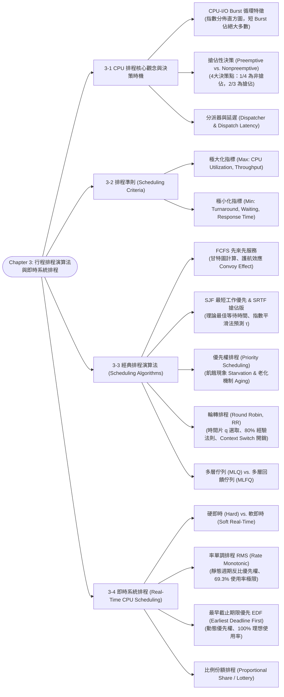

# Chapter 3: Process Scheduling & Real-Time CPU Scheduling

> 📚 **課程名稱**：作業系統 (Operating Systems)  
> 📖 **對應章節**：Chapter 3 Process Scheduling (Basic Concepts ~ Real-Time CPU Scheduling)  
> 👨‍🏫 **授課教師**：NCU CSIE / IM 恐龍書經典教材體系  
> 📄 **參考講義**：[OS-ch03.ppt](file:///c:/Users/Cupid/Downloads/Study-space/Reference/NCU_Classes/作業系統/OS-ch03.ppt)  
> 🔖 **先修觀念**：[Chapter 2 行程五狀態與 PCB 結構](./Chapter_2_教材.md)、甘特圖 (Gantt Chart) 繪製、基礎機率與數列求和

---

## 🗺️ 知識架構心智圖 (Mermaid Tree Diagram)



<a id="tree-diagram"></a>

### 🎯 本章學習進度檢核 (完成後打勾，建立成就反饋)

- [ ] [3-1 CPU 排程核心觀念與決策時機](#sec-1)
- [ ] [3-2 排程準則 (Scheduling Criteria)](#sec-2)
- [ ] [3-3 經典排程演算法 (Scheduling Algorithms)](#sec-3)
- [ ] [3-4 即時系統排程 (Real-Time CPU Scheduling)](#sec-4)

---

## 📖 核心觀念與理論精解

<a id="sec-1"></a>

### 3-1 CPU 排程核心觀念與決策時機

CPU 排程是作業系統多元程式規劃設計的核心基石。其宗旨是透過**在行程交替間快速指派 CPU**，以達到極大化 CPU 產能與極小化等待延遲的目標。

#### 1. CPU–I/O Burst 循環特徵

行程的執行過程是由「CPU 運算執行」與「I/O 等待」交替組成的循環週期：
$$\text{CPU Burst} \longrightarrow \text{I/O Burst} \longrightarrow \text{CPU Burst} \longrightarrow \text{I/O Burst} \dots$$

* **CPU Burst 分佈直方圖特性**：大量實證研究顯示，系統中存在**壓倒性多數的「極短 CPU Burst」（< 8 ms）**，而長 CPU Burst 僅佔極少數。
* **行程性質分類**：
  * **I/O-Bound 行程**：耗費極少時間在 CPU 運算上，充斥著大量極短的 CPU Burst（頻繁進行 I/O 呼叫）。
  * **CPU-Bound 行程**：耗費絕大多數時間在密集運算上，具有少數但極為冗長的 CPU Burst。

#### 2. CPU 排程決策四大時機與搶佔性 (Preemption)

短期排程器（CPU Scheduler）可能在行程發生以下四種狀態變更時發動排程決策：

1. **Running $\to$ Waiting**：執行中行程發起 I/O 請求或呼叫 `wait()` 等待子行程。
2. **Running $\to$ Ready**：硬體時鐘中斷發生（時間片用盡），或更高優先權行程抵達。
3. **Waiting $\to$ Ready**：I/O 裝置完成傳輸或所等待之事件發生。
4. **Terminates**：行程執行完畢結束退出。

##### 搶佔性分類（重要考點）：

* **非搶佔式排程 (Nonpreemptive / Cooperative Scheduling)**：
  * 排程決策**僅在情境 1 與情境 4 發生**！
  * 行程一旦奪得 CPU 控制權，便可以持續佔用 CPU，**直到該行程主動終止（4）或自願進入 Waiting 等待 I/O（1）**為止，外部無法強制剝奪。
  * 優點：硬體邏輯單純，不需時鐘中斷支援，完全避免了共用資料的競態條件。
* **搶佔式排程 (Preemptive Scheduling)**：
  * 排程決策**在情境 2 與情境 3 亦可發動**！
  * 作業系統可隨時依據演算法（如時間片耗盡或出現更高優先權者）**強制奪回 CPU 控制權**，將原行程放回 Ready Queue。
  * 挑戰：必須妥善處理「共用資料的一致性（Race Conditions）」、防止核心資料結構在中斷時受損。現代作業系統（Linux, Windows, macOS）皆為完全搶佔式系統。

#### 3. 分派器 (Dispatcher) 與分派延遲 (Dispatch Latency)

* **分派器 (Dispatcher)**：排程器選定下一個運行的行程後，真正負責將 CPU 操控權交給該行程的底層核心模組。
* **分派器三大任務**：
  1. 執行內文切換（Context Switch）。
  2. 將 CPU 模式位元切換為使用者模式（User Mode）。
  3. 跳轉至該使用者程式之 Program Counter (PC) 所指位址重新啟動執行。
* **分派延遲 (Dispatch Latency)**：分派器「停止前一個行程、並完全啟動新行程執行」所耗費的硬體與軟體時間總和。此延遲直接決定即時系統的即時性。

---

<a id="sec-2"></a>

### 3-2 排程準則 (Scheduling Criteria)

評估一個 CPU 排程演算法良劣，主要考量以下五大黃金指標：

| 指標名稱 | 定義與物理意義 | 優化目標 | 備註說明 |
| :--- | :--- | :---: | :--- |
| **CPU 使用率 (CPU Utilization)** | CPU 處於忙碌執行狀態的時間百分比 | **極大化 (Max)** | 實務上通常落在 40% (輕載) ~ 90% (重載) |
| **吞吐量 (Throughput)** | 單位時間內系統所能執行**完成的行程總數** | **極大化 (Max)** | 短工作越多，吞吐量越高 |
| **週轉時間 (Turnaround Time)** | 從行程「**提交進入系統**」到「**完全執行結束**」的總耗時 | **極小化 (Min)** | 包含等待、執行及 I/O 總和：$T_{\text{finish}} - T_{\text{arrival}}$ |
| **等待時間 (Waiting Time)** | 行程在 **Ready Queue 中苦苦等待取得 CPU** 的時間總和 | **極小化 (Min)** | 排程演算法直接影響的關鍵指標：$T_{\text{turnaround}} - T_{\text{burst}}$ |
| **回應時間 (Response Time)** | 從提交請求到系統「**產生第一次反應輸出**」的時間 | **極小化 (Min)** | 分時多工與互動式系統（UI）最重要的體驗指標 |

---

<a id="sec-3"></a>

### 3-3 經典排程演算法 (Scheduling Algorithms)

#### 1. 先來先服務排程 (First-Come, First-Served, FCFS)

* **機制**：最先進入 Ready Queue 的行程最先分配到 CPU（以 FIFO 佇列實作），屬**非搶佔式**。
* **致命缺陷：護航效應 (Convoy Effect)**：
  * 當一個巨大的 CPU-Bound 行程排在前端時，後方所有短小精悍的 I/O-Bound 行程全部被迫在 Ready Queue 中冗長等待。
  * 導致 CPU 執行長工作期間，週邊 I/O 裝置全數閒置；長工作釋放 CPU 後，大家蜂擁爭搶 I/O，CPU 瞬間閒置。整體系統資源利用率極端低落！

#### 2. 最短工作優先排程 (Shortest-Job-First, SJF)

* **機制**：挑選**下一次 CPU Burst 時間最短**的行程優先執行。
* **理論神格地位**：數學上已證明，**SJF 是最佳化演算法（Optimal）**，在所有排程演算法中能為給定的一組行程提供**最小的平均等待時間 (Minimum Average Waiting Time)**！
* **致命痛點**：在實際長程作業系統中，**根本無法事先精確得知行程「下一次 CPU Burst 的具體長度」**！
* **解法：指數平滑法 (Exponential Smoothing) 預測下一次 Burst**：
  作業系統利用過去歷史執行時間的統計加權來估算下一次長度：
  $$\tau_{n+1} = \alpha t_n + (1 - \alpha)\tau_n$$
  * $t_n$：第 $n$ 次 CPU Burst 的**實際測得時間**。
  * $\tau_n$：第 $n$ 次 CPU Burst 的**歷史預測值**。
  * $\tau_{n+1}$：對下一次 CPU Burst 的**預測估計值**。
  * $\alpha$：平滑加權參數（$0 \le \alpha \le 1$）。若 $\alpha = 0$，表示近期歷史完全不算數（$\tau_{n+1} = \tau_0$）；若 $\alpha = 1$，表示完全只看最近一次實際值（$\tau_{n+1} = t_n$）。業界標準常設 $\alpha = 0.5$。
* **搶佔式 SJF：最短剩餘時間優先 (Shortest-Remaining-Time-First, SRTF)**：
  * 當一個新行程抵達 Ready Queue 時，若其預期 CPU Burst 比「當前正在執行的行程之**剩餘 CPU 時間**」還要短，排程器立即發動搶佔，奪取 CPU！

#### 3. 優先權排程 (Priority Scheduling)

* **機制**：為每個行程賦予一個優先權代碼（通常整數越小優先權越高）。CPU 永遠指派給優先權最高的行程。SJF 本質上就是優先權排程（優先權即預測 Burst 的倒數）。
* **致命缺陷：飢餓現象 (Starvation / Indefinite Blocking)**：
  * 若系統中源源不絕湧入高優先權行程，低優先權行程可能在 Ready Queue 中苦候數天、數月甚至永遠無法獲得 CPU！
  * 歷史名案：1973 年 MIT 的 IBM 7094 停機時，發現一個 1967 年提交的低優先權工作在佇列中苦等了整整 6 年！
* **解法：老化機制 (Aging)**：
  * 隨著行程在 Ready Queue 中等待時間的增加，作業系統定期**逐步調升該行程的優先權**（例如每等待 15 分鐘優先權等級 $+1$）。如此即使原本優先權極低的行程，歷經足夠時間後終將攀升至最高優先權，徹底終結飢餓！

#### 4. 輪轉排程 (Round Robin, RR)

* **專為分時系統量身打造的搶佔式演算法**。
* **機制**：定義微小的時間單位稱為 **時間片 (Time Quantum / Time Slice, $q$)**（通常為 10 ~ 100 毫秒）。Ready Queue 視為 FIFO 環狀佇列。行程每次最多執行一個時間片：
  * 若行程在其時間片內完成或自願 I/O，立即交出 CPU。
  * 若時間片用盡行程尚未完成，硬體定時器觸發中斷，OS 搶佔 CPU，將其放回 Ready Queue 尾端排隊。
* **效能分析與 $q$ 的權衡抉擇**：
  * 若 Ready Queue 中有 $n$ 個行程、時間片為 $q$，則每個行程分配到 $1/n$ 的 CPU 時間，**任何行程最多只需等待 $(n-1)q$ 個時間單位即可再次獲得 CPU**（絕無飢餓，回應時間極佳）。
  * 若 $q \to \infty$：RR 直接退化為 **FCFS**！
  * 若 $q$ 極端微小：內文切換（Context Switch）的系統開銷將徹底拖垮系統！
  * **工程經驗法則**：**80% 的 CPU Burst 長度應該小於時間片 $q$**。

#### 5. 多層佇列 (Multilevel Queue, MLQ) vs. 多層回饋佇列 (Multilevel Feedback Queue, MLFQ)

* **多層佇列 (MLQ)**：
  * 將 Ready Queue 依行程屬性永久固定拆分成多個獨立佇列（例如：前景互動佇列使用 RR、背景批次佇列使用 FCFS）。
  * 佇列間排程多採固定優先權（前景未清空絕不執行背景，有飢餓風險）或時間份額配置（如 80% 給前景、20% 給背景）。
  * **限制**：行程一旦分發即永久綁定在該佇列，無法調配。
* **多層回饋佇列 (MLFQ)**：
  * **現代作業系統最強大通用的排程演算法**！
  * **核心機制：允許行程在不同優先權佇列之間上下移動**！
  * **動態降級**：若某行程佔用完整時間片而未完成，判定為 CPU-Bound，將其**降級至較低優先權佇列**（該佇列時間片較長）。
  * **動態升級 (Aging)**：在低優先權佇列等待過久的行程，**定期升級至高優先權佇列**以杜絕飢餓。

---

<a id="sec-4"></a>

### 3-4 即時系統排程 (Real-Time CPU Scheduling)

即時系統（Real-Time Systems）中，運算結果不僅要求邏輯正確，**更嚴格要求必須在指定的截止期限（Deadline, $d$）前交付結果**！

* **軟即時 (Soft Real-Time)**：僅保證關鍵即時行程享有最高優先權優先執行，但**不保證**絕對能在 Deadline 前完成（如影音串流、電競遊戲）。
* **硬即時 (Hard Real-Time)**：任務**絕對必須在 Deadline 之前完成**，一旦逾時將引發致命災難（如火箭發射、汽車安全氣囊、醫療起搏器）。
* **週期行程模型**：即時行程通常具有週期性（Period, $p$），每次需執行時間 $t$，截止期限 $d$（通常 $t \le d \le p$），請求頻率 Rate $= 1/p$。

#### 1. 率單調排程演算法 (Rate Monotonic Scheduling, RMS)

* **排程策略**：**靜態優先權（Static Priority）**。優先權高低與行程的週期 $p$ 成反比：**週期越短（發生頻率越高）的行程，賦予越高的優先權**！
* **RMS 可排程性極限定理（Liu and Layland, 1973）**：
  若一組 $n$ 個獨立週期性行程滿足總 CPU 使用率條件：
  $$U = \sum_{i=1}^{n} \frac{t_i}{p_i} \le n(2^{1/n} - 1)$$
  則 RMS 保證所有行程必定能在截止期限前完成排程！
  * 當 $n = 1$ 時，$U \le 100\%$。
  * 當 $n = 2$ 時，$U \le 2(2^{1/2} - 1) \approx 82.8\%$。
  * 當 $n \to \infty$ 時，極限值為 $\lim_{n \to \infty} n(2^{1/n} - 1) = \ln 2 \approx \mathbf{69.3\%}$。
  * *注意：此為充分非必要條件！若使用率介於 69.3% ~ 100% 之間，RMS 依然可能可排程，亦可能錯過 Deadline。*

#### 2. 最早截止期限優先排程 (Earliest Deadline First, EDF)

* **排程策略**：**動態優先權（Dynamic Priority）**。在任何排程時刻，**截止期限（Deadline）越早迫近的行程，動態賦予最高優先權**！
* **EDF 神級定理**：
  理論上，**只要總 CPU 使用率滿足 $U = \sum_{i=1}^{n} \frac{t_i}{p_i} \le 100\%$，EDF 保證所有任務必定能全部如期達成 Deadline**！無需受限於 RMS 的 69.3% 上限。

#### 3. 比例份額排程 (Proportional Share Scheduling)

* 系統總算力劃分為 $T$ 股份額（Shares）。若行程 $A$ 獲分配 $N$ 股，則保證獲得 $N/T$ 的 CPU 總運算時間。
* 具備**准入控制 (Admission Control)**：若新申請行程所需的份額會導致總分配份額超過 $T$，作業系統直接拒絕該行程進入。

---

## 💻 經典範例甘特圖演算詳解

<a id="sec-5"></a>

### 範例：SRTF (搶佔式 SJF) 甘特圖與等待時間計算

給定四個行程資訊如下表：

| 行程 | 抵達時間 (Arrival Time) | CPU Burst 時間 |
| :---: | :---: | :---: |
| **$P_1$** | 0 | 8 |
| **$P_2$** | 1 | 4 |
| **$P_3$** | 2 | 9 |
| **$P_4$** | 3 | 5 |

#### 逐步動態追蹤：

1. **$t = 0$**：僅 $P_1$ 抵達，執行 $P_1$。
2. **$t = 1$**：$P_2$ 抵達（Burst = 4）。此時 $P_1$ 剩餘 $8 - 1 = 7$。因為 $4 < 7$，$P_2$ 強制搶佔 CPU！$P_1$ 回 Ready Queue。
3. **$t = 2$**：$P_3$ 抵達（Burst = 9）。當前 $P_2$ 剩餘 3。$3 < 9$，$P_2$ 繼續執行。
4. **$t = 3$**：$P_4$ 抵達（Burst = 5）。當前 $P_2$ 剩餘 2。$2 < 5$，$P_2$ 繼續執行。
5. **$t = 5$**：$P_2$ 執行完畢退出！此時 Ready Queue 中的行程剩餘時間：$P_4(5)$, $P_1(7)$, $P_3(9)$。挑選最小的 **$P_4$** 執行。
6. **$t = 10$**：$P_4$ 執行完畢退出！剩餘 $P_1(7)$, $P_3(9)$。挑選 **$P_1$** 執行。
7. **$t = 17$**：$P_1$ 執行完畢退出！挑選 **$P_3$** 執行至 $t = 26$ 完工。

#### 甘特圖 (Gantt Chart)：

```
┌───────┬───────────┬───────────────┬───────────────────┬───────────────────────┐
│  P1   │    P2     │      P4       │        P1         │          P3           │
└───────┴───────────┴───────────────┴───────────────────┴───────────────────────┘
0       1           5              10                  17                      26
```

#### 等待時間（Waiting Time = 完成時刻 - 抵達時刻 - Burst 時間）計算：

* $P_1$ 等待時間 $= 17 - 0 - 8 = 9$（在 Ready Queue 中於 $1 \sim 10$ 等待了 9 ms）
* $P_2$ 等待時間 $= 5 - 1 - 4 = 0$
* $P_4$ 等待時間 $= 10 - 3 - 5 = 2$（在 $3 \sim 5$ 等待了 2 ms）
* $P_3$ 等待時間 $= 26 - 2 - 9 = 15$（在 $2 \sim 17$ 等待了 15 ms）
* **平均等待時間 (Average Waiting Time)**：
  $$\text{Avg Waiting Time} = \frac{9 + 0 + 2 + 15}{4} = \frac{26}{4} = \mathbf{6.5\text{ ms}}$$

---

## 📝 實戰練習題 (三層遞進式強化測驗)

### 🟢 Tier 1：必懂基礎 (Must-Know Fundamentals)

> 💡 **學習目標**：確認自己「會算、會辨識」——給數字就能做對、給名稱就能配對。

<a id="q1"></a>

#### Q1. (基礎數值計算) FCFS 甘特圖與平均等待時間計算

設有三個行程 $P_1, P_2, P_3$，均在時間 $t = 0$ 抵達就緒佇列（抵達順序為 $P_1, P_2, P_3$）。它們的 CPU Burst 時間分別為：
* $P_1$：$24\text{ ms}$
* $P_2$：$3\text{ ms}$
* $P_3$：$3\text{ ms}$

若作業系統採用先到先服務（FCFS）排程演算法，請問：
(1) 三個行程的等待時間（Waiting Time）分別為何？  
(2) 全體行程的平均等待時間（Average Waiting Time, AWT）為何？  

(A) (1) $P_1=0, P_2=24, P_3=27$; (2) $17\text{ ms}$  
(B) (1) $P_1=0, P_2=3, P_3=6$; (2) $3\text{ ms}$  
(C) (1) $P_1=24, P_2=27, P_3=30$; (2) $27\text{ ms}$  
(D) (1) $P_1=0, P_2=24, P_3=27$; (2) $25.5\text{ ms}$  

👉 [查看 Q1 答案與詳細解析](#ans-q1)

---

<a id="q2"></a>

#### Q2. (基礎數值計算) SJF (非搶奪) 消除護航效應後的平均等待時間

承上一題之數據（$P_1=24\text{ ms}, P_2=3\text{ ms}, P_3=3\text{ ms}$，皆於 $t=0$ 抵達）。若改採**非搶奪式最短工作先做（Non-preemptive SJF）** 排程演算法（遇相同長度以編號小者優先）：
請問全體行程的平均等待時間（Average Waiting Time）大幅縮減為多少？

(A) $17\text{ ms}$  
(B) $3\text{ ms}$  
(C) $6\text{ ms}$  
(D) $9\text{ ms}$  

👉 [查看 Q2 答案與詳細解析](#ans-q2)

---

<a id="q3"></a>

#### Q3. (基礎指標辨識) CPU 排程評估標準：周轉時間 vs. 反應時間

在互動式分時系統（Time-Sharing System）中，評估使用者體驗最重要的指標是「從行程發出輸入請求，到作業系統產生**第一個實質回應（First Response）** 所經歷的時間間隔」。此指標稱為：

(A) 周轉時間 (Turnaround Time)  
(B) 吞吐量 (Throughput)  
(C) 反應時間 (Response Time)  
(D) 執行時間 (Execution Time)  

👉 [查看 Q3 答案與詳細解析](#ans-q3)

---

<a id="q4"></a>

#### Q4. (基礎極限分析) Round Robin (RR) 時間配額 $q$ 的退化特性

在循環分時排程演算法（Round Robin, RR）中，時間配額（Time Quantum, $q$）的大小對系統行為有決定性影響：
(1) 當 $q$ 被設定為極大值（$q \to \infty$，大於任何行程的 CPU Burst）時，RR 排程演算法在行為上**退化為哪種演算法**？  
(2) 當 $q$ 被設定為極小值（例如 $1\ \mu\text{s}$，接近上下文切換耗時）時，系統會面臨何種致命困境？

(A) (1) 退化為 SJF；(2) 發生死結  
(B) (1) 退化為 FCFS；(2) CPU 大多數時間浪費在上下文切換（Context Switch Overhead），有效運算吞吐量趨近於 0  
(C) (1) 退化為優先權排程；(2) 記憶體溢位  
(D) (1) 退化為 FCFS；(2) 所有行程發生飢餓 (Starvation)  

👉 [查看 Q4 答案與詳細解析](#ans-q4)

---

<a id="q5"></a>

#### Q5. (基礎即時排程) 速率單調排程 (Rate-Monotonic Scheduling, RMS) 靜態優先權指派

在硬即時系統（Hard Real-Time System）的週期性任務排程中，速率單調排程演算法（RMS）所遵循的核心優先權指派規則為何？

(A) 任務的 CPU 執行時間（Burst Time）越長，優先權越高  
(B) 任務的週期（Period, $p$）越短（即發生頻率 Rate 越高），所獲得的靜態優先權越高  
(C) 任務的最早截止時間（Deadline）越近，優先權越高  
(D) 抵達時間越早的任務優先權越高  

👉 [查看 Q5 答案與詳細解析](#ans-q5)

---

### 🟡 Tier 2：基礎 + 實際應用 (Application & Scenario Matching)

> 💡 **學習目標**：確認自己「會用」——能消除護航效應、運用老化技術防飢餓、計算 RMS 可排程性。

<a id="q6"></a>

#### Q6. (效能瓶頸消除) 護航效應 (Convoy Effect) 的成因與演算法抉擇

在某批次運算伺服器中，觀測到系統經常出現「CPU 密集行程長時間霸佔處理器，導致後方多個僅需 1~2 ms 運算即可發出磁碟寫入請求的 I/O 密集行程被全數卡死在 Ready 佇列中，使得硬碟與周邊裝置長時間處於閒置」的病態現象。
(1) 這種病態現象在作業系統中稱為什麼？  
(2) 理論上，若欲獲得數學上證明的**最小平均等待時間（Optimal Average Waiting Time）**，應將排程演算法切換為：

(A) (1) 飢餓現象 (Starvation)，(2) 先到先服務 (FCFS)  
(B) (1) 護航效應 (Convoy Effect)，(2) 最短工作先做 (SJF / SRTF)  
(C) (1) 活結現象 (Livelock)，(2) 循環分時 (RR)  
(D) (1) 優先權倒置 (Priority Inversion)，(2) 多層佇列 (MLQ)  

👉 [查看 Q6 答案與詳細解析](#ans-q6)

---

<a id="q7"></a>

#### Q7. (飢餓防禦機制) 優先權排程與老化技術 (Aging Technique)

在純粹的優先權排程系統（Priority Scheduling）中，系統保證總是優先挑選優先權最高的行程執行。此策略面臨的最大隱患是「低優先權行程可能永久無法取得 CPU（飢餓現象 Starvation / Indefinite Blocking）」。
作業系統在工程實務中採用「**老化技術 (Aging)**」完美解決此問題，其具體運作規則為何？

(A) 隨著低優先權行程在系統中等待的時間逐步增加，核心動態逐步遞增其優先權數值，使其最終必然升至最高優先權獲得執行  
(B) 當行程年齡達到 10 秒後，核心直接將其強制終止  
(C) 定期降低高優先權行程的記憶體配額  
(D) 將所有等待超過 1 分鐘的行程直接移出記憶體並儲存至磁碟 Swap 區  

👉 [查看 Q7 答案與詳細解析](#ans-q7)

---

<a id="q8"></a>

#### Q8. (即時排程可排程性分析) RMS 充分保證上限 (Liu & Layland Bound) 驗證

設有兩個獨立的週期性即時任務 $T_1$ 與 $T_2$：
* 任務 $T_1$：週期 $p_1 = 50\text{ ms}$，最差執行時間 $c_1 = 20\text{ ms}$
* 任務 $T_2$：週期 $p_2 = 100\text{ ms}$，最差執行時間 $c_2 = 35\text{ ms}$

依據 Liu & Layland 提出的 RMS 可排程性充分條件公式：
$$U = \sum_{i=1}^{m} \frac{c_i}{p_i} \le m\left(2^{1/m} - 1\right)$$
請問這組任務是否**保證可被 RMS 安全排程且絕不違反截止時間（Miss Deadline）**？

(A) 總利用率 $U = 0.85$，超過上限 $0.828$，保證不可排程  
(B) 總利用率 $U = 0.75$，小於上限 $0.828$，保證必定可安全排程  
(C) 總利用率 $U = 0.55$，小於上限 $0.693$，保證可安全排程  
(D) 總利用率 $U = 1.00$，剛好達到系統上限  

👉 [查看 Q8 答案與詳細解析](#ans-q8)

---

<a id="q9"></a>

#### Q9. (多佇列排程選型) 多層回饋佇列 (MLFQ) 相比固定多層佇列 (MLQ) 的本質優勢

在設計通用作業系統（如 Windows / Linux）時，架構師為何不採用靜態劃分的「多層佇列 (Multilevel Queue, MLQ)」，而一致採用「多層回饋佇列 (Multilevel Feedback Queue, MLFQ)」？

(A) 因為 MLQ 需要消耗更多的實體記憶體空間  
(B) 因為 MLQ 的行程在建立時就被永久固定在特定佇列（無法跨層移動），缺乏彈性；而 MLFQ 允許行程根據 CPU 耗用歷史在佇列間動態升降，能自動辨識 I/O-bound 與 CPU-bound 行程  
(C) 因為 MLQ 只能在單核心處理器上執行  
(D) 因為 MLQ 完全不支援分時機制  

👉 [查看 Q9 答案與詳細解析](#ans-q9)

---

### 🔴 Tier 3：概念講述與深度分析 (Conceptual & Analytical)

> 💡 **學習目標**：確認自己「會講」——能推導 CPU Burst 指數平滑預測、解析 MLFQ 防作弊規則與即時排程極限。

<a id="q10"></a>

#### Q10. (數學推導與數值預測題) SJF 指數平滑法 (Exponential Smoothing) 預測 CPU Burst

SJF 是理論上最佳的演算法，但其最大難點在於「作業系統無法預知行程下一次真正的 CPU Burst 長度」，實務上採用過去歷史觀測值的指數平滑法進行預測：
$$\tau_{n+1} = \alpha t_n + (1 - \alpha)\tau_n$$
其中 $t_n$ 為第 $n$ 次的實際觀測長度，$\tau_n$ 為歷史預測值，$0 \le \alpha \le 1$。
(1) 請將該遞迴式徹底展開至第 0 期，寫出一般項展開式 $\tau_{n+1} = \alpha t_n + \alpha(1-\alpha)t_{n-1} + \dots$，並論述為什麼此方法被稱為「指數平滑法」？  
(2) 當 $\alpha = 0$ 與 $\alpha = 1$ 時分別代表何種極端的設計哲學？  
(3) 設初始猜測 $\tau_1 = 10\text{ ms}$，設定平滑參數 $\alpha = 0.5$。若後續行程前兩次的實際執行長度分別為 $t_1 = 12\text{ ms}$ 與 $t_2 = 8\text{ ms}$，請精確計算預測值 $\tau_2$ 與 $\tau_3$。

👉 [查看 Q10 答案與詳細解析](#ans-q10)

---

<a id="q11"></a>

#### Q11. (演算法工程設計題) MLFQ 的「防作弊 (Anti-Gaming)」與「全域優先權提升 (Priority Boost)」

經典的多層回饋佇列（MLFQ）設計有以下著名規則：
* 規則 1：若 Priority(A) > Priority(B)，執行 A。
* 規則 2：若 Priority(A) == Priority(B)，以 RR 執行。
* 規則 3：新進入系統的行程置於最頂層佇列。
* 規則 4：一旦行程用完了當前層級的時間配額，強制降級至下一層佇列。

請回答下列深層防禦設計問題：
(1) **防作弊計時規則 (Accounting Rule)**：若系統僅在「單次 CPU 突發用完配額」時才予以處罰降級，某惡意行程可以在時間配額即將用盡的 $99\%$ 時刻，故意呼叫一次無意義的 I/O 藉此保留在頂層佇列。現代 MLFQ 是如何修改規則來徹底防堵此作弊行為？  
(2) **規則 5 (Priority Boost)**：「經過週期時間 $S$ 後，系統將全體行程無條件全部重置回最頂層佇列」。試深入闡述此規則同時解決了哪兩大關鍵實務問題？

👉 [查看 Q11 答案與詳細解析](#ans-q11)

---

<a id="q12"></a>

#### Q12. (即時排程理論極限對比) RMS (速率單調) vs. EDF (最早截止時間先做)

在硬即時嵌入式系統中，架構師必須在 RMS 與 EDF 之間做出決策：
試從以下三個維度深入對比兩者：
(1) **優先權賦予方式**（靜態 Static vs. 動態 Dynamic）  
(2) **理論最大 CPU 利用率上限**（RMS 的 $\approx 69.3\%$ 瓶頸 vs. EDF 的 $100\%$）  
(3) **系統超載 (Overload) 時的崩潰模式**（RMS 的穩定優先級截斷 vs. EDF 的骨牌骨折效應 Domino Effect）

👉 [查看 Q12 答案與詳細解析](#ans-q12)

---

## 🔑 本章練習題答案與詳細解析 (Answer Key)

### 🟢 Tier 1 解析

<a id="ans-q1"></a>

### Q1 答案與詳細解析

* **正確答案**：**(A)**
* **甘特圖與數值推導**：
  * 排程甘特圖：
    `[ P1 (0~24) | P2 (24~27) | P3 (27~30) ]`
  * **各行程等待時間 (Waiting Time)**：
    * $P_1$：$0\text{ ms}$（抵達即執行）
    * $P_2$：$24 - 0 = 24\text{ ms}$
    * $P_3$：$27 - 0 = 27\text{ ms}$
  * **平均等待時間 (AWT)**：
    $$\text{AWT} = \frac{0 + 24 + 27}{3} = \frac{51}{3} = 17\text{ ms}$$
  * 選項 (A) 完全正確。

[🔙 返回題目 Q1](#q1) ｜ [🔝 返回知識架構圖](#tree-diagram)

---

<a id="ans-q2"></a>

### Q2 答案與詳細解析

* **正確答案**：**(B)**
* **數值對比推導**：
  * 在非搶奪式 SJF 下，挑選目前最短的行程先執行。因 $P_2$ 與 $P_3$ 皆為 3 ms，優先執行 $P_2$ 再 $P_3$，最後執行 24 ms 的 $P_1$。
  * 排程甘特圖：
    `[ P2 (0~3) | P3 (3~6) | P1 (6~30) ]`
  * **各行程等待時間**：
    * $P_2$：$0\text{ ms}$
    * $P_3$：$3\text{ ms}$
    * $P_1$：$6\text{ ms}$
  * **平均等待時間 (AWT)**：
    $$\text{AWT} = \frac{0 + 3 + 6}{3} = \frac{9}{3} = 3\text{ ms}$$
  * 結論：平均等待時間從 $17\text{ ms}$ 暴跌至 $3\text{ ms}$，效率提升將近 6 倍！

[🔙 返回題目 Q2](#q2) ｜ [🔝 返回知識架構圖](#tree-diagram)

---

<a id="ans-q3"></a>

### Q3 答案與詳細解析

* **正確答案**：**(C)**
* **指標辨析**：
  * **反應時間 (Response Time)**：從請求提交到系統產生「第一次響應/輸出」的時間間隔。在圖形介面與互動終端中，使用者最在乎點擊後多久看到畫面動靜，故此為核心指標。
  * **周轉時間 (Turnaround Time)**：從行程進入系統到其完全執行結束退出的總時間（含等待 + 執行）。
  * **吞吐量 (Throughput)**：單位時間內完成的行程總數。選項 (C) 正確。

[🔙 返回題目 Q3](#q3) ｜ [🔝 返回知識架構圖](#tree-diagram)

---

<a id="ans-q4"></a>

### Q4 答案與詳細解析

* **正確答案**：**(B)**
* **配額極限剖析**：
  * (1) 若 $q \to \infty$，每個行程一旦獲得 CPU，其時間配額永遠用不完，直到行程自己執行結束或主動發出 I/O 讓出，這正是先到先服務（FCFS）的行為。
  * (2) 若 $q \to 0$（例如 $1\ \mu\text{s}$），雖然在理論上呈現完美的「處理器共享（Processor Sharing）」，每個行程看似同時以 $1/n$ 的速度前進；然而每次 Context Switch 需要耗費約 $1 \sim 10\ \mu\text{s}$。如果切換開銷與配額相當甚至更大，CPU 將幾乎 $100\%$ 耗死在排程與儲存暫存器上，使用者有效運算徹底停頓。選項 (B) 正確。

[🔙 返回題目 Q4](#q4) ｜ [🔝 返回知識架構圖](#tree-diagram)

---

<a id="ans-q5"></a>

### Q5 答案與詳細解析

* **正確答案**：**(B)**
* **RMS 原理**：
  * **Rate-Monotonic** 的定義即為「速率越快，優先權越高」。
  * 在週期性任務中，速率（Rate）等於週期的倒數 $f = 1/p$。
  * 因此週期 $p$ 越短的任務，其重複出現的頻率越高，必須獲得更高的靜態優先權（Static Priority）。一旦指派完畢，在任務整個執行生命週期中優先權永遠不再改變。選項 (B) 正確。

[🔙 返回題目 Q5](#q5) ｜ [🔝 返回知識架構圖](#tree-diagram)

---

### 🟡 Tier 2 解析

<a id="ans-q6"></a>

### Q6 答案與詳細解析

* **正確答案**：**(B)**
* **病態機制與最佳解**：
  * **護航效應 (Convoy Effect)**：類似在單行道上一輛時速 20 公里的巨型壓路機（CPU-bound 行程）擋在前面，後方跟著一整串時速 100 公里的敏捷小跑車（I/O-bound 行程）。當巨型行程霸佔 CPU 時，所有周邊裝置被迫閒置等待；而當巨型行程終於做 I/O 時，小行程瞬間做完 CPU 又回到佇列，造成 CPU 與 I/O 裝置的使用率皆極度低落。
  * **數學最優證明**：SJF（最短工作先做）演算法已被數學證明，對於任何給定的一組排程任務，SJF 保證產生**全體排程演算法中最小的平均等待時間**。因此改用 SJF / SRTF 可以讓小工作迅速通過離開，徹底消除護航效應。選項 (B) 正確。

[🔙 返回題目 Q6](#q6) ｜ [🔝 返回知識架構圖](#tree-diagram)

---

<a id="ans-q7"></a>

### Q7 答案與詳細解析

* **正確答案**：**(A)**
* **老化技術 (Aging) 實作機制**：
  * 優先權排程的一大宿疾為**飢餓 (Starvation / Indefinite Blocking)**：只要系統源源不絕湧入高優先權行程，低優先權行程可能等待數小時甚至數天都得不到 CPU。
  * **Aging 解決之道**：作業系統設置週期性定時器，每當行程在 Ready 佇列中每等待一定時間（例如每過 15 分鐘），核心就將其優先權等級 $+1$（假設數值越大優先權越高）。
  * 如此一來，即使是初始優先權最低的行程，只要在佇列中等待足夠長的時間，其優先權終將超越系統中所有其他新抵達的行程，保證獲得 CPU 執行，從根本上消除了飢餓。選項 (A) 正確。

[🔙 返回題目 Q7](#q7) ｜ [🔝 返回知識架構圖](#tree-diagram)

---

<a id="ans-q8"></a>

### Q8 答案與詳細解析

* **正確答案**：**(B)**
* **精確數值計算推導**：
  1. 計算總 CPU 利用率 $U$：
     $$U = \frac{c_1}{p_1} + \frac{c_2}{p_2} = \frac{20}{50} + \frac{35}{100} = 0.40 + 0.35 = 0.75\ (75\%)$$
  2. 計算 $m = 2$ 個任務時的 RMS 充分條件上限：
     $$U_{\text{bound}} = 2\left(2^{1/2} - 1\right) = 2(\sqrt{2} - 1) \approx 2(1.4142 - 1) = 0.8284\ (82.8\%)$$
  3. 判定：
     $$U = 0.75 \le U_{\text{bound}} \approx 0.828$$
     因總利用率低於理論保證上限，故依據 Liu & Layland 定理，這組任務**百分之百保證可被 RMS 安全排程**，絕不會發生任何逾期。選項 (B) 正確。

[🔙 返回題目 Q8](#q8) ｜ [🔝 返回知識架構圖](#tree-diagram)

---

<a id="ans-q9"></a>

### Q9 答案與詳細解析

* **正確答案**：**(B)**
* **架構演進核心原因**：
  * **Multilevel Queue (MLQ)**：佇列靜態劃分（如前台佇列與後台佇列）。行程建立後便被永久固定於某一佇列，若前台佇列永遠有工作，後台佇列將永久飢餓，且作業系統無法得知某個未知的外部程式到底是偏好互動還是偏好運算。
  * **Multilevel Feedback Queue (MLFQ)**：引入**回饋與動態流動**。新行程先被當作高優先權 I/O 行程放入頂層；若其迅速讓出 CPU（互動式），則繼續留在頂層享受極低延遲；若其長時間霸佔 CPU（運算型），則自動逐層降級至底層。MLFQ 能在零先驗知識下**自適應學習**行程行為，是現代通用作業系統的核心實作。選項 (B) 正確。

[🔙 返回題目 Q9](#q9) ｜ [🔝 返回知識架構圖](#tree-diagram)

---

### 🔴 Tier 3 解析

<a id="ans-q10"></a>

### Q10 答案與詳細解析

* **(1) 展開式推導與指數平滑命名緣由**：
  * 將遞迴式展開：
    $$\begin{aligned}
    \tau_{n+1} &= \alpha t_n + (1-\alpha)\tau_n \\
               &= \alpha t_n + (1-\alpha)[\alpha t_{n-1} + (1-\alpha)\tau_{n-1}] \\
               &= \alpha t_n + \alpha(1-\alpha)t_{n-1} + (1-\alpha)^2\tau_{n-1} \\
               &= \alpha t_n + \alpha(1-\alpha)t_{n-1} + \alpha(1-\alpha)^2 t_{n-2} + \dots + (1-\alpha)^n \tau_0
    \end{aligned}$$
  * 因 $(1-\alpha) < 1$，隨著歷史期數越久遠，其係數 $(1-\alpha)^j$ 呈現**幾何級數（指數衰減）** 遞減。越近期的實際觀測值 $t_n$ 權重越大，歷史久遠的數值權重趨近於零，故稱為「指數平滑法」。

* **(2) 極端參數物理意義**：
  * 若 $\alpha = 0$：$\tau_{n+1} = \tau_n = \dots = \tau_0$。近期的實際表現完全被忽視，系統永遠固守初始猜測值（無學習能力）。
  * 若 $\alpha = 1$：$\tau_{n+1} = t_n$。系統毫無記憶性，完全只相信上一次的瞬間爆發值（極易受到單次異常雜訊干擾）。

* **(3) 精確數值計算**：
  * 已知 $\tau_1 = 10, \alpha = 0.5$：
  * 第 1 期結束，實際 $t_1 = 12$：
    $$\tau_2 = 0.5 \times t_1 + (1 - 0.5) \times \tau_1 = 0.5 \times 12 + 0.5 \times 10 = 6 + 5 = 11\text{ ms}$$
  * 第 2 期結束，實際 $t_2 = 8$：
    $$\tau_3 = 0.5 \times t_2 + 0.5 \times \tau_2 = 0.5 \times 8 + 0.5 \times 11 = 4 + 5.5 = 9.5\text{ ms}$$

[🔙 返回題目 Q10](#q10) ｜ [🔝 返回知識架構圖](#tree-diagram)

---

<a id="ans-q11"></a>

### Q11 答案與詳細解析

* **(1) 累積時間配額防作弊 (Accounting Rule)**：
  * **漏洞剖析**：若規則規定「單次連續用滿時間配額 $T$ 才降級」，惡意程式在執行了 $0.99T$ 時，發起一次讀取 1 Byte 磁碟的 I/O。核心誤以為它是 I/O-bound 互動行程，在中斷後又將其放回頂層並重置完整的時間配額 $T$。如此惡意行程可以永遠霸佔 99% 的頂層 CPU 時間。
  * **解決之道（累積記帳規則）**：核心不再檢查「單次連續執行長度」，改為在該層級維護**累積耗用時間配額（Allotment）**。無論該行程中途放棄或發出幾次 I/O，只要它在當前層級累計消耗的 CPU 時間總和達到配額 $T$，核心便強制將其降級至下一層佇列，徹底粉碎作弊行為。

* **(2) Priority Boost 規則解決的兩大痛點**：
  * **痛點一：徹底杜絕飢餓 (Starve-free)**：若系統湧入源源不絕的短時間互動行程，底層的長運算行程將永久得不到 CPU。經過時間 $S$ 後全體提升至頂層，保證了底層行程每隔一段時間必然能被排程執行。
  * **痛點二：自適應應對行程相態轉變 (Phase Change)**：某些大型程式原本是 CPU-bound（如解壓縮或載入檔案），一段時間後轉變為高互動性（如遊戲開始讓使用者操作鍵盤滑鼠）。若無 Priority Boost，該行程一旦跌入底層佇列將永遠無法翻身，導致畫面卡頓。Priority Boost 賦予了所有行程定期「洗心革面、重新證明自己」的機會。

[🔙 返回題目 Q11](#q11) ｜ [🔝 返回知識架構圖](#tree-diagram)

---

<a id="ans-q12"></a>

### Q12 答案與詳細解析

* **(1) 優先權賦予機制**：
  * **RMS (Rate-Monotonic)**：**靜態優先權 (Static Priority)**。優先權在系統編譯或任務初始化時即依據週期 $p$ 決定好，執行期間完全不變。排程器僅需維護靜態 Bitmap 或優先權佇列，Runtime 開銷極小。
  * **EDF (Earliest-Deadline-First)**：**動態優先權 (Dynamic Priority)**。每次任務實例（Job Instance）釋放時，其絕對截止時間為 $r_i + d_i$。排程器必須動態維護所有就緒任務的絕對截止時間排序，排程開銷相對較大。

* **(2) 最大 CPU 利用率上限**：
  * **RMS**：理論保證上限隨任務數增加而遞減，極限為 $\lim_{m \to \infty} m(2^{1/m} - 1) = \ln 2 \approx 69.3\%$。若任務集總利用率介於 $70\% \sim 99\%$ 之間，RMS 無法直接保證可排程，需額外做昂貴的響應時間分析（Response-Time Analysis, RTA）。
  * **EDF**：在所有截止時間等於週期的任務集中，EDF 被證明其可排程性上限嚴格為 **$100\%$**（$U \le 1$ 即充分且必要！）。EDF 能榨乾處理器的最後一滴效能而不錯失任何截止期。

* **(3) 超載時的崩潰模式 (Overload Failure Mode)**：
  * **RMS（優雅降級）**：當系統遭遇突發超載時，由於優先權是靜態的，最高優先權的最核心關鍵任務（週期短、如心跳或姿態控制）**百分之百能保證按時完成**，只有最低優先權的次要任務（如記錄日誌）會逾期。工程師能完全預測並控制失敗半徑。
  * **EDF（骨牌骨折 Domino Effect）**：當系統瞬間超載（$U > 1$）時，EDF 會優先去搶救「最早截止」但已經注定無法按時完成的任務，導致該任務不僅逾期，還拖垮後方原本有充足時間完成的任務，引發連鎖崩潰反應（全部任務集體逾期），在關鍵生命安全系統（如航太、車控）中這是不可接受的災難。

[🔙 返回題目 Q12](#q12) ｜ [🔝 返回知識架構圖](#tree-diagram)

---
## 📊 重點速記表 (Summary Table)

| 排程演算法 | 搶佔性 | 核心準則 / 機制 | 核心優點 | 主要缺點或潛在風險 |
| :--- | :---: | :--- | :--- | :--- |
| **FCFS** | 非搶佔 | 先來先服務 (FIFO 佇列) | 實作最簡單、公平無開銷 | 護航效應 (Convoy Effect) |
| **SJF** | 非搶佔 | 挑選最短 CPU Burst 者 | 理論最小平均等待時間 | 需預測 Burst；長工作會飢餓 |
| **SRTF** | 搶佔式 | 剩餘時間最短者優先搶佔 | 提供搶佔式最小平均等待時間 | 需頻繁預測與頻繁 Context Switch |
| **Priority** | 兩者皆有 | 數字越小優先權越高 | 反映任務客觀重要性 | 飢餓 (Starvation)；需老化 (Aging) 解決 |
| **Round Robin** | 搶佔式 | 固定時間片 $q$ 輪轉 | 回應時間佳，無飢餓風險 | $q$ 太小內文切換開銷過大 |
| **MLFQ** | 搶佔式 | 多層佇列動態升降級與 Aging | 兼顧互動性、吞吐量與防飢餓 | 參數調校極其複雜 |
| **RMS** | 搶佔式 | 週期越短優先權越高 (靜態) | 即時系統實作簡單優雅 | 算力利用率上限僅 $\ln 2 \approx 69.3\%$ |
| **EDF** | 搶佔式 | 截止期限越早優先權越高 (動態) | 算力利用率保證可達 100% | 動態計算 Deadline 核心開銷高 |

---

## 🗂️ 考前速查卡片 (Flashcards)

<div style="display: grid; grid-template-columns: repeat(auto-fit, minmax(280px, 1fr)); gap: 1rem;">

<div style="border: 1px solid #e2e8f0; border-radius: 8px; padding: 1rem; background-color: #f8fafc;">
  <strong style="color: #2563eb;">Q: 為什麼 SJF 被稱為最佳化 (Optimal) 排程演算法？</strong>
  <hr style="margin: 0.5rem 0;" />
  <p><strong>A:</strong> 經數學證明，SJF 演算法能夠在所有排程演算法中，為給定的一組行程提供最小的平均等待時間 (Minimum Average Waiting Time)。</p>
</div>

<div style="border: 1px solid #e2e8f0; border-radius: 8px; padding: 1rem; background-color: #f8fafc;">
  <strong style="color: #2563eb;">Q: 什麼是護航效應 (Convoy Effect)？</strong>
  <hr style="margin: 0.5rem 0;" />
  <p><strong>A:</strong> 在 FCFS 中，長 CPU-bound 行程排在前面，導致後方眾多短 I/O-bound 行程被迫苦苦等待，造成 CPU 與 I/O 設備利用率雙雙低落。</p>
</div>

<div style="border: 1px solid #e2e8f0; border-radius: 8px; padding: 1rem; background-color: #f8fafc;">
  <strong style="color: #2563eb;">Q: 即時系統中 RMS 與 EDF 的優先權指派原則各為何？</strong>
  <hr style="margin: 0.5rem 0;" />
  <p><strong>A:</strong> RMS 為靜態優先權，週期 p 越短（頻率越高）優先權越高；EDF 為動態優先權，截止期限 Deadline 越早迫近者優先權越高。</p>
</div>

<div style="border: 1px solid #e2e8f0; border-radius: 8px; padding: 1rem; background-color: #f8fafc;">
  <strong style="color: #2563eb;">Q: 設計 Round Robin 的時間片 q 時有何工程經驗法則？</strong>
  <hr style="margin: 0.5rem 0;" />
  <p><strong>A:</strong> 大約 80% 的 CPU Burst 長度應當小於時間片 q，且 q 必須遠大於內文切換時間（通常 q 為 10~100 ms，Context Switch &lt; 10 μs）。</p>
</div>

</div>

---

## ⚠️ 考試常見陷阱題 (Common Traps)

1. **陷阱一：計算等待時間時忘記減去抵達時間 (Arrival Time)**  
   * *錯誤示範*：誤以為等待時間就是排程開始執行的時刻。  
   * *防坑秘笈*：牢記公式：等待時間 $=$ 週轉時間 $-$ CPU Burst 時間 $=$ (完成時刻 $-$ 抵達時刻) $-$ CPU Burst 時間。
2. **陷阱二：SRTF 遇到新行程抵達時未比對「剩餘時間」**  
   * *錯誤示範*：拿新行程的 Burst 與舊行程的「原始 Burst」比對。  
   * *防坑秘笈*：搶佔式比對必須以舊行程「已經執行後剩下來的殘餘 Burst」與新行程的完整 Burst 比大小！
3. **陷阱三：誤以為 RMS 只要總使用率小於 100% 就一定能保證完成**  
   * *防坑秘笈*：RMS 的極限是 $n(2^{1/n}-1)$（極限 69.3%）。若使用率超過此界線，RMS 可能會錯過 Deadline！只有 EDF 才能在 $U \le 100\%$ 下保證排程成功。
4. **陷阱四：搶佔式與非搶佔式的 4 大決策點混淆**  
   * *防坑秘笈*：非搶佔式嚴格只有 1 (Running $\to$ Waiting) 與 4 (Terminates)；凡是包含 2 (時間片用完) 或 3 (I/O 完成回 Ready) 的排程皆屬搶佔式。

---

## 🔗 相關章節索引與導航

* 🔙 **上一章節**：[Chapter 2: 行程觀念與行程間通訊](./Chapter_2_教材.md)
* 🔙 **課程教材總覽**：[作業系統教材目錄 (_INDEX.md)](./_INDEX.md)
* ⏭️ **下一章節**：[Chapter 4: 多執行緒程式設計 (Multithreaded Programming)](./Chapter_4_教材.md)
* 📂 **原始講義檔案**：[OS-ch03.ppt](file:///c:/Users/Cupid/Downloads/Study-space/Reference/NCU_Classes/作業系統/OS-ch03.ppt)
