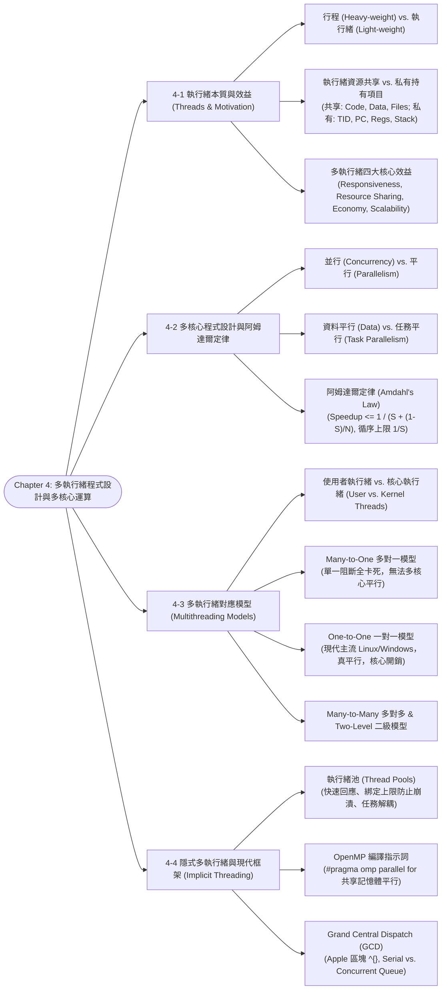

# Chapter 4: Multithreaded Programming & Multicore Architecture

> 📚 **課程名稱**：作業系統 (Operating Systems)  
> 📖 **對應章節**：Chapter 4 Multithreaded Programming (Overview ~ Implicit Threading)  
> 👨‍🏫 **授課教師**：NCU CSIE / IM 恐龍書經典教材體系  
> 📄 **參考講義**：[OS-ch04.ppt](file:///c:/Users/Cupid/Downloads/Study-space/Reference/NCU_Classes/作業系統/OS-ch04.ppt)  
> 🔖 **先修觀念**：[Chapter 2 行程記憶體配置與 PCB](./Chapter_2_教材.md)、[Chapter 3 CPU 排程準則](./Chapter_3_教材.md)、多核心硬體架構、C/C++ 函式指標

---

## 🗺️ 知識架構心智圖 (Mermaid Tree Diagram)



<a id="tree-diagram"></a>

### 🎯 本章學習進度檢核 (完成後打勾，建立成就反饋)

- [ ] [4-1 執行緒本質與效益 (Threads & Motivation)](#sec-1)
- [ ] [4-2 多核心程式設計與阿姆達爾定律](#sec-2)
- [ ] [4-3 多執行緒對應模型 (Multithreading Models)](#sec-3)
- [ ] [4-4 隱式多執行緒與現代框架 (Implicit Threading)](#sec-4)

---

## 📖 核心觀念與理論精解

<a id="sec-1"></a>

### 4-1 執行緒概念 (Thread Concept) 與核心效益

傳統作業系統中，一個行程（Process）只有單一控制執行緒（Single Thread of Execution），同一時刻只能做一件事。在現代軟體工程中，絕大多數應用程式皆為**多執行緒（Multithreaded）**架構（如瀏覽器中一個執行緒負責下載圖片、一個負責解析 HTML、一個負責即時響應滑鼠點擊）。

#### 1. 行程 (Heavy-weight) vs. 執行緒 (Light-weight)

* **行程 (Process)**：資源分配的最小基本單位。建立行程需要由 OS 配置完整的獨立虛擬位址空間、分頁表與 PCB，屬於**重量級（Heavy-weight）**操作。
* **執行緒 (Thread)**：CPU 排程與執行的最小基本單位（又稱輕量級行程 Lightweight Process, LWP）。多個執行緒存在於同一個行程內部。

#### 2. 執行緒間的「共享資源」vs.「私有持有項目」（高頻必考）

```
     單一執行緒行程 (Single-threaded)            多執行緒行程 (Multithreaded)
  ┌─────────────────────────────────┐     ┌─────────────────────────────────┐
  │ 共享: Code, Data, Open Files    │     │ 共享: Code, Data, Open Files    │
  ├─────────────────────────────────┤     ├─────────────┬─────────────┬─────┤
  │ 私有暫存器 Registers            │     │ Regs (T1)   │ Regs (T2)   │ ... │
  ├─────────────────────────────────┤     ├─────────────┼─────────────┼─────┤
  │ 私有堆疊 Stack                  │     │ Stack (T1)  │ Stack (T2)  │ ... │
  └─────────────────────────────────┘     └─────────────┴─────────────┴─────┘
```

* **同一行程內所有執行緒「共享 (Shared)」的資源**：
  1. **程式碼區段 (Code / Text Section)**：共享編譯後的二進位機器指令。
  2. **資料區段 (Data Section)**：共享全域變數（Global Variables）與靜態變數（Static Variables）。
  3. **堆積區段 (Heap Section)**：共享動態配置記憶體（如 `malloc`、`new` 所配置的記憶體）。
  4. **作業系統週邊資源 (OS Resources)**：共享開啟檔案描述元表格（Open File Descriptors）、網路 Socket、號誌與訊號處理常式。
* **每個執行緒「私有獨佔 (Private)」的項目（不可共享）**：
  1. **執行緒識別碼 (Thread ID, TID)**：唯一識別該執行緒。
  2. **程式計數器 (Program Counter, PC)**：記錄該執行緒當前正在執行的指令記憶體位址（各執行緒執行不同函式）。
  3. **暫存器狀態組 (Register Set)**：包含 CPU 通用暫存器數值、狀態標誌。
  4. **私有堆疊 (Private Stack)**：存放該執行緒函式呼叫的局部變數（Local Variables）、傳入參數與返回位址。

#### 3. 多執行緒程式設計的四大核心效益 (Benefits)

1. **回應性 (Responsiveness)**：在圖形介面（GUI）或網路服務中，即使某個執行緒因漫長的磁碟 I/O 或網路請求而陷入阻斷（Blocked），其他執行緒仍能全速運作，維持使用者介面的即時互動流暢性。
2. **資源共享 (Resource Sharing)**：同一行程內的執行緒天生共享相同的記憶體空間，資料交換極為直覺迅速，完全免除傳統 IPC（共享記憶體或訊息傳遞）繁瑣複雜的系統呼叫與配置。
3. **經濟性 (Economy)**：
   * 建立執行緒的耗時與記憶體開銷遠小於建立行程（通常便宜數十倍）。
   * 執行緒間的內文切換（Thread Context Switch）無需切換分頁表與清除快取（TLB），開銷遠低於行程內文切換。
4. **可擴展性 (Scalability)**：單一執行緒行程無論硬體有多少個 CPU 核心，始終只能佔用單一核心運算；多執行緒行程能將不同執行緒分派至多個物理 CPU 核心上**真正平行執行**，充分壓榨多核心硬體算力。

---

<a id="sec-2"></a>

### 4-2 多核心程式設計與阿姆達爾定律 (Multicore & Amdahl's Law)

#### 1. 並行性 (Concurrency) vs. 平行性 (Parallelism)

* **並行性 (Concurrency)**：系統支援「多個任務同時向前推進（Making Progress）」的能力。在**單一 CPU 核心系統**中，CPU 透過時間片輪轉高頻切換執行緒，營造出多任務同時運行的表象，此為並行。
* **平行性 (Parallelism)**：系統在「**同一實體時間點（Simultaneously）**同時執行多個任務」的能力。系統**必須擁有兩個以上的物理 CPU 核心**，方能達成真正的物理平行。

#### 2. 資料平行 vs. 任務平行

* **資料平行 (Data Parallelism)**：將**同一批龐大資料**切分成多個子集合，分散至多個核心，每個核心對其分配到的資料子集執行**完全相同的操作**（如 GPU 矩陣相乘、影像像素濾鏡處理）。
* **任務平行 (Task Parallelism)**：將**多個完全相異的工作任務（獨立執行緒）**分發至不同核心，每個執行緒執行各自獨特的程式碼邏輯（如一個執行緒負責下載，一個負責壓縮解碼）。

#### 3. 阿姆達爾定律 (Amdahl's Law)

阿姆達爾定律是用來估算當我們替應用程式增加更多處理器核心時，系統所能獲得的**最大理論加速比（Theoretical Speedup）**：

$$\text{Speedup} \le \frac{1}{S + \frac{1 - S}{N}}$$

* $S$：應用程式中**必須循序執行（無法平行化）的部分所佔的比例**（Serial portion，$0 \le S \le 1$）。
* $1 - S$：應用程式中**能夠完全平行化的部分所佔的比例**（Parallel portion）。
* $N$：系統擁有的**處理器核心數量 (Processing Cores)**。

> 💡 **阿姆達爾極限定理（極重要考點）**：  
> 當我們將處理器核心數增加至無窮大時（$N \to \infty$）：
> $$\lim_{N \to \infty} \text{Speedup} = \frac{1}{S + 0} = \mathbf{\frac{1}{S}}$$
> **結論**：應用程式的加速比上限**嚴格受限於其循序程式碼的比例 $S$**！  
> 例如：若一個程式有 25% 的代碼必須循序執行（$S = 0.25$），則即便配備 10,000 個 CPU 核心，其最大極限加速比永遠不可能超過 $\frac{1}{0.25} = 4$ 倍！

---

<a id="sec-3"></a>

### 4-3 多執行緒對應模型 (Multithreading Models)

執行緒可分為兩大層次：

* **使用者執行緒 (User Threads)**：由使用者空間的執行緒函式庫管理，核心完全不知其存在。
* **核心執行緒 (Kernel Threads)**：由作業系統核心直接支援與管理。

使用者執行緒與核心執行緒之間必須建立映射關係，主要分為三種模型：

```
     (a) 多對一模型 (Many-to-One)         (b) 一對一模型 (One-to-One)         (c) 多對多模型 (Many-to-Many)
          [U] [U] [U] [U]                    [U]   [U]   [U]                    [U] [U] [U] [U] [U]
            \  |  /  /                        │     │     │                       \  \  |  /  /
              ▼                              ▼     ▼     ▼                         ▼  ▼  ▼
             [K]                            [K]   [K]   [K]                       [K]   [K]   [K]
```

#### 1. 多對一模型 (Many-to-One Model)

* **機制**：多個使用者層級執行緒全部映射至**單一核心層級執行緒**。
* **優點**：執行緒的建立、排程與切換完全在使用者空間由程式庫完成，無需系統呼叫，速度極快。
* **致命缺點**：
  1. **一處阻斷，全盤卡死**：若其中任何一個使用者執行緒發動阻斷式系統呼叫（如讀檔），核心執行緒會被作業系統掛起，導致該行程內部**所有其他執行緒全部被迫停擺**！
  2. **無法利用多核心硬體**：因為核心只有一個執行緒實體，即便主機有 64 個 CPU 核心，該行程同一時刻永遠只能在一個核心上運作，**完全無法平行化**。
* **代表範例**：早期的 Solaris Green Threads、GNU Portable Threads。

#### 2. 一對一模型 (One-to-One Model) —— 現代主流標準

* **機制**：**每一個使用者執行緒精確映射至一個專屬的核心執行緒**。
* **優點**：
  1. 提供極高並行度：一個執行緒發動阻斷呼叫，完全不影響其他執行緒運行。
  2. **真多核心平行**：多個執行緒可同時分派至不同物理 CPU 核心平行執行。
* **缺點**：每在使用者端建立一個執行緒，就必須在核心內部配置一個核心執行緒（與核心堆疊），系統開銷較大，因此作業系統通常會限制單一應用程式可建立的執行緒上限。
* **代表範例**：**現代主流作業系統（Linux, Windows 10/11, macOS）的絕對標準實作**。

#### 3. 多對多模型 (Many-to-Many Model) 與 二級模型 (Two-Level Model)

* **多對多 (Many-to-Many)**：多個使用者執行緒多工映射至較少或相等數量的核心執行緒。兼具多對一的輕量與一對一的並行優勢。
* **二級模型 (Two-Level Model)**：在多對多的基礎上，額外允許關鍵重要的使用者執行緒單獨「綁定（Bound）」專屬的核心執行緒（如 Solaris 8 以前版本、HP-UX）。

---

<a id="sec-4"></a>

### 4-4 隱式多執行緒與現代平行程式庫 (Implicit Threading)

隨著 CPU 核心數成倍暴增（數十至數百核心），由程式設計師手動顯式（Explicit）撰寫 `pthread_create()`、管理執行緒生命週期與同步，變得極其脆弱且容易滋生 Race Condition。**隱式多執行緒（Implicit Threading）**將執行緒的建立與排程調度完全移交給**編譯器與執行期環境（Runtime Libraries）**代勞。

#### 1. 執行緒池 (Thread Pools)

* **原理**：在應用程式啟動時，預先建立若干個執行緒放入「池（Pool）」中處於待命睡眠狀態。當任務抵達時，喚醒池中一個閒置執行緒處理；任務完成後，執行緒並不銷毀，而是放回池中繼續待命。
* **三大核心效益**：
  1. **回應速度極快**：服務請求到來時，直接使用現成執行緒，省去每次動態呼叫系統配置執行緒的時間開銷。
  2. **保護系統資源邊界**：池中執行緒總數受嚴格上限約束（Bounded），防止突然湧入百萬請求時建立百萬執行緒而吃垮 CPU 與記憶體。
  3. **任務與執行機制解耦**：將「要執行的任務邏輯」與「如何建立執行緒的底層機制」徹底分離，方便進行週期排程或優先權派送。

#### 2. OpenMP (開放多處理框架)

* 專為 C/C++ 與 Fortran 設計的編譯指示詞（Compiler Directives）與 API 集合，專注於**共享記憶體環境**的平行化。
* **用法範例**：

  ```c
  #include <omp.h>
  #include <stdio.h>

  int main() {
      // 宣告平行區域：編譯器自動建立與 CPU 核心數相同的執行緒
      #pragma omp parallel
      {
          printf("Parallel region executed by thread %d\n", omp_get_thread_num());
      }

      // 自動將 for 迴圈迭代切塊平行分發
      #pragma omp parallel for
      for (int i = 0; i < 1000; i++) {
          c[i] = a[i] + b[i];
      }
      return 0;
  }
  ```

#### 3. Grand Central Dispatch (GCD - Apple macOS / iOS)

* Apple 開發的執行期底層技術，結合 C 語言擴充的「區塊語法（Block: `^{ ... }`）」：

  ```c
  ^{ printf("I am a task block running in GCD\n"); }
  ```

* **分派佇列 (Dispatch Queues)**：任務區塊放入佇列中，由系統自動從執行緒池調度執行：
  1. **循序佇列 (Serial Queue / Main Queue)**：以 FIFO 順序每次僅執行一個 Block，通常用於主執行緒 GUI 畫面更新，保證不發生資料競爭。
  2. **並行佇列 (Concurrent Queue)**：以 FIFO 順序取出 Block，但**允許多個 Block 同時分派至多個執行緒平行執行**。系統提供 Low, Default, High 三種不同優先權的全域並行佇列。

---

## 💻 經典範例與計算詳解

<a id="sec-5"></a>

### 範例一：阿姆達爾定律加速比計算

設某氣象模擬軟體經過效能剖析（Profiling），發現其中有 80% 的運算可以完美平行化，其餘 20% 必須嚴格循序執行。  
(1) 若在配備 4 顆核心的處理器上執行，該軟體的理論加速比為何？  
(2) 若將核心數擴充至 16 顆核心，加速比為何？  
(3) 即便投入無限多顆核心（$N \to \infty$），該軟體的極限加速比為何？

#### 詳細計算推導：

* 循序比例 $S = 20\% = 0.20$；平行比例 $1 - S = 80\% = 0.80$。

1. **$N = 4$ 核心時**：
   $$\text{Speedup} = \frac{1}{S + \frac{1 - S}{N}} = \frac{1}{0.20 + \frac{0.80}{4}} = \frac{1}{0.20 + 0.20} = \frac{1}{0.40} = \mathbf{2.5\text{ 倍}}$$
2. **$N = 16$ 核心時**：
   $$\text{Speedup} = \frac{1}{0.20 + \frac{0.80}{16}} = \frac{1}{0.20 + 0.05} = \frac{1}{0.25} = \mathbf{4.0\text{ 倍}}$$
3. **$N \to \infty$ 極限時**：
   $$\lim_{N \to \infty} \text{Speedup} = \frac{1}{S} = \frac{1}{0.20} = \mathbf{5.0\text{ 倍}}$$

* **評析**：當核心數從 4 核心（2.5倍）暴增 4 倍至 16 核心時，加速比僅由 2.5 提升至 4.0；即便核心數無限多，加速比絕對無法突破 5 倍！這深刻印證了循序程式碼是平行效能的致命瓶頸。

---

## 📝 實戰練習題 (三層遞進式強化測驗)

### 🟢 Tier 1：必懂基礎 (Must-Know Fundamentals)

> 💡 **學習目標**：確認自己「會算、會辨識」——給數字就能做對、給名稱就能配對。

<a id="q1"></a>

#### Q1. (基礎資源共享辨析) 執行緒私有資源 vs. 行程共享資源判定

在多執行緒程式設計（Multithreaded Programming）中，同屬於同一個行程的多個執行緒彼此高度共享資源以降低開銷。下列各項電腦資源中，何者屬於每個執行緒**各自獨立擁有、絕對不與其他執行緒共享的私有資源**？

(A) 程式碼區段（Code / Text Segment）  
(B) 全域變數與靜態資料區段（Data Segment）  
(C) 程式計數器（Program Counter, PC）、CPU 暫存器組與私有堆疊（Stack）  
(D) 行程開啟的檔案描述子清單（Open File Table）與網路連線  

👉 [查看 Q1 答案與詳細解析](#ans-q1)

---

<a id="q2"></a>

#### Q2. (基礎公式計算) Amdahl 定律 (Amdahl's Law) 加速比計算

某多媒體處理程式經過效能分析，其中有 $75\%$ 的演算法邏輯可以完全平行化執行（平行比例 $p = 0.75$），而其餘 $25\%$ 的程式碼（如循序讀取輸入檔、初始化硬體）受限於依賴性必須序列執行（序列比例 $1 - p = 0.25$）。
(1) 若將該程式部署在 4 核心（$N = 4$）的處理器上執行，其理論加速比 $S$ 為多少？  
(2) 若硬體工程師將處理器核心數擴充至無限多核心（$N \to \infty$），該程式的理論加速極限為多少倍？

(A) (1) 2.29 倍, (2) 4.00 倍  
(B) (1) 3.00 倍, (2) 16.00 倍  
(C) (1) 4.00 倍, (2) 無限大  
(D) (1) 1.75 倍, (2) 4.00 倍  

👉 [查看 Q2 答案與詳細解析](#ans-q2)

---

<a id="q3"></a>

#### Q3. (基礎概念對比) 並發 (Concurrency) vs. 平行 (Parallelism)

關於並發（Concurrency）與平行（Parallelism）在現代計算機架構中的精確定義，下列敘述何者**完全正確**？

(A) 單核心（Single-core）CPU 在微秒級時間尺度下交替切換多個執行緒，創造出多個任務同時前進的感知，這屬於真實的「平行 (Parallelism)」  
(B) 並發（Concurrency）意指系統支援兩個以上的任務同時處於前進狀態；而平行（Parallelism）必須依賴多個實體硬體核心在同一個實體時鐘刻度上同時執行指令  
(C) 平行必然包含並發，但並發系統永遠無法在多核心處理器上執行  
(D) 並發只存在於分散式網路系統，單一主機只能支援平行  

👉 [查看 Q3 答案與詳細解析](#ans-q3)

---

<a id="q4"></a>

#### Q4. (基礎類型辨析) 資料平行 (Data Parallelism) vs. 任務平行 (Task Parallelism)

某機器學習演算法欲計算 1,000 萬筆樣本資料的特徵向量平均值。工程師將這 1,000 萬筆資料均分為 4 份（每份 250 萬筆），指派 4 個完全相同的執行緒，在各自獨立的資料子集上執行相同的統計相加運算。這種並行模式屬於：

(A) 任務平行 (Task Parallelism)  
(B) 資料平行 (Data Parallelism)  
(C) 管道平行 (Pipeline Parallelism)  
(D) 指令層級平行 (Instruction-Level Parallelism)  

👉 [查看 Q4 答案與詳細解析](#ans-q4)

---

<a id="q5"></a>

#### Q5. (基礎模型缺陷) 多對一 (Many-to-One) 執行緒模型的致命軟肋

在綠色執行緒（Green Threads）等早期實作所採用的「多對一（Many-to-One）」模型中，所有使用者層級執行緒（ULT）皆映射至單一核心層級執行緒（KLT）。該模型面臨的最大致命缺陷為何？

(A) 執行緒建立速度過慢  
(B) 只要其中任何一個使用者執行緒執行了阻塞式系統呼叫（如讀取磁碟 I/O），整個行程內的全部執行緒將會一同被核心完全卡死阻塞  
(C) 無法在 Linux 系統上編譯  
(D) 每個執行緒都必須配置獨立的實體分頁表  

👉 [查看 Q5 答案與詳細解析](#ans-q5)

---

### 🟡 Tier 2：基礎 + 實際應用 (Application & Scenario Matching)

> 💡 **學習目標**：確認自己「會用」——能運用執行緒池提升高並發效能、避開多執行緒 fork/exec 陷阱與安全取消。

<a id="q6"></a>

#### Q6. (高並發伺服器架構) 執行緒池 (Thread Pool) 的工程效益

高並發 Web 伺服器面對每秒數萬次短暫連線請求時，若採用「每來一個請求就呼叫 `pthread_create()` 建立新執行緒、連線結束就銷毀執行緒」的隨機建立策略：
(1) 系統會遭遇什麼嚴重的效能瓶頸與穩定性風險？  
(2) 引入「執行緒池（Thread Pool）」機制如何從根本上消除此問題？

(A) (1) 頻繁的執行緒建立與銷毀產生巨大的 CPU 開銷，且無限制建立執行緒會耗盡記憶體導致崩潰；(2) 執行緒池預先配置固定數量的工作執行緒重複循環取任務執行，限制資源上限並消除建立延遲  
(B) (1) 執行緒會自動互相覆蓋全域變數；(2) 執行緒池能將所有多執行緒程式自動轉為單執行緒  
(C) (1) 網路卡會因中斷過多而物理斷線；(2) 執行緒池能自動關閉作業系統防火牆  
(D) (1) 資料庫無法建立索引；(2) 執行緒池直接將資料庫快取進 CPU L1 快取  

👉 [查看 Q6 答案與詳細解析](#ans-q6)

---

<a id="q7"></a>

#### Q7. (多執行緒行程派生) 多執行緒環境下的 `fork()` 與 `exec()` 語意

在一個擁有 8 個活動執行緒的多執行緒 C 語言行程中，若其中 Thread #3 呼叫了 `fork()` 產生子行程：
(1) 依據 POSIX 標準，新建立的子行程內部會複製出幾個執行緒？  
(2) 若在 `fork()` 完成後，子行程立即執行 `execvp("/bin/ls", argv)`，為什麼「僅複製單一呼叫執行緒」在此情境下是最為明智高效的設計？

(A) (1) 複製出 8 個執行緒；(2) 因為 `exec()` 會增強這 8 個執行緒的平行度  
(B) (1) 僅複製發起呼叫的單一執行緒（Thread #3）；(2) 因為 `exec()` 會立刻以全新的執行檔映像覆蓋整個位址空間，先前若花時間複製其餘 7 個執行緒全屬無效浪費  
(C) (1) 複製出 16 個執行緒；(2) 因為子行程享有雙倍執行緒額度  
(D) (1) 程式直接報錯編譯失敗；(2) POSIX 禁止多執行緒程式使用 `fork()`  

👉 [查看 Q7 答案與詳細解析](#ans-q7)

---

<a id="q8"></a>

#### Q8. (資源安全防禦) 執行緒取消機制：非同步取消 vs. 延遲取消

某後台工作執行緒正在動態配置記憶體（`malloc`）並持有一把關鍵互斥鎖（`pthread_mutex_lock`）更新全域資料結構。此時主控執行緒因逾時欲取消該工作執行緒：
為什麼架構師嚴厲禁止使用「非同步取消（Asynchronous Cancellation）」，而強制要求使用「延遲取消（Deferred Cancellation）」？

(A) 因為非同步取消需要消耗額外的網路頻寬  
(B) 非同步取消會在任意未知時刻瞬間撲殺執行緒，導致該執行緒持有的互斥鎖永遠無法釋放（引發全系統永久死結），且動態配置的記憶體直接斷鏈洩漏；延遲取消讓執行緒平穩運行至安全取消點（Cancellation Point）清理資源後再退出  
(C) 因為延遲取消速度比非同步取消快 1,000 倍  
(D) 因為作業系統核心不支援延遲取消  

👉 [查看 Q8 答案與詳細解析](#ans-q8)

---

<a id="q9"></a>

#### Q9. (變數隔離情境) 執行緒區域儲存 (Thread-Local Storage, TLS) 的工程應用

在多執行緒伺服器中，每個連線處理執行緒都需要維護一個「事務交易識別碼（Transaction ID）」與「請求開始時間戳記」。若定義為全域變數會發生資料競爭（Race Condition）；若透過函式參數層層向下傳遞數十個函式調用則會嚴重污染 API 介面。
針對此需求，C/C++ 或 Java 提供了何種標準機制？

(A) 共享記憶體映射 (mmap)  
(B) 執行緒區域儲存（Thread-Local Storage, TLS，如 C++ 中的 `thread_local` 關鍵字），每個執行緒皆擁有該全域識別碼的獨立專屬副本  
(C) 命名管道 (FIFO)  
(D) 靜態揮發性暫存器 (volatile register)  

👉 [查看 Q9 答案與詳細解析](#ans-q9)

---

### 🔴 Tier 3：概念講述與深度分析 (Conceptual & Analytical)

> 💡 **學習目標**：確認自己「會講」——能剖析執行緒與行程切換的底層本質差異、論述排程器啟動與 Amdahl 定律極限。

<a id="q10"></a>

#### Q10. (底層開銷推導題) 為什麼 Thread 切換比 Process 切換輕量數十倍？

演算法與系統教科書皆指出：「Thread is a lightweight process (LWP).」
請從以下四個底層硬體與作業系統記憶體架構面向，深入推導為什麼「同行程內的執行緒切換（Thread Context Switch）」之代價遠低於「跨行程上下文切換（Process Context Switch）」：
(1) **記憶體虛擬位址空間與分頁表（Page Table & CR3）**  
(2) **轉譯後備緩衝區（TLB Invalidation / Flush）的行為差異**  
(3) **CPU L1/L2 快取行（Cache Warmth）的保留性**  
(4) **核心內部資料結構的更動範疇**

👉 [查看 Q10 答案與詳細解析](#ans-q10)

---

<a id="q11"></a>

#### Q11. (排程中介架構題) 排程器啟動 (Scheduler Activations) 與向上呼叫 (Upcall) 機制

在經典的多對多（Many-to-Many）與雙層（Two-level）執行緒模型中，核心層級排程器與使用者層級執行緒程式庫（User Thread Library）之間面臨資訊不對稱的困境：
(1) 何謂「輕量級行程 (Lightweight Process, LWP)」？它在使用者空間與核心空間之間扮演何種資料通道角色？  
(2) 當某個使用者執行緒即將執行阻塞式 I/O 呼叫時，作業系統核心如何利用「**向上呼叫 (Upcall)**」與全新的 LWP 通知使用者執行緒排程器？該機制如何確保行程內其餘就緒的使用者執行緒不會被連帶卡死？

👉 [查看 Q11 答案與詳細解析](#ans-q11)

---

<a id="q12"></a>

#### Q12. (理論極限與架構哲學) Amdahl 定律的數學證明與 Gustafson 定律的宏觀對比

(1) 請從 Amdahl 定律公式 $S = \frac{1}{(1-p) + \frac{p}{N}}$ 出發，證明當處理器核心數趨近於無窮大（$N \to \infty$）時，系統的最大加速極限嚴格受制於序列比例 $1-p$（即 $S_{\max} = \frac{1}{1-p}$）。  
(2) 若某氣象模擬程式的序列部分佔 $2\%$（$1-p = 0.02$），即使使用 10 萬顆核心運算，Amdahl 定律預測其加速比絕對無法超越 50 倍。然而，現代 GPU 超級電腦卻能在該任務上取得上萬倍的實質加速。請引入 **Gustafson 定律（固定時間與問題規模縮放，Scaled Speedup）**，深入論述兩者在假設前提上的本質哲學分歧。

👉 [查看 Q12 答案與詳細解析](#ans-q12)

---

## 🔑 本章練習題答案與詳細解析 (Answer Key)

### 🟢 Tier 1 解析

<a id="ans-q1"></a>

### Q1 答案與詳細解析

* **正確答案**：**(C)**
* **執行緒私有 vs. 共享項目精確分類**：
  * **每個執行緒各自私有（Private）的資源**：
    1. **程式計數器（Program Counter, PC）**：每個執行緒獨立執行到不同的指令位址。
    2. **CPU 暫存器組（Register Set）**：保存該執行緒目前的區域運算中間值。
    3. **私有堆疊（Stack）**：保存該執行緒獨立的函式調用堆疊框架（Stack Frame）、區域變數與回傳位址。
    4. **Thread ID** 與優先權。
  * **全體執行緒共同共享（Shared）的資源**：
    * 程式碼區段（Text / Code Segment）、全域變數與靜態變數（Data Segment）、動態記憶體堆積（Heap）、開啟檔案描述子（Open Files）、信號處理常式（Signal Handlers）。選項 (C) 正確。

[🔙 返回題目 Q1](#q1) ｜ [🔝 返回知識架構圖](#tree-diagram)

---

<a id="ans-q2"></a>

### Q2 答案與詳細解析

* **正確答案**：**(A)**
* **精確數值計算推導**：
  * Amdahl 定律公式為：
    $$S = \frac{1}{(1 - p) + \frac{p}{N}}$$
  * 已知平行比例 $p = 0.75$，序列比例 $1 - p = 0.25$。
  * **(1) 當核心數 $N = 4$ 時**：
    $$S = \frac{1}{0.25 + \frac{0.75}{4}} = \frac{1}{0.25 + 0.1875} = \frac{1}{0.4375} = \frac{16}{7} \approx 2.2857\text{ 倍}$$
  * **(2) 當核心數 $N \to \infty$ 時**：
    $$\lim_{N \to \infty} S = \frac{1}{(1 - p) + 0} = \frac{1}{1 - p} = \frac{1}{0.25} = 4.00\text{ 倍}$$
  * 選項 (A) 完全正確。

[🔙 返回題目 Q2](#q2) ｜ [🔝 返回知識架構圖](#tree-diagram)

---

<a id="ans-q3"></a>

### Q3 答案與詳細解析

* **正確答案**：**(B)**
* **核心觀念辨析**：
  * **並發 (Concurrency)**：是指系統能夠**處理**多個任務同時前進的能力。在單核心系統中，CPU 透過時間分割（Time-slicing）快速在不同執行緒間切換，任何單一瞬間只有一個執行緒在執行，但巨觀上多個任務都在推進，這屬於 Concurrency。
  * **平行 (Parallelism)**：是指系統能夠**在同一時刻物理上同時執行**多個任務。這必須依賴多實體核心（Multicore）或多處理器，在同一物理時鐘刻度下，多個核心各自執行獨立指令。
  * 記憶口訣：「並發是結構（Structure），平行是執行（Execution）。」選項 (B) 正確。

[🔙 返回題目 Q3](#q3) ｜ [🔝 返回知識架構圖](#tree-diagram)

---

<a id="ans-q4"></a>

### Q4 答案與詳細解析

* **正確答案**：**(B)**
* **平行分類辨析**：
  * **資料平行 (Data Parallelism)**：將同一份龐大資料切分成多個子集，各核心執行**相同的演算法或操作**處理不同的資料切片（如陣列求和、影像濾波、矩陣乘法）。
  * **任務平行 (Task Parallelism)**：各核心執行**完全不同性質的任務或函式**，各任務可能存取相同或不同的資料（例如一個執行緒負責下載網路資料，另一個執行緒負責解碼視訊，第三個執行緒負責音訊播放）。選項 (B) 正確。

[🔙 返回題目 Q4](#q4) ｜ [🔝 返回知識架構圖](#tree-diagram)

---

<a id="ans-q5"></a>

### Q5 答案與詳細解析

* **正確答案**：**(B)**
* **多對一模型底層缺陷**：
  * 在多對一模型中，使用者層級執行緒（ULT）完全由使用者空間的執行緒程式庫管理，作業系統核心完全不知道 ULT 的存在，核心眼中只有那個單一的核心執行緒（KLT）。
  * 當某個 ULT 發起阻塞式 I/O 呼叫（如 `read()` 磁碟）時，系統呼叫會使底層唯一的 KLT 進入核心的 Waiting 狀態。
  * 由於唯一的 KLT 被卡死，整個行程喪失了 CPU 執行權，導致其餘即使處於 Ready 狀態的使用者執行緒全部動彈不得，平行優勢蕩然無存。選項 (B) 正確。

[🔙 返回題目 Q5](#q5) ｜ [🔝 返回知識架構圖](#tree-diagram)

---

### 🟡 Tier 2 解析

<a id="ans-q6"></a>

### Q6 答案與詳細解析

* **正確答案**：**(A)**
* **系統工程痛點剖析**：
  * **隨機建立執行緒的代價**：
    1. 呼叫 `pthread_create()` 需向核心申請記憶體配置 Thread Stack（通常 8MB）與核心資料結構，連線結束又呼叫 `pthread_join()` 釋放，在百萬次請求下 CPU 大量浪費在記憶體配置與系統呼叫上。
    2. 若突發瞬間湧入 50,000 個連線，系統若建立 50,000 個執行緒，將消耗數十 GB 記憶體直接引發 Out-Of-Memory (OOM) 崩潰，且 5 萬個執行緒競爭 CPU 會造成排程器癱瘓。
  * **執行緒池 (Thread Pool) 的優勢**：
    * 預先建立固定數量（如等於 CPU 核心數 $\times 2$）的工作執行緒常駐。
    * 請求抵達時放入任務佇列，工作執行緒自佇列取出任務執行，完成後不銷毀而是等待下一個任務。
    * **徹底杜絕了建立/銷毀開銷**，並為系統建立了堅固的資源使用上限防護。選項 (A) 正確。

[🔙 返回題目 Q6](#q6) ｜ [🔝 返回知識架構圖](#tree-diagram)

---

<a id="ans-q7"></a>

### Q7 答案與詳細解析

* **正確答案**：**(B)**
* **POSIX 標準哲學**：
  * 在多執行緒環境中執行 `fork()`，若將所有執行緒複製過去，可能引發災難性死結（例如某個執行緒正好持有一把互斥鎖，複製到子行程後該執行緒不存在了，該鎖將永遠無法釋放）。
  * 因此 POSIX 規定：`fork()` **僅複製發起呼叫的那一條執行緒**進入子行程。
  * 在 UNIX 經典慣用法中，`fork()` 通常緊接著執行 `exec()`。`exec()` 會立即將子行程的位址空間以全新二進位執行檔全面替換覆蓋。若先前 `fork()` 費盡千辛萬苦複製了所有執行緒及其堆疊，這些工作在 `exec()` 的瞬間全數被清空覆蓋，純屬白費力氣。因此僅複製單一執行緒是最佳設計。選項 (B) 正確。

[🔙 返回題目 Q7](#q7) ｜ [🔝 返回知識架構圖](#tree-diagram)

---

<a id="ans-q8"></a>

### Q8 答案與詳細解析

* **正確答案**：**(B)**
* **取消機制安全性分析**：
  * **非同步取消 (Asynchronous Cancellation)**：核心在接收到取消請求的瞬間，毫不留情地立即將目標執行緒終止。
    * **致命災難**：若該執行緒正在修改全域資料結構且持有一把 Mutex，執行緒被殺死後該 Mutex 永遠無法解鎖，後續所有欲取得該鎖的執行緒將集體永久卡死（死結）；若它剛 `malloc` 了一塊記憶體尚未存入指標，該記憶體位址永遠遺失（記憶體洩漏）。
  * **延遲取消 (Deferred Cancellation - 預設與推薦做法)**：目標執行緒收到取消信號後，核心僅將其標記為取消待定。執行緒繼續正常運作，直到執行到明確的**取消點 (Cancellation Point)**（如呼叫 `pthread_testcancel()`, `read()`, `sleep()`）。在取消點，執行緒會先執行註冊的清理處理常式（Cleanup Handlers），將鎖解開並釋放動態資源，最後再安全退出。選項 (B) 正確。

[🔙 返回題目 Q8](#q8) ｜ [🔝 返回知識架構圖](#tree-diagram)

---

<a id="ans-q9"></a>

### Q9 答案與詳細解析

* **正確答案**：**(B)**
* **實作技術解析**：
  * **Thread-Local Storage (TLS)**：為每個執行緒提供專屬的靜態或全域變數副本。
  * 語法：在 C++11 中使用 `thread_local int txn_id;`，在 POSIX 中使用 `pthread_key_create`。
  * 記憶體特徵：TLS 變數在編譯期被置於特殊的 `.tbss` / `.tdata` 區段。執行緒建立時核心會依據執行緒控制區塊（TCB）基底暫存器（如 x86 的 `%fs` 或 `%gs` 暫存器）加上位移量進行定址。不同執行緒讀寫同一個變數名稱，實際存取的是各自獨立的私有記憶體位址，兼顧了全域可見性與嚴格的無鎖執行緒隔離。選項 (B) 正確。

[🔙 返回題目 Q9](#q9) ｜ [🔝 返回知識架構圖](#tree-diagram)

---

### 🔴 Tier 3 解析

<a id="ans-q10"></a>

### Q10 答案與詳細解析

* **(1) 記憶體分頁表與 CR3 暫存器**：
  * **行程切換**：每個行程擁有獨立的虛擬記憶體位址空間與分頁表。行程切換必須載入新的頁目錄實體位址到 CPU 的 CR3 控制暫存器。
  * **執行緒切換**：同一行程內的所有執行緒共享完全相同的虛擬記憶體空間與頁表。切換執行緒時，**完全不需要修改 CR3 暫存器**，頁表維持不動。

* **(2) TLB (轉譯後備緩衝區) 的行為差異**：
  * 修改 CR3 會導致 CPU 內部的硬體 TLB 快取全面失效（TLB Flush）。切換後的行程在前數千次記憶體存取時遭遇密集的 TLB Miss，被迫反覆走訪 DRAM 中的四級頁表。
  * 執行緒切換由於頁表未更動，**TLB 快取完全保留**，記憶體位址轉譯依舊維持微秒級的硬體直出。

* **(3) CPU 快取行 (Cache Warmth) 保留性**：
  * 同一行程的不同執行緒通常存取相同的全域變數、程式碼與資料結構。切換執行緒後，CPU L1/L2 快取中的資料仍然高度有效（Warm Cache）。
  * 跨行程切換會導致另一個行程的程式碼與資料將快取全部洗掉（Cache Pollution）。

* **(4) 核心資料結構開銷**：
  * 執行緒切換只需保存與載入極簡的 CPU 暫存器、程式計數器（PC）與堆疊指標（SP），切換程式碼僅需數十條組合語言指令即可完成。

[🔙 返回題目 Q10](#q10) ｜ [🔝 返回知識架構圖](#tree-diagram)

---

<a id="ans-q11"></a>

### Q11 答案與詳細解析

* **(1) 輕量級行程 (LWP, Lightweight Process) 的角色**：
  * LWP 是核心排程器可感知並調度的資料結構（實質上就是核心層級執行緒 KLT）。
  * 在多對多模型中，使用者層級執行緒程式庫（User Thread Library）維護大量極其輕量微小的使用者執行緒（ULT）。這些 ULT 必須「附著（Attach）」在 LWP 上才能被作業系統指派至實體 CPU 核心運算。LWP 扮演了連接使用者空間虛擬執行緒與核心實體排程器之間的「虛擬處理器（Virtual Processor）」中介通道。

* **(2) 向上呼叫 (Upcall) 處理阻塞 I/O 的機制**：
  1. 當某個 ULT 執行了阻塞式系統呼叫（如磁碟讀取），核心感知到其附著的 LWP 即將進入阻塞睡眠。
  2. 核心排程器**主動向使用者空間發出一個向上呼叫（Upcall）**，並在此過程中向該行程額外分配一個全新或空閒的 LWP。
  3. 核心透過 Upcall 觸發使用者執行緒程式庫中的**向上呼叫處理函式（Upcall Handler）**，將「某某 ULT 已被阻塞」的訊息通知使用者排程器。
  4. 使用者排程器立刻將該阻塞的 ULT 狀態儲存，並從使用者空間就緒佇列中挑選另一個就緒的 ULT，將其排程到新配置的 LWP 上繼續執行。
  5. 當先前的 I/O 完成時，核心再度透過 Upcall 通知使用者程式庫，將原本阻塞的 ULT 移回使用者就緒佇列。此機制完美結合了使用者執行緒極致輕量的切換優勢與核心層級真正的非阻塞多工能力。

[🔙 返回題目 Q11](#q11) ｜ [🔝 返回知識架構圖](#tree-diagram)

---

<a id="ans-q12"></a>

### Q12 答案與詳細解析

* **(1) Amdahl 定律的數學極限推導**：
  * 設整體程式為 1，平行部分佔 $p$，序列部分佔 $1-p$。使用 $N$ 個處理器時的執行時間為：
    $$T(N) = (1 - p) + \frac{p}{N}$$
  * 加速比 $S(N) = \frac{T(1)}{T(N)} = \frac{1}{(1 - p) + \frac{p}{N}}$。
  * 當處理器數量無限制擴增（$N \to \infty$）時：
    $$\lim_{N \to \infty} S(N) = \lim_{N \to \infty} \frac{1}{(1 - p) + \frac{p}{N}} = \frac{1}{1 - p}$$
  * 這證明了**加速比的極限完全由序列程式碼的比例決定**。即使平行部分以無窮大速度在 0 秒內完成，序列部分依然必須一個接著一個由單核心慢慢跑完，成為無法突破的鋼鐵天花板。

* **(2) Gustafson 定律的視角分歧（Scaled Speedup）**：
  * **Amdahl 定律的假設**：**固定問題規模（Fixed Problem Size）**。它假設工程師拿一個固定大小的舊任務，買了 10,000 顆核心，只為了追求該特定任務以更短的時間跑完。此時序列部分確實是致命瓶頸。
  * **Gustafson 定律的視角**：**固定時間規模（Fixed Time / Scaled Speedup）**。在現實科學運算中，當工程師擁有 10,000 顆核心時，絕不會拿來跑以前單核心跑的粗糙模擬，而是會將模擬網格細化 10,000 倍（例如將 100 萬個網格提升為 100 億個網格）！
  * 隨著問題規模的爆炸性擴大，**平行計算量以 $O(N)$ 乃至 $O(N^2)$ 暴增，而序列初始化的時間幾乎保持不變**。序列部分的相對佔比被壓縮至 $0.0001\%$。
  * Gustafson 定律公式為 $S_{\text{scaled}} = N - (1 - p)(N - 1)$。它成功解釋了為什麼現代超級電腦與 GPU 並行運算能夠透過「擴大問題規模」實現數萬倍的真實線性加速。

[🔙 返回題目 Q12](#q12) ｜ [🔝 返回知識架構圖](#tree-diagram)

---
## 📊 重點速記表 (Summary Table)

| 技術類別 | 核心架構 / 模型 | 核心特徵與機制 | 最大優點 | 顯著限制或代價 |
| :--- | :--- | :--- | :--- | :--- |
| **執行緒模型** | Many-to-One | 多個使用者緒映射至單一核心緒 | 建立與切換極快，免核心介入 | 單一阻斷全癱瘓；無法多核平行 |
| **執行緒模型** | One-to-One | 每個使用者緒對應一個核心緒 | 真多核心物理平行；阻斷互不影響 | 核心執行緒建立開銷較大 |
| **執行緒模型** | Many-to-Many | 多個使用者緒多工映射至多個核心緒 | 彈性平衡開銷與並行度 | 系統排程器複雜度極高 |
| **效能極限定律** | 阿姆達爾定律 | $\text{Speedup} \le \frac{1}{S + (1-S)/N}$ | 精確預測增核效益 | 極限受限於循序比例 $1/S$ |
| **隱式多執行緒** | 執行緒池 (Pools) | 預先維護固定數量待命執行緒 | 快速回應、設定上限防崩潰 | 需根據伺服器負載調校池容量 |
| **編譯平行化** | OpenMP | `#pragma omp parallel for` | 簡單標註即可自動平行化迴圈 | 僅適用共享記憶體架構 |
| **任務佇列分派** | GCD (Apple) | 區塊 `^{}` 派入 Serial/Concurrent 佇列 | 程式碼直覺，系統代管執行緒池 | 專屬於 Apple 生態系統 |

---

## 🗂️ 考前速查卡片 (Flashcards)

<div style="display: grid; grid-template-columns: repeat(auto-fit, minmax(280px, 1fr)); gap: 1rem;">

<div style="border: 1px solid #e2e8f0; border-radius: 8px; padding: 1rem; background-color: #f8fafc;">
  <strong style="color: #2563eb;">Q: 同行程內的多個執行緒共享哪些項目？不共享哪些項目？</strong>
  <hr style="margin: 0.5rem 0;" />
  <p><strong>A:</strong> 共享：Code、Data（全域/靜態）、Heap、開啟檔案；不共享（私有）：Thread ID、Program Counter (PC)、暫存器組、私有 Stack。</p>
</div>

<div style="border: 1px solid #e2e8f0; border-radius: 8px; padding: 1rem; background-color: #f8fafc;">
  <strong style="color: #2563eb;">Q: 阿姆達爾定律中，當核心數 N 趨近無窮大時的極限加速比為何？</strong>
  <hr style="margin: 0.5rem 0;" />
  <p><strong>A:</strong> 極限加速比為 1/S（S 為循序程式碼比例）。這證明循序比例嚴格限制了平行運算的最大理論效能提升。</p>
</div>

<div style="border: 1px solid #e2e8f0; border-radius: 8px; padding: 1rem; background-color: #f8fafc;">
  <strong style="color: #2563eb;">Q: 為什麼現代 OS 都採用 One-to-One 執行緒模型？</strong>
  <hr style="margin: 0.5rem 0;" />
  <p><strong>A:</strong> 因為它能達成真正的多核心物理平行執行，且單一執行緒發生 Blocking 系統呼叫時，其他執行緒完全不受影響可繼續運轉。</p>
</div>

<div style="border: 1px solid #e2e8f0; border-radius: 8px; padding: 1rem; background-color: #f8fafc;">
  <strong style="color: #2563eb;">Q: 什麼是執行緒池 (Thread Pool) 的最大好處？</strong>
  <hr style="margin: 0.5rem 0;" />
  <p><strong>A:</strong> 1. 使用現成執行緒回應更快；2. 限制系統執行緒總數，防止突發流量建立過多執行緒吃垮記憶體；3. 任務與建立解耦。</p>
</div>

</div>

---

## ⚠️ 考試常見陷阱題 (Common Traps)

1. **陷阱一：誤以為多個執行緒各自擁有獨立的堆積區 (Heap)**  
   * *防坑秘笈*：同一行程內的所有執行緒共享同一個 Heap！只有堆疊（Stack）是各執行緒專屬私有的。
2. **陷阱二：計算阿姆達爾定律加速比時搞混 $S$ 與 $1-S$**  
   * *防坑秘笈*：公式中分母是 $S + \frac{1-S}{N}$。$S$ 是「循序（Serial）」部分，**千萬不要除以 $N$**！只有平行部分 $1-S$ 才能被 $N$ 等分提速。
3. **陷阱三：混淆資料平行 (Data Parallelism) 與任務平行 (Task Parallelism)**  
   * *防坑秘笈*：同一批資料切塊做相同運算 $\to$ 資料平行；不同執行緒做完全不同功能的事 $\to$ 任務平行。
4. **陷阱四：誤以為 POSIX Pthreads 是一套特定的實作軟體**  
   * *防坑秘笈*：Pthreads 是一套 IEEE 規範的「標準 API 介面規格（Specification）」，具體實作由各作業系統函式庫負責。

---

## 🔗 相關章節索引與導航

* 🔙 **上一章節**：[Chapter 3: CPU 排程演算法與準則](./Chapter_3_教材.md)
* 🔙 **課程教材總覽**：[作業系統教材目錄 (_INDEX.md)](./_INDEX.md)
* ⏭️ **下一章節**：[Chapter 5: 死結原理、避免與偵測 (Deadlocks)](./Chapter_5_教材.md)
* 📂 **原始講義檔案**：[OS-ch04.ppt](file:///c:/Users/Cupid/Downloads/Study-space/Reference/NCU_Classes/作業系統/OS-ch04.ppt)
