# Chapter 5: Deadlocks — Characterization, Prevention, Avoidance & Recovery

> 📚 **課程名稱**：作業系統 (Operating Systems)
> 📖 **對應章節**：Chapter 5 Deadlocks (System Model ~ Recovery from Deadlock)
> 👨‍🏫 **授課教師**：NCU CSIE / IM 恐龍書經典教材體系
> 📄 **參考講義**：[OS-ch05.ppt](file:///c:/Users/Cupid/Downloads/Study-space/Reference/NCU_Classes/作業系統/OS-ch05.ppt)
> 🔖 **先修觀念**：[Chapter 2 行程五狀態與同步](./Chapter_2_教材.md)、[Chapter 4 多執行緒與競爭條件](./Chapter_4_教材.md)、圖論（有向圖、環檢測）、矩陣與向量代數

---

## 🗺️ 知識架構心智圖 (Mermaid Tree Diagram)

```mermaid
graph TD
    Root["Chapter 5: 死結原理、避免與偵測"]
  
    Root --> Sec1["5-1 系統模型與死結四大必要條件"]
    Sec1 --> Sec1_1["資源使用三部曲<br>(Request -> Use -> Release)"]
    Sec1 --> Sec1_2["死結四大必要條件 (Coffman Conditions)<br>(Mutual Exclusion, Hold and Wait, No Preemption, Circular Wait)"]
    Sec1 --> Sec1_3["資源配置圖 (Resource-Allocation Graph, RAG)<br>(Request Edge vs. Assignment Edge)"]
    Sec1 --> Sec1_4["有環定理 (Cycle vs. Deadlock)<br>(單一實例: 有環必死結; 多實例: 有環未必死結)"]
  
    Root --> Sec2["5-2 死結預防 (Deadlock Prevention)"]
    Sec2 --> Sec2_1["打破互斥 (唯讀共享)"]
    Sec2 --> Sec2_2["打破持有並等待 (一次配置全額資源)"]
    Sec2 --> Sec2_3["打破不可搶佔 (申請受拒即釋放舊資源)"]
    Sec2 --> Sec2_4["打破循環等待 (全域資源遞增編號排序，最實用)"]
  
    Root --> Sec3["5-3 死結避免 (Deadlock Avoidance)"]
    Sec3 --> Sec3_1["安全狀態 (Safe State) vs. 不安全狀態 (Unsafe)"]
    Sec3 --> Sec3_2["單一實例避免演算法<br>(宣示邊 Claim Edge 虛線環檢測)"]
    Sec3 --> Sec3_3["多實例銀行家演算法 (Banker's Algorithm)<br>(Safety Algorithm 安全性檢查 + Request Algorithm 試探配置)"]
  
    Root --> Sec4["5-4 死結偵測、復原與鴕鳥策略"]
    Sec4 --> Sec4_1["單一實例等待圖 (Wait-For Graph 找環 O(n²))"]
    Sec4 --> Sec4_2["多實例偵測演算法 (Request 矩陣追蹤)"]
    Sec4 --> Sec4_3["死結復原策略<br>(終止行程 vs. 資源搶佔與 Rollback 犧牲者防飢餓)"]
    Sec4 --> Sec4_4["鴕鳥演算法 (Ostrich Algorithm - Linux/Windows 實務)"]
```



---

## 📖 核心觀念與理論精解

### 5-1 系統模型與死結四大必要條件 (Deadlock Characterization)

死結（Deadlock）是指**一組行程中的每一個行程，都在苦苦等待只能由該組中另一個行程引發的事件（資源釋放），導致所有行程陷入永久凍結、無法繼續向前推進的死鎖狀態**。

#### 1. 系統資源模型 (System Model)

* 系統由 $m$ 種相異的資源類型組成：$R_1, R_2, \dots, R_m$（如 CPU 週期、記憶體空間、印表機、磁碟檔案）。
* 每一種資源類型 $R_i$ 包含 $W_i$ 個相同實例（Instances，例如系統配備有 2 台完全相同的印表機）。
* 行程使用任何資源必須嚴格依循三部曲生命週期：
  1. **請求 (Request)**：申請所需資源，若資源不足則必須進入 Waiting 狀態。
  2. **使用 (Use)**：成功取得資源後，對資源進行操作（如列印檔案）。
  3. **釋放 (Release)**：操作完成後，主動交還資源以供其他行程使用。

#### 2. 死結四大必要條件 (Coffman Conditions)

電腦科學家 Edward G. Coffman Jr. 於 1971 年嚴格證明：**死結唯有在以下四個條件「同時成立（Hold Simultaneously）」時才會發生**；反之，只要打破其中任何一個條件，死結絕不可能產生！

```
       ┌────────────────────────┐      ┌────────────────────────┐
       │ 1. 互斥 (Mutual Excl.) │      │ 2. 持有並等待 (Hold & Wait)
       │  資源一次只能單一進程用 │      │  抱著已得資源，再要更多 │
       └───────────┬────────────┘      └───────────┬────────────┘
                   │                               │
                   └───────────────┬───────────────┘
                                   │ 同時成立
                                   ▼
                             [ 💀 死結 DEADLOCK ]
                                   ▲
                   ┌───────────────┴───────────────┐
                   │                               │
       ┌───────────┴────────────┐      ┌───────────┴────────────┐
       │ 3. 不可搶佔 (No Preempt)│      │ 4. 循環等待 (Circular Wait)
       │  不可強奪，只能自願還  │      │  P0等P1, P1等P2...Pn等P0│
       └────────────────────────┘      └────────────────────────┘
```

1. **互斥條件 (Mutual Exclusion)**：至少有一種資源必須處於非共享模式，即任一時刻只能被單一行程佔用。若其他行程請求該資源，必須排隊等待。
2. **持有並等待 (Hold and Wait)**：一個行程持有了至少一個資源，同時又在等待取得由其他行程所持有的額外資源。
3. **不可搶佔條件 (No Preemption)**：資源不能被強制剝奪！資源只能由持有它的行程在完成任務後**自願主動釋放（Voluntarily Released）**。
4. **循環等待條件 (Circular Wait)**：存在一個封閉的等待行程鏈 $\{P_0, P_1, \dots, P_n\}$，使得 $P_0$ 正在等待 $P_1$ 持有的資源，$P_1$ 正在等待 $P_2$ 持有的資源，……，$P_{n-1}$ 正在等待 $P_n$ 持有的資源，而 $P_n$ 正在等待 $P_0$ 持有的資源。

#### 3. 資源配置圖 (Resource-Allocation Graph, RAG)

資源配置圖是有向圖 $G = (V, E)$，用以視覺化描述行程與資源之間的配置關係：

* **節點集合 $V$**：
  * 行程節點集合 $P = \{P_1, P_2, \dots, P_n\}$（圓形繪製）。
  * 資源節點集合 $R = \{R_1, R_2, \dots, R_m\}$（矩形繪製，矩形內的點代表實例個數）。
* **有向邊集合 $E$**：
  * **請求邊 (Request Edge)**：$P_i \longrightarrow R_j$（行程指向資源，代表 $P_i$ 正在請求 $R_j$ 的一個實例，目前處於等待狀態）。
  * **配置邊 (Assignment Edge)**：$R_j \longrightarrow P_i$（資源內的圓點指向行程，代表 $R_j$ 的一個實例已成功分派給 $P_i$ 持有）。

#### 4. 資源配置圖「有環定理」（高頻必考）

* **定理一**：若資源配置圖中**不存在任何環（No Cycle）** $\implies$ **系統絕對沒有死結 (No Deadlock)**！
* **定理二**：若資源配置圖中**存在環（Contains a Cycle）**：
  * **狀況 A（單一實例 Single Instance）**：若環中涉及的所有資源類型皆僅有 1 個實例 $\implies$ **有環必定死結（Cycle $\iff$ Deadlock）**！
  * **狀況 B（多個實例 Multiple Instances）**：若環中的資源類型擁有 2 個以上實例 $\implies$ **有環「僅代表可能死結（Possibility of Deadlock）」，不一定發生死結**！因為環外可能存在其他未參與死結的行程，一旦它們釋放資源，環即可被動態解開。

---

### 5-2 死結預防 (Deadlock Prevention)

死結預防的策略是：**在系統設計層次，透過限制資源請求的規則，保證四大必要條件中的至少一個永遠無法成立**。

1. **破除互斥 (Mutual Exclusion)**：
   * 對於本質上可共享的資源（如唯讀檔案），允許多個行程同時讀取，天然無死結。
   * **限制**：許多資源（如印表機、互斥鎖、磁帶機）本質上具有排他性，無法硬性破除。
2. **破除持有並等待 (Hold and Wait)**：
   * **協定一（一次性預先配置）**：行程在開始執行前，必須**一次性申請其一生所需的全部資源**。只要有一項不滿足，一項都不發給。
   * **協定二（手頭無資源才准申請）**：行程只有在手頭沒有持有任何資源時，才被允許發出資源請求；若欲申請新資源，必須先釋放手頭所有現有資源。
   * **代價**：資源利用率極端低落（例如印表機整天被佔用卻只在最後一秒印一張紙）；長工作極易陷入**飢餓 (Starvation)**。
3. **破除不可搶佔 (No Preemption)**：
   * 若行程持有某些資源並發起新請求，若新請求無法立即被滿足，則該行程**手頭持有的所有資源將被作業系統強制剝奪（Preempted）**！
   * 該行程被掛起，唯有當它能重新一次奪回舊資源與新請求的資源時，方能重啟。
   * **適用範圍**：僅適用於狀態容易保存與還原的資源（如 CPU 暫存器與記憶體分頁），不適用於狀態不可中斷的印表機或磁碟寫入。
4. **破除循環等待 (Circular Wait) —— 最具實用價值的預防機制**：
   * **全域編號協定**：作業系統替所有資源類型指定全域嚴格遞增的整數編號：$F: R \to \mathbb{N}$（如 $F(\text{Tape}) = 1, F(\text{Disk}) = 5, F(\text{Printer}) = 12$）。
   * **硬性規則**：規定**每個行程必須嚴格按照資源編號「由小到大遞增的順序」提出請求**！若行程當前持有編號為 $k$ 的資源，它後續只能申請編號大於 $k$ 的資源。
   * **數學證明**：藉由自然數嚴格全序關係（Strict Total Ordering），使得資源相依圖不可能產生封閉的循環迴圈，在數學上徹底杜絕了 Circular Wait！

---

### 5-3 死結避免 (Deadlock Avoidance) 與銀行家演算法

死結預防過於嚴苛，會嚴重壓抑資源利用率。**死結避免（Deadlock Avoidance）**採取較溫和動態的手段：**只要行程預先提供額外的先驗資訊（宣告其所需各類資源的最大需求上限 Max），作業系統在每次分派前動態評估，確保系統永遠處於「安全狀態 (Safe State)」**。

#### 1. 安全狀態 (Safe State) vs. 不安全狀態 (Unsafe State)

* **安全狀態 (Safe State)**：若系統存在至少一條由全體行程組成的 **安全序列 (Safe Sequence) $\langle P_1, P_2, \dots, P_n \rangle$**，使得對每個 $P_i$ 而言，$P_i$ 未來可能發起的最大剩餘資源需求（$\text{Need}_i$），均能被「當前系統剩餘可用資源 ＋ 先前所有行程 $P_j$ ($j < i$) 釋放的資源」所滿足。
* **核心哲學關係**：
  $$
  \text{Safe State (安全狀態)} \subset \text{Unsafe State (不安全狀態)} \supset \text{Deadlock (死結)}
  $$

  * **Safe State $\implies$ 絕對沒有死結**。
  * **Unsafe State $\implies$ 可能死結，但不一定立即死結**。不安全狀態如同開車駛上懸崖邊緣，若後續行程沒有同時要求最大資源，仍可能平安度過；但一旦同時要求最大量，即墜入死結。
  * **死結避免演算法的核心守則**：**絕不允許系統跨入 Unsafe State！若某個資源請求一旦核准會導致系統由 Safe 墮入 Unsafe，該請求立即被暫緩阻斷！**

```
    ┌──────────────────────────────────────────────┐
    │              全部系統狀態空間                │
    │  ┌────────────────────────┐                  │
    │  │   安全狀態 Safe State  │                  │
    │  │   (保證絕無死結)       │  不安全狀態      │
    │  └────────────────────────┘  Unsafe State    │
    │              ┌───────────────────────────┐   │
    │              │ 💀 死結狀態 Deadlock      │   │
    │              └───────────────────────────┘   │
    └──────────────────────────────────────────────┘
```

#### 2. 單一實例死結避免：資源配置圖宣告邊演算法 (Claim Edge)

* 引入第三種邊：**宣示邊 (Claim Edge, $P_i \dashrightarrow R_j$)**，以虛線繪製，代表行程 $P_i$ 未來某刻「可能會請求」資源 $R_j$。
* 當行程真正發出請求時，虛線宣示邊轉換為實線請求邊；當資源核准配置時，實線請求邊轉換為配置邊。
* **判斷準則**：當行程發起請求時，僅當將該請求轉換為配置邊後，**圖形中不會形成任何有向環（Cycle）**時，才允許分配；否則該請求必須等待！

#### 3. 多實例死結避免：銀行家演算法 (Banker's Algorithm)

由計算機先驅 Edsger Dijkstra 設計，因其概念類似銀行向客戶發放貸款（確保銀行手頭準備金隨時能滿足至少一位客戶的全額借貸需求，待其還款後再貸給下一位）而得名。

##### 資料結構矩陣宣告（設有 $n$ 個行程、$m$ 類資源）：

1. `Available[m]`：長度為 $m$ 的向量。`Available[j] = k` 代表資源 $R_j$ 目前剩餘 $k$ 個可用實例。
2. `Max[n][m]`：$n \times m$ 矩陣。`Max[i][j] = k` 代表行程 $P_i$ 一生最多可能申請 $R_j$ 的實例個數。
3. `Allocation[n][m]`：$n \times m$ 矩陣。`Allocation[i][j] = k` 代表行程 $P_i$ 目前已持有 $R_j$ 的實例個數。
4. `Need[n][m]`：$n \times m$ 矩陣。代表行程 $P_i$ 未來還可能需要的剩餘資源量：
   $$
   \mathbf{Need[i][j] = Max[i][j] - Allocation[i][j]}
   $$

##### 子演算法一：安全性檢查演算法 (Safety Algorithm)

用以檢驗當前系統狀態是否存在安全序列，時間複雜度為 $O(m \times n^2)$：

1. 宣告工作向量 `Work = Available`，完成標記向量 `Finish[i] = false` ($i = 0 \dots n-1$)。
2. 尋找是否存在一個行程 $P_i$ 同時滿足：
   * `Finish[i] == false`
   * $\mathbf{Need_i \le Work}$（其所需剩餘資源不大於當前系統可用量）
   * 若找到，進入步驟 3；若找不到滿足條件的行程，跳至步驟 4。
3. 模擬該行程執行完畢並全額歸還資源：
   * $\mathbf{Work = Work + Allocation_i}$
   * `Finish[i] = true`
   * 跳回步驟 2 繼續尋找下一個可滿足的行程。
4. 若對所有 $i$，`Finish[i] == true` 全數成立 $\implies$ **系統處於 Safe State（此尋得順序即為安全序列）**；反之若存在 `Finish[i] == false` $\implies$ **系統處於 Unsafe State**！

##### 子演算法二：資源請求演算法 (Resource-Request Algorithm for $P_i$)

當行程 $P_i$ 提出資源請求向量 $Request_i$：

1. **合法性檢查**：若 $Request_i \le Need_i$，前往步驟 2；否則拋出錯誤（因為該行程超出了其當初宣告的最大需求限額）。
2. **可用性檢查**：若 $Request_i \le Available$，前往步驟 3；否則 $P_i$ 必須等待（因為系統當前沒有足夠實例）。
3. **試探性虛擬配置 (Pretend to Allocate)**：
   * $Available = Available - Request_i$
   * $Allocation_i = Allocation_i + Request_i$
   * $Need_i = Need_i - Request_i$
4. **執行安全性檢查 (Run Safety Algorithm)**：
   * 若系統依然處於 **Safe State** $\implies$ **正式核准此請求**，完成分派。
   * 若系統會落入 **Unsafe State** $\implies$ **立即取消試探配置、恢復原狀**，令 $P_i$ 暫停等待！

---

## 💻 經典範例與演算詳解

### 範例：銀行家演算法完整動態推導

系統共有 5 個行程 $P_0 \sim P_4$，3 種資源 $A(10), B(5), C(7)$。在時間 $T_0$ 的快照如下：

|       行程       | Allocation ($A, B, C$) | Max ($A, B, C$) | Available ($A, B, C$) |      |                |
| :---------------: | :--------------------------------------------------------------------: | :---: | :-------------: |
| **$P_0$** |                                 0 1 0                                 | 7 5 3 | **3 3 2** |
| **$P_1$** |                                 2 0 0                                 | 3 2 2 |                |
| **$P_2$** |                                 3 0 2                                 | 9 0 2 |                |
| **$P_3$** |                                 2 1 1                                 | 2 2 2 |                |
| **$P_4$** |                                 0 0 2                                 | 4 3 3 |                |

#### 步驟 1：計算 Need 矩陣 ($Need = Max - Allocation$)

* $Need_0 = (7-0, 5-1, 3-0) = \mathbf{(7, 4, 3)}$
* $Need_1 = (3-2, 2-0, 2-0) = \mathbf{(1, 2, 2)}$
* $Need_2 = (9-3, 0-0, 2-2) = \mathbf{(6, 0, 0)}$
* $Need_3 = (2-2, 2-1, 2-1) = \mathbf{(0, 1, 1)}$
* $Need_4 = (4-0, 3-0, 3-2) = \mathbf{(4, 3, 1)}$

#### 步驟 2：執行 Safety Algorithm 尋找安全序列

初始：$Work = Available = (3, 3, 2)$，全體 $Finish = false$。

1. 比對各行程 Need：
   * $Need_0(7,4,3) \le (3,3,2)$ 不成立。
   * $Need_1(1,2,2) \le (3,3,2)$ **成立**！
   * 選擇 $P_1$：$Work = Work + Allocation_1 = (3,3,2) + (2,0,0) = \mathbf{(5, 3, 2)}$，$Finish[1] = true$。
2. 目前 $Work = (5, 3, 2)$：
   * $Need_3(0,1,1) \le (5,3,2)$ **成立**！
   * 選擇 $P_3$：$Work = (5,3,2) + (2,1,1) = \mathbf{(7, 4, 3)}$，$Finish[3] = true$。
3. 目前 $Work = (7, 4, 3)$：
   * $Need_4(4,3,1) \le (7,4,3)$ **成立**！
   * 選擇 $P_4$：$Work = (7,4,3) + (0,0,2) = \mathbf{(7, 4, 5)}$，$Finish[4] = true$。
4. 目前 $Work = (7, 4, 5)$：
   * $Need_2(6,0,0) \le (7,4,5)$ **成立**！
   * 選擇 $P_2$：$Work = (7,4,5) + (3,0,2) = \mathbf{(10, 4, 7)}$，$Finish[2] = true$。
5. 目前 $Work = (10, 4, 7)$：
   * $Need_0(7,4,3) \le (10,4,7)$ **成立**！
   * 選擇 $P_0$：$Work = (10,4,7) + (0,1,0) = \mathbf{(10, 5, 7)}$，$Finish[0] = true$。

* **結論**：找到安全序列 **$\langle P_1, P_3, P_4, P_2, P_0 \rangle$**，系統處於 **Safe State**！

#### 步驟 3：動態請求檢驗

* **請求問答 A：若此時 $P_1$ 提出請求 $Request_1 = (1, 0, 2)$，系統是否允許核准？**
  1. $Request_1(1,0,2) \le Need_1(1,2,2)$（合法）
  2. $Request_1(1,0,2) \le Available(3,3,2)$（可用）
  3. 試探性配置：
     * $Available = (3,3,2) - (1,0,2) = \mathbf{(2, 3, 0)}$
     * $Allocation_1 = (2,0,0) + (1,0,2) = \mathbf{(3, 0, 2)}$
     * $Need_1 = (1,2,2) - (1,0,2) = \mathbf{(0, 2, 0)}$
  4. 執行 Safety 檢查：
     * $Work = (2, 3, 0)$：此時 $Need_1(0,2,0) \le (2,3,0)$ 成立，執行 $P_1$ 後 $Work = (2,3,0) + (3,0,2) = (5,3,2)$。
     * 後續依序滿足 $P_3, P_4, P_0, P_2$。
     * 找到安全序列 $\langle P_1, P_3, P_4, P_0, P_2 \rangle$，**系統維持 Safe State，該請求立即予以核准 (Granted)！**
* **請求問答 B：在上述狀態下，若 $P_4$ 提出 $Request_4 = (3, 3, 0)$，是否可被核准？**
  * $Available = (2, 3, 0)$。$Request_4(3, 3, 0) \le Available(2, 3, 0)$ **不成立**（資源 A 僅剩 2 個，不足 3 個）！
  * **結論**：$P_4$ 必須等待，直接拒絕當前配置。

---

## 📝 實戰練習題 (12 題分級強化測驗)

### 基礎概念題 (Basic Level)

#### Q1. (單選題) 下列哪一項「不是」死結發生時必須同時成立的四大必要條件（Coffman Conditions）之一？

(A) 互斥 (Mutual Exclusion)
(B) 持有並等待 (Hold and Wait)
(C) 搶佔式排程 (Preemptive Scheduling)
(D) 循環等待 (Circular Wait)

<details>
<summary>👉 點擊展開答案與詳細解析</summary>

**正確答案**：**(C)**
**解析**：
四大必要條件為：1. 互斥 (Mutual Exclusion)、2. 持有並等待 (Hold and Wait)、3. **不可搶佔 (No Preemption)**、4. 循環等待 (Circular Wait)。(C) 寫成「搶佔式」，反而是破除死結的手段。

</details>

---

#### Q2. (單選題) 在資源配置圖 (Resource-Allocation Graph, RAG) 中，由「行程節點 $P_i$ 指向資源節點 $R_j$」的有向邊（$P_i \to R_j$）代表何種意義？

(A) 資源 $R_j$ 已經成功分配給行程 $P_i$
(B) 行程 $P_i$ 正在請求資源 $R_j$，目前正處於等待該資源的狀態
(C) 行程 $P_i$ 已經將資源 $R_j$ 完全釋放
(D) 資源 $R_j$ 內部發生了硬體損毀

<details>
<summary>👉 點擊展開答案與詳細解析</summary>

**正確答案**：**(B)****解析**：

* 行程指向資源（$P_i \to R_j$）稱為**請求邊 (Request Edge)**，表示行程正在等待該資源。
* 資源指向行程（$R_j \to P_i$）稱為**配置邊 (Assignment Edge)**，表示該資源已被行程持有。

</details>

---

#### Q3. (單選題) 關於資源配置圖中的「環 (Cycle)」與「死結 (Deadlock)」之間的關係，下列敘述何者完全正確？

(A) 只要圖中存在環，就必定發生死結，無論資源實例個數為何
(B) 若圖中不存在環，則系統絕對沒有死結；若圖中存在環且環中每個資源皆只有單一實例，則必定發生死結
(C) 死結發生時，資源配置圖中絕對不可能出現環
(D) 多個實例的資源配置圖中若出現環，則死結發生的機率為 100%

<details>
<summary>👉 點擊展開答案與詳細解析</summary>

**正確答案**：**(B)****解析**：

* 無環 $\implies$ 絕對無死結。
* 有環且每類資源僅有 1 個實例 $\implies$ 有環等價於死結（充要條件）。
* 有環但資源具有多個實例 $\implies$ 僅代表可能死結（必要非充分條件），若環外有其他行程釋放同類實例即可解開死鎖。

</details>

---

#### Q4. (單選題) 現代通用作業系統（如 Linux 與 Windows）在實務上普遍採取下列何種方式來處理死結問題？

(A) 全面採用銀行家演算法嚴密監視所有記憶體請求
(B) 採用鴕鳥演算法（Ostrich Algorithm），假裝死結從未發生，交由使用者或程式員自行排解
(C) 強制所有行程在開機時宣告最大需求
(D) 每 5 秒鐘自動重新啟動整台電腦

<details>
<summary>👉 點擊展開答案與詳細解析</summary>

**正確答案**：**(B)**
**解析**：
在通用 OS 中，死結發生的頻率相對較低，而死結預防與避免（如銀行家演算法）會帶來巨大的執行期效能開銷與人為約束。因此作業系統普遍採用鴕鳥策略（Ignore the problem），寧可承擔偶發死結重啟的代價，換取平時極高的系統吞吐率。

</details>

---

### 進階應用題 (Intermediate Level)

#### Q5. (單選題) 在死結預防（Deadlock Prevention）策略中，要求對系統所有資源類型賦予全域嚴格遞增的整數編號，並強制所有行程必須按編號遞增順序申請資源，其主要目的是為了破除四大必要條件中的哪一項？

(A) 互斥 (Mutual Exclusion)
(B) 持有並等待 (Hold and Wait)
(C) 不可搶佔 (No Preemption)
(D) 循環等待 (Circular Wait)

<details>
<summary>👉 點擊展開答案與詳細解析</summary>

**正確答案**：**(D)**
**解析**：
資源全域編號與遞增請求協定破除了形成閉環的可能（因為環中必定存在一個「由大編號指向小編號」的反向等待邊，這在規則中被硬性禁止），故其直接破除的是「循環等待 (Circular Wait)」。

</details>

---

#### Q6. (多選題) 關於安全狀態（Safe State）與不安全狀態（Unsafe State），下列敘述哪些正確？

(A) 若系統處於安全狀態，則保證絕對不會發生死結
(B) 若系統處於不安全狀態，則代表系統當下已經發生死結
(C) 死結狀態必然是不安全狀態的真子集（Deadlock $\subset$ Unsafe State）
(D) 不安全狀態僅代表「具有發生死結的風險與可能性」，不一定保證死結
(E) 死結避免（Deadlock Avoidance）演算法的核心目標就是確保系統永遠不會跨入不安全狀態

<details>
<summary>👉 點擊展開答案與詳細解析</summary>

**正確答案**：**(A), (C), (D), (E)****解析**：

* (A), (C), (D), (E) 完全符合作業系統理論公理。
* (B) 錯誤，不安全狀態不等於死結。只要行程在後續運算中沒有同時提出極端最大需求，系統仍有可能安全結束。

</details>

---

#### Q7. (單選題) 在死結偵測架構中，若系統中每種類型的資源都「僅有單一實例 (Single Instance)」，則作業系統通常將資源配置圖簡化為下列何種圖形來進行快速找環檢驗？

(A) 二元搜尋樹 (Binary Search Tree)
(B) 等待圖 (Wait-For Graph)
(C) 狀態轉換圖 (State Transition Diagram)
(D) 柏拉圖 (Pareto Chart)

<details>
<summary>👉 點擊展開答案與詳細解析</summary>

**正確答案**：**(B)**
**解析**：
對於單一實例系統，可將 RAG 中的資源節點全部折疊剔除，僅保留行程之間的相依等待關係（若 $P_i$ 等待 $R$ 且 $R$ 配給 $P_j$，則畫邊 $P_i \to P_j$），此圖即為「等待圖 (Wait-For Graph)」。在此圖中找環（時間複雜度 $O(n^2)$），有環等價於死結。

</details>

---

#### Q8. (單選題) 在死結復原（Recovery from Deadlock）中，若採取資源搶佔（Resource Preemption）策略，系統多次挑選同一個行程作為犧牲者（Victim）強制中斷並 Rollback，可能會使該行程面臨何種困境？

(A) 互斥條件失效
(B) 殭屍行程激增
(C) 飢餓現象 (Starvation)
(D) 護航效應 (Convoy Effect)

<details>
<summary>👉 點擊展開答案與詳細解析</summary>

**正確答案**：**(C)**
**解析**：
若選取犧牲者的代價函數僅考慮「佔用資源少、運行時間短」，則同一個剛啟動的弱小行程可能會被連續成百上千次選為犧牲者回滾，永遠無法執行完畢，陷入嚴重的飢餓現象。解法是將「被 Rollback 的累積次數」納入成本因子中。

</details>

---

### 挑戰與計算題 (Advanced Level)

#### Q9. (銀行家演算法計算綜合題) 某系統共有 5 個行程 $P_0 \sim P_4$ 以及 4 種資源 $A, B, C, D$。資源總實例向量為 $(A: 8, B: 5, C: 9, D: 7)$。當前系統狀態如下：

* **Allocation 矩陣**：$P_0: (2, 0, 1, 1)$, $P_1: (0, 1, 2, 1)$, $P_2: (4, 0, 0, 3)$, $P_3: (0, 2, 1, 0)$, $P_4: (1, 0, 3, 0)$
* **Max 矩陣**：
  $P_0: (3, 2, 1, 4)$, $P_1: (0, 2, 5, 2)$, $P_2: (5, 1, 0, 5)$, $P_3: (1, 5, 3, 0)$, $P_4: (3, 0, 3, 3)$
  (1) 計算當前的可用資源向量 `Available` 與需求矩陣 `Need`。
  (2) 該系統目前是否處於安全狀態？若是，請列出一組完整的安全序列；若否，請說明理由。

<details>
<summary>👉 點擊展開答案與詳細解析</summary>

**詳細推導步驟**：

1. **計算目前總配置量與 Available**：
   * 總配置量 $Alloc_{total} = (2+0+4+0+1, 0+1+0+2+0, 1+2+0+1+3, 1+1+3+0+0) = \mathbf{(7, 3, 7, 5)}$。
   * $Available = \text{Total} - Alloc_{total} = (8-7, 5-3, 9-7, 7-5) = \mathbf{(1, 2, 2, 2)}$。
2. **計算 Need 矩陣 ($Need = Max - Allocation$)**：
   * $Need_0 = (3-2, 2-0, 1-1, 4-1) = \mathbf{(1, 2, 0, 3)}$
   * $Need_1 = (0-0, 2-1, 5-2, 2-1) = \mathbf{(0, 1, 3, 1)}$
   * $Need_2 = (5-4, 1-0, 0-0, 5-3) = \mathbf{(1, 1, 0, 2)}$
   * $Need_3 = (1-0, 5-2, 3-1, 0-0) = \mathbf{(1, 3, 2, 0)}$
   * $Need_4 = (3-1, 0-0, 3-3, 3-0) = \mathbf{(2, 0, 0, 3)}$
3. **執行安全性檢查 (Safety Algorithm)**：
   * 初始：$Work = Available = (1, 2, 2, 2)$。
   * 比對各行程 Need：
     * $Need_0(1,2,0,3) \le (1,2,2,2)$（資源 D 不足，失敗）
     * $Need_1(0,1,3,1) \le (1,2,2,2)$（資源 C 不足，失敗）
     * $Need_2(1,1,0,2) \le (1,2,2,2)$ **成功滿足**！
     * 選擇 $P_2$：$Work = (1,2,2,2) + Allocation_2(4,0,0,3) = \mathbf{(5, 2, 2, 5)}$，$Finish[2] = true$。
   * 目前 $Work = (5, 2, 2, 5)$：
     * $Need_0(1,2,0,3) \le (5,2,2,5)$ **成功滿足**！
     * 選擇 $P_0$：$Work = (5,2,2,5) + Allocation_0(2,0,1,1) = \mathbf{(7, 2, 3, 6)}$，$Finish[0] = true$。
   * 目前 $Work = (7, 2, 3, 6)$：
     * $Need_1(0,1,3,1) \le (7,2,3,6)$ **成功滿足**！
     * 選擇 $P_1$：$Work = (7,2,3,6) + Allocation_1(0,1,2,1) = \mathbf{(7, 3, 5, 7)}$，$Finish[1] = true$。
   * 目前 $Work = (7, 3, 5, 7)$：
     * $Need_3(1,3,2,0) \le (7,3,5,7)$ **成功滿足**！
     * 選擇 $P_3$：$Work = (7,3,5,7) + Allocation_3(0,2,1,0) = \mathbf{(7, 5, 6, 7)}$，$Finish[3] = true$。
   * 目前 $Work = (7, 5, 6, 7)$：
     * $Need_4(2,0,0,3) \le (7,5,6,7)$ **成功滿足**！
     * 選擇 $P_4$：$Work = (7,5,6,7) + Allocation_4(1,0,3,0) = (8, 5, 9, 7)$，$Finish[4] = true$。

**正確結論**：
系統目前處於 **安全狀態 (Safe State)**，存在一組合法安全序列為 **$\langle P_2, P_0, P_1, P_3, P_4 \rangle$**。

</details>

---

#### Q10. (死結預防之資源全域排序證明題) 請以嚴謹的反證法（Proof by Contradiction），證明：「若系統要求所有行程必須按照全域嚴格遞增的整數編號順序申請資源，則系統中絕對不可能形成循環等待（Circular Wait）」。

<details>
<summary>👉 點擊展開答案與詳細解析</summary>

**嚴格數學證明**：

1. **假設反命題成立**：假設系統嚴格遵守遞增申請規則下，依然存在一個循環等待鏈 $\{P_0, P_1, \dots, P_n, P_0\}$。
2. **符號定義**：令 $F(R)$ 為指派給資源 $R$ 的唯一全域整數編號。令行程 $P_i$ 持有資源 $R_{alloc(i)}$，同時正在申請並等待由 $P_{i+1}$ 所持有的資源 $R_{req(i)}$（其中當 $i=n$ 時，$P_n$ 等待 $P_0$ 持有的資源）。
3. **根據遞增申請規則列出不等式**：
   * 由於每個行程只有在持有了編號較小的資源時，才能申請編號較大的資源，因此對每一個行程 $P_i$ 而言，其正在請求的資源編號必定嚴格大於其目前持有的資源編號：
     $$
     F(R_{alloc(i)}) < F(R_{req(i)})
     $$
   * 又因為 $P_i$ 所請求的資源 $R_{req(i)}$ 正被下一個行程 $P_{i+1}$ 所持有，即 $R_{req(i)} = R_{alloc(i+1)}$，故可得：
     $$
     F(R_{alloc(0)}) < F(R_{alloc(1)}) < F(R_{alloc(2)}) < \dots < F(R_{alloc(n)}) < F(R_{alloc(0)})
     $$
4. **推導矛盾**：
   * 由上述傳遞鏈推導出：$F(R_{alloc(0)}) < F(R_{alloc(0)})$。
   * 任何整數絕對不可能嚴格小於其自身，此推論在數學上產生荒謬矛盾！
5. **結論**：原假設不成立，故在該協定下**絕對不可能形成循環等待**，證畢！

</details>

---

#### Q11. (死結避免與死結預防深度比較題) 試從「對行程行為的限制性」、「資源利用率 (Resource Utilization)」以及「執行期系統負載開銷」三個面向，深度對比「死結預防 (Prevention)」與「死結避免 (Avoidance)」。

<details>
<summary>👉 點擊展開答案與詳細解析</summary>

**標準對比解析**：

1. **對行程行為的限制性 (Restrictions on Process)**：
   * **死結預防**：限制極其死板苛刻。要求行程必須一次性申請全部資源、或者必須強制按特定數字編號順序申請，嚴重閹割了應用程式動態規劃的自由度。
   * **死結避免**：限制較寬鬆。僅要求行程在啟動時預先宣告一個最大需求上限（Max Claim），執行期間依然可自由依需求動態申請。
2. **資源利用率 (Resource Utilization)**：
   * **死結預防**：資源利用率極低。例如預先配置會導致行程長期霸佔暫時不用的設備；強行搶佔會引發重複重算。
   * **死結避免**：資源利用率顯著較高。只要系統能維持在 Safe 狀態，資源隨時可被充分借貸分配。
3. **執行期系統負載開銷 (Runtime Overhead)**：
   * **死結預防**：執行期零動態開銷。規則已在編譯期或協定中固定，OS 核心無需在每次申請時進行動態矩陣運算。
   * **死結避免**：執行期開銷極大。每次行程申請資源，核心都必須執行 $O(m \times n^2)$ 的銀行家 Safety 演算法進行試探模擬，在高併發環境下容易成為效能瓶頸。

</details>

---

#### Q12. (死結復原策略決策題) 當作業系統偵測到死結並決定採取「終止行程 (Process Termination)」以打破死結環時，排程器在挑選「優先終止哪一個行程（犧牲者 Victim）」時，通常依據哪些權衡因素？試列出至少五項指標。

<details>
<summary>👉 點擊展開答案與詳細解析</summary>

**標準解答指標（選取代價最小者）**：

1. **行程的優先權 (Process Priority)**：優先終止低優先權背景批次行程，保留高優先權關鍵系統行程。
2. **已計算時間與預期剩餘時間 (Computed vs. Remaining Time)**：優先終止剛啟動不久的行程（重算代價極小），避免終止已全速運算 10 小時即將完工的長程計算。
3. **已佔用的資源數量與類型 (Resources Held)**：優先終止持有多項關鍵資源的行程，以便一次性釋放最大量的資源解開多個死結環。
4. **未來還需要多少額外資源 (Resources Needed to Complete)**：若某行程未來還需要極多資源才能完工，優先將其終止。
5. **行程性質是互動式還是批次型 (Interactive vs. Batch)**：優先終止無人值守的批次工作（Batch Job），保護面對使用者的即時互動行程（Interactive Process），維護使用者體驗。

</details>

---

## 📊 重點速記表 (Summary Table)

| 死結處理範疇       | 技術 / 演算法         | 運作機制與特徵                          | 優點                       | 代價或限制                                 |
| :----------------- | :-------------------- | :-------------------------------------- | :------------------------- | :----------------------------------------- |
| **死結預防** | 破除 Hold & Wait      | 一次性取得所有資源 / 手頭無資源方可申請 | 徹底免除死結               | 資源浪費嚴重，容易引發飢餓                 |
| **死結預防** | 破除 Circular Wait    | 全域資源編號嚴格遞增申請                | 實作簡單優雅，最具實用價值 | 行程必須按硬性編號順序請求                 |
| **死結避免** | 宣示邊演算法 (Claim)  | 單一實例 RAG 加入虛線宣示邊檢測環       | 演算法直觀清晰             | 僅適用單一實例系統                         |
| **死結避免** | 銀行家演算法 (Banker) | 試探配置並執行 Safety Algorithm         | 資源利用率高於預防         | 需預先知道 Max；$O(m \times n^2)$ 運算大 |
| **死結狀態** | Safe vs. Unsafe       | 存在安全序列為 Safe；不存在為 Unsafe    | 清楚劃分風險邊界           | Unsafe 不等於立刻死結                      |
| **死結偵測** | 等待圖 (Wait-For)     | 單一實例折疊資源節點找環$O(n^2)$      | 能在事後精確定位死鎖       | 需定期掃描，有背景開銷                     |
| **死結復原** | 犧牲者挑選與 Rollback | 搶佔資源並回滾至安全檢查點              | 避免全部行程全軍覆沒       | 需將回滾次數納入成本以防飢餓               |
| **實務策略** | 鴕鳥演算法 (Ostrich)  | 假裝死結不存在，留給工程師重開機        | 平時完全零效能開銷         | 偶發死結時需人工介入重啟                   |

---

## 🗂️ 考前速查卡片 (Flashcards)

<div style="display: grid; grid-template-columns: repeat(auto-fit, minmax(280px, 1fr)); gap: 1rem;">

---

## ⚠️ 考試常見陷阱題 (Common Traps)

1. **陷阱一：誤以為不安全狀態 (Unsafe State) 就是死結狀態 (Deadlock)**
   * *防坑秘笈*：牢記包含關係：Safe $\cap$ Unsafe $=\emptyset$；Deadlock $\subset$ Unsafe。不安全只是失去安全序列保障，非立刻卡死！
2. **陷阱二：看到多實例 RAG 有環就直接斷言死結**
   * *防坑秘笈*：先看資源內有幾個點！若有點數大於 1 的資源，一定要追蹤環外是否有其他行程持有該資源且能先完工釋放。
3. **陷阱三：計算銀行家演算法時忘記 $Need = Max - Allocation$**
   * *防坑秘笈*：比對可用量時必須拿 $Need$（剩餘還需要的量）跟 $Available$ 比較，千萬不要拿 $Max$ 去跟 $Available$ 比！
4. **陷阱四：試探配置後忘記將 $Allocation$ 加回 $Work$**
   * *防坑秘笈*：某行程執行完畢後釋放的是它「原本持有的全部資源（$Allocation$）」，更新式為 $Work = Work + Allocation_i$！

---

## 🔗 相關章節索引與導航

* 🔙 **上一章節**：[Chapter 4: 多執行緒程式設計與多核心架構](./Chapter_4_教材.md)
* 🔙 **課程教材總覽**：[作業系統教材目錄 (_INDEX.md)](./_INDEX.md)
* 📂 **原始講義檔案**：[OS-ch05.ppt](file:///c:/Users/Cupid/Downloads/Study-space/Reference/NCU_Classes/作業系統/OS-ch05.ppt)
