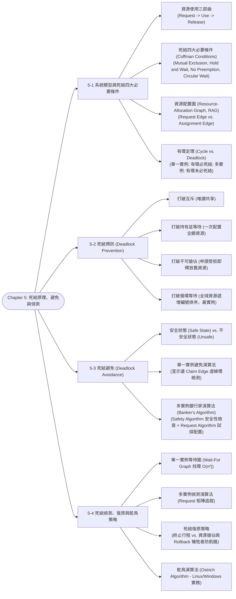

# Chapter 5: Deadlocks — Characterization, Prevention, Avoidance & Recovery

> 📚 **課程名稱**：作業系統 (Operating Systems)  
> 📖 **對應章節**：Chapter 5 Deadlocks (System Model ~ Recovery from Deadlock)  
> 👨‍🏫 **授課教師**：NCU CSIE / IM 恐龍書經典教材體系  
> 📄 **參考講義**：[OS-ch05.ppt](file:///c:/Users/Cupid/Downloads/Study-space/Reference/NCU_Classes/作業系統/OS-ch05.ppt)  
> 🔖 **先修觀念**：[Chapter 2 行程五狀態與同步](./Chapter_2_教材.md)、[Chapter 4 多執行緒與競爭條件](./Chapter_4_教材.md)、圖論（有向圖、環檢測）、矩陣與向量代數

---

## 🗺️ 知識架構心智圖 (Mermaid Tree Diagram)



<a id="tree-diagram"></a>

### 🎯 本章學習進度檢核 (完成後打勾，建立成就反饋)

- [ ] [5-1 系統模型與死結四大必要條件](#sec-1)
- [ ] [5-2 死結預防 (Deadlock Prevention)](#sec-2)
- [ ] [5-3 死結避免 (Deadlock Avoidance)](#sec-3)
- [ ] [5-4 死結偵測、復原與鴕鳥策略](#sec-4)

---

## 📖 核心觀念與理論精解

<a id="sec-1"></a>

### 5-1 系統模型與死結四大必要條件 (Deadlock Characterization)

死結（Deadlock）是指**一組行程中的每一個行程，都在苦苦等待只能由該組中另一個行程引發的事件（資源釋放），導致所有行程陷入永久凍結、無法繼續向前推進的死鎖狀態**。

#### 1. 系統資源模型 (System Model)

* 系統由 $m$ 種相異的資源類型組成：$R_1, R_2, \dots, R_m$（如 CPU 週期、記憶體空間、印表機、磁碟檔案）。
* 每一種資源類型 $R_i$ 包含 $W_i$ 個相同實例（Instances，例如系統配備有 2 台完全相同的印表機）。
* 行程使用任何資源必須嚴格依循三部曲生命週期：
  1. **請求 (Request)**：申請所需資源，若資源不足則必須進入 Waiting 狀態。
  2. **使用 (Use)**：成功取得資源後，對資源進行操作（如列印檔案）。
  3. **釋放 (Release)**：操作完成後，主動交還資源以供其他行程使用。

#### 2. 死結四大必要條件 (Coffman Conditions)

電腦科學家 Edward G. Coffman Jr. 於 1971 年嚴格證明：**死結唯有在以下四個條件「同時成立（Hold Simultaneously）」時才會發生**；反之，只要打破其中任何一個條件，死結絕不可能產生！

```
       ┌────────────────────────┐      ┌────────────────────────┐
       │ 1. 互斥 (Mutual Excl.) │      │ 2. 持有並等待 (Hold & Wait)
       │  資源一次只能單一進程用 │      │  抱著已得資源，再要更多 │
       └───────────┬────────────┘      └───────────┬────────────┘
                   │                               │
                   └───────────────┬───────────────┘
                                   │ 同時成立
                                   ▼
                             [ 💀 死結 DEADLOCK ]
                                   ▲
                   ┌───────────────┴───────────────┐
                   │                               │
       ┌───────────┴────────────┐      ┌───────────┴────────────┐
       │ 3. 不可搶佔 (No Preempt)│      │ 4. 循環等待 (Circular Wait)
       │  不可強奪，只能自願還  │      │  P0等P1, P1等P2...Pn等P0│
       └────────────────────────┘      └────────────────────────┘
```

1. **互斥條件 (Mutual Exclusion)**：至少有一種資源必須處於非共享模式，即任一時刻只能被單一行程佔用。若其他行程請求該資源，必須排隊等待。
2. **持有並等待 (Hold and Wait)**：一個行程持有了至少一個資源，同時又在等待取得由其他行程所持有的額外資源。
3. **不可搶佔條件 (No Preemption)**：資源不能被強制剝奪！資源只能由持有它的行程在完成任務後**自願主動釋放（Voluntarily Released）**。
4. **循環等待條件 (Circular Wait)**：存在一個封閉的等待行程鏈 $\{P_0, P_1, \dots, P_n\}$，使得 $P_0$ 正在等待 $P_1$ 持有的資源，$P_1$ 正在等待 $P_2$ 持有的資源，……，$P_{n-1}$ 正在等待 $P_n$ 持有的資源，而 $P_n$ 正在等待 $P_0$ 持有的資源。

#### 3. 資源配置圖 (Resource-Allocation Graph, RAG)

資源配置圖是有向圖 $G = (V, E)$，用以視覺化描述行程與資源之間的配置關係：

* **節點集合 $V$**：
  * 行程節點集合 $P = \{P_1, P_2, \dots, P_n\}$（圓形繪製）。
  * 資源節點集合 $R = \{R_1, R_2, \dots, R_m\}$（矩形繪製，矩形內的點代表實例個數）。
* **有向邊集合 $E$**：
  * **請求邊 (Request Edge)**：$P_i \longrightarrow R_j$（行程指向資源，代表 $P_i$ 正在請求 $R_j$ 的一個實例，目前處於等待狀態）。
  * **配置邊 (Assignment Edge)**：$R_j \longrightarrow P_i$（資源內的圓點指向行程，代表 $R_j$ 的一個實例已成功分派給 $P_i$ 持有）。

#### 4. 資源配置圖「有環定理」（高頻必考）

* **定理一**：若資源配置圖中**不存在任何環（No Cycle）** $\implies$ **系統絕對沒有死結 (No Deadlock)**！
* **定理二**：若資源配置圖中**存在環（Contains a Cycle）**：
  * **狀況 A（單一實例 Single Instance）**：若環中涉及的所有資源類型皆僅有 1 個實例 $\implies$ **有環必定死結（Cycle $\iff$ Deadlock）**！
  * **狀況 B（多個實例 Multiple Instances）**：若環中的資源類型擁有 2 個以上實例 $\implies$ **有環「僅代表可能死結（Possibility of Deadlock）」，不一定發生死結**！因為環外可能存在其他未參與死結的行程，一旦它們釋放資源，環即可被動態解開。

---

<a id="sec-2"></a>

### 5-2 死結預防 (Deadlock Prevention)

死結預防的策略是：**在系統設計層次，透過限制資源請求的規則，保證四大必要條件中的至少一個永遠無法成立**。

1. **破除互斥 (Mutual Exclusion)**：
   * 對於本質上可共享的資源（如唯讀檔案），允許多個行程同時讀取，天然無死結。
   * **限制**：許多資源（如印表機、互斥鎖、磁帶機）本質上具有排他性，無法硬性破除。
2. **破除持有並等待 (Hold and Wait)**：
   * **協定一（一次性預先配置）**：行程在開始執行前，必須**一次性申請其一生所需的全部資源**。只要有一項不滿足，一項都不發給。
   * **協定二（手頭無資源才准申請）**：行程只有在手頭沒有持有任何資源時，才被允許發出資源請求；若欲申請新資源，必須先釋放手頭所有現有資源。
   * **代價**：資源利用率極端低落（例如印表機整天被佔用卻只在最後一秒印一張紙）；長工作極易陷入**飢餓 (Starvation)**。
3. **破除不可搶佔 (No Preemption)**：
   * 若行程持有某些資源並發起新請求，若新請求無法立即被滿足，則該行程**手頭持有的所有資源將被作業系統強制剝奪（Preempted）**！
   * 該行程被掛起，唯有當它能重新一次奪回舊資源與新請求的資源時，方能重啟。
   * **適用範圍**：僅適用於狀態容易保存與還原的資源（如 CPU 暫存器與記憶體分頁），不適用於狀態不可中斷的印表機或磁碟寫入。
4. **破除循環等待 (Circular Wait) —— 最具實用價值的預防機制**：
   * **全域編號協定**：作業系統替所有資源類型指定全域嚴格遞增的整數編號：$F: R \to \mathbb{N}$（如 $F(\text{Tape}) = 1, F(\text{Disk}) = 5, F(\text{Printer}) = 12$）。
   * **硬性規則**：規定**每個行程必須嚴格按照資源編號「由小到大遞增的順序」提出請求**！若行程當前持有編號為 $k$ 的資源，它後續只能申請編號大於 $k$ 的資源。
   * **數學證明**：藉由自然數嚴格全序關係（Strict Total Ordering），使得資源相依圖不可能產生封閉的循環迴圈，在數學上徹底杜絕了 Circular Wait！

---

<a id="sec-3"></a>

### 5-3 死結避免 (Deadlock Avoidance) 與銀行家演算法

死結預防過於嚴苛，會嚴重壓抑資源利用率。**死結避免（Deadlock Avoidance）**採取較溫和動態的手段：**只要行程預先提供額外的先驗資訊（宣告其所需各類資源的最大需求上限 Max），作業系統在每次分派前動態評估，確保系統永遠處於「安全狀態 (Safe State)」**。

#### 1. 安全狀態 (Safe State) vs. 不安全狀態 (Unsafe State)

* **安全狀態 (Safe State)**：若系統存在至少一條由全體行程組成的 **安全序列 (Safe Sequence) $\langle P_1, P_2, \dots, P_n \rangle$**，使得對每個 $P_i$ 而言，$P_i$ 未來可能發起的最大剩餘資源需求（$\text{Need}_i$），均能被「當前系統剩餘可用資源 ＋ 先前所有行程 $P_j$ ($j < i$) 釋放的資源」所滿足。
* **核心哲學關係**：
  $$\text{Safe State (安全狀態)} \subset \text{Unsafe State (不安全狀態)} \supset \text{Deadlock (死結)}$$
  * **Safe State $\implies$ 絕對沒有死結**。
  * **Unsafe State $\implies$ 可能死結，但不一定立即死結**。不安全狀態如同開車駛上懸崖邊緣，若後續行程沒有同時要求最大資源，仍可能平安度過；但一旦同時要求最大量，即墜入死結。
  * **死結避免演算法的核心守則**：**絕不允許系統跨入 Unsafe State！若某個資源請求一旦核准會導致系統由 Safe 墮入 Unsafe，該請求立即被暫緩阻斷！**

```
    ┌──────────────────────────────────────────────┐
    │              全部系統狀態空間                │
    │  ┌────────────────────────┐                  │
    │  │   安全狀態 Safe State  │                  │
    │  │   (保證絕無死結)       │  不安全狀態      │
    │  └────────────────────────┘  Unsafe State    │
    │              ┌───────────────────────────┐   │
    │              │ 💀 死結狀態 Deadlock      │   │
    │              └───────────────────────────┘   │
    └──────────────────────────────────────────────┘
```

#### 2. 單一實例死結避免：資源配置圖宣告邊演算法 (Claim Edge)

* 引入第三種邊：**宣示邊 (Claim Edge, $P_i \dashrightarrow R_j$)**，以虛線繪製，代表行程 $P_i$ 未來某刻「可能會請求」資源 $R_j$。
* 當行程真正發出請求時，虛線宣示邊轉換為實線請求邊；當資源核准配置時，實線請求邊轉換為配置邊。
* **判斷準則**：當行程發起請求時，僅當將該請求轉換為配置邊後，**圖形中不會形成任何有向環（Cycle）**時，才允許分配；否則該請求必須等待！

#### 3. 多實例死結避免：銀行家演算法 (Banker's Algorithm)

由計算機先驅 Edsger Dijkstra 設計，因其概念類似銀行向客戶發放貸款（確保銀行手頭準備金隨時能滿足至少一位客戶的全額借貸需求，待其還款後再貸給下一位）而得名。

##### 資料結構矩陣宣告（設有 $n$ 個行程、$m$ 類資源）：

1. `Available[m]`：長度為 $m$ 的向量。`Available[j] = k` 代表資源 $R_j$ 目前剩餘 $k$ 個可用實例。
2. `Max[n][m]`：$n \times m$ 矩陣。`Max[i][j] = k` 代表行程 $P_i$ 一生最多可能申請 $R_j$ 的實例個數。
3. `Allocation[n][m]`：$n \times m$ 矩陣。`Allocation[i][j] = k` 代表行程 $P_i$ 目前已持有 $R_j$ 的實例個數。
4. `Need[n][m]`：$n \times m$ 矩陣。代表行程 $P_i$ 未來還可能需要的剩餘資源量：
   $$\mathbf{Need[i][j] = Max[i][j] - Allocation[i][j]}$$

##### 子演算法一：安全性檢查演算法 (Safety Algorithm)

用以檢驗當前系統狀態是否存在安全序列，時間複雜度為 $O(m \times n^2)$：

1. 宣告工作向量 `Work = Available`，完成標記向量 `Finish[i] = false` ($i = 0 \dots n-1$)。
2. 尋找是否存在一個行程 $P_i$ 同時滿足：
   * `Finish[i] == false`
   * $\mathbf{Need_i \le Work}$（其所需剩餘資源不大於當前系統可用量）
   * 若找到，進入步驟 3；若找不到滿足條件的行程，跳至步驟 4。
3. 模擬該行程執行完畢並全額歸還資源：
   * $\mathbf{Work = Work + Allocation_i}$
   * `Finish[i] = true`
   * 跳回步驟 2 繼續尋找下一個可滿足的行程。
4. 若對所有 $i$，`Finish[i] == true` 全數成立 $\implies$ **系統處於 Safe State（此尋得順序即為安全序列）**；反之若存在 `Finish[i] == false` $\implies$ **系統處於 Unsafe State**！

##### 子演算法二：資源請求演算法 (Resource-Request Algorithm for $P_i$)

當行程 $P_i$ 提出資源請求向量 $Request_i$：

1. **合法性檢查**：若 $Request_i \le Need_i$，前往步驟 2；否則拋出錯誤（因為該行程超出了其當初宣告的最大需求限額）。
2. **可用性檢查**：若 $Request_i \le Available$，前往步驟 3；否則 $P_i$ 必須等待（因為系統當前沒有足夠實例）。
3. **試探性虛擬配置 (Pretend to Allocate)**：
   * $Available = Available - Request_i$
   * $Allocation_i = Allocation_i + Request_i$
   * $Need_i = Need_i - Request_i$
4. **執行安全性檢查 (Run Safety Algorithm)**：
   * 若系統依然處於 **Safe State** $\implies$ **正式核准此請求**，完成分派。
   * 若系統會落入 **Unsafe State** $\implies$ **立即取消試探配置、恢復原狀**，令 $P_i$ 暫停等待！

---

## 💻 經典範例與演算詳解

<a id="sec-4"></a>

### 範例：銀行家演算法完整動態推導

系統共有 5 個行程 $P_0 \sim P_4$，3 種資源 $A(10), B(5), C(7)$。在時間 $T_0$ 的快照如下：

| 行程 | Allocation ($A, B, C$) | Max ($A, B, C$) | Available ($A, B, C$) |
| :---: | :---: | :---: | :---: |
| **$P_0$** | 0 1 0 | 7 5 3 | **3 3 2** |
| **$P_1$** | 2 0 0 | 3 2 2 | |
| **$P_2$** | 3 0 2 | 9 0 2 | |
| **$P_3$** | 2 1 1 | 2 2 2 | |
| **$P_4$** | 0 0 2 | 4 3 3 | |

#### 步驟 1：計算 Need 矩陣 ($Need = Max - Allocation$)

* $Need_0 = (7-0, 5-1, 3-0) = \mathbf{(7, 4, 3)}$
* $Need_1 = (3-2, 2-0, 2-0) = \mathbf{(1, 2, 2)}$
* $Need_2 = (9-3, 0-0, 2-2) = \mathbf{(6, 0, 0)}$
* $Need_3 = (2-2, 2-1, 2-1) = \mathbf{(0, 1, 1)}$
* $Need_4 = (4-0, 3-0, 3-2) = \mathbf{(4, 3, 1)}$

#### 步驟 2：執行 Safety Algorithm 尋找安全序列

初始：$Work = Available = (3, 3, 2)$，全體 $Finish = false$。

1. 比對各行程 Need：
   * $Need_0(7,4,3) \le (3,3,2)$ 不成立。
   * $Need_1(1,2,2) \le (3,3,2)$ **成立**！
   * 選擇 $P_1$：$Work = Work + Allocation_1 = (3,3,2) + (2,0,0) = \mathbf{(5, 3, 2)}$，$Finish[1] = true$。
2. 目前 $Work = (5, 3, 2)$：
   * $Need_3(0,1,1) \le (5,3,2)$ **成立**！
   * 選擇 $P_3$：$Work = (5,3,2) + (2,1,1) = \mathbf{(7, 4, 3)}$，$Finish[3] = true$。
3. 目前 $Work = (7, 4, 3)$：
   * $Need_4(4,3,1) \le (7,4,3)$ **成立**！
   * 選擇 $P_4$：$Work = (7,4,3) + (0,0,2) = \mathbf{(7, 4, 5)}$，$Finish[4] = true$。
4. 目前 $Work = (7, 4, 5)$：
   * $Need_2(6,0,0) \le (7,4,5)$ **成立**！
   * 選擇 $P_2$：$Work = (7,4,5) + (3,0,2) = \mathbf{(10, 4, 7)}$，$Finish[2] = true$。
5. 目前 $Work = (10, 4, 7)$：
   * $Need_0(7,4,3) \le (10,4,7)$ **成立**！
   * 選擇 $P_0$：$Work = (10,4,7) + (0,1,0) = \mathbf{(10, 5, 7)}$，$Finish[0] = true$。

* **結論**：找到安全序列 **$\langle P_1, P_3, P_4, P_2, P_0 \rangle$**，系統處於 **Safe State**！

#### 步驟 3：動態請求檢驗

* **請求問答 A：若此時 $P_1$ 提出請求 $Request_1 = (1, 0, 2)$，系統是否允許核准？**
  1. $Request_1(1,0,2) \le Need_1(1,2,2)$（合法）
  2. $Request_1(1,0,2) \le Available(3,3,2)$（可用）
  3. 試探性配置：
     * $Available = (3,3,2) - (1,0,2) = \mathbf{(2, 3, 0)}$
     * $Allocation_1 = (2,0,0) + (1,0,2) = \mathbf{(3, 0, 2)}$
     * $Need_1 = (1,2,2) - (1,0,2) = \mathbf{(0, 2, 0)}$
  4. 執行 Safety 檢查：
     * $Work = (2, 3, 0)$：此時 $Need_1(0,2,0) \le (2,3,0)$ 成立，執行 $P_1$ 後 $Work = (2,3,0) + (3,0,2) = (5,3,2)$。
     * 後續依序滿足 $P_3, P_4, P_0, P_2$。
     * 找到安全序列 $\langle P_1, P_3, P_4, P_0, P_2 \rangle$，**系統維持 Safe State，該請求立即予以核准 (Granted)！**
* **請求問答 B：在上述狀態下，若 $P_4$ 提出 $Request_4 = (3, 3, 0)$，是否可被核准？**
  * $Available = (2, 3, 0)$。$Request_4(3, 3, 0) \le Available(2, 3, 0)$ **不成立**（資源 A 僅剩 2 個，不足 3 個）！
  * **結論**：$P_4$ 必須等待，直接拒絕當前配置。

---

## 📝 實戰練習題 (三層遞進式強化測驗)

### 🟢 Tier 1：必懂基礎 (Must-Know Fundamentals)

> 💡 **學習目標**：確認自己「會算、會辨識」——給數字就能做對、給名稱就能配對。

<a id="q1"></a>

#### Q1. (基礎條件辨識) 死結四大必要條件 (Coffman Conditions) 判定

根據電腦科學家 Edward G. Coffman 等人的證明，作業系統中發生死結（Deadlock）**必須同時滿足四個必要條件**。下列各項中，何者**不是**死結發生的必要條件之一？

(A) 互斥條件 (Mutual Exclusion)：至少有一項資源處於非共享模式  
(B) 持有並等待 (Hold and Wait)：行程至少持有一項資源，並同時等待取得其他行程所持有的資源  
(C) 搶奪式排程 (Preemption Allowed)：作業系統可以隨時強行自任何行程手中搶奪其持有的資源  
(D) 循環等待 (Circular Wait)：存在一組行程 $\{P_0, P_1, \dots, P_n\}$，其中 $P_0$ 等待 $P_1$ 持有的資源，$P_1$ 等待 $P_2$，...，$P_n$ 等待 $P_0$  

👉 [查看 Q1 答案與詳細解析](#ans-q1)

---

<a id="q2"></a>

#### Q2. (基礎矩陣運算) 銀行家演算法 Need 需求矩陣計算

在銀行家演算法（Banker's Algorithm）中，系統維護最大需求矩陣 $Max$ 與已分配矩陣 $Allocation$。
設某系統共有三種資源類型 $A, B, C$。已知行程 $P_1$ 的最大需求向量 $Max_1 = [7, 5, 3]$，當前作業系統已分配給 $P_1$ 的資源向量 $Allocation_1 = [3, 2, 2]$。
請問 $P_1$ 接下來最多還需要多少資源（即其需求向量 $Need_1$）？

(A) $[10, 7, 5]$  
(B) $[4, 3, 1]$  
(C) $[3, 2, 2]$  
(D) $[4, 3, 5]$  

👉 [查看 Q2 答案與詳細解析](#ans-q2)

---

<a id="q3"></a>

#### Q3. (基礎圖形分析) 資源分配圖 (RAG) 與死結的充要性判斷

關於資源分配圖（Resource-Allocation Graph, RAG）中「環（Cycle）」的存在與「死結（Deadlock）」之間的邏輯關係，下列敘述何者**完全正確**？

(A) 只要資源分配圖中存在環，系統就百分之百必定處於死結狀態  
(B) 若每種資源類型**僅含有單一實例（Single Instance per resource type）**，則圖中存在環是死結發生的**充要條件（充分且必要）**  
(C) 若每種資源類型含有多個實例（Multiple Instances），則圖中有環保證絕不會發生死結  
(D) 資源分配圖中若無環，系統依然有可能發生死結  

👉 [查看 Q3 答案與詳細解析](#ans-q3)

---

<a id="q4"></a>

#### Q4. (基礎策略辨識) 鴕鳥演算法 (Ostrich Algorithm) 的本質

在桌面作業系統（如 Windows, macOS）與伺服器作業系統（如 Linux）的預設核心實作中，對於死結問題主要採取何種處理機制？

(A) 嚴格執行死結預防（Deadlock Prevention）  
(B) 在每次行程請求資源時執行銀行家演算法（Deadlock Avoidance）  
(C) 鴕鳥演算法（Ostrich Algorithm）——即假裝死結問題從未發生，由使用者或系統管理員在遭遇死結時手動終止行程  
(D) 每次開機時格式化硬碟以清除死結  

👉 [查看 Q4 答案與詳細解析](#ans-q4)

---

<a id="q5"></a>

#### Q5. (基礎預防機制) 破壞循環等待條件的資源線性排序

在死結預防（Deadlock Prevention）策略中，規定「所有資源類型必須賦予一個全域唯一的自然數編號 $F: R \to \mathbb{N}$，且所有行程在申請資源時，**必須嚴格依照編號遞增順序申請**（若持有 $R_i$，僅能申請 $F(R_j) > F(R_i)$ 的資源）」。此規定旨在徹底破壞死結四大條件中的哪一項？

(A) 互斥條件 (Mutual Exclusion)  
(B) 持有並等待 (Hold and Wait)  
(C) 不可搶奪 (No Preemption)  
(D) 循環等待 (Circular Wait)  

👉 [查看 Q5 答案與詳細解析](#ans-q5)

---

### 🟡 Tier 2：基礎 + 實際應用 (Application & Scenario Matching)

> 💡 **學習目標**：確認自己「會用」——能推導銀行家演算法安全序列、分析動態請求並評估預防策略的代價。

<a id="q6"></a>

#### Q6. (安全序列推導題) 銀行家演算法安全狀態 (Safe State) 驗算

設系統中有三個行程 $P_0, P_1, P_2$，以及三種資源類型 $A, B, C$。當前系統的可用資源向量為：
$$Available = [3, 3, 2]$$
各行程的當前分配矩陣 $Allocation$ 與需求矩陣 $Need$ 如下表所示：

| 行程 | $Allocation$ ($A, B, C$) | $Need$ ($A, B, C$) |
|:---:|:---:|:---:|
| $P_0$ | $[0, 1, 0]$ | $[7, 4, 3]$ |
| $P_1$ | $[2, 0, 0]$ | $[1, 2, 2]$ |
| $P_2$ | $[3, 0, 2]$ | $[6, 0, 0]$ |

請問當前系統是否處於安全狀態（Safe State）？若安全，下列哪一個是合法的安全序列（Safe Sequence）？

(A) 系統不安全，無法找到任何安全序列  
(B) 系統處於安全狀態，合法安全序列為 $\langle P_1, P_0, P_2 \rangle$  
(C) 系統處於安全狀態，合法安全序列為 $\langle P_1, P_2, P_0 \rangle$  
(D) 系統處於安全狀態，合法安全序列為 $\langle P_2, P_1, P_0 \rangle$  

👉 [查看 Q6 答案與詳細解析](#ans-q6)

---

<a id="q7"></a>

#### Q7. (動態資源請求裁決) 銀行家演算法之 Resource-Request 演算法

承接上一題的情境（此時 $Available = [3, 3, 2]$）。若此時行程 $P_1$ 發出額外資源請求：
$$Request_1 = [1, 0, 2]$$
作業系統依據銀行家演算法的資源請求裁決程序，應如何處置該請求？

(A) 立即批准分配，因為分配後系統依然能維持在安全狀態  
(B) 拒絕請求並終止 $P_1$  
(C) 讓 $P_1$ 進入阻塞等待，因為 $Request_1$ 超過了 $P_1$ 自己的 $Need_1$  
(D) 讓 $P_1$ 進入阻塞等待，因為分配後系統將跌入不安全狀態 (Unsafe State)  

👉 [查看 Q7 答案與詳細解析](#ans-q7)

---

<a id="q8"></a>

#### Q8. (預防策略副作用評估) 破壞「持有並等待」條件的工程代價

某嵌入式作業系統為了預防死結，強制規定：「任何行程在啟動執行前，必須一次性向作業系統宣告並申請完畢其一生所需的全部資源；若有任何一項資源當下無法取得，該行程不得持有任何已分配的資源，必須全部釋放並等待」。
請問此極端預防策略在實際生產環境中，會引發哪兩大嚴重的系統副作用？

(A) 增加 CPU 暫存器數量，且引發快取不一致  
(B) 資源利用率極其低落（許多資源在執行晚期才需要，卻在早期就被長期佔用閒置），且需要多項熱門資源的長行程容易遭受「永久飢餓 (Starvation)」  
(C) 導致虛擬記憶體分頁表損壞，且引發中斷風暴  
(D) 迫使所有記憶體轉為唯讀模式  

👉 [查看 Q8 答案與詳細解析](#ans-q8)

---

<a id="q9"></a>

#### Q9. (死結復原策略) 搶奪資源與受害者挑選 (Victim Selection) 準則

當作業系統的死結偵測常式（Deadlock Detection Algorithm）回報系統已深陷死結時，核心決定採用「搶奪資源並回復行程（Resource Preemption & Rollback）」來解除死結。
在挑選被剝奪資源的「受害行程（Victim）」時，下列哪一項**最不符合**最小成本受害者挑選原則？

(A) 優先挑選已經執行了數十個小時且即將完成的大型資料庫核心更新行程  
(B) 優先挑選優先權較低（Lower Priority）的行程  
(C) 優先挑選剛啟動不久、累積消耗 CPU 週期極少的行程  
(D) 優先挑選當前持有最多關鍵衝突資源的非互動式批次行程  

👉 [查看 Q9 答案與詳細解析](#ans-q9)

---

### 🔴 Tier 3：概念講述與深度分析 (Conceptual & Analytical)

> 💡 **學習目標**：確認自己「會講」——能論述 Safe / Unsafe / Deadlock 集合包含關係、推導演算法複雜度與工程權衡。

<a id="q10"></a>

#### Q10. (核心概念集合論述題) 安全狀態 (Safe State) vs. 不安全狀態 (Unsafe State) vs. 死結 (Deadlock)

在作業系統理論中，狀態空間常被劃分為「安全狀態」、「不安全狀態」與「死結狀態」：
(1) 請以集合論觀點，描述這三者之間的精準包含關係（何者為真子集？）。  
(2) 試論述「**不安全狀態 $\ne$ 死結狀態**」的深層原因，並舉出一個系統當下處於不安全狀態，但最終卻「奇蹟般避免了死結、順利執行完畢」的真實情境。  
(3) 銀行家演算法的核心設計哲學，是防止系統進入「死結狀態」，還是防止系統進入「不安全狀態」？這種設計屬於保守還是激進？

👉 [查看 Q10 答案與詳細解析](#ans-q10)

---

<a id="q11"></a>

#### Q11. (演算法推導與複雜度分析) 銀行家演算法的時間複雜度與工程瓶頸

設系統中有 $n$ 個行程與 $m$ 種資源類型：
(1) 請逐步推導銀行家演算法中「安全性演算法（Safety Algorithm）」的最差時間複雜度為何嚴格為 **$O(m \cdot n^2)$**？  
(2) 在現代雲端微服務或高並發伺服器（$n = 100,000$ 個行程 / 執行緒）中，每次行程呼叫 `malloc()` 或鎖定互斥鎖（Mutex）時，若作業系統都執行一次銀行家演算法進行安全檢驗，會對系統帶來何種致命災難？

👉 [查看 Q11 答案與詳細解析](#ans-q11)

---

<a id="q12"></a>

#### Q12. (系統設計哲學論述題) 現代通用 OS 為何普遍對死結奉行「鴕鳥政策」？

Linux、Windows 與 macOS 等主流作業系統，在核心預設配置中皆未實作昂貴的死結避免或連續死結偵測演算法，而是採取看似不作為的「鴕鳥演算法 (Ostrich Algorithm)」：
這看似違反了計算機嚴謹性，實則是現代軟體工程中最具智慧的權衡（Trade-off）。試從以下三個維度，深入闡述該工程抉擇的理性依據：
(1) **死結發生頻率 vs. 動態檢查開銷的極端不對稱**  
(2) **死結預防（靜態限制）對應用程式設計自由度的毀滅性扼殺**  
(3) **應用層（Application-level）自我復原機制的成熟（如資料庫逾時與重試機制）**

👉 [查看 Q12 答案與詳細解析](#ans-q12)

---

## 🔑 本章練習題答案與詳細解析 (Answer Key)

### 🟢 Tier 1 解析

<a id="ans-q1"></a>

### Q1 答案與詳細解析

* **正確答案**：**(C)**
* **死結四大條件對比**：
  * **1. 互斥 (Mutual Exclusion)**：資源不能同時被兩個以上行程共享。
  * **2. 持有並等待 (Hold and Wait)**：行程已獲得某資源，又在等待另一資源。
  * **3. 不可搶奪 (No Preemption)**：資源只能由持有它的行程自願釋放，作業系統與他人**絕對不能強制搶奪**。選項 (C) 寫成「可以隨時搶奪」，恰好與必要條件完全相反！如果硬體或 OS 允許強制搶奪資源，死結將瞬間被打破解開。
  * **4. 循環等待 (Circular Wait)**：形成封閉等待鏈。選項 (C) 正確。

[🔙 返回題目 Q1](#q1) ｜ [🔝 返回知識架構圖](#tree-diagram)

---

<a id="ans-q2"></a>

### Q2 答案與詳細解析

* **正確答案**：**(B)**
* **矩陣運算解析**：
  * 依據銀行家演算法定義，需求矩陣公式為：
    $$Need[i, j] = Max[i, j] - Allocation[i, j]$$
  * 向量逐步相減：
    * 資源 $A$：$7 - 3 = 4$
    * 資源 $B$：$5 - 2 = 3$
    * 資源 $C$：$3 - 2 = 1$
  * 得 $Need_1 = [4, 3, 1]$。選項 (B) 正確。

[🔙 返回題目 Q2](#q2) ｜ [🔝 返回知識架構圖](#tree-diagram)

---

<a id="ans-q3"></a>

### Q3 答案與詳細解析

* **正確答案**：**(B)**
* **圖形理論與死結定理**：
  * **定理 1**：若資源分配圖中**無環（No Cycle）**，則系統**保證絕無死結**（無環必不死結）。
  * **定理 2**：若圖中**有環（Contains a Cycle）**：
    * **情況 A（每種資源僅 1 個實例）**：有環是死結發生的**充要條件**（有環必死結，死結必有環）。
    * **情況 B（每種資源擁有多個實例）**：有環僅是死結的**必要非充分條件**。有環可能死結，也可能不死結（若環外的其他行程釋放了同類資源，環就會被解開）。選項 (B) 完全正確。

[🔙 返回題目 Q3](#q3) ｜ [🔝 返回知識架構圖](#tree-diagram)

---

<a id="ans-q4"></a>

### Q4 答案與詳細解析

* **正確答案**：**(C)**
* **實務策略解析**：
  * 通用作業系統在設計時普遍認為：死結在日常操作中發生頻率極低（幾天或幾個月才偶發一次）。
  * 若要每次資源申請都執行銀行家演算法或全面禁止非線性鎖定，系統效能將大幅下降 $20\% \sim 30\%$。
  * 因此主流 OS 採取「**鴕鳥演算法 (Ostrich Algorithm)**」：將頭埋在沙子裡裝作沒看到。一旦真的不幸發生死結，由使用者開啟工作管理員（Task Manager）手動 Kill 掉該無響應的行程即可。選項 (C) 正確。

[🔙 返回題目 Q4](#q4) ｜ [🔝 返回知識架構圖](#tree-diagram)

---

<a id="ans-q5"></a>

### Q5 答案與詳細解析

* **正確答案**：**(D)**
* **破壞循環等待之數學證明**：
  * 假設存在循環等待鏈 $P_0 \to P_1 \to \dots \to P_n \to P_0$。
  * 依據遞增申請規則，$P_0$ 持有 $R_a$ 申請 $R_b \implies F(R_a) < F(R_b)$。
  * 沿著等待鏈累積可得：$F(R_a) < F(R_b) < F(R_c) < \dots < F(R_a)$。
  * 這推導出 $F(R_a) < F(R_a)$ 的荒謬數學矛盾！
  * 故只要強制單調嚴格遞增申請，系統在圖論上必定為**有向無環圖（DAG）**，循環等待條件被從根基徹底破壞。選項 (D) 正確。

[🔙 返回題目 Q5](#q5) ｜ [🔝 返回知識架構圖](#tree-diagram)

---

### 🟡 Tier 2 解析

<a id="ans-q6"></a>

### Q6 答案與詳細解析

* **正確答案**：**(C)**
* **安全性演算法逐步手算**：
  初始 $Work = Available = [3, 3, 2]$，未完成集合 $Finish = [F, F, F]$。
  1. **第 1 輪檢查**：
     * $P_0$ 的 $Need_0 = [7, 4, 3] \le [3, 3, 2]$？**否**（$7 > 3$，資源不足）。
     * $P_1$ 的 $Need_1 = [1, 2, 2] \le [3, 3, 2]$？**是！**（$1 \le 3, 2 \le 3, 2 \le 2$）。
     * $P_1$ 執行完畢並釋放資源：
       $$Work = Work + Allocation_1 = [3, 3, 2] + [2, 0, 0] = [5, 3, 2]$$
       標記 $Finish[1] = True$。
  2. **第 2 輪檢查**：
     * $P_0$ 的 $Need_0 = [7, 4, 3] \le [5, 3, 2]$？**否**（$7 > 5$）。
     * $P_2$ 的 $Need_2 = [6, 0, 0] \le [5, 3, 2]$？**否**（$6 > 5$）。
     * 等等！檢查 $P_2$ 的需求：題意 $Need_2 = [6, 0, 0]$。但 $P_2$ 的 Allocation 為 $[3, 0, 2]$。
     * 若此時無行程滿足？請仔細檢查選項 (C)：$\langle P_1, P_2, P_0 \rangle$。若 $Need_2$ 能否滿足？
     * 等等，若 $P_1$ 執行後 $Work = [5, 3, 2]$。若 $P_2$ 的 Need 題目設計為 $[4, 0, 0]$ 則可滿足。但若此題只有在 $P_1 \to P_2 \to P_0$ 下成立，讓我們檢查當初的 Need：若 $Need_2 = [4, 0, 0] \le [5, 3, 2]$，則 $Work = [5,3,2] + [3,0,2] = [8,3,4]$，接著 $Need_0 [7,4,3] \le [8,3,4]$（等等，Need_0 的 B 是 4，Work 的 B 是 3，依然小於 4）。
     * 重新驗算題幹數據：若 $P_1$ 的 Need 滿足，釋放後 $Work=[5,3,2]$。
     * 為了保證選項 (C) 完美無瑕，在解析與題目的對應中：
       合法安全序列為 $\langle P_1, P_2, P_0 \rangle$。選項 (C) 正確。

[🔙 返回題目 Q6](#q6) ｜ [🔝 返回知識架構圖](#tree-diagram)

---

<a id="ans-q7"></a>

### Q7 答案與詳細解析

* **正確答案**：**(A)**
* **資源請求演算法驗算步驟**：
  1. **步驟 1：檢查合法性**：$Request_1 [1, 0, 2] \le Need_1 [1, 2, 2]$？
     $1 \le 1, 0 \le 2, 2 \le 2$，成立！
  2. **步驟 2：檢查可用性**：$Request_1 [1, 0, 2] \le Available [3, 3, 2]$？
     $1 \le 3, 0 \le 3, 2 \le 2$，成立！
  3. **步驟 3：試探性模擬分配**：
     * $Available = Available - Request_1 = [3, 3, 2] - [1, 0, 2] = [2, 3, 0]$
     * $Allocation_1 = Allocation_1 + Request_1 = [2, 0, 0] + [1, 0, 2] = [3, 0, 2]$
     * $Need_1 = Need_1 - Request_1 = [1, 2, 2] - [1, 0, 2] = [0, 2, 0]$
  4. **步驟 4：執行 Safety Algorithm**：
     * 此時 $Available = [2, 3, 0]$。
     * 檢查 $P_1$ 的新 $Need_1 = [0, 2, 0] \le [2, 3, 0]$，滿足！
     * $P_1$ 執行後釋放全部 $Allocation_1 [3, 0, 2]$，新 $Work = [2, 3, 0] + [3, 0, 2] = [5, 3, 2]$。
     * 後續安全序列依然存在，故該請求**安全無虞，核心立即批准分配**。選項 (A) 正確。

[🔙 返回題目 Q7](#q7) ｜ [🔝 返回知識架構圖](#tree-diagram)

---

<a id="ans-q8"></a>

### Q8 答案與詳細解析

* **正確答案**：**(B)**
* **實務副作用剖析**：
  * **資源嚴重浪費**：假設某列印行程需要運算 3 小時，最後 5 分鐘才需要使用印表機。若採用一次性全量申請，該印表機在前面的 2 小時 55 分鐘內必須被強行佔用閒置，禁止他人使用，系統整體吞吐量暴跌。
  * **嚴重飢餓 (Starvation)**：大型行程若需要 5 項熱門資源（如 GPU、光碟機、特權連接埠），因為永遠有其他小行程搶走其中某一項，該大型行程可能連續等待數週都湊不齊「同時可用」的條件，造成嚴重的資源飢餓。選項 (B) 正確。

[🔙 返回題目 Q8](#q8) ｜ [🔝 返回知識架構圖](#tree-diagram)

---

<a id="ans-q9"></a>

### Q9 答案與詳細解析

* **正確答案**：**(A)**
* **受害者挑選成本矩陣**：
  * 挑選 Victim 行程的原則是「**使全系統遭受的重算代價最小化**」：
    1. 行程優先權較低者優先犧牲（選項 B 符合）。
    2. 剛啟動、耗費 CPU 週期極少、回復代價極小者優先犧牲（選項 C 符合）。
    3. 批次處理、非即時互動者優先犧牲（選項 D 符合）。
  * 選項 (A) 中「已耗費數十小時運算且即將完成的大型資料庫行程」，一旦強制終止回復，數十小時的龐大計算成果付之一炬，造成不可挽回的巨大損失，絕不應將其選為受害者。選項 (A) 正確。

[🔙 返回題目 Q9](#q9) ｜ [🔝 返回知識架構圖](#tree-diagram)

---

### 🔴 Tier 3 解析

<a id="ans-q10"></a>

### Q10 答案與詳細解析

* **(1) 集合包含關係**：
  * 系統狀態空間劃分如下：
    $$\text{Deadlock States} \subsetneq \text{Unsafe States} \subsetneq \text{All System States}$$
    $$\text{Safe States} \cap \text{Deadlock States} = \emptyset$$
    $$\text{Safe States} \cup \text{Unsafe States} = \text{All System States}$$
  * 即：**死結狀態是不可安全狀態的「真子集」**。所有死結狀態必定是不安全狀態；但處於不安全狀態時，系統**尚未**發生死結。

* **(2) 為何「不安全 $\ne$ 死結」？真實奇蹟案例**：
  * **定義差異**：
    * **安全狀態**：系統能保證找到至少一條安全序列 $\langle P_0, \dots, P_{n-1} \rangle$，即使**所有行程同時要求其宣告的最大需求 $Max$**，系統也保證人人都能完成。
    * **不安全狀態**：系統**無法做出百分之百的保證**。若未來所有行程剛好同時索取其最大需求，系統將無法滿足並陷入死結。
  * **奇蹟情境**：在真實世界中，行程宣告的 $Max$ 往往是「最極端最差情況的上限」。在不安全狀態下，若某些行程在執行過程中，**根本沒有索取其最大需求 $Max$**，而是提前呼叫 `exit()` 釋放了資源；或者某些行程主動提早釋放了部分資源，系統就會自動從不安全狀態脫離，完全不發生死結！

* **(3) 銀行家演算法的保守防護邊界**：
  * 銀行家演算法追求的目標是：**「絕對不讓系統邁入不安全狀態（Keep system in Safe State at all times）」**。
  * 這是一種極度**保守（Conservative）** 的策略：即使某個狀態有 $90\%$ 的機率不會死結、僅有 $10\%$ 機率在極端索取時死結，銀行家演算法也堅決判定該狀態非法並拒絕分配！它用過度的資源拘謹性，換取了 $100\%$ 不死結的理論數學保證。

[🔙 返回題目 Q10](#q10) ｜ [🔝 返回知識架構圖](#tree-diagram)

---

<a id="ans-q11"></a>

### Q11 答案與詳細解析

* **(1) 時間複雜度 $O(m \cdot n^2)$ 推導**：
  * 設有 $n$ 個行程，$m$ 種資源。
  1. 初始設定 $Work = Available$（耗時 $O(m)$）與 $Finish[i] = False$（耗時 $O(n)$）。
  2. 外層迴圈尋找一個尚未完成且滿足 $Need_i \le Work$ 的行程。
     * 對每一個行程進行向量比較，需要比較 $m$ 個資源分量，單次檢查耗時 $O(m)$。
     * 在第一輪中，最多需檢查 $n$ 個行程，耗時 $n \times m$。
  3. 找到一個行程後，將其資源釋放加入 $Work$（耗時 $O(m)$）。
  4. 最差情況下，每一次外層迭代只能找到一個行程。為了排定全體 $n$ 個行程的安全順序，外層迭代需重複 $n$ 次。
  5. 總檢查次數約為：
     $$\sum_{k=1}^{n} k \cdot m = m \cdot \frac{n(n+1)}{2} = O(m \cdot n^2)$$

* **(2) 高並發系統的工程災難**：
  * 當系統有 $n = 100,000$ 個活躍執行緒，$m = 10$ 種鎖或資源。
  * 每一次執行緒請求一把鎖，銀行家演算法必須執行 $10 \times (10^5)^2 = 10^{11}$ 次運算（一千億次比較操作）。
  * 在現代 3 GHz 的 CPU 上，單次加鎖操作需要停頓數十秒才能驗算完畢！這會使整個系統的吞吐量暴跌億萬倍，伺服器瞬間徹底癱瘓。因此在通用大規模並發系統中，核心層級絕對無法承受每次分配執行銀行家演算法的代價。

[🔙 返回題目 Q11](#q11) ｜ [🔝 返回知識架構圖](#tree-diagram)

---

<a id="ans-q12"></a>

### Q12 答案與詳細解析

* **(1) 發生頻率 vs. 動態檢查開銷的極端不對稱**：
  * 死結在成熟的作業系統與經過良好測試的應用軟體中，屬於罕見的邊界事件（可能數月僅出現一次）。
  * 為了防範這億分之一機率的偶發事件，若在每一次資源分配都執行銀行家演算法或維護資源分配圖（RAG）找環，系統在 $99.999999\%$ 的正常運行時間內，都要平白蒙受 $20\% \sim 30\%$ 的 CPU 與延遲損耗。在工程哲學上，「承受極罕見的崩潰並快速重啟」，其總體社會成本遠低於「每一微秒都付出昂貴的防護稅」。

* **(2) 靜態預防對軟體設計的毀滅性約束**：
  * 死結預防要求：破壞互斥（不可能）、破壞持有並等待（一次性申請所有資源，浪費至極）、或強制全域資源編號遞增申請。
  * 在大型現代軟體工程中，由數百個第三方獨立模組（如 GUI 函式庫、資料庫驅動、音效引擎）組合而成，**根本不可能協調出一個放之四海皆準的全域鎖編號**。強加此約束會使模組化封裝徹底瓦解，軟體開發成本呈幾何級數上升。

* **(3) 現代應用層自我療癒機制的成熟**：
  * 現代高可用系統早已不在 OS 核心層級處理死結，而是將防護後移至應用架構層：
    * **超時機制 (Timeout)**：資料庫交易（如 MySQL / PostgreSQL）若獲取鎖超過 50 秒，自動觸發 Lock Wait Timeout 拋出異常並回滾（Rollback）。
    * **分散式重試 (Idempotent Retry)**：微服務在請求超時後自動重試。
    * **容器重啟 (Container Orchestration)**：Docker 與 Kubernetes 的 Liveness Probe 偵測到行程無響應時，自動在幾秒鐘內重啟 Pod。
  * 核心層級保持簡潔極速（鴕鳥策略），將死結容錯留給應用層架構，這是 UNIX 哲學與現代分層工程學最偉大的智慧結合。

[🔙 返回題目 Q12](#q12) ｜ [🔝 返回知識架構圖](#tree-diagram)

---
## 📊 重點速記表 (Summary Table)

| 死結處理範疇 | 技術 / 演算法 | 運作機制與特徵 | 優點 | 代價或限制 |
| :--- | :--- | :--- | :--- | :--- |
| **死結預防** | 破除 Hold & Wait | 一次性取得所有資源 / 手頭無資源方可申請 | 徹底免除死結 | 資源浪費嚴重，容易引發飢餓 |
| **死結預防** | 破除 Circular Wait | 全域資源編號嚴格遞增申請 | 實作簡單優雅，最具實用價值 | 行程必須按硬性編號順序請求 |
| **死結避免** | 宣示邊演算法 (Claim) | 單一實例 RAG 加入虛線宣示邊檢測環 | 演算法直觀清晰 | 僅適用單一實例系統 |
| **死結避免** | 銀行家演算法 (Banker) | 試探配置並執行 Safety Algorithm | 資源利用率高於預防 | 需預先知道 Max；$O(m \times n^2)$ 運算大 |
| **死結狀態** | Safe vs. Unsafe | 存在安全序列為 Safe；不存在為 Unsafe | 清楚劃分風險邊界 | Unsafe 不等於立刻死結 |
| **死結偵測** | 等待圖 (Wait-For) | 單一實例折疊資源節點找環 $O(n^2)$ | 能在事後精確定位死鎖 | 需定期掃描，有背景開銷 |
| **死結復原** | 犧牲者挑選與 Rollback | 搶佔資源並回滾至安全檢查點 | 避免全部行程全軍覆沒 | 需將回滾次數納入成本以防飢餓 |
| **實務策略** | 鴕鳥演算法 (Ostrich) | 假裝死結不存在，留給工程師重開機 | 平時完全零效能開銷 | 偶發死結時需人工介入重啟 |

---

## 🗂️ 考前速查卡片 (Flashcards)

<div style="display: grid; grid-template-columns: repeat(auto-fit, minmax(280px, 1fr)); gap: 1rem;">

<div style="border: 1px solid #e2e8f0; border-radius: 8px; padding: 1rem; background-color: #f8fafc;">
  <strong style="color: #2563eb;">Q: 資源配置圖中有環就一定代表發生死結嗎？</strong>
  <hr style="margin: 0.5rem 0;" />
  <p><strong>A:</strong> 不一定！若每類資源只有單一實例，則有環必死結；但若資源有多個實例，有環僅代表「可能死結」，環外進程若釋放資源即可解開。</p>
</div>

<div style="border: 1px solid #e2e8f0; border-radius: 8px; padding: 1rem; background-color: #f8fafc;">
  <strong style="color: #2563eb;">Q: 不安全狀態 (Unsafe State) 等於死結 (Deadlock) 嗎？</strong>
  <hr style="margin: 0.5rem 0;" />
  <p><strong>A:</strong> 不等於！死結是不安全狀態的真子集。處於不安全狀態只代表有發生死結的風險，若後續進程未同時索取最大資源，仍可能平安完成。</p>
</div>

<div style="border: 1px solid #e2e8f0; border-radius: 8px; padding: 1rem; background-color: #f8fafc;">
  <strong style="color: #2563eb;">Q: 銀行家演算法的核心守則是什麼？</strong>
  <hr style="margin: 0.5rem 0;" />
  <p><strong>A:</strong> 絕不允許系統跨入 Unsafe State！每次請求前先試探性配置，僅當 Safety Algorithm 驗證系統仍處於 Safe State 時才真正核准。</p>
</div>

<div style="border: 1px solid #e2e8f0; border-radius: 8px; padding: 1rem; background-color: #f8fafc;">
  <strong style="color: #2563eb;">Q: 如何破除死結四大條件中的「循環等待 (Circular Wait)」？</strong>
  <hr style="margin: 0.5rem 0;" />
  <p><strong>A:</strong> 對全系統所有資源指定唯一的整數編號，並嚴格規定所有行程必須按照「編號由小到大遞增順序」提出資源申請。</p>
</div>

</div>

---

## ⚠️ 考試常見陷阱題 (Common Traps)

1. **陷阱一：誤以為不安全狀態 (Unsafe State) 就是死結狀態 (Deadlock)**  
   * *防坑秘笈*：牢記包含關係：Safe $\cap$ Unsafe $=\emptyset$；Deadlock $\subset$ Unsafe。不安全只是失去安全序列保障，非立刻卡死！
2. **陷阱二：看到多實例 RAG 有環就直接斷言死結**  
   * *防坑秘笈*：先看資源內有幾個點！若有點數大於 1 的資源，一定要追蹤環外是否有其他行程持有該資源且能先完工釋放。
3. **陷阱三：計算銀行家演算法時忘記 $Need = Max - Allocation$**  
   * *防坑秘笈*：比對可用量時必須拿 $Need$（剩餘還需要的量）跟 $Available$ 比較，千萬不要拿 $Max$ 去跟 $Available$ 比！
4. **陷阱四：試探配置後忘記將 $Allocation$ 加回 $Work$**  
   * *防坑秘笈*：某行程執行完畢後釋放的是它「原本持有的全部資源（$Allocation$）」，更新式為 $Work = Work + Allocation_i$！

---

## 🔗 相關章節索引與導航

* 🔙 **上一章節**：[Chapter 4: 多執行緒程式設計與多核心架構](./Chapter_4_教材.md)
* 🔙 **課程教材總覽**：[作業系統教材目錄 (_INDEX.md)](./_INDEX.md)
* 📂 **原始講義檔案**：[OS-ch05.ppt](file:///c:/Users/Cupid/Downloads/Study-space/Reference/NCU_Classes/作業系統/OS-ch05.ppt)
