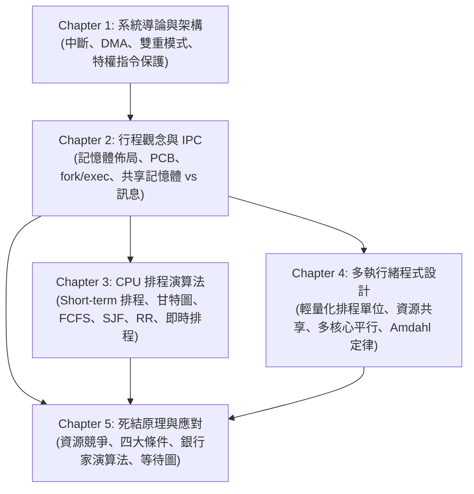

# 作業系統 (Operating Systems) — 教材總覽

> 📅 最新更新日期：2026-10-24  
> 📂 來源目錄：[Reference/NCU_Classes/作業系統/](file:///c:/Users/Cupid/Downloads/Study-space/Reference/NCU_Classes/作業系統/)  
> 👨‍🏫 授課體系：NCU CSIE / IM 經典恐龍書體系 (Abraham Silberschatz et al.)  
> 📄 共 5 份講義（5 份已全數生成完畢）  

---

## 📚 章節目錄與進度

| 章節 | 來源檔案 | 知識點核心 | 狀態 | 教材連結 |
| :--- | :--- | :--- | :---: | :---: |
| **Chapter 1** | [OS-ch01.ppt](file:///c:/Users/Cupid/Downloads/Study-space/Reference/NCU_Classes/作業系統/OS-ch01.ppt) | 作業系統角色、中斷與 DMA 架構、儲存階層、雙重模式與特權保護指令、定時器 | ✅ 已完成 | [開啟 Chapter 1 教材](./Chapter_1_教材.md) |
| **Chapter 2** | [OS-ch02.ppt](file:///c:/Users/Cupid/Downloads/Study-space/Reference/NCU_Classes/作業系統/OS-ch02.ppt) | 行程概念、記憶體四分區、PCB 與排程佇列、Context Switch、fork/exec/wait、IPC (共享記憶體 vs. 訊息傳遞) | ✅ 已完成 | [開啟 Chapter 2 教材](./Chapter_2_教材.md) |
| **Chapter 3** | [OS-ch03.ppt](file:///c:/Users/Cupid/Downloads/Study-space/Reference/NCU_Classes/作業系統/OS-ch03.ppt) | CPU-I/O Burst、排程五大準則、FCFS (護航效應)、SJF/SRTF (指數平滑)、Priority (Aging)、RR (時間片選取)、MLFQ、即時排程 (RMS vs. EDF) | ✅ 已完成 | [開啟 Chapter 3 教材](./Chapter_3_教材.md) |
| **Chapter 4** | [OS-ch04.ppt](file:///c:/Users/Cupid/Downloads/Study-space/Reference/NCU_Classes/作業系統/OS-ch04.ppt) | 執行緒共享 vs. 私有項目、多核心程式設計 (資料 vs. 任務平行)、阿姆達爾定律、執行緒模型 (1:1, M:1, M:M)、隱式執行緒 (Thread Pools, OpenMP, GCD) | ✅ 已完成 | [開啟 Chapter 4 教材](./Chapter_4_教材.md) |
| **Chapter 5** | [OS-ch05.ppt](file:///c:/Users/Cupid/Downloads/Study-space/Reference/NCU_Classes/作業系統/OS-ch05.ppt) | 死結四大必要條件、資源配置圖 (RAG)、死結預防 (遞增排序破除環)、死結避免 (安全狀態與銀行家演算法)、死結偵測與復原、鴕鳥策略 | ✅ 已完成 | [開啟 Chapter 5 教材](./Chapter_5_教材.md) |

---

## 🗺️ 跨章節知識關聯圖

---

## 🎯 全科考前必背精選清單

1. **核心 (Kernel) 與 Bootstrap 流程**：Kernel 是電腦開機後無時無刻常駐執行的單一核心程式。Bootstrap 儲存於 ROM/EPROM 韌體（BIOS/UEFI），負責初始化硬體並從磁碟載入 OS 核心至記憶體。
2. **中斷與直接記憶體存取 (DMA)**：OS 本質為中斷驅動。DMA 允許週邊控制器直接在本地緩衝區與主記憶體間大批搬移資料塊，**一個區塊僅產生一次中斷（One interrupt per block）**，大幅解放 CPU。
3. **雙重模式 (Dual-Mode Operation)**：硬體 Mode Bit（0 為 Kernel、1 為 User）。特權指令（如修改模式位元、停用中斷、直接 I/O、設定 Timer）僅限 Kernel Mode 執行；使用者透過觸發軟體陷阱（Trap / System Call）受控切入核心。
4. **行程記憶體四分區佈局**：
   - **Text**（程式碼，唯讀）
   - **Data**（全域/靜態變數）
   - **Heap**（動態配置 `malloc`/`new`，**向高位址向上增長**）
   - **Stack**（函式區域變數、參數、返回位址，**向低位址向下增長**）
5. **行程控制表 (PCB) 與內文切換 (Context Switch)**：PCB 記錄 PC、暫存器、狀態與排程資訊。Context Switch 是**純系統開銷 (Pure Overhead)**，切換期間系統不做任何有用功。
6. **`fork()` 回傳值鐵律**：父行程回傳子行程的 PID（正整數）；子行程回傳 0；失敗回傳 -1。父子位址空間獨立隔離，修改變數互不影響。
7. **殭屍行程 vs. 孤兒行程**：
   - 殭屍（Zombie）：子死父未 wait，PCB 殘留佔用 PID；需父行程呼叫 `wait()` 清理。
   - 孤兒（Orphan）：父先死子未死；由 `init`（PID 1）收養並代為 wait。
8. **IPC 兩大模型比較**：
   - 共享記憶體（Shared Memory）：速度最快，免核心介入，但需自行處理同步與 Race Condition。
   - 訊息傳遞（Message Passing）：適合分散式網路，核心代管佇列，但每次需系統呼叫拷貝。
9. **排程最佳性與護航效應**：
   - **SJF / SRTF**：理論最佳，具備**最小平均等待時間**；利用指數平滑法 $\tau_{n+1} = \alpha t_n + (1-\alpha)\tau_n$ 預測下一次 Burst。
   - **Convoy Effect**：FCFS 中長 CPU-bound 行程卡在前端，導致短 I/O-bound 行程與設備利用率暴跌。
10. **阿姆達爾定律 (Amdahl's Law)**：
    $$\text{Speedup} \le \frac{1}{S + \frac{1 - S}{N}} \quad \xrightarrow{N \to \infty} \quad \frac{1}{S}$$
    極限加速比嚴格受限於必須循序執行的比例 $S$！
11. **執行緒共享 vs. 私有項目**：
    - 共享：Code、Data（全域/靜態）、Heap、開啟檔案與週邊資源。
    - 私有：Thread ID、Program Counter (PC)、暫存器組、私有 Stack。
12. **死結四大必要條件 (Coffman Conditions)**：
    1. 互斥 (Mutual Exclusion)
    2. 持有並等待 (Hold and Wait)
    3. 不可搶佔 (No Preemption)
    4. 循環等待 (Circular Wait)  
    同時成立才會發生死結；破除其一即可杜絕死結。
13. **資源配置圖 (RAG) 有環定理**：
    - 無環 $\implies$ 絕對無死結。
    - 有環：若每類資源僅有 1 個實例 $\implies$ **必定死結**；若資源有多個實例 $\implies$ **僅代表可能死結**。
14. **安全狀態 vs. 不安全狀態**：
    - 安全狀態（Safe State）保證存在安全序列，**絕無死結**。
    - 不安全狀態（Unsafe State）僅代表**有死結風險**，不等於立刻死結（Deadlock $\subset$ Unsafe State）。
    - 銀行家演算法核心：**絕不允許系統跨入 Unsafe State**！
15. **即時系統排程 RMS vs. EDF**：
    - RMS：靜態優先權，週期越短優先權越高；CPU 使用率極限為 $\ln 2 \approx 69.3\%$。
    - EDF：動態優先權，截止期限 Deadline 越早優先權越高；理論 CPU 使用率保證可達 $100\%$！
