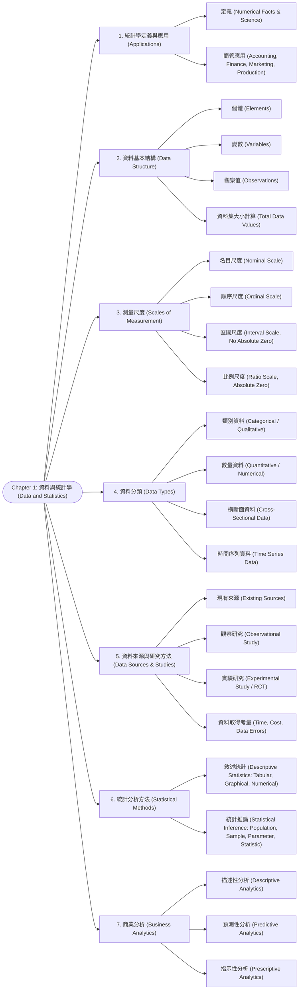

# Chapter 1: 資料與統計學 (Data and Statistics)

> 📅 生成日期：2026-10-20  
> 📄 來源檔案：Chapter 1.pdf (Statistics for Business and Economics, 14e)  
> 🎯 適用考試：期中考重點複習教材  

---

## 🗺️ 知識架構總覽 (Tree Diagram)

### 🎯 本章學習進度檢核 (完成後打勾，建立成就反饋)

- [ ] [1. 統計學定義與應用 (Applications)](#sec-1)
- [ ] [2. 資料基本結構 (Data Structure)](#sec-2)
- [ ] [3. 測量尺度 (Scales of Measurement)](#sec-3)
- [ ] [4. 資料分類 (Data Types)](#sec-4)
- [ ] [5. 資料來源與研究方法 (Data Sources & Studies)](#sec-5)
- [ ] [6. 統計分析方法 (Statistical Methods)](#sec-6)
- [ ] [7. 商業分析 (Business Analytics)](#sec-7)

---

## 📖 知識點教材

### 1.1 統計學定義與商管應用 (Applications in Business and Economics)

#### 📌 核心概念

統計學（Statistics）具有雙重涵義：

1. **數值事實（Numerical facts）**：如平均數（mean）、中位數（median）、百分比（percentages），用以描繪商業與經濟現況。
2. **科學與藝術（The art and science）**：涵蓋資料的**蒐集（collecting）**、**分析（analyzing）**、**呈現（presenting）**與**解釋（interpreting）**的完整方法論。

在企業管理與經濟學中的常見應用包括：

- **會計（Accounting）**：在審計（Audit）過程中採用統計抽樣（Statistical Sampling）程序來核對帳目。
- **財務（Finance）**：利用本益比（Price-Earnings Ratio, P/E Ratio）與股利殖利率（Dividend Yield）評估投資組合風險與報酬。
- **行銷（Marketing）**：利用零售終端銷售掃描資料（POS Scanners）進行消費者偏好與購物籃分析。
- **生產與作業（Production）**：採用統計品質管制圖（Statistical Quality Control Charts）監控製造製程變異。
- **經濟（Economics）**：利用總體經濟指標（如 GDP、CPI）進行景氣預測（Forecasting）。

#### 💡 重要觀念提醒

- 統計數字本身只是客觀事實，但如何「解讀」需要領域專業（Domain Knowledge），因此統計學既是科學（有嚴格數學定理）也是藝術（涉及假設與決策情境）。

#### 📊 範例

**題目**：某會計師事務所在審核一家擁有 100,000 筆銷貨交易的跨國企業時，決定隨機抽取 400 筆發票進行詳細比對。請問此情境體現了統計學在哪個領域的什麼應用？  
**解題**：

1. 領域為會計審計（Accounting Audit）。
2. 方法為統計抽樣（Statistical Sampling），利用樣本特徵推論母體交易是否合規，避免耗費極高成本進行全面查核（Census）。

---

### 1.2 資料結構：個體、變數與觀察值 (Data, Elements, Variables, Observations)

#### 📌 核心概念

資料（Data）是為呈現與解釋目的而蒐集、分析與彙總的事實與數據。包含三核心要素：

1. **個體（Elements）**：蒐集資料的對象實體（如：個別員工、公司、國家、學生）。
2. **變數（Variable）**：研究者所感興趣的個體特徵或屬性（如：年齡、科系、營收、每週讀書時數）。
3. **觀察值（Observation）**：針對**單一特定個體**所取得的所有變數之測量值集合（Set of measurements for a particular element）。

#### 📐 關鍵公式 / 定理

若一個資料集包含 $n$ 個個體（Elements）與 $p$ 個變數（Variables）：

- 觀察值數量（Number of observations）$= n$
- 資料值總數（Total data values in a complete data set）$= n \times p$

#### 💡 重要觀念提醒

| 觀念 | 定義 | 試卷常見陷阱 |
|:---|:---|:---|
| **個體 (Element)** | 研究對象（列 Row 代表的對象） | 容易與樣本大小 $n$ 混淆，每筆列代表一個個體 |
| **變數 (Variable)** | 欄位（行 Column）代表的特徵 | 容易將特定觀察數值當作變數名稱 |
| **觀察值 (Observation)** | 一個個體的所有數值組合（整列） | **不是單一格子**！一個 observation 包含該列所有變數的值 |

#### 📊 範例

**題目**：某校統計學期中考登錄表包含 120 位學生的「學號」、「姓名」、「出席率」、「作業平均」與「期中考成績」。  
請問此資料集中共有多少個 Elements、Variables、Observations 以及總共有多少個 Data Values？  
**解題**：

1. Elements（個體）：120 位學生，共 $120$ 個。
2. Variables（變數）：學號、姓名、出席率、作業平均、期中考成績，共 $5$ 個變數。
3. Observations（觀察值）：與個體數相同，共 $120$ 個觀察值。
4. Total Data Values（資料值總數）：$120 \times 5 = 600$ 個數值。

---

### 1.3 測量尺度 (Scales of Measurement)

#### 📌 核心概念

測量尺度決定了資料所包含的資訊量多寡，並嚴格決定了後續合適的統計摘要與分析方法：

1. **名目尺度（Nominal scale）**：
   - 僅供分類、標籤或命名（Labels or names）。
   - 即使以數字編碼（Numeric codes，如：1=管理學院, 2=工學院, 3=醫學院），數字僅代表組別，**無順序大小**，不可進行排序或加減。
2. **順序尺度（Ordinal scale）**：
   - 具備名目尺度的所有特性，且**排序或等級（Order or rank）具有實質意義**。
   - 數值之間的**間距不相等或無法衡量**（例如：顧客滿意度 1=非常不滿意到 5=非常滿意；飯店星級評等；名次）。
3. **區間尺度（Interval scale）**：
   - 具備順序尺度的特性，且**測量單位固定，數值間的差距（Interval）具備實質意義**。
   - **沒有絕對零點（No absolute/true zero point）**；「0」僅為人為設定的基準，不代表「完全不存在」。
   - 可進行加減運算，但**不能計算比率（Ratio is meaningless）**（例如：攝氏溫度 $20^\circ\text{C}$ 與 $10^\circ\text{C}$ 差 $10^\circ\text{C}$，但不能說 $20^\circ\text{C}$ 的熱度是 $10^\circ\text{C}$ 的兩倍；西元紀年；SAT/GMAT 成績）。
4. **比例尺度（Ratio scale）**：
   - 具備區間尺度的所有特性，且**具備絕對零點（Absolute true zero point）**，「0」代表該屬性完全不存在（Nothing exists）。
   - 兩個數值的**比值（Ratio）具有實質數學意義**。
   - 可進行加、減、乘、除所有算術運算（例如：薪資、成本、長度、重量、時間、銷售量）。

#### 💡 重要觀念提醒

| 尺度 (Scale) | 順序意義? | 等距意義 (加減)? | 絕對零點 (比率乘除)? | 代表範例 | 允許運算 |
|:---|:---:|:---:|:---:|:---|:---|
| **Nominal** | ❌ | ❌ | ❌ | 郵遞區號、血型、產業類別、性別 | 眾數、頻率 |
| **Ordinal** | ✅ | ❌ | ❌ | 滿意度等級、賽跑名次、信用評等 | 中位數、百分位數 |
| **Interval** | ✅ | ✅ | ❌ | 攝氏/華氏溫度、西元年代、SAT分數 | 平均數、標準差 |
| **Ratio** | ✅ | ✅ | ✅ | 產品價格、所得、身高、行駛距離 | 變異係數、幾何平均數等所有運算 |

> ⚠️ **常見大陷阱**：
>
> 1. **溫度（Celsius / Fahrenheit）是 Interval**，因為 $0^\circ\text{C}$ 只是水結冰點，並不代表「沒有溫度」！
> 2. **郵遞區號（Zip Code）、電話號碼、學生學號**：雖然全由數字組成，但本質是 **Nominal**！

#### 📊 範例

**題目**：判斷以下變數各屬於何種測量尺度？  
(1) 某航空公司航班準點評等（準點、微幅延誤、嚴重延誤）  
(2) 各班機起飛時機艙外之攝氏溫度  
(3) 旅客託運行李之重量（公斤）  
(4) 旅客登機證上的座位號碼（如 12A, 14B）  
**解題**：

- (1) 具等級順序，但無固定差距 $\rightarrow$ **Ordinal**。
- (2) 差距有意義但零度不代表無溫度 $\rightarrow$ **Interval**。
- (3) 0 公斤代表無重量，20 公斤是 10 公斤的兩倍 $\rightarrow$ **Ratio**。
- (4) 僅代表特定座位分類代號 $\rightarrow$ **Nominal**。

---

### 1.4 資料類型：類別資料 vs. 數量資料 (Categorical vs. Quantitative Data)

#### 📌 核心概念

資料依據其屬性性質可進一步二分為：

1. **類別資料（Categorical / Qualitative Data）**：
   - 用標籤或名稱辨識個體的特定屬性（回答 "Which group or category?"）。
   - 對應 **Nominal** 或 **Ordinal** 尺度。
   - 可以是文字（如 Male/Female）或數值代碼（如 0/1）。
   - 統計分析手段相對受限（主要為頻率、百分比、長條圖、圓餅圖）。
2. **數量資料（Quantitative / Numerical Data）**：
   - 數值表示「多少（How much）」或「幾項（How many）」。
   - 對應 **Interval** 或 **Ratio** 尺度。
   - **恆為數值型態（Always numeric）**，一般的算術運算（加、減、乘、除）皆具實質意義。
   - 統計分析手段豐富（平均數、標準差、相關係數、迴歸等）。

#### 💡 重要觀念提醒
>
> ⚠️ **考試最愛考判斷題**：
> 「所有呈現為數字的資料都是數量資料嗎？」$\rightarrow$ **絕對不是！**
> 例如：信用卡卡號、身分證字號、滿意度代碼（1, 2, 3）。若算術運算（如求平均值）沒有實質物理或經濟意義，就只是類別資料。

---

### 1.5 資料時間維度：橫斷面 vs. 時間序列 (Cross-Sectional vs. Time Series Data)

#### 📌 核心概念

根據蒐集的時間維度，資料分為兩大類：

1. **橫斷面資料（Cross-Sectional Data）**：
   - 在**同一個時間點（或大致相同的時間點）**所蒐集的資料。
   - 目的在於比較同一時期不同個體（Elements）之間的差異。
   - 範例：2025 年 9 月份全台灣各縣市的建築建照核發數量；全班同學在期中考當天的統計學得分。
2. **時間序列資料（Time Series Data）**：
   - 跨越**多個不同時期（Over several time periods）**連續蒐集的資料。
   - 目的在於觀察變數隨時間變化的趨勢（Trend）、週期性（Cycles）以及進行未來預測（Forecasting）。
   - 範例：台北市在過去連續 36 個月的每個月建照核發數量；台積電過去 10 年每季的 EPS。

#### 💡 重要觀念提醒

| 比較維度 | 橫斷面資料 (Cross-Sectional) | 時間序列資料 (Time Series) |
|:---|:---|:---|
| **時間點** | 單一時間點（同一個時間切面） | 多個連續時間點（時間軸推進） |
| **主體對象** | 多個個體（跨對象比較） | 單一或多個個體在多個時期的演變 |
| **主要圖表** | 長條圖 (Bar Chart)、直方圖 (Histogram) | 折線圖 / 時間序列圖 (Line Graph / Time Series Plot) |
| **核心分析目的** | 剖析分布形態、橫向群體差異 | 探索歷史趨勢、季節循環、預測未來數值 |

#### 📊 範例

**題目**：某投資機構分析 (A) 2024 年底標普 500 指數中 500 家企業各自的本益比；(B) 蘋果公司（Apple Inc.）自 2015 至 2024 年每季的淨利潤變化。請分別辨識其資料型態。  
**解題**：

- (A) 固定於 2024 年底同一時間點，比較 500 家不同企業 $\rightarrow$ **橫斷面資料（Cross-Sectional Data）**。
- (B) 單一企業在跨越 10 年（40 個季度）的序列追蹤 $\rightarrow$ **時間序列資料（Time Series Data）**。

---

### 1.6 資料來源與研究設計：觀察研究 vs. 實驗研究 (Data Sources & Studies)

#### 📌 核心概念

1. **現有資料來源（Existing Sources）**：
   - 企業內部紀錄（Internal records）：員工資料、生產日誌、庫存水準、銷貨明細。
   - 外部商用資料庫（Business database services）：Bloomberg、Dow Jones、政府機關主計處統計。
2. **統計研究設計（Statistical Studies）**：
   - **觀察研究（Observational Studies）**：研究者**不嘗試控制或干預（No attempt to control or influence）**研究變數，僅被動觀察、記錄現狀。例如：問卷調查（Surveys）、吸煙者與非吸煙者的心肺功能長期追蹤研究（無法也不可強制受試者吸煙）。
   - **實驗研究（Experimental Studies）**：研究者先確認感興趣的反應變數（Variable of interest），接著**人為操縱與控制（Identified and controlled）**一個或多個自變數，探討其對反應變數的因果影響。例如：醫學臨床隨機對照試驗（Randomized Controlled Trial, RCT）、行銷 A/B 測試。
3. **資料取得考量（Data Acquisition Considerations）**：
   - **時間需求（Time requirement）**：搜尋與蒐集耗時，資料取得時可能已過時。
   - **取得成本（Cost of acquisition）**：高質量專有資料索價高昂。
   - **資料錯誤（Data errors）**：垃圾進垃圾出（GIGO），取得不良資料會導致誤導性決策。

#### 💡 重要觀念提醒
>
> ⚠️ **因果關係（Causation）vs. 相關性（Correlation）**：
>
> - **觀察研究通常只能建立「相關性（Association / Correlation）」**，很難排除潛在干擾變數（Confounding variables），不可直接下因果結論！
> - **嚴謹的實驗研究（透過隨機分派 Randomized Assignment）才是確立「因果關係（Causal relationship）」的黃金標準**。

---

### 1.7 敘述統計 vs. 統計推論 (Descriptive Statistics vs. Statistical Inference)

#### 📌 核心概念

統計學主要分為兩大主軸：

1. **敘述統計（Descriptive Statistics）**：
   - 彙總、整理並以易於理解的方式呈現現有資料。
   - 三大形式：
     - **表格（Tabular Displays）**：次數分配表（Frequency distribution）、相對次數分配表、交叉分類表。
     - **圖形（Graphical Displays）**：直方圖（Histogram）、長條圖（Bar chart）、圓餅圖（Pie chart）、散佈圖。
     - **數值指標（Numerical Measures）**：平均數（Mean）、中位數（Median）、變異數（Variance）、標準差。
2. **統計推論（Statistical Inference）**：
   - 利用從**樣本（Sample）**所獲得的資料，對**母體（Population）**的特徵進行估計（Estimates）或假設檢定（Hypothesis Tests）。
   - **母體（Population）**：某項特定研究所感興趣的**所有個體之集合**。
   - **母體參數（Population Parameter）**：母體的數值摘要特性（通常未知，以希臘字母標示，如 $\mu, \sigma$）。
   - **樣本（Sample）**：母體的**一個子集合（Subset of the population）**。
   - **樣本統計量（Sample Statistic）**：根據樣本資料計算出的數值指標（如 $\bar{x}, s$），作為母體參數的**點估計量（Point Estimator）**。
   - **普查（Census）**：針對母體中「所有個體」進行全面調查。
   - **抽樣調查（Sample Survey）**：僅針對母體的子集（樣本）進行資料蒐集。

#### 📐 關鍵公式 / 定理

- 樣本平均數（Sample Mean，作為母體平均數 $\mu$ 之點估計值）：
  $$\bar{x} = \frac{\sum_{i=1}^n x_i}{n}$$
- 統計推論核心邏輯架構：
  $$\text{母體 (Population, 大規模/未知參數 } \mu \text{)} \xrightarrow{\text{隨機抽樣 (Sample)}} \text{樣本 (Sample, } n \text{)} \xrightarrow{\text{計算統計量 } \bar{x}} \xrightarrow{\text{統計推論 (Inference)}} \text{推估母體參數 } \mu$$

#### 💡 重要觀念提醒

| 比較項目 | 敘述統計 (Descriptive) | 統計推論 (Inferential) |
|:---|:---|:---|
| **研究對象** | 手頭已有的現成數據（樣本或母體） | 超越現有數據，推論未知的整個母體 |
| **主要產出** | 圖表、均值、百分比、摘要表 | 信賴區間、假設檢定顯著性、預測 |
| **不確定性風險** | 無（只是純粹描述事實） | 存在抽樣誤差（Sampling Error）與不確定性 |

#### 📊 範例

**題目**：Hudson 汽車修護廠經理為了了解引擎保養更換零件的成本，抽查了 50 張客戶工單。

1. 這 50 張工單計算出零件平均花費為 $79 美元。
2. 經理據此宣稱：「本店所有維修客戶的平均引擎零件更換成本約為 $79 美元」。  
請區分上述兩步驟分別屬於敘述統計還是統計推論。  
**解題**：
3. 從 50 張工單直接計算出該組數據的平均值為 $79 $\rightarrow$ **敘述統計（Descriptive Statistics）**。
4. 以 50 張工單的樣本平均數（$\bar{x} = 79$）推估「全店所有客戶（母體）」的平均更換成本 $\rightarrow$ **統計推論（Statistical Inference）**。

---

### 1.8 商業數據分析層次 (Business Analytics)

#### 📌 核心概念

商業分析（Analytics）是將資料轉化為洞察力（Insight），以做出更佳決策的科學化過程。包含三大層次（由淺入深）：

1. **描述性分析（Descriptive Analytics）**：
   - 核心問題：**過去發生了什麼事？（What has happened in the past?）**
   - 包含資料查詢、報告、敘述統計、資料視覺化（Data dashboards）、資料倉儲。
2. **預測性分析（Predictive Analytics）**：
   - 核心問題：**未來可能發生什麼事？（What could happen in the future?）或變數間的關聯影響為何？**
   - 採用過去的歷史資料建構統計與機器學習模型（迴歸分析、時間序列預測、分類模型、模擬技術）。
3. **指示性分析 / 規範性分析（Prescriptive Analytics）**：
   - 核心問題：**我們應該採取什麼最佳行動？（What is the best course of action?）**
   - 結合最佳化模型（Optimization models）、作業研究（Operations Research）、決策樹與規則引擎，在特定限制條件下找出最大化效益或最小化成本的最佳解。

#### 💡 重要觀念提醒

| 分析層級 | 核心提問 | 代表技術與工具 | 決策價值 |
|:---|:---|:---|:---|
| **Descriptive** | 過去發生了什麼？ | 樞紐分析表、Dashboard、直方圖、平均數 | 基礎認知、監控現狀 |
| **Predictive** | 未來會如何？ | 線性迴歸、時間序列預測、Random Forest | 前瞻預警、評估風險 |
| **Prescriptive** | 該怎麼做最好？ | 線性規劃 (Linear Programming)、庫存最佳化 | 最佳化決策、資源配置 |

---

---

## 📝 實戰練習題 (三層遞進式強化測驗)

### 🟢 Tier 1：必懂基礎 (Must-Know Fundamentals)

> 💡 **學習目標**：確認自己「會算、會辨識」——給數字就能做對、給名稱就能配對。

#### Q1. (基礎尺度判斷) 四大測量尺度 (NOIR) 屬性判定

在統計學中，測量尺度由低階至高階分為名義（Nominal）、順序（Ordinal）、區間（Interval）與比例（Ratio）。下列各項變數中，何者屬於最高階的「**比例尺度 (Ratio Scale)**」？

(A) 華氏溫度計所測得的氣溫（華氏度數 $^\circ\text{F}$）  
(B) 信用評等機構對企業給予的債券等級（AAA、AA、A、BBB 等）  
(C) 某跨國企業在 2025 會計年度的全球營業總收入（美元金額）  
(D) 大學學生的學號與健保卡卡號  

👉 [查看 Q1 答案與詳細解析](#ans-q1)

---

#### Q2. (基礎維度計算) 個體 (Elements)、變數 (Variables) 與觀察值 (Observations) 數量

某市調顧問公司對 500 位智慧型手機消費者進行滿意度調查（個體數 $n = 500$）。每位受訪者皆完整回答了 8 個相關欄位（包含年齡、月所得、手機品牌、滿意度分數等 $p = 8$ 個變數），且無任何遺漏值。請問：
(1) 該資料集包含的「觀察值總數（Number of Observations）」為多少？  
(2) 該完整資料集包含的「資料值總數（Total Data Values）」為多少？  

(A) (1) 8 個, (2) 4,000 個  
(B) (1) 500 個, (2) 4,000 個  
(C) (1) 500 個, (2) 508 個  
(D) (1) 4,000 個, (2) 500 個  

👉 [查看 Q2 答案與詳細解析](#ans-q2)

---

#### Q3. (基礎型態辨析) 截面資料 (Cross-Sectional) vs. 時間序列資料 (Time Series)

某金融分析師蒐集了台灣半導體產業 30 家上市公司在「2025 年 12 月 31 日收盤時」的本益比（P/E Ratio）、殖利率與負債比率進行橫向競爭力比較。這組資料屬於何種類型的資料？

(A) 時間序列資料 (Time Series Data)  
(B) 截面資料 (Cross-Sectional Data)  
(C) 面板資料 (Panel Data)  
(D) 實驗室控制資料 (Controlled Laboratory Data)  

👉 [查看 Q3 答案與詳細解析](#ans-q3)

---

#### Q4. (基礎符號辨識) 母體參數 (Parameter) vs. 樣本統計量 (Statistic)

關於統計學符號與術語的對應關係，下列配對何者**完全正確**？

(A) $\mu$ 代表樣本平均數，$\bar{x}$ 代表母體平均數  
(B) $\sigma$ 與 $\mu$ 是由樣本資料計算出來、會隨每次抽樣隨機變動的統計量  
(C) $\mu$（母體平均數）與 $\sigma$（母體標準差）是描述全體母體特徵的「固定但未知的常數（Parameters）」；而 $\bar{x}$ 與 $s$ 是由抽樣樣本計算出的「隨機變數（Statistics）」  
(D) 只要樣本數大於 30，樣本統計量 $\bar{x}$ 就必然與母體參數 $\mu$ 完全相同  

👉 [查看 Q4 答案與詳細解析](#ans-q4)

---

#### Q5. (基礎尺度限制) 區間尺度 (Interval) 缺乏絕對零點的數學意義

小明對小華說：「今天台北氣溫是攝氏 20 度，而哈爾濱氣溫是攝氏 10 度，所以台北比哈爾濱『熱兩倍（兩倍溫暖）』。」
在嚴謹的統計資料尺度理論中，小明的說法為什麼是**錯誤的**？

(A) 因為氣溫是順序尺度，不能比較大小  
(B) 因為攝氏溫度是區間尺度（Interval Scale），其 0 度是人為設定的冰點而非物理上「熱量完全不存在」的絕對零點，因此不可進行乘除倍數運算  
(C) 因為 20 除以 10 不等於 2  
(D) 因為氣溫屬於定性變數 (Categorical Variable)  

👉 [查看 Q5 答案與詳細解析](#ans-q5)

---

### 🟡 Tier 2：基礎 + 實際應用 (Application & Scenario Matching)

> 💡 **學習目標**：確認自己「會用」——能分辨實驗與觀測研究、識別抽樣偏誤並精準選取分析層級。

#### Q6. (研究設計選型) 實驗研究 (Experimental) vs. 觀測研究 (Observational)

某生技公司欲驗證一種全新降膽固醇藥物的療效：
「研究團隊招募了 300 名高膽固醇患者，利用隨機分派（Random Assignment）將其分為兩組：實驗組每日服用新藥，對照組服用外觀相同但無療效的澱粉安慰劑（Placebo），且受試者與醫師皆不知分組情況（雙盲設計）。三個月後測量兩組膽固醇降幅。」
(1) 這種研究設計屬於何種研究方法？  
(2) 相比於僅發放問卷調查平常有吃降血脂藥者的「觀測研究」，此設計最核心的優勢為何？

(A) (1) 觀測研究；(2) 成本較低且樣本數大  
(B) (1) 實驗研究；(2) 透過人為控制自變數與隨機分派，能有效消除潛在混淆變數（Confounding Variables），確立明確的「因果關係 (Causality)」  
(C) (1) 截面研究；(2) 不需要統計假設檢定  
(D) (1) 描述性分析；(2) 保證結果 100% 正確  

👉 [查看 Q6 答案與詳細解析](#ans-q6)

---

#### Q7. (商業數據分析層級) 描述性、預測性與指示性分析的實戰判定

國際連鎖零售巨頭建構了現代化商業分析系統，其不同部門的工作如下：
* 甲部門：每周產出儀表板，呈現各地門市上週的銷售總額與熱門品項排名。
* 乙部門：利用機器學習迴歸模型，根據天氣預報與過往歷史，預估下個月各門市的啤酒需求量。
* 丙部門：利用整數線性規劃模型（Integer Programming），在預算與貨車載重限制下，求解出能讓全區缺貨率最低且配送成本最小的「最佳自動補貨配送決策」。
請問甲、乙、丙三個部門所屬的分析層次依序為何？

(A) 描述性分析（Descriptive）、預測性分析（Predictive）、指示性分析（Prescriptive）  
(B) 預測性分析、描述性分析、指示性分析  
(C) 描述性分析、指示性分析、預測性分析  
(D) 探索性分析、定性分析、定量分析  

👉 [查看 Q7 答案與詳細解析](#ans-q7)

---

#### Q8. (抽樣偏差辨識) 自願回應偏誤 (Voluntary Response Bias) 與推論效力

某熱門政治談話節目在電視螢幕下方打出投票專線，詢問觀眾：「你是否贊成政府調高特定產業稅率？」五分鐘內湧入 15,000 通電話投票，其中 92% 表示「強烈反對」。主持人隨後在節目中大肆宣稱：「民調結果顯示，全台灣超過九成民眾堅決反對此項加稅政策！」
從統計推論（Statistical Inference）的角度，此結論具備何種嚴重的致命謬誤？

(A) 樣本數太小（15,000 人不足以推論 2,300 萬人）  
(B) 自願回應樣本（Voluntary Response Sample）存在極嚴重的選擇偏誤（Selection Bias），只有對該議題持強烈情緒或特定立場的觀眾才會主動花費電話費撥打，樣本對全體母體嚴重缺乏代表性，所得結論完全無法推論至全體國民  
(C) 該問題屬於比例尺度，不能計算百分比  
(D) 調查未經過連續性校正  

👉 [查看 Q8 答案與詳細解析](#ans-q8)

---

#### Q9. (問卷尺度分析陷阱) 李克特五點量表 (Likert Scale) 的數學運算界限

在客戶滿意度調查中，問卷採用李克特五點量表：$1 =$ 非常不滿意、$2 =$ 不滿意、$3 =$ 普通、$4 =$ 滿意、$5 =$ 非常滿意。
某產品經理計算甲產品平均得分為 $4.0$，乙產品平均得分為 $2.0$，因此在主管會議上報告：「甲產品的滿意度恰好是乙產品的『兩倍（$4.0 / 2.0 = 2$）』。」
請問該產品經理的結論在統計尺度理論上犯了什麼核心錯誤？

(A) 滿意度只能計算眾數，絕對不可計算中位數  
(B) 李克特量表在嚴謹統計定義下屬於**順序尺度 (Ordinal Scale)**，各等級間的心理距離並不相等（4 到 5 的滿意增量未必等於 1 到 2），且數值 0 並無意義，故「比值（Ratio）」在數學上毫無統計意義  
(C) 滿意度分數必須轉換為二進位  
(D) 樣本數必須超過 10,000 人倍數才成立  

👉 [查看 Q9 答案與詳細解析](#ans-q9)

---

### 🔴 Tier 3：概念講述與深度分析 (Conceptual & Analytical)

> 💡 **學習目標**：確認自己「會講」——能論述敘述統計與統計推論的橋樑、NOIR 運算層級及偽相關陷阱。

#### Q10. (統計核心哲學) 敘述統計學 (Descriptive) 與 統計推論 (Inferential) 的本質差異與抽樣誤差

統計學通常劃分為「敘述統計」與「統計推論」兩大核心範疇：
(1) 試詳細對比兩者的根本研究目的與處理對象（Dataset Description vs. Generalization to Population）。  
(2) 為什麼我們由樣本推論母體時，**永遠無法給出 $100\%$ 絕對確定的結論**？請闡明「抽樣誤差（Sampling Error）」的不可避免性，以及統計學是如何藉助「機率（Probability）」與「信賴區間（Confidence Interval）」建立嚴謹的推論橋樑？

👉 [查看 Q10 答案與詳細解析](#ans-q10)

---

#### Q11. (理論體系論述題) 四大測量尺度 (NOIR) 的階層遞進性與統計量容許權

統計學家 S. S. Stevens 提出了著名的 NOIR 四大測量尺度體系：
(1) 請以階層遞進（低階 $\to$ 高階）順序，列出名義尺度（Nominal）、順序尺度（Ordinal）、區間尺度（Interval）與比例尺度（Ratio）的層級關係。  
(2) 請詳細闡述這四種尺度分別「容許進行何種數學運算（$=/\ne$、$> / <$、$+/-$、$\times/\div$）」，以及各自最適合使用的集中趨勢指標（眾數 Mode、中位數 Median、算術平均數 Mean、幾何平均數 Geometric Mean）。

👉 [查看 Q11 答案與詳細解析](#ans-q11)

---

#### Q12. (大數據與因果推論思辨) 相關性 (Correlation) 絕不等於因果性 (Causation)

在大數據與人工智慧時代，機器學習演算法常在海量資料中挖掘出高度相關的特徵。然而統計學家一再提出嚴厲警告：「Correlation does not imply causation.（相關不等於因果）。」
(1) 何謂「偽相關（Spurious Correlation）」？請舉出一個具體的經典案例（例如雪糕銷量與溺水人數的關係），並深入剖析背後的「混淆變數 / 潛在變數（Confounding / Lurking Variable）」是如何製造出虛假的因果假象。  
(2) 若政府決策者或企業高層直接依據「大數據相關性」制定重大公共衛生或商業價格政策，會造成何種毀滅性後果？

👉 [查看 Q12 答案與詳細解析](#ans-q12)

---

## 🔑 本章練習題答案與詳細解析 (Answer Key)

### 🟢 Tier 1 解析

### Q1 答案與詳細解析

* **正確答案**：**(C)**
* **四大尺度辨析準則**：
  * **名義尺度 (Nominal)**：純分類與身分代號，無大小順序（如學號、性別、郵遞區號）。選項 (D) 屬之。
  * **順序尺度 (Ordinal)**：具備排序優劣關係，但間距不保證相等，不可做加減乘除（如信用評級 AAA > AA、名次 1st/2nd）。選項 (B) 屬之。
  * **區間尺度 (Interval)**：間距相等可加減，但**無絕對零點**（0 只是人為標籤），不可乘除做倍數比較（如攝氏/華氏溫度、西元年份）。選項 (A) 屬之。
  * **比例尺度 (Ratio)**：具備相等間距，且**擁有真正的絕對零點（Absolute Zero）**，0 代表「完全不存在」，可進行加減乘除與倍數運算。企業營收 $0 代表沒有任何收入，100 萬美元是 50 萬美元的嚴格兩倍，為標準的比例尺度。選項 (C) 正確。

[🔙 返回題目 Q1](#q1) ｜ [🔝 返回知識架構圖](#tree-diagram)

---

### Q2 答案與詳細解析

* **正確答案**：**(B)**
* **資料矩陣結構計算**：
  * **個體 (Elements)**：研究對象實體，此處為 500 位受訪者（$n = 500$）。
  * **變數 (Variables)**：所測量的特徵欄位，此處 $p = 8$。
  * **觀察值 (Observations)**：針對單一特定個體所取得的所有變數之數值集合（在表格中即為**一整列 Row**）。因有 500 位個體，故**觀察值總數嚴格等於個體數 $n = 500$ 個**。
  * **資料值總數 (Total Data Values)**：矩陣中的每一個格子數值總和：
    $$\text{Total Values} = n \times p = 500 \times 8 = 4,000\text{ 個}$$
  * 選項 (B) 正確。

[🔙 返回題目 Q2](#q2) ｜ [🔝 返回知識架構圖](#tree-diagram)

---

### Q3 答案與詳細解析

* **正確答案**：**(B)**
* **資料型態維度辨析**：
  * **截面資料 (Cross-Sectional Data)**：在**同一個特定時間點（或大致相同的時間區段）**，對多個不同個體蒐集的多項變數資料（此處為 2025/12/31 同一日對 30 家不同公司進行測量）。
  * **時間序列資料 (Time Series Data)**：對**單一特定個體**，在**不同連續時間點**（如每日、每月、每年）所進行的重複持續觀測（例如台積電過去 10 年的每日收盤價）。選項 (B) 正確。

[🔙 返回題目 Q3](#q3) ｜ [🔝 返回知識架構圖](#tree-diagram)

---

### Q4 答案與詳細解析

* **正確答案**：**(C)**
* **母體參數 vs. 樣本統計量本質**：
  * **母體參數 (Parameter)**：描述整個母體（Population）整體特徵的數值指標（如母體平均數 $\mu$、母體標準差 $\sigma$、母體比例 $p$）。在古典統計學中，母體參數被視為**固定不變的未知常數**（Fixed, true unknown constant）。
  * **樣本統計量 (Statistic)**：由隨機抽樣所得的樣本資料所計算出的數值（如樣本平均數 $\bar{x}$、樣本標準差 $s$、樣本比例 $\hat{p}$）。因為抽樣的隨機性，每次抽樣算出的值都不同，故統計量本質上是**隨機變數 (Random Variable)**，用來估計母體參數。選項 (C) 完全正確。

[🔙 返回題目 Q4](#q4) ｜ [🔝 返回知識架構圖](#tree-diagram)

---

### Q5 答案與詳細解析

* **正確答案**：**(B)**
* **絕對零點（Natural Zero）的物理意義**：
  * 攝氏溫標的 $0^\circ\text{C}$ 是人為將「水在一大氣壓下的冰點」定義為 0，此時分子內部仍有熱能（絕對溫度約 $273.15\text{ K}$），並非熱量的真正終點。
  * 若換算為絕對溫標（Kelvin）：
    * 攝氏 $20^\circ\text{C} = 293.15\text{ K}$
    * 攝氏 $10^\circ\text{C} = 283.15\text{ K}$
    * 兩者之真實熱能比值為 $\frac{293.15}{283.15} \approx 1.035$ 倍，根本不是 2 倍！
  * 只有在具備真正自然零點的比例尺度（如 Kelvin 溫標、開銷金額、重量）下，「兩倍」的乘除倍數概念才具備統計科學意義。選項 (B) 正確。

[🔙 返回題目 Q5](#q5) ｜ [🔝 返回知識架構圖](#tree-diagram)

---

### 🟡 Tier 2 解析

### Q6 答案與詳細解析

* **正確答案**：**(B)**
* **研究設計方法剖析**：
  * **實驗研究 (Experimental Study)**：研究者主動介入操縱自變數（給藥 vs. 給安慰劑），並透過**隨機分派 (Randomization)** 將受試者分組。隨機分派能讓年齡、體質、飲食習慣等未知潛在干擾因素在兩組間均勻分佈互相抵銷。因此兩組後續的顯著差異，可以百分之百歸因於新藥的效果，**是確立「因果關係」的黃金標準**。
  * **觀測研究 (Observational Study)**：研究者完全不介入受試者行為，僅被動觀測記錄。例如直接調查有吃藥與沒吃藥的人，往往會面臨「主動吃藥的人可能本身就比較注重健康（如定期運動、清淡飲食）」的混淆變數，無法確定降膽固醇是因為藥效還是因為健康生活習慣。選項 (B) 正確。

[🔙 返回題目 Q6](#q6) ｜ [🔝 返回知識架構圖](#tree-diagram)

---

### Q7 答案與詳細解析

* **正確答案**：**(A)**
* **商業分析三大層級判定**：
  * **1. 描述性分析 (Descriptive Analytics)**：關注「過去發生了什麼？」。甲部門產出上週銷售額與熱門排名儀表板，屬於純粹的歷史彙總與敘述統計。
  * **2. 預測性分析 (Predictive Analytics)**：關注「未來會發生什麼？」。乙部門利用機器學習模型預估未來的啤酒銷量，屬於典型的預測建模。
  * **3. 指示性 / 規範性分析 (Prescriptive Analytics)**：關注「面對未來，我們應該採取什麼最佳行動？」。丙部門使用數學規劃在限制條件下求解全域最佳解（Optimal Decision），屬於指示性分析。
  * 順序為描述性 $\to$ 預測性 $\to$ 指示性。選項 (A) 完全正確。

[🔙 返回題目 Q7](#q7) ｜ [🔝 返回知識架構圖](#tree-diagram)

---

### Q8 答案與詳細解析

* **正確答案**：**(B)**
* **抽樣偏差深度解析**：
  * **自願回應偏誤 (Voluntary Response Bias)**：該調查為非隨機抽樣。受訪者必須自行主動撥打付費電話，只有對政策持有極端強烈情緒（尤其是憤怒或強烈反對）的人群才具備足夠動機撥打電話；對政策中立、無感或溫和支持的大多數沈默民眾絕不會撥打。
  * 此外，特定政論節目的收視群眾本身就具備極為鮮明的政治與意識形態同質性（Coverage Bias 涵蓋偏誤）。
  * 統計學核心原則：**「樣本代表性（Representativeness）遠比樣本數量（Sample Size）重要億萬倍！」** 一個缺乏代表性的偏差樣本，哪怕蒐集了 100 萬筆數據，其推論結果依然是垃圾（Garbage in, garbage out）。選項 (B) 正確。

[🔙 返回題目 Q8](#q8) ｜ [🔝 返回知識架構圖](#tree-diagram)

---

### Q9 答案與詳細解析

* **正確答案**：**(B)**
* **心理計量與尺度界限**：
  * 李克特量表上的數字標籤（$1, 2, 3, 4, 5$）本質上是用來代表「強弱順序」的代號。
  * 順序尺度（Ordinal）僅能確定 $4 > 2$（滿意優於不滿意），但**不具備等距性質**：從「不滿意 (2)」提升到「普通 (3)」的心理感受跨度，絕不等於從「普通 (3)」提升到「滿意 (4)」。
  * 由於沒有等距性且缺乏自然絕對零點，計算比值 $\frac{4.0}{2.0} = 2$ 在統計學理論上是嚴重的數學邏輯濫用。選項 (B) 正確。

[🔙 返回題目 Q9](#q9) ｜ [🔝 返回知識架構圖](#tree-diagram)

---

### 🔴 Tier 3 解析

### Q10 答案與詳細解析

* **(1) 敘述統計 vs. 統計推論的根本目標**：
  * **敘述統計學 (Descriptive Statistics)**：
    * **研究目標**：以圖形、表格與彙總指標（如平均數、標準差、百分位數）客觀、精煉地呈現「**手中既有資料集（Collected Data）**」的內在規律與特徵。
    * **邊界**：結論僅適用於當前被觀測的資料本身，不涉及未被觀測的群體。
  * **統計推論學 (Inferential Statistics)**：
    * **研究目標**：以「**局部樣本資料（Sample）**」作為依據，藉由嚴謹的機率模型，推斷「**未知的龐大母體整體特徵（Population Parameters）**」或對假設進行檢定。
    * **邊界**：試圖跨越已知資料，窺探未知全貌。

* **(2) 抽樣誤差與機率橋樑**：
  * **為何無法 100% 確定？**：除非進行耗資浩大的全面普查（Census），否則只要進行抽樣，就只觀察了母體的一小部分。由於抽樣的隨機偶然性，樣本結構永遠不可能與母體達到原子級的精準吻合，這兩者之間的自然落差稱為**抽樣誤差（Sampling Error）**。
  * **機率與信賴區間的橋樑**：統計學不給出虛假的確定性，而是量化不確定性。依據中央極限定理（CLT），統計學家能精確推導出樣本統計量的抽樣分配（Sampling Distribution），進而宣稱：「我們有 $95\%$ 的信心（Confidence Level），母體真實參數會落在 $\bar{x} \pm E$ 的區間內。」透過機率語言，使推論具備了堅實的科學可證偽性。

[🔙 返回題目 Q10](#q10) ｜ [🔝 返回知識架構圖](#tree-diagram)

---

### Q11 答案與詳細解析

* **(1) NOIR 階層遞進包含體系**：
  * 尺度位階嚴格遞增：
    $$\text{Nominal (名義)} \subset \text{Ordinal (順序)} \subset \text{Interval (區間)} \subset \text{Ratio (比例)}$$
  * 高階尺度天生具備低階尺度的所有數學性質，反之則不成立。

* **(2) 數學運算與容許統計量完整對照**：
  1. **名義尺度 (Nominal)**：
     * **允許運算**：僅能進行相等性比較（$=$ 或 $\ne$）。
     * **最適統計量**：**眾數 (Mode)**、次數分配表（Frequency）、列聯表（Cross-tabulation）。加減乘除均無意義。
  2. **順序尺度 (Ordinal)**：
     * **允許運算**：相等性比較與順序排列（$=, \ne, >, <$）。
     * **最適統計量**：**中位數 (Median)**、百分位數（Percentiles）、四分位距（IQR）。無法進行實質加減。
  3. **區間尺度 (Interval)**：
     * **允許運算**：順序比較與**差值運算（$+/-$）**。
     * **最適統計量**：**算術平均數 (Arithmetic Mean)**、變異數（Variance）、標準差（Standard Deviation）。不可進行乘除倍數運算。
  4. **比例尺度 (Ratio)**：
     * **允許運算**：包含全套數學運算（$=, \ne, >, <, +, -, \times, \div$）。
     * **最適統計量**：**幾何平均數 (Geometric Mean)**、變異係數（CV）、百分比成長率，所有高階統計檢定均完全適用。

[🔙 返回題目 Q11](#q11) ｜ [🔝 返回知識架構圖](#tree-diagram)

---

### Q12 答案與詳細解析

* **(1) 偽相關 (Spurious Correlation) 與混淆變數剖析**：
  * **定義**：兩個變數在統計圖表上呈現極高的線性相關性（如 $r > 0.9$），但在真實物理或社會機制中，兩者之間完全不存在任何因果關聯。
  * **經典實例**：某濱海城市統計發現「雪糕販售金額」與「海邊溺水死亡人數」呈現極高度正相關。若草率得出因果推論，結論將變成「吃雪糕會導致民眾溺水，應全面禁止雪糕販售以拯救生命」的荒唐政策！
  * **混淆變數 (Lurking / Confounding Variable)**：真正的幕後推手是「**夏季高溫（氣溫）**」。炎夏高溫導致吃雪糕人數暴增；同時炎夏也促使成千上萬民眾前往海灘游泳，進而使得溺水事故自然增加。氣溫同時作為兩者的共同肇因，製造出虛假的「雪糕 $\to$ 溺水」偽相關。

* **(2) 政策與決策上的毀滅性代價**：
  * 機器學習與巨量資料擅長在成千上萬個維度中找出關聯性。如果決策者將相關性誤認為因果性：
    1. **政策目標錯位**：政府花費巨額公帑管制無辜的表面指標（如管制雪糕），而真正的致命致病源頭（缺乏救生員與海流安全教育）卻完全未獲解決。
    2. **古德哈特定律 (Goodhart's Law)**：「當一個指標變成決策目標時，它就不再是一個好指標。」一旦決策者試圖人為操縱該相關特徵，原本的統計關聯往往瞬間崩潰，導致巨大的資源浪費與難以彌補的系統性災難。因此因果推論（Causal Inference）永遠是科學統計決策不可替代的基石。

[🔙 返回題目 Q12](#q12) ｜ [🔝 返回知識架構圖](#tree-diagram)

---
## 📋 本章重點速記表

| # | 觀念 / 術語 | 一句話定義 | 核心公式 / 判斷標準 |
|:--|:---|:---|:---|
| 1 | **個體 (Element)** | 蒐集資料的對象實體 | 每一列代表一個個體 |
| 2 | **變數 (Variable)** | 個體所具備的某項感興趣特徵 | 每一欄代表一個變數 |
| 3 | **觀察值 (Observation)** | 單一特定個體在所有變數上的測量值集合 | $n$ 個 Elements 即有 $n$ 個 Observations |
| 4 | **名目尺度 (Nominal)** | 僅供類別標記，無大小順序意義 | 數字代碼不能比大小（如學號、性別） |
| 5 | **順序尺度 (Ordinal)** | 類別具等級大小順序，但間距無法衡量 | 可比大小，但不能算加減（如名次、滿意度） |
| 6 | **區間尺度 (Interval)** | 等間距固定單位，無絕對零點 | 可加減，但不可乘除比率（如攝氏/華氏溫度） |
| 7 | **比例尺度 (Ratio)** | 等間距且具備實質「絕對零點」 | 可加減乘除，比率有意義（如所得、長度、成本） |
| 8 | **橫斷面 (Cross-Sectional)** | 單一時間點蒐集的多個體資料 | 比較不同個體橫向差異 |
| 9 | **時間序列 (Time Series)** | 跨越數個時期連續蒐集的時序資料 | 描繪趨勢與未來預測 |
| 10 | **觀察研究 (Observational)** | 不人為干預控制變數的研究 | 只能推論相關性，不能妄下因果論斷 |
| 11 | **實驗研究 (Experimental)** | 主動操縱控制自變數的試驗 | 隨機對照試驗 (RCT) 可確立因果關係 |
| 12 | **統計推論 (Inference)** | 以樣本統計量估計未知的母體參數 | 包含估計與假設檢定，必伴隨抽樣誤差 |
| 13 | **商業分析三大層次** | Descriptive $\rightarrow$ Predictive $\rightarrow$ Prescriptive | 過去發生什麼 $\rightarrow$ 未來會怎樣 $\rightarrow$ 該採取什麼最佳行動 |

---

## 🃏 考前速查卡片

| 正面 (問題) | 背面 (答案) |
|:---|:---|
| 什麼是觀察值（Observation）？ | 針對特定個體所取得的「所有變數測量值之完整集合」（即資料表中的一整列）。 |
| 區間尺度（Interval）與比例尺度（Ratio）的本質差異為何？ | 比例尺度具備「絕對零點（True zero point）」，$0$ 代表完全沒有，比值具物理意義；區間尺度之 $0$ 為人為定義，無絕對零點，比值無意義。 |
| 攝氏 $30^\circ\text{C}$ 的氣溫是 $15^\circ\text{C}$ 的兩倍熱嗎？ | 錯誤！攝氏溫度是區間尺度，不具絕對零點，比值無實質意義。 |
| 觀察研究（Observational Study）能證明「A 導致 B」嗎？ | 不能！因為未控制外在干擾變數，僅能證明兩者具關聯性（Correlation），無法證明因果（Causation）。 |
| 總資料值（Total Data Values）如何計算？ | 個體數（Elements, $n$）$\times$ 變數數（Variables, $p$）。 |
| 何謂指示性分析（Prescriptive Analytics）？ | 運用最佳化或規則模型，直接產出「達成最佳目標之行動方案」的高階分析。 |

---

## ⚠️ 本章常見考試陷阱

1. **陷阱一：看到數字就認定是數量資料（Quantitative）**
   - *常見錯誤*：認為郵遞區號（320）、電話號碼、產品型號代碼是數量資料，算平均數。
   - *正確認知*：這些數值只是類別代碼（Nominal scale），算術平均毫無實質意義，屬於類別資料。
2. **陷阱二：將單一儲存格當作 Observation**
   - *常見錯誤*：以為某人的一個年齡數字就是一個 Observation。
   - *正確認知*：一個 Observation 是指「該個體在所有變數上的整組紀錄（An entire row）」。
3. **陷阱三：誤把問卷李克特五點量表（Likert Scale）視為比例或區間尺度**
   - *常見錯誤*：以為 1 到 5 分是等距且有絕對零點。
   - *正確認知*：在嚴謹統計學定義中，滿意度屬於順序尺度（Ordinal Scale），間距主觀且不保證等距。
4. **陷阱四：將相關性（Correlation）誤判為因果關係（Causation）**
   - *常見錯誤*：在觀察性調查中發現兩變數高度相關，便直接推導因果結論。
   - *正確認知*：除非有嚴格隨機分派的實驗研究（Experimental Design），否則觀察研究不能直接宣稱因果。

---

## 📊 本章練習題統計

| 難度 | 題數 |
|:-----|:-----|
| Easy | 4 題 |
| Medium | 6 題 |
| Hard | 2 題 |
| **合計** | **12 題** |
