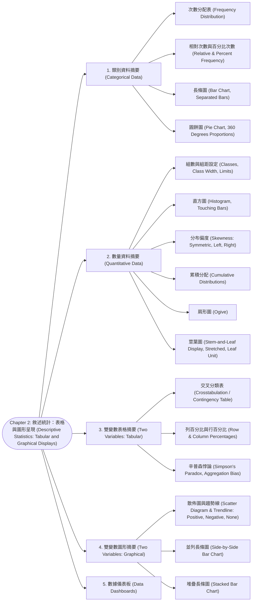

# Chapter 2: 敘述統計：表格與圖形呈現 (Descriptive Statistics: Tabular and Graphical Displays)

> 📅 生成日期：2026-10-20  
> 📄 來源檔案：Chapter 2.pdf (Statistics for Business and Economics, 14e)  
> 🎯 適用考試：期中考重點複習教材  

---

## 🗺️ 知識架構總覽 (Tree Diagram)



<a id="tree-diagram"></a>

### 🎯 本章學習進度檢核 (完成後打勾，建立成就反饋)

- [ ] [1. 類別資料摘要 (Categorical Data)](#sec-1)
- [ ] [2. 數量資料摘要 (Quantitative Data)](#sec-2)
- [ ] [3. 雙變數表格摘要 (Two Variables: Tabular)](#sec-3)
- [ ] [4. 雙變數圖形摘要 (Two Variables: Graphical)](#sec-4)
- [ ] [5. 數據儀表板 (Data Dashboards)](#sec-5)

---

## 📖 知識點教材

<a id="sec-1"></a>

### 2.1 類別資料之表格與圖形摘要 (Summarizing Categorical Data)

#### 📌 核心概念

類別資料（Categorical Data）使用標籤或名稱辨識類別。其基本摘要流程為：

1. **次數分配表（Frequency Distribution）**：列出所有互斥類別，並統計落入各類別之個體數（次數 Frequency, $f_i$）。
2. **相對次數分配（Relative Frequency Distribution）**：各類別次數佔總觀察值數量的比例。
3. **百分比次數分配（Percent Frequency Distribution）**：將相對次數乘以 $100\%$。
4. **長條圖（Bar Chart）**：以矩形高度代表各類別次數或百分比。**相鄰長條之間必須有間隔（Bars are separated）**，用以強調各類別在概念上彼此分離獨立。
5. **圓餅圖（Pie Chart）**：將圓形按各類別相對次數分割為扇形。扇形圓心角度 $= \text{相對次數} \times 360^\circ$。

#### 📐 關鍵公式 / 定理

- 相對次數（Relative Frequency）：
  $$\text{Relative Frequency} = \frac{f_i}{n}$$
  性質：$\sum_{i=1}^k \frac{f_i}{n} = 1.00$
- 百分比次數（Percent Frequency）：
  $$\text{Percent Frequency} = \left(\frac{f_i}{n}\right) \times 100\%$$
  性質：$\sum_{i=1}^k \text{Percent Frequency} = 100\%$
- 圓餅圖圓心角：
  $$\theta_i = \left(\frac{f_i}{n}\right) \times 360^\circ$$

#### 💡 重要觀念提醒

| 圖表類型 | 適用資料 | 柱狀外觀特徵 | 適用情境 |
|:---|:---|:---|:---|
| **長條圖 (Bar Chart)** | 類別資料 (Categorical) | **長條之間有空隙（Separated）** | 比較各類別次數大小 |
| **直方圖 (Histogram)** | 數量資料 (Quantitative) | **長條緊密相連（Touching/No gap）** | 觀察連續數值分布型態 |

> ⚠️ **圓餅圖使用警訊**：
> 圓餅圖僅適合類別數量少（通常 $\le 5\sim 7$ 類）且彼此百分比差異明顯時。若類別過多或佔比極度接近，人類視覺難以精確辨識扇形面積大小，此時長條圖遠優於圓餅圖。

#### 📊 範例

**題目**：某公司統計 200 名員工上班使用的交通工具：捷運 90 人、公車 50 人、騎機車 40 人、開車 20 人。
請計算捷運的相對次數、百分比次數以及在圓餅圖上所對應的圓心角。  
**解題**：

1. 總樣本數 $n = 200$。
2. 捷運相對次數 $= \frac{90}{200} = 0.45$。
3. 百分比次數 $= 0.45 \times 100\% = 45\%$。
4. 圓心角 $= 0.45 \times 360^\circ = 162^\circ$。

---

<a id="sec-2"></a>

### 2.2 數量資料之次數分配與組距決定 (Summarizing Quantitative Data: Classes & Width)

#### 📌 核心概念

將數量資料（Quantitative Data）轉換為次數分配表時，需經過三步驟：

1. **決定組數（Number of classes）**：
   - 通常介於 $5$ 到 $20$ 組之間。組數過少會損失過多細節，組數過多則無法有效歸納摘要。
   - 常用經驗法則：**$2^k \ge n$ 法則**（Sturges' Rule 精神），其中 $k$ 為組數，$n$ 為總樣本數。
2. **決定組距寬度（Approximate Class Width）**：
   - 建議所有組採用相同的組距寬度。
   - 估計公式：$\text{Class Width} \approx \frac{\text{Largest Value (Max)} - \text{Smallest Value (Min)}}{\text{Number of Classes}}$。
   - 計算後通常**向上取整（Round up）**至方便計算閱讀的整數（如 5, 10, 50, 100 等）。
3. **決定組限（Class Limits）**：
   - 下組限（Lower class limit）與上組限（Upper class limit）必須明確，確保**每一個數值恰好落入且只落入其中一組（互斥且周延）**。

#### 📐 關鍵公式 / 定理

- 概略組距：
  $$\text{Approximate Class Width} = \frac{\text{Maximum Value} - \text{Minimum Value}}{\text{Number of Classes}}$$
- 組中點（Class Midpoint）：
  $$\text{Class Midpoint} = \frac{\text{Lower Class Limit} + \text{Upper Class Limit}}{2}$$

#### 📊 範例

**題目**：Hudson 汽車廠分析 50 筆工單零件花費，最低花費為 $\$52$，最高花費為 $\$109$。若欲劃分為 6 個組，求概略組距，並設計合適的組限。  
**解題**：

1. 組距概算：$\frac{109 - 52}{6} = \frac{57}{6} = 9.5$。
2. 向上取整至方便的整數：設定組距為 $10$。
3. 起始下組限取 $\$50$，組別劃分如下：
   - $50 - 59$
   - $60 - 69$
   - $70 - 79$
   - $80 - 89$
   - $90 - 99$
   - $100 - 109$（剛好 6 組，涵蓋全部資料）。

---

<a id="sec-3"></a>

### 2.3 直方圖與分布偏度 (Histogram & Skewness)

#### 📌 核心概念

1. **直方圖（Histogram）**：
   - 水平軸為數量變數的數值級距，垂直軸為次數、相對次數或百分比次數。
   - 每個組距上方畫一矩形，矩形之間**緊鄰不留間隙（No space between bars）**。
2. **偏度（Skewness）**：衡量分布不對稱性（Lack of symmetry）的指標。
   - **對稱分布（Symmetric Distribution，$\text{Skewness} \approx 0$）**：
     - 左半部與右半部互為鏡像倒影。
     - 範例：成年人身高分布、常態製程規格。
     - 特性：$\text{Mean} \approx \text{Median} \approx \text{Mode}$。
   - **右偏態 / 正偏態（Moderately/Highly Skewed Right / Positive Skewness，$\text{Skewness} > 0$）**：
     - **右側拖著長長一道尾巴（Long tail to the right）**，多數資料集中在低數值端，少數極端高值將圖形向右拉扯。
     - 範例：家庭年所得、房屋售價、手遊玩家課金金額。
     - 特性：$\text{Mode} < \text{Median} < \text{Mean}$（平均數受右側極端大值影響被往右拉高）。
   - **左偏態 / 負偏態（Moderately/Highly Skewed Left / Negative Skewness，$\text{Skewness} < 0$）**：
     - **左側拖著長尾巴（Long tail to the left）**，多數資料集中在高數值端，少數極端低值將圖形向左拉扯。
     - 範例：過於簡單的考試成績、一般成年人的退休年齡。
     - 特性：$\text{Mean} < \text{Median} < \text{Mode}$（平均數受左側極低分拉低）。

#### 💡 重要觀念提醒

```
       對稱 (Symmetric)                  右偏態 (Right-skewed)                 左偏態 (Left-skewed)
            /\                               /\                                     /\
           /  \                             /  \___                               ___/  \
          /____\                           /_______\________             ________/_______\
     Mean = Median = Mode               Mode < Median < Mean             Mean < Median < Mode
      (Skewness = 0)                     (Skewness > 0, 正偏)             (Skewness < 0, 負偏)
```

> ⚠️ **口訣大心法**：
> 「尾巴在哪邊，就偏向哪邊！」
> 尾巴在右邊 $\rightarrow$ 右偏（正偏）；尾巴在左邊 $\rightarrow$ 左偏（負偏）。
> 並且平均數（Mean）最經不起誘惑，永遠被極端值的尾巴拉著跑！

---

<a id="sec-4"></a>

### 2.4 累積分配與肩形圖 (Cumulative Distributions & Ogive)

#### 📌 核心概念

1. **累積分配表（Cumulative Distributions）**：
   - 回答「小於等於某特定數值上限的資料有多少？」
   - **累積次數分配（Cumulative Frequency）**：小於等於該組上組限的觀察值總個數。
   - **累積相對次數分配（Cumulative Relative Frequency）**：小於等於該組上組限的比例（累加最後一組必為 $1.00$）。
   - **累積百分比次數分配（Cumulative Percent Frequency）**：小於等於該組上組限的百分比（最後一組必為 $100\%$）。
2. **肩形圖 / 累積次數多邊圖（Ogive）**：
   - 繪製累積分配的折線圖。
   - 水平軸標示**各組組限**（通常從第一組的下限開始，對應累積次數 0）。
   - 垂直軸為累積次數、累積相對次數或累積百分比次數。
   - 特性：**曲線恆為非遞減（Monotonically Non-decreasing）**。

#### 📊 範例

**題目**：某產品零件耐用測試資料如下表：

| 壽命（小時） | 次數 ($f$) |
|:---|:---|
| $100 - 199$ | $5$ |
| $200 - 299$ | $15$ |
| $300 - 399$ | $20$ |
| $400 - 499$ | $10$ |

求壽命 $\le 399$ 小時的累積次數與累積百分比。  
**解題**：

1. 總樣本數 $n = 5 + 15 + 20 + 10 = 50$。
2. $\le 399$ 小時涵蓋前三組，累積次數 $= 5 + 15 + 20 = 40$。
3. 累積百分比 $= \frac{40}{50} \times 100\% = 80\%$。

---

<a id="sec-5"></a>

### 2.5 莖葉圖與伸展莖葉圖 (Stem-and-Leaf Displays)

#### 📌 核心概念

1. **莖葉圖（Stem-and-Leaf Display）**：
   - 一種同時呈現「**分配形態（Rank order & Shape）**」與「**原始數據（Original data values）**」的強大探索性工具。
   - 垂直線左側為**莖（Stem）**：由數值的前導數字（Leading digits）構成。
   - 垂直線右側為**葉（Leaf）**：由數值的最後一位數字構成，依大小依序排列。
   - **每片葉子只能是單一數字（A single digit, 0~9）**。
2. **葉單位（Leaf Unit）**：
   - 說明葉子數字所代表的位值權重。
   - 若未特別標註，預設 $\text{Leaf Unit} = 1$。
   - 若數值為小數點（如 8.6, 9.4），可設 $\text{Leaf Unit} = 0.1$。
   - 若數值為大數（如 1806, 1717），可截斷或四捨五入後設 $\text{Leaf Unit} = 10$。
3. **伸展莖葉圖（Stretched Stem-and-Leaf Display）**：
   - 當資料過於密集時，可將每個莖**重複列出兩次**以拉長顯示：
     - 第一個莖：對應葉子為 **$0 - 4$**。
     - 第二個莖：對應葉子為 **$5 - 9$**。
   - 或重複五次（每個莖涵蓋 2 個數字：0-1, 2-3, 4-5, 6-7, 8-9）。

#### 💡 重要觀念提醒
>
> 🌟 **莖葉圖 vs. 直方圖的致命優勢**：
> 直方圖分組後，原始數據的精確值就被遮蔽（只知道落在該組內）；而**莖葉圖保留了每一筆原始資料的完整數值**，完全不會丟失資訊！

#### 📊 範例

**題目**：數據為：$72, 75, 78, 81, 84, 86, 90, 93, 97$。
若繪製成標準莖葉圖與伸展莖葉圖（每個莖拆為兩行）：  
**解題**：

- 標準莖葉圖（Leaf unit = 1）：

  ```text
  7 | 2 5 8
  8 | 1 4 6
  9 | 0 3 7
  ```

- 伸展莖葉圖（Stretched, 每個莖出現兩次）：

  ```text
  7 | 2       (對應 0-4)
  7 | 5 8     (對應 5-9)
  8 | 1 4     (對應 0-4)
  8 | 6       (對應 5-9)
  9 | 0 3     (對應 0-4)
  9 | 7       (對應 5-9)
  ```

---

<a id="sec-6"></a>

### 2.6 雙變數表格摘要：交叉分類表 (Crosstabulation / Contingency Table)

#### 📌 核心概念

1. **交叉分類表（Crosstabulation）**：
   - 同時彙總兩個變數資料的二維表格（Row 變數與 Column 變數）。
   - 適用於：兩個類別變數、一類別一數量變數、或兩個數量變數（先分組後填表）。
2. **百分比轉換**：
   - **列百分比（Row Percentages）**：以每一列的列總計（Row Total）為分母（$100\%$），觀察列變數在各行變數的分布條件比例。
   - **行百分比（Column Percentages）**：以每一行的行總計（Column Total）為分母（$100\%$），觀察行變數在各列變數的分布條件比例。
   - **總體百分比（Total Percentages）**：以全體總樣本數 $n$ 為分母。

#### 💡 重要觀念提醒
>
> ⚠️ **考試關鍵字判讀**：
>
> - 題目問：「在所有**購買休旅車的顧客中**，年收入大於百萬的比例為何？」$\rightarrow$ 這是**以休旅車為基準的條件百分比**（分母為休旅車那一列/行）！
> - 題目問：「所有顧客中，**既買休旅車且年收入大於百萬**的比例？」$\rightarrow$ 這是**總體百分比（分母為全體總人數 $n$）**！

#### 📊 範例

**題目**：Finger Lakes 房地產調查房型與價格的交叉表如下：

| 房屋類型 | 價格 $< \$250,000$ | 價格 $\ge \$250,000$ | 總計 |
|:---|:---:|:---:|:---:|
| 雙層別墅 (Split-level) | $19$ | $2$ | $21$ |
| A型度假屋 (A-Frame) | $1$ | $3$ | $4$ |
| 殖民風別墅 (Colonial) | $12$ | $13$ | $25$ |
| **總計** | **$32$** | **$18$** | **$50$** |

求：(1) Split-level 且價格 $< \$250,000$ 的總百分比；(2) 在所有價格 $< \$250,000$ 的房屋中，Split-level 的比例（行百分比）。  
**解題**：

1. 總百分比 $= \frac{19}{50} = 38\%$。
2. 行百分比（分母為價格 $< \$250,000$ 的總計 32 棟）$= \frac{19}{32} \approx 59.38\%$。

---

<a id="sec-7"></a>

### 2.7 辛普森悖論 (Simpson's Paradox) — 🌟 期中考必考核心！

#### 📌 核心概念

1. **定義**：
   - 當兩個或多個交叉分類表的資料進行**合併彙總（Aggregated）**之後，所得出的**整體結論，竟然與「各自分組未彙總（Unaggregated）」時的結論完全相反（Reversal of conclusions）！**
2. **成因**：
   - 存在一個未被顯式納入分組考量的**干擾變數 / 隱藏變數（Confounding / Lurking variable）**。
   - 兩個比較群體在不同難度或不同環境下的**樣本權重分配極度不均勻**所導致。

#### 💡 重要觀念提醒：經典範例剖析

假設評估兩位工程師 Alan 與 John 的除錯成功率：

- **專案 1（極困難任務）**：
  - Alan：處理 100 件，成功 20 件 $\rightarrow$ 成功率 **$20\%$**。
  - John：處理 10 件，成功 1 件 $\rightarrow$ 成功率 **$10\%$**。
  - 結論：**Alan 勝（$20\% > 10\%$）**。
- **專案 2（極簡單任務）**：
  - Alan：處理 10 件，成功 9 件 $\rightarrow$ 成功率 **$90\%$**。
  - John：處理 100 件，成功 85 件 $\rightarrow$ 成功率 **$85\%$**。
  - 結論：**Alan 勝（$90\% > 85\%$）**。
- **合併數據（Aggregated Data）**：
  - Alan 總計：處理 $100 + 10 = 110$ 件，成功 $20 + 9 = 29$ 件 $\rightarrow$ 總成功率 $= \frac{29}{110} \approx \mathbf{26.4\%}$。
  - John 總計：處理 $10 + 100 = 110$ 件，成功 $1 + 85 = 86$ 件 $\rightarrow$ 總成功率 $= \frac{86}{110} \approx \mathbf{78.2\%}$。
  - 驚人反轉結論：**John 總成功率遠勝 Alan（$78.2\% \gg 26.4\%$）！**

> 🔑 **為什麼會這樣？**
> Alan 被指派了 100 次極度困難的專案 1（成功率本來就很低），而 John 被指派了 100 次極度簡單的專案 2！
> 「專案難度」就是強大的**干擾變數（Confounding Variable）**。若僅看加總數據，會被分配比重的假象嚴重誤導！

---

<a id="sec-8"></a>

### 2.8 雙變數圖形摘要：散佈圖、趨勢線與長條圖 (Scatter Diagrams & Charts)

#### 📌 核心概念

1. **散佈圖（Scatter Diagram）與趨勢線（Trendline）**：
   - 呈現**兩個數量變數（Two quantitative variables）**之間關係的圖形。
   - 一個變數置於水平軸（橫軸 $X$），另一個置於垂直軸（縱軸 $Y$）。
   - **正相關關係（Positive Relationship）**：點狀由左下往右上延伸，$X$ 增加時 $Y$ 亦傾向增加（如讀書時數與成績）。
   - **負相關關係（Negative Relationship）**：點狀由左上往右下傾斜，$X$ 增加時 $Y$ 傾向減少（如產品價格與需求量）。
   - **無明顯關聯（No Apparent Relationship）**：點狀隨機散布，無明確線性走向（如鞋子尺碼與考試分數）。
2. **群組長條圖（Side-by-Side Bar Chart）**：
   - 同時展示兩個類別變數。以第一個變數的值作為群組（Cluster），群組內並列第二個變數的各個長條。
3. **堆疊長條圖（Stacked Bar Chart）**：
   - 將第二個變數的各類別以不同顏色矩形堆疊於同一長條中，可同時呈現總量與各細項結構佔比。

#### 💡 重要觀念提醒

| 圖表名稱 | 適用變數形態 | 主要用途 |
|:---|:---|:---|
| **散佈圖 (Scatter Diagram)** | 兩變數皆為 **數量變數 (Quantitative)** | 觀察兩數值之關聯走向與線性趨勢 |
| **並列長條圖 (Side-by-Side)** | 兩變數皆為 **類別變數 (Categorical)** | 跨群組比較次數或比例 |
| **堆疊長條圖 (Stacked Bar)** | 兩變數皆為 **類別變數 (Categorical)** | 比較各群組總計並剖析內部組成比例 |

---

---

## 📝 實戰練習題 (三層遞進式強化測驗)

### 🟢 Tier 1：必懂基礎 (Must-Know Fundamentals)

> 💡 **學習目標**：確認自己「會算、會辨識」——給數字就能做對、給名稱就能配對。

<a id="q1"></a>

#### Q1. (基礎公式計算) 相對次數與百分比次數分配計算

某科技大學統計學課程共有 40 名學生修習（全體樣本數 $n = 40$）。經調查學生的主修科系，其中有 14 名學生主修資訊管理系。請問：
(1) 資訊管理系學生的「相對次數（Relative Frequency）」為何？  
(2) 資訊管理系學生的「百分比次數（Percent Frequency）」為何？  
(3) 全體各科系相對次數的加總和，理論上必然**嚴格等於多少**？

(A) (1) 0.35, (2) 35%, (3) 1.00  
(B) (1) 0.28, (2) 28%, (3) 100  
(C) (1) 0.35, (2) 35%, (3) 40  
(D) (1) 1.40, (2) 14%, (3) 1.00  

👉 [查看 Q1 答案與詳細解析](#ans-q1)

---

<a id="q2"></a>

#### Q2. (基礎分組公式) 定量資料組距 (Class Width) 的計算

某工廠品管部門蒐集了 100 批原料的抗拉強度數據，經初步整理，該批資料中的最小值（Minimum）為 $22\text{ kg}$，最大值（Maximum）為 $98\text{ kg}$。若品管工程師決定將這批資料整理為 $k = 5$ 個組別（Classes）：
依據標準組距估算公式，其「近似組距（Approximate Class Width）」計算結果為何？實務上最建議取整為何值？

(A) $15.2$，實務上向上取整為 $16$ 或便利數值 $20$  
(B) $19.0$，實務上向下取整為 $15$  
(C) $24.4$，實務上取整為 $25$  
(D) $15.2$，實務上必須向下捨去為 $15$  

👉 [查看 Q2 答案與詳細解析](#ans-q2)

---

<a id="q3"></a>

#### Q3. (基礎圖形外觀辨析) 長條圖 (Bar Chart) vs. 直方圖 (Histogram)

關於長條圖（Bar Chart）與直方圖（Histogram）在外觀構造與本質意義上的差異，下列敘述何者**完全正確**？

(A) 長條圖的各垂直長方形之間緊密相連無任何空隙，用以呈現定性資料  
(B) 直方圖的柱體彼此緊密相連（無人為空隙），代表連續定量資料的連續性區間；而長條圖的長條之間通常留有人為間隔（Gaps），強調各類別彼此為離散互斥的定性項目  
(C) 長條圖的長條面積代表資料機率，直方圖的高度代表標準差  
(D) 直方圖只能用來呈現時間序列資料，長條圖只能呈現截面資料  

👉 [查看 Q3 答案與詳細解析](#ans-q3)

---

<a id="q4"></a>

#### Q4. (基礎圖表解讀) 莖葉圖 (Stem-and-Leaf) 的資訊讀取與核心優勢

某班級統計學小考成績（滿分 100 分）繪製成莖葉圖，其中「莖（Stem）」代表十位數，「葉（Leaf）」代表個位數。其中某一行顯示如下：
`7 | 1  3  5  5  8  9`
(1) 該行代表哪 6 個原始考生成績？  
(2) 相比於直方圖（Histogram），莖葉圖最突出的核心資訊優勢為何？

(A) (1) 71, 73, 75, 75, 78, 79；(2) 直方圖在分組後原始資料點數值完全遺失，而莖葉圖在展現分佈形狀的同時，完整保留了每一筆原始數值  
(B) (1) 17, 37, 57, 57, 87, 97；(2) 莖葉圖能自動計算中位數標準差  
(C) (1) 71, 73, 75, 75, 78, 79；(2) 莖葉圖只適用於樣本數大於 10,000 的大數據  
(D) (1) 70, 70, 70, 70, 70, 70；(2) 莖葉圖能消除離群值  

👉 [查看 Q4 答案與詳細解析](#ans-q4)

---

<a id="q5"></a>

#### Q5. (基礎圖形特徵) 柏拉圖 (Pareto Chart) 的構成規範

在全面品質管理（TQM）中，品管圈常使用「柏拉圖 (Pareto Chart)」找出引發產品瑕疵的關鍵少數原因（80/20 法則）。關於標準柏拉圖的繪製規範，下列敘述何者正確？

(A) 橫軸的瑕疵原因類別必須**依發生頻率由小到大**升冪排列  
(B) 橫軸的各類別長條必須**依發生頻率（或損失金額）由大到小**降冪排列，且上方必須疊加一條「累積百分比折線」  
(C) 柏拉圖必須採用圓形餅狀圖呈現  
(D) 柏拉圖的柱體高度必須全部相等  

👉 [查看 Q5 答案與詳細解析](#ans-q5)

---

### 🟡 Tier 2：基礎 + 實際應用 (Application & Scenario Matching)

> 💡 **學習目標**：確認自己「會用」——能由直方圖形狀判斷平均數與中位數相對大小、解析辛普森悖論。

<a id="q6"></a>

#### Q6. (分佈偏態與指標位移) 右偏分佈 (Right-Skewed) 下平均數與中位數的關係

某新創科技園區對園區內 5,000 名工程師的年收入進行調查並繪製直方圖：
圖形呈現明顯的「右偏分佈（Right-Skewed / Positively Skewed）」，即大部分年輕工程師年薪集中於 80~120 萬元，但極右端拖著一條長長的細尾巴（少數頂級創辦人年薪高達數億元）。
在此偏態直方圖下，該年薪資料的「算術平均數（Mean）」與「中位數（Median）」之間的大小關係為何？

(A) 平均數嚴格等於中位數 ($\text{Mean} = \text{Median}$)  
(B) 平均數大於中位數 ($\text{Mean} > \text{Median}$)  
(C) 平均數小於中位數 ($\text{Mean} < \text{Median}$)  
(D) 兩者大小無法由偏態方向判定  

👉 [查看 Q6 答案與詳細解析](#ans-q6)

---

<a id="q7"></a>

#### Q7. (累積折線圖判讀) 肩峰圖 (Ogive) 與百分位數反求

某大學對 1,000 名新生英文能力測驗成績繪製了「累積百分比折線圖（Ogive）」。圖中橫軸為成績（$0 \sim 100$ 分），縱軸為累積百分比（$0\% \sim 100\%$）：

* 縱軸 $50\%$ 的水平線對應到折線上的橫軸分數為 $68$ 分。
* 縱軸 $75\%$ 的水平線對應到折線上的橫軸分數為 $82$ 分。

請問下列推論何者**完全正確**？

(A) 成績的算術平均數必然等於 68 分  
(B) 成績的中位數（Median）為 68 分，且全校考取 82 分以上的高分群學生比例佔 $25\%$  
(C) 成績的第一四分位數（$Q_1$）為 82 分  
(D) 全校有 750 名學生成績不及格（低於 60 分）  

👉 [查看 Q7 答案與詳細解析](#ans-q7)

---

<a id="q8"></a>

#### Q8. (統計悖論實務解析) 辛普森悖論 (Simpson's Paradox) 的混淆機制

某兩大醫院比較心臟外科手術成功率：

* 在「簡單輕症手術」中：A 醫院成功率 $98\%$，B 醫院成功率 $95\%$（A 勝）
* 在「極度危險重症手術」中：A 醫院成功率 $80\%$，B 醫院成功率 $70\%$（A 勝）

然而當把所有病患數據合併計算總成功率時，B 醫院的總成功率竟然為 $92.5\%$，大幅超越 A 醫院的 $83.6\%$！
造成這種「分組皆贏，總合反輸」的辛普森悖論，其幕後最核心的**混淆變數（Confounding Variable）** 為何？

(A) 兩家醫院病床的收費金額不同  
(B) 病患病情的嚴重程度比例極度失衡：A 醫院作為國家醫學中心，其病患中有 $80\%$ 屬於致死率極高的重症手術；而 B 醫院有 $90\%$ 皆為風險極低的輕症手術，重症案件比例過高拉低了 A 的總體平均  
(C) 醫生手術時的年齡差異  
(D) 計算成功率時未乘以標準差  

👉 [查看 Q8 答案與詳細解析](#ans-q8)

---

<a id="q9"></a>

#### Q9. (非線性關聯辨析) 散布圖 (Scatter Diagram) 呈二次曲線時的相關性陷阱

某汽車零件廠測試「引擎運轉溫度 (X)」與「金屬疲勞壽命 (Y)」的關係，繪製散布圖後發現數據點呈現一個完美的倒 U 字型對稱拋物線（在適溫 $90^\circ\text{C}$ 時壽命最長，過低或過高時壽命皆急遽衰減）。
若工程師直接呼叫 Excel 計算這兩變數的皮爾森線性相關係數（Pearson correlation coefficient, $r$），其數值可能接近多少？能否宣稱兩者「毫無關聯」？

(A) $r \approx +1.0$；兩者有強烈正相關  
(B) $r \approx -1.0$；兩者有強烈負相關  
(C) $r \approx 0$；但絕不能宣稱兩者無關，因為皮爾森 $r$ 僅能衡量「線性關係」，兩變數之間存在極其強烈的「非線性拋物線關聯」  
(D) $r \approx 0.5$；兩者中度相關  

👉 [查看 Q9 答案與詳細解析](#ans-q9)

---

### 🔴 Tier 3：概念講述與深度分析 (Conceptual & Analytical)

> 💡 **學習目標**：確認自己「會講」——能推導圖形面積原則、組界防二義性規範與辛普森悖論的數理結構。

<a id="q10"></a>

#### Q10. (資料視覺化原則) 面積原則 (The Area Principle) 與圖形視覺欺騙剖析

在統計圖表製作中，知名統計學家 Edward Tufte 提出了「面積原則 (The Area Principle)」：圖形中視覺元素的幾何面積比例，必須精確等於其所代表的數值比例。
(1) 試論述商業簡報中常見的「三維長條圖（3D Bar Charts）」或「將長條圖的寬度隨高度同步等比例放大」是如何嚴重違反面積原則的？  
(2) 設某企業今年的利潤為 1 億元，明年預估利潤翻倍為 2 億元（數值比例為 $1:2$）。若美編人員在繪製圖示時，將代表利潤的錢袋圖形「高度放大為 2 倍，寬度亦放大為 2 倍」，請問讀者大腦所感知的視覺面積比例變成了多少？這種視覺放大效應對投資人會造成何種誤導？

👉 [查看 Q10 答案與詳細解析](#ans-q10)

---

<a id="q11"></a>

#### Q11. (組界定義與連續性哲學) 定量分組中組界 (Class Boundaries) 的防二義性設計

在連續型定量資料建構次數分配表時：
(1) 若將組別簡單寫為「$10 \sim 20$」與「$20 \sim 30$」，當資料集中恰好出現觀測值 $X = 20$ 時，會產生什麼致命缺陷？  
(2) 統計學家如何利用**嚴格數學區間標記（如 $[10, 20)$ 或 $10 \le X < 20$）** 與 **真實組界（True Class Boundaries，例如整數資料使用 $9.5 \sim 19.5, 19.5 \sim 29.5$）** 徹底根除歸屬的二義性，並確保直方圖柱體無縫銜接？

👉 [查看 Q11 答案與詳細解析](#ans-q11)

---

<a id="q12"></a>

#### Q12. (辛普森悖論數理本質推導) 辛普森悖論的加權平均數證明與分層化 (Stratification) 防禦

(1) 設有兩組樣本大小 $n_{A1}, n_{A2}$ 與 $n_{B1}, n_{B2}$，且在兩個子分組中分別滿足比率 $p_{A1} > p_{B1}$ 與 $p_{A2} > p_{B2}$。請以加權平均數的代數結構，推導為什麼當子群體的權重權重比例極度懸殊時，會導致整體加權總比率發生反轉（$\bar{p}_A < \bar{p}_B$）？  
(2) 在現代科技巨頭的 A/B 測試（如新舊演算法轉換率評估）中，資料科學家應採取何種具體分析策略（如分層分析 Stratified Analysis / 傾向評分匹配 PSM），以防範辛普森悖論導致錯誤的產品決策？

👉 [查看 Q12 答案與詳細解析](#ans-q12)

---

## 🔑 本章練習題答案與詳細解析 (Answer Key)

### 🟢 Tier 1 解析

<a id="ans-q1"></a>

### Q1 答案與詳細解析

* **正確答案**：**(A)**
* **逐步計算過程**：
  * (1) **相對次數公式**：
    $$\text{Relative Frequency} = \frac{\text{Class Frequency}}{n} = \frac{14}{40} = 0.35$$
  * (2) **百分比次數公式**：
    $$\text{Percent Frequency} = \text{Relative Frequency} \times 100\% = 0.35 \times 100\% = 35\%$$
  * (3) 因全體各類別頻率總和必等於樣本總數 $n$，故所有類別的相對次數加總和**在理論上必定嚴格等於 $1.00$**（或百分比次數總和等於 $100\%$）。選項 (A) 完全正確。

[🔙 返回題目 Q1](#q1) ｜ [🔝 返回知識架構圖](#tree-diagram)

---

<a id="ans-q2"></a>

### Q2 答案與詳細解析

* **正確答案**：**(A)**
* **組距估算與取整法則**：
  * **近似組距計算公式**：
    $$\text{Approximate Class Width} = \frac{\text{Maximum} - \text{Minimum}}{\text{Number of Classes}} = \frac{98 - 22}{5} = \frac{76}{5} = 15.2$$
  * **實務取整準則**：
    * 計算結果通常帶有小數。為了保證所有資料皆能被涵蓋在 $k$ 個組別之內，**組距必須「向上取整（Round Up）」**。若向下捨去為 15，則 $5 \times 15 = 75 < 76$，最大值 98 將會溢出最後一組之外！
    * 在實際報表製作中，通常會向上取整為人類心算方便的便利數字（Convenient Number），例如 16、20 或 25。選項 (A) 正確。

[🔙 返回題目 Q2](#q2) ｜ [🔝 返回知識架構圖](#tree-diagram)

---

<a id="ans-q3"></a>

### Q3 答案與詳細解析

* **正確答案**：**(B)**
* **長條圖 vs. 直方圖本質對比**：
  * **長條圖 (Bar Chart)**：用於呈現**定性資料（Categorical Data）**。類別之間本質上是分離、不連續的（如蘋果、香蕉、橘子）。長條之間的「間隙」是人為特意保留的，用以視覺化強調類別的獨立互斥性。
  * **直方圖 (Histogram)**：用於呈現**定量資料（Quantitative Data）**。橫軸為連續數值區間（如年齡 $20 \sim 30, 30 \sim 40$）。相鄰組別無縫銜接，故柱體之間緊密相鄰、不留任何空隙，且直方圖柱體的**面積（Area）** 與次數嚴格成正比。選項 (B) 正確。

[🔙 返回題目 Q3](#q3) ｜ [🔝 返回知識架構圖](#tree-diagram)

---

<a id="ans-q4"></a>

### Q4 答案與詳細解析

* **正確答案**：**(A)**
* **莖葉圖解讀與資訊優勢**：
  * 莖為 7，葉為 1, 3, 5, 5, 8, 9，代表的原始分數分別為：$71, 73, 75, 75, 78, 79$。
  * **核心優勢剖析**：
    * 在標準次數分配表或直方圖中，一旦將成績歸入「$70 \sim 80$」組，我們只知道該組次數為 6，但這 6 個人的原始分數到底是全部 70 分、還是全部 79 分，資訊被完全壓縮抹平。
    * 莖葉圖（Stem-and-Leaf）既能像直方圖一樣橫向一眼看出分佈的集中與偏態形狀，**同時完整保留了每一個資料點的真實原始數值**，兼具圖形呈現與原始數據留存之雙重優點。選項 (A) 正確。

[🔙 返回題目 Q4](#q4) ｜ [🔝 返回知識架構圖](#tree-diagram)

---

<a id="ans-q5"></a>

### Q5 答案與詳細解析

* **正確答案**：**(B)**
* **柏拉圖三大構成要素**：
  1. **類別長條**：橫軸依據發生次數（或金額損失）**從大到小嚴格降冪排列**（最左側為造成問題最大的頭號元凶）。
  2. **左縱軸**：代表瑕疵次數或損失金額。
  3. **右縱軸與累積折線**：疊加一條由左下往右上攀升的**累積百分比曲線（Cumulative Percentage Curve）**，輔助管理者迅速鎖定累積達到 $80\%$ 的「關鍵少數（Vital Few）」問題優先解決。選項 (B) 正確。

[🔙 返回題目 Q5](#q5) ｜ [🔝 返回知識架構圖](#tree-diagram)

---

### 🟡 Tier 2 解析

<a id="ans-q6"></a>

### Q6 答案與詳細解析

* **正確答案**：**(B)**
* **偏態對平均數之拉扯效應**：
  * **中位數 (Median)**：具備高度「抗性（Robustness）」，只取排序後正中間位置的數值，不受極端值影響。
  * **算術平均數 (Mean)**：由全體數值加總後除以 $n$。當分佈呈現右偏（極右側存在少數數億元的超高薪極端值），這些龐大數值會將總和劇烈拉高，導致**平均數被強行向右拖曳**。
  * 規律總結：
    * **右偏（正偏態）**：$\text{Mean} > \text{Median} > \text{Mode}$
    * **對稱（鐘形分佈）**：$\text{Mean} = \text{Median} = \text{Mode}$
    * **左偏（負偏態）**：$\text{Mean} < \text{Median} < \text{Mode}$
  * 故平均數大於中位數。選項 (B) 正確。

[🔙 返回題目 Q6](#q6) ｜ [🔝 返回知識架構圖](#tree-diagram)

---

<a id="ans-q7"></a>

### Q7 答案與詳細解析

* **正確答案**：**(B)**
* **肩峰圖 (Ogive) 百分位數解讀**：
  * 肩峰圖的縱軸是「小於等於某分數的累積百分比」。
  * 累積百分比 $50\%$ 所對應的橫軸數值即為**中位數（第 50 百分位數 $P_{50}$）**，故中位數 $= 68$ 分。
  * 累積百分比 $75\%$ 所對應的分數為 82 分（第 75 百分位數 $Q_3$）。這代表有 $75\%$ 的學生成績 $\le 82$ 分；換言之，成績大於 82 分的高分群比例為 $100\% - 75\% = 25\%$（即 $1000 \times 25\% = 250$ 人）。選項 (B) 正確。

[🔙 返回題目 Q7](#q7) ｜ [🔝 返回知識架構圖](#tree-diagram)

---

<a id="ans-q8"></a>

### Q8 答案與詳細解析

* **正確答案**：**(B)**
* **辛普森悖論之實體案例拆解**：
  * 檢視兩家醫院的手術結構：
    * **A 醫院（重症中心）**：共接 1,000 例。其中 100 例輕症（成功 98 例），900 例重症（成功 720 例）。總成功率 $= \frac{98 + 720}{1000} = \frac{818}{1000} = 81.8\%$。
    * **B 醫院（社區診所）**：共接 1,000 例。其中 900 例輕症（成功 855 例），100 例重症（成功 70 例）。總成功率 $= \frac{855 + 70}{1000} = \frac{925}{1000} = 92.5\%$。
  * 雖然 A 醫院在每種手術的醫療水準都完勝 B 醫院，但因其病患分佈高度向重症傾斜，加權平均數被重症的低基期拉低。若不控制「病情嚴重度」這一混淆變數，直接比較整體總比率，將會得出極度荒謬且不公平的結論。選項 (B) 正確。

[🔙 返回題目 Q8](#q8) ｜ [🔝 返回知識架構圖](#tree-diagram)

---

<a id="ans-q9"></a>

### Q9 答案與詳細解析

* **正確答案**：**(C)**
* **皮爾森線性相關係數的盲點**：
  * 皮爾森相關係數 $r$ 的數學公式是建立在「尋找一條最適配的直線（Best-fit Straight Line）」之上。
  * 當兩變數呈現對稱的倒 U 字拋物線時，左半部的強烈正斜率與右半部的強烈負斜率在數學加總時**剛好互相抵銷**，導致算出的線性相關係數 $r \approx 0$。
  * **關鍵教訓**：$r = 0$ 僅代表「**不存在線性關係（No Linear Association）**」，絕不代表兩變數「沒有關係（No Association）」。在計算統計指標前，**永遠必須先繪製散布圖（Scatter Diagram）觀察圖形樣貌**！選項 (C) 正確。

[🔙 返回題目 Q9](#q9) ｜ [🔝 返回知識架構圖](#tree-diagram)

---

### 🔴 Tier 3 解析

<a id="ans-q10"></a>

### Q10 答案與詳細解析

* **(1) 三維圖與寬度放大對面積原則的破壞**：
  * **面積原則核心**：人類眼睛和大腦在接收圖表資訊時，直覺感知的是圖形佔據視野的**二維面積**，而非僅僅是一維的高度。
  * 3D 圖表因為透視投影（Perspective Projection），前方柱體會遮擋後方，且靠近視角的柱體看起來面積被虛假放大。

* **(2) 錢袋圖示之面積幾何推導與視覺欺騙**：
  * 設今年利潤為 $1$ 單位，錢袋圖示的高度為 $H$，寬度為 $W$，面積為 $A_1 = H \times W$。
  * 明年利潤為 $2$ 單位（真實成長為 2 倍）。
  * 若美編人員將高度放大為 $2H$，寬度亦等比例放大為 $2W$，則明年錢袋的面積變為：
    $$A_2 = (2H) \times (2W) = 4(H \times W) = 4 A_1$$
  * **視覺欺騙**：真實利潤僅成長 2 倍，但讀者大腦感知的視覺面積卻暴增為 **4 倍**！若是三維立體圖案，體積甚至會放大為 $2^3 = 8$ 倍！這種無意識的圖形放大，會極大程度誇大企業的成長幅度，構成嚴重的統計誤導。

[🔙 返回題目 Q10](#q10) ｜ [🔝 返回知識架構圖](#tree-diagram)

---

<a id="ans-q11"></a>

### Q11 答案與詳細解析

* **(1) 重疊端點的二義性困境**：
  * 若組別設定為「$10 \sim 20$」與「$20 \sim 30$」，當出現剛好等於 $20$ 的數值時，分析人員無法客觀判定它到底該計入第一組還是第二組。若不同人員主觀處理，會導致次數分配表完全失去一致性與可重複性。

* **(2) 根除二義性的兩大標準工程規範**：
  * **方法一：半開半閉數學區間記號 (Half-Open Intervals)**：
    * 明確定義區間為 $[10, 20)$，即 $10 \le X < 20$（含下界、不含上界）。
    * 此時數值 $19.999$ 歸入第一組，而 $20.0$ 明確歸入第二組 $[20, 30)$，邏輯嚴密清晰。
  * **方法二：真實組界 (True Class Boundaries)**：
    * 針對整數資料，刻意在各組之間取小數點後一位的 $0.5$ 作為組界。例如第一組記錄為 $10 \sim 19$（組界為 $9.5 \sim 19.5$），第二組記錄為 $20 \sim 29$（組界為 $19.5 \sim 29.5$）。
    * 由於整數資料絕不可能剛好等於 $19.5$，二義性被物理隔絕，且兩組組界點緊密相連（皆為 19.5），使得直方圖柱體能完美連續無縫拼接。

[🔙 返回題目 Q11](#q11) ｜ [🔝 返回知識架構圖](#tree-diagram)

---

<a id="ans-q12"></a>

### Q12 答案與詳細解析

* **(1) 加權平均數代數結構證明**：
  * 整體合併比率本質上是各子組比率的加權平均數：
    $$\bar{p} = w_1 p_1 + w_2 p_2 = \frac{n_1}{n_1 + n_2} p_1 + \frac{n_2}{n_1 + n_2} p_2$$
  * 即使在每個子組內皆有 $p_{A1} > p_{B1}$ 與 $p_{A2} > p_{B2}$：
    * 若群體 A 的樣本大多集中在「本來比率就很低」的子組 2（即權重 $w_{A2}$ 極大，$w_{A1}$ 極小），則 $\bar{p}_A \approx p_{A2}$。
    * 若群體 B 的樣本大多集中在「本來比率就很高」的子組 1（即權重 $w_{B1}$ 極大，$w_{B2}$ 極小），則 $\bar{p}_B \approx p_{B1}$。
    * 只要子組間本身的固有水準差距夠大（$p_{B1} \gg p_{A2}$），加權總和必然發生反轉，證明了 $\bar{p}_A < \bar{p}_B$ 在數學上完全成立。

* **(2) A/B 測試防禦策略：分層分析 (Stratification)**：
  * 在科技公司（如 Google、Meta）評估新演算法 A 與舊演算法 B 的點擊轉化率時：
    * 若新演算法 A 被隨機分派到較多「非尖峰時段」或「低轉化率國家（如開發中國家）」的流量，整體合併點擊率可能呈現 $A < B$。
    * **正確實踐**：資料科學家必須實施**分層分析（Stratified Analysis）** 或使用 **Cochran-Mantel-Haenszel (CMH) 檢定**，將流量按國家、裝置（手機 vs. 電腦）、時段分層，在各層級內部獨立比較；或在實驗設計階段採用**分層隨機抽樣（Stratified Randomization）**，強制確保各實驗組的混淆變數比例完全一致，杜絕辛普森悖論誤殺優秀的新演算法。

[🔙 返回題目 Q12](#q12) ｜ [🔝 返回知識架構圖](#tree-diagram)

---

## 📋 本章重點速記表

| # | 觀念 / 圖表 | 適用資料型態 | 核心判斷重點 / 公式 |
|:--|:---|:---|:---|
| 1 | **長條圖 (Bar Chart)** | 類別資料 | 長條間**有空隙**，寬度固定，高度代表次數/比例 |
| 2 | **圓餅圖 (Pie Chart)** | 類別資料 | 角度 $= \text{相對次數} \times 360^\circ$；類別過多時不建議使用 |
| 3 | **直方圖 (Histogram)** | 數量資料 | 長條間**無空隙緊相鄰**，反映連續數值分布 |
| 4 | **組距概算公式** | 數量資料 | $\text{Width} \approx \frac{\text{Max} - \text{Min}}{\text{組數}}$，向上取方便整數 |
| 5 | **右偏態 (Positive Skew)** | 數量資料 | 長尾在右方，極端大值拉動均值：$\text{Mode} < \text{Median} < \text{Mean}$ |
| 6 | **左偏態 (Negative Skew)** | 數量資料 | 長尾在左方，極端小值拉低均值：$\text{Mean} < \text{Median} < \text{Mode}$ |
| 7 | **肩形圖 (Ogive)** | 數量資料 | 累積次數/百分比折線圖，曲線性質**單調非遞減** |
| 8 | **莖葉圖 (Stem-and-Leaf)** | 數量資料 | 兼具圖形分布與**完整保留原始數據**；葉子必為單一數字 |
| 9 | **交叉分類表 (Crosstab)** | 雙變數 | 橫列縱行二維彙總，可換算列百分比與行百分比 |
| 10 | **辛普森悖論 (Simpson's)** | 雙變數合併 | 合併數據與分組數據結論**完全反轉**，因隱藏干擾變數存在 |
| 11 | **散佈圖 (Scatter)** | 雙數量變數 | 點狀座標分佈，用以觀察正相關、負相關或無關聯 |

---

## 🃏 考前速查卡片

| 正面 (問題) | 背面 (答案) |
|:---|:---|
| 長條圖（Bar Chart）與直方圖（Histogram）外觀最大的區別是什麼？ | 長條圖的條形之間**有間距（Separated）**；直方圖的矩形之間**緊鄰無間距（Touching）**。 |
| 右偏態（Right-skewed）分布中，Mean、Median、Mode 的大小順序為何？ | $\text{Mode} < \text{Median} < \text{Mean}$（平均數被右方長尾巴極端大值拉得最高）。 |
| 什麼是肩形圖（Ogive）？它能往下走嗎？ | 繪製累積分配的折線圖，由於次數只會累加，**曲線恆為單調非遞減，絕對不可能往下走**。 |
| 莖葉圖中的葉（Leaf）有什麼限制？ | 每一片葉子**必須嚴格限制為單一數字（A single digit, 0~9）**。 |
| 何謂辛普森悖論（Simpson's Paradox）？ | 資料在細部分組時的結論，於加總合併（Aggregated）後發生徹底反轉的現象。通常由樣本比重失衡或隱藏干擾變數引起。 |
| 散佈圖（Scatter Diagram）適用於什麼型態的變數？ | **兩個數量變數（Two quantitative variables）**。 |

---

## ⚠️ 本章常見考試陷阱

1. **陷阱一：偏度（Skewness）左右搞混**
   - *常見錯誤*：以為「資料峰值偏在左邊」就是左偏。
   - *正確認知*：偏度看的是**尾巴（Tail）**！多數資料在左、尾巴拖在右邊 $\rightarrow$ **右偏態（Right-skewed / Positive）**！
2. **陷阱二：直方圖長條畫上間距**
   - *常見錯誤*：把直方圖畫得像長條圖一樣一根一根分開。
   - *正確認知*：直方圖矩形邊界相接，中間沒有空隙。
3. **陷阱三：忽略莖葉圖的葉單位（Leaf Unit）**
   - *常見錯誤*：直接把葉子當個位數，忽略題目給定的「$\text{Leaf Unit} = 0.1$」或「$100$」。
   - *正確認知*：計算真實原始數據前，務必先確認葉單位並乘上權重。
4. **陷阱四：交叉表的百分比分母選錯**
   - *常見錯誤*：求條件百分比時，誤拿全體總數 $n$ 作分母。
   - *正確認知*：「在 A 的前提下 B 的比例」$\rightarrow$ 分母是 A 的邊際總和（Row/Column Total），非總樣本數。

---

## 📊 本章練習題統計

| 難度 | 題數 |
|:-----|:-----|
| Easy | 5 題 |
| Medium | 4 題 |
| Hard | 2 題 |
| **合計** | **11 題** |
