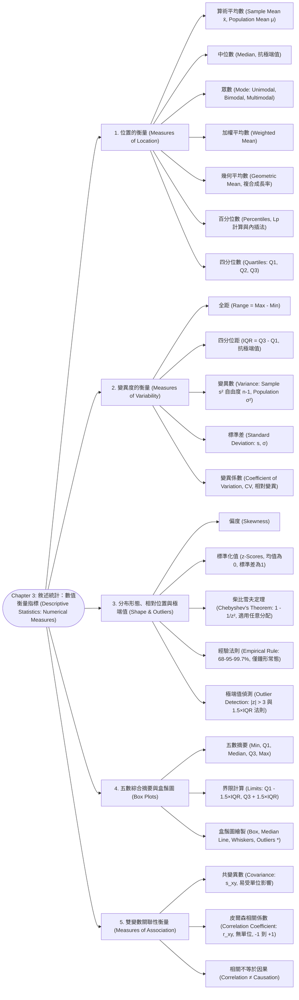

# Chapter 3: 敘述統計：數值衡量指標 (Descriptive Statistics: Numerical Measures)

> 📅 生成日期：2026-10-20  
> 📄 來源檔案：Chapter 3.pdf (Statistics for Business and Economics, 14e)  
> 🎯 適用考試：期中考重點複習教材  

---

## 🗺️ 知識架構總覽 (Tree Diagram)

### 🎯 本章學習進度檢核 (完成後打勾，建立成就反饋)

- [ ] [1. 位置的衡量 (Measures of Location)](#sec-1)
- [ ] [2. 變異度的衡量 (Measures of Variability)](#sec-2)
- [ ] [3. 分布形態、相對位置與極端值 (Shape & Outliers)](#sec-3)
- [ ] [4. 五數綜合摘要與盒鬚圖 (Box Plots)](#sec-4)
- [ ] [5. 雙變數關聯性衡量 (Measures of Association)](#sec-5)

---

## 📖 知識點教材

### 3.1 位置的衡量 (Measures of Location)

#### 📌 核心概念

衡量一組資料中心集中趨勢（Central Tendency）或特定百分比位置的指標：

1. **算術平均數（Mean）**：
   - 樣本平均數 $\bar{x}$（作為母體平均數 $\mu$ 之點估計值）。
   - **易受極端值（Outliers）嚴重影響**，不具抗性（Not resistant）。
2. **中位數（Median）**：
   - 資料由小到大排序後位於正中間的數值。
   - 樣本數 $n$ 為奇數時，取第 $\frac{n+1}{2}$ 筆；$n$ 為偶數時，取中間兩數之算術平均。
   - **具抗變性（Resistant to outliers）**，極適合衡量所得、房價等偏態分配。
3. **眾數（Mode）**：
   - 資料中出現次數最頻繁的數值。可為單峰（Unimodal）、雙峰（Bimodal）或多峰（Multimodal）。若無重複數值則無眾數。
4. **加權平均數（Weighted Mean）**：
   - 各數值重要性（權重 Weight, $w_i$）不同時使用，如 GPA 計算、平均工資計算。
5. **幾何平均數（Geometric Mean, $\bar{x}_g$）**：
   - 專門用於**乘法複利或多期成長率（Multiplicative / Compounding situations, Growth rates）**。
   - 算術平均數在此情境下會產生向上高估的嚴重誤導！
   - 若 $r_t$ 為第 $t$ 期成長率，則成長因子（Growth Factor）為 $x_t = 1 + r_t$。
6. **百分位數（Percentiles）與四分位數（Quartiles）**：
   - 第 $p$ 百分位數表示至少有 $p\%$ 的資料值小於等於此值，且至少有 $(100-p)\%$ 大於等於此值。
   - 第一四分位數 $Q_1 = 25\text{th percentile}$；第二四分位數 $Q_2 = \text{Median} = 50\text{th percentile}$；第三四分位數 $Q_3 = 75\text{th percentile}$。

#### 📐 關鍵公式 / 定理

- 樣本平均數與母體平均數：
  $$\bar{x} = \frac{\sum_{i=1}^n x_i}{n}, \quad \mu = \frac{\sum_{i=1}^N x_i}{N}$$
- 加權平均數：
  $$\bar{x}_w = \frac{\sum_{i=1}^n w_i x_i}{\sum_{i=1}^n w_i}$$
- 幾何平均數：
  $$\bar{x}_g = \sqrt[n]{x_1 \cdot x_2 \cdots x_n} = (x_1 \cdot x_2 \cdots x_n)^{1/n}$$
  平均成長率（Average Growth Rate）$= (\bar{x}_g - 1) \times 100\%$
- 百分位數位置公式（$L_p$ 計算與線性內插法，Anderson 14e 標準）：
  $$L_p = \frac{p}{100}(n + 1)$$
  - 若 $L_p$ 為整數，第 $p$ 百分位數即為排序後第 $L_p$ 筆數值。
  - 若 $L_p$ 非整數，設整數部分為 $i$，小數部分為 $f$（即 $L_p = i + f$），則：
    $$P_p = x_{(i)} + f \cdot \left(x_{(i+1)} - x_{(i)}\right)$$

#### 💡 重要觀念提醒

| 比較維度 | 算術平均數 (Mean) | 中位數 (Median) | 眾數 (Mode) |
|:---|:---|:---|:---|
| **適用尺度** | Interval, Ratio | Ordinal, Interval, Ratio | Nominal, Ordinal, Interval, Ratio |
| **抗極端值?** | ❌ 極易受極端值拉偏 | ✅ 極具抗性 | ✅ 不受極端值影響 |
| **數值利用度** | 利用每一筆資料的數值 | 僅依賴順序位置 | 僅依賴頻率 |

> ⚠️ **投資報酬率計算大陷阱**：
> 股票第一年暴賺 $+100\%$（成長因子 $2.0$），第二年腰斬 $-50\%$（成長因子 $0.5$）。
> 算術平均數 $= \frac{100\% + (-50\%)}{2} = +25\%$（看起來每年賺 25%！）。
> 事實上你從 100 元變 200 元再變 100 元，根本沒賺沒賠！
> 幾何平均數成長因子 $= \sqrt{2.0 \times 0.5} = \sqrt{1.0} = 1.0 \implies$ 平均年報酬率 $= 1.0 - 1 = 0\%$！幾何平均才是真實的複利增長率！

#### 📊 範例

**題目**：某共同基金連續 3 年的投資報酬率分別為：第 1 年 $+30\%$、第 2 年 $-20\%$、第 3 年 $+10\%$。
求這 3 年的平均年複合成長率（幾何平均報酬率）。  
**解題**：

1. 轉換為各期成長因子（Growth Factors）：
   $x_1 = 1 + 0.30 = 1.30$
   $x_2 = 1 - 0.20 = 0.80$
   $x_3 = 1 + 0.10 = 1.10$
2. 計算幾何平均數：
   $\bar{x}_g = \sqrt[3]{1.30 \times 0.80 \times 1.10} = \sqrt[3]{1.144} \approx 1.04586$
3. 平均年複合成長率 $= (1.04586 - 1) \times 100\% \approx +4.59\%$。
（對比：算術平均數為 $\frac{30 - 20 + 10}{3} = 6.67\%$，明顯高估真實績效）。

---

### 3.2 變異度的衡量 (Measures of Variability)

#### 📌 核心概念

衡量資料分散程度（Spread / Dispersion）的指標：

1. **全距（Range）**：$\text{Range} = \text{Maximum} - \text{Minimum}$。最直觀但極度脆弱，僅取決於兩個極端值。
2. **四分位距（Interquartile Range, IQR）**：
   - 中間 $50\%$ 資料所涵蓋的跨度：$IQR = Q_3 - Q_1$。
   - **克服了全距易受極端值影響的缺點**，具有高度抗變性。
3. **變異數（Variance）**：
   - 利用了所有資料點的離差平方和平均。
   - **樣本變異數（Sample Variance, $s^2$）的分母為 $n-1$（貝塞爾修正 Bessel's Correction）**，提供母體變異數 $\sigma^2$ 之**不偏估計量（Unbiased Estimator）**；$n-1$ 稱為自由度（Degrees of Freedom）。
   - **母體變異數（Population Variance, $\sigma^2$）的分母為 $N$**。
   - 單位為「原始單位之平方」，在物理與經濟解讀上不便。
4. **標準差（Standard Deviation）**：
   - 變異數的正平方根（$s = \sqrt{s^2}$），**還原為與原始資料相同的單位**。
5. **變異係數（Coefficient of Variation, CV）**：
   - 標準差佔平均數的百分比，為**無單位的相對變異衡量指標（Relative variability）**。
   - 專門用於比較「測量單位不同」或「平均數水準懸殊」的兩組資料之分散風險。

#### 📐 關鍵公式 / 定理

- 樣本變異數與標準差：
  $$s^2 = \frac{\sum_{i=1}^n (x_i - \bar{x})^2}{n - 1} = \frac{\sum_{i=1}^n x_i^2 - \frac{(\sum x_i)^2}{n}}{n - 1}, \quad s = \sqrt{s^2}$$
- 母體變異數與標準差：
  $$\sigma^2 = \frac{\sum_{i=1}^N (x_i - \mu)^2}{N}, \quad \sigma = \sqrt{\sigma^2}$$
- 變異係數（CV）：
  $$\text{Sample CV} = \left(\frac{s}{\bar{x}}\right) \times 100\%, \quad \text{Population CV} = \left(\frac{\sigma}{\mu}\right) \times 100\%$$

#### 💡 重要觀念提醒
>
> ⚠️ **為什麼變異係數（CV）不可或缺？**
> 比較兩支股票：
>
> - 股票 A：股價 $\bar{x}_A = 10$ 元，標準差 $s_A = 2$ 元。
> - 股票 B：股價 $\bar{x}_B = 1,000$ 元，標準差 $s_B = 50$ 元。
> 若單看標準差，股票 B（$50 > 2$）波動看似大得多；
> 但算 CV：$CV_A = \frac{2}{10} = 20\%$，而 $CV_B = \frac{50}{1000} = 5\%$！
> 事實上股票 A 相對平均股價的震盪幅度是股票 B 的 4 倍！投資風險以 CV 評估才是客觀的！

#### 📊 範例

**題目**：某 5 筆樣本數據為：$3, 5, 7, 9, 11$。求樣本平均數、樣本變異數、樣本標準差與變異係數。  
**解題**：

1. $n = 5$。
2. $\bar{x} = \frac{3 + 5 + 7 + 9 + 11}{5} = \frac{35}{5} = 7$。
3. 計算各項離差平方和：
   $(3-7)^2 = 16$  
   $(5-7)^2 = 4$  
   $(7-7)^2 = 0$  
   $(9-7)^2 = 4$  
   $(11-7)^2 = 16$  
   $\sum (x_i - \bar{x})^2 = 16 + 4 + 0 + 4 + 16 = 40$。
4. 樣本變異數 $s^2 = \frac{40}{5 - 1} = \frac{40}{4} = 10$。
5. 樣本標準差 $s = \sqrt{10} \approx 3.162$。
6. 變異係數 $CV = \frac{3.162}{7} \times 100\% \approx 45.17\%$。

---

### 3.3 分布形態、相對位置與極端值偵測 (Shape, Relative Location, and Outliers)

#### 📌 核心概念

1. **$z$-分數（$z$-Scores / Standardized Values）**：
   - 衡量一個觀察值距離平均數「**有幾個標準差遠**」。
   - 性質：任何資料經由 $z$ 轉換後，**新變數的平均數恆為 $0$，標準差恆為 $1$**。
   - $z > 0$ 表示高於平均；$z < 0$ 表示低於平均；$z = 0$ 表示恰等於平均。
2. **柴比雪夫定理（Chebyshev’s Theorem）**：
   - **適用於「任何形狀」的資料分配（無論是否對稱或偏態）**。
   - 內容：對於任何大於 1 的數值 $z$，**至少有 $\left(1 - \frac{1}{z^2}\right)$ 的資料值落在平均數加減 $z$ 個標準差之內（$\bar{x} \pm z \cdot s$）**。
     - $z = 2$：至少 $1 - \frac{1}{4} = 75\%$ 的資料在 $\bar{x} \pm 2s$ 內。
     - $z = 3$：至少 $1 - \frac{1}{9} \approx 88.89\%$（講義簡記約 $89\%$）在 $\bar{x} \pm 3s$ 內。
     - $z = 4$：至少 $1 - \frac{1}{16} \approx 93.75\%$（講義簡記約 $94\%$）在 $\bar{x} \pm 4s$ 內。
3. **經驗法則（Empirical Rule）**：
   - **嚴格僅適用於「鐘形分布 / 常態分布（Bell-shaped / Normal distribution）」**！
     - 約 **$68.26\%$**（約 $68\%$）的資料在 $\mu \pm 1\sigma$ 之內。
     - 約 **$95.44\%$**（約 $95\%$）的資料在 $\mu \pm 2\sigma$ 之內。
     - 約 **$99.72\%$**（幾近全部）的資料在 $\mu \pm 3\sigma$ 之內。
4. **極端值（Outliers）的判定標準**：
   - **$z$-分數法**：若 $|z| > 3$（即 $z < -3$ 或 $z > +3$），可視為潛在極端值。
   - **盒鬚圖上下限法（IQR 法則）**：落在 $[Q_1 - 1.5 IQR, Q_3 + 1.5 IQR]$ 區間之外的觀察值視為極端值。

#### 💡 重要觀念提醒

| 定理名稱 | 適用分配形狀 | $z=2$ 涵蓋比例 | $z=3$ 涵蓋比例 |
|:---|:---|:---:|:---:|
| **柴比雪夫定理 (Chebyshev)** | **任何形狀 (Any distribution)** | **至少 $75\%$** | **至少 $89\%$** |
| **經驗法則 (Empirical Rule)** | **僅限對稱鐘形 (Bell-shaped only)** | **約 $95\%$** | **約 $99.7\%$** |

> ⚠️ **考題辨析必殺技**：
> 題目只要**沒有明確說明資料為 Bell-shaped（鐘形常態）**，就**絕對不能使用 68-95-99.7% 的經驗法則**，必須使用柴比雪夫定理！

#### 📊 範例

**題目**：某大學全校 10,000 名學生的每週生活費平均數為 $\$2,000$，標準差為 $\$300$。若完全不知道生活費的分布形狀：  
(1) 至少有多少名學生的每週生活費介於 $\$1,400$ 至 $\$2,600$ 之間？  
(2) 若已知生活費呈現對稱鐘形分布，則約有多少名學生生活費在 $\$1,400$ 至 $\$2,600$ 之間？  
**解題**：

1. 區間 $\$1,400$ 到 $\$2,600$ 距離平均值 $\$2,000$ 恰好為 $600$，即 $z = \frac{600}{300} = 2$ 個標準差。
2. 分布形狀未知 $\rightarrow$ 採用**柴比雪夫定理**：
   比例 $\ge 1 - \frac{1}{2^2} = 75\%$。
   人數 $\ge 10,000 \times 75\% = 7,500$ 人。
3. 若為鐘形分布 $\rightarrow$ 採用**經驗法則**：
   比例 $\approx 95\%$。
   人數 $\approx 10,000 \times 95\% = 9,500$ 人。

---

### 3.4 五數綜合摘要與盒鬚圖 (Five-Number Summary & Box Plots)

#### 📌 核心概念

1. **五數綜合摘要（Five-Number Summary）**：
   由五個關鍵位置指標組成：
   1. 最小值（Smallest value / Minimum）
   2. 第一四分位數（First Quartile, $Q_1$）
   3. 中位數（Median / Second Quartile, $Q_2$）
   4. 第三四分位數（Third Quartile, $Q_3$）
   5. 最大值（Largest value / Maximum）
2. **盒鬚圖（Box Plot）建構步驟**：
   - **繪製中央矩形盒子（Box）**：左端（或下端）為 $Q_1$，右端（或上端）為 $Q_3$，盒子長度恰為 $IQR = Q_3 - Q_1$。
   - **繪製中位數線（Median Line）**：在盒子內部對應中位數位置畫一條垂直線。
   - **計算內界限（Limits / Fences）**（輔助線，不實際繪出）：
     $$\text{Lower Limit} = Q_1 - 1.5 \times IQR$$
     $$\text{Upper Limit} = Q_3 + 1.5 \times IQR$$
   - **繪製鬚線（Whiskers）**：從盒子兩端向外延伸至**落在界限內部的「最極端真實資料點」**（不是直接畫到界限線！）。
   - **標記極端值（Outliers）**：凡是小於 Lower Limit 或大於 Upper Limit 的數值，一律以星號 $*$ 或獨立點標註。

#### 💡 重要觀念提醒
>
> ⚠️ **盒鬚圖鬍鬚（Whiskers）長度之大陷阱**：
> 考試極常考問答題：「鬍鬚的終點是畫在 $Q_1 - 1.5 IQR$ 上嗎？」
> **絕對不是！** 鬍鬚只能延伸到**資料集裡實際存在且未超標的最小值/最大值**。界限（Limit）只是用來把關誰是極端值的警戒線！

#### 📊 範例

**題目**：某公寓租金調查（$n=70$），五數摘要為：
$\text{Min} = 525, Q_1 = 545, \text{Median} = 575, Q_3 = 625, \text{Max} = 715$。
檢定該資料集是否存在極端值？  
**解題**：

1. 計算四分位距：$IQR = Q_3 - Q_1 = 625 - 545 = 80$。
2. 計算下界限：$\text{Lower Limit} = Q_1 - 1.5(IQR) = 545 - 1.5(80) = 545 - 120 = 425$。
3. 計算上界限：$\text{Upper Limit} = Q_3 + 1.5(IQR) = 625 + 1.5(80) = 625 + 120 = 745$。
4. 檢驗全體資料：最小值 $525 \ge 425$，最大值 $715 \le 745$，所有資料皆落在 $[425, 745]$ 內，因此本資料集**不存在任何極端值（No outliers）**。

---

### 3.5 雙變數關聯性衡量：共變異數與相關係數 (Covariance and Correlation)

#### 📌 核心概念

衡量兩個數量變數（$X, Y$）之間**線性關聯（Linear Association）**程度的指標：

1. **共變異數（Covariance）**：
   - 衡量兩變數是否同向或反向變動。
   - $s_{xy} > 0$：正向線性關聯（$X$ 大時 $Y$ 傾向大）。
   - $s_{xy} < 0$：負向線性關聯（$X$ 大時 $Y$ 傾向小）。
   - **重大缺點**：共變異數的數值大小取決於變數的**測量單位（Units of measurement）**，無法單憑數值大小比較關聯強弱！
2. **皮爾森相關係數（Pearson Correlation Coefficient, $r$）**：
   - 將共變異數除以兩變數之標準差相乘，**消除了單位的影響（Unitless）**。
   - 數值嚴格介於 **$-1$ 與 $+1$ 之間（$-1 \le r \le +1$）**。
     - $r = +1$：完美正向線性關係（所有點完美落於斜率為正的直線上）。
     - $r = -1$：完美負向線性關係（所有點完美落於斜率為負的直線上）。
     - $r = 0$：**無線性關聯（No linear relationship）**（注意：可能存在極強的非線性/二次曲線關聯！）。
     - $|r|$ 越接近 1，線性關聯越強；越接近 0，線性關聯越弱。
3. **相關不等於因果（Correlation $\ne$ Causation）**：
   - 高度相關可能純屬巧合（Spurious correlation）或源於共同潛在變數的影響。

#### 📐 關鍵公式 / 定理

- 樣本共變異數（分母為自由度 $n-1$）：
  $$s_{xy} = \frac{\sum_{i=1}^n (x_i - \bar{x})(y_i - \bar{y})}{n - 1}$$
- 母體共變異數（分母為 $N$）：
  $$\sigma_{xy} = \frac{\sum_{i=1}^N (x_i - \mu_x)(y_i - \mu_y)}{N}$$
- 樣本相關係數（Sample Correlation Coefficient）：
  $$r_{xy} = \frac{s_{xy}}{s_x \cdot s_y} = \frac{\sum (x_i - \bar{x})(y_i - \bar{y})}{\sqrt{\sum (x_i - \bar{x})^2 \cdot \sum (y_i - \bar{y})^2}}$$

#### 💡 重要觀念提醒
>
> ⚠️ **考試極限陷阱：$r = 0$ 代表兩變數完全無關嗎？**
> **錯！**
> 相關係數 $r$ 僅衡量「**線性（Linear）**」關聯。
> 若 $Y = X^2$ 且 $X$ 分布在 $[-2, -1, 0, 1, 2]$，計算出的 $r$ 剛好等於 $0$！
> 但 $Y$ 與 $X$ 之間有完美的拋物線決定性關係。因此 $r=0$ 只能說「無線性關係」，絕不能說「沒有任何關係」！

#### 📊 範例

**題目**：某高爾夫球員研究「開球距離（碼, $X$）」與「18 洞桿數（桿, $Y$）」之關係，收集 6 場比賽數據。
已知：$\sum (x_i - \bar{x})(y_i - \bar{y}) = -35.40$，樣本數 $n = 6$，$s_x = 8.16$ 碼，$s_y = 0.894$ 桿。
求樣本共變異數與樣本相關係數，並解釋其意義。  
**解題**：

1. 樣本共變異數：
   $$s_{xy} = \frac{-35.40}{6 - 1} = \frac{-35.40}{5} = -7.08$$
   （負值表示開球越遠，總桿數傾向越低）。
2. 樣本相關係數：
   $$r_{xy} = \frac{s_{xy}}{s_x s_y} = \frac{-7.08}{8.16 \times 0.894} = \frac{-7.08}{7.295} \approx -0.97$$
3. 解釋：$r = -0.97$ 極度接近 $-1$，代表開球距離與桿數之間存在極強的「負向線性關係（Strong negative linear relationship）」。

---

---

## 📝 實戰練習題 (三層遞進式強化測驗)

### 🟢 Tier 1：必懂基礎 (Must-Know Fundamentals)

> 💡 **學習目標**：確認自己「會算、會辨識」——給數字就能做對、給名稱就能配對。

#### Q1. (基礎數值計算) 樣本平均數與樣本標準差手算

某抽驗小組隨機抽取了 5 筆產品的加工公差數據（單位：$\mu\text{m}$）：
$$2,\ 4,\ 6,\ 8,\ 10$$
請依序逐步計算：
(1) 樣本平均數 $\bar{x}$ 為多少？  
(2) 離均差平方和 $\sum_{i=1}^{n} (x_i - \bar{x})^2$ 為多少？  
(3) 樣本變異數 $s^2$（注意分母為 $n-1$）為多少？  
(4) 樣本標準差 $s$ 為多少？

(A) (1) 6, (2) 40, (3) 8.0, (4) 2.83  
(B) (1) 6, (2) 40, (3) 10.0, (4) $\sqrt{10} \approx 3.16$  
(C) (1) 6, (2) 50, (3) 12.5, (4) 3.54  
(D) (1) 5, (2) 40, (3) 10.0, (4) 3.16  

👉 [查看 Q1 答案與詳細解析](#ans-q1)

---

#### Q2. (基礎分位數手算) 五數摘要與四分位距 (IQR) 計算

設有一組已由小到大排序的 8 筆樣本數據：
$$12,\ 15,\ 18,\ 22,\ 28,\ 32,\ 40,\ 50$$
請依據標準中位數與四分位數計算方法求出：
(1) 中位數（Median / $Q_2$）  
(2) 第一四分位數（$Q_1$）與第三四分位數（$Q_3$）  
(3) 四分位距（Interquartile Range, $IQR = Q_3 - Q_1$）

(A) (1) 25.0, (2) $Q_1 = 16.5, Q_3 = 36.0$, (3) $IQR = 19.5$  
(B) (1) 25.0, (2) $Q_1 = 18.0, Q_3 = 32.0$, (3) $IQR = 14.0$  
(C) (1) 22.0, (2) $Q_1 = 15.0, Q_3 = 40.0$, (3) $IQR = 25.0$  
(D) (1) 28.0, (2) $Q_1 = 16.5, Q_3 = 36.0$, (3) $IQR = 19.5$  

👉 [查看 Q2 答案與詳細解析](#ans-q2)

---

#### Q3. (基礎標準化計算) $z$ 分數 (z-Score) 計算與相對位置判定

全校大一微積分期中考成績的平均數為 $\bar{x} = 70$ 分，標準差為 $s = 8$ 分。
小明考了 $86$ 分，而小華考了 $58$ 分。
請問小明與小華兩人的標準化分數（$z$ 分數）分別為何？

(A) 小明 $z = +2.0$；小華 $z = -1.5$  
(B) 小明 $z = +16.0$；小華 $z = -12.0$  
(C) 小明 $z = +1.5$；小華 $z = -2.0$  
(D) 小明 $z = +2.5$；小華 $z = -1.0$  

👉 [查看 Q3 答案與詳細解析](#ans-q3)

---

#### Q4. (基礎經驗法則判定) 鐘形常態分佈之 68-95-99.7 經驗法則

某國家級考試成績呈現完美的**對稱鐘形常態分佈（Bell-Shaped Normal Distribution）**，母體平均數 $\mu = 500$ 分，母體標準差 $\sigma = 100$ 分。
依據經驗法則（Empirical Rule）：
(1) 大約有百分之幾的考生，其成績落在 $400 \sim 600$ 分之間（即 $\mu \pm 1\sigma$）？  
(2) 大約有百分之幾的考生，其成績落在 $300 \sim 700$ 分之間（即 $\mu \pm 2\sigma$）？

(A) (1) 約 50%, (2) 約 75%  
(B) (1) 約 68%, (2) 約 95%  
(C) (1) 約 75%, (2) 約 88.9%  
(D) (1) 約 68%, (2) 約 99.7%  

👉 [查看 Q4 答案與詳細解析](#ans-q4)

---

#### Q5. (基礎相關係數性質) 皮爾森相關係數 $r$ 的數值意涵

在探討兩定量變數 $X$ 與 $Y$ 的線性關聯時，計算出其樣本皮爾森相關係數為 $r_{xy} = -0.88$。下列關於此數值的解讀，何者**完全正確**？

(A) 兩變數之間存在極弱的負向關聯，因為數值小於 0  
(B) 兩變數之間存在強烈的負向線性關聯（Negative Linear Association），即當 $X$ 增加時，$Y$ 呈現高度一致的減少趨勢  
(C) $X$ 的增加會導致 $Y$ 的減少，兩者之間具有嚴格因果關係  
(D) 相關係數的數值可以大於 $+1$ 或小於 $-1$  

👉 [查看 Q5 答案與詳細解析](#ans-q5)

---

### 🟡 Tier 2：基礎 + 實際應用 (Application & Scenario Matching)

> 💡 **學習目標**：確認自己「會用」——能運用變異係數跨資產比較風險、用幾何平均數算投資複利、辨識極端偏態的柴比雪夫邊界。

#### Q6. (相對離散度應用) 變異係數 (Coefficient of Variation, CV) 跨規模風險比較

資產管理經理人正在評估兩檔股票的投資風險：
* 股票 A（生技微型股）：平均股價 $\bar{x}_A = 20\text{ 元}$，標準差 $s_A = 4\text{ 元}$
* 股票 B（權值藍籌股）：平均股價 $\bar{x}_B = 500\text{ 元}$，標準差 $s_B = 50\text{ 元}$
若單看標準差絕對值，$s_B (50\text{ 元}) \gg s_A (4\text{ 元})$。但若衡量「**每 1 元股價所承擔的相對波動風險（變異係數 CV）**」，哪一檔股票的投資風險更高？

(A) 股票 B 風險更高，因為標準差為 50 元  
(B) 兩者風險完全相同，因為皆在合理波動範圍內  
(C) 股票 A 風險更高，其變異係數 $CV_A = 20\%$，是股票 B（$CV_B = 10\%$）的整整兩倍  
(D) 無法比較，因為兩檔股票面額不同  

👉 [查看 Q6 答案與詳細解析](#ans-q6)

---

#### Q7. (跨期複利盲點) 幾何平均數 (Geometric Mean) vs. 算術平均數 (Arithmetic Mean)

某檔科技基金第一年績效翻倍暴賺 $+100\%$（資產成長因子 $x_1 = 2.0$），第二年遭遇熊市崩跌 $-50\%$（資產成長因子 $x_2 = 0.5$）。
(1) 理財專員若使用算術平均數計算平均報酬率：$\frac{100\% + (-50\%)}{2} = +25\%$，宣稱該基金「平均年賺 25%」。  
(2) 實際上投資人若初始投入 100 萬元，兩年後的真實資產為 $100 \times 2.0 \times 0.5 = 100$ 萬元（實質收益為 0 元！）。  
(3) 若使用嚴謹的**幾何平均成長因子 $\bar{x}_g = \sqrt{x_1 \cdot x_2}$**，所計算出的實質年化複合成長率為何？

(A) 實質年複合成長率為 $+25\%$  
(B) 實質年複合成長率為 $+12.5\%$  
(C) 實質年複合成長率為 $0\%$（成長因子 $\bar{x}_g = 1.0$）  
(D) 實質年複合成長率為 $-25\%$  

👉 [查看 Q7 答案與詳細解析](#ans-q7)

---

#### Q8. (分佈未知時的邊界保障) 柴比雪夫定理 (Chebyshev's Theorem) 的實務選用

某半導體廠封裝晶片的導熱係數分佈形狀**完全未知，且工程師懷疑存在嚴重非對稱偏態**。目前僅知該製程的平均導熱係數 $\mu = 50\text{ W/mK}$，標準差 $\sigma = 2\text{ W/mK}$。
若客戶要求評估：「至少有百分之幾的晶片，其導熱係數保證會落在 $44 \sim 56\text{ W/mK}$（即 $\mu \pm 3\sigma$）的規格區間內？」
工程師應選用何種定理？計算出之理論保證百分比為何？

(A) 選用經驗法則（Empirical Rule），保證比例為 $99.7\%$  
(B) 選用柴比雪夫定理（Chebyshev's Theorem），理論保證比例**至少為 $88.9\%$**（$1 - 1/3^2 = 8/9$）  
(C) 選用中央極限定理，保證比例為 $95\%$  
(D) 分佈未知時完全無法計算任何比例  

👉 [查看 Q8 答案與詳細解析](#ans-q8)

---

#### Q9. (離群值檢驗工程規範) 箱形圖 1.5 IQR 圍籬檢驗法

某電商平台分析使用者的購物停留時間（分鐘），五數摘要為：
* 最小值 $\text{Min} = 5$
* 第一四分位數 $Q_1 = 20$
* 中位數 $\text{Median} = 35$
* 第三四分位數 $Q_3 = 50$
* 最大值 $\text{Max} = 120$

依據探索性資料分析（EDA）的 $1.5 \times IQR$ 內圍籬（Inner Fences）檢驗準則：
(1) 判定高於多少數值即屬於「高分端離群值（Upper Outlier）」？  
(2) 最大值 $120$ 分鐘是否為統計離群值？

(A) (1) 門檻為 80 分鐘；(2) 120 分鐘不是離群值  
(B) (1) 門檻為 95 分鐘；(2) 120 分鐘是顯著離群值（因為 $120 > 95$）  
(C) (1) 門檻為 105 分鐘；(2) 120 分鐘是顯著離群值  
(D) (1) 門檻為 70 分鐘；(2) 120 分鐘不是離群值  

👉 [查看 Q9 答案與詳細解析](#ans-q9)

---

### 🔴 Tier 3：概念講述與深度分析 (Conceptual & Analytical)

> 💡 **學習目標**：確認自己「會講」——能推導 Bessel 修正自由度 $n-1$、論述指標抗性與無因次相關係數。

#### Q10. (數理推導題) 為什麼樣本變異數的分母必須除以 $n-1$ (Bessel's Correction)？

在計算母體變異數時，公式分母除以母體總數 $N$：$\sigma^2 = \frac{\sum (x_i - \mu)^2}{N}$；而在計算樣本變異數時，公式分母卻必須除以 $n-1$：$s^2 = \frac{\sum (x_i - \bar{x})^2}{n-1}$。
(1) 從統計學「不偏估計量（Unbiased Estimator）」的角度，請論述若直接除以 $n$（即使用 $\frac{\sum (x_i - \bar{x})^2}{n}$），為什麼會造成對母體變異數 $\sigma^2$ 的**系統性低估（Systematic Underestimate）**？  
(2) 請從「自由度（Degrees of Freedom）」的幾何約束維度說明：已知數學恆等式 $\sum_{i=1}^{n} (x_i - \bar{x}) = 0$ 永遠成立，這為 $n$ 個離均差施加了幾重約束？真正具備自由隨機變動能力的獨立離均差有幾個？

👉 [查看 Q10 答案與詳細解析](#ans-q10)

---

#### Q11. (指標穩健性論述題) 集中與離散指標的「抗性 (Robustness)」與崩潰點分析

統計指標的「抗性（Robustness）」是指該指標抵禦少數極端極大值或離群值（Outliers）污染的能力：
(1) 試對比下列兩組指標在面對資料污染時的表現：
* **敏感型指標（無抗性）**：算術平均數 (Mean)、全距 (Range)、樣本標準差 (Standard Deviation)
* **抗性型指標（高穩健性）**：中位數 (Median)、四分位距 (IQR)、修剪平均數 (Trimmed Mean)
(2) 為什麼在各國政府統計局發布的全國「每戶家庭可支配所得」與「住宅不動產成交單價」官方報告中，**絕對首選發布「中位數」與「四分位距」**，而堅決避免將「算術平均數」作為最主要的宣傳指標？

👉 [查看 Q11 答案與詳細解析](#ans-q11)

---

#### Q12. (統計尺度無關性推導) 協方差 (Covariance) 的單位缺陷與皮爾森相關係數的標準化優勢

在雙變數關聯性分析中：
(1) 樣本協方差公式為 $s_{xy} = \frac{\sum (x_i - \bar{x})(y_i - \bar{y})}{n-1}$。若 $X$ 為身高（公尺 $\text{m}$），$Y$ 為體重（公斤 $\text{kg}$），則 $s_{xy}$ 的物理單位為何？若研究員將身高的計量單位由「公尺」改為「公分（$\text{cm}$）」，協方差數值會發生何種劇變？為什麼這使得協方差無法用來直接比較不同研究間的關聯強弱？  
(2) 皮爾森相關係數 $r_{xy} = \frac{s_{xy}}{s_x s_y}$ 是如何透過將兩變數標準化（$z$ 分數化），巧妙將所有物理單位完全消除，轉化為無因次的純量？請證明其取值範圍為何嚴格落於 $[-1, +1]$ 之間。

👉 [查看 Q12 答案與詳細解析](#ans-q12)

---

## 🔑 本章練習題答案與詳細解析 (Answer Key)

### 🟢 Tier 1 解析

### Q1 答案與詳細解析

* **正確答案**：**(B)**
* **逐步手算流程**：
  * 給定數值：$x_1=2, x_2=4, x_3=6, x_4=8, x_5=10$（樣本數 $n=5$）。
  * (1) **樣本平均數**：
    $$\bar{x} = \frac{2 + 4 + 6 + 8 + 10}{5} = \frac{30}{5} = 6$$
  * (2) **離均差 $(x_i - \bar{x})$ 與平方和**：
    * $(2 - 6)^2 = (-4)^2 = 16$
    * $(4 - 6)^2 = (-2)^2 = 4$
    * $(6 - 6)^2 = 0^2 = 0$
    * $(8 - 6)^2 = 2^2 = 4$
    * $(10 - 6)^2 = 4^2 = 16$
    * 離均差平方和 $\sum (x_i - \bar{x})^2 = 16 + 4 + 0 + 4 + 16 = 40$
  * (3) **樣本變異數（分母為 $n-1 = 4$）**：
    $$s^2 = \frac{40}{5 - 1} = \frac{40}{4} = 10.0$$
  * (4) **樣本標準差**：
    $$s = \sqrt{s^2} = \sqrt{10} \approx 3.1623$$
  * 選項 (B) 完全正確。

[🔙 返回題目 Q1](#q1) ｜ [🔝 返回知識架構圖](#tree-diagram)

---

### Q2 答案與詳細解析

* **正確答案**：**(A)**
* **排序資料分位數推導**：
  * 已排序數列（$n = 8$）：$12, 15, 18, 22, 28, 32, 40, 50$。
  * **中位數 $Q_2$**：偶數個樣本，取中間第 4 個（22）與第 5 個（28）之算術平均數：
    $$Q_2 = \frac{22 + 28}{2} = 25.0$$
  * **第一四分位數 $Q_1$**：下半部四個數值 $\{12, 15, 18, 22\}$ 的中位數：
    $$Q_1 = \frac{15 + 18}{2} = 16.5$$
  * **第三四分位數 $Q_3$**：上半部四個數值 $\{28, 32, 40, 50\}$ 的中位數：
    $$Q_3 = \frac{32 + 40}{2} = 36.0$$
  * **四分位距 (IQR)**：
    $$IQR = Q_3 - Q_1 = 36.0 - 16.5 = 19.5$$
  * 選項 (A) 完全正確。

[🔙 返回題目 Q2](#q2) ｜ [🔝 返回知識架構圖](#tree-diagram)

---

### Q3 答案與詳細解析

* **正確答案**：**(A)**
* **$z$ 分數標準化計算**：
  * $z$ 分數公式為：$z = \frac{x - \bar{x}}{s}$
  * **小明（86 分）**：
    $$z_{\text{明}} = \frac{86 - 70}{8} = \frac{16}{8} = +2.0$$
    代表小明的成績高於全校平均數整整 $2.0$ 個標準差。
  * **小華（58 分）**：
    $$z_{\text{華}} = \frac{58 - 70}{8} = \frac{-12}{8} = -1.5$$
    代表小華的成績低於全校平均數 $1.5$ 個標準差。選項 (A) 正確。

[🔙 返回題目 Q3](#q3) ｜ [🔝 返回知識架構圖](#tree-diagram)

---

### Q4 答案與詳細解析

* **正確答案**：**(B)**
* **經驗法則核心數值**：
  * 對於任何對稱單峰的常態分佈：
    * 落在 $\mu \pm 1\sigma$ 區間內（此處為 $500 \pm 100 \implies 400 \sim 600$ 分）的資料比例**約佔全體的 $68.26\% \approx 68\%$**。
    * 落在 $\mu \pm 2\sigma$ 區間內（此處為 $500 \pm 200 \implies 300 \sim 700$ 分）的資料比例**約佔全體的 $95.44\% \approx 95\%$**。
    * 落在 $\mu \pm 3\sigma$ 區間內（此處為 $200 \sim 800$ 分）的資料比例**約佔全體的 $99.73\% \approx 99.7\%$**。選項 (B) 正確。

[🔙 返回題目 Q4](#q4) ｜ [🔝 返回知識架構圖](#tree-diagram)

---

### Q5 答案與詳細解析

* **正確答案**：**(B)**
* **相關係數性質解析**：
  * 皮爾森相關係數 $r$ 的數學範圍嚴格界於 $[-1, +1]$ 之間。
  * 負值（$r < 0$）代表負相關，即兩者變化方向相反。
  * $|r| = 0.88$ 介於 $0.7 \sim 1.0$ 之間，屬於**極高強度的負線性相關**。
  * 選項 (C) 錯在「相關不等於因果」；選項 (D) 錯在相關係數絕對不可能超過 1。選項 (B) 完全正確。

[🔙 返回題目 Q5](#q5) ｜ [🔝 返回知識架構圖](#tree-diagram)

---

### 🟡 Tier 2 解析

### Q6 答案與詳細解析

* **正確答案**：**(C)**
* **變異係數 (CV) 實務精算**：
  * **變異係數公式**：$CV = \frac{s}{\bar{x}} \times 100\%$
  * **股票 A**：
    $$CV_A = \frac{4}{20} \times 100\% = 20.0\%$$
  * **股票 B**：
    $$CV_B = \frac{50}{500} \times 100\% = 10.0\%$$
  * **分析結論**：雖然股票 B 的標準差（50 元）在絕對金額上較大，但相對於其高達 500 元的股價，波動僅佔股價的 $10\%$；反觀股票 A，股價僅 20 元卻有 4 元的波動，相對風險高達 $20\%$。因此股票 A 的投資波動風險是股票 B 的整整兩倍。當比較**平均數差異極大或測量單位不同**的資料集時，變異係數 CV 是唯一的客觀評估工具。選項 (C) 正確。

[🔙 返回題目 Q6](#q6) ｜ [🔝 返回知識架構圖](#tree-diagram)

---

### Q7 答案與詳細解析

* **正確答案**：**(C)**
* **算術平均數在跨期投資中的嚴重誤導**：
  * 設本金為 100 萬：
    * 第 1 年結束：$100 \times (1 + 100\%) = 200\text{ 萬}$
    * 第 2 年結束：$200 \times (1 - 50\%) = 100\text{ 萬}$
    * 兩年後結算，資產不增不減，實質年化報酬率為 $0\%$。
  * 理專宣稱的 $+25\%$ 是因為算術平均數忽略了「基期的連動乘法效應（Compounding Effect）」，在統計學上屬於嚴重的金融話術欺騙。
  * **幾何平均成長因子**：
    $$\bar{x}_g = \sqrt{x_1 \cdot x_2} = \sqrt{2.0 \times 0.5} = \sqrt{1.0} = 1.0$$
    實質年化報酬率 $= \bar{x}_g - 1 = 1.0 - 1 = 0\%$。幾何平均數精準反映了真實資產變化。選項 (C) 正確。

[🔙 返回題目 Q7](#q7) ｜ [🔝 返回知識架構圖](#tree-diagram)

---

### Q8 答案與詳細解析

* **正確答案**：**(B)**
* **定理邊界與精確計算**：
  * **經驗法則 (Empirical Rule)** 具有嚴苛的前提假設：**資料分配必須為對稱單峰的常態鐘形分佈**。若分佈未知或具有嚴重偏態，濫用經驗法則會產生致命的評估誤差。
  * **柴比雪夫定理 (Chebyshev's Theorem)**：
    * **適用範圍**：適用於**任何形狀**的資料分配（無論對稱、偏態或雙峰）。
    * **公式**：在任何分佈中，至少有 $1 - \frac{1}{k^2}$ 的資料會落在 $\mu \pm k\sigma$ 區間之內（其中 $k > 1$）。
    * 本題區間為 $44 \sim 56$，即 $50 \pm 6\text{ W/mK}$。因 $\sigma = 2$，故 $k = \frac{6}{2} = 3$。
    * 保證比例：
      $$\text{At least } 1 - \frac{1}{3^2} = 1 - \frac{1}{9} = \frac{8}{9} \approx 88.89\%$$
    * 故工程師能以數學嚴謹性保證，至少有 $88.9\%$ 的產品符合規格。選項 (B) 正確。

[🔙 返回題目 Q8](#q8) ｜ [🔝 返回知識架構圖](#tree-diagram)

---

### Q9 答案與詳細解析

* **正確答案**：**(B)**
* **箱形圖 1.5 IQR 圍籬手算**：
  1. 計算四分位距：$IQR = Q_3 - Q_1 = 50 - 20 = 30$。
  2. 計算高分端內圍籬（Upper Inner Fence）：
     $$\text{Upper Fence} = Q_3 + 1.5 \times IQR = 50 + 1.5 \times 30 = 50 + 45 = 95$$
  3. 計算低分端內圍籬（Lower Inner Fence）：
     $$\text{Lower Fence} = Q_1 - 1.5 \times IQR = 20 - 1.5 \times 30 = 20 - 45 = -25$$
  4. 判定：最大值 $120$ 大於上圍籬 $95$（$120 > 95$），落在安全圍籬之外，故 $120$ 分鐘確定為顯著的極端離群值。選項 (B) 正確。

[🔙 返回題目 Q9](#q9) ｜ [🔝 返回知識架構圖](#tree-diagram)

---

### 🔴 Tier 3 解析

### Q10 答案與詳細解析

* **(1) 系統性低估與不偏估計量 (Unbiased Estimator)**：
  * 當我們計算變異數時，真正的定義是各資料點與「真實母體平均數 $\mu$」的離均差平方和：$\sum (x_i - \mu)^2$。
  * 然而在抽樣實務中，母體參數 $\mu$ 是未知的，我們被迫以「樣本平均數 $\bar{x}$」來取代 $\mu$。
  * 數學上已知一個重要定理：**對於任何一組數值，各點到其自身的算術平均數 $\bar{x}$ 的平方和，必定小於各點到任何其他數值（包含 $\mu$）的平方和**：
    $$\sum_{i=1}^{n} (x_i - \bar{x})^2 < \sum_{i=1}^{n} (x_i - \mu)^2 \quad (\text{只要 } \bar{x} \ne \mu)$$
  * 這意味著：以 $\bar{x}$ 計算出的平方和 $\sum(x_i - \bar{x})^2$，天生就偏小！若分母依然除以 $n$，其期望值 $E[S^2] < \sigma^2$，會系統性地低估母體變異數。
  * 數學證明顯示其期望值恰好為 $E\left[\frac{\sum(x_i - \bar{x})^2}{n}\right] = \frac{n-1}{n} \sigma^2$。為了消除此偏誤，分母必須除以 $n-1$（乘上 $\frac{n}{n-1}$），使得 $E[s^2] = \sigma^2$，達成「不偏性（Unbiasedness）」。此修正稱為 **Bessel 修正 (Bessel's Correction)**。

* **(2) 自由度 (Degrees of Freedom) 的幾何約束維度**：
  * 考慮 $n$ 個離均差：$(x_1 - \bar{x}), (x_2 - \bar{x}), \dots, (x_n - \bar{x})$。
  * 根據平均數定義，這 $n$ 個離均差的總和永遠嚴格為零：
    $$\sum_{i=1}^{n} (x_i - \bar{x}) = 0$$
  * 這代表著一條**線性方程式約束**。只要我們任意決定了前面 $n-1$ 個離均差的數值，最後一個離均差 $(x_n - \bar{x})$ 就被唯一鎖死（等於前 $n-1$ 個離均差總和的負值），完全喪失了自由取值的資格！
  * 因此，樣本變異數中真正能夠「自由獨立隨機變動」的離均差只有 $n-1$ 個，故其自由度為 $n-1$。

[🔙 返回題目 Q10](#q10) ｜ [🔝 返回知識架構圖](#tree-diagram)

---

### Q11 答案與詳細解析

* **(1) 統計指標的抗性與崩潰點 (Breakdown Point)**：
  * **崩潰點 (Breakdown Point)**：使統計指標產生無窮大偏差所需要替換的最小污染資料比例。
  * **算術平均數、全距與標準差**：
    * **崩潰點為 $0$（即僅需 $1/n$）**：若在一萬筆薪資資料中，不慎將其中一筆誤打為 100 億元（或者引進一個世界首富馬斯克），算術平均數瞬間暴增至數千萬元，標準差亦發散至無窮大。單一極端值即可徹底摧毀整份指標的代表性。
  * **中位數與四分位距 (IQR)**：
    * **中位數的崩潰點高達 $50\%$**：代表除非資料集中有超過一半以上的資料點被惡意竄改，否則中位數頂多在局部範圍微幅跳動，絕不可能被單一極端值拉扯發散。IQR 同樣具備 $25\%$ 的崩潰點，具備極強的抗雜訊穩健性。

* **(2) 官方所得與房價報告的決策依據**：
  * 在國民所得或房屋交易價格分佈中，資料具有天生且無法消除的「極度右偏特性（少數豪宅與頂層富豪營造的長尾）」。
  * 若政府發布「平均薪資 8 萬元」，因為少數超高薪將平均數大幅拉高，全體國民中會有高達 $70\%$ 的民眾其真實薪水低於平均數，導致民眾強烈感受到「官方數據脫離現實」的嚴重民怨。
  * 發布「薪資中位數（例如 4.2 萬元）」，能嚴格保證全國剛好有 $50\%$ 的人高於此數值、$50\%$ 的人低於此數值，真實反映一般中產階級與平民大眾的客觀生活水準。

[🔙 返回題目 Q11](#q11) ｜ [🔝 返回知識架構圖](#tree-diagram)

---

### Q12 答案與詳細解析

* **(1) 協方差 (Covariance) 的單位依賴性缺陷**：
  * 樣本協方差為 $s_{xy} = \frac{\sum (x_i - \bar{x})(y_i - \bar{y})}{n-1}$。
  * 其物理單位為「$X$ 的單位 $\times Y$ 的單位」。若 $X$ 為身高（公尺 $\text{m}$），$Y$ 為體重（公斤 $\text{kg}$），則 $s_{xy}$ 的單位為 $\text{m} \cdot \text{kg}$。
  * 若研究員將身高的度量衡改以公分（$\text{cm}$）表示（$1\text{ m} = 100\text{ cm}$），則每一筆離均差數值皆擴大 100 倍，導致計算出的協方差數值**瞬間暴增 100 倍**！
  * 然而，身高與體重之間的客觀自然關聯強度，絕對不可能因為我們換了尺規就發生任何物理改變。數值大小受制於測量單位，使得協方差無法跨研究、跨變數做任何客觀比較。

* **(2) 皮爾森相關係數的標準化推導與界限證明**：
  * 皮爾森將兩變數分別除以各自的標準差 $s_x$ 與 $s_y$：
    $$r_{xy} = \frac{s_{xy}}{s_x s_y} = \frac{\frac{1}{n-1}\sum (x_i - \bar{x})(y_i - \bar{y})}{\sqrt{\frac{1}{n-1}\sum (x_i - \bar{x})^2} \sqrt{\frac{1}{n-1}\sum (y_i - \bar{y})^2}} = \frac{1}{n-1} \sum_{i=1}^{n} \left(\frac{x_i - \bar{x}}{s_x}\right) \left(\frac{y_i - \bar{y}}{s_y}\right) = \frac{1}{n-1} \sum z_x z_y$$
  * 由於分子分母的物理單位完全相消（$\frac{\text{m} \cdot \text{kg}}{\text{m} \cdot \text{kg}}$），$r_{xy}$ 成為純粹的無因次標量（Dimensionless Scalar）。
  * **界限證明**：依據柯西-施瓦茨不等式（Cauchy-Schwarz Inequality）：
    $$\left(\sum_{i=1}^{n} (x_i - \bar{x})(y_i - \bar{y})\right)^2 \le \left(\sum_{i=1}^{n} (x_i - \bar{x})^2\right) \left(\sum_{i=1}^{n} (y_i - \bar{y})^2\right)$$
    兩側開平方根並移項，立即得證：
    $$-1 \le r_{xy} \le +1$$
  * 只有當所有資料點精準落在同一條直線上時，柯西不等式的等號才成立（$|r| = 1$），完美解決了跨研究比較的普適性難題。

[🔙 返回題目 Q12](#q12) ｜ [🔝 返回知識架構圖](#tree-diagram)

---
## 📋 本章重點速記表

| # | 觀念 / 公式 | 定義 / 計算方式 | 關鍵特性與限制 |
|:--|:---|:---|:---|
| 1 | **算術平均數 ($\bar{x}, \mu$)** | $\frac{\sum x_i}{n}$ | 易受極端值影響，不具抗性 |
| 2 | **中位數 (Median)** | 排序後正中間數值 | **具抗變性**，偏態資料（所得/房價）首選 |
| 3 | **加權平均數 ($\bar{x}_w$)** | $\frac{\sum w_i x_i}{\sum w_i}$ | 依各項目重要性權重加總 |
| 4 | **幾何平均數 ($\bar{x}_g$)** | $\sqrt[n]{\prod (1+r_i)}$ | **複利與成長率首選**，算術平均會高估 |
| 5 | **百分位數位置 ($L_p$)** | $L_p = \frac{p}{100}(n+1)$ | 非整數時採線性內插法 |
| 6 | **四分位距 (IQR)** | $Q_3 - Q_1$ | 中間 50% 範圍，抗極端值 |
| 7 | **樣本變異數 ($s^2$)** | $\frac{\sum (x_i - \bar{x})^2}{n-1}$ | **除以 $n-1$** 自由度（不偏估計量） |
| 8 | **變異係數 (CV)** | $\frac{s}{\bar{x}} \times 100\%$ | **無單位**，比較不同單位或均值差距大之變異 |
| 9 | **$z$-分數 ($z$)** | $\frac{x_i - \bar{x}}{s}$ | 標準化指標，平均為 0，標準差為 1 |
| 10 | **柴比雪夫定理** | 比例 $\ge 1 - \frac{1}{z^2}$ ($z>1$) | **適用任何分布** ($z=2 \implies 75\%$) |
| 11 | **經驗法則** | 68% - 95% - 99.7% | **僅適用常態鐘形分布** |
| 12 | **盒鬚圖界限** | $Q_1 - 1.5 IQR$ 與 $Q_3 + 1.5 IQR$ | 鬚線畫至界限內最外側實際值，外側標 $*$ |
| 13 | **皮爾森相關係數 ($r$)** | $\frac{s_{xy}}{s_x s_y}$ | 範圍 $[-1, +1]$，**僅測量線性**，相關非因果 |

---

## 🃏 考前速查卡片

| 正面 (問題) | 背面 (答案) |
|:---|:---|
| 為什麼樣本變異數分母是 $n-1$ 而不是 $n$？ | 為了消除樣本離差平方和對母體變異數的系統性低估，除以自由度 $n-1$ 才能獲得母體變異數的「不偏估計量（Unbiased estimator）」。 |
| 何時必須使用幾何平均數（Geometric Mean）？ | 計算多期的複合成長率、投資報酬率等涉及「乘法/複利關係（Multiplicative）」的情境。 |
| 柴比雪夫定理（Chebyshev）與經驗法則（Empirical Rule）的最大區別？ | 柴比雪夫適用於「任何形狀」的分配（$z=2$ 至少 75%）；經驗法則「僅嚴格適用於對稱鐘形常態分配」（$z=2$ 約 95%）。 |
| 盒鬚圖的下鬚線（Whisker）終點是直接畫在 $Q_1 - 1.5 IQR$ 嗎？ | 否！鬍鬚只能畫到「落在界限內部的最極端真實資料點」。界限只是判定極端值的虛擬邊界。 |
| 相關係數 $r=0$ 代表兩變數毫無關係嗎？ | 錯誤！$r=0$ 僅代表兩變數「無線性關係」，兩者之間仍可能存在極強的曲線（非線性）關係。 |

---

## ⚠️ 本章常見考試陷阱

1. **陷阱一：樣本變異數除以 $n$**
   - *常見錯誤*：手算樣本變異數 $s^2$ 時習慣性除以 $n$。
   - *正確認知*：只要是「樣本（Sample）」變異數或共變異數，分母一律除以 $n-1$！只有母體才除以 $N$。
2. **陷阱二：亂套經驗法則（Empirical Rule）**
   - *常見錯誤*：題目沒說分布形狀，看到「2 個標準差」就直接填 95%。
   - *正確認知*：若題目未提及 Bell-shaped / Normal，一律使用柴比雪夫定理（答案為「至少 75%」）！
3. **陷阱三：相關係數正負號受線性轉換影響**
   - *常見錯誤*：以為 $X$ 與 $Y$ 線性轉換後 $r$ 數值與正負號完全不變。
   - *正確認知*：若轉換斜率一正一負（如 $U = 2X$, $V = -3Y$），相關係數正負號會**反轉**！
4. **陷阱四：百分位數位置 $L_p$ 當作百分位數答案**
   - *常見錯誤*：算出來 $L_{50} = 10$，就直接寫答案是 10。
   - *正確認知*：$L_p$ 是「第幾個位置（Location）」，必須回頭去查排序後「第 10 筆資料的值」才是答案！

---

## 📊 本章練習題統計

| 難度 | 題數 |
|:-----|:-----|
| Easy | 4 題 |
| Medium | 5 題 |
| Hard | 2 題 |
| **合計** | **11 題** |
