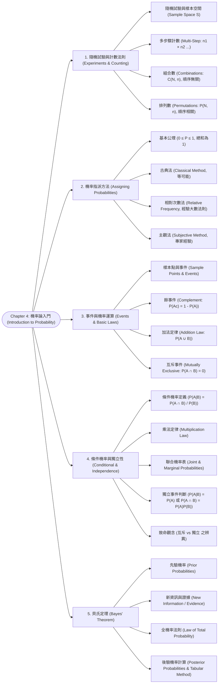

# Chapter 4: 機率論入門 (Introduction to Probability)

> 📅 生成日期：2026-10-20  
> 📄 來源檔案：Chapter 4.pdf (Statistics for Business and Economics, 14e)  
> 🎯 適用考試：期中考重點複習教材  

---

## 🗺️ 知識架構總覽 (Tree Diagram)



<a id="tree-diagram"></a>

### 🎯 本章學習進度檢核 (完成後打勾，建立成就反饋)

- [ ] [1. 隨機試驗與計數法則 (Experiments & Counting)](#sec-1)
- [ ] [2. 機率指派方法 (Assigning Probabilities)](#sec-2)
- [ ] [3. 事件與機率運算 (Events & Basic Laws)](#sec-3)
- [ ] [4. 條件機率與獨立性 (Conditional & Independence)](#sec-4)
- [ ] [5. 貝氏定理 (Bayes' Theorem)](#sec-5)

---

## 📖 知識點教材

<a id="sec-1"></a>

### 4.1 隨機試驗、計數法則與機率指派 (Experiments, Counting Rules & Assigning Probabilities)

#### 📌 核心概念

1. **隨機試驗（Random Experiment）**：
   - 結果具有不確定性，但所有可能發生的結果在試驗前均為已知的過程。
   - **樣本空間（Sample Space, $S$）**：隨機試驗所有可能實驗結果（Experimental Outcomes / Sample Points）的集合。
2. **三大計數法則（Counting Rules）**：
   - **多步驟試驗法則（Multiple-Step Experiments）**：若一試驗包含 $k$ 個連續步驟，第 1 步有 $n_1$ 種結果，第 2 步有 $n_2$ 種結果……則總結果數為：
     $$N = n_1 \times n_2 \times \cdots \times n_k$$
     （常用**樹狀圖 Tree Diagram** 進行視覺化窮舉）。
   - **組合數（Combinations）**：從 $N$ 個相異物件中任選 $n$ 個，**順序不重要（Order does NOT matter）**（例如選出專案委員）：
     $$C_n^N = \binom{N}{n} = \frac{N!}{n!(N - n)!}$$
   - **排列數（Permutations）**：從 $N$ 個相異物件中任選 $n$ 個並依序排列，**順序極為重要（Order DOES matter）**（例如選出隊長與副隊長）：
     $$P_n^N = \frac{N!}{(N - n)!} = n! \times \binom{N}{n}$$
3. **機率指派的兩大基本條件（Basic Requirements）**：
   - 任何基本結果的機率介於 0 到 1 之間：$0 \le P(E_i) \le 1$。
   - 所有基本結果的機率總和必為 1：$\sum_{i=1}^n P(E_i) = 1$。
4. **機率指派的三種方法**：
   - **古典法（Classical Method）**：基於「所有基本結果發生機會均等（Equally likely outcomes）」的假設（如公正骰子、抽撲克牌）。
   - **相對次數法（Relative Frequency Method）**：基於歷史經驗數據或大數法則（Law of Large Numbers），以長期觀察到的相對次數作為機率估計。
   - **主觀法（Subjective Method）**：缺乏歷史客觀數據時，依據決策者的專業判斷、信念或經驗進行評估。

#### 💡 重要觀念提醒

| 計數法則 | 順序是否影響? | 代表公式 | 經典情境 |
|:---|:---:|:---|:---|
| **組合 (Combination)** | ❌ 順序無關 | $\binom{N}{n} = \frac{N!}{n!(N-n)!}$ | 10 人抽 3 人成立小組；樂透開獎 |
| **排列 (Permutation)** | ✅ 順序相關 | $P_n^N = \frac{N!}{(N-n)!}$ | 10 人選出主席、秘書、財務各 1 人 |

#### 📊 範例

**題目**：某創投基金欲從 8 個具潛力的 AI 專案中挑選 3 個進行投資。  
(1) 共有多少種不同的投資組合？  
(2) 若這 3 個被挑中的專案需分別評定為「第一優先」、「第二優先」與「第三優先」注資順序，共有多少種不同的排序方案？  
**解題**：

1. 僅挑選 3 個，順序無關 $\rightarrow$ 組合數：
   $$C_3^8 = \binom{8}{3} = \frac{8 \times 7 \times 6}{3 \times 2 \times 1} = 56 \text{ 種}$$
2. 指定優先順序，順序相關 $\rightarrow$ 排列數：
   $$P_3^8 = \frac{8!}{(8 - 3)!} = 8 \times 7 \times 6 = 336 \text{ 種}$$

---

<a id="sec-2"></a>

### 4.2 事件與事件機率 (Events and Their Probabilities)

#### 📌 核心概念

1. **事件（Event）**：
   - 樣本點（Sample Points）的**一個子集合（Collection of sample points）**。
   - 範例：丟骰子試驗中，事件 $A = \{\text{點數為偶數}\} = \{2, 4, 6\}$。
2. **事件機率（Probability of an Event）**：
   - 事件中**所包含的所有樣本點之機率總和**：
     $$P(A) = \sum_{E_i \in A} P(E_i)$$
   - 若為等可能樣本空間（古典法），則：
     $$P(A) = \frac{n(A)}{n(S)} = \frac{\text{事件 } A \text{ 包含的樣本點個數}}{\text{樣本空間 } S \text{ 的總樣本點個數}}$$

---

<a id="sec-3"></a>

### 4.3 機率基本關係：餘事件、加法定律與互斥 (Basic Relationships of Probability)

#### 📌 核心概念

1. **餘事件（Complement of an Event, $A^c$）**：
   - 樣本空間中所有**不屬於 $A$** 的樣本點構成的事件。
   - 定理：$P(A) + P(A^c) = 1 \implies P(A^c) = 1 - P(A)$。
2. **交集（Intersection, $A \cap B$）**：
   - 事件 $A$ 與事件 $B$ **同時發生**的事件。
3. **聯集（Union, $A \cup B$）**：
   - 事件 $A$ 發生、或事件 $B$ 發生、或兩者皆發生的事件。
4. **機率加法定律（Addition Law）**：
   - 對於任何兩個事件 $A$ 與 $B$：
     $$P(A \cup B) = P(A) + P(B) - P(A \cap B)$$
   - （減去 $P(A \cap B)$ 是為了避免中間交集區域被重複計算兩次）。
5. **互斥事件（Mutually Exclusive Events / Disjoint）**：
   - 若兩事件**絕不可能同時發生**，即沒有任何共同的樣本點（$A \cap B = \emptyset$），則稱兩事件互斥。
   - 互斥條件：**$P(A \cap B) = 0$**。
   - 互斥事件加法定律化簡為：
     $$P(A \cup B) = P(A) + P(B)$$

#### 💡 重要觀念提醒

```
       一般事件 (有交集重複部分)                       互斥事件 (Mutually Exclusive, 無交集)
     ┌──────────────────────┐                     ┌──────────────────────┐
     │   ( A  ( A∩B )  B )  │                     │   (  A  )    (  B  ) │
     │                      │                     │                      │
     │ P(A∪B)=P(A)+P(B)-P(A∩B)                    │ P(A∩B) = 0           │
     └──────────────────────┘                     │ P(A∪B) = P(A) + P(B) │
                                                  └──────────────────────┘
```

#### 📊 範例

**題目**：某公司應徵者中，具備碩士學位者佔 40%（$P(M) = 0.40$），具備 3 年以上工作經驗者佔 50%（$P(E) = 0.50$），兩者皆具備者佔 20%（$P(M \cap E) = 0.20$）。  
求：隨機抽取一名應徵者，具備碩士學位或具備 3 年以上工作經驗的機率 $P(M \cup E)$。  
**解題**：
套用加法定律：
$$P(M \cup E) = P(M) + P(E) - P(M \cap E) = 0.40 + 0.50 - 0.20 = 0.70$$

---

<a id="sec-4"></a>

### 4.4 條件機率、乘法定律與獨立性 (Conditional Probability & Independence)

#### 📌 核心概念

1. **條件機率（Conditional Probability）**：
   - 在**已知事件 $B$ 已經發生**的條件下，事件 $A$ 發生的機率，記作 $P(A|B)$。
   - 核心邏輯：**事件 $B$ 的發生將樣本空間縮小至 $B$**！
   - 定義公式（要求 $P(B) > 0$）：
     $$P(A|B) = \frac{P(A \cap B)}{P(B)}, \quad P(B|A) = \frac{P(A \cap B)}{P(A)}$$
2. **聯合機率表（Joint Probability Table）**：
   - 表格中央儲存格為**聯合機率（Joint Probabilities, $P(A_i \cap B_j)$）**。
   - 表格邊緣列總計與行總計為**邊際機率（Marginal Probabilities, $P(A_i)$ 或 $P(B_j)$）**。
3. **機率乘法定律（Multiplication Law）**：
   - 用於計算兩事件交集（同時發生）之機率：
     $$P(A \cap B) = P(B) \cdot P(A|B) = P(A) \cdot P(B|A)$$
4. **獨立事件（Independent Events）**：
   - 若事件 $B$ 是否發生，**完全不影響**事件 $A$ 發生的機率，則稱 $A$ 與 $B$ 獨立。
   - **檢定獨立性的三種等價判別式**：
     1. $P(A|B) = P(A)$
     2. $P(B|A) = P(B)$
     3. **$P(A \cap B) = P(A) \cdot P(B)$**（獨立事件乘法定律）
   - 若上述任一式不成立，則兩事件為**相依事件（Dependent Events）**。

#### 💡 重要觀念提醒：🌟 期中考必考神級陷阱！
>
> ⚠️ **「互斥（Mutually Exclusive）」與「獨立（Independent）」的致命混淆**：
> 很多學生誤以為「互斥就是獨立」，**大錯特錯！**
>
> - **互斥**是指兩件事「絕不可能同時發生」（$P(A \cap B) = 0$）。
> - **定理**：**若兩個事件 $A$ 與 $B$ 的機率皆大於 0（$P(A)>0, P(B)>0$），則「互斥」與「獨立」絕對不可能同時成立！**
> - *直觀證明*：若 $A$ 與 $B$ 互斥，一旦知道 $B$ 發生了，$A$ 就**絕對不可能發生**（$P(A|B) = 0$）；但原本 $A$ 發生的機率 $P(A) > 0$。因此 $P(A|B) \ne P(A)$，兩者**必定極度相依（Dependent）**！

#### 📊 範例

**題目**：某公司投資兩檔股票：Markley 石油（$M$）與 Collins 採礦（$C$）。聯合機率表如下：

| | 採礦賺錢 ($C$) | 採礦不賺 ($C^c$) | 邊際機率 |
|:---|:---:|:---:|:---:|
| **石油賺錢 ($M$)** | $0.36$ | $0.34$ | $0.70$ |
| **石油不賺 ($M^c$)** | $0.12$ | $0.18$ | $0.30$ |
| **邊際機率** | $0.48$ | $0.52$ | $1.00$ |

求：  
(1) 在已知 Collins 採礦獲利（$C$）的前提下，Markley 石油亦獲利（$M$）的條件機率 $P(M|C)$。  
(2) Markley 石油與 Collins 採礦是否為獨立事件？  
**解題**：

1. 條件機率：
   $$P(M|C) = \frac{P(M \cap C)}{P(C)} = \frac{0.36}{0.48} = 0.75$$
2. 檢驗獨立性：
   - 邊際機率 $P(M) = 0.70$。
   - 條件機率 $P(M|C) = 0.75$。
   - 因為 $P(M|C) = 0.75 \ne P(M) = 0.70$（或檢驗 $P(M \cap C) = 0.36 \ne 0.70 \times 0.48 = 0.336$）。
   - **結論：兩事件不獨立（為相依事件 Dependent Events）**。

---

<a id="sec-5"></a>

### 4.5 貝氏定理與全機率法則 (Bayes' Theorem & Law of Total Probability)

#### 📌 核心概念

貝氏定理（Bayes' Theorem）是用於**在取得新資訊或實驗證據（New Information / Sample Evidence）後，動態修正初始機率評估**的強大數學工具：

1. **先驗機率（Prior Probabilities, $P(A_i)$）**：在取得新證據前，對各互斥且周延的潛在狀態所指派的初始機率。
2. **條件機率 / 概似度（Likelihood, $P(B|A_i)$）**：在特定真實狀態 $A_i$ 發生下，觀察到特定證據 $B$ 的條件機率。
3. **全機率法則（Law of Total Probability）**：
   若 $A_1, A_2, \dots, A_k$ 為樣本空間的一組**分割（Partition）**（互斥且聯集為全體），則任何新事件 $B$ 發生的總機率為各路徑聯合機率之和：
   $$P(B) = \sum_{i=1}^k P(A_i \cap B) = \sum_{i=1}^k P(A_i) \cdot P(B|A_i)$$
4. **後驗機率（Posterior Probabilities, $P(A_j|B)$）**：在已經確認觀察到新證據 $B$ 後，回推真實狀態為 $A_j$ 的修正後機率。
5. **貝氏定理公式**：
   $$P(A_j|B) = \frac{P(A_j \cap B)}{P(B)} = \frac{P(A_j) \cdot P(B|A_j)}{\sum_{i=1}^k P(A_i) \cdot P(B|A_i)}$$

#### 💡 重要觀念提醒：四步驟表格解題法（考試零出錯模板）

考試時強烈建議繪製「貝氏分析計算表」，絕不混亂：

| 狀態 ($A_i$) | 先驗機率 $P(A_i)$ | 條件機率 $P(B\vert A_i)$ | 聯合機率 $P(A_i \cap B) = P(A_i)P(B\vert A_i)$ | 後驗機率 $P(A_i\vert B) = \frac{P(A_i \cap B)}{P(B)}$ |
|:---|:---:|:---:|:---:|:---:|
| $A_1$ | 先驗 1 | 條件 1 | 乘積 1 | 乘積 1 / 總合 |
| $A_2$ | 先驗 2 | 條件 2 | 乘積 2 | 乘積 2 / 總合 |
| **總計** | **$1.00$** | — | **$P(B) = \sum$ 乘積** | **$1.00$** |

#### 📊 範例

**題目**：某城鎮興建商場需市議會通過都市分區變更案。

- 市議會通過變更的先驗機率為 $P(A_1) = 0.70$，否決的先驗機率為 $P(A_2) = 0.30$。
- 市規劃委員會將先行提出建議報告（事件 $B$ 代表委員會提出「反對建議」）。
- 歷史經驗顯示：
  - 若市議會最終會通過，委員會仍有 20% 機率提出反對建議：$P(B|A_1) = 0.20$。
  - 若市議會最終會否決，委員會高達 90% 機率會提出反對建議：$P(B|A_2) = 0.90$。
- 今規劃委員會正式提出「反對建議（$B$ 已發生）」，求市議會最終仍會通過分區變更的後驗機率 $P(A_1|B)$。  

**解題**：
使用四步驟表格法：

1. 聯合機率計算：
   - $P(A_1 \cap B) = P(A_1) P(B|A_1) = 0.70 \times 0.20 = 0.14$
   - $P(A_2 \cap B) = P(A_2) P(B|A_2) = 0.30 \times 0.90 = 0.27$
2. 全機率 $P(B)$：
   $$P(B) = 0.14 + 0.27 = 0.41$$
3. 修正後驗機率：
   $$P(A_1|B) = \frac{P(A_1 \cap B)}{P(B)} = \frac{0.14}{0.41} \approx 0.3415 \text{ (約 } 34.15\%)$$
4. 解讀：反對建議使市議會通過機率由原本的先驗 70% 驟降至後驗 34.15%。

---

---

## 📝 實戰練習題 (三層遞進式強化測驗)

### 🟢 Tier 1：必懂基礎 (Must-Know Fundamentals)

> 💡 **學習目標**：確認自己「會算、會辨識」——給數字就能做對、給名稱就能配對。

<a id="q1"></a>

#### Q1. (基礎組合數計算) 組合數公式 $C_n^N$ 手算

某科技公司研發部門共有 8 位資深演算法工程師（$N = 8$）。現欲從中挑選 3 位工程師組成人工智慧核心小組（$n = 3$），且小組內部成員不分職位順序。
依據計數法則的組合公式 $C_n^N = \binom{N}{n} = \frac{N!}{n!(N-n)!}$，總共可以產生多少種不同的選拔組合？

(A) 24 種  
(B) 56 種  
(C) 336 種  
(D) 512 種  

👉 [查看 Q1 答案與詳細解析](#ans-q1)

---

<a id="q2"></a>

#### Q2. (基礎加法法則) 聯集機率公式計算

在某大型購物網站的會員消費行為分析中：
* 會員在本次造訪中購買電子書（事件 $A$）的機率為 $P(A) = 0.40$
* 會員購買實體書（事件 $B$）的機率為 $P(B) = 0.50$
* 同時購買電子書與實體書（交集事件 $A \cap B$）的機率為 $P(A \cap B) = 0.15$
請問該會員在本次造訪中「至少購買其中一種書籍（即聯集事件 $A \cup B$）」的機率是多少？

(A) $0.90$  
(B) $0.75$  
(C) $0.60$  
(D) $0.20$  

👉 [查看 Q2 答案與詳細解析](#ans-q2)

---

<a id="q3"></a>

#### Q3. (基礎條件機率) 條件機率公式代入計算

某跨國銀行對全體員工進行統計調查：
* 全體員工中，女性員工佔比為 $40\%$（即 $P(F) = 0.40$）
* 同時為女性且具備金融特許分析師（CFA）證照的員工佔全體的 $12\%$（即 $P(F \cap CFA) = 0.12$）
若已知人資部隨機抽訪的一位員工是女性（條件為 $F$），請問該名女性員工「具備 CFA 證照」的條件機率 $P(CFA | F)$ 為何？

(A) $0.30$ (即 $30\%$)  
(B) $0.12$ (即 $12\%$)  
(C) $0.48$ (即 $48\%$)  
(D) $0.048$ (即 $4.8\%$)  

👉 [查看 Q3 答案與詳細解析](#ans-q3)

---

<a id="q4"></a>

#### Q4. (基礎獨立性公式) 獨立事件之乘法法則

已知事件 $A$ 與事件 $B$ 為**統計獨立事件（Independent Events）**。
若 $P(A) = 0.60$ 且 $P(B) = 0.50$：
依據獨立事件的機率乘法法則，兩事件同時發生的交集機率 $P(A \cap B)$ 為何？

(A) $1.10$  
(B) $0.30$  
(C) $0.10$  
(D) $0.00$  

👉 [查看 Q4 答案與詳細解析](#ans-q4)

---

<a id="q5"></a>

#### Q5. (基礎概念辨析) 互斥事件 (Mutually Exclusive) 的公理特徵

若事件 $A$ 與事件 $B$ 為**互斥事件（Mutually Exclusive Events / Disjoint）**，且已知 $P(A) = 0.35$，$P(B) = 0.45$。
關於這兩事件的機率關係，下列敘述何者**完全正確**？

(A) 交集機率必然為零，即 $P(A \cap B) = 0$  
(B) 聯集機率可直接相加，即 $P(A \cup B) = P(A) + P(B) = 0.80$  
(C) 事件 $A$ 的發生會導致事件 $B$ 絕對不可能發生  
(D) 以上選項 (A)、(B)、(C) 皆完全正確  

👉 [查看 Q5 答案與詳細解析](#ans-q5)

---

### 🟡 Tier 2：基礎 + 實際應用 (Application & Scenario Matching)

> 💡 **學習目標**：確認自己「會用」——能區分互斥與獨立之本質對立、精通貝氏定理篩檢偽陽性、計算系統備援可靠度。

<a id="q6"></a>

#### Q6. (核心考點辨析) 互斥 (Mutually Exclusive) 與 獨立 (Independent) 的本質對立

許多初學者常直覺誤以為「互斥就是獨立」。
設事件 $A$ 與事件 $B$ 的發生機率皆大於零（即 $P(A) > 0, P(B) > 0$）：
若已知 $A$ 與 $B$ 互斥，請問它們**是否可能彼此統計獨立**？其嚴密數學原因為何？

(A) 可能獨立，只要兩者機率相加小於 1  
(B) 絕對不可能獨立！因為互斥代表交集 $P(A \cap B) = 0$。若兩者獨立則必須滿足 $P(A \cap B) = P(A)P(B) > 0$，這產生了 $0 > 0$ 的致命矛盾。已知 $A$ 發生，直接宣告了 $B$ 的機率降為 0，具有極強烈的相依性！  
(C) 一定獨立，因為互斥表示兩者各走各的路、互不干涉  
(D) 只有在常態分佈下才可能獨立  

👉 [查看 Q6 答案與詳細解析](#ans-q6)

---

<a id="q7"></a>

#### Q7. (貝氏定理實務應用) 罕見疾病篩檢的「偽陽性陷阱 (False Positive Trap)」

某極罕見傳染病在全體國民中的盛行率（Prior Probability）僅為 $0.1\%$（即每 1,000 人中僅有 1 人患病，$P(D) = 0.001$）。
生技團隊研發了一套高精準度檢測試劑：
* **靈敏度（Sensitivity）**：若受檢者確實患病，快篩呈現陽性（$+$）的機率高達 $99\%$（$P(+ | D) = 0.99$）
* **特異度（Specificity）**：若受檢者未患病，快篩呈現陰性（$-$）的機率為 $98\%$（即未患病卻被誤判為陽性的「偽陽性率」為 $2\%$，$P(+ | D^c) = 0.02$）
若某位民眾隨機接受篩檢，結果報告赫然顯示為「**陽性 (+)**」：
依據貝氏定理（Bayes' Theorem），該民眾**實際上真正患病的事後機率（Posterior Probability, $P(D | +)$）** 約為多少？

(A) 高達 $99.0\%$，幾乎注定確診  
(B) 約 $97.0\%$  
(C) 僅約 $4.7\%$（絕大部分陽性者其實都是健康的未患病者）  
(D) 剛好 $50.0\%$  

👉 [查看 Q7 答案與詳細解析](#ans-q7)

---

<a id="q8"></a>

#### Q8. (系統可靠度架構選型) 串聯 (Series) vs. 並聯備援 (Parallel Redundancy) 故障機率

某航太無人機的通訊導航模組，單一接收晶片正常運作的可靠度為 $P(\text{OK}) = 0.90$（故障機率為 $P(\text{Fail}) = 0.10$）。各晶片的故障彼此獨立：
(1) 若架構師採用**並聯備援架構（Parallel Redundancy）**，配置兩個獨立晶片，只要「至少有一個晶片正常」無人機即可安全導航。全系統正常運作的可靠度為何？  
(2) 若採用傳統**串聯架構（Series）**，兩個晶片必須「全部正常」系統才能運作，其可靠度為何？

(A) (1) $0.99$, (2) $0.81$  
(B) (1) $0.95$, (2) $0.90$  
(C) (1) $0.90$, (2) $0.70$  
(D) (1) $1.00$, (2) $0.81$  

👉 [查看 Q8 答案與詳細解析](#ans-q8)

---

<a id="q9"></a>

#### Q9. (條件機率倒置陷阱) 檢察官謬誤 (Prosecutor's Fallacy)

在刑事法庭上，公訴檢察官提出關鍵指控：「犯罪現場遺留的 DNA 樣本極度罕見，若被告是無辜的，隨機一人 DNA 吻合現場跡證的機率僅有百萬分之一（即 $P(\text{Match} | \text{Innocent}) = 0.000001$）。因此，既然被告的 DNA 吻合，被告無罪的機率也只有百萬分之一，被告有罪的機率高達 99.9999%！」
在統計條件機率理論中，檢察官的論述犯了何種著名的嚴重謬誤？

(A) 樣本數不足謬誤  
(B) 條件機率倒置謬誤（檢察官謬誤）：將「在無辜前提下出現匹配的機率 $P(\text{Match} | \text{Innocent})$」，錯誤等同於「在匹配前提下被告無辜的機率 $P(\text{Innocent} | \text{Match})$」。若在大都會 1,000 萬人中搜尋，可能會有 10 人純屬隨機巧合吻合，未考慮事前機率會造成極大的誤判冤獄  
(C) 柴比雪夫偏誤  
(D) 連續性修正錯誤  

👉 [查看 Q9 答案與詳細解析](#ans-q9)

---

### 🔴 Tier 3：概念講述與深度分析 (Conceptual & Analytical)

> 💡 **學習目標**：確認自己「會講」——能推導全機率與貝氏定理、闡述頻率 vs. 貝氏哲學、破解三門問題。

<a id="q10"></a>

#### Q10. (數學理論推導題) 全機率定理 (Law of Total Probability) 與 貝氏定理嚴密推導

設樣本空間 $S$ 被一組互斥且周延（Mutually Exclusive and Exhaustive）的事件集合 $\{B_1, B_2, \dots, B_k\}$ 所完全分割（即 $B_i \cap B_j = \emptyset, \forall i \ne j$ 且 $\bigcup_{i=1}^k B_i = S$）。
(1) 對於任何可觀測事件 $A \subset S$，請利用集合論與乘法法則，逐步完整推導出**全機率定理（Law of Total Probability）**：
$$P(A) = \sum_{i=1}^{k} P(B_i) P(A | B_i)$$
(2) 請進一步推導出事後機率的**貝氏定理（Bayes' Rule）** 標準表達式：
$$P(B_j | A) = \frac{P(B_j) P(A | B_j)}{\sum_{i=1}^{k} P(B_i) P(A | B_i)}$$

👉 [查看 Q10 答案與詳細解析](#ans-q10)

---

<a id="q11"></a>

#### Q11. (機率哲學交鋒論述) 頻率學派 (Frequentist) vs. 貝氏學派 (Bayesian) 的本質世界觀

在統計科學思想史中，頻率學派與貝氏學派對「機率」的根本認知存在極深的分歧：
(1) **頻率學派的觀點**：試闡明為什麼頻率學派堅稱「母體參數是固定不變的常數」，並將機率定義為「在完全相同條件下進行無限次獨立重複試驗時的客觀極限頻率」？在此視角下，為什麼「明天下雨的機率是 70%」或「這枚硬幣是均勻的機率是 95%」在嚴格哲學語義上是不被允許的？  
(2) **貝氏學派的觀點**：貝氏學派如何打破此限制，將機率詮釋為「決策者面對不確定性時的主觀信念程度（Degree of Belief）」？請論述貝氏推論如何利用「Prior $\times$ Likelihood $\propto$ Posterior」完成動態知識學習與演算法更新。

👉 [查看 Q11 答案與詳細解析](#ans-q11)

---

<a id="q12"></a>

#### Q12. (經典思維博弈) 蒙提霍爾問題 (Monty Hall Problem) 的條件機率推導

在美國著名的電視遊戲節目中，出現了引發全世界激烈爭論的「三門問題（Monty Hall Problem）」：
參賽者面前有三扇關閉的門（1 號、2 號、3 號）。其中一扇門後是一輛豪華跑車，另外兩扇門後各是一隻山羊。
1. 參賽者選中了 **1 號門**（此時尚未開啟）。
2. 主持人（知曉所有門後真相，且永遠只會開啟藏有山羊的門）開啟了 **3 號門**，露出一隻山羊。
3. 主持人轉向參賽者詢問：「你現在是否決定改變選擇，**改換成 2 號門？**」

(1) 許多直覺思維者認為：「剩下 1 號門與 2 號門，跑車在後面的機率各是 $50\%$，換與不換完全沒有差別。」請指出此直覺思維忽略了什麼關鍵的資訊條件？  
(2) 請利用嚴密的**條件機率或全機率分配**，精確推導出「堅持不換（選擇 1 號門）」與「決定更換（選擇 2 號門）」贏得跑車的各自機率。

👉 [查看 Q12 答案與詳細解析](#ans-q12)

---

## 🔑 本章練習題答案與詳細解析 (Answer Key)

### 🟢 Tier 1 解析

<a id="ans-q1"></a>

### Q1 答案與詳細解析

* **正確答案**：**(B)**
* **組合公式手算步驟**：
  * 從 $N=8$ 人中不計順序選取 $n=3$ 人，使用組合公式：
    $$C_3^8 = \binom{8}{3} = \frac{8!}{3!(8 - 3)!} = \frac{8 \times 7 \times 6 \times 5!}{3 \times 2 \times 1 \times 5!}$$
  * 分子分母約分：
    $$C_3^8 = \frac{8 \times 7 \times 6}{6} = 8 \times 7 = 56\text{ 種}$$
  * 選項 (B) 正確。

[🔙 返回題目 Q1](#q1) ｜ [🔝 返回知識架構圖](#tree-diagram)

---

<a id="ans-q2"></a>

### Q2 答案與詳細解析

* **正確答案**：**(B)**
* **加法法則逐步推導**：
  * 任意兩事件 $A$ 與 $B$ 的聯集機率加法法則公式為：
    $$P(A \cup B) = P(A) + P(B) - P(A \cap B)$$
  * 代入已知數據：
    $$P(A \cup B) = 0.40 + 0.50 - 0.15 = 0.90 - 0.15 = 0.75$$
  * **概念解析**：若直接將 $P(A) + P(B) = 0.90$，會將兩者重疊重複發生的交集部分（$0.15$）計算了兩次，因此必須扣除一次交集以符合機率公理。選項 (B) 正確。

[🔙 返回題目 Q2](#q2) ｜ [🔝 返回知識架構圖](#tree-diagram)

---

<a id="ans-q3"></a>

### Q3 答案與詳細解析

* **正確答案**：**(A)**
* **條件機率公式計算**：
  * 條件機率公式為：
    $$P(A | B) = \frac{P(A \cap B)}{P(B)}$$
  * 本題中條件事件為「女性 ($F$)」，目標事件為「具備 CFA 證照」：
    $$P(CFA | F) = \frac{P(F \cap CFA)}{P(F)} = \frac{0.12}{0.40} = \frac{12}{40} = 0.30\ (30\%)$$
  * 概念本質：條件機率相當於將樣本空間從全體員工縮小約束至「全體女性員工（分母為 0.40）」，在該縮小後的群體中，具備 CFA 者佔 0.12，故比例為 30%。選項 (A) 正確。

[🔙 返回題目 Q3](#q3) ｜ [🔝 返回知識架構圖](#tree-diagram)

---

<a id="ans-q4"></a>

### Q4 答案與詳細解析

* **正確答案**：**(B)**
* **獨立事件乘法法則**：
  * 當兩事件 $A$ 與 $B$ 統計獨立時，其條件機率等於邊際機率：$P(A|B) = P(A)$。
  * 代入乘法法則：
    $$P(A \cap B) = P(B) \cdot P(A | B) = P(A) \cdot P(B)$$
  * 數值計算：
    $$P(A \cap B) = 0.60 \times 0.50 = 0.30$$
  * 選項 (B) 正確。

[🔙 返回題目 Q4](#q4) ｜ [🔝 返回知識架構圖](#tree-diagram)

---

<a id="ans-q5"></a>

### Q5 答案與詳細解析

* **正確答案**：**(D)**
* **互斥事件公理剖析**：
  * **互斥（Mutually Exclusive / Disjoint）** 的嚴格數學定義為：兩事件不可能同時發生，即交集為空集合：
    $$A \cap B = \emptyset \implies P(A \cap B) = 0$$
  * 當 $P(A \cap B) = 0$ 時，加法法則 $P(A \cup B) = P(A) + P(B) - P(A \cap B)$ 簡化為直接相加：
    $$P(A \cup B) = 0.35 + 0.45 = 0.80$$
  * 選項 (A)、(B)、(C) 皆符合互斥事件的本質。選項 (D) 完全正確。

[🔙 返回題目 Q5](#q5) ｜ [🔝 返回知識架構圖](#tree-diagram)

---

### 🟡 Tier 2 解析

<a id="ans-q6"></a>

### Q6 答案與詳細解析

* **正確答案**：**(B)**
* **數理矛盾證明（重要必考陷阱）**：
  1. 假設兩非零機率事件 $A, B$ 同時滿足「互斥」與「獨立」：
     * 因 **互斥**，兩者交集機率必為 0：
       $$P(A \cap B) = 0$$
     * 因 **獨立**，兩者交集機率必等於各自機率之乘積：
       $$P(A \cap B) = P(A) \cdot P(B)$$
     * 聯立兩式可得：
       $$P(A) \cdot P(B) = 0$$
     * 然而題幹已知 $P(A) > 0$ 且 $P(B) > 0$，其乘積必定為正數：$P(A)P(B) > 0$。
     * 這推導出 $0 > 0$ 的荒謬數學矛盾！
  2. **直覺哲學意義**：
     * 「獨立」是指知道 $A$ 發生，對 $B$ 的發生機率毫無影響（$P(B|A) = P(B)$）。
     * 「互斥」是指只要 $A$ 發生了，$B$ 就被瞬間宣判死刑、絕對不可能發生（$P(B|A) = 0$）。$A$ 的發生提供了關於 $B$ 的**最極致資訊量**！因此：**若兩非零事件互斥，則兩者必定強烈相依（Dependent）**。選項 (B) 正確。

[🔙 返回題目 Q6](#q6) ｜ [🔝 返回知識架構圖](#tree-diagram)

---

<a id="ans-q7"></a>

### Q7 答案與詳細解析

* **正確答案**：**(C)**
* **貝氏定理表格化速算法**：
  假設受檢母體有 $100,000$ 人：
  1. **真實病情分流（盛行率 $0.1\%$）**：
     * **患病者 ($D$)**：$100,000 \times 0.001 = 100\text{ 人}$
     * **未患病者 ($D^c$)**：$100,000 \times 0.999 = 99,900\text{ 人}$
  2. **快篩檢驗分流**：
     * 患病者中，靈敏度 $99\%$ 呈現陽性：
       $$\text{真陽性} = 100 \times 0.99 = 99\text{ 人}$$
     * 未患病者中，偽陽性率 $2\%$ 呈現陽性：
       $$\text{偽陽性} = 99,900 \times 0.02 = 1,998\text{ 人}$$
  3. **計算篩出陽性者的真實患病機率**：
     * 全體篩出陽性的總人數 $= \text{真陽性} + \text{偽陽性} = 99 + 1,998 = 2,097\text{ 人}$。
     * 在這群陽性者中，真正有病的人數僅有 99 人：
       $$P(D | +) = \frac{99}{2,097} \approx 0.0472\ (4.72\%)$$
  * **震撼結論**：儘管快篩精確度高達 99%，但因為該疾病極端罕見（Prior 極低），導致健康者的偽陽性絕對人數（1,998 人）遠遠淹沒了真正的病患人數（99 人）！快篩陽性者真實確診率連 $5\%$ 都不到。此題為醫學統計決策最經典之基石。選項 (C) 正確。

[🔙 返回題目 Q7](#q7) ｜ [🔝 返回知識架構圖](#tree-diagram)

---

<a id="ans-q8"></a>

### Q8 答案與詳細解析

* **正確答案**：**(A)**
* **可靠度計算推導**：
  * 設晶片 1 正常為 $A_1$，晶片 2 正常為 $A_2$。故障為 $A_1^c, A_2^c$，且故障機率各為 $0.10$。
  * **(1) 並聯備援系統 (Parallel)**：
    * 系統唯有在「兩晶片同時故障」時才會崩潰：
      $$P(\text{System Failure}) = P(A_1^c \cap A_2^c) = P(A_1^c) \times P(A_2^c) = 0.10 \times 0.10 = 0.01$$
    * 系統正常運作機率為其餘事機率：
      $$P(\text{System OK}) = 1 - P(\text{System Failure}) = 1 - 0.01 = 0.99\ (99\%)$$
  * **(2) 串聯系統 (Series)**：
    * 系統必須兩晶片皆正常才能運作：
      $$P(\text{System OK}) = P(A_1 \cap A_2) = P(A_1) \times P(A_2) = 0.90 \times 0.90 = 0.81\ (81\%)$$
  * 選項 (A) 完全正確。

[🔙 返回題目 Q8](#q8) ｜ [🔝 返回知識架構圖](#tree-diagram)

---

<a id="ans-q9"></a>

### Q9 答案與詳細解析

* **正確答案**：**(B)**
* **司法統計謬誤剖析**：
  * **檢察官謬誤 (Prosecutor's Fallacy)** 的本質是**倒置了條件機率的方向**：
    $$P(\text{Match} | \text{Innocent}) \ne P(\text{Innocent} | \text{Match})$$
  * 設大都會有 $10,000,000$ 人。如果真凶只有 1 人，剩下的 9,999,999 人皆為無辜。
  * 在 1,000 萬無辜市民中，以百萬分之一的隨機吻合率檢驗：
    $$\text{隨機吻合的無辜人數} \approx 10,000,000 \times 0.000001 = 10\text{ 人}$$
  * 加上真正的凶手 1 人，全城市總共有 11 人的 DNA 會與現場跡證完全吻合！
  * 若僅憑 DNA 吻合隨機抓捕一人，該被告真正無罪的機率高達 $\frac{10}{11} \approx 90.9\%$，有罪機率僅有 $\frac{1}{11} \approx 9.1\%$！若未考慮事前人口基數，會造成極其恐怖的司法冤案。選項 (B) 正確。

[🔙 返回題目 Q9](#q9) ｜ [🔝 返回知識架構圖](#tree-diagram)

---

### 🔴 Tier 3 解析

<a id="ans-q10"></a>

### Q10 答案與詳細解析

* **(1) 全機率定理嚴格推導**：
  * 因 $\{B_1, \dots, B_k\}$ 構成樣本空間 $S$ 的一個分割，故 $\bigcup_{i=1}^k B_i = S$ 且兩兩互斥。
  * 任何事件 $A$ 皆可寫為其與樣本空間的交集：
    $$A = A \cap S = A \cap \left( \bigcup_{i=1}^k B_i \right) = \bigcup_{i=1}^k (A \cap B_i)$$
  * 因各 $(A \cap B_i)$ 亦彼此互斥，依據機率第三公理（可加性）：
    $$P(A) = \sum_{i=1}^{k} P(A \cap B_i)$$
  * 依據條件機率乘法法則 $P(A \cap B_i) = P(B_i) P(A | B_i)$，代入即得證全機率公式：
    $$P(A) = \sum_{i=1}^{k} P(B_i) P(A | B_i)$$

* **(2) 貝氏定理嚴格推導**：
  * 依據條件機率定義，給定事件 $A$ 發生的條件下，$B_j$ 發生的事後機率為：
    $$P(B_j | A) = \frac{P(A \cap B_j)}{P(A)}$$
  * 將分子代以乘法法則 $P(A \cap B_j) = P(B_j) P(A | B_j)$，並將分母 $P(A)$ 代以全機率公式，立即得證貝氏定理：
    $$P(B_j | A) = \frac{P(B_j) P(A | B_j)}{\sum_{i=1}^{k} P(B_i) P(A | B_i)}$$

[🔙 返回題目 Q10](#q10) ｜ [🔝 返回知識架構圖](#tree-diagram)

---

<a id="ans-q11"></a>

### Q11 答案與詳細解析

* **(1) 頻率學派 (Frequentist) 的世界觀**：
  * **機率的定義**：在完全相同且可重複的物理實驗下，試驗次數趨於無窮大時，事件發生次數的**極限相對頻率**：$P(A) = \lim_{n \to \infty} \frac{n_A}{n}$。
  * **參數本質**：母體真實參數 $\theta$ 是一個**固定且客觀存在、但不為人知的常數**。
  * **語意限制**：硬幣一旦鑄造出來，要麼是公正的、要麼不是公正的，它沒有「重複拋擲硬幣身分」這回事，不存在「硬幣有 95% 機率是公正」的說法；同樣，「明天下雨」是單一不可重複的歷史事件，無法以頻率定義，頻率學派嚴格禁止對未知參數賦予機率分配。

* **(2) 貝氏學派 (Bayesian) 的世界觀**：
  * **機率的定義**：機率是人類心智在面對未知與資訊不完整時，對某個陳述所持有的**主觀合理信念強度（Degree of Belief）**。
  * **參數本質**：真實參數本身被視為一個**隨機變數（Random Variable）**，可以用機率分配來描述其不確定性。
  * **認知迭代核心**：
    $$\text{Posterior} \propto \text{Prior} \times \text{Likelihood}$$
    人類先持有事前信念 $P(\theta)$；當獲得全新樣本資料 $D$ 時，透過概似函數 $P(D|\theta)$ 更新信念，得出更精確的事後信念 $P(\theta|D)$。這完美吻合了現代機器學習與人類大腦由經驗中持續修正認知的本質。

[🔙 返回題目 Q11](#q11) ｜ [🔝 返回知識架構圖](#tree-diagram)

---

<a id="ans-q12"></a>

### Q12 答案與詳細解析

* **(1) 直覺迷思剖析**：
  * 認為「剩下兩扇門故機率各 $50\%$」的根本盲點在於：**忽略了主持人開門行為的非隨機性（主持人知道真相且必須避開跑車）**。
  * 主持人的開門並不是隨機拋硬幣，而是「定向篩除」！主持人的行為將其餘未選門後的資訊，全部集中壓縮到了剩下的那扇門中。

* **(2) 嚴密條件機率推導**：
  * 設跑車在 $i$ 號門的事件為 $C_i$。因無先驗偏好，$P(C_1) = P(C_2) = P(C_3) = \frac{1}{3}$。
  * 參賽者初始選擇 **1 號門**。
  * 設事件 $H_3$ 代表「主持人開啟 3 號門（露出山羊）」：
    * 若跑車在 1 號門（$C_1$）：主持人可在 2 號門與 3 號門間隨機挑一扇開，故 $P(H_3 | C_1) = \frac{1}{2}$。
    * 若跑車在 2 號門（$C_2$）：主持人絕不能開 1 號（參賽者選了），亦絕不能開 2 號（後面有車），**主持人被迫只能開啟 3 號門**！故 $P(H_3 | C_2) = 1$。
    * 若跑車在 3 號門（$C_3$）：主持人絕不能開 3 號門，故 $P(H_3 | C_3) = 0$。
  * **計算主持人開 3 號門的全機率**：
    $$P(H_3) = \sum P(C_i) P(H_3 | C_i) = \frac{1}{3}\left(\frac{1}{2}\right) + \frac{1}{3}(1) + \frac{1}{3}(0) = \frac{1}{6} + \frac{1}{3} = \frac{1}{2}$$
  * **計算堅持不換（跑車在 1 號門）的事後機率**：
    $$P(C_1 | H_3) = \frac{P(C_1) P(H_3 | C_1)}{P(H_3)} = \frac{\frac{1}{3} \times \frac{1}{2}}{\frac{1}{2}} = \frac{1}{3}$$
  * **計算決定換門（跑車在 2 號門）的事後機率**：
    $$P(C_2 | H_3) = \frac{P(C_2) P(H_3 | C_2)}{P(H_3)} = \frac{\frac{1}{3} \times 1}{\frac{1}{2}} = \frac{2}{3}$$
  * **結論**：堅持不換門中獎機率只有 $\frac{1}{3}$（$33.3\%$）；而**決定更換至 2 號門的中獎機率高達 $\frac{2}{3}$（$66.7\%$）**，勝率整整翻倍！

[🔙 返回題目 Q12](#q12) ｜ [🔝 返回知識架構圖](#tree-diagram)

---
## 📋 本章重點速記表

| # | 觀念 / 法則 | 核心公式 | 必考重點提醒 |
|:--|:---|:---|:---|
| 1 | **多步驟計數** | $n_1 \times n_2 \times \cdots \times n_k$ | 樹狀圖分支展開 |
| 2 | **組合數 (Combination)** | $\binom{N}{n} = \frac{N!}{n!(N-n)!}$ | **順序不重要**（選委員會、抽籤） |
| 3 | **排列數 (Permutation)** | $P_n^N = \frac{N!}{(N-n)!}$ | **順序重要**（排職稱、冠亞軍） |
| 4 | **機率指派三法** | 古典法、相對次數法、主觀法 | 均須滿足 $0 \le P \le 1$ 且 $\sum P = 1$ |
| 5 | **餘事件** | $P(A^c) = 1 - P(A)$ | 遇到「至少一個」時反面思考首選 |
| 6 | **加法定律** | $P(A \cup B) = P(A) + P(B) - P(A \cap B)$ | 扣除重複交集 |
| 7 | **互斥事件** | $P(A \cap B) = 0$ | 絕不同時發生；$P(A \cup B) = P(A)+P(B)$ |
| 8 | **條件機率** | $P(A\vert B) = \frac{P(A \cap B)}{P(B)}$ | 縮小樣本空間至 $B$ |
| 9 | **乘法定律** | $P(A \cap B) = P(B)P(A\vert B)$ | 計算交集機率 |
| 10 | **獨立事件** | $P(A\vert B) = P(A)$ 或 $P(A \cap B)=P(A)P(B)$ | $B$ 的發生完全不影響 $A$ 的機率 |
| 11 | **互斥 vs. 獨立** | 若 $P(A),P(B)>0$，互斥則必**相依** | 絕不可混為一談！ |
| 12 | **全機率法則** | $P(B) = \sum P(A_i)P(B\vert A_i)$ | 互斥周延路徑聯合機率加總 |
| 13 | **貝氏定理** | $P(A_j\vert B) = \frac{P(A_j)P(B\vert A_j)}{\sum P(A_i)P(B\vert A_i)}$ | 先驗機率結合新證據修訂為後驗機率 |

---

## 🃏 考前速查卡片

| 正面 (問題) | 背面 (答案) |
|:---|:---|
| 組合（Combination）與排列（Permutation）的決定性區別？ | **順序（Order）是否重要**。順序不重要用組合 $\binom{N}{n}$；順序重要用排列 $P_n^N$。 |
| 如果事件 $A$ 與事件 $B$ 互斥且機率皆大於 0，它們可能是獨立事件嗎？ | **絕對不可能！** 互斥表示一旦 $B$ 發生，$A$ 發生的機率直接歸零（$P(A\vert B)=0 \ne P(A)$），兩者必定相依。 |
| 遇到題目問「至少出現一次...」時的最佳解題捷徑？ | 使用**餘事件法則（Complement Law）**：$P(\text{至少一次}) = 1 - P(\text{一次都沒出現})$。 |
| 什麼是邊際機率（Marginal Probability）？ | 在聯合機率表中，位於列邊界或行邊界的單一變數事件總機率（如 $P(A)$ 或 $P(B)$）。 |
| 貝氏定理的後驗機率（Posterior Probability）代表什麼？ | 在**已經觀察到新資訊或新證據（$B$ 已發生）**的前提下，回溯推論各潛在真實狀態（$A_i$）發生的修正機率。 |

---

## ⚠️ 本章常見考試陷阱

1. **陷阱一：把「互斥」當成「獨立」**
   - *常見錯誤*：以為「互斥就是兩者沒有關係，所以獨立」，計算時直接寫 $P(A \cap B) = P(A)P(B)$。
   - *正確認知*：互斥的定義是 $P(A \cap B) = 0$！若機率非零，互斥事件絕對不獨立。
2. **陷阱二：條件機率分母搞反**
   - *常見錯誤*：求 $P(A|B)$ 時分母放成了 $P(A)$。
   - *正確認知*：直槓 $|$ 後面的條件就是分母！$P(A|B) = \frac{P(A \cap B)}{P(B)}$。
3. **陷阱三：罕病檢驗忽視先驗機率（Base Rate Fallacy）**
   - *常見錯誤*：快篩準確率 99%，驗出陽性就認定有 99% 得病機率。
   - *正確認知*：若罕見疾病母體罹病率極低，偽陽性人數很可能遠大於真陽性人數，必須嚴格套用貝氏定理計算。
4. **陷阱四：組合排列取錯公式**
   - *常見錯誤*：選幹部題目有職務之分卻用組合數；抽球放回與不放回未分清。
   - *正確認知*：有身分職務區別一律使用排列數 $P$；抽球不放回時分母逐次遞減。

---

## 📊 本章練習題統計

| 難度 | 題數 |
|:-----|:-----|
| Easy | 4 題 |
| Medium | 4 題 |
| Hard | 2 題 |
| **合計** | **10 題** |
