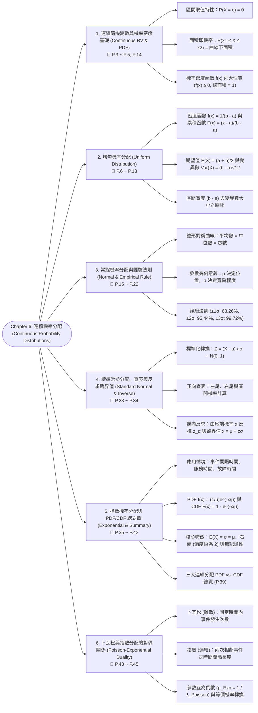

# Chapter 6: 連續機率分配 (Continuous Probability Distributions)

> 📅 生成日期：2026-11-25  
> 📄 來源檔案：[Chapter 6.pdf](./../../Reference/NCU_Classes/統計學/上學期/Chapter%206.pdf)（全 45 頁 / P.1 ~ P.45） (Statistics for Business and Economics, 14e Metric Version)  
> 🎯 適用考試：中央大學統計學課程期末考核心考點精華教材  

---

## 🗺️ 知識架構總覽 (Tree Diagram)

### 🎯 本章學習進度檢核 (完成後打勾，建立成就反饋)

- [ ] [1. 連續隨機變數與機率密度基礎 (Continuous RV & PDF) 📄 (P.3 ~ P.5, P.14)](#sec-1)
- [ ] [2. 均勻機率分配 (Uniform Distribution) 📄 (P.6 ~ P.13)](#sec-2)
- [ ] [3. 常態機率分配與經驗法則 (Normal & Empirical Rule) 📄 (P.15 ~ P.22)](#sec-3)
- [ ] [4. 標準常態分配、查表與反求臨界值 (Standard Normal & Inverse) 📄 (P.23 ~ P.34)](#sec-4)
- [ ] [5. 指數機率分配與 PDF/CDF 總對照 (Exponential & Summary) 📄 (P.35 ~ P.42)](#sec-5)
- [ ] [6. 卜瓦松與指數分配的對偶關係 (Poisson-Exponential Duality) 📄 (P.43 ~ P.45)](#sec-6)

---

## 📖 知識點教材

### 6.1 連續隨機變數與機率密度函數基礎 (Continuous Random Variables & PDF) 📄 [P.3 ~ P.5, P.14]

> 📍 **講義對應範圍**：[Chapter 6.pdf](./../../Reference/NCU_Classes/統計學/上學期/Chapter%206.pdf) P.3 ~ P.5, P.14 (Slide 3 ~ 5, 14)

#### 📌 核心概念

1. **連續隨機變數（Continuous Random Variable）的機率觀念轉折**：
   * 與第 5 章離散隨機變數透過「逐點加總」求機率不同，連續隨機變數可在實數線的某區間內取**無限多個不可數數值**（例如時間、重量、溫度）。
   * 因此，談論連續隨機變數「剛好等於某單一精確數值」的機率是沒有意義的——該單點在數線上的寬度為 0，故面積恆為 0，即 **$P(X = c) = 0$**。
   * 我們永遠只能計算連續隨機變數落入某個**區間（Interval）**的機率，其幾何定義即為該區間內**機率密度函數（Probability Density Function, PDF）曲線下方的面積**。
2. **機率密度函數 $f(x)$ 不是機率本身**：
   * 離散分配的 $f(x)$（PMF）代表 $P(X=x)$，因此必定介於 $0$ 與 $1$ 之間。
   * 連續分配的 $f(x)$（PDF）代表的是「機率密度（曲線高度）」，只要曲線下總面積等於 1，**$f(x)$ 的高度完全可以大於 1**（例如均勻分配 $U(0, 0.5)$ 的高度即為 $f(x) = 2$）。
3. **端點包含與否不影響機率值**：
   * 由於任何單一點的機率都是 0，對於所有連續隨機變數而言，區間是否包含端點（$<$ 與 $\le$）所得到的機率**完全相同**。

#### 📐 關鍵公式 / 定理

* **機率密度函數（PDF）兩大合法條件**：
  1. 非負性：$f(x) \ge 0$（對所有實數 $x$）
  2. 總面積為 1：$\int_{-\infty}^{\infty} f(x)\,dx = 1$
* **區間機率（面積即機率）與單點零機率性質**：
  $$P(X = c) = 0$$
  $$P(x_1 \le X \le x_2) = P(x_1 < X < x_2) = P(x_1 \le X < x_2) = P(x_1 < X \le x_2) = \int_{x_1}^{x_2} f(x)\,dx$$
* **累積分配函數（Cumulative Distribution Function, CDF）**：
  $$F(x_0) = P(X \le x_0) = \int_{-\infty}^{x_0} f(x)\,dx \implies P(x_1 \le X \le x_2) = F(x_2) - F(x_1)$$
  * **為什麼這樣用**：在沒有直接積分的情況下，只要查表或套用 CDF 公式 $F(x)$，將「右端點累積面積減去左端點累積面積」，就能瞬間求出任意區間機率。

#### 💡 重要觀念提醒

| 比較項目 | 離散機率分配 (Chapter 5) | 連續機率分配 (Chapter 6) |
|:---|:---|:---|
| **函數名稱** | 機率質量函數（PMF）$f(x) = P(X=x)$ | 機率密度函數（PDF）$f(x)$（僅表高度） |
| **函數值上限** | 必定滿足 $0 \le f(x) \le 1$ | 僅需 $f(x) \ge 0$，**可大於 1** |
| **單點機率 $P(X=c)$** | 可以大於 0 | **恆等於 0** |
| **$P(a < X < b)$ vs. $P(a \le X \le b)$** | **不相等**（需注意端點是否包含） | **完全相等**（端點面積為 0） |
| **總機率條件** | $\sum f(x) = 1$ | $\int_{-\infty}^{\infty} f(x)\,dx = 1$（總面積 = 1） |

> 🔗 **關聯**：Chapter 5 — [5.1 隨機變數本質](./Chapter_5_教材.md#sec-1) 與 [5.2 離散機率公理](./Chapter_5_教材.md#sec-2)，注意將「離散求和 $\sum$」升級為「連續面積 $\int$」。

#### 📊 範例

**題目**：某連續隨機變數 $X$ 的機率密度函數定義為 $f(x) = c x$（當 $0 \le x \le 4$ 時），其他區域為 $0$。  
(1) 求常數 $c$ 之值。  
(2) 求 $P(1 \le X \le 3)$ 與 $P(X = 2)$。

**解析**：  
1. 根據 PDF 曲線下總面積必為 1（此圖形為底長 $4$、高 $4c$ 的直角三角形）：
   $$\int_{0}^{4} c x\,dx = \left[\frac{c x^2}{2}\right]_{0}^{4} = 8c = 1 \implies c = \frac{1}{8} = 0.125$$
   *(幾何驗證：三角形面積 $= \frac{1}{2} \times 4 \times 4c = 8c = 1 \implies c = 0.125$)*
2. 求區間機率 $P(1 \le X \le 3)$：
   $$P(1 \le X \le 3) = \int_{1}^{3} 0.125x\,dx = \left[0.0625x^2\right]_{1}^{3} = 0.0625(9 - 1) = 0.50$$
   而單點機率 $P(X = 2) = 0$（連續隨機變數在單一點面積為 0）。

#### ✏️ 練習題

**Q1.** 【判斷題（True/False，需說明理由）】某同學在檢查一個連續隨機變數的機率密度函數（PDF）時，發現 $f(0.2) = 1.8$，於是斷定這個函數一定寫錯了，因為「任何機率都不可能大於 1」。請問該同學的說法是否正確？請說明原因。 `[Medium]`

**Q2.** 【計算選擇題】設連續隨機變數 $X$ 的機率密度函數為 $f(x) = k(2 - x)$（當 $0 \le x \le 2$ 時），其餘區間 $f(x) = 0$。試求常數 $k$ 以及機率 $P(0.5 < X \le 1.5)$ 分別為何？ `[Medium]`  
(A) $k = 0.25$；$P = 0.25$  
(B) $k = 0.50$；$P = 0.50$  
(C) $k = 0.50$；$P = 0.375$  
(D) $k = 1.00$；$P = 0.50$  

👉 [查看本節練習題答案與詳細解析](#ans-sec-1)

---

### 6.2 均勻機率分配 (Uniform Probability Distribution) 📄 [P.6 ~ P.13]

> 📍 **講義對應範圍**：[Chapter 6.pdf](./../../Reference/NCU_Classes/統計學/上學期/Chapter%206.pdf) P.6 ~ P.13 (Slide 6 ~ 13)

#### 📌 核心概念

1. **均勻機率分配（Uniform Probability Distribution）定義**：
   * 若連續隨機變數 $X$ 落在區間 $[a, b]$ 內任何子區間的機率，皆**正比於該子區間的長度（Proportional to the interval's length）**，則稱 $X$ 服從均勻分配，記為 $X \sim U(a, b)$。
   * 幾何形狀為一個位於 $[a, b]$ 上方的**矩形（Rectangle）**：底寬為 $b - a$，高度固定為 $\frac{1}{b - a}$，總面積恰為 $(b - a) \times \frac{1}{b - a} = 1$。
2. **區間寬度與變異程度**：
   * $b - a$ 代表可能取值的總寬度（Range）。
   * 區間越寬（$b - a$ 越大）$\implies$ 數據分散程度越大 $\implies$ **變異數越大**；反之，區間越窄 $\implies$ 變異數越小。
   * 注意：由於均勻分配沒有任何「向中心集中」的趨勢，其變異數分母為 $12$（由積分 $\int_a^b (x - \frac{a+b}{2})^2 \frac{1}{b-a}\,dx$ 推導得出）。

#### 📐 關鍵公式 / 定理

* **機率密度函數（PDF）**：
  $$f(x) = \begin{cases} \dfrac{1}{b - a}, & \text{for } a \le x \le b \\ 0, & \text{elsewhere} \end{cases}$$
  其中 $a$ 為變數最小值（下界），$b$ 為變數最大值（上界）。
* **累積分配函數（CDF）與區間機率**：
  $$F(x) = P(X \le x) = \frac{x - a}{b - a} \quad (a \le x \le b)$$
  $$P(x_1 \le X \le x_2) = \text{底} \times \text{高} = \frac{x_2 - x_1}{b - a} \quad (a \le x_1 \le x_2 \le b)$$
* **期望值與變異數**：
  $$E(X) = \frac{a + b}{2}, \qquad \text{Var}(X) = \frac{(b - a)^2}{12}, \qquad \sigma = \frac{b - a}{\sqrt{12}}$$
  * **為什麼這樣用**：矩形完全左右對稱，重心自然在端點中點 $\frac{a+b}{2}$；而離散度只與寬度 $(b - a)$ 有關，與區間平移位置無關。

#### 💡 重要觀念提醒

* **陷阱警訊**：計算區間機率 $P(x_1 \le X \le x_2)$ 前，務必檢查 $x_1, x_2$ 是否超出定義域 $[a, b]$！若題目問 $P(X \le c)$ 且 $c > b$，機率上限恆為 $1$（不可硬套公式算出大於 1 的數值）。
* **Excel 與抽樣應用連結**：Excel 的 `RAND()` 函數所產生的亂數即服從標準均勻分配 $U(0, 1)$，這是第 7 章電腦自動化簡單隨機抽樣的核心工具。

> 🔗 **關聯**：Chapter 7 — [7.1 抽樣基礎（有限母體電腦亂數抽樣）](./Chapter_7_教材.md#sec-1)，`RAND()` 即利用 $U(0, 1)$ 分配抽樣。

#### 📊 範例

**題目**：某高鐵接駁公車發車間隔固定，乘客到達站牌後的候車時間 $X$（分鐘）服從均勻分配 $U(2, 14)$。  
(1) 寫出 $X$ 的機率密度函數 $f(x)$。  
(2) 求乘客候車時間介於 $5$ 分鐘至 $11$ 分鐘之間的機率。  
(3) 求候車時間的期望值 $E(X)$、變異數 $\text{Var}(X)$ 與標準差 $\sigma$。

**解析**：  
1. 已知 $a = 2, b = 14$，區間寬度 $b - a = 12$：
   $$f(x) = \frac{1}{14 - 2} = \frac{1}{12} \approx 0.0833 \quad (2 \le x \le 14)$$
2. 區間機率（矩形面積）：
   $$P(5 \le X \le 11) = \frac{11 - 5}{14 - 2} = \frac{6}{12} = 0.50$$
3. 期望值與變異數：
   $$E(X) = \frac{2 + 14}{2} = 8 \text{ (分鐘)}$$
   $$\text{Var}(X) = \frac{(14 - 2)^2}{12} = \frac{144}{12} = 12 \text{ (分鐘}^2\text{)}, \qquad \sigma = \sqrt{12} \approx 3.4641 \text{ (分鐘)}$$

#### ✏️ 練習題

**Q3.** 某航空公司在旺季期間，特定航線的班機起飛延誤時間 $X$（分鐘）服從 $10$ 分鐘至 $40$ 分鐘的均勻機率分配。請問一架班機延誤超過 $28$ 分鐘的機率，以及延誤時間的標準差約為多少？ `[Medium]`  
(A) 機率 $0.40$；標準差 $8.66$ 分鐘  
(B) 機率 $0.60$；標準差 $8.66$ 分鐘  
(C) 機率 $0.40$；標準差 $75.00$ 分鐘  
(D) 機率 $0.70$；標準差 $15.00$ 分鐘  

**Q4.** 【進階應用計算】已知某連續隨機變數 $X$ 服從均勻分配 $U(a, b)$，且其期望值 $E(X) = 20$，標準差 $\sigma = \sqrt{12}$。試求：  
(1) 下界 $a$ 與上界 $b$ 之值。  
(2) 條件機率 $P(X \le 17 \mid X \le 23)$。 `[Hard]`

👉 [查看本節練習題答案與詳細解析](#ans-sec-2)

---

### 6.3 常態機率分配與經驗法則 (Normal Probability Distribution & Empirical Rule) 📄 [P.15 ~ P.22]

> 📍 **講義對應範圍**：[Chapter 6.pdf](./../../Reference/NCU_Classes/統計學/上學期/Chapter%206.pdf) P.15 ~ P.22 (Slide 15 ~ 22)

#### 📌 核心概念

1. **常態機率分配（Normal Probability Distribution）的地位**：
   * 統計學中最重要、應用最廣泛的連續機率分配，不僅能描述大量自然與社會現象（如身高、測量誤差、考試成績），更是後續**統計推論（Statistical Inference）**與第 7 章**中央極限定理（Central Limit Theorem）**的理論基石。
2. **常態曲線的五大幾何性質**：
   * **雙參數決定全族**：整個常態分配家族完全由平均數 $\mu$ 與標準差 $\sigma$ 唯一決定，記為 $X \sim N(\mu, \sigma^2)$。
   * **中心三量重合**：曲線最高點位於平均數 $\mu$ 處，且**平均數 = 中位數 = 眾數**。
   * **完全對稱**：曲線以 $\mu$ 為對稱軸左右鏡像對稱，左側面積 $P(X < \mu) = 0.5$，右側面積 $P(X > \mu) = 0.5$。
   * **$\mu$ 控制位置、$\sigma$ 控制形狀**：$\mu$ 可為任意實數（負、零、正），改變 $\mu$ 只做水平平移；**$\sigma$ 越大，曲線越寬扁（Wider, Flatter）；$\sigma$ 越小，曲線越窄高（Narrower, Taller）**。
   * **漸近尾端**：兩側尾巴無限延伸趨近於橫軸但永不接觸，曲線下總面積恆為 $1$。
3. **經驗法則（Empirical Rule）的精確比例**：
   * 在常態分配下，資料落在平均數加減 1、2、3 個標準差內的機率分別為：**$68.26\%$（約 68%）**、**$95.44\%$（約 95%）**、**$99.72\%$（約 99.7%）**。

#### 📐 關鍵公式 / 定理

* **常態機率密度函數（Normal PDF）**：
  $$f(x) = \frac{1}{\sigma \sqrt{2\pi}} e^{-\frac{(x - \mu)^2}{2\sigma^2}}, \qquad -\infty < x < \infty$$
  其中 $\mu$ 為母體平均數、$\sigma$ 為母體標準差、$\pi \approx 3.14159$、$e \approx 2.71828$。
  * **為什麼這樣用**：此函數的積分沒有初等解析解（無法手算不定積分），因此實務上絕不直接積分 $f(x)$，而是透過下一節的**標準化（$z$-Score）**並查閱標準常態分配表來求面積。
* **經驗法則（Empirical Rule）**：
  $$P(\mu - \sigma \le X \le \mu + \sigma) \approx 0.6826 \quad (\approx 68\%)$$
  $$P(\mu - 2\sigma \le X \le \mu + 2\sigma) \approx 0.9544 \quad (\approx 95\%)$$
  $$P(\mu - 3\sigma \le X \le \mu + 3\sigma) \approx 0.9972 \quad (\approx 99.7\%)$$

#### 💡 重要觀念提醒

| 參數變動情境 | 曲線中心位置 | 曲線寬度與峰值高度 | 曲線下總面積 |
|:---|:---|:---|:---|
| $\mu$ 增加、$\sigma$ 不變 | 整體往右平移 | 形狀完全不變 | 恆為 $1$ |
| $\mu$ 不變、$\sigma$ 增加 | 中心位置不變 | **變寬、峰值變矮** | 恆為 $1$ |
| $\mu$ 不變、$\sigma$ 減少 | 中心位置不變 | **變窄、峰值變高** | 恆為 $1$ |

* **記憶技巧**：把常態曲線想像成「一團總體積固定為 1 的黏土」——壓扁拉寬（$\sigma$ 變大），最高點必然下降；往中間捏緊（$\sigma$ 變小），最高點必然飆高。

> 🔗 **關聯**：Chapter 3 — [3.3 柴比雪夫定理與經驗法則](./Chapter_3_教材.md)，經驗法則僅適用於鐘形常態分配，任意未知形狀分配則必須改用柴比雪夫定理。

#### 📊 範例

**題目**：某品牌筆電電池的充電循環壽命 $X$ 服從常態分配，平均數 $\mu = 500$ 次、標準差 $\sigma = 40$ 次。請僅利用常態對稱性與經驗法則回答：  
(1) 約有 $95.44\%$ 的電池壽命會落在哪個區間？  
(2) 電池壽命超過 $540$ 次的機率約為多少？

**解析**：  
1. 根據經驗法則，$95.44\%$ 的數值落在 $\mu \pm 2\sigma$ 內：
   $$500 \pm 2(40) = [420,\; 580] \text{ 次}$$
2. $540 = \mu + 1\sigma$。因為 $\mu \pm 1\sigma$ 內包含 $68.26\%$ 的面積，剩餘左右兩尾合計面積為 $1 - 0.6826 = 0.3174$。由左右對稱性可知右尾機率為其一半：
   $$P(X > 540) = \frac{1 - 0.6826}{2} = 0.1587 \quad (\approx 15.87\%)$$

#### ✏️ 練習題

**Q5.** 設有兩個常態分配：$X \sim N(50, 5^2)$ 與 $Y \sim N(50, 10^2)$。下列敘述何者**正確**？ `[Medium]`  
(A) $Y$ 的曲線最高點比 $X$ 更高，因為 $Y$ 的標準差較大。  
(B) $P(X > 50) > P(Y > 50)$。  
(C) $P(40 \le X \le 60) > P(40 \le Y \le 60)$。  
(D) $X$ 與 $Y$ 曲線下的總面積比例為 $1 : 2$。  

**Q6.** 某大學微積分會考成績服從常態分配，平均數為 $72$ 分，標準差為 $8$ 分。若僅運用經驗法則（$68.26\%$、$95.44\%$、$99.72\%$）與對稱性，不查表估算成績介於 $64$ 分至 $88$ 分之間的學生比例約為多少？ `[Medium]`  
(A) $68.26\%$  
(B) $81.85\%$  
(C) $83.85\%$  
(D) $95.44\%$  

👉 [查看本節練習題答案與詳細解析](#ans-sec-3)

---

### 6.4 標準常態分配、查表與反求臨界值 (Standard Normal Distribution, Z-Table & Inverse Normal) 📄 [P.23 ~ P.34]

> 📍 **講義對應範圍**：[Chapter 6.pdf](./../../Reference/NCU_Classes/統計學/上學期/Chapter%206.pdf) P.23 ~ P.34 (Slide 23 ~ 34)

#### 📌 核心概念

1. **標準常態機率分配（Standard Normal Probability Distribution）**：
   * 特指平均數 $\mu = 0$、標準差 $\sigma = 1$ 的常態分配，以隨機變數 $Z \sim N(0, 1)$ 表示。
   * 透過**標準化轉換（Standardization）**，任何不同單位、不同均值與標準差的常態隨機變數 $X$，都可以投影到同一把標準尺 $Z$ 上，只靠**一張標準常態累積機率表（Z-Table）**就能查出所有機率！
   * **$z$ 值的直覺意義**：代表觀察值 $x$ 距離平均數 $\mu$ 有「多少個標準差」以及方向（正為高於均值、負為低於均值）。
2. **兩大核心考題型態**：
   * **正向查表（給定 $x$ 求機率）**：先算出 $z = \frac{x-\mu}{\sigma}$，再依「左尾、右尾、區間」規則由 Z 表讀取累積面積 $P(Z \le z)$。
   * **逆向反求（給定機率求臨界值 $x$）**：商管決策最愛考（例如訂定**再訂購點 Reorder Point**、錄取分數線、品質保固年限）！先將題目要求的尾端機率轉為**左尾累積機率**，從 Z 表「內部數值區」反查出對應的 $z$ 值，再還原為 $x = \mu + z\sigma$。

#### 📐 關鍵公式 / 定理

* **標準化公式（正向）與還原公式（逆向）**：
  $$z = \frac{x - \mu}{\sigma} \quad \Longleftrightarrow \quad x = \mu + z \sigma$$
* **三種常見機率查表規則（設 Z 表提供左尾累積面積 $\Phi(z) = P(Z \le z)$）**：
  1. **左尾機率**：$P(X \le x_0) = P(Z \le z_0) = \Phi(z_0)$
  2. **右尾機率**：$P(X > x_0) = 1 - P(Z \le z_0) = 1 - \Phi(z_0)$
  3. **區間機率**：$P(x_1 \le X \le x_2) = \Phi(z_2) - \Phi(z_1)$
* **對稱性質**：$\Phi(-z) = 1 - \Phi(z)$
* **常考臨界 $z$ 值速記（右尾面積 $\alpha$）**：
  * 右尾 $10\%$（左尾 $0.90$）：$z_{0.10} \approx 1.28$
  * 右尾 $5\%$（左尾 $0.95$）：$z_{0.05} \approx 1.645$（查表常見 $1.64$ 或 $1.65$）
  * 右尾 $2.5\%$（左尾 $0.975$）：$z_{0.025} = 1.96$
  * 右尾 $1\%$（左尾 $0.99$）：$z_{0.01} \approx 2.33$

#### 💡 重要觀念提醒

* **無條件進位的實務邏輯（講義 P.32 重點）**：在庫存管理求「缺貨機率**不超過** $\alpha$（no more than $\alpha$）」的再訂購點時，若算出的 $x$ 含小數點（如 $24.87$），必須**無條件進位（Round Up）**至 $25$；若四捨五入往下取 $24$，缺貨機率就會微微**超過**上限 $\alpha$，違反管理承諾！
* **左尾 vs. 右尾正負號檢查**：
  * 若目標值 $x$ 在前 $50\%$（左尾機率 $< 0.5$，例如「最低 10%」），對應的 $z$ 值必定為**負數**。
  * 若目標值 $x$ 在後 $50\%$（左尾機率 $> 0.5$，例如「前 10% 高分」），對應的 $z$ 值必定為**正數**。

> 🔗 **關聯**：Chapter 3 — [z-Score 標準分數](./Chapter_3_教材.md)，第 3 章用 $z$ 值衡量相對位置，本章則將 $z$ 值與精確機率面積掛鉤。

#### 📊 範例

**題目**：某雲端 API 伺服器的單次請求回應時間 $X$ 服從常態分配，平均數 $\mu = 120$ 毫秒、標準差 $\sigma = 25$ 毫秒。  
(1) 求單次請求回應時間超過 $155$ 毫秒的機率。  
(2) 工程團隊要簽署 SLA 服務合約，希望回應時間超過門檻 $c$ 毫秒的機率**恰好為 $2.5\%$**，請問門檻 $c$ 應設為多少毫秒？（已知 $\Phi(1.40) = 0.9192$，$\Phi(1.96) = 0.9750$）

**解析**：  
1. **正向查表**：
   $$z = \frac{155 - 120}{25} = \frac{35}{25} = 1.40$$
   查表得左尾面積 $P(Z \le 1.40) = 0.9192$，因此右尾超過機率為：
   $$P(X > 155) = 1 - 0.9192 = 0.0808 \quad (8.08\%)$$
2. **逆向反求**：
   要求右尾機率 $P(X > c) = 0.025 \implies$ 左尾累積機率 $P(X \le c) = 1 - 0.025 = 0.9750$。  
   反查 Z 表得知 $z = 1.96$，代入還原公式：
   $$c = \mu + z\sigma = 120 + 1.96 \times 25 = 120 + 49 = 169 \text{ 毫秒}$$

#### ✏️ 練習題

**Q7.** 某連鎖咖啡店的自動咖啡機每杯中杯拿鐵的注入量 $X$ 服從常態分配，平均數 $\mu = 360\text{ mL}$、標準差 $\sigma = 12\text{ mL}$。請問隨機一杯拿鐵的容量介於 $345\text{ mL}$ 與 $378\text{ mL}$ 之間的機率為何？（參考查表值：$\Phi(-1.25) = 0.1056$，$\Phi(1.25) = 0.8944$，$\Phi(1.50) = 0.9332$） `[Medium]`  
(A) $0.0388$  
(B) $0.8276$  
(C) $0.8944$  
(D) $0.9612$  

**Q8.** 某電子零組件工廠每週對特定微控制器的需求量服從常態分配，平均數 $\mu = 400$ 顆、標準差 $\sigma = 50$ 顆。採購經理希望每週發生缺貨（需求量大於庫存量）的機率**不超過 $1\%$**。若採購數量須為整數顆，請問每週至少應備妥多少顆庫存？（已知 $\Phi(2.32) = 0.9898$，$\Phi(2.33) = 0.9901$） `[Hard]`  
(A) $516$ 顆  
(B) $517$ 顆  
(C) $483$ 顆  
(D) $529$ 顆  

**Q9.** 【進階聯立求解】某全國性語文檢定測驗的成績 $X$ 服從常態分配 $N(\mu, \sigma^2)$。已知成績最高的前 $10\%$ 考生分數至少為 $87.8$ 分，而成績最低的後 $20\%$ 考生分數最高不超過 $66.6$ 分。試求該測驗的平均數 $\mu$ 與標準差 $\sigma$。（參考值：$\Phi(1.28) \approx 0.9000$，$\Phi(-0.84) \approx 0.2000$） `[Hard]`

👉 [查看本節練習題答案與詳細解析](#ans-sec-4)

---

### 6.5 指數機率分配與 PDF / CDF 綜合比較 (Exponential Probability Distribution & PDF vs. CDF) 📄 [P.35 ~ P.42]

> 📍 **講義對應範圍**：[Chapter 6.pdf](./../../Reference/NCU_Classes/統計學/上學期/Chapter%206.pdf) P.35 ~ P.42 (Slide 35 ~ 42)

#### 📌 核心概念

1. **指數機率分配（Exponential Probability Distribution）的適用情境**：
   * 專門用來描述**「直到某事件發生所需的時間（Time until an event occurs）」**或**「兩次事件之間的時間間隔（Time between events）」**。
   * 典型實務例子（講義 P.35）：收費站車輛到達間隔時間、完成問卷所需時間、高速公路兩處重大路面瑕疵之間的距離、等候線（Waiting Line）系統中的顧客服務時間。
2. **三大標誌性統計特徵（極高頻選擇題考點）**：
   * **平均數等於標準差**：$E(X) = \sigma = \mu$，故變異數 $\text{Var}(X) = \mu^2$。（⚠️ 切勿與第 5 章卜瓦松分配的「平均數等於變異數」搞混！）
   * **永遠右偏且偏度恆定**：機率密度在 $x = 0$ 處達到最高峰 $\frac{1}{\mu}$，隨後隨 $x$ 增大呈指數遞減（代表短等候時間的密度較高、極長等候時間的密度較低），其**偏度值恆等於 $2$（Skewness = 2）**，與 $\mu$ 大小無關。
   * **無記憶性（Memoryless Property）**：$P(X > s + t \mid X > s) = P(X > t)$。意思是「不論已經等了多久（$s$），從現在起還需要再等超過 $t$ 的機率，跟剛開始等的時候完全一樣」。
3. **兩大參數寫法對照**：
   * 本課程（Anderson 14e）以**平均間隔時間 $\mu$** 為主參數：$f(x) = \frac{1}{\mu} e^{-x/\mu}$。
   * 其他理工教科書常以**發生速率 $\lambda = \frac{1}{\mu}$** 為主參數：$f(x) = \lambda e^{-\lambda x}$。兩者數學上完全等價，看題目給的是「平均時間（分鐘/次）」還是「速率（次/分鐘）」即可輕鬆切換！

#### 📐 關鍵公式 / 定理

* **指數機率密度函數（PDF）**：
  $$f(x) = \frac{1}{\mu} e^{-x/\mu}, \qquad x \ge 0$$
  其中 $\mu$ 為平均間隔時間（Expected Value / Mean），$e \approx 2.71828$。
* **指數累積分配函數（CDF）與衍生機率公式**：
  * 小於等於（左尾）：$P(X \le x_0) = F(x_0) = 1 - e^{-x_0 / \mu}$
  * 大於（右尾 / 存活機率）：$P(X > x_0) = 1 - (1 - e^{-x_0 / \mu}) = e^{-x_0 / \mu}$
  * 區間機率：$P(a \le X \le b) = F(b) - F(a) = e^{-a / \mu} - e^{-b / \mu}$
* **動差與偏度特徵**：
  $$E(X) = \mu, \qquad \sigma = \mu, \qquad \text{Var}(X) = \mu^2, \qquad \text{Skewness} = 2$$

#### 💡 重要觀念提醒

##### 📊 本章三大連續分配 PDF vs. CDF 總對照表（對應講義 P.39）

| 分配名稱 | 機率密度函數 (PDF) $f(x)$ | 累積分配函數 (CDF) $F(x) = P(X \le x)$ | 期望值 $E(X)$ | 變異數 $\text{Var}(X)$ |
|:---|:---|:---|:---:|:---:|
| **均勻分配** $U(a, b)$ | $\dfrac{1}{b - a} \;(a \le x \le b)$ | $\dfrac{x - a}{b - a} \;(a \le x \le b)$ | $\dfrac{a + b}{2}$ | $\dfrac{(b - a)^2}{12}$ |
| **常態分配** $N(\mu, \sigma^2)$ | $\dfrac{1}{\sigma\sqrt{2\pi}} e^{-\frac{(x-\mu)^2}{2\sigma^2}}$ | $P(Z \le \frac{x-\mu}{\sigma})$（查 Z 表） | $\mu$ | $\sigma^2$ |
| **指數分配** $\text{Exp}(\mu)$ | $\dfrac{1}{\mu} e^{-x/\mu} \;(x \ge 0)$ | $1 - e^{-x/\mu} \;(x \ge 0)$ | $\mu$ | $\mu^2$（即 $\sigma = \mu$） |

* **超級易錯陷阱（講義 P.41 特別標出 VS）**：計算「$2$ 分鐘**以內**」的機率時，必須代入 **CDF** $P(X \le x_0) = 1 - e^{-x_0/\mu}$，**絕對不能**誤代 PDF $f(x_0) = \frac{1}{\mu} e^{-x_0/\mu}$！PDF 算出來只是曲線在 $x_0$ 的高度，不是機率！

> 🔗 **關聯**：Chapter 5 — [5.6 卜瓦松分配](./Chapter_5_教材.md#sec-6)，對比記憶：「卜瓦松均值＝變異數（$\mu = \sigma^2$），指數均值＝標準差（$\mu = \sigma$）」。

#### 📊 範例

**題目**：某銀行客服專線的單通通話處理時間 $X$ 服從指數機率分配，平均通話時間為 $\mu = 6$ 分鐘。試求：  
(1) 一通客服電話在 $4$ 分鐘以內結束的機率。  
(2) 通話時間超過 $9$ 分鐘的機率。  
(3) 通話時間介於 $3$ 分鐘與 $9$ 分鐘之間的機率。

**解析**：  
已知 $\mu = 6$ 分鐘：  
1. $P(X \le 4) = 1 - e^{-4/6} = 1 - e^{-0.6667} \approx 1 - 0.5134 = 0.4866$。
2. $P(X > 9) = e^{-9/6} = e^{-1.5} \approx 0.2231$。
3. $P(3 \le X \le 9) = F(9) - F(3) = e^{-3/6} - e^{-9/6} = e^{-0.5} - e^{-1.5} \approx 0.6065 - 0.2231 = 0.3834$。

#### ✏️ 練習題

**Q10.** 某資料中心硬碟控制器的無故障運轉時間 $X$ 服從指數分配，平均壽命為 $\mu = 500$ 小時。請問該控制器在運轉第 $250$ 小時至第 $750$ 小時之間發生故障的機率為何？（已知 $e^{-0.5} \approx 0.6065$，$e^{-1.5} \approx 0.2231$） `[Medium]`  
(A) $0.2231$  
(B) $0.3834$  
(C) $0.6065$  
(D) $0.7769$  

**Q11.** 【進階觀念與計算】設隨機變數 $X$ 代表某急診室分流櫃檯的等候時間（分鐘），服從平均數 $\mu = 10$ 分鐘的指數機率分配。  
(1) 請計算該等候時間的**中位數（Median）** $m$（即滿足 $P(X \le m) = 0.5$ 之值），並解釋為何中位數小於平均數 $10$ 分鐘？（已知 $\ln 2 \approx 0.69315$）  
(2) 若一位病患**已經等了 $5$ 分鐘**尚未叫號，請問他**總等候時間超過 $15$ 分鐘**的條件機率為何？（已知 $e^{-1} \approx 0.3679$，$e^{-1.5} \approx 0.2231$） `[Hard]`

👉 [查看本節練習題答案與詳細解析](#ans-sec-5)

---

### 6.6 卜瓦松分配與指數分配的對偶關係 (Relationship between Poisson & Exponential Distributions) 📄 [P.43 ~ P.45]

> 📍 **講義對應範圍**：[Chapter 6.pdf](./../../Reference/NCU_Classes/統計學/上學期/Chapter%206.pdf) P.43 ~ P.45 (Slide 43 ~ 45)

#### 📌 核心概念

1. **同一隨機過程的一體兩面（Duality）**：
   * 想像在一個加油站或伺服器入口觀察隨機抵達的事件流（Poisson Process）：
   * 若你固定一段時間長度（例如 $1$ 小時），去**數（Count）**來了幾輛車 $\implies$ **卜瓦松分配（Poisson Distribution，離散型）**。
   * 若你盯著馬錶，去**量（Measure）**兩輛相鄰車輛之間隔了幾分鐘 $\implies$ **指數分配（Exponential Distribution，連續型）**。
2. **核心數學橋樑（零事件等價原理）**：
   * 「下一次事件發生所需的等待時間**大於 $t$**（指數觀點）」在邏輯上**完全等價於**「在接下來的 $t$ 時間內，發生事件次數**恰為 $0$ 次**（卜瓦松觀點）」！
   * 用公式驗證：若單位時間平均發生率為 $\lambda$ 次/小時，則平均間隔時間為 $\mu = \frac{1}{\lambda}$ 小時。在長度 $t$ 內的卜瓦松平均次數為 $\lambda t$，故：
     $$P(\text{Exp} > t) = e^{-t/\mu} = e^{-\lambda t} = \frac{(\lambda t)^0 e^{-\lambda t}}{0!} = P(\text{Poisson}(t) = 0)$$

#### 📐 關鍵公式 / 定理

* **參數互為倒數（單位必須對齊！）**：
  $$\text{若 } N \sim \text{Poisson}(\text{每單位時間平均 } \lambda \text{ 次}) \iff T \sim \text{Exponential}\left(\text{平均間隔時間 } \mu = \frac{1}{\lambda} \text{ 單位時間}\right)$$
  * **為什麼這樣用**：考題經常只給「每小時到達幾位客人（卜瓦松速率）」，卻反問「兩位客人間隔時間不超過幾分鐘（指數機率）」，此時必須先做**單位對齊**再取**倒數**！

#### 💡 重要觀念提醒

| 比較面向 | 卜瓦松分配 (Poisson) | 指數分配 (Exponential) |
|:---|:---|:---|
| **隨機變數類型** | **離散型（Discrete）** | **連續型（Continuous）** |
| **描述對象** | 固定區間內的**事件發生次數**（Number of occurrences） | 相鄰兩次事件之間的**區間長度**（Length of interval） |
| **參數單位範例** | $15$ 筆訂單 / 小時（速率 $\lambda$） | $\frac{1}{15}$ 小時 / 筆 $= 4$ 分鐘 / 筆（均值 $\mu$） |
| **均值與離散特徵** | $E(N) = \text{Var}(N) = \lambda$ | $E(T) = \sigma_T = \mu$ |

* **單位轉換口訣**：**「先統一時間單位，再取倒數」**。例如每小時 $12$ 通電話 $\to$ 每分鐘 $\frac{12}{60} = 0.2$ 通 $\to$ 平均間隔 $\mu = \frac{1}{0.2} = 5$ 分鐘。

> 🔗 **關聯**：Chapter 5 — [5.6 卜瓦松機率分配](./Chapter_5_教材.md#sec-6)，跨章綜合題最愛將 5.6 與 6.5 合併出題！

#### 📊 範例

**題目**：某電商物流中心平均每小時湧入 $15$ 筆急件訂單，訂單到達次數服從卜瓦松分配。  
(1) 相鄰兩筆急件訂單的到達間隔時間 $X$ 服從何種分配？平均間隔為幾分鐘？  
(2) 分別利用**指數分配**與**卜瓦松分配**兩種觀點，計算兩筆訂單間隔超過 $6$ 分鐘的機率，驗證兩者是否一致。

**解析**：  
1. 統一單位為分鐘：平均速率 $\lambda = \frac{15}{60} = 0.25$ 筆/分鐘。  
   間隔時間 $X$ 服從**指數分配**，平均間隔時間為：
   $$\mu = \frac{1}{\lambda} = \frac{1}{0.25} = 4 \text{ 分鐘}$$
2. **方法一（指數觀點）**：
   $$P(X > 6) = e^{-6/4} = e^{-1.5} \approx 0.2231$$
   **方法二（卜瓦松觀點）**：在 $6$ 分鐘區間內平均發生次數為 $\mu_{6\text{min}} = 0.25 \times 6 = 1.5$ 筆。間隔超過 $6$ 分鐘等價於「$6$ 分鐘內收到 $0$ 筆訂單」：
   $$P(N = 0) = \frac{1.5^0 e^{-1.5}}{0!} = e^{-1.5} \approx 0.2231$$
   兩種觀點結果完全一致！

#### ✏️ 練習題

**Q12.** 某企業 IT 報修專線平均每小時接到 $12$ 通報修電話，來電次數服從卜瓦松分配。若剛剛接完一通電話，請問下一通報修電話在 **$3$ 分鐘以內**打進來的機率為何？（已知 $e^{-0.6} \approx 0.5488$，$e^{-0.25} \approx 0.7788$，$e^{-36} \approx 0$） `[Medium]`  
(A) $0.2212$  
(B) $0.4512$  
(C) $0.5488$  
(D) $0.7788$  

**Q13.** 【跨章綜合大題】某自動化機台的無預警當機事件服從卜瓦松過程，平均每 $2$ 天發生 $1$ 次當機（即平均速率為 $0.5$ 次/天）。試計算：  
(1) 該機台連續正常運作超過 $4$ 天（兩次當機間隔 $> 4$ 天）的機率。  
(2) 在接下來的 $4$ 天內，該機台發生**至少 $2$ 次**當機的機率。（已知 $e^{-2} \approx 0.1353$） `[Hard]`

👉 [查看本節練習題答案與詳細解析](#ans-sec-6)

---

## 🔑 本章練習題答案與詳細解析 (Answer Key)

### 第 6.1 節練習題解析

#### Q1 詳細解析

* **正確答案**：**False（錯誤）**
* **解題步驟與觀念**：
  1. 對於連續隨機變數，$f(x)$ 是**機率密度函數（PDF）**，僅代表曲線在 $x$ 處的「密度高度」，並非該點的機率值（事實上單點機率 $P(X=0.2) = 0$）。
  2. PDF 的合法條件只有兩條：$f(x) \ge 0$ 與曲線下總面積 $\int_{-\infty}^{\infty} f(x)\,dx = 1$。只要定義域寬度小於 $1$，高度完全可能大於 $1$。例如 $X \sim U(0, 0.5)$ 時，$f(x) = 2$（處處大於 1），但總面積 $= 0.5 \times 2 = 1$，完全合法！
* **陷阱分析**：將離散分配的 PMF（$0 \le f(x) \le 1$）規則直接套用到連續分配的 PDF 上，是最常見的觀念混淆。

[🔙 返回題目 Q1](#q1) ｜ [🔝 返回知識架構圖](#tree-diagram)

---

#### Q2 詳細解析

* **正確答案**：**(B)**
* **解題步驟與觀念**：
  1. 利用總面積等於 $1$ 求解常數 $k$：
     $$\int_{0}^{2} k(2 - x)\,dx = k\left[2x - \frac{x^2}{2}\right]_{0}^{2} = k(4 - 2) = 2k = 1 \implies k = 0.50$$
     *(幾何驗算：此為底長 $2$、在 $x=0$ 處高為 $2k$ 的三角形，面積 $\frac{1}{2} \times 2 \times 2k = 2k = 1 \implies k = 0.5$)*
  2. 計算區間機率（因連續分配端點不影響機率，$P(0.5 < X \le 1.5) = \int_{0.5}^{1.5} 0.5(2-x)\,dx$）：
     $$P(0.5 < X \le 1.5) = 0.5\left[2x - \frac{x^2}{2}\right]_{0.5}^{1.5} = 0.5\Big[(3 - 1.125) - (1 - 0.125)\Big] = 0.5(1.875 - 0.875) = 0.50$$
* **陷阱分析**：若在面積公式漏掉三角形係數 $\frac{1}{2}$ 會誤算 $k = 0.25$（誤選 A）；或在代入上下界時漏減下界 $0.5$。

[🔙 返回題目 Q2](#q2) ｜ [🔝 返回知識架構圖](#tree-diagram)

---

### 第 6.2 節練習題解析

#### Q3 詳細解析

* **正確答案**：**(A)**
* **解題步驟與觀念**：
  1. 已知 $X \sim U(10, 40)$，寬度 $b - a = 30$。
  2. 延誤超過 $28$ 分鐘之機率：
     $$P(X > 28) = \frac{40 - 28}{40 - 10} = \frac{12}{30} = 0.40$$
  3. 變異數與標準差：
     $$\text{Var}(X) = \frac{(40 - 10)^2}{12} = \frac{900}{12} = 75 \implies \sigma = \sqrt{75} \approx 8.6603 \approx 8.66 \text{ 分鐘}$$
* **陷阱分析**：誤算成 $P(X \le 28) = 0.60$（誤選 B），或忘記開根號把變異數 $75$ 當作標準差（誤選 C）。

[🔙 返回題目 Q3](#q3) ｜ [🔝 返回知識架構圖](#tree-diagram)

---

#### Q4 詳細解析

* **正確答案**：**(1) $a = 14, b = 26$；(2) $\frac{1}{3} \approx 0.3333$**
* **解題步驟與觀念**：
  1. 由期望值與變異數聯立反求 $a, b$：
     * $E(X) = \frac{a + b}{2} = 20 \implies a + b = 40$
     * $\text{Var}(X) = \sigma^2 = 12 = \frac{(b - a)^2}{12} \implies (b - a)^2 = 144 \implies b - a = 12$（因 $b > a$）
     * 兩式相加：$2b = 52 \implies b = 26$；代回得 $a = 14$。
  2. 利用條件機率公式計算 $P(X \le 17 \mid X \le 23)$：
     $$P(X \le 17 \mid X \le 23) = \frac{P(X \le 17 \cap X \le 23)}{P(X \le 23)} = \frac{P(X \le 17)}{P(X \le 23)} = \frac{\frac{17 - 14}{26 - 14}}{\frac{23 - 14}{26 - 14}} = \frac{3}{9} = \frac{1}{3} \approx 0.3333$$
* **陷阱分析**：在算變異數時忘了將標準差 $\sqrt{12}$ 先平方（誤寫成 $\frac{(b-a)^2}{12} = \sqrt{12}$）；或在條件機率中忘記把分子交集簡化為 $\{X \le 17\}$。

[🔙 返回題目 Q4](#q4) ｜ [🔝 返回知識架構圖](#tree-diagram)

---

### 第 6.3 節練習題解析

#### Q5 詳細解析

* **正確答案**：**(C)**
* **解題步驟與觀念**：
  * (A) 錯誤。$\sigma$ 越大曲線越**寬扁**，故 $Y$ 的峰值比 $X$ 更矮。
  * (B) 錯誤。兩者平均數皆為 $50$，依對稱性 $P(X > 50) = P(Y > 50) = 0.50$。
  * (C) **正確**。區間 $[40, 60]$ 對 $X$ 而言是 $\mu \pm 2\sigma_X$（約 $95.44\%$）；對 $Y$ 而言僅為 $\mu \pm 1\sigma_Y$（約 $68.26\%$），顯然前者遠大於後者！
  * (D) 錯誤。任何機率密度曲線下的總面積皆恆等於 $1$，比例為 $1 : 1$。

[🔙 返回題目 Q5](#q5) ｜ [🔝 返回知識架構圖](#tree-diagram)

---

#### Q6 詳細解析

* **正確答案**：**(B)**
* **解題步驟與觀念**：
  1. 將端點換算為標準差個數（$z$ 值）：
     * 下界：$64 = 72 - 1(8) = \mu - 1\sigma$
     * 上界：$88 = 72 + 2(8) = \mu + 2\sigma$
  2. 拆解為均值左側與右側兩段面積相加：
     * $P(\mu - 1\sigma < X < \mu) = \frac{68.26\%}{2} = 34.13\%$
     * $P(\mu < X < \mu + 2\sigma) = \frac{95.44\%}{2} = 47.72\%$
     * 合計：$34.13\% + 47.72\% = 81.85\%$。
* **陷阱分析**：未先拆半，直接拿 $95.44\%$ 或把 $68.26\%$ 與 $95.44\%$ 直接相加再亂減。

[🔙 返回題目 Q6](#q6) ｜ [🔝 返回知識架構圖](#tree-diagram)

---

### 第 6.4 節練習題解析

#### Q7 詳細解析

* **正確答案**：**(B)**
* **解題步驟與觀念**：
  1. 分別標準化兩端點：
     $$z_1 = \frac{345 - 360}{12} = \frac{-15}{12} = -1.25, \qquad z_2 = \frac{378 - 360}{12} = \frac{18}{12} = 1.50$$
  2. 區間面積 $=$ 右端點左尾面積 $-$ 左端點左尾面積：
     $$P(345 \le X \le 378) = \Phi(1.50) - \Phi(-1.25) = 0.9332 - 0.1056 = 0.8276$$
* **陷阱分析**：把負號看漏，誤算為 $\Phi(1.50) - \Phi(1.25) = 0.9332 - 0.8944 = 0.0388$（誤選 A）。

[🔙 返回題目 Q7](#q7) ｜ [🔝 返回知識架構圖](#tree-diagram)

---

#### Q8 詳細解析

* **正確答案**：**(B)**
* **解題步驟與觀念**：
  1. 要求缺貨機率（右尾面積）$P(X > c) \le 0.01 \iff$ 左尾累積面積 $P(X \le c) \ge 0.9900$。
  2. 檢視 Z 表：$\Phi(2.32) = 0.9898$（右尾為 $0.0102 > 1\%$，不合格）；$\Phi(2.33) = 0.9901$（右尾為 $0.0099 \le 1\%$，合格）。故選 $z = 2.33$。
  3. 還原庫存量：
     $$c = \mu + z\sigma = 400 + 2.33 \times 50 = 400 + 116.5 = 516.5 \text{ 顆}$$
  4. 為確保缺貨機率「**不超過** $1\%$」，整數庫存量必須**無條件進位**至 **$517$ 顆**。
* **陷阱分析**：若選擇 $z = 2.32$ 得出 $516$ 顆（誤選 A），則實際缺貨機率為 $1.02\%$，已違反「不超過 $1\%$」的管理規範！

[🔙 返回題目 Q8](#q8) ｜ [🔝 返回知識架構圖](#tree-diagram)

---

#### Q9 詳細解析

* **正確答案**：**$\mu = 75.0$ 分；$\sigma = 10.0$ 分**
* **解題步驟與觀念**：
  1. 依題意建立兩個標準化方程式：
     * 前 $10\%$（右尾 $0.10 \implies$ 左尾 $0.90$）：$z_1 = +1.28$
       $$\frac{87.8 - \mu}{\sigma} = 1.28 \implies \mu + 1.28\sigma = 87.8 \quad \text{--- (1)}$$
     * 後 $20\%$（左尾 $0.20$）：$z_2 = -0.84$
       $$\frac{66.6 - \mu}{\sigma} = -0.84 \implies \mu - 0.84\sigma = 66.6 \quad \text{--- (2)}$$
  2. 式 (1) 減去式 (2) 消去 $\mu$：
     $$(1.28 - (-0.84))\sigma = 87.8 - 66.6 \implies 2.12\sigma = 21.2 \implies \sigma = 10.0$$
  3. 代回式 (1) 求 $\mu$：
     $$\mu = 87.8 - 1.28(10.0) = 87.8 - 12.8 = 75.0$$
* **陷阱分析**：將「後 $20\%$」的 $z$ 值誤設為正數 $+0.84$，會算出錯誤的 $\sigma$ 與 $\mu$。只要畫出鐘形曲線標記位置即可百分之百防錯！

[🔙 返回題目 Q9](#q9) ｜ [🔝 返回知識架構圖](#tree-diagram)

---

### 第 6.5 節練習題解析

#### Q10 詳細解析

* **正確答案**：**(B)**
* **解題步驟與觀念**：
  1. 已知 $X \sim \text{Exp}(\mu = 500)$。
  2. 利用指數 CDF 計算區間機率：
     $$P(250 \le X \le 750) = F(750) - F(250) = (1 - e^{-750/500}) - (1 - e^{-250/500})$$
     $$= e^{-0.5} - e^{-1.5} \approx 0.6065 - 0.2231 = 0.3834$$
* **陷阱分析**：把減法順序寫反得出負數，或只算了 $P(X \le 750) = 0.7769$（誤選 D）。

[🔙 返回題目 Q10](#q10) ｜ [🔝 返回知識架構圖](#tree-diagram)

---

#### Q11 詳細解析

* **正確答案**：**(1) 中位數 $m \approx 6.9315$ 分鐘（因指數分配高度右偏）；(2) $0.3679$**
* **解題步驟與觀念**：
  1. **求中位數 $m$**：
     $$P(X \le m) = 1 - e^{-m/10} = 0.5 \implies e^{-m/10} = 0.5$$
     兩邊取自然對數：
     $$-\frac{m}{10} = \ln(0.5) = -\ln 2 \implies m = 10 \ln 2 \approx 10(0.69315) = 6.9315 \text{ 分鐘}$$
     **統計意涵解釋**：由於指數分配是嚴格**右偏（偏度恆為 2）**，少數極長的等候時間會把算術平均數往右拉高，因此必定滿足 $\text{Median} (6.93) < \text{Mean} (10)$！
  2. **利用無記憶性求條件機率**：
     $$P(X > 15 \mid X > 5) = \frac{P(X > 15)}{P(X > 5)} = \frac{e^{-15/10}}{e^{-5/10}} = e^{-(1.5 - 0.5)} = e^{-1} \approx 0.3679$$
     （正好等於 $P(X > 10)$，印證已經等待的 $5$ 分鐘完全不影響未來還需再等 $10$ 分鐘的機率）。
* **陷阱分析**：忘記條件機率分母 $P(X > 5)$，直接算無條件機率 $P(X > 15) = e^{-1.5} = 0.2231$。

[🔙 返回題目 Q11](#q11) ｜ [🔝 返回知識架構圖](#tree-diagram)

---

### 第 6.6 節練習題解析

#### Q12 詳細解析

* **正確答案**：**(B)**
* **解題步驟與觀念**：
  1. 先統一時間單位（分鐘）：每小時 $12$ 通 $= \frac{12}{60} = 0.2$ 通/分鐘。
  2. 取倒數求指數分配平均間隔時間：
     $$\mu = \frac{1}{0.2} = 5 \text{ 分鐘}$$
  3. 求「$3$ 分鐘以內」之累積機率：
     $$P(X \le 3) = 1 - e^{-3/5} = 1 - e^{-0.6} \approx 1 - 0.5488 = 0.4512$$
* **陷阱分析**：
  * 未取倒數或未換算單位，誤將 $\mu = 12$ 直接代入（得出 $1 - e^{-3/12} = 0.2212$，誤選 A）。
  * 忘記用 $1$ 減去 $e^{-0.6}$，誤算成超過 $3$ 分鐘的機率 $0.5488$（誤選 C）。

[🔙 返回題目 Q12](#q12) ｜ [🔝 返回知識架構圖](#tree-diagram)

---

#### Q13 詳細解析

* **正確答案**：**(1) $0.1353$；(2) $0.5940$**
* **解題步驟與觀念**：
  1. **連續正常運作超過 $4$ 天（指數分配）**：
     已知平均當機間隔 $\mu_{\text{Exp}} = 2$ 天：
     $$P(T > 4) = e^{-4/2} = e^{-2} \approx 0.1353$$
  2. **$4$ 天內至少當機 $2$ 次（卜瓦松分配）**：
     將平均速率對齊至 $4$ 天區間：$\mu_{4\text{天}} = 0.5 \times 4 = 2$ 次。  
     利用反面扣除法求 $P(N \ge 2) = 1 - P(N=0) - P(N=1)$：
     * $P(N = 0) = \frac{2^0 e^{-2}}{0!} = e^{-2}$
     * $P(N = 1) = \frac{2^1 e^{-2}}{1!} = 2 e^{-2}$
     * $P(N \ge 2) = 1 - 3 e^{-2} \approx 1 - 3(0.1353) = 1 - 0.4059 = 0.5941$（精確值 $1 - 3e^{-2} = 0.5940$）。
* **陷阱分析**：在第二小題誤把「平均間隔 $2$ 天」直接當成「每天當機 $2$ 次」，導致 $4$ 天內平均次數誤算成 $8$ 次！務必分清 $\mu_{\text{Exp}}$（天/次）與 $\lambda_{\text{Poisson}}$（次/天）。

[🔙 返回題目 Q13](#q13) ｜ [🔝 返回知識架構圖](#tree-diagram)

---

## 📋 本章重點速記表

| # | 觀念 / 分配 | 講義出處 | 核心公式 / 判別條件 | 必考重點提醒 |
|:--|:--|:---:|:---|:---|
| 1 | **連續單點機率** | P.3~5, 14 | $P(X = c) = 0$ | 端點含與不含機率相同；PDF 高度可大於 1 |
| 2 | **均勻分配 PDF/CDF** | P.6~12 | $f(x)=\frac{1}{b-a},\; F(x)=\frac{x-a}{b-a}$ | 機率與區間長度成正比；矩形面積計算 |
| 3 | **均勻分配動差** | P.8~9, 13 | $E(X)=\frac{a+b}{2},\; \text{Var}(X)=\frac{(b-a)^2}{12}$ | 寬度 $b-a$ 越大，變異數越大 |
| 4 | **常態分配特徵** | P.15~20 | $\text{Mean}=\text{Median}=\text{Mode}=\mu$ | $\mu$ 管平移，$\sigma$ 越大曲線越寬扁 |
| 5 | **經驗法則** | P.21~22 | $\pm 1\sigma: 68.26\%,\; \pm 2\sigma: 95.44\%,\; \pm 3\sigma: 99.72\%$ | 僅適用常態鐘形分配，搭配對稱性可心算 |
| 6 | **標準化與還原** | P.23~32 | $z = \frac{x-\mu}{\sigma} \iff x = \mu + z\sigma$ | $Z \sim N(0,1)$；逆向反求時須先轉左尾面積 |
| 7 | **再訂購點決策** | P.30~34 | 右尾缺貨率 $\le \alpha \implies$ 左尾 $1-\alpha$ | 整數庫存若遇小數必須**無條件進位** |
| 8 | **指數分配 PDF/CDF** | P.35~42 | $f(x)=\frac{1}{\mu}e^{-x/\mu},\; F(x)=1-e^{-x/\mu}$ | 算機率必用 **CDF**，切勿誤代 PDF |
| 9 | **指數分配特性** | P.36 | $E(X) = \sigma = \mu$；偏度恆為 $2$ | 均值等於**標準差**（非變異數）；具無記憶性 |
| 10 | **卜瓦松 vs. 指數** | P.43~45 | $\mu_{\text{Exp}} = \frac{1}{\lambda_{\text{Poisson}}}$ | 次數（離散）vs. 間隔（連續）；先對齊單位再取倒數 |

---

## 🃏 考前速查卡片

| 正面 (問題) | 背面 (答案) |
|:---|:---|
| 連續隨機變數的 $f(x)$（PDF）值可以大於 1 嗎？為什麼？ | **可以！** PDF 代表機率密度（曲線高度）而非機率本身，只要 $f(x) \ge 0$ 且曲線下總面積等於 1 即合法。 |
| 常態分配的標準差 $\sigma$ 變大時，曲線外觀會如何變化？ | 中心位置不變，曲線會變得**更寬、更扁平（最高點下降）**，但曲線下總面積仍恆為 1。 |
| 在逆向查 Z 表求「缺貨機率不超過 5%」的庫存量時，算出 $24.87$ 應該取 $24$ 還是 $25$？ | **無條件進位取 $25$**。若向下取 $24$，缺貨機率會微幅超過 $5\%$，違反上限要求。 |
| 卜瓦松分配與指數分配的「相等特徵」有何不同？ | 卜瓦松分配是**平均數等於變異數**（$\mu = \sigma^2$）；指數分配是**平均數等於標準差**（$\mu = \sigma$）。 |
| 如何快速將卜瓦松的「每小時發生 $\lambda$ 次」轉為指數分配的參數？ | 先將時間單位換成與題目一致（例如分鐘），再取倒數即得平均間隔時間 $\mu = \frac{1}{\lambda}$。 |

---

## ⚠️ 本章常見考試陷阱

1. **陷阱一：把指數 PDF 當成機率直接代入計算**
   * *常見錯誤*：求 $P(X \le 2)$ 時，錯代 $f(2) = \frac{1}{\mu} e^{-2/\mu}$。
   * *正確認知*：連續分配求累積機率必須用 **CDF**：$P(X \le 2) = 1 - e^{-2/\mu}$；右尾超過機率為 $P(X > 2) = e^{-2/\mu}$。
2. **陷阱二：混淆指數分配與卜瓦松分配的均值離散性質**
   * *常見錯誤*：題目說指數分配 $\mu = 4$，誤以為變異數也是 $4$。
   * *正確認知*：指數分配是**標準差等於平均數**（$\sigma = \mu = 4$），故變異數 $\text{Var}(X) = \mu^2 = 16$！
3. **陷阱三：Z 表左尾與右尾搞反**
   * *常見錯誤*：題目問「前 5% 高分的分數線」，直接去查累積面積 $0.05$（得到 $z = -1.645$），算出比平均分還低的門檻。
   * *正確認知*：「前 5%」代表右尾 $0.05$，左尾累積面積應為 $1 - 0.05 = 0.95$，對應正的 $z = +1.645$。
4. **陷阱四：卜瓦松速率與指數均值忘記取倒數或單位未統一**
   * *常見錯誤*：每小時到達 $12$ 人，問 $3$ 分鐘內到達機率時直接令 $\mu = 12$。
   * *正確認知*：先換成每分鐘 $0.2$ 人，再取倒數得平均間隔 $\mu = 5$ 分鐘。
5. **陷阱五：均勻分配變異數分母記錯**
   * *常見錯誤*：把 $\text{Var}(X) = \frac{(b-a)^2}{12}$ 誤記成分母除以 $2$ 或除以 $4$。
   * *正確認知*：均勻分配期望值除以 $2$（中點），變異數分母固定除以 **$12$**。

---

## 📊 本章練習題統計

| 難度 | 題數 | 對應題號 |
|:-----|:---:|:---|
| Easy | 0 題 | （基礎概念已融入範例與速查卡片） |
| Medium | 8 題 | Q1, Q2, Q3, Q5, Q6, Q7, Q10, Q12 |
| Hard | 5 題 | Q4, Q8, Q9, Q11, Q13 |
| **合計** | **13 題** | **涵蓋 6 大核心模組（選擇、判斷、計算、跨章綜合題）** |
