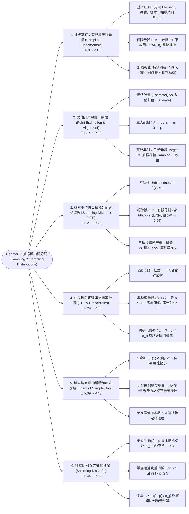

# Chapter 7: 抽樣與抽樣分配 (Sampling and Sampling Distributions)

> 📅 生成日期：2026-11-25  
> 📄 來源檔案：[Chapter 7.pdf](./../../Reference/NCU_Classes/統計學/上學期/Chapter%207.pdf)（全 53 頁 / P.1 ~ P.53） (Statistics for Business and Economics, 14e Metric Version)  
> 🎯 適用考試：中央大學統計學課程期末考核心考點精華教材  

---

## 🗺️ 知識架構總覽 (Tree Diagram)

### 🎯 本章學習進度檢核 (完成後打勾，建立成就反饋)

- [ ] [1. 抽樣基礎：有限與無限母體 (Sampling Fundamentals) 📄 (P.3 ~ P.13)](#sec-1)
- [ ] [2. 點估計與母體一致性 (Point Estimation & Alignment) 📄 (P.14 ~ P.20)](#sec-2)
- [ ] [3. 樣本平均數 $\bar{x}$ 抽樣分配與標準誤 (Sampling Dist. of $\bar{x}$ & SE) 📄 (P.21 ~ P.28)](#sec-3)
- [ ] [4. 中央極限定理與 $\bar{x}$ 機率計算 (CLT & Probabilities) 📄 (P.29 ~ P.38)](#sec-4)
- [ ] [5. 樣本數 $n$ 對抽樣精確度之影響 (Effect of Sample Size) 📄 (P.39 ~ P.43)](#sec-5)
- [ ] [6. 樣本比例 $\bar{p}$ 之抽樣分配 (Sampling Dist. of $\bar{p}$) 📄 (P.44 ~ P.53)](#sec-6)

---

## 📖 知識點教材

### 7.1 抽樣基礎：有限母體與無限母體 (Sampling Fundamentals: Finite vs. Infinite Populations) 📄 [P.3 ~ P.13]

> 📍 **講義對應範圍**：[Chapter 7.pdf](./../../Reference/NCU_Classes/統計學/上學期/Chapter%207.pdf) P.3 ~ P.13 (Slide 3 ~ 13)

#### 📌 核心概念

1. **抽樣五大基礎名詞**：
   * **元素（Element）**：資料蒐集的單一對象（如一位申請者、一筆訂單）。
   * **母體（Population）**：所有感興趣元素的完整集合。
   * **樣本（Sample）**：從母體中抽出的子集合，用來推論母體特徵。
   * **抽樣母體（Sampled Population）**：實際上從中進行抽樣的母體。
   * **抽樣清冊 / 框架（Frame）**：列出所有待抽元素的清單（如會員名冊、學號清單、庫存編號表）。
2. **有限母體（Finite Population）與簡單隨機抽樣（Simple Random Sample, SRS）**：
   * 有限母體有明確總數 $N$，通常可以建立完整的清冊（Frame）。
   * **簡單隨機樣本（SRS）定義**：從大小為 $N$ 的有限母體中抽取大小為 $n$ 的樣本，若**每一組可能的 $n$ 元樣本組合都有完全相同的被抽中機率**，則稱之為簡單隨機樣本。
   * **放回抽樣（Sampling with Replacement）**：每次抽完放回，同一元素可能重複出現；**不放回抽樣（Sampling without Replacement）**則是實務上最常用的方式。
   * **電腦亂數實作（講義 P.8~9）**：為 $N$ 個元素各自指派一組由 Excel `RAND()` 產生的 $U(0, 1)$ 均勻亂數，排序後選取亂數最小的 $n$ 個元素，即可自動化抽出無偏的簡單隨機樣本。
3. **無限母體（Infinite Population）的隨機抽樣**：
   * 許多母體是由**持續進行的流程（Ongoing Process）**所產生（如生產線零件、銀行櫃檯交易、客服來電、進店顧客），沒有數量上限，**無法建立清冊（Frame）**，也就無法套用有限母體的亂數表抽樣。
   * 因此，無限母體的隨機樣本必須滿足兩大條件（簡稱 **i.i.d. 條件**）：
     1. 每個被抽出的元素皆來自**同一個母體（Same Population）**。
     2. 每個元素都是**彼此獨立（Independently）**被抽出的。

#### 📐 關鍵公式 / 定理

* **有限母體不放回簡單隨機抽樣**：
  * 總共可組成 $\binom{N}{n}$ 種不同樣本，每組樣本被抽中的機率皆為 $\dfrac{1}{\binom{N}{n}}$。
* **無限母體隨機樣本兩大充要條件**：
  1. 同分佈（Identically Distributed）：所有樣本元素皆來自同一穩定製程或母體。
  2. 獨立性（Independent）：前一個元素的選取結果不影響下一個元素。

#### 💡 重要觀念提醒

| 比較維度 | 有限母體 (Finite Population) | 無限母體 (Infinite Population) |
|:---|:---|:---|
| **母體來源** | 明確可數集合（名單、帳戶清單、在校學生） | 持續產出流程（產線產品、每日交易、來電） |
| **抽樣清冊 (Frame)** | **可建立** | **無法建立** |
| **隨機抽樣定義** | 每組大小為 $n$ 的樣本被選中機率相等 | 每個元素來自**同一母體**且**獨立抽出** |
| **常用工具** | 亂數表、Excel `RAND()` 排序選取 | 穩定製程中隨機時點獨立觀測 |

> 🔗 **關聯**：Chapter 6 — [6.2 均勻機率分配](./Chapter_6_教材.md#sec-2)，電腦亂數 `RAND()` 生成器服從 $U(0, 1)$；Chapter 5 — [5.7 超幾何分配](./Chapter_5_教材.md#sec-7) 亦屬於有限母體不放回抽樣。

#### 📊 範例

**題目**：請判斷以下兩種情境屬於「有限母體」還是「無限母體」，並說明如何取得有效隨機樣本：  
(1) 某大學教務處想從本學期修讀統計學的 $450$ 名學生中抽出 $30$ 人訪談學習成效。  
(2) 某飲料裝瓶廠欲檢驗全自動充填產線的每瓶實際裝填量是否合乎標準。

**解析**：  
1. **有限母體**：修課名單明確固定（$N = 450$），可從選課系統建立完整清冊（Frame）。可對 $450$ 位學生以 `RAND()` 指派均勻亂數，排序後抽取前 $30$ 名組成簡單隨機樣本（不放回）。
2. **無限母體**：產線會不斷產出無上限的飲料瓶，無法事先列清冊。品管人員須確認產線處於穩定運作狀態（同一母體），並在隨機時間間隔**獨立**抽取 $n$ 瓶進行測量（避免只挑連續生產或異常時段的瓶子）。

#### ✏️ 練習題

**Q1.** 關於有限母體與無限母體抽樣的敘述，下列何者**正確**？ `[Medium]`  
(A) 任何母體（包含銀行每日持續湧入的交易紀錄）只要使用 Excel `RAND()` 都能先建立完整清冊（Frame）再抽樣。  
(B) 在有限母體中，「不放回抽樣」允許同一個體在同一次樣本中被重複選中。  
(C) 若要從無限母體（持續流程）抽出有效隨機樣本，只需確保樣本數夠大即可，不須考慮獨立性。  
(D) 無限母體隨機樣本必須同時滿足「每個元素來自同一母體」與「每個元素獨立被抽出」兩大條件。  

**Q2.** 【判斷題（True/False，需說明理由）】某餐廳經理為了調查顧客滿意度，站在門口只訪問「中午 12:00 到 12:15 連續走進來的前 20 位客人」（同桌朋友一起填寫）。請問這組資料是否滿足無限母體的隨機樣本條件？請從兩大條件逐一檢驗。 `[Medium]`

👉 [查看本節練習題答案與詳細解析](#ans-sec-1)

---

### 7.2 點估計與目標／抽樣母體一致性 (Point Estimation & Population Alignment) 📄 [P.14 ~ P.20]

> 📍 **講義對應範圍**：[Chapter 7.pdf](./../../Reference/NCU_Classes/統計學/上學期/Chapter%207.pdf) P.14 ~ P.20 (Slide 14 ~ 20)

#### 📌 核心概念

1. **點估計（Point Estimation）本質**：
   * 統計推論最基本的方法：利用樣本資料計算出單一數值（樣本統計量），作為未知**母體參數（Population Parameter）**的估計。
   * 必須區分兩個看似相似卻概念不同的名詞：
     * **點估計量（Point Estimator）**：用來計算估計值的**公式或隨機變數**（例如 $\bar{x}, s, \bar{p}$），在抽樣前其值尚未確定。
     * **點估計值（Point Estimate）**：實際抽完樣本並代入數據後算出的**具體數值**（例如 $\bar{x} = 1684$、$\bar{p} = 0.67$）。
2. **抽樣誤差（Sampling Error）的必然性**：
   * 因為樣本只包含母體的一部分，不同次隨機抽樣會抽到不同個體，產生的點估計值自然會與真實母體參數略有差異（如講義 P.19：$\bar{x}=1684$ vs. $\mu=1697$）。這不是計算錯誤，而是抽樣固有的隨機波動，也正是我們需要研究**抽樣分配（Sampling Distribution）**來量化精確度的原因。
3. **實務黃金準則：目標母體 vs. 抽樣母體（講義 P.20）**：
   * **目標母體（Target Population）**：研究者真正想下結論的對象群體。
   * **抽樣母體（Sampled Population）**：實際上用來抽樣的清冊群體。
   * 若兩者不一致（例如想推論「全台成年人投票意向」，卻只從「市內電話簿」抽樣，漏掉大量只用手機的年輕族群），即使樣本數再大、統計公式再精確，推論結果仍會產生嚴重的**覆蓋偏誤（Coverage / Frame Bias）**！

#### 📐 關鍵公式 / 定理

| 未知母體參數 (Population Parameter) | 對應點估計量 (Point Estimator) | 計算公式 |
|:---|:---|:---|
| 母體平均數 $\mu$ | 樣本平均數 $\bar{x}$ | $\bar{x} = \dfrac{\sum_{i=1}^n x_i}{n}$ |
| 母體標準差 $\sigma$ | 樣本標準差 $s$ | $s = \sqrt{\dfrac{\sum_{i=1}^n (x_i - \bar{x})^2}{n - 1}}$ |
| 母體比例 $p$ | 樣本比例 $\bar{p}$ *(他書亦記作 $\hat{p}$)* | $\bar{p} = \dfrac{x}{n}$ |

> 💡 **符號提醒**：本課程教科書（Anderson 14e）統一使用 **$\bar{p}$** 表示樣本比例（而非 $\hat{p}$），考試看題目符號務必認得兩者意義完全相同！

#### 💡 重要觀念提醒

* **估計量 vs. 估計值速辨**：題目若問「$\bar{x}$ 是 $\mu$ 的什麼？」，答 **Point Estimator（點估計量）**；若問「本次抽樣算出的 $68.5$ 分是什麼？」，答 **Point Estimate（點估計值）**。

> 🔗 **關聯**：Chapter 1 — [母體參數 vs. 樣本統計量](./Chapter_1_教材.md)，Chapter 3 — [樣本標準差除以 $n-1$](./Chapter_3_教材.md)。

#### 📊 範例

**題目**：某新創外送平台想了解「全台灣所有外送員的每月平均收入 $\mu$」以及「兼職外送員比例 $p$」。該平台隨機抽出 $200$ 名外送員，算得樣本平均月收為 $38,500$ 元，其中有 $124$ 人為兼職。  
(1) 請指出本題的點估計量與對應點估計值。  
(2) 若這 $200$ 名樣本全數僅從「台北市信義區高單價商圈」的外送員名單中抽出，會出現什麼統計推論問題？

**解析**：  
1. **點估計量與估計值**：
   * 母體平均數 $\mu$ 的點估計量為樣本平均數 $\bar{x}$，點估計值為 **$38,500$ 元**。
   * 母體比例 $p$ 的點估計量為樣本比例 $\bar{p}$，點估計值為 $\bar{p} = \frac{124}{200} = \mathbf{0.62}$（$62\%$）。
2. **母體不一致偏誤**：目標母體是「全台灣所有外送員」，但抽樣母體卻是「台北市信義區外送員」。高單價商圈的收入與專職比例顯著高於全國平均，將導致樣本估計嚴重高估全台灣平均月收，推論無效。

#### ✏️ 練習題

**Q3.** 在統計推論中，研究人員從 $2,000$ 位消費者中隨機抽出 $50$ 人，算得這 $50$ 人的平均消費金額為 $1,250$ 元，用來推估 $2,000$ 人的平均消費金額。在此情境下，下列名詞配對何者**正確**？ `[Easy]`  
(A) $1,250$ 元是「母體參數（Population Parameter）」。  
(B) $\bar{x}$ 是「點估計量（Point Estimator）」，而 $1,250$ 元是「點估計值（Point Estimate）」。  
(C) $\mu$ 是「樣本統計量（Sample Statistic）」。  
(D) 若重新獨立抽取另一組 $50$ 人，點估計值必定仍為 $1,250$ 元。  

**Q4.** 【情境分析簡答題】某知名雜誌社想調查「全國大學生對生成式 AI 付費訂閱的意願比例」，於是在該雜誌的「科技投資付費會員專屬電子報」中附帶線上問卷，並回收了 $5,000$ 份有效大學生問卷。請問此調查即便樣本數高達 $5,000$ 人，其推論仍存在什麼核心缺陷？請使用「目標母體（Target Population）」與「抽樣母體（Sampled Population）」概念說明。 `[Medium]`

👉 [查看本節練習題答案與詳細解析](#ans-sec-2)

---

### 7.3 樣本平均數 $\bar{x}$ 的抽樣分配、標準誤與有限母體校正 (Sampling Distribution of $\bar{x}$, Standard Error & FPC) 📄 [P.21 ~ P.28]

> 📍 **講義對應範圍**：[Chapter 7.pdf](./../../Reference/NCU_Classes/統計學/上學期/Chapter%207.pdf) P.21 ~ P.28 (Slide 21 ~ 28)

#### 📌 核心概念

1. **抽樣分配（Sampling Distribution of $\bar{x}$）的本質**：
   * 想像我們從同一個母體反覆獨立抽取**所有可能的大小為 $n$ 的樣本**，每一組樣本都會算出一個 $\bar{x}$。
   * 把這無數個可能的 $\bar{x}$ 收集起來所構成的機率分配，就稱為「**$\bar{x}$ 的抽樣分配**」。它讓我們能精確回答：「我這次抽出的 $\bar{x}$ 距離真實 $\mu$ 到底有多接近？」
2. **不偏性（Unbiasedness）**：
   * 所有可能樣本平均數的期望值，**嚴格等於真實母體平均數**：$E(\bar{x}) = \mu$。
   * 只要某個點估計量的期望值等於它要估計的母體參數，就稱該估計量為**不偏估計量（Unbiased Estimator）**（表示長期重複抽樣不會系統性高估或低估）。
3. **平均數標準誤（Standard Error of the Mean, $\sigma_{\bar{x}}$）與有限母體校正（FPC）**：
   * $\bar{x}$ 抽樣分配的標準差，在統計學上給予專有名稱：**標準誤（Standard Error）**，記作 $\sigma_{\bar{x}}$。
   * 當從**有限母體不放回抽樣**，且抽樣比率 $\frac{n}{N} > 0.05$（樣本佔母體超過 $5\%$）時，抽樣後母體剩餘資訊變少，估計會更精準，因此必須乘上**有限母體校正因子（Finite Population Correction Factor, FPC）** $\sqrt{\frac{N-n}{N-1}}$。
   * 若為無限母體，或有限母體滿足 **$\frac{n}{N} \le 0.05$**，FPC 非常接近 $1$，直接視為無限母體使用簡化公式 $\sigma_{\bar{x}} = \frac{\sigma}{\sqrt{n}}$！

#### 📐 關鍵公式 / 定理

* **期望值（不偏性）**：
  $$E(\bar{x}) = \mu$$
* **平均數標準誤（Standard Error of the Mean, $\sigma_{\bar{x}}$）**：
  * **有限母體（$\dfrac{n}{N} > 0.05$）**：
    $$\sigma_{\bar{x}} = \sqrt{\frac{N - n}{N - 1}} \left(\frac{\sigma}{\sqrt{n}}\right)$$
  * **無限母體，或有限母體且 $\dfrac{n}{N} \le 0.05$**：
    $$\sigma_{\bar{x}} = \frac{\sigma}{\sqrt{n}}$$
  * 其中 $\text{FPC} = \sqrt{\dfrac{N - n}{N - 1}}$（注意：第 5 章超幾何變異數的 FPC 沒有根號，這裡算的是**標準誤**所以有**根號**！）。

#### 💡 重要觀念提醒

##### 🔍 考試必殺辨析：三種標準差絕對不能混用！（講義 P.28 專頁強調）

| 符號 | 英文名稱 | 衡量的對象 | 計算與特性 |
|:---:|:---|:---|:---|
| **$\sigma$** | Population Standard Deviation | **母體個別觀察值 $x$** 的離散程度 | 固定常數（通常未知），不隨樣本數 $n$ 改變 |
| **$s$** | Sample Standard Deviation | **單一樣本內個別觀察值 $x_i$** 的離散程度 | 由單一樣本算出，作為 $\sigma$ 的點估計量 |
| **$\sigma_{\bar{x}}$** | **Standard Error of the Mean (標準誤)** | **樣本平均數 $\bar{x}$** 在重複抽樣間的波動程度 | $\frac{\sigma}{\sqrt{n}}$（或含 FPC），**必小於 $\sigma$**（當 $n > 1$），且隨 $n$ 增加而變小 |

> 🔗 **關聯**：Chapter 5 — [5.7 超幾何分配與 FPC](./Chapter_5_教材.md#sec-7)，同樣採用 $\frac{n}{N} \le 0.05$ 作為是否忽略有限母體校正的 $5\%$ 經驗門檻！

#### 📊 範例

**題目**：某中型科技公司共有 $N = 500$ 名工程師，全體年薪的平均數為 $\mu = 62,000$ 美元，標準差為 $\sigma = 8,000$ 美元。  
(1) 若人資部門隨機不放回抽出 $n = 20$ 名工程師，求 $E(\bar{x})$ 與標準誤 $\sigma_{\bar{x}}$。  
(2) 若改為抽出 $n = 64$ 名工程師，求 $E(\bar{x})$ 與標準誤 $\sigma_{\bar{x}}$。

**解析**：  
兩情境下不偏性皆成立：$E(\bar{x}) = \mu = 62,000$ 美元。  
1. **$n = 20$**：先檢查抽樣比率 $\frac{n}{N} = \frac{20}{500} = 0.04 \le 0.05$，視為無限母體，**不需** FPC：
   $$\sigma_{\bar{x}} = \frac{\sigma}{\sqrt{n}} = \frac{8,000}{\sqrt{20}} \approx 1,788.85 \text{ 美元}$$
2. **$n = 64$**：檢查抽樣比率 $\frac{n}{N} = \frac{64}{500} = 0.128 > 0.05$，**必須乘上 FPC**：
   $$\text{FPC} = \sqrt{\frac{500 - 64}{500 - 1}} = \sqrt{\frac{436}{499}} \approx 0.9347$$
   $$\sigma_{\bar{x}} = 0.9347 \times \left(\frac{8,000}{\sqrt{64}}\right) = 0.9347 \times 1,000 \approx 934.74 \text{ 美元}$$

#### ✏️ 練習題

**Q5.** 某物流倉庫共有 $N = 400$ 箱待檢貨品，已知母體每箱重量的標準差為 $\sigma = 24$ 公斤。若質檢員以不放回方式抽取 $n = 36$ 箱進行秤重，請問樣本平均重量 $\bar{x}$ 的標準誤 $\sigma_{\bar{x}}$ 約為多少公斤？ `[Medium]`  
(A) $4.0000$ 公斤  
(B) $3.8205$ 公斤  
(C) $3.6491$ 公斤  
(D) $0.6667$ 公斤  

**Q6.** 某研究團隊從一個無限母體（標準差 $\sigma = 30$）抽取隨機樣本。下列關於 $\sigma$ 與標準誤 $\sigma_{\bar{x}}$ 的敘述，何者**完全正確**？ `[Hard]`  
(A) 若樣本數從 $n = 25$ 增加到 $n = 50$，標準誤 $\sigma_{\bar{x}}$ 會剛好減半。  
(B) 若想讓 $n = 25$ 時的標準誤 $\sigma_{\bar{x}} = 6$ 縮減為原來的一半（即 $\sigma_{\bar{x}} = 3$），樣本數必須擴大為 $4$ 倍（$n = 100$）。  
(C) 只要樣本數 $n$ 持續增加，母體標準差 $\sigma$ 也會跟著趨近於 $0$。  
(D) 若在有限母體中抽樣比率 $\frac{n}{N} > 0.05$，加上有限母體校正因子（FPC）後會使標準誤變得更大。  

👉 [查看本節練習題答案與詳細解析](#ans-sec-3)

---

### 7.4 中央極限定理與 $\bar{x}$ 機率計算 (Central Limit Theorem & Probability Calculations for $\bar{x}$) 📄 [P.29 ~ P.38]

> 📍 **講義對應範圍**：[Chapter 7.pdf](./../../Reference/NCU_Classes/統計學/上學期/Chapter%207.pdf) P.29 ~ P.38 (Slide 29 ~ 38)

#### 📌 核心概念

1. **$\bar{x}$ 抽樣分配的「形狀」判定（兩大黃金規則）**：
   * **情境一（母體本身就是常態分配）**：無論樣本數 $n$ 多小（哪怕 $n = 2$ 或 $n = 5$），$\bar{x}$ 的抽樣分配**精確服從常態分配**。
   * **情境二（母體不是常態分配，或形狀未知）**：這就是統計學皇冠上的明珠——**中央極限定理（Central Limit Theorem, CLT）**！只要隨機樣本數 $n$ 足夠大，不論原始母體是均勻、指數、偏態還是雙峰分配，$\bar{x}$ 的抽樣分配都會自動收斂趨近於**常態分配**！
2. **大樣本門檻實務準則（講義 P.29 必背數字）**：
   * 一般非常態母體：**$n \ge 30$** 即可使用常態分配逼近 $\bar{x}$。
   * 若母體**高度偏態（Highly Skewed）或存在極端值（Outliers）**：通常需要 **$n \ge 50$** 才能獲得良好的常態逼近。
3. **$\bar{x}$ 機率計算的五步標準流程（講義 P.33~38）**：
   * Step 1：確認是否可用常態（母體常態 or 符合 CLT）。
   * Step 2：檢查 $\frac{n}{N}$ 決定標準誤 $\sigma_{\bar{x}}$（是否需 FPC）。
   * Step 3：將上下界標準化為 $z = \frac{\bar{x} - \mu}{\sigma_{\bar{x}}}$（⚠️ **分母一定是 $\sigma_{\bar{x}}$，絕不能直接除以 $\sigma$**！）。
   * Step 4：查標準常態表（Z-Table）求兩端點左尾面積。
   * Step 5：計算區間面積（上界左尾 $-$ 下界左尾）或單尾機率。

#### 📐 關鍵公式 / 定理

* **中央極限定理（CLT）數學表述**：
  $$\text{當 } n \text{ 足夠大時，}\quad \bar{x} \;\dot{\sim}\; N\left(\mu,\; \sigma_{\bar{x}}^2\right)$$
* **樣本平均數標準化公式**：
  $$z = \frac{\bar{x} - \mu}{\sigma_{\bar{x}}}$$
  * **為什麼這樣用**：有了這條公式，就能計算「樣本平均數 $\bar{x}$ 落在真實母體平均數 $\mu \pm E$ 誤差範圍內」的機率 $P(\mu - E \le \bar{x} \le \mu + E)$，評估這次抽樣有多可靠！

#### 💡 重要觀念提醒

| 問句特徵 | 目標隨機變數 | 標準化分母 | 幾何意涵 |
|:---|:---:|:---:|:---|
| 「隨機抽**一個**產品重量大於 $c$ 的機率」 | 單一觀察值 $X$ | **$\sigma$** | 原始母體分配（必須母體本身常態才能查 Z 表！） |
| 「隨機抽 **$n$ 個**產品的**平均**重量大於 $c$ 的機率」 | 樣本平均數 $\bar{x}$ | **$\sigma_{\bar{x}} = \frac{\sigma}{\sqrt{n}}$** (或含 FPC) | 抽樣分配（遠比母體窄，極端平均值更難出現！） |

> 🔗 **關聯**：Chapter 6 — [6.4 標準常態分配與 Z 表查詢](./Chapter_6_教材.md#sec-4)，本章所有機率計算皆高度依賴 Z 表操作熟練度。

#### 📊 範例

**題目**：某電商平台的單筆訂單消費金額呈**高度右偏**分配，已知母體平均數 $\mu = 1,500$ 元，母體標準差 $\sigma = 320$ 元。數據分析師從龐大交易流中隨機抽出 $n = 64$ 筆訂單。  
(1) 為何此處可以使用常態分配來近似 $\bar{x}$ 的機率？  
(2) 試求這 $64$ 筆訂單的平均消費金額 $\bar{x}$ 落在母體平均數 $\pm 60$ 元以內（即 $1,440$ 至 $1,560$ 元之間）的機率。（已知 $\Phi(1.50) = 0.9332$，$\Phi(-1.50) = 0.0668$）

**解析**：  
1. 雖然母體呈高度右偏，但樣本數 $n = 64 \ge 50$，依**中央極限定理（CLT）**，$\bar{x}$ 的抽樣分配可由常態分配良好近似。
2. 交易流為無限母體，計算標準誤：
   $$\sigma_{\bar{x}} = \frac{\sigma}{\sqrt{n}} = \frac{320}{\sqrt{64}} = \frac{320}{8} = 40 \text{ 元}$$
   標準化上下界：
   $$z_2 = \frac{1,560 - 1,500}{40} = +1.50, \qquad z_1 = \frac{1,440 - 1,500}{40} = -1.50$$
   查表求區間機率：
   $$P(1,440 \le \bar{x} \le 1,560) = \Phi(1.50) - \Phi(-1.50) = 0.9332 - 0.0668 = 0.8664 \quad (86.64\%)$$

#### ✏️ 練習題

**Q7.** 某餐飲外送平台在尖峰時段的單筆外送耗時並非非常對稱（非常態分配），已知母體平均時間 $\mu = 45$ 分鐘、母體標準差 $\sigma = 12$ 分鐘。若隨機抽出 $n = 36$ 筆訂單，請問這 $36$ 筆訂單的**平均**外送時間超過 $48$ 分鐘的機率約為何？（已知 $\Phi(1.50) = 0.9332$，$\Phi(0.25) = 0.5987$） `[Medium]`  
(A) $0.0668$  
(B) $0.4013$  
(C) $0.5987$  
(D) $0.9332$  

**Q8.** 【進階有限母體 CLT】某連鎖超商集團全台共有 $N = 600$ 家分店，已知所有分店單日鮮食平均銷售盒數為 $\mu = 80$ 盒，母體標準差 $\sigma = 15$ 盒。總部隨機不放回抽查 $n = 100$ 家分店，試求這 $100$ 家分店的樣本平均銷量落在真實母體均值 $\pm 2$ 盒以內的機率為何？（查表值：$\Phi(1.33) = 0.9082$，$\Phi(1.46) = 0.9279$） `[Hard]`  
(A) $0.8164$  
(B) $0.8558$  
(C) $0.9082$  
(D) $0.9279$  

**Q9.** 【單體 vs. 平均數對比大題】某工廠生產的鋰電池壽命服從常態分配，平均數 $\mu = 100$ 小時，標準差 $\sigma = 15$ 小時。試分別計算（參考值：$\Phi(0.40) = 0.6554$，$\Phi(2.00) = 0.9772$）：  
(1) 隨機抽取**單一顆**電池，其壽命超過 $106$ 小時的機率。  
(2) 隨機抽取 **$25$ 顆**電池，其**平均**壽命超過 $106$ 小時的機率。  
(3) 簡要說明為何第 (2) 小題的機率遠小於第 (1) 小題。 `[Hard]`

👉 [查看本節練習題答案與詳細解析](#ans-sec-4)

---

### 7.5 樣本數 $n$ 對抽樣精確度的影響 (Sample Size & Precision of $\bar{x}$) 📄 [P.39 ~ P.43]

> 📍 **講義對應範圍**：[Chapter 7.pdf](./../../Reference/NCU_Classes/統計學/上學期/Chapter%207.pdf) P.39 ~ P.43 (Slide 39 ~ 43)

#### 📌 核心概念

1. **增加樣本數 $n$ 的三大連鎖效應**：
   * **中心不變**：無論 $n$ 從 $30$ 變成 $100$ 還是 $1,000$，抽樣分配的期望值 $E(\bar{x}) = \mu$ 始終維持在同一個中心點。
   * **標準誤縮小**：$\sigma_{\bar{x}}$ 與 $\sqrt{n}$ 成反比（若在有限母體中超過 $5\%$，FPC 亦會進一步拉小 $\sigma_{\bar{x}}$）。
   * **精確度暴增**：由於 $\sigma_{\bar{x}}$ 變小，抽樣分配曲線在 $\mu$ 附近變得**更窄、更高聳**，因此 $\bar{x}$ 落在真實均值 $\pm E$ 誤差範圍內的機率大幅提升！
2. **平方根邊際遞減法則（$\sqrt{n}$ Law）**：
   * 要將抽樣標準誤**減半**（精確度提升 $2$ 倍），樣本數 $n$ 必須擴大為原來的 **$4$ 倍**（因為 $\sqrt{4} = 2$）！
   * 這是商管調研成本控制的核心觀念：想大幅壓縮誤差，需要付出平方倍的抽樣調查成本。
3. **有限母體的切換警覺（講義 P.40 實戰細節）**：
   * 在 St. Andrew's College 案例（$N = 900$）中：當 $n = 30$ 時，$\frac{30}{900} = 3.3\% \le 5\%$，不需 FPC；但當樣本擴大到 $n = 100$ 時，$\frac{100}{900} = 11.1\% > 5\%$，**必須立刻切換啟用 FPC**！

#### 📐 關鍵公式 / 定理

* **給定誤差上限 $E$ 與目標信心機率（對應雙尾臨界值 $z_{\alpha/2}$），反求無限母體最低樣本數 $n$**：
  $$P(\mu - E \le \bar{x} \le \mu + E) \ge 1 - \alpha \iff \frac{E}{\sigma / \sqrt{n}} \ge z_{\alpha/2} \iff n \ge \left(\frac{z_{\alpha/2} \cdot \sigma}{E}\right)^2$$
  * **為什麼這樣用**：在實地執行問卷或品管抽樣之前，管理者可先決定可容忍的誤差 $E$ 與達標機率（例如 $95\%$），直接算出最低需要花錢抽幾份樣本（遇小數必**無條件進位**）。

#### 💡 重要觀念提醒

* **視覺圖像對照（講義 P.41）**：把 $n=30$ 與 $n=100$ 的兩條 $\bar{x}$ 分配畫在同一個座標軸上——兩條曲線中心完全重疊在 $\mu$，但 **$n=100$ 的曲線明顯瘦高尖銳**，代表極端誤差幾乎被消滅。

> 🔗 **關聯**：Chapter 6 — [6.3 常態曲線 $\sigma$ 決定寬扁](./Chapter_6_教材.md#sec-3)，此處角色由 $\sigma_{\bar{x}}$ 擔綱。

#### 📊 範例

**題目**：某無限母體的平均數 $\mu = 500$、標準差 $\sigma = 60$。研究員想讓樣本平均數 $\bar{x}$ 落在真實平均數 $\pm 12$ 以內。請分別計算當 $n = 25$ 與 $n = 100$ 時的達標機率，觀察樣本數擴大 $4$ 倍的效果。（已知 $\Phi(1.00) = 0.8413$，$\Phi(2.00) = 0.9772$）

**解析**：  
1. **$n = 25$**：$\sigma_{\bar{x}} = \frac{60}{\sqrt{25}} = 12$。
   $$z = \pm\frac{12}{12} = \pm 1.00 \implies P(|\bar{x} - 500| \le 12) = 0.8413 - 0.1587 = 0.6826 \quad (68.26\%)$$
2. **$n = 100$**：$\sigma_{\bar{x}} = \frac{60}{\sqrt{100}} = 6$（標準誤精準減半！）。
   $$z = \pm\frac{12}{6} = \pm 2.00 \implies P(|\bar{x} - 500| \le 12) = 0.9772 - 0.0228 = 0.9544 \quad (95.44\%)$$
結論：樣本數擴大為 $4$ 倍後，估計落在 $\pm 12$ 誤差內的把握度從 $68.26\%$ 躍升至 $95.44\%$！

#### ✏️ 練習題

**Q10.** 當我們從同一無限母體中增加簡單隨機樣本的樣本數 $n$（從 $n = 36$ 增加至 $n = 144$）時，下列關於 $\bar{x}$ 抽樣分配的變化，何者**錯誤**？ `[Medium]`  
(A) 抽樣分配的中心期望值 $E(\bar{x})$ 保持不變。  
(B) 抽樣分配的標準誤 $\sigma_{\bar{x}}$ 縮小為原來的 $\frac{1}{2}$。  
(C) 抽樣分配的曲線峰值會變得更低且更寬平。  
(D) 樣本平均數 $\bar{x}$ 落在 $\mu \pm 5$ 誤差區間內的機率會提高。  

**Q11.** 【進階反求樣本數】某市場調查公司欲估計某消費族群的平均月支出 $\mu$（視為無限母體），依據歷史資料得知母體標準差 $\sigma = 40$ 美元。請問至少需要抽取多少份隨機樣本 $n$，才能確保樣本平均數 $\bar{x}$ 落在真實母體均值 $\pm 8$ 美元以內的機率**至少達 $95\%$**？（已知雙尾 $95\%$ 對應臨界值 $z_{0.025} = 1.96$） `[Hard]`  
(A) $96$ 份  
(B) $97$ 份  
(C) $49$ 份  
(D) $10$ 份  

👉 [查看本節練習題答案與詳細解析](#ans-sec-5)

---

### 7.6 樣本比例 $\bar{p}$ 的抽樣分配與常態逼近 (Sampling Distribution of Sample Proportion $\bar{p}$) 📄 [P.44 ~ P.53]

> 📍 **講義對應範圍**：[Chapter 7.pdf](./../../Reference/NCU_Classes/統計學/上學期/Chapter%207.pdf) P.44 ~ P.53 (Slide 44 ~ 53)

#### 📌 核心概念

1. **樣本比例 $\bar{p}$ 的定義與不偏性**：
   * 當關注對象屬於「二元類別特徵」（例如支持/反對、良品/不良品、想住宿舍/不想住）時，樣本比例 $\bar{p} = \frac{x}{n}$ 就是母體比例 $p$ 的點估計量。
   * 所有可能樣本的 $\bar{p}$ 所構成之機率分配，稱為 **$\bar{p}$ 的抽樣分配**，且其期望值滿足不偏性：**$E(\bar{p}) = p$**。
2. **比例標準誤（Standard Error of the Proportion, $\sigma_{\bar{p}}$）**：
   * 背後原理來自第 5 章二項分配：$X \sim \text{Binomial}(n, p) \implies \text{Var}(X) = np(1-p)$，因此 $\text{Var}(\bar{p}) = \text{Var}(\frac{X}{n}) = \frac{1}{n^2} np(1-p) = \frac{p(1-p)}{n}$，開根號即得無限母體標準誤 $\sqrt{\frac{p(1-p)}{n}}$！
   * 若為有限母體且 $\frac{n}{N} > 0.05$，同樣必須乘上有限母體校正因子 $\sqrt{\frac{N-n}{N-1}}$。
3. **$\bar{p}$ 的常態逼近雙重門檻（講義 P.47 超高頻必考條件）**：
   * 因為 $\bar{p}$ 本質上是離散計數除以 $n$，要使用常態分配（Z 表）近似計算 $\bar{p}$ 的機率，樣本數 $n$ **必須同時滿足兩個條件**：
     $$np \ge 5 \qquad \text{且} \qquad n(1 - p) \ge 5$$
   * **直覺理解**：這要求樣本中預期「成功次數」與「失敗次數」都至少有 $5$ 次！若 $p$ 極端靠近 $0$ 或 $1$（例如罕見疾病盛行率 $p = 0.02$），即使 $n = 100$，因 $np = 2 < 5$，分配仍嚴重右偏，**不可**用常態逼近（至少需 $n \ge 250$）！

#### 📐 關鍵公式 / 定理

* **期望值（不偏性）**：
  $$E(\bar{p}) = p$$
* **比例標準誤（Standard Error of the Proportion, $\sigma_{\bar{p}}$）**：
  * **有限母體（$\dfrac{n}{N} > 0.05$）**：
    $$\sigma_{\bar{p}} = \sqrt{\frac{N - n}{N - 1}} \sqrt{\frac{p(1 - p)}{n}}$$
  * **無限母體，或有限母體且 $\dfrac{n}{N} \le 0.05$**：
    $$\sigma_{\bar{p}} = \sqrt{\frac{p(1 - p)}{n}}$$
* **常態逼近條件與標準化**：
  $$\text{當 } np \ge 5 \text{ 且 } n(1-p) \ge 5 \text{ 時：}\quad z = \frac{\bar{p} - p}{\sigma_{\bar{p}}} \;\dot{\sim}\; N(0, 1)$$

#### 💡 重要觀念提醒

##### 📊 $\bar{x}$ 與 $\bar{p}$ 兩大抽樣分配核心公式對照表

| 項目 | 樣本平均數 $\bar{x}$ (Section 7.5) | 樣本比例 $\bar{p}$ (Section 7.6) |
|:---|:---|:---|
| **推論母體參數** | 母體平均數 $\mu$（數量資料） | 母體比例 $p$（二元類別資料） |
| **期望值（不偏性）** | $E(\bar{x}) = \mu$ | $E(\bar{p}) = p$ |
| **無限母體標準誤** | $\sigma_{\bar{x}} = \dfrac{\sigma}{\sqrt{n}}$ | $\sigma_{\bar{p}} = \sqrt{\dfrac{p(1 - p)}{n}}$ |
| **有限母體校正條件** | $\dfrac{n}{N} > 0.05$ 時乘上 $\sqrt{\dfrac{N - n}{N - 1}}$ | $\dfrac{n}{N} > 0.05$ 時乘上 $\sqrt{\dfrac{N - n}{N - 1}}$ |
| **常態逼近門檻** | 母體常態（任意 $n$）；非常態一般 $n \ge 30$（極偏 $n \ge 50$） | **$np \ge 5$ 且 $n(1 - p) \ge 5$** |
| **標準化 $z$ 值** | $z = \dfrac{\bar{x} - \mu}{\sigma_{\bar{x}}}$ | $z = \dfrac{\bar{p} - p}{\sigma_{\bar{p}}}$ |

> 🔗 **關聯**：Chapter 5 — [5.5 二項分配](./Chapter_5_教材.md#sec-5)，當 $p = 0.5$ 時 $p(1-p) = 0.25$ 達到最大值，故在相同樣本數 $n$ 下，$p = 0.5$ 時比例標準誤 $\sigma_{\bar{p}}$ 最大！

#### 📊 範例

**題目**：某連鎖健身房全國會員的滿意率為 $p = 0.60$（視為無限母體）。行銷部隨機訪問 $n = 100$ 位會員。  
(1) 檢驗 $\bar{p}$ 是否可使用常態分配逼近，並計算 $E(\bar{p})$ 與 $\sigma_{\bar{p}}$。  
(2) 求樣本滿意率 $\bar{p}$ 落在真實滿意率 $\pm 0.05$ 以內（即 $0.55$ 至 $0.65$ 之間）的機率。（已知 $\Phi(1.02) = 0.8461$，$\Phi(-1.02) = 0.1539$）

**解析**：  
1. **常態逼近檢驗**：
   $$np = 100(0.60) = 60 \ge 5, \qquad n(1 - p) = 100(0.40) = 40 \ge 5$$
   兩條件皆滿足，可用常態逼近！  
   期望值 $E(\bar{p}) = 0.60$；標準誤：
   $$\sigma_{\bar{p}} = \sqrt{\frac{0.60(1 - 0.60)}{100}} = \sqrt{0.0024} \approx 0.0490$$
2. **計算區間機率**：
   $$z_2 = \frac{0.65 - 0.60}{0.0490} \approx +1.02, \qquad z_1 = \frac{0.55 - 0.60}{0.0490} \approx -1.02$$
   $$P(0.55 \le \bar{p} \le 0.65) = \Phi(1.02) - \Phi(-1.02) = 0.8461 - 0.1539 = 0.6922 \quad (69.22\%)$$

#### ✏️ 練習題

**Q12.** 某網購平台歷史退貨率為 $p = 0.20$（視為無限母體）。品保部門本月隨機抽檢 $n = 400$ 筆訂單，請問這 $400$ 筆訂單的樣本退貨率 $\bar{p}$ 超過 $23\%$（即 $0.23$）的機率約為何？（已知 $\Phi(1.50) = 0.9332$，$\Phi(0.075) = 0.5299$） `[Medium]`  
(A) $0.0668$  
(B) $0.4701$  
(C) $0.5299$  
(D) $0.9332$  

**Q13.** 【有限母體 $\bar{p}$ 與門檻綜合題】某大學資管系與企管系本屆畢業生共計 $N = 500$ 人，已知真實有攻讀研究所意願的比例為 $p = 0.50$。職涯中心以不放回方式隨機抽訪 $n = 100$ 位畢業生：  
(1) 檢查常態逼近條件是否滿足，並判斷是否需使用有限母體校正因子（FPC），計算標準誤 $\sigma_{\bar{p}}$。  
(2) 求樣本比例 $\bar{p}$ 落在真實比例 $\pm 0.08$ 以內（即 $0.42$ 至 $0.58$ 之間）的機率。（參考查表值：$\Phi(1.60) = 0.9452$，$\Phi(1.79) = 0.9633$） `[Hard]`

👉 [查看本節練習題答案與詳細解析](#ans-sec-6)

---

## 🔑 本章練習題答案與詳細解析 (Answer Key)

### 第 7.1 節練習題解析

#### Q1 詳細解析

* **正確答案**：**(D)**
* **解題步驟與觀念**：
  * (A) 錯誤。持續進行的流程屬於無限母體，沒有上限，**無法建立清冊（Frame）**。
  * (B) 錯誤。只有「放回抽樣」才可能重複抽到同一個體；不放回抽樣每個元素最多出現一次。
  * (C) 錯誤。若不滿足獨立性（例如抽樣過程有系統性偏差或群聚效應），樣本再大也無效。
  * (D) **正確**。這是講義 P.13 定義無限母體隨機樣本的兩大核心條件。

[🔙 返回題目 Q1](#q1) ｜ [🔝 返回知識架構圖](#tree-diagram)

---

#### Q2 詳細解析

* **正確答案**：**False（不滿足）**
* **解題步驟與觀念**：
  1. **檢驗條件一（是否來自同一母體）**：中午 12:00~12:15 是尖峰上班族用餐時段，其候餐時間、點餐偏好與離峰或晚餐時段顧客截然不同，可能無法代表餐廳全體顧客母體。
  2. **檢驗條件二（是否獨立抽出）**：明確違反！同桌同行朋友的用餐體驗、餐點分享與對服務的評價高度互相影響，並非彼此獨立選取的樣本。
* **陷阱分析**：這屬於「便利抽樣（Convenience Sampling）」，切勿誤以為「隨機站在門口等人走進來」就自動等同於統計學的隨機樣本。

[🔙 返回題目 Q2](#q2) ｜ [🔝 返回知識架構圖](#tree-diagram)

---

### 第 7.2 節練習題解析

#### Q3 詳細解析

* **正確答案**：**(B)**
* **解題步驟與觀念**：
  * 樣本平均數公式 $\bar{x}$ 是用來估計 $\mu$ 的**點估計量（Point Estimator）**，實際算出的數值 $1,250$ 元則是**點估計值（Point Estimate）**。
  * (A) 錯：母體參數是未知的真實全體平均 $\mu$；(C) 錯：$\mu$ 是母體參數而非樣本統計量；(D) 錯：不同隨機樣本通常會產生不同的點估計值（抽樣變異）。

[🔙 返回題目 Q3](#q3) ｜ [🔝 返回知識架構圖](#tree-diagram)

---

#### Q4 詳細解析

* **正確答案**：**目標母體與抽樣母體嚴重不一致（覆蓋偏誤 / 自願者選擇偏誤）**
* **解題步驟與觀念**：
  1. **目標母體（Target Population）**：「全國所有大學生」。
  2. **抽樣母體（Sampled Population）**：「訂閱科技投資付費電子報且願意填答的大學生」。
  3. **核心缺陷**：會花錢訂閱科技投資電子報的大學生，本來就對科技工具高度關注且具付費習慣，這會導致調查出的 AI 付費意願比例**嚴重高估**全國大學生真實狀況。在抽樣母體偏離目標母體時，**增加樣本數（就算到 $5,000$ 人）完全無法消除系統性偏誤**！

[🔙 返回題目 Q4](#q4) ｜ [🔝 返回知識架構圖](#tree-diagram)

---

### 第 7.3 節練習題解析

#### Q5 詳細解析

* **正確答案**：**(B)**
* **解題步驟與觀念**：
  1. 先檢查抽樣比率：$\frac{n}{N} = \frac{36}{400} = 0.09 > 0.05$，**必須使用有限母體校正因子（FPC）**！
  2. 計算 FPC（切記要開根號，且分母為 $N - 1 = 399$）：
     $$\text{FPC} = \sqrt{\frac{400 - 36}{400 - 1}} = \sqrt{\frac{364}{399}} \approx 0.9551$$
  3. 計算標準誤：
     $$\sigma_{\bar{x}} = 0.9551 \times \frac{24}{\sqrt{36}} = 0.9551 \times 4 \approx 3.8205 \text{ 公斤}$$
* **陷阱分析**：
  * 忘記檢查 $5\%$ 門檻而漏乘 FPC，會算出 $\frac{24}{6} = 4.0000$（誤選 A）。
  * 忘記給 FPC 開根號（直接用 $\frac{364}{399} \times 4 = 3.6491$，誤選 C）。
  * 忘記給 $n = 36$ 開根號（直接算 $\frac{24}{36} = 0.6667$，誤選 D）。

[🔙 返回題目 Q5](#q5) ｜ [🔝 返回知識架構圖](#tree-diagram)

---

#### Q6 詳細解析

* **正確答案**：**(B)**
* **解題步驟與觀念**：
  * (A) 錯誤。標準誤與 $\sqrt{n}$ 成反比，樣本加倍僅縮小為原來的 $\frac{1}{\sqrt{2}} \approx 0.707$ 倍，不會減半。
  * (B) **正確**。$n=25$ 時 $\sigma_{\bar{x}} = \frac{30}{5} = 6$；要使 $\frac{30}{\sqrt{n}} = 3 \implies \sqrt{n} = 10 \implies n = 100$（原來的 $4$ 倍）。
  * (C) 錯誤。母體標準差 $\sigma$ 是母體固有常數，絕不因樣本數 $n$ 改變而縮小；縮小的是**標準誤 $\sigma_{\bar{x}}$**。
  * (D) 錯誤。因 $n > 1$，恆有 $\frac{N-n}{N-1} < 1$，故乘上 FPC 只會讓標準誤**更小**（估計更精準）。

[🔙 返回題目 Q6](#q6) ｜ [🔝 返回知識架構圖](#tree-diagram)

---

### 第 7.4 節練習題解析

#### Q7 詳細解析

* **正確答案**：**(A)**
* **解題步驟與觀念**：
  1. 雖然母體非常態，但 $n = 36 \ge 30$，依中央極限定理（CLT）$\bar{x}$ 近似常態分配。
  2. 計算標準誤：$\sigma_{\bar{x}} = \frac{12}{\sqrt{36}} = 2$ 分鐘。
  3. 標準化並求右尾機率：
     $$z = \frac{48 - 45}{2} = 1.50 \implies P(\bar{x} > 48) = 1 - \Phi(1.50) = 1 - 0.9332 = 0.0668$$
* **陷阱分析**：忘記除以 $\sqrt{36}$，直接拿母體標準差 $12$ 去算 $z = \frac{3}{12} = 0.25$（得出 $1 - 0.5987 = 0.4013$，誤選 B）；或忘記用 $1$ 減去左尾面積（誤選 D）。

[🔙 返回題目 Q7](#q7) ｜ [🔝 返回知識架構圖](#tree-diagram)

---

#### Q8 詳細解析

* **正確答案**：**(B)**
* **解題步驟與觀念**：
  1. 檢查抽樣比率：$\frac{n}{N} = \frac{100}{600} \approx 0.1667 > 0.05$，**必須使用 FPC**！
  2. 計算標準誤：
     $$\text{FPC} = \sqrt{\frac{600 - 100}{600 - 1}} = \sqrt{\frac{500}{599}} \approx 0.9136$$
     $$\sigma_{\bar{x}} = 0.9136 \times \frac{15}{\sqrt{100}} = 0.9136 \times 1.5 \approx 1.3704$$
  3. 計算誤差 $\pm 2$ 盒對應的 $z$ 值與雙側區間機率：
     $$z = \pm \frac{2}{1.3704} \approx \pm 1.46$$
     $$P(78 \le \bar{x} \le 82) = \Phi(1.46) - \Phi(-1.46) = 0.9279 - (1 - 0.9279) = 0.9279 - 0.0721 = 0.8558$$
* **陷阱分析**：若忘記乘上 FPC，會算出 $\sigma_{\bar{x}} = 1.5 \implies z = \pm 1.33 \implies 0.9082 - 0.0918 = 0.8164$（誤選 A），這是最經典的有限母體大考陷阱！

[🔙 返回題目 Q8](#q8) ｜ [🔝 返回知識架構圖](#tree-diagram)

---

#### Q9 詳細解析

* **正確答案**：**(1) $0.3446$；(2) $0.0228$；(3) 平均數會抵銷個別極端誤差，使 $\sigma_{\bar{x}}$ 大幅縮小**
* **解題步驟與觀念**：
  1. **單一顆電池（$X \sim N(100, 15^2)$）**：
     $$z = \frac{106 - 100}{15} = 0.40 \implies P(X > 106) = 1 - \Phi(0.40) = 1 - 0.6554 = 0.3446$$
  2. **$25$ 顆電池之平均壽命（$\bar{x} \sim N(100, 3^2)$）**：
     $$\sigma_{\bar{x}} = \frac{15}{\sqrt{25}} = 3 \implies z = \frac{106 - 100}{3} = 2.00 \implies P(\bar{x} > 106) = 1 - \Phi(2.00) = 1 - 0.9772 = 0.0228$$
  3. **統計直覺說明**：單一電池出現高於均值 $6$ 小時的波動（僅 $0.4$ 個標準差）十分尋常；但要讓 $25$ 顆隨機抽取的電池「平均起來」仍高出 $6$ 小時，在正負誤差相互抵銷下已高達 $2.0$ 個標準誤，因此機率從 $34.46\%$ 驟降至僅剩 $2.28\%$。

[🔙 返回題目 Q9](#q9) ｜ [🔝 返回知識架構圖](#tree-diagram)

---

### 第 7.5 節練習題解析

#### Q10 詳細解析

* **正確答案**：**(C)**
* **解題步驟與觀念**：
  * $n$ 從 $36$ 變成 $144$（擴大為 $4$ 倍）：
    * (A) 正確：$E(\bar{x}) = \mu$ 不受 $n$ 影響。
    * (B) 正確：$\frac{\sigma}{\sqrt{144}} = \frac{1}{2} \cdot \frac{\sigma}{\sqrt{36}}$。
    * (C) **錯誤**：標準誤變小，總面積恆為 $1$，曲線會變得**更窄且峰值更高**，絕非更低更寬平！
    * (D) 正確：曲線更集中於 $\mu$ 附近，落在固定誤差 $\pm 5$ 內的機率上升。

[🔙 返回題目 Q10](#q10) ｜ [🔝 返回知識架構圖](#tree-diagram)

---

#### Q11 詳細解析

* **正確答案**：**(B)**
* **解題步驟與觀念**：
  1. 要求 $P(|\bar{x} - \mu| \le 8) \ge 0.95 \iff z = \frac{8}{40 / \sqrt{n}} \ge 1.96$。
  2. 解不等式求 $n$：
     $$\frac{\sqrt{n}}{5} \ge 1.96 \implies \sqrt{n} \ge 9.8 \implies n \ge (9.8)^2 = 96.04$$
  3. 樣本數必須為整數且需滿足「**至少達 $95\%$**」，因此必須**無條件進位**至 **$n = 97$ 份**！
* **陷阱分析**：四捨五入取 $96$ 份（誤選 A），會使實際達標機率略低於 $95\%$；或忘記將 $9.8$ 平方（誤選 D）。

[🔙 返回題目 Q11](#q11) ｜ [🔝 返回知識架構圖](#tree-diagram)

---

### 第 7.6 節練習題解析

#### Q12 詳細解析

* **正確答案**：**(A)**
* **解題步驟與觀念**：
  1. 檢查常態逼近門檻：$np = 400(0.20) = 80 \ge 5$，$n(1-p) = 400(0.80) = 320 \ge 5$，完全滿足！
  2. 計算比例標準誤（無限母體）：
     $$\sigma_{\bar{p}} = \sqrt{\frac{0.20(1 - 0.20)}{400}} = \sqrt{\frac{0.16}{400}} = \frac{0.4}{20} = 0.02$$
  3. 標準化並求右尾機率：
     $$z = \frac{0.23 - 0.20}{0.02} = 1.50 \implies P(\bar{p} > 0.23) = 1 - \Phi(1.50) = 1 - 0.9332 = 0.0668$$
* **陷阱分析**：計算 $\sigma_{\bar{p}}$ 時忘記將分母 $400$ 放在根號內（或忘記開根號），會算出錯的 $z$ 值（誤選 B）。

[🔙 返回題目 Q12](#q12) ｜ [🔝 返回知識架構圖](#tree-diagram)

---

#### Q13 詳細解析

* **正確答案**：**(1) 滿足常態逼近，需用 FPC，$\sigma_{\bar{p}} \approx 0.0448$；(2) $0.9266$**
* **解題步驟與觀念**：
  1. **常態逼近與 FPC 檢驗**：
     * 常態逼近：$np = 100(0.50) = 50 \ge 5$ 且 $n(1-p) = 100(0.50) = 50 \ge 5 \implies$ **滿足**。
     * 有限母體比率：$\frac{n}{N} = \frac{100}{500} = 0.20 > 0.05 \implies$ **必須乘上 FPC**！
     * 計算標準誤：
       $$\text{FPC} = \sqrt{\frac{500 - 100}{500 - 1}} = \sqrt{\frac{400}{499}} \approx 0.8953$$
       $$\sigma_{\bar{p}} = 0.8953 \times \sqrt{\frac{0.50(0.50)}{100}} = 0.8953 \times 0.05 \approx 0.04477 \approx 0.0448$$
  2. **求區間機率 $P(0.42 \le \bar{p} \le 0.58)$**：
     $$z = \pm\frac{0.08}{0.04477} \approx \pm 1.79$$
     $$P(0.42 \le \bar{p} \le 0.58) = \Phi(1.79) - \Phi(-1.79) = 0.9633 - (1 - 0.9633) = 0.9633 - 0.0367 = 0.9266$$
* **陷阱分析**：漏乘 FPC 會算出 $\sigma_{\bar{p}} = 0.05 \implies z = \pm 1.60 \implies 0.8904$，低估了大比例抽樣所帶來的實際精確度！

[🔙 返回題目 Q13](#q13) ｜ [🔝 返回知識架構圖](#tree-diagram)

---

## 📋 本章重點速記表

| # | 觀念 / 定理 | 講義出處 | 核心公式 / 判別條件 | 必考重點提醒 |
|:--|:--|:---:|:---|:---|
| 1 | **無限母體隨機樣本** | P.10~13 | ① 同母體 ② 獨立抽出 | 無法建清冊（Frame），例：產線、銀行交易 |
| 2 | **點估計配對** | P.14~19 | $\bar{x} \to \mu,\; s \to \sigma,\; \bar{p} \to p$ | 區分 Estimator（公式）vs. Estimate（數值） |
| 3 | **母體一致性** | P.20 | Target Population $\approx$ Sampled Population | 不一致會造成偏誤，大樣本也救不回來 |
| 4 | **不偏性** | P.23, 45 | $E(\bar{x}) = \mu,\; E(\bar{p}) = p$ | 期望值等於母體參數即稱 Unbiased |
| 5 | **平均數標準誤** | P.26~27 | $\sigma_{\bar{x}} = \frac{\sigma}{\sqrt{n}}$；若 $\frac{n}{N}>0.05$ 乘 $\sqrt{\frac{N-n}{N-1}}$ | 必先檢驗 $5\%$ 門檻！區分 $\sigma, s, \sigma_{\bar{x}}$ |
| 6 | **中央極限定理 (CLT)** | P.29~30 | 常態母體任意 $n$；一般 $n \ge 30$；極偏 $n \ge 50$ | 使非常態母體的 $\bar{x}$ 亦能查 Z 表算機率 |
| 7 | **樣本數效應** | P.39~43 | $\sigma_{\bar{x}} \propto \frac{1}{\sqrt{n}}$ | 標準誤減半需 $4$ 倍樣本；$n$ 越大曲線越窄高 |
| 8 | **比例標準誤** | P.46 | $\sigma_{\bar{p}} = \sqrt{\frac{p(1-p)}{n}}$（$\frac{n}{N}>0.05$ 乘 FPC） | $p = 0.5$ 時變異與標準誤最大 |
| 9 | **比例常態逼近** | P.47, 49 | **$np \ge 5$ 且 $n(1 - p) \ge 5$** | 兩條件缺一不可！極端 $p$ 值需更大 $n$ |

---

## 🃏 考前速查卡片

| 正面 (問題) | 背面 (答案) |
|:---|:---|
| 有限母體抽樣時，什麼時候「需要」與「不需要」乘上有限母體校正因子（FPC）？ | 當抽樣比例 **$\frac{n}{N} > 0.05$** 時**必須**乘上 $\sqrt{\frac{N-n}{N-1}}$；若 $\frac{n}{N} \le 0.05$（不超過 $5\%$），可視為無限母體直接省略 FPC。 |
| 樣本數 $n$ 必須增加為原來的幾倍，才能讓標準誤 $\sigma_{\bar{x}}$ 縮減為原來的一半？ | **$4$ 倍**！因為 $\sigma_{\bar{x}} = \frac{\sigma}{\sqrt{n}}$，$\sqrt{4} = 2$。 |
| 非常態母體下，應用中央極限定理（CLT）的樣本數門檻為何？ | 一般情況下 **$n \ge 30$**；若母體**高度偏態或有極端值**，建議 **$n \ge 50$**。（若母體本身就是常態，則任意 $n$ 皆精確常態！） |
| 樣本比例 $\bar{p}$ 使用常態分配逼近的兩個必要條件是什麼？ | **$np \ge 5$ 且 $n(1 - p) \ge 5$**（預期成功與失敗次數皆須至少 $5$ 次）。 |
| $\sigma$、$s$、$\sigma_{\bar{x}}$ 三者有什麼區別？ | $\sigma$ 是母體個體標準差（常數）；$s$ 是單一樣本個體標準差；$\sigma_{\bar{x}}$ 是「樣本平均數 $\bar{x}$」抽樣波動的標準誤。 |

---

## ⚠️ 本章常見考試陷阱

1. **陷阱一：求 $\bar{x}$ 的機率時忘記除以 $\sqrt{n}$**
   * *常見錯誤*：題目問「$36$ 筆訂單的**平均**時間大於 $48$ 分鐘」，卻用 $z = \frac{48 - \mu}{\sigma}$ 計算。
   * *正確認知*：只要問的是**樣本平均數 $\bar{x}$**，標準化分母一律是**標準誤 $\sigma_{\bar{x}} = \frac{\sigma}{\sqrt{n}}$**！
2. **陷阱二：遺漏有限母體 $5\%$ 門檻檢驗或漏給 FPC 開根號**
   * *常見錯誤*：題目給了母體總數 $N = 600$、樣本 $n = 100$，卻直接套無限母體公式，或忘記給 $\frac{N-n}{N-1}$ 開根號。
   * *正確認知*：只要題目出現母體大小 $N$，第一步必算 $\frac{n}{N}$！超過 $0.05$ 就要乘上**帶根號的** $\sqrt{\frac{N-n}{N-1}}$。
3. **陷阱三：以為 $n \ge 30$ 就能對樣本比例 $\bar{p}$ 用常態逼近**
   * *常見錯誤*：見 $n = 30, p = 0.05$，以為 $n \ge 30$ 就能查 Z 表。
   * *正確認知*：$\bar{p}$ 的常態逼近條件是 **$np \ge 5$ 且 $n(1-p) \ge 5$**！此處 $np = 1.5 < 5$，**不適用**常態逼近！
4. **陷阱四：把 $n$ 變大時誤以為母體標準差 $\sigma$ 會變小**
   * *常見錯誤*：認為抽越多樣本，母體的離散程度 $\sigma$ 就會下降。
   * *正確認知*：母體標準差 $\sigma$ 是固定不變的客觀事實，會隨 $n$ 增加而縮小的是**抽樣分配標準誤 $\sigma_{\bar{x}}$**。
5. **陷阱五：反求樣本數時採四捨五入而非無條件進位**
   * *常見錯誤*：算出 $n \ge 96.04$ 後寫答 $96$。
   * *正確認知*：為確保誤差與機率門檻達標，樣本數**永遠無條件進位**（此處應為 $97$）。

---

## 📊 本章練習題統計

| 難度 | 題數 | 對應題號 |
|:-----|:---:|:---|
| Easy | 1 題 | Q3 |
| Medium | 7 題 | Q1, Q2, Q4, Q5, Q7, Q10, Q12 |
| Hard | 5 題 | Q6, Q8, Q9, Q11, Q13 |
| **合計** | **13 題** | **涵蓋 6 大核心模組（選擇、判斷、簡答、計算與綜合應用題）** |
