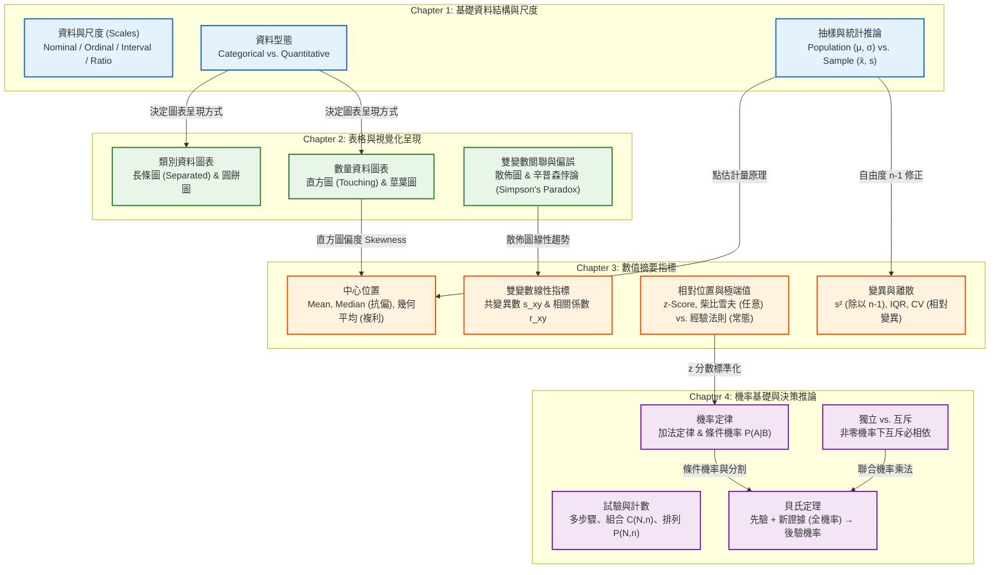

# 統計學 (上學期) — 期中考教材與複習總覽

> 📅 生成日期：2026-10-20  
> 📂 來源目錄：`./Reference/NCU_Classes/統計學/上學期/`  
> 📄 共處理 4 份核心章節投影片 (Anderson 14e Metric Version)  
> 🎯 目標：掌握核心概念、破除考試陷阱、衝刺期中考高分！  

---

## 📚 章節教材目錄

| 章節編號 | 章節主題 | 核心知識點數 | 練習題數 | 教材連結 |
|:---|:---|:---:|:---:|:---|
| **Chapter 1** | **資料與統計學 (Data and Statistics)** | 8 個 | 12 題 | [開啟 Chapter 1 教材](./Chapter_1_教材.md) |
| **Chapter 2** | **敘述統計：表格與圖形呈現 (Tabular and Graphical Displays)** | 8 個 | 11 題 | [開啟 Chapter 2 教材](./Chapter_2_教材.md) |
| **Chapter 3** | **敘述統計：數值衡量指標 (Numerical Measures)** | 7 個 | 11 題 | [開啟 Chapter 3 教材](./Chapter_3_教材.md) |
| **Chapter 4** | **機率論入門 (Introduction to Probability)** | 5 個 | 10 題 | [開啟 Chapter 4 教材](./Chapter_4_教材.md) |
| **總計** | **期中考四大模組** | **28 個考點** | **44 題 (含詳解)** | — |

---

## 🗺️ 跨章節知識關聯圖 (Cross-Chapter Knowledge Map)

---

## ⚡ 全科考前必背精華清單 (Top 15 Must-Know Concepts & Formulas)

考前 30 分鐘必讀！精準鎖定考卷得分點：

1. **測量尺度四層次 (Nominal $\rightarrow$ Ordinal $\rightarrow$ Interval $\rightarrow$ Ratio)**：
   - 攝氏/華氏溫度是 **Interval**（無絕對零點，不可算倍數比率）。
   - 價格、所得、長度、年齡是 **Ratio**（有絕對零點，比值有意義）。
   - 郵遞區號、學號、性別代碼是 **Nominal**（純標籤，不能比大小、不能算平均）。

2. **長條圖 vs. 直方圖的外觀特徵**：
   - 長條圖（Bar Chart）：適用類別資料，條形間**有空隙（Separated）**。
   - 直方圖（Histogram）：適用數量資料，矩形間**緊密相接（Touching/No gap）**。

3. **偏度（Skewness）與均值拉扯關係**：
   - 尾巴在右 $\rightarrow$ **右偏（正偏）**：$\text{Mode} < \text{Median} < \text{Mean}$（均值被極端大值往右拉）。
   - 尾巴在左 $\rightarrow$ **左偏（負偏）**：$\text{Mean} < \text{Median} < \text{Mode}$（均值被極端小值往左拉）。

4. **辛普森悖論 (Simpson's Paradox)**：
   - 分組資料皆勝，但加總合併（Aggregated）後結論**完全反轉**！原因出在存在未控制的**干擾變數（Confounding Variable）**或樣本權重失衡。

5. **中位數 (Median) 與四分位距 (IQR) 的抗變性 (Resistant)**：
   - 當資料有極端值（Outliers）或嚴重偏態時，描述中心與離散首選 **Median** 與 **IQR**，而非 Mean 與 Standard Deviation。

6. **幾何平均數 ($\bar{x}_g$) 專攻成長率與複利**：
   - $\bar{x}_g = \sqrt[n]{(1+r_1)(1+r_2)\cdots(1+r_n)}$。
   - 算術平均數在此情境下會嚴重**高估**真實成長率！

7. **樣本變異數分母除以 $n-1$**：
   - $s^2 = \frac{\sum (x_i - \bar{x})^2}{n - 1}$（自由度 Degrees of Freedom，提供母體變異數 $\sigma^2$ 之不偏估計量）。

8. **變異係數 (Coefficient of Variation, CV)**：
   - $CV = \frac{s}{\bar{x}} \times 100\%$。**無單位**，專門用於比較「單位不同」或「均值差距極大」之相對波動風險。

9. **柴比雪夫定理 vs. 經驗法則**：
   - **柴比雪夫（適用任意分配）**：距離均值 $z$ 個標準差內至少有 $1 - \frac{1}{z^2}$ 的資料（$z=2 \implies \ge 75\%$；$z=3 \implies \ge 89\%$）。
   - **經驗法則（僅適用鐘形常態分配）**：$1\sigma \approx 68\%$，$2\sigma \approx 95\%$，$3\sigma \approx 99.7\%$。

10. **盒鬚圖極端值判別界限**：
    - $\text{Lower Limit} = Q_1 - 1.5(IQR)$；$\text{Upper Limit} = Q_3 + 1.5(IQR)$。
    - 鬚線（Whiskers）只能延伸到界限內最外側的**真實資料點**，超出界限者標示為 $*$。

11. **皮爾森相關係數 ($r$) 僅測量「線性」**：
    - $-1 \le r \le +1$。$r=0$ 僅代表**無線性關係**，不代表兩變數沒有其他非線性關係！且「相關不等於因果」。

12. **排列 (Permutation) vs. 組合 (Combination)**：
    - 順序重要（選職位、排順序）$\rightarrow P_n^N = \frac{N!}{(N-n)!}$。
    - 順序無關（選成員、抽樣品）$\rightarrow \binom{N}{n} = \frac{N!}{n!(N-n)!}$。

13. **互斥 (Mutually Exclusive) 與獨立 (Independent) 的生死區隔**：
    - 若 $P(A) > 0, P(B) > 0$：**互斥事件必定相依，絕不可能獨立！**
    - 互斥：$P(A \cap B) = 0$。
    - 獨立：$P(A|B) = P(A)$ 且 $P(A \cap B) = P(A)P(B)$。

14. **條件機率與全機率法則**：
    - $P(A|B) = \frac{P(A \cap B)}{P(B)}$（分母為已發生條件事件）。
    - $P(B) = \sum_{i=1}^k P(A_i)P(B|A_i)$。

15. **貝氏定理 (Bayes' Theorem) 表格化解題法**：
    $$P(A_j|B) = \frac{P(A_j)P(B|A_j)}{\sum P(A_i)P(B|A_i)}$$
    - 利用「先驗 $\times$ 條件 $=$ 聯合 $\rightarrow$ 聯合相加得到全機率 $\rightarrow$ 聯合除以全機率得到後驗」的固定流程解題，穩拿滿分！

---

## 🚀 後續複習行動指引

教材已全數備妥，建議依照以下步調進行考前衝刺：

1. **快速閱讀**：花 30 分鐘依序瀏覽 [Chapter 1](./Chapter_1_教材.md) ~ [Chapter 4](./Chapter_4_教材.md) 的知識樹與重點速記表，確認概念清晰。
2. **實戰刷題**：遮住答案，親自練習每章教材中標註為 `[Medium]` 與 `[Hard]` 的練習題與考試陷阱題（特別是辛普森悖論、柴比雪夫計算、盒鬚圖界限與貝氏定理）。
3. **出題模擬考 (Mock Exam)**：隨時向我發送指令：「**幫我出一份統計學期中模擬考**」，我會觸發 `Mock Exam Generator` 嚴格按照考試標準組卷並產出附帶步驟的解答卷！
