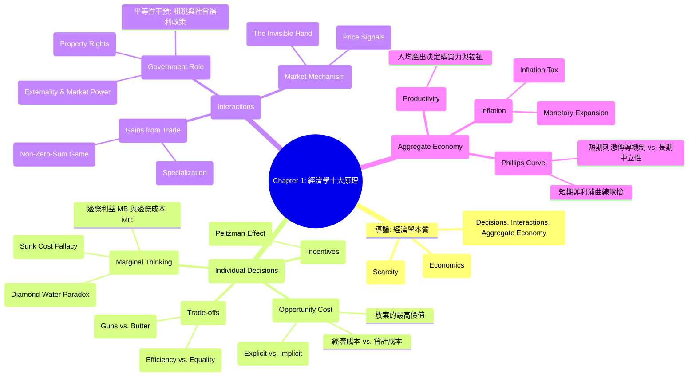

# Chapter 1: 經濟學十大原理 (Ten Principles of Economics)

> 📅 生成日期：2026-10-24
> 📄 來源檔案：[Reference/NCU_Classes/經濟學/CH1.pdf](file:///c:/Users/Cupid/Downloads/Study-space/Reference/NCU_Classes/經濟學/CH1.pdf)
> 🎯 適用考試：中央大學經濟學課程期中考、商管研究所/轉學考個體經濟學基礎

---

## 🗺️ 知識架構總覽 (Tree Diagram)

---

## 📖 知識點教材

### 1.0 導論：經濟學的本質與稀少性 (Nature and Scope of Economics)

#### 📌 核心概念

- **稀少性（Scarcity）**：社會所擁有的資源（自然資源、勞動力、資本財、時間）具有**有限性（limited nature）**，無法產出滿足人類無限慾望的所有物品與服務。
- **經濟學（Economics）**：研究**社會如何管理其稀少資源**的科學與藝術。主要探討：
  1. 人們如何做出決策（工作時數、儲蓄率、消費組合、教育投資）。
  2. 企業如何決定生產量與受僱員工人數。
  3. 社會如何在國防、民生消費品、環境保護與社會救助之間配置資源。

#### 📐 關鍵觀念與資源配置

經濟學的核心在於**資源配置（Resource Allocation）**。由於資源具有稀少性，任何生產行為都必然涉及分配：

- **生產什麼（What to produce）**：消費品 vs. 資本品？
- **如何生產（How to produce）**：勞力密集 vs. 資本密集？
- **為誰生產（For whom to produce）**：依支付能力分配（市場機制）vs. 依需求平均分配（政府計劃）？

#### 💡 重要觀念提醒

| 比較面向           | 稀少性 (Scarcity)                                          | 貧困 (Poverty)                                     |
| :----------------- | :--------------------------------------------------------- | :------------------------------------------------- |
| **本質**     | 普遍客觀存在（富裕社會與比爾蓋茲同樣面臨時間等資源稀少性） | 物質生活低於特定標準的狀態（可透過財富增長而消除） |
| **消除可能** | **不可消除**（慾望永遠大於有限資源）                 | **可消除**（透過經濟發展與所得重分配）       |

---

### 1.1 原理一：人們面臨權衡取捨 (Principle 1: People Face Trade-offs)

#### 📌 核心概念

> **「天下沒有白吃的午餐（There is no such thing as a free lunch.）」**

為了得到我們喜歡的一樣東西，通常必須放棄另一樣我們也喜歡的東西：

1. **個人層面**：
   - 考試前一晚去參加派對 $\to$ 放棄了複習時間與潛在高分。
   - 增加工作時數賺取更高收入 $\to$ 犧牲個人休閒與陪伴家人的時間。
2. **社會整體層面**：
   - **大砲與奶油（Guns vs. Butter）**：國家預算花費在國防（大砲）越多，能用於提升國民物質生活（奶油）的預算就越少。
   - **環境保護 vs. 物質產出**：要求工廠加裝防污設備改善公害（如台化彰化廠爭議），能換取乾淨空氣與健康，但代價是產品生產成本上升、利潤降低、甚至導致員工減薪或遷廠失業。

#### 📐 效率與平等的拉鋸（The Big Trade-off: Efficiency vs. Equality）

社會資源配置面臨最重要的權衡取捨：

- **效率（Efficiency）**：社會從其稀少資源中**獲取最大利益（The size of the economic pie）**。
- **平等（Equality）**：繁榮福祉在社會全體成員之間**均勻分配（How the pie is divided into slices）**。
- **拉鋸效應（Trade-off Mechanism）**：
  $$
  \text{政策推動平等（如高所得稅、全民健保、失業補助）} \implies \text{降低努力工作、投資與創新的邊際誘因} \implies \text{經濟大餅縮小（Efficiency 降低）}
  $$

#### 💡 重要觀念提醒

- **常見誤解**：以為保護環境必然「有害經濟」。
- **正確理解**：環境品質本身就是一種經濟福祉（Economic Welfare）。環境法規是社會在「更高的物質商品產出」與「更乾淨的生活環境」之間做出的**理性權衡取捨（Trade-off）**。

#### 📊 範例

**情境**：政府擬推動「基本工資調漲至 33,000 元」並對年所得超過千萬者課徵 50% 稅率以發放全民生活津貼。請分析此政策在效率與平等間的權衡取捨。**解析**：

1. **平等（Equality）層面**：提升底層勞工名目購買力，並縮減高低所得群體間的可支配所得差距，有助於促進均富。
2. **效率（Efficiency）層面**：
   - 過高的法定基本工資可能使邊際產值低於工資的邊緣勞工（如年輕工讀生、非技術勞工）遭到解僱，造成失業；
   - 50% 的高邊際稅率會抑制高生產力企業家與專業技術人員的加班、創業與投資誘因（縮減經濟大餅的規模）。

#### ✏️ 練習題

**Q1.** 下列何者最能精確說明經濟學中「效率（Efficiency）」與「平等（Equality）」的關係？ `[Medium]`
A. 追求效率必然會自動帶來平等，因為餅做大後每個人分到的絕對數量都增加
B. 政府透過累進稅率向富人課稅並補助窮人，通常能在不影響經濟大餅大小的前提下增進平等
C. 當政府試圖將經濟大餅切得更加均勻時，人們工作與生產的誘因常被削弱，可能導致整塊大餅縮小
D. 效率指的是財富在社會成員間的分配公平性，平等指的是資源利用的最大化

**Q2.** 假設某國政府面臨有限的財政收入，決定撥款 500 億元建造高鐵延伸線，這項決策最直接體現了哪一項經濟學原理？ `[Easy]`
A. 貨幣數量增加會導致物價膨脹
B. 理性人考慮邊際量
C. 人們面臨權衡取捨
D. 市場通常是組織經濟活動的良好方式

🔑 答案與解析

**Q1 答案：C**

- **解析**：效率指大餅的大小，平等指切餅的方式。所得重分配政策會改變工作與創新的誘因，因此追求平等的同時往往必須承擔縮小經濟大餅（犧牲效率）的代價。選項 A 忽略了分配不均的可能；B 忽視了重分配帶來的無謂損失與扭曲；D 將兩者定義完全顛倒。

**Q2 答案：C**

- **解析**：政府預算有限，將 500 億投入高鐵建設，就無法將這筆錢用於教育、國防或醫療保健，直接展現了「人們（政府）面臨權衡取捨」。

---

### 1.2 原理二：某物的成本是為了得到它所放棄的東西 (Principle 2: The Opportunity Cost)

#### 📌 核心概念

- **機會成本（Opportunity Cost）**：為了獲得某項事物所必須放棄的**所有其他選擇中，價值最高者（The highest-valued alternative forgone）**。
- 理性決策不是只看名目支付的金錢，必須比較所有可行替代方案的**完整成本（Total Economic Cost）**與收益。

#### 📐 關鍵公式：經濟成本 vs. 會計成本

$$
\text{經濟成本（Economic Cost / Opportunity Cost）} = \text{外顯成本（Explicit Costs）} + \text{隱含成本（Implicit Costs）}
$$

$$
\text{會計成本（Accounting Cost）} = \text{外顯成本（只有帳面上實際支出的現金費用）}
$$

1. **外顯成本（Explicit Costs）**：需要實際掏出錢包支付的費用（如學雜費、書籍費、住宿租金）。
2. **隱含成本（Implicit Costs）**：不涉及現金流出，但實際放棄的時間或自有資產價值（如讀大學期間放棄的全職工作薪資、自有店面若出租可得的租金）。

#### 💡 重要觀念提醒

> ⚠️ **就學的機會成本陷阱**：
> 「讀大學的住宿費與伙食費」**不完全**是讀大學的機會成本！因為即使不讀大學，人在社會上也必須吃飯和睡覺。只有**因讀大學而額外增加的住宿/伙食差額**，才算入機會成本；而**放棄的就業薪資（Foregone Earnings）**則是就學機會成本中最大宗的一筆！

- **名人案例剖析**：比爾蓋茲（Bill Gates）與祖克柏（Mark Zuckerberg）從哈佛休學、MLB 強投 Clayton Kershaw 放棄德州農工大學獎學金，並非因為他們不愛念書，而是因為他們留在校園的**機會成本過於巨大（數百萬乃至數十億美元的創業與職棒合約收入）**！

#### 📊 範例

**情境**：小明抽中某運動彩券獎金 10,000 元。他有兩個選擇：(A) 立刻花掉購買 iPhone 耳機；(B) 存入銀行一年，年利率為 5%。請問小明選擇立刻花掉這 10,000 元的機會成本是多少？**逐步推導**：

1. 若小明存入銀行一年，本利和為：
   $$
   \$10,000 \times (1 + 0.05) = \$10,500
   $$
2. 小明選擇現在花掉 10,000 元，他所放棄的最高替代方案是「一年後的 10,500 元購買力」。
3. **結論**：現在花掉 10,000 元的機會成本是**一年後的 10,500 元（或 10,000 元的本金加上 500 元的利息收入）**。

#### ✏️ 練習題

**Q1.** 某工程師辭去原本年薪 120 萬元的台積電職位，自行出資 200 萬元（原本存放銀行年利率 2%）開設獨立咖啡廳。第一年營運的店租、原料與人事支出總計 80 萬元，營業總收入為 210 萬元。請計算該工程師第一年的「會計利潤」與「經濟利潤」分別為何？ `[Hard]`
A. 會計利潤 130 萬元；經濟利潤 6 萬元
B. 會計利潤 130 萬元；經濟利潤 10 萬元
C. 會計利潤 210 萬元；經濟利潤 90 萬元
D. 會計利潤 90 萬元；經濟利潤 -34 萬元

**Q2.** 下列何者「不應」計入一位全職大學生四年間求學的經濟機會成本？ `[Medium]`
A. 四年期間為了購買教科書與專業軟體所支付的費用
B. 若四年間投入職場原本可領取的基本薪資所得
C. 四年間在校外租屋所支付的全部租金（假設即便不讀大學也需在同地租同等規格的房屋）
D. 四年繳交給學校的學雜費與學分費

🔑 答案與解析

**Q1 答案：A**

- **會計成本**（外顯成本）$= 80\text{ 萬元}$。
- **會計利潤** $= \text{總收益 } (210) - \text{外顯成本 } (80) = 130\text{ 萬元}$。
- **隱含成本** $= \text{放棄年薪 } (120) + \text{放棄的自有資金利息 } (200 \times 2\% = 4\text{ 萬元}) = 124\text{ 萬元}$。
- **經濟成本** $= 80 + 124 = 204\text{ 萬元}$。
- **經濟利潤** $= \text{總收益 } (210) - \text{經濟成本 } (204) = 6\text{ 萬元}$。故選 A。

**Q2 答案：C**

- **解析**：如果不管是否讀大學都必須在該地支付相同的房租，則該基礎房租屬於「維持生存無論如何都要發生的支出」，並非讀大學所「額外放棄」的代價，因此不屬於讀大學的機會成本（只有讀大學若造成房租比留在家鄉額外增加的差額，才算機會成本）。選項 A、B、D 都是因選擇讀大學而必須額外承擔的支出或放棄的收入。

---

### 1.3 原理三：理性人考慮邊際量 (Principle 3: Rational People Think at the Margin)

#### 📌 核心概念

- **理性人（Rational People）**：在給定可用機會與限制下，**系統性且有目的地（systematically and purposefully）**竭盡所能達成其目標的人。
- **邊際變動（Marginal Changes）**：對既定行動計畫所做的**微小增量調整（Incremental adjustments）**。
- **決策法則**：
  $$
  \text{當且僅當 } \text{邊際利益（Marginal Benefit, } MB) \ge \text{邊際成本（Marginal Cost, } MC) \text{ 時，採取該行動！}
  $$

#### 📐 核心理論：水與鑽石的矛盾（Diamond-Water Paradox）

- **古典謎題**：水是維繫生命的必需品，價格卻極為低廉；鑽石對生存毫無必要，價格卻極度昂貴。為什麼？
- **邊際分析解答**：物品的市場價格不是由「總效用/總利益（Total Utility）」決定，而是由**「邊際利益（Marginal Benefit, $MB$）」**決定！
  - 由於地球上的水極度豐沛，個人多喝一杯水的邊際利益 $MB_{\text{water}}$ 非常微小；
  - 鑽石極度稀少，個人多獲得一顆鑽石的邊際利益 $MB_{\text{diamond}}$ 卻極高。人們願意為邊際利益支付相對應的價格。

#### 📐 沉沒成本謬誤（Sunk Cost Fallacy）

- **沉沒成本（Sunk Cost）**：**過去已經發生、且無論現在或未來做何種決定都無法收回的成本**。
- **重要鐵律**：**沉沒成本不是邊際成本！在評估未來決策時，沉沒成本應該完全被忽略（Bygones are bygones）！**

#### 💡 重要觀念提醒

| 成本類型                    | 定義                                     | 是否計入後續邊際決策？                               |
| :-------------------------- | :--------------------------------------- | :--------------------------------------------------- |
| **邊際成本 ($MC$)** | 多生產或多執行一個單位所需額外增加的成本 | **是**（做決策的核心依據）                     |
| **平均成本 ($AC$)** | 總成本除以總產出                         | **否**（不可用平均成本作為單次追加決策的門檻） |
| **沉沒成本 ($SC$)** | 已經支出且不可收回的既成事實             | **否**（完全忽略，嚴禁計入！）                 |

#### 📊 範例（講義 Active Learning 1 改編）

**情境**：你打算賣掉你的二手車。你先前已經花費了 1,000 美元修理引擎。此時變速箱突然故障。你若花 900 美元修理變速箱，車子可以賣 7,500 美元；若不修理現況出售，只能賣 6,200 美元。請問你該花 900 美元修理變速箱嗎？**逐步解析**：

1. 先前花費的 1,000 美元屬於**沉沒成本（Sunk Cost）**，無論修不修變速箱都拿不回來，**完全忽略**。
2. 計算修理變速箱的邊際利益（$MB$）：
   $$
   MB = \$7,500 - \$6,200 = \$1,300
   $$
3. 修理變速箱的邊際成本（$MC$）：
   $$
   MC = \$900
   $$
4. 比較：
   $$
   MB (\$1,300) > MC (\$900) \implies \text{邊際淨收益 } = \$400 > 0
   $$
5. **決策結論**：應該花 900 美元修理變速箱再出售。

#### ✏️ 練習題

**Q1.** 某航空公司一架由台北飛往舊金山的班機共有 300 個座位，整趟航程的飛行與人事總成本固定為 300 萬元（平均每座位成本 10,000 元）。起飛前一小時，機上尚有 3 個空位，一位候補旅客願意出價 4,000 元購買機票。若機上供應餐點與額外行李油耗的邊際成本為 800 元，理性的航空公司經理應該如何決定？ `[Medium]`
A. 拒絕出售，因為出價 4,000 元遠低於平均成本 10,000 元，載運會造成 6,000 元虧損
B. 接受出價，因為邊際利益 4,000 元大於邊際成本 800 元，能使總利潤額外增加 3,200 元
C. 拒絕出售，因為這會破壞市場價格機制，導致所有乘客未來都要求 4,000 元購票
D. 接受出價，但必須向該旅客追收 6,000 元的沉沒成本補貼

**Q2.** 科技公司已投入 5,000 萬元研發某 AI 晶片，但尚未完成。競爭對手突然推出更強新品，業務主管預估該晶片研發完成後僅能帶來 3,000 萬元的預期營收。若再投入 1,200 萬元即可完成研發，這家公司最多願意再支付多少追加資金來完成這項專案？ `[Hard]`
A. 應立即放棄，因為總成本 6,200 萬遠大於預期營收 3,000 萬，已經淨虧損
B. 願意追加 1,200 萬完成，且最多願意支付不超過 3,000 萬元
C. 最多只願意再支付 500 萬元，使總投入不超過原預算
D. 最多願意再支付 1,800 萬元，因為預期營收與追加成本的差額是 1,800 萬

🔑 答案與解析

**Q1 答案：B**

- **解析**：起飛前飛機原本就要飛，300 萬的固定成本已經發生（沉沒）。此時多載一名乘客的邊際利益是客人的付費 $\$4,000$，邊際成本只有餐點與油耗 $\$800$。只要 $MB (\$4,000) > MC (\$800)$，就能為公司額外貢獻 $\$3,200$ 的營利，理性的經理人應予以接受。

**Q2 答案：B**

- **解析**：已投入的 5,000 萬是不可挽回的沉沒成本。未來的決策僅取決於「完成開發帶來的邊際利益」vs.「完成開發所需的邊際成本」。
  - 邊際利益 $MB = \$3,000\text{ 萬}$。
  - 目前追加成本為 1,200 萬，因 $MB (3,000) > MC (1,200)$，應繼續開發（可少虧損 1,800 萬）。
  - 公司「最多願意支付」的追加成本上限，就是邊際利益的臨界點，即 **3,000 萬元**。超過 3,000 萬則 $MB < MC$。

---

### 1.4 原理四：人們會對誘因做出反應 (Principle 4: People Respond to Incentives)

#### 📌 核心概念

- **誘因（Incentive）**：誘導、促使人們採取行動的事物（如懲罰的威脅或獎勵的承諾）。
- 由於理性人透過比較成本與利益來做決策，因此**當成本或利益改變時，人們的行為也必然會隨之改變**。
- **政策制定的核心**：制定公共政策時，若只看到直接效果而忽略了**政策改變了人們面對的誘因結構**，往往會產生出乎意料的**非預期後果（Unintended Consequences）**。

#### 📐 經典實例分析：佩茲曼效應（The Peltzman Effect / 安全帶法案）

1. **直接效果（Direct Effect）**：1960 年代美國通過立法強制新車加裝安全帶，直覺上車禍時駕駛存活率應大幅提升。
2. **誘因改變與行為反應（Incentive Reaction）**：
   - 安全帶降低了車禍時的傷亡風險 $\implies$ 相當於降低了開快車與粗心駕駛的「潛在成本」。
   - 理性駕駛的反應是：開得更快、更具攻擊性。
3. **最終結果**：每次車禍駕駛死亡率微幅下降，但**車禍發生總次數上升**，且**路人（行人與單車騎士）死亡率顯著增加**！

#### 💡 重要觀念提醒

- **福利改革（Welfare Reform 1996）**：若政府對貧困家庭提供無期限補助，會形成「工作反向誘因（work disincentive）」；1996 年美國改革將領取期限限制為兩年，藉由改變誘因結構大幅促使失業人口重回職場。

#### 📊 範例

**情境**：地方政府為了鼓勵民眾節能減碳，推出「公車與 YouBike 前 30 公里完全免費」政策。請運用原理四評估民眾行為與潛在外部效應。**解析**：

1. **搭乘成本下降**：公車與單車邊際貨幣成本降為 0，對市民形成正向搭乘誘因，有助於減少私人機車與汽車使用，緩解交通壅塞與碳排放。
2. **非預期後果與搭便車（Free-rider）**：
   - 邊際成本為 0 可能導致民眾短程（如 100 公尺）亦佔用單車，造成「車輛調度失衡」或長程通勤者無車可借；
   - 巨額補貼由納稅人負擔，可能需排擠其他市政建設預算（原理一：Trade-off）。

#### ✏️ 練習題

**Q1.** 經濟學家 Sam Peltzman 研究汽車安全法規時發現，強制要求安裝防鎖死煞車系統（ABS）與安全帶後，行人的死亡人數反而上升。下列哪一項經濟學邏輯最能合理解釋此現象？ `[Medium]`
A. 安全配備使駕駛面臨更高的邊際成本，因此他們決定減少開車
B. 安全配備降低了危險駕駛的預期代價，駕駛受此誘因改變而採取更冒險的駕駛方式
C. 汽車製造商為了轉嫁成本，故意降低行車視野以犧牲行人安全
D. 這完全是統計上的隨機偏差，與經濟學誘因無關

**Q2.** 政府為了降低青少年吸菸率，對香菸每包額外課徵 50 元的健康捐。根據原理四，下列何者最不可能發生？ `[Easy]`
A. 青少年香菸消費量顯著下滑，因為青少年可支配所得低、價格彈性大
B. 部分癮君子轉向地下黑市購買走私未稅香菸
C. 吸菸者為了完全吸取尼古丁，抽每一根菸時吸得更深、更接近濾嘴
D. 民眾對香菸的消費量完全不受任何影響，因為抽菸是一種成癮性習慣，完全不具誘因敏感性

🔑 答案與解析

**Q1 答案：B**

- **解析**：安全配備為駕駛提供了安全防護，降低了事故傷害的邊際成本。駕駛人在「追求速度與省時」的利益下，理性選擇增加行車速度與冒險程度，因而將外部風險轉嫁給沒有防護的行人。

**Q2 答案：D**

- **解析**：即使是成癮性商品，當價格大幅攀升時，人們依然會因成本增加而減少消費量（或轉移替代管道）。實證研究顯示香菸稅大幅降低了青少年吸菸率。主張「完全不受影響」違反了原理四的人類行為基本法則。

---

### 1.5 原理五：貿易能使每個人都獲益 (Principle 5: Trade Can Make Everyone Better Off)

#### 📌 核心概念

- 國家或個人之間的貿易競爭**不是運動比賽般的「零和博弈（Zero-Sum Game）」**（一人贏代表另一人必輸），而是**互利共贏（Mutually Beneficial）**的交換過程。
- **貿易的好處來源**：
  1. **專業化分工（Specialization）**：每個人或國家專注於自己最擅長生產的物品（基於比較利益）。
  2. **多樣性與低成本**：透過交換，所有人都能以比自己獨力生產**更低的代價**，享受**種類更豐富**的物品與服務。

#### 💡 重要觀念提醒

- **常識誤區**：許多人認為「美國與中國貿易，中國出口廉價商品會摧毀美國所有製造業，使美國人變窮」。
- **經濟學真相**：貿易確實會造成國內不同產業成員間的**所得分配變化**（進口替代產業受衝擊，出口導向產業與一般消費者獲益），但**全體社會的總福利與消費可能性邊界必定擴大**。

#### ✏️ 練習題

**Q1.** 下列關於「貿易使每個人都獲益」的敘述，何者最為正確？ `[Medium]`
A. 貿易代表著國與國之間的殘酷競賽，技術領先國必定在所有層面掠奪落後國的財富
B. 貿易之所以能創造雙贏，核心在於允許個人或國家依據自身優勢進行專業化分工，再透過市場交換
C. 貿易能保證社會中的「每一個個別成員」在任何貿易政策實施後都不受損害
D. 唯有在兩國生產力完全相同的情況下，貿易才具有互利效果

🔑 答案與解析

**Q1 答案：B**

- **解析**：貿易的核心力量來自專業化與分工（Specialization and Trade）。選項 C 是常見陷阱：貿易使國家「整體」福利增加，但內部特定受進口衝擊的產業從業人員可能受損（涉及分配問題），並非所有人皆無痛；選項 A 屬於重商主義零和謬誤；D 完全錯誤，生產力差異越大，比較利益與貿易利益往往越顯著。

---

### 1.6 原理六：市場通常是組織經濟活動的良好方式 (Principle 6: Markets Organize Economic Activity)

#### 📌 核心概念

- **市場經濟（Market Economy）**：資源的配置是由**眾多廠商與家計單位在商品與要素市場互動時的「分散決策（Decentralized Decisions）」**所決定，而非由政府中央計畫官員集中調控。
- **亞當斯密（Adam Smith, 《國富論》1776）與「看不見的手（The Invisible Hand）」**：
  - 家計單位與企業在市場中互動，每個人都出於**自私自利的動機（Self-interest）**追求個人利益最大化。
  - 但他們彷彿被一隻「看不見的手」所引導，最終促成了**全體社會經濟福祉的最大化**！

#### 📐 核心機制：價格體系（Price System as an Information Mechanism）

- **價格的雙重反映**：
  1. 反映了**買者對該商品的價值評價（Marginal Value to buyers）**。
  2. 反映了**社會生產該商品的真實成本（Marginal Cost of production）**。
- **政府價格管制的危害**：當政府實施價格管制（如價格上限 Price Ceilings、價格下限 Price Floors、共產中央計畫），人為扭曲或凍結了價格，使得看不見的手失去協調資源配置的訊號，必然導致**無效率（如排隊、短缺或過剩）**。

#### 💡 重要觀念提醒

- **自私 vs. 公益**：亞當斯密名言：「我們能吃上一頓豐盛的晚餐，不是出自屠夫、釀酒師或麵包師傅的仁慈善心，而是出自他們對自身利益的關照。」

#### ✏️ 練習題

**Q1.** 亞當斯密提出「看不見的手」引導市場參與者促進社會福祉，這隻看不見的手在市場經濟中最主要的執行工具或機制是什麼？ `[Easy]`
A. 政府法規與行政指導
B. 道德約束與宗教教義
C. 市場價格機能
D. 工會組織與勞資協商

🔑 答案與解析

**Q1 答案：C**

- **解析**：市場經濟透過「價格機制（Prices）」傳遞買賣雙方的稀少性與偏好資訊，引導資源流向價值最高的地方。

---

### 1.7 原理七：政府有時能改善市場結果 (Principle 7: Governments Can Sometimes Improve Market Outcomes)

#### 📌 核心概念

市場雖然偉大，但並非萬能。看不見的手需要政府提供兩大基石：

1. **保障產權（Enforce Property Rights）**：
   - 唯有政府維持司法、警察與法院制度，保障人們對稀少資源的控制與擁有權，市場機制才能運轉。
   - 例：若農夫辛勤耕作的稻米隨時會被掠奪，農夫便不會耕作；若餐廳客人可以隨意吃霸王餐賴帳，餐廳便無法營業；若缺乏專利法與版權保護，影業與軟體公司便不願投資巨資創作。
2. **矯正市場失靈（Market Failure）**與**促進社會平等（Promoting Equality）**。

#### 📐 市場失靈的兩大根源 (Sources of Market Failure)

- **市場失靈（Market Failure）**：市場自身無法在不受干預的情況下達到資源的最有效率配置。

| 市場失靈根源                      | 定義                                                             | 實例                                                             | 政府可採取的介入措施                                           |
| :-------------------------------- | :--------------------------------------------------------------- | :--------------------------------------------------------------- | :------------------------------------------------------------- |
| **外部性 (Externality)**    | 一個人的行為對旁觀者的福利造成了影響，卻未為此支付代價或獲得補償 | 工廠排放化學廢氣（負外部性）；研發科技溢出或接種疫苗（正外部性） | 課徵皮古稅（Pigovian Tax）、排放交易權配額、補貼疫苗與基礎研發 |
| **市場力量 (Market Power)** | 單一經濟個體（或少數群體）具有實質操控市場價格的能力             | 洛克菲勒標準石油（壟斷 90% 煉油廠）、獨家有線電視、水電公用事業  | 制定反托拉斯法（Antitrust Laws）、拆分托拉斯、管制自然獨占定價 |

#### 💡 重要觀念提醒

> ⚠️ **政策失誤風險**：
> 「政府*有時*能改善市場結果」並不代表「政府*總是*能改善市場結果」！公共政策往往由不完美的政治體系制定，可能受到利益團體遊說綁架，或因官員掌握的資訊不足而導致「政府失靈（Government Failure）」，甚至讓市場情況變得比干預前更糟。

#### 📊 範例（講義 Active Learning 2 改編）

**情境**：判斷下列政府行為主要是出於「促進效率（Efficiency）」還是「促進平等（Equality）」的考量？若是效率，指出其對應的市場失靈類型：

1. **對有線電視業者費率進行價格審查管制** $\to$ **效率**（防範獨占廠商的市場力量 Market Power 剝削消費者）。
2. **向低收入戶發放食物券或生活補貼** $\to$ **平等**（促進所得與生活水準的均勻分配）。
3. **法律全面禁止在公共室內場所與校園吸菸** $\to$ **效率**（解決二手菸害的負外部性 Negative Externality）。
4. **將擁有全美 90% 煉油設施的標準石油（Standard Oil）強制拆分為多家獨立公司** $\to$ **效率**（反托拉斯法打破壟斷市場力量）。
5. **對高所得者課徵 45% 的綜合所得稅累進稅率** $\to$ **平等**（富人移轉給窮人的所得重分配）。
6. **嚴厲取締酒後駕車並處以刑責** $\to$ **效率**（防範酒駕撞傷無辜用路人的致命負外部性）。

#### ✏️ 練習題

**Q1.** 下列各項政府政策與其「主要動機及經濟學失靈類型」的配對，何者最為正確？ `[Hard]`
A. 課徵工廠碳排放稅 $\to$ 促進平等；矯正貧富不均
B. 拆分電信托拉斯巨頭 $\to$ 促進效率；消除市場力量帶來的無效率
C. 推行低收入健保保費全額補助 $\to$ 促進效率；解決醫療專利權壟斷
D. 授權藥廠對新救命藥物享有 20 年專利獨佔銷售權 $\to$ 促進平等；保障病人用藥權利

**Q2.** 若某個小鎮唯一的深水井由單一地主擁有，地主對居民抽取極高的供水費用。此現象在經濟學中屬於何種市場失靈？ `[Easy]`
A. 正外部性（Positive Externality）
B. 負外部性（Negative Externality）
C. 市場力量（Market Power / Monopoly）
D. 產權不明確（Lack of Property Rights）

🔑 答案與解析

**Q1 答案：B**

- **解析**：拆分壟斷巨頭是為了解決「市場力量（Market Power）」造成的產量過低、定價過高的效率損失，屬於效率導向。選項 A 課徵碳稅是為了解決「負外部性（負面公害）」，非平等；C 健保補助是所得重分配，屬於「平等」；D 專利制度是為了提供研發誘因（解決研發成果容易被仿冒的正外部性/產權保障），代價是暫時賦予市場力量，非促進平等。

**Q2 答案：C**

- **解析**：單一賣方掌控全鎮唯一水源，能單方面決定市場供應量與過高價格，是典型的「市場力量（Market Power / 獨占）」。

---

### 1.8 原理八：一國的生活水準取決於其生產物品與服務的能力 (Principle 8: Productivity Determines Living Standards)

#### 📌 核心概念

- 各國生活水準（Living Standards）存在驚人落差：富裕國家的人均所得往往是貧窮國家的十倍以上。
- **決定生活水準的最核心根本原因**：**生產力（Productivity）**！
- **生產力定義**：每一單位勞動投入所能生產出的**物品與服務的數量（Output per unit of labor input）**。
- **政策意涵**：工會倡議、提高最低工資法規或防止外國競爭，對國民整體實質生活水準的長期影響，遠遠比不上**生產力的提升**。要提高國民生活水準，政策重點必須放在：
  - 提升勞工的受教育水準與技能培訓（人力資本 Human Capital）。
  - 提供更先進的工具設備（實體資本 Physical Capital）。
  - 投資最先進的生產技術（技術知識 Technological Knowledge）。

#### ✏️ 練習題

**Q1.** 總體經濟學中，用來解釋為什麼現代美國勞工的生活水準比一百年前高出約八倍的最主要原因是： `[Medium]`
A. 工會力量日益強大，為勞工爭取到更合理的工時與福利
B. 最低工資法令的不斷調升
C. 美國勞工的生產力隨著科技、教育與資本累積而大幅提升
D. 美國聯準會印製了足夠多的美鈔來支撐消費

🔑 答案與解析

**Q1 答案：C**

- **解析**：生產力是決定一國國民長期實質購買力與生活水準的根本源泉。工會與工資法令僅影響分配，無法憑空創造實質產出。

---

### 1.9 原理九：當政府印製過多貨幣時，物價上漲 (Principle 9: Excessive Money Causes Inflation)

#### 📌 核心概念

- **通貨膨脹（Inflation）**：經濟體系中**整體物價水準的普遍、持續性上升（Increase in the overall level of prices）**。
- **通膨的根本原因**：在長期中，通貨膨脹幾乎總是源自於**貨幣數量的過度增長（Excessive growth in the quantity of money）**！
  - 當政府創造出巨量貨幣時，每單位貨幣的實質購買價值必定下跌（錢變薄了）。
- **通貨膨脹稅（Inflation Tax）**：
  - 當政府面臨財政赤字或龐大戰爭開支（如美國獨立戰爭、1920 年代威瑪德國、近代辛巴威與委內瑞拉），無法透過課稅或發債籌資時，選擇直接開動印鈔機印鈔支應。
  - **印鈔等同於向全體持有現金與貨幣資產的民眾課稅**，因為物價飆漲掠奪了民眾口袋中貨幣的實質購買力！

#### ✏️ 練習題

**Q1.** 美國獨立戰爭期間，大陸會議無法徵收足夠稅收支應軍費，因而印製大量「大陸幣（Continentals）」，導致嚴重物價飆漲。歷史學家稱此舉是徵收了「通貨膨脹稅（Inflation Tax）」。請問此稅實際上是由誰負擔？ `[Medium]`
A. 僅由製造與運送武器的軍火商承擔
B. 所有持有大陸幣現金及依賴固定名目貨幣所得的民眾，因為其購買力遭到實質稀釋
C. 英國殖民統治者與英國國王
D. 大陸會議的議員個人財產

🔑 答案與解析

**Q1 答案：B**

- **解析**：印鈔創造了額外名目需求，推升物價，直接侵蝕了流通在外的每張現鈔的購買力。所有持有現金貨幣者手中資產價值縮水，如同被政府無形課徵了財產稅。

---

### 1.10 原理十：社會面臨通貨膨脹與失業之間的短期權衡取捨 (Principle 10: Short-run Trade-off between Inflation and Unemployment)

#### 📌 核心概念

雖然在長期中貨幣增長只會導致物價膨脹，但在**一至兩年的短期內（Short run）**，經濟政策對通膨與失業會產生**相反方向的推力**：

1. **短期的傳導鏈（Short-run Transmission Mechanism）**：

   $$
   \text{政府增加貨幣發行量} \implies \text{全體社會總支出與商品需求增加}
   $$

   $$
   \implies \text{物價上升（Inflation 增加）同時商品銷售熱絡}
   $$

   $$
   \implies \text{廠商擴大生產規模，增聘勞工（雇用增加）} \implies \text{失業率下降（Unemployment 降低）！}
   $$
2. **短期菲利浦曲線（Short-run Phillips Curve, SRPC）**：

   - 描繪短期內通貨膨脹率與失業率之間的負向替代關係。
   - 政策制定者面臨艱難抉擇：若利用貨幣或財政政策壓制通膨，短期內可能必須承受經濟趨緩與失業率上升的代價。
3. **長期與短期之本質差異**：

   - **短期**：貨幣非中立，存在菲利浦曲線權衡取捨。
   - **長期**：價格與工資充分調整，貨幣具有**中立性（Monetary Neutrality）**，失業率回歸自然失業率（Natural Rate of Unemployment），印鈔**只會帶來通膨，無法降低長期失業率**。

#### 💡 重要觀念提醒

| 比較維度                 | 短期（Short Run, 1~2 年）        | 長期（Long Run）                                           |
| :----------------------- | :------------------------------- | :--------------------------------------------------------- |
| **通膨與失業關係** | **存在權衡取捨（負相關）** | **無權衡取捨（垂直線）**                             |
| **印鈔效果**       | 刺激需求、降低失業、推升物價     | **僅推升物價水準**，失業率由生產力與勞動市場體質決定 |

#### ✏️ 練習題

**Q1.** 根據經濟學原理十，當中央銀行無預警地突然大幅增加貨幣供給量時，在未來一至兩年的「短期」內，總體經濟最可能出現下列哪種變化？ `[Medium]`
A. 通膨率上升，失業率亦同步大幅攀升
B. 通膨率下降，失業率下降
C. 通膨率上升，且伴隨著失業率的暫時性下降
D. 實質經濟產出與失業率完全不受任何影響，只有物價跳升

**Q2.** 下列何者最精確描述了「印鈔對就業的短期與長期效應之區別」？ `[Hard]`
A. 短期內物價僵固，增發貨幣推動總需求，促使廠商增聘勞工；長期工資物價全面調漲後，就業水準回到自然水準
B. 短期內印鈔只會引發停滯性通膨；長期則會使失業率永久性降低
C. 短期與長期的效應完全相同，貨幣在任何時間尺度下都不會改變就業情況
D. 短期內貨幣會直接轉化為實質生產設備，從而永久提高就業率

🔑 答案與解析

**Q1 答案：C**

- **解析**：短期內增加貨幣會刺激總需求，廠商為了滿足訂單會增聘工人，使失業率短期走低，但代價是通膨壓力上升（菲利浦曲線負相關）。故選 C。

**Q2 答案：A**

- **解析**：短期存在物價與名目工資僵固性（Sticky prices/wages），額外名目需求能驅動實質產出與聘僱；但長期當合約重新議定、物價預期調升後，經濟產出與失業率回歸實質基本面，印鈔無法永久解決失業問題。

---

## 📋 本章重點速記表

|      #      | 原理名稱                     | 核心一句話定義                       | 決策核心規則 / 關鍵關係式                                                      |
| :----------: | :--------------------------- | :----------------------------------- | :----------------------------------------------------------------------------- |
| **1** | **人們面臨權衡取捨**   | 慾望無窮但資源有限，為得其一必捨其一 | $\text{效率 (大餅大小)} \longleftrightarrow \text{平等 (分餅方式)}$          |
| **2** | **機會成本概念**       | 某物的代價是為獲取它所放棄的最高價值 | $\text{經濟成本} = \text{外顯成本 (掏錢)} + \text{隱含成本 (放棄工資/利息)}$ |
| **3** | **理性人考慮邊際量**   | 透過微小增量評估，沉沒成本絕不可計入 | 執行準則：$MB \ge MC$；忽略已發生的沉沒成本 ($SC$)                         |
| **4** | **人們對誘因做反應**   | 成本或效益改變時，人類行為必相應改變 | 警惕政策的「非預期後果」（如佩茲曼安全帶效應）                                 |
| **5** | **貿易使人人獲益**     | 貿易不是零和博弈，分工使總福祉擴大   | 透過「專業化分工（Specialization）」實現互利共贏                               |
| **6** | **市場通常組織良好**   | 分散決策的看不見的手引導資源最優配置 | 價格反映「買者願付價值」與「賣者生產成本」                                     |
| **7** | **政府有時改善結果**   | 保障產權是市場前提，並矯正市場失靈   | 矯正失靈（外部性、市場力量）與所得重分配                                       |
| **8** | **生活水準取決生產力** | 國民實質富裕程度源於勞動產出能力     | $\text{長期生活水準} \propto \text{生產力（每工時實質產出）}$                |
| **9** | **印鈔過多物價上漲**   | 長期通貨膨脹幾乎全因貨幣數量超額發行 | 貨幣超額增長$\implies$ 貨幣貶值 $\implies$ 通膨稅                          |
| **10** | **短期通膨失業取捨**   | 短期內印鈔刺激總需求，通膨升但失業降 | 短期菲利浦曲線存在 Trade-off；長期貨幣中立                                     |

---

## 🃏 考前速查卡片

| 正面 (問題)                                                         | 背面 (答案)                                                                                                                                                                          |
| :------------------------------------------------------------------ | :----------------------------------------------------------------------------------------------------------------------------------------------------------------------------------- |
| **什麼是「機會成本」？是否等同於會計帳面支出？**              | 機會成本是為了得到某物所必須放棄的「所有替代選項中價值最高者」。不等同於會計支出，它包含了**外顯成本（實際付現）**與**隱含成本（未付現但放棄的工資、自有資金利息等）**。 |
| **為什麼比爾蓋茲或祖克柏選擇從哈佛大學休學？**                | 因為他們繼續留在大學就讀的**機會成本極度巨大**（放棄了開創微軟與臉書數億乃至數十億美元的潛在價值與先機）。                                                                     |
| **在做邊際決策時，過去已投入的 100 萬元研發費用該如何處理？** | 視為**沉沒成本（Sunk Cost）**，在未來的邊際利益（$MB$）與邊際成本（$MC$）評估中**完全忽略**。                                                                        |
| **為什麼水是生存必需品但極度便宜，鑽石無關生存卻價值連城？**  | 價格是由**邊際利益（Marginal Benefit）**決定，而非總效用。地球上水極其豐沛，多喝一杯水的邊際利益極低；鑽石極度稀缺，多擁有一顆的邊際利益極高。                                       |
| **什麼是「佩茲曼效應（Peltzman Effect）」？**                 | 強制安全帶法規降低了事故傷亡的代價（邊際成本下降），誘使駕駛人以更危險的速度開車，導致行車事故次數與行人死亡率上升的**非預期後果**。                                           |
| **市場失靈（Market Failure）的兩大主要根源為何？**            | 1.**外部性（Externality）**：如工廠排污（負外部性）；2. **市場力量（Market Power）**：如獨占企業操控市場價格。                                                           |
| **提高一國國民長期生活水準的最根本手段是什麼？**              | **提高勞工的生產力（Productivity）**（透過改善教育訓練、提升資本設備與研發先進技術），而非單純印鈔或立法提高工資。                                                             |
| **印鈔票在短期與長期對失業率的影響有何根本不同？**            | **短期（1~2年）**：印鈔刺激總需求，失業率暫時下降（菲利浦曲線）；**長期**：工資物價全面調整，貨幣具中立性，失業率回到自然水準，只留下更高的物價膨脹。                    |

---

## ⚠️ 本章常見考試陷阱

1. **機會成本計算漏掉「隱含成本」**：
   - ❌ 誤區：計算自行創業的成本時，只扣掉店租與原料費。
   - ✅ 正確做法：必須加上「創業者原本在外上班放棄的薪水」以及「自有店面原本可收取的租金」或「自有資金存款利息」。
2. **沉沒成本的執念（捨不得停損）**：
   - ❌ 誤區：專案已花費 9,000 萬元，還需 2,000 萬才能完工，但完工後只能賣 1,500 萬。因為「不想讓前期的 9,000 萬泡湯」而堅持追加 2,000 萬。
   - ✅ 正確做法：已花費的 9,000 萬是沉沒成本，不予考慮。比較追加的 $MC (2,000\text{ 萬})$ 與預期收益 $MB (1,500\text{ 萬})$，因 $MB < MC$，應立即終止專案停損！
3. **混淆「平均成本」與「邊際成本」**：
   - ❌ 誤區：飛機每位乘客平均成本 10,000 元，因此起飛前空位出價 3,000 元不可接受。
   - ✅ 正確做法：起飛前的固定成本是沉沒的，只要乘客出價大於額外多載一人所需的**邊際成本（如餐費與行李油耗 500 元）**，就該接受。
4. **誤認「貿易使每個人都獲益」代表全體國民皆大歡喜**：
   - ❌ 誤區：自由貿易政策實施後，國內不會有任何受害者。
   - ✅ 正確做法：貿易使國家「整體」大餅擴大，但國內受進口競爭衝擊的傳統製造業勞工可能會失業減薪，產生嚴重的所得重分配問題。
5. **混淆「市場失靈」與「市場貧富不均」**：
   - ❌ 誤區：市場經濟產生貧富差距，所以是市場失靈。
   - ✅ 正確做法：市場失靈在經濟學上**專指「無效率（Efficiency failure）」**（如外部性、獨占）；而貧富差距屬於**「不平等（Inequality）」**，政府介入是為了平等而非矯正效率失靈。

---

## 📊 本章練習題統計

|       難度       |      題數      | 分布知識點                                                                                             |
| :--------------: | :-------------: | :----------------------------------------------------------------------------------------------------- |
|  **Easy**  |        4        | 原理一 (Q2)、原理四 (Q2)、原理六 (Q1)、原理七 (Q2)                                                     |
| **Medium** |        8        | 原理一 (Q1)、原理二 (Q2)、原理三 (Q1)、原理四 (Q1)、原理五 (Q1)、原理八 (Q1)、原理九 (Q1)、原理十 (Q1) |
|  **Hard**  |        3        | 原理二 (Q1)、原理三 (Q2)、原理七 (Q1)、原理十 (Q2)                                                     |
|  **合計**  | **15 題** | 完整覆蓋十大原理與導論核心觀念                                                                         |
