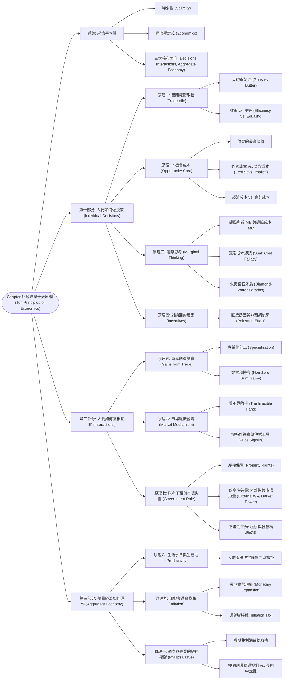

# Chapter 1: 經濟學十大原理 (Ten Principles of Economics)

> 📅 生成日期：2026-10-24  
> 📄 來源檔案：[Reference/NCU_Classes/經濟學/CH1.pdf](file:///c:/Users/Cupid/Downloads/Study-space/Reference/NCU_Classes/經濟學/CH1.pdf)  
> 🎯 適用考試：中央大學經濟學課程期中考、商管研究所/轉學考個體經濟學基礎  

---

## 🗺️ 知識架構總覽 (Tree Diagram)

### 🎯 本章學習進度檢核 (完成後打勾，建立成就反饋)

- [ ] [導論: 經濟學本質](#sec-1)
- [ ] [第一部分: 人們如何做決策 (Individual Decisions)](#sec-2)
- [ ] [第二部分: 人們如何互相互動 (Interactions)](#sec-3)
- [ ] [第三部分: 整體經濟如何運作 (Aggregate Economy)](#sec-4)

---

## 📖 知識點教材

### 1.0 導論：經濟學的本質與稀少性 (Nature and Scope of Economics)

#### 📌 核心概念

- **稀少性（Scarcity）**：社會所擁有的資源（自然資源、勞動力、資本財、時間）具有**有限性（limited nature）**，無法產出滿足人類無限慾望的所有物品與服務。
- **經濟學（Economics）**：研究**社會如何管理其稀少資源**的科學與藝術。主要探討：
  1. 人們如何做出決策（工作時數、儲蓄率、消費組合、教育投資）。
  2. 企業如何決定生產量與受僱員工人數。
  3. 社會如何在國防、民生消費品、環境保護與社會救助之間配置資源。

#### 📐 關鍵觀念與資源配置

經濟學的核心在於**資源配置（Resource Allocation）**。由於資源具有稀少性，任何生產行為都必然涉及分配：

- **生產什麼（What to produce）**：消費品 vs. 資本品？
- **如何生產（How to produce）**：勞力密集 vs. 資本密集？
- **為誰生產（For whom to produce）**：依支付能力分配（市場機制）vs. 依需求平均分配（政府計劃）？

#### 💡 重要觀念提醒

| 比較面向 | 稀少性 (Scarcity) | 貧困 (Poverty) |
| :--- | :--- | :--- |
| **本質** | 普遍客觀存在（富裕社會與比爾蓋茲同樣面臨時間等資源稀少性） | 物質生活低於特定標準的狀態（可透過財富增長而消除） |
| **消除可能** | **不可消除**（慾望永遠大於有限資源） | **可消除**（透過經濟發展與所得重分配） |

---

### 1.1 原理一：人們面臨權衡取捨 (Principle 1: People Face Trade-offs)

#### 📌 核心概念
>
> **「天下沒有白吃的午餐（There is no such thing as a free lunch.）」**

為了得到我們喜歡的一樣東西，通常必須放棄另一樣我們也喜歡的東西：

1. **個人層面**：
   - 考試前一晚去參加派對 $\to$ 放棄了複習時間與潛在高分。
   - 增加工作時數賺取更高收入 $\to$ 犧牲個人休閒與陪伴家人的時間。
2. **社會整體層面**：
   - **大砲與奶油（Guns vs. Butter）**：國家預算花費在國防（大砲）越多，能用於提升國民物質生活（奶油）的預算就越少。
   - **環境保護 vs. 物質產出**：要求工廠加裝防污設備改善公害（如台化彰化廠爭議），能換取乾淨空氣與健康，但代價是產品生產成本上升、利潤降低、甚至導致員工減薪或遷廠失業。

#### 📐 效率與平等的拉鋸（The Big Trade-off: Efficiency vs. Equality）

社會資源配置面臨最重要的權衡取捨：

- **效率（Efficiency）**：社會從其稀少資源中**獲取最大利益（The size of the economic pie）**。
- **平等（Equality）**：繁榮福祉在社會全體成員之間**均勻分配（How the pie is divided into slices）**。
- **拉鋸效應（Trade-off Mechanism）**：
  $$\text{政策推動平等（如高所得稅、全民健保、失業補助）} \implies \text{降低努力工作、投資與創新的邊際誘因} \implies \text{經濟大餅縮小（Efficiency 降低）}$$

#### 💡 重要觀念提醒

- **常見誤解**：以為保護環境必然「有害經濟」。
- **正確理解**：環境品質本身就是一種經濟福祉（Economic Welfare）。環境法規是社會在「更高的物質商品產出」與「更乾淨的生活環境」之間做出的**理性權衡取捨（Trade-off）**。

#### 📊 範例

**情境**：政府擬推動「基本工資調漲至 33,000 元」並對年所得超過千萬者課徵 50% 稅率以發放全民生活津貼。請分析此政策在效率與平等間的權衡取捨。  
**解析**：

1. **平等（Equality）層面**：提升底層勞工名目購買力，並縮減高低所得群體間的可支配所得差距，有助於促進均富。
2. **效率（Efficiency）層面**：
   - 過高的法定基本工資可能使邊際產值低於工資的邊緣勞工（如年輕工讀生、非技術勞工）遭到解僱，造成失業；
   - 50% 的高邊際稅率會抑制高生產力企業家與專業技術人員的加班、創業與投資誘因（縮減經濟大餅的規模）。

---

### 1.2 原理二：某物的成本是為了得到它所放棄的東西 (Principle 2: The Opportunity Cost)

#### 📌 核心概念

- **機會成本（Opportunity Cost）**：為了獲得某項事物所必須放棄的**所有其他選擇中，價值最高者（The highest-valued alternative forgone）**。
- 理性決策不是只看名目支付的金錢，必須比較所有可行替代方案的**完整成本（Total Economic Cost）**與收益。

#### 📐 關鍵公式：經濟成本 vs. 會計成本

$$\text{經濟成本（Economic Cost / Opportunity Cost）} = \text{外顯成本（Explicit Costs）} + \text{隱含成本（Implicit Costs）}$$
$$\text{會計成本（Accounting Cost）} = \text{外顯成本（只有帳面上實際支出的現金費用）}$$

1. **外顯成本（Explicit Costs）**：需要實際掏出錢包支付的費用（如學雜費、書籍費、住宿租金）。
2. **隱含成本（Implicit Costs）**：不涉及現金流出，但實際放棄的時間或自有資產價值（如讀大學期間放棄的全職工作薪資、自有店面若出租可得的租金）。

#### 💡 重要觀念提醒
>
> ⚠️ **就學的機會成本陷阱**：
> 「讀大學的住宿費與伙食費」**不完全**是讀大學的機會成本！因為即使不讀大學，人在社會上也必須吃飯和睡覺。只有**因讀大學而額外增加的住宿/伙食差額**，才算入機會成本；而**放棄的就業薪資（Foregone Earnings）**則是就學機會成本中最大宗的一筆！

- **名人案例剖析**：比爾蓋茲（Bill Gates）與祖克柏（Mark Zuckerberg）從哈佛休學、MLB 強投 Clayton Kershaw 放棄德州農工大學獎學金，並非因為他們不愛念書，而是因為他們留在校園的**機會成本過於巨大（數百萬乃至數十億美元的創業與職棒合約收入）**！

#### 📊 範例

**情境**：小明抽中某運動彩券獎金 10,000 元。他有兩個選擇：(A) 立刻花掉購買 iPhone 耳機；(B) 存入銀行一年，年利率為 5%。請問小明選擇立刻花掉這 10,000 元的機會成本是多少？  
**逐步推導**：

1. 若小明存入銀行一年，本利和為：
   $$\$10,000 \times (1 + 0.05) = \$10,500$$
2. 小明選擇現在花掉 10,000 元，他所放棄的最高替代方案是「一年後的 10,500 元購買力」。
3. **結論**：現在花掉 10,000 元的機會成本是**一年後的 10,500 元（或 10,000 元的本金加上 500 元的利息收入）**。

---

### 1.3 原理三：理性人考慮邊際量 (Principle 3: Rational People Think at the Margin)

#### 📌 核心概念

- **理性人（Rational People）**：在給定可用機會與限制下，**系統性且有目的地（systematically and purposefully）**竭盡所能達成其目標的人。
- **邊際變動（Marginal Changes）**：對既定行動計畫所做的**微小增量調整（Incremental adjustments）**。
- **決策法則**：
  $$\text{當且僅當 } \text{邊際利益（Marginal Benefit, } MB) \ge \text{邊際成本（Marginal Cost, } MC) \text{ 時，採取該行動！}$$

#### 📐 核心理論：水與鑽石的矛盾（Diamond-Water Paradox）

- **古典謎題**：水是維繫生命的必需品，價格卻極為低廉；鑽石對生存毫無必要，價格卻極度昂貴。為什麼？
- **邊際分析解答**：物品的市場價格不是由「總效用/總利益（Total Utility）」決定，而是由**「邊際利益（Marginal Benefit, $MB$）」**決定！
  - 由於地球上的水極度豐沛，個人多喝一杯水的邊際利益 $MB_{\text{water}}$ 非常微小；
  - 鑽石極度稀少，個人多獲得一顆鑽石的邊際利益 $MB_{\text{diamond}}$ 卻極高。人們願意為邊際利益支付相對應的價格。

#### 📐 沉沒成本謬誤（Sunk Cost Fallacy）

- **沉沒成本（Sunk Cost）**：**過去已經發生、且無論現在或未來做何種決定都無法收回的成本**。
- **重要鐵律**：**沉沒成本不是邊際成本！在評估未來決策時，沉沒成本應該完全被忽略（Bygones are bygones）！**

#### 💡 重要觀念提醒

| 成本類型 | 定義 | 是否計入後續邊際決策？ |
| :--- | :--- | :--- |
| **邊際成本 ($MC$)** | 多生產或多執行一個單位所需額外增加的成本 | **是**（做決策的核心依據） |
| **平均成本 ($AC$)** | 總成本除以總產出 | **否**（不可用平均成本作為單次追加決策的門檻） |
| **沉沒成本 ($SC$)** | 已經支出且不可收回的既成事實 | **否**（完全忽略，嚴禁計入！） |

#### 📊 範例（講義 Active Learning 1 改編）

**情境**：你打算賣掉你的二手車。你先前已經花費了 1,000 美元修理引擎。此時變速箱突然故障。你若花 900 美元修理變速箱，車子可以賣 7,500 美元；若不修理現況出售，只能賣 6,200 美元。請問你該花 900 美元修理變速箱嗎？  
**逐步解析**：

1. 先前花費的 1,000 美元屬於**沉沒成本（Sunk Cost）**，無論修不修變速箱都拿不回來，**完全忽略**。
2. 計算修理變速箱的邊際利益（$MB$）：
   $$MB = \$7,500 - \$6,200 = \$1,300$$
3. 修理變速箱的邊際成本（$MC$）：
   $$MC = \$900$$
4. 比較：
   $$MB (\$1,300) > MC (\$900) \implies \text{邊際淨收益 } = \$400 > 0$$
5. **決策結論**：應該花 900 美元修理變速箱再出售。

---

### 1.4 原理四：人們會對誘因做出反應 (Principle 4: People Respond to Incentives)

#### 📌 核心概念

- **誘因（Incentive）**：誘導、促使人們採取行動的事物（如懲罰的威脅或獎勵的承諾）。
- 由於理性人透過比較成本與利益來做決策，因此**當成本或利益改變時，人們的行為也必然會隨之改變**。
- **政策制定的核心**：制定公共政策時，若只看到直接效果而忽略了**政策改變了人們面對的誘因結構**，往往會產生出乎意料的**非預期後果（Unintended Consequences）**。

#### 📐 經典實例分析：佩茲曼效應（The Peltzman Effect / 安全帶法案）

1. **直接效果（Direct Effect）**：1960 年代美國通過立法強制新車加裝安全帶，直覺上車禍時駕駛存活率應大幅提升。
2. **誘因改變與行為反應（Incentive Reaction）**：
   - 安全帶降低了車禍時的傷亡風險 $\implies$ 相當於降低了開快車與粗心駕駛的「潛在成本」。
   - 理性駕駛的反應是：開得更快、更具攻擊性。
3. **最終結果**：每次車禍駕駛死亡率微幅下降，但**車禍發生總次數上升**，且**路人（行人與單車騎士）死亡率顯著增加**！

#### 💡 重要觀念提醒

- **福利改革（Welfare Reform 1996）**：若政府對貧困家庭提供無期限補助，會形成「工作反向誘因（work disincentive）」；1996 年美國改革將領取期限限制為兩年，藉由改變誘因結構大幅促使失業人口重回職場。

#### 📊 範例

**情境**：地方政府為了鼓勵民眾節能減碳，推出「公車與 YouBike 前 30 公里完全免費」政策。請運用原理四評估民眾行為與潛在外部效應。  
**解析**：

1. **搭乘成本下降**：公車與單車邊際貨幣成本降為 0，對市民形成正向搭乘誘因，有助於減少私人機車與汽車使用，緩解交通壅塞與碳排放。
2. **非預期後果與搭便車（Free-rider）**：
   - 邊際成本為 0 可能導致民眾短程（如 100 公尺）亦佔用單車，造成「車輛調度失衡」或長程通勤者無車可借；
   - 巨額補貼由納稅人負擔，可能需排擠其他市政建設預算（原理一：Trade-off）。

---

### 1.5 原理五：貿易能使每個人都獲益 (Principle 5: Trade Can Make Everyone Better Off)

#### 📌 核心概念

- 國家或個人之間的貿易競爭**不是運動比賽般的「零和博弈（Zero-Sum Game）」**（一人贏代表另一人必輸），而是**互利共贏（Mutually Beneficial）**的交換過程。
- **貿易的好處來源**：
  1. **專業化分工（Specialization）**：每個人或國家專注於自己最擅長生產的物品（基於比較利益）。
  2. **多樣性與低成本**：透過交換，所有人都能以比自己獨力生產**更低的代價**，享受**種類更豐富**的物品與服務。

#### 💡 重要觀念提醒

- **常識誤區**：許多人認為「美國與中國貿易，中國出口廉價商品會摧毀美國所有製造業，使美國人變窮」。
- **經濟學真相**：貿易確實會造成國內不同產業成員間的**所得分配變化**（進口替代產業受衝擊，出口導向產業與一般消費者獲益），但**全體社會的總福利與消費可能性邊界必定擴大**。

---

### 1.6 原理六：市場通常是組織經濟活動的良好方式 (Principle 6: Markets Organize Economic Activity)

#### 📌 核心概念

- **市場經濟（Market Economy）**：資源的配置是由**眾多廠商與家計單位在商品與要素市場互動時的「分散決策（Decentralized Decisions）」**所決定，而非由政府中央計畫官員集中調控。
- **亞當斯密（Adam Smith, 《國富論》1776）與「看不見的手（The Invisible Hand）」**：
  - 家計單位與企業在市場中互動，每個人都出於**自私自利的動機（Self-interest）**追求個人利益最大化。
  - 但他們彷彿被一隻「看不見的手」所引導，最終促成了**全體社會經濟福祉的最大化**！

#### 📐 核心機制：價格體系（Price System as an Information Mechanism）

- **價格的雙重反映**：
  1. 反映了**買者對該商品的價值評價（Marginal Value to buyers）**。
  2. 反映了**社會生產該商品的真實成本（Marginal Cost of production）**。
- **政府價格管制的危害**：當政府實施價格管制（如價格上限 Price Ceilings、價格下限 Price Floors、共產中央計畫），人為扭曲或凍結了價格，使得看不見的手失去協調資源配置的訊號，必然導致**無效率（如排隊、短缺或過剩）**。

#### 💡 重要觀念提醒

- **自私 vs. 公益**：亞當斯密名言：「我們能吃上一頓豐盛的晚餐，不是出自屠夫、釀酒師或麵包師傅的仁慈善心，而是出自他們對自身利益的關照。」

---

### 1.7 原理七：政府有時能改善市場結果 (Principle 7: Governments Can Sometimes Improve Market Outcomes)

#### 📌 核心概念

市場雖然偉大，但並非萬能。看不見的手需要政府提供兩大基石：

1. **保障產權（Enforce Property Rights）**：
   - 唯有政府維持司法、警察與法院制度，保障人們對稀少資源的控制與擁有權，市場機制才能運轉。
   - 例：若農夫辛勤耕作的稻米隨時會被掠奪，農夫便不會耕作；若餐廳客人可以隨意吃霸王餐賴帳，餐廳便無法營業；若缺乏專利法與版權保護，影業與軟體公司便不願投資巨資創作。
2. **矯正市場失靈（Market Failure）**與**促進社會平等（Promoting Equality）**。

#### 📐 市場失靈的兩大根源 (Sources of Market Failure)

- **市場失靈（Market Failure）**：市場自身無法在不受干預的情況下達到資源的最有效率配置。

| 市場失靈根源 | 定義 | 實例 | 政府可採取的介入措施 |
| :--- | :--- | :--- | :--- |
| **外部性 (Externality)** | 一個人的行為對旁觀者的福利造成了影響，卻未為此支付代價或獲得補償 | 工廠排放化學廢氣（負外部性）；研發科技溢出或接種疫苗（正外部性） | 課徵皮古稅（Pigovian Tax）、排放交易權配額、補貼疫苗與基礎研發 |
| **市場力量 (Market Power)** | 單一經濟個體（或少數群體）具有實質操控市場價格的能力 | 洛克菲勒標準石油（壟斷 90% 煉油廠）、獨家有線電視、水電公用事業 | 制定反托拉斯法（Antitrust Laws）、拆分托拉斯、管制自然獨占定價 |

#### 💡 重要觀念提醒
>
> ⚠️ **政策失誤風險**：
> 「政府*有時*能改善市場結果」並不代表「政府*總是*能改善市場結果」！公共政策往往由不完美的政治體系制定，可能受到利益團體遊說綁架，或因官員掌握的資訊不足而導致「政府失靈（Government Failure）」，甚至讓市場情況變得比干預前更糟。

#### 📊 範例（講義 Active Learning 2 改編）

**情境**：判斷下列政府行為主要是出於「促進效率（Efficiency）」還是「促進平等（Equality）」的考量？若是效率，指出其對應的市場失靈類型：  

1. **對有線電視業者費率進行價格審查管制** $\to$ **效率**（防範獨占廠商的市場力量 Market Power 剝削消費者）。  
2. **向低收入戶發放食物券或生活補貼** $\to$ **平等**（促進所得與生活水準的均勻分配）。  
3. **法律全面禁止在公共室內場所與校園吸菸** $\to$ **效率**（解決二手菸害的負外部性 Negative Externality）。  
4. **將擁有全美 90% 煉油設施的標準石油（Standard Oil）強制拆分為多家獨立公司** $\to$ **效率**（反托拉斯法打破壟斷市場力量）。  
5. **對高所得者課徵 45% 的綜合所得稅累進稅率** $\to$ **平等**（富人移轉給窮人的所得重分配）。  
6. **嚴厲取締酒後駕車並處以刑責** $\to$ **效率**（防範酒駕撞傷無辜用路人的致命負外部性）。

---

### 1.8 原理八：一國的生活水準取決於其生產物品與服務的能力 (Principle 8: Productivity Determines Living Standards)

#### 📌 核心概念

- 各國生活水準（Living Standards）存在驚人落差：富裕國家的人均所得往往是貧窮國家的十倍以上。
- **決定生活水準的最核心根本原因**：**生產力（Productivity）**！
- **生產力定義**：每一單位勞動投入所能生產出的**物品與服務的數量（Output per unit of labor input）**。
- **政策意涵**：工會倡議、提高最低工資法規或防止外國競爭，對國民整體實質生活水準的長期影響，遠遠比不上**生產力的提升**。要提高國民生活水準，政策重點必須放在：
  - 提升勞工的受教育水準與技能培訓（人力資本 Human Capital）。
  - 提供更先進的工具設備（實體資本 Physical Capital）。
  - 投資最先進的生產技術（技術知識 Technological Knowledge）。

---

### 1.9 原理九：當政府印製過多貨幣時，物價上漲 (Principle 9: Excessive Money Causes Inflation)

#### 📌 核心概念

- **通貨膨脹（Inflation）**：經濟體系中**整體物價水準的普遍、持續性上升（Increase in the overall level of prices）**。
- **通膨的根本原因**：在長期中，通貨膨脹幾乎總是源自於**貨幣數量的過度增長（Excessive growth in the quantity of money）**！
  - 當政府創造出巨量貨幣時，每單位貨幣的實質購買價值必定下跌（錢變薄了）。
- **通貨膨脹稅（Inflation Tax）**：
  - 當政府面臨財政赤字或龐大戰爭開支（如美國獨立戰爭、1920 年代威瑪德國、近代辛巴威與委內瑞拉），無法透過課稅或發債籌資時，選擇直接開動印鈔機印鈔支應。
  - **印鈔等同於向全體持有現金與貨幣資產的民眾課稅**，因為物價飆漲掠奪了民眾口袋中貨幣的實質購買力！

---

### 1.10 原理十：社會面臨通貨膨脹與失業之間的短期權衡取捨 (Principle 10: Short-run Trade-off between Inflation and Unemployment)

#### 📌 核心概念

雖然在長期中貨幣增長只會導致物價膨脹，但在**一至兩年的短期內（Short run）**，經濟政策對通膨與失業會產生**相反方向的推力**：

1. **短期的傳導鏈（Short-run Transmission Mechanism）**：
   $$\text{政府增加貨幣發行量} \implies \text{全體社會總支出與商品需求增加}$$
   $$\implies \text{物價上升（Inflation 增加）同時商品銷售熱絡}$$
   $$\implies \text{廠商擴大生產規模，增聘勞工（雇用增加）} \implies \text{失業率下降（Unemployment 降低）！}$$
2. **短期菲利浦曲線（Short-run Phillips Curve, SRPC）**：
   - 描繪短期內通貨膨脹率與失業率之間的負向替代關係。
   - 政策制定者面臨艱難抉擇：若利用貨幣或財政政策壓制通膨，短期內可能必須承受經濟趨緩與失業率上升的代價。
3. **長期與短期之本質差異**：
   - **短期**：貨幣非中立，存在菲利浦曲線權衡取捨。
   - **長期**：價格與工資充分調整，貨幣具有**中立性（Monetary Neutrality）**，失業率回歸自然失業率（Natural Rate of Unemployment），印鈔**只會帶來通膨，無法降低長期失業率**。

#### 💡 重要觀念提醒

| 比較維度 | 短期（Short Run, 1~2 年） | 長期（Long Run） |
| :--- | :--- | :--- |
| **通膨與失業關係** | **存在權衡取捨（負相關）** | **無權衡取捨（垂直線）** |
| **印鈔效果** | 刺激需求、降低失業、推升物價 | **僅推升物價水準**，失業率由生產力與勞動市場體質決定 |

---

---

## 📝 實戰練習題 (三層遞進式強化測驗)

### 🟢 Tier 1：必懂基礎 (Must-Know Fundamentals)

> 💡 **學習目標**：確認自己「會算、會辨識」——給數字就能做對、給名稱就能配對。

#### Q1. (基礎數值計算) 機會成本 (Opportunity Cost) 的精確衡量

小陳獲得了一張某知名天團演唱會的免費贈票（市價 3,000 元，小陳若不去看可立即以 3,000 元轉賣給朋友）。如果小陳選擇去看這場演唱會，他必須耗費 4 個小時，並且搭乘計程車花費 500 元交通費。若小陳不去演唱會，這 4 個小時他原本會在咖啡廳兼職打工，每小時薪資 250 元。
請問小陳選擇「去看演唱會」的真正機會成本總共是多少元？

(A) $500\text{ 元}$  
(B) $1,500\text{ 元}$  
(C) $4,500\text{ 元}$  
(D) $3,500\text{ 元}$  

👉 [查看 Q1 答案與詳細解析](#ans-q1)

---

#### Q2. (基礎邊際決策計算) 邊際效益 (MB) vs. 邊際成本 (MC) 準則

某航空公司的波音 777 客機即將起飛，機上尚有 5 個空座位。該班機的總飛行成本為 200,000 美元，全機共有 200 個座位，平均每座位的成本為 1,000 美元。
此時有一位後補旅客在登機門前，願意出價 300 美元購買一張機票登機。若讓該名旅客登機，航空公司只需額外提供一瓶礦泉水和一份餐點，邊際成本（Marginal Cost）僅為 20 美元。
依據理性人邊際決策原理（Rational people think at the margin），航空公司是否應該以 300 美元將機票售出？

(A) 不應該，因為 300 美元遠低於平均成本 1,000 美元，售出必然虧損  
(B) 應該，因為該交易的邊際效益（$\text{MB} = 300$）大於邊際成本（$\text{MC} = 20$），能使公司利潤淨增 280 美元  
(C) 不應該，除非旅客出價大於等於 1,000 美元  
(D) 應該，但必須將售價定為 0 元免費贈送  

👉 [查看 Q2 答案與詳細解析](#ans-q2)

---

#### Q3. (基礎誘因反應) 原理四：人們對誘因產生反應 (Incentives)

政府為了降低交通事故死亡率，立法強制要求所有自小客車必須全面加裝「安全氣囊（Airbags）與防鎖死煞車系統（ABS）」。
根據經濟學家 Sam Peltzman 對「安全帶與防護裝備法令」的著名實證研究（佩茲曼效應 Peltzman Effect），這項安全法令在實施後，駕駛人會做出何種理性的誘因反應？

(A) 駕駛人感受到開車變得更安全、事故致死成本降低，因此誘發了更具侵略性與高速的駕駛行為，導致行人被撞的事故率反而上升  
(B) 駕駛人開車變得極度緩慢保守，全社會車禍完全歸零  
(C) 汽車銷售量暴跌 90%  
(D) 駕駛人的行為完全不發生任何改變  

👉 [查看 Q3 答案與詳細解析](#ans-q3)

---

#### Q4. (基礎市場失靈辨析) 市場失靈 (Market Failure) 的兩大成因

亞當·斯密（Adam Smith）提出市場中的「看不見的手（Invisible Hand）」通常能引導資源達到最有效率配置。然而在某些特殊情境下，市場機制會失去效率（即發生市場失靈）。下列何者為市場失靈的兩大最主要根源？

(A) 通貨膨脹（Inflation）與失業（Unemployment）  
(B) 外部性（Externalities）與市場力量 / 獨占（Market Power）  
(C) 匯率波動與國際貿易赤字  
(D) 政府課稅過多與公務員貪污  

👉 [查看 Q4 答案與詳細解析](#ans-q4)

---

#### Q5. (基礎宏觀現象) 通貨膨脹 (Inflation) 的根本肇因

經濟學原理九指出：「當政府發行了過多的貨幣時，物價必然上漲。」在長期（Long-run）經濟體系中，引發全社會物價水準普遍且持續上漲的根本原因為何？

(A) 跨國企業聯合壟斷市場定價  
(B) 央行與政府發行貨幣的增長速度，遠遠超過了實體經濟商品與勞務產出的增長速度  
(C) 消費者過度節儉不肯消費  
(D) 銀行存款利率過高  

👉 [查看 Q5 答案與詳細解析](#ans-q5)

---

### 🟡 Tier 2：基礎 + 實際應用 (Application & Scenario Matching)

> 💡 **學習目標**：確認自己「會用」——能識破沉沒成本陷阱、辨析公平與效率的政策取捨與菲利浦曲線。

#### Q6. (行為決策陷阱辨識) 沉沒成本 (Sunk Cost) 謬誤分析

某半導體公司投入了 5,000 萬美元研發一款新晶片。此時市場突然被競爭對手發表的颠覆性新技術攻佔，經銷團隊估算：
* 若再額外追加投資 1,000 萬美元完成開發，該晶片上市後的總銷售收入預估僅有 3,000 萬美元。
董事長在董事會上憤怒主張：「我們已經砸了 5,000 萬美元進去，如果不繼續追加投資，那 5,000 萬就全部打水漂了！所以我們必須追加投資！」
依據理性邊際分析原理：
(1) 先前投入的 5,000 萬美元屬於何種成本？  
(2) 該公司究竟應不應該追加這 1,000 萬美元？

(A) (1) 固定成本；(2) 應該追加，因為可將虧損減少為 2,000 萬美元  
(B) (1) 沉沒成本（Sunk Cost，已經發生且無法收回）；(2) 應該追加，因為追加投入的邊際成本為 1,000 萬美元，而獲得的邊際收益為 3,000 萬美元（邊際利益大於邊際成本，淨賺 2,000 萬美元），先前的 5,000 萬是不可挽回的歷史包袱，不應干擾當前決策  
(C) (1) 機會成本；(2) 不應追加，因為總成本 6,000 萬大於總收入 3,000 萬必然虧損  
(D) (1) 邊際成本；(2) 立即解散公司以求自保  

👉 [查看 Q6 答案與詳細解析](#ans-q6)

---

#### Q7. (公共政策核心權衡) 效率 (Efficiency) vs. 平等 (Equality) 的大餅理論

曼昆在原理一中以「切大餅」生動比喻社會資源配置的兩難：
「效率（Efficiency）是指社會能從其稀少性資源中獲得最大產出（把餅做大）；而平等（Equality）是指將這些產出成果平均分配給社會全體成員（把餅切均勻）。」
當政府實施高額的「富人稅」與累進所得稅，並將稅收全數用於補貼低收入戶時，會引發什麼經典的代價？

(A) 餅既做大又切得均勻，社會達到帕雷托最優  
(B) 雖然提升了社會平等，但懲罰了勤奮工作與投資創新的誘因，許多高技能者選擇減少工時或外移資本，導致社會整體生產力萎縮，實質上「將原本的大餅變小了」  
(C) 貧富差距會瞬間擴大 10 倍  
(D) 社會貨幣流通速度歸零  

👉 [查看 Q7 答案與詳細解析](#ans-q7)

---

#### Q8. (宏觀短期取捨情境) 菲利浦曲線 (Phillips Curve) 短期取捨

原理十指出：「社會在短期內面臨通貨膨脹與失業之間的權衡取捨（Trade-off）。」
當中央銀行為了因應突發經濟衰退，在短期內大量向市場注入流動性（增加貨幣供給量）：
(1) 短期內總需求、就業率與物價水準會產生何種聯動變化？  
(2) 為什麼這種取捨關係「僅存在於短期，在長期中完全失效」？

(A) (1) 貨幣增加 $\to$ 刺激消費與投資需求 $\to$ 廠商增聘員工擴產 $\to$ 失業率短期下降，但伴隨物價上漲壓力；(2) 長期中物價與工資完全調整，貨幣呈現中立性（Money Neutrality），失業率回歸自然失業率  
(B) (1) 貨幣增加直接導致失業率飆升；(2) 長期中通貨膨脹會自動歸零  
(C) (1) 總需求暴跌；(2) 只有在金本位制下菲利浦曲線才成立  
(D) (1) 企業集體破產；(2) 長期中政府不再發行貨幣  

👉 [查看 Q8 答案與詳細解析](#ans-q8)

---

#### Q9. (外部性與產權解決) 負外部性 (Negative Externality) 的市場調整

某造紙廠在河畔設廠生產紙張。造紙過程中排放的未處理污水嚴重污染下游漁民的養殖魚塭，但造紙廠完全不需要為此支付任何清潔費用：
(1) 這種現象在經濟學中屬於何種市場失靈？  
(2) 此時完全放任自由市場運作，紙張的市場均衡產量會「高於」還是「低於」社會最適效率產量？政府應當採取何種手段予以導正？

(A) (1) 市場力量獨占；(2) 市場產量過低，政府應發放生產補貼  
(B) (1) 負外部性（Negative Externality）；(2) 造紙廠只承擔私人生產成本而忽略了外部社會成本，導致市場供給過剩（產量高於社會最適水準）；政府應課徵皮古稅（Pigovian Tax）使外部成本內部化  
(C) (1) 正外部性；(2) 產量剛好最適  
(D) (1) 公共財悲歌；(2) 政府應強制徵收該河流  

👉 [查看 Q9 答案與詳細解析](#ans-q9)

---

### 🔴 Tier 3：概念講述與深度分析 (Conceptual & Analytical)

> 💡 **學習目標**：確認自己「會講」——能系統歸納十大原理的三大維度、闡述看不見的手之運作哲學與生活水準核心。

#### Q10. (知識體系結構題) 經濟學十大原理的三大結構維度歸納

曼昆（N. Gregory Mankiw）將涵蓋全書的經濟學十大原理，嚴謹架構在三大漸進層次之上：
(1) **個人如何做決策（How People Make Decisions, 原理一至四）**  
(2) **人們如何互相交易影響（How People Interact, 原理五至七）**  
(3) **整體經濟如何運作（How the Economy as a Whole Works, 原理八至十）**  
請分別論述這三大模組的「核心命題與設計哲學」，並說明為什麼微觀經濟學（Microeconomics）的個體決策是整個宏觀經濟學（Macroeconomics）的堅實基石？

👉 [查看 Q10 答案與詳細解析](#ans-q10)

---

#### Q11. (經濟思想哲學論述題) 亞當·斯密「看不見的手」與價格機制的資訊傳導

亞當·斯密在 1776 年《國富論》中寫道：「每個人都在力圖使用他的資本，使產出達到最大的價值...他通常既不打算促進公共利益，也不知道他到底在促進多少...他所盤算的也只是他自己的利益，他在這場合，像在其他許多場合一樣，被一隻看不見的手引導著，去達到一個他自身非出於本意的目的。」
(1) 試深入論述自由市場中的「**價格機制 (Price System)**」如何扮演了全社會龐大資訊的濃縮器與協調者？（當某資源短缺時，不需要中央計劃委員會下達公文，市場是如何自發協調數十億人節約使用該資源的？）  
(2) 為什麼中央計畫經濟體制（共產主義公有制）在配置資源時普遍遭遇徹底崩潰？請從「缺乏價格信號」與「誘因錯配」兩個維度剖析箇中根由。

👉 [查看 Q11 答案與詳細解析](#ans-q11)

---

#### Q12. (國家繁榮核心推導) 原理八：一國的生活水準取決於其生產力 (Productivity)

原理八指出：「一國的生活水準取決於它生產商品與勞務的能力。」
(1) 何謂「生產力（Productivity）」？請給出其嚴格定義公式。  
(2) 許多工會或政治人物常宣稱「最低工資法令」或「工會集體罷工爭取高薪」是提高工人生活水準的根本原因。請從經濟學原理八的角度，反駁此論點，並嚴格論述為什麼「唯有提高每名工人每小時的實質產出（Physical Output per Worker-Hour），才是全社會生活水準持久提升的唯一真實源泉」？決定一國生產力的四大核心要素為何？

👉 [查看 Q12 答案與詳細解析](#ans-q12)

---

## 🔑 本章練習題答案與詳細解析 (Answer Key)

### 🟢 Tier 1 解析

### Q1 答案與詳細解析

* **正確答案**：**(C)**
* **機會成本嚴格公式推導**：
  * **機會成本 (Opportunity Cost)** 的精確定義是：「為了採取某個行動，而必須放棄的其他所有替代選擇中，**價值最高者（Highest-valued alternative forgone）**。」
  * 機會成本 = **外顯成本（Explicit Cost，實際現金支出）** + **隱含成本（Implicit Cost，放棄的潛在收益）**。
  * **外顯成本**：計程車交通費 $= 500\text{ 元}$。
  * **隱含成本**：
    1. 門票雖然是免費贈送的，但若不去看，小陳可立即以 3,000 元轉售他人。選擇自己看掉，等於**放棄了 3,000 元的現金轉售收入**！故門票機會成本 $= 3,000\text{ 元}$。
    2. 放棄的 4 小時兼職打工薪水：$4 \times 250 = 1,000\text{ 元}$。
  * **總機會成本**：
    $$\text{Total Opportunity Cost} = 500 + 3,000 + 1,000 = 4,500\text{ 元}$$
  * 選項 (C) 完全正確。

[🔙 返回題目 Q1](#q1) ｜ [🔝 返回知識架構圖](#tree-diagram)

---

### Q2 答案與詳細解析

* **正確答案**：**(B)**
* **邊際決策分析原則**：
  * 理性人在做決策時，比較的是**邊際效益（Marginal Benefit, MB）** 與 **邊際成本（Marginal Cost, MC）**，而非平均值！
  * **邊際效益 (MB)**：賣出這張機票，航空公司能額外獲得現金收入 $= 300\text{ 美元}$。
  * **邊際成本 (MC)**：讓這位旅客登機，飛機早已排定要飛，燃油、機組員薪資與折舊全都是沈沒與固定成本。額外增加的真實成本僅為一瓶水與餐點 $= 20\text{ 美元}$。
  * **判定**：
    $$\text{MB} (300) > \text{MC} (20) \implies \text{利潤淨增 } 300 - 20 = 280\text{ 美元}$$
  * 航空公司的平均成本 1,000 美元包含固定折舊，只要班機有空位且出價大於邊際成本，賣出必定增進利潤。選項 (B) 正確。

[🔙 返回題目 Q2](#q2) ｜ [🔝 返回知識架構圖](#tree-diagram)

---

### Q3 答案與詳細解析

* **正確答案**：**(A)**
* **佩茲曼效應 (Peltzman Effect) 剖析**：
  * 人們隨時在收益與風險之間權衡。開車時的高速與刺激能帶來便利與樂趣，但代價是潛在車禍的傷亡成本。
  * 當政府強制安裝氣囊與防鎖死煞車後，車輛安全係數倍增，駕駛人意識到「即使發生車禍，自己生還的機率大幅提升」，這實質上**降低了魯莽駕駛的邊際代價**。
  * 理性人對此誘因產生反應：駕駛人開始開得更快、更貼近前車、在雨天更肆無忌憚地急煞車。
  * 最終實證結果：駕駛人本身的死亡率僅微幅下降，但由於車速大幅飆升，行人和騎自行車被撞的傷亡人數顯著上升。這生動證明了「未考慮誘因改變的政策往往會產生事與願違的非預期後果」。選項 (A) 正確。

[🔙 返回題目 Q3](#q3) ｜ [🔝 返回知識架構圖](#tree-diagram)

---

### Q4 答案與詳細解析

* **正確答案**：**(B)**
* **市場失靈根源辨識**：
  * **市場失靈 (Market Failure)**：自由市場在沒有外力干預下，無法有效率地配置資源的狀態。
  * 兩大根本肇因：
    1. **外部性 (Externalities)**：一個人的行為對旁觀者的福利產生了影響，卻未為此承擔代價或獲得補償（如工廠排放廢氣的負外部性、研發新科技的正外部性）。
    2. **市場力量 (Market Power / Monopoly)**：單一經濟主體（如獨占企業或托拉斯寡頭）擁有不當影響市場價格的實質能力，透過人為限制產量拉抬價格以謀取暴利，摧毀了完全競爭的效率。選項 (B) 正確。

[🔙 返回題目 Q4](#q4) ｜ [🔝 返回知識架構圖](#tree-diagram)

---

### Q5 答案與詳細解析

* **正確答案**：**(B)**
* **通貨膨脹核心機制**：
  * 貨幣學派大師 Milton Friedman 曾有名言：「通貨膨脹在何時何地都是一種貨幣現象（Inflation is always and everywhere a monetary phenomenon）。」
  * 當中央銀行開動印鈔機大量注入貨幣，而社會上的實體商品（衣服、糧食、汽車）產出數量並未同步增加時，流通領域中「追逐固定數量商品的貨幣越來越多」，必然造成單一貨幣單位的購買力直線下降，表現為全體商品價格的全面上揚。選項 (B) 正確。

[🔙 返回題目 Q5](#q5) ｜ [🔝 返回知識架構圖](#tree-diagram)

---

### 🟡 Tier 2 解析

### Q6 答案與詳細解析

* **正確答案**：**(B)**
* **沉沒成本謬誤深度推導**：
  * **沉沒成本 (Sunk Cost)**：已經發生且無論未來做出何種決策都絕對無法收回的歷史支出。
  * 過去已經花掉的 5,000 萬美元是歷史事實，無論是追加投資還是立刻放棄，這 5,000 萬都已經憑空蒸發了。
  * **理性決策只看未來（向前看 Forward-looking）**：
    * 決策 A（追加投資）：未來付出邊際成本 1,000 萬，未來獲得邊際收益 3,000 萬，淨現金流入 $= +2,000\text{ 萬}$。全案最終淨虧損 $= 5,000 - 2,000 = 3,000\text{ 萬}$。
    * 決策 B（放棄計畫）：未來付出 0，未來收入 0，淨現金流入 $= 0$。全案最終淨虧損 $= 5,000\text{ 萬}$。
  * 比較兩者：決策 A 比決策 B 少虧損整整 2,000 萬美元！因此理性董事會**必須選擇追加 1,000 萬美元**。董事長若因 5,000 萬心痛而拒絕理性計算，屬於沉沒成本心理偏誤。選項 (B) 完全正確。

[🔙 返回題目 Q6](#q6) ｜ [🔝 返回知識架構圖](#tree-diagram)

---

### Q7 答案與詳細解析

* **正確答案**：**(B)**
* **公平 vs. 效率權衡剖析**：
  * 經濟政策面臨的最經典權衡取捨即為「平等與效率的衝突」。
  * 當政府實施劫富濟貧的極端財政重分配（如將年薪千萬者課徵 $70\%$ 重稅，並將補貼發給不工作者）：
    * 努力工作、承擔高度創業風險的人發現辛苦賺來的錢絕大部分被政府拿走，因此理智地選擇減少工時、提早退休或將工廠外移至低稅國家。
    * 領取優渥失業救濟金的人失去了重返職場的經濟誘因。
  * 兩者合力的結果：全社會的實體產出與勞動投入大幅萎縮。雖然收入分配看似切得更均勻了，但整個國家能分配的「總大餅」卻實質縮小了。選項 (B) 正確。

[🔙 返回題目 Q7](#q7) ｜ [🔝 返回知識架構圖](#tree-diagram)

---

### Q8 答案與詳細解析

* **正確答案**：**(A)**
* **菲利浦曲線長短期傳導鏈**：
  * **短期傳導機制（1~2 年內）**：
    1. 央行增加貨幣供給量 $\to$ 市場流動性氾濫，利率下降。
    2. 低利率與充沛貨幣刺激了民眾買房消費與企業貸款投資（總需求 Total Demand 擴張）。
    3. 需求大增導致商品供不應求，企業短時間內無法立刻調整標籤價格與長期合約工資（價格與工資僵固性 Sticky Prices & Wages）。
    4. 企業選擇增聘失業勞工、加班開工以擴大生產 $\to$ **失業率下降，但伴隨物價走揚（短期菲利浦曲線生效）**。
  * **長期調整（3~5 年以上）**：
    * 隨著時間推移，工會與勞工發現物價全面上漲，實質購買力受損，在重新簽訂勞動契約時要求全面調高名目薪資以補償通膨。
    * 企業生產成本暴增，被迫將產量縮回原先水準並裁撤多餘員工。
    * 最終結果：失業率回到原先的自然失業率（Natural Rate of Unemployment），而全社會僅僅留下了高居不下的物價水準。貨幣在中長期是中立的（Classical Dichotomy）。選項 (A) 完全正確。

[🔙 返回題目 Q8](#q8) ｜ [🔝 返回知識架構圖](#tree-diagram)

---

### Q9 答案與詳細解析

* **正確答案**：**(B)**
* **外部性內部化原理**：
  * **負外部性 (Negative Externality)** 的市場失靈機制：造紙廠在決定產量時，只依據其「私人邊際成本（Private Marginal Cost, PMC，如木漿、人工、電費）」設定 $P = PMC$。
  * 但是污水排入河川對下游漁業與居民造成的生態破壞與健康損害，屬於**外部邊際成本（External Marginal Cost, EMC）**。
  * 真正的**社會邊際成本（Social Marginal Cost, SMC）** 其實更高：
    $$SMC = PMC + EMC > PMC$$
  * 當自由市場僅以較低的 PMC 運作時，造紙廠產出的紙張數量遠遠超過了社會最適效率產量（產生無謂損失，過度生產）。
  * 解決方案：政府必須課徵等於外部成本損害額的**皮古稅（Pigovian Tax）**，強制造紙廠承擔環境污染的代價，將外部成本內部化（Internalize the externality），促使市場產量回縮至社會最佳水準。選項 (B) 正確。

[🔙 返回題目 Q9](#q9) ｜ [🔝 返回知識架構圖](#tree-diagram)

---

### 🔴 Tier 3 解析

### Q10 答案與詳細解析

* **(1) 經濟學十大原理的三大維度架構**：
  * **模組一：人們如何做決策（微觀個體選擇）**：
    * 核心命題：人類面臨資源的稀少性（Scarcity）。四個基本公理：
      1. 人們面臨權衡取捨（Trade-offs）
      2. 某事的成本是為了得到它所放棄的東西（Opportunity Cost）
      3. 理性人思考邊際量（Marginal Thinking）
      4. 人們對誘因產生反應（Incentives）
    * 哲學意義：奠定了全體經濟學分析的微觀基礎——理性選擇模型。
  * **模組二：人們如何互相交易影響（微觀市場運作）**：
    * 核心命題：孤立個體無法繁榮，交換創造價值。
      5. 貿易能使每個人生活得更好（Comparative Advantage）
      6. 市場通常是組織經濟活動的一種好方法（Invisible Hand & Price Mechanism）
      7. 政府有時能改善市場結果（Market Failure & Property Rights）
  * **模組三：整體經濟如何運作（宏觀聚合現象）**：
    * 核心命題：微觀行為加總後的宏觀長期繁榮與短期波動。
      8. 一國的生活水準取決於其生產力（Productivity determines Standard of Living）
      9. 政府發行過多貨幣時物價上漲（Money Growth causes Inflation）
      10. 社會面臨通膨與失業的短期權衡（Short-run Phillips Curve）

* **(2) 微觀基礎 (Microfoundations) 的不可或缺性**：
  * 宏觀經濟學所研究的 GDP、失業率、通膨率，本質上不是獨立存在的實體，而是全社會數千萬名消費者、工人和企業家「邊際決策與誘因反應的聚合結果」。若缺乏穩固的微觀個體誘因基礎，宏觀經濟預測必將遭遇著名的盧卡斯批判（Lucas Critique）而全面失效。

[🔙 返回題目 Q10](#q10) ｜ [🔝 返回知識架構圖](#tree-diagram)

---

### Q11 答案與詳細解析

* **(1) 價格機制 (Price System) 的資訊濃縮與去中心化協調**：
  * 諾貝爾經濟學獎得主 Friedrich Hayek 曾指出：市場體系中最神奇的發明就是「價格」。
  * 假設中東某主要油田突遭地震破壞，原油產能驟降：
    * 世界上沒有任何單一超級大腦知道全人類上億種產品的工廠該如何縮減用油。
    * 但在市場中，原油價格在期貨市場瞬間飆漲 50%。
    * 這個單一的「價格信號」包含了所有必要的濃縮資訊：全球塑膠廠自動改用替代原料；航空公司自動取消低載客航班；卡車司機自發性開慢車節能；數千萬家庭隨手關掉空調暖氣。
    * **沒有任何人下達強制行政命令**，沒有任何中央委員會開會，僅僅憑藉著每個人在追求自身成本最小化的利己動機下，全人類數十億人瞬間達成了高度協同的資源節約與重新配置！這就是「看不見的手」的極致奇蹟。

* **(2) 中央計畫經濟體制崩潰的必然性**：
  1. **資訊不對稱與計算不可能（Hayek 知識問題）**：社會上的實質知識（如某工廠某天機台故障、某地消費者今天偏好轉移）是分散在數億人腦海中的「局部情境知識」。中央官僚根本不可能蒐集完備這些海量動態資訊，強行由中央下達生產指標必然導致嚴重的「資源錯配」（鋼鐵產量過剩生鏽，而民眾排隊 5 小時買不到麵包與衛生紙）。
  2. **誘因機制的徹底錯配**：公有制下「幹多幹少一個樣」，缺乏私有產權的利潤誘因與破產懲罰機制。工廠經理人只求滿足公文配額而不管產品品質，勞工消極怠工，整個社會的生產力在缺乏誘因的泥淖中徹底窒息。

[🔙 返回題目 Q11](#q11) ｜ [🔝 返回知識架構圖](#tree-diagram)

---

### Q12 答案與詳細解析

* **(1) 生產力 (Productivity) 的精確定義**：
  * **定義**：一國經濟體系中，每一單位勞動投入（通常為每名工人工作一小時）所能夠生產製造出的「商品與勞務之實體產出數量」：
    $$\text{Productivity} = \frac{\text{Real Output (GDP)}}{\text{Total Labor Hours}}$$

* **(2) 對最低工資與工會論點之批判與真理辨析**：
  * **批判**：貨幣薪資只是實體財富的標籤。若工廠每小時只能生產 1 碗麵，政府就算立法規定每小時工資為 1,000 萬元，全社會依然只有 1 碗麵可以吃（只會引發毀滅性惡性通膨或全面倒閉失業）。如果沒有實質產出的增長，任何單純提高名目工資的法令都只是無源之水、空中樓閣。
  * **真理**：美國或瑞士工人的平均生活水準之所以遠高於非洲某些貧困國家，不是因為美國有更強大的工會或更仁慈的最低工資法，**唯一真實的原因是：美國工人每小時生產出的高附加價值商品與服務，是非洲工人的數十倍！**

* **(3) 決定生產力的四大核心資本要素**：
  1. **實體資本（Physical Capital per worker）**：工人所配備的高精度機械、工具、自動化廠房與伺服器。
  2. **人力資本（Human Capital per worker）**：勞工透過高等教育、技職訓練與在職實習所累積的專業知識技能與健康體魄。
  3. **自然資源（Natural Resources per worker）**：肥沃土地、石油礦產等大自然賦予的生產原料（非絕對必要，如日本與新加坡資源匱乏但生產力極高）。
  4. **技術知識（Technological Knowledge）**：全社會對「理解世界最佳運作方式」的智慧結晶（如組裝線發明、半導體光刻技術、精益生產法與 AI 演算法），這是推動人類長期生產力非線性爆發的最核心引擎。

[🔙 返回題目 Q12](#q12) ｜ [🔝 返回知識架構圖](#tree-diagram)

---
## 📋 本章重點速記表

| # | 原理名稱 | 核心一句話定義 | 決策核心規則 / 關鍵關係式 |
| :---: | :--- | :--- | :--- |
| **1** | **人們面臨權衡取捨** | 慾望無窮但資源有限，為得其一必捨其一 | $\text{效率 (大餅大小)} \longleftrightarrow \text{平等 (分餅方式)}$ |
| **2** | **機會成本概念** | 某物的代價是為獲取它所放棄的最高價值 | $\text{經濟成本} = \text{外顯成本 (掏錢)} + \text{隱含成本 (放棄工資/利息)}$ |
| **3** | **理性人考慮邊際量** | 透過微小增量評估，沉沒成本絕不可計入 | 執行準則：$MB \ge MC$；忽略已發生的沉沒成本 ($SC$) |
| **4** | **人們對誘因做反應** | 成本或效益改變時，人類行為必相應改變 | 警惕政策的「非預期後果」（如佩茲曼安全帶效應） |
| **5** | **貿易使人人獲益** | 貿易不是零和博弈，分工使總福祉擴大 | 透過「專業化分工（Specialization）」實現互利共贏 |
| **6** | **市場通常組織良好** | 分散決策的看不見的手引導資源最優配置 | 價格反映「買者願付價值」與「賣者生產成本」 |
| **7** | **政府有時改善結果** | 保障產權是市場前提，並矯正市場失靈 | 矯正失靈（外部性、市場力量）與所得重分配 |
| **8** | **生活水準取決生產力** | 國民實質富裕程度源於勞動產出能力 | $\text{長期生活水準} \propto \text{生產力（每工時實質產出）}$ |
| **9** | **印鈔過多物價上漲** | 長期通貨膨脹幾乎全因貨幣數量超額發行 | 貨幣超額增長 $\implies$ 貨幣貶值 $\implies$ 通膨稅 |
| **10** | **短期通膨失業取捨** | 短期內印鈔刺激總需求，通膨升但失業降 | 短期菲利浦曲線存在 Trade-off；長期貨幣中立 |

---

## 🃏 考前速查卡片

| 正面 (問題) | 背面 (答案) |
| :--- | :--- |
| **什麼是「機會成本」？是否等同於會計帳面支出？** | 機會成本是為了得到某物所必須放棄的「所有替代選項中價值最高者」。不等同於會計支出，它包含了**外顯成本（實際付現）**與**隱含成本（未付現但放棄的工資、自有資金利息等）**。 |
| **為什麼比爾蓋茲或祖克柏選擇從哈佛大學休學？** | 因為他們繼續留在大學就讀的**機會成本極度巨大**（放棄了開創微軟與臉書數億乃至數十億美元的潛在價值與先機）。 |
| **在做邊際決策時，過去已投入的 100 萬元研發費用該如何處理？** | 視為**沉沒成本（Sunk Cost）**，在未來的邊際利益（$MB$）與邊際成本（$MC$）評估中**完全忽略**。 |
| **為什麼水是生存必需品但極度便宜，鑽石無關生存卻價值連城？** | 價格是由**邊際利益（Marginal Benefit）**決定，而非總效用。地球上水極其豐沛，多喝一杯水的邊際利益極低；鑽石極度稀缺，多擁有一顆的邊際利益極高。 |
| **什麼是「佩茲曼效應（Peltzman Effect）」？** | 強制安全帶法規降低了事故傷亡的代價（邊際成本下降），誘使駕駛人以更危險的速度開車，導致行車事故次數與行人死亡率上升的**非預期後果**。 |
| **市場失靈（Market Failure）的兩大主要根源為何？** | 1. **外部性（Externality）**：如工廠排污（負外部性）； 2. **市場力量（Market Power）**：如獨占企業操控市場價格。 |
| **提高一國國民長期生活水準的最根本手段是什麼？** | **提高勞工的生產力（Productivity）**（透過改善教育訓練、提升資本設備與研發先進技術），而非單純印鈔或立法提高工資。 |
| **印鈔票在短期與長期對失業率的影響有何根本不同？** | **短期（1~2年）**：印鈔刺激總需求，失業率暫時下降（菲利浦曲線）； **長期**：工資物價全面調整，貨幣具中立性，失業率回到自然水準，只留下更高的物價膨脹。 |

---

## ⚠️ 本章常見考試陷阱

1. **機會成本計算漏掉「隱含成本」**：
   - ❌ 誤區：計算自行創業的成本時，只扣掉店租與原料費。
   - ✅ 正確做法：必須加上「創業者原本在外上班放棄的薪水」以及「自有店面原本可收取的租金」或「自有資金存款利息」。
2. **沉沒成本的執念（捨不得停損）**：
   - ❌ 誤區：專案已花費 9,000 萬元，還需 2,000 萬才能完工，但完工後只能賣 1,500 萬。因為「不想讓前期的 9,000 萬泡湯」而堅持追加 2,000 萬。
   - ✅ 正確做法：已花費的 9,000 萬是沉沒成本，不予考慮。比較追加的 $MC (2,000\text{ 萬})$ 與預期收益 $MB (1,500\text{ 萬})$，因 $MB < MC$，應立即終止專案停損！
3. **混淆「平均成本」與「邊際成本」**：
   - ❌ 誤區：飛機每位乘客平均成本 10,000 元，因此起飛前空位出價 3,000 元不可接受。
   - ✅ 正確做法：起飛前的固定成本是沉沒的，只要乘客出價大於額外多載一人所需的**邊際成本（如餐費與行李油耗 500 元）**，就該接受。
4. **誤認「貿易使每個人都獲益」代表全體國民皆大歡喜**：
   - ❌ 誤區：自由貿易政策實施後，國內不會有任何受害者。
   - ✅ 正確做法：貿易使國家「整體」大餅擴大，但國內受進口競爭衝擊的傳統製造業勞工可能會失業減薪，產生嚴重的所得重分配問題。
5. **混淆「市場失靈」與「市場貧富不均」**：
   - ❌ 誤區：市場經濟產生貧富差距，所以是市場失靈。
   - ✅ 正確做法：市場失靈在經濟學上**專指「無效率（Efficiency failure）」**（如外部性、獨占）；而貧富差距屬於**「不平等（Inequality）」**，政府介入是為了平等而非矯正效率失靈。

---

## 📊 本章練習題統計

| 難度 | 題數 | 分布知識點 |
| :---: | :---: | :--- |
| **Easy** | 4 | 原理一 (Q2)、原理四 (Q2)、原理六 (Q1)、原理七 (Q2) |
| **Medium** | 8 | 原理一 (Q1)、原理二 (Q2)、原理三 (Q1)、原理四 (Q1)、原理五 (Q1)、原理八 (Q1)、原理九 (Q1)、原理十 (Q1) |
| **Hard** | 3 | 原理二 (Q1)、原理三 (Q2)、原理七 (Q1)、原理十 (Q2) |
| **合計** | **15 題** | 完整覆蓋十大原理與導論核心觀念 |
