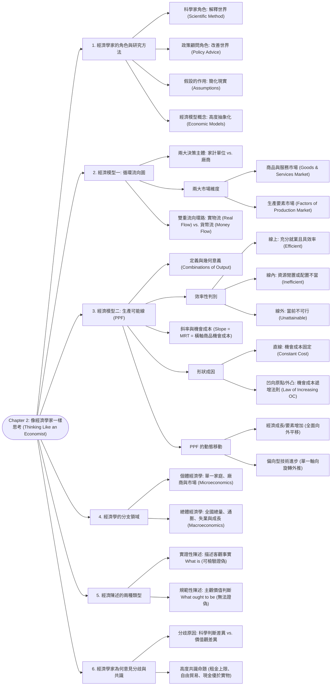

# Chapter 2: 像經濟學家一樣思考 (Thinking Like an Economist)

> 📅 生成日期：2026-10-24  
> 📄 來源檔案：[Reference/NCU_Classes/經濟學/CH2.pdf](file:///c:/Users/Cupid/Downloads/Study-space/Reference/NCU_Classes/經濟學/CH2.pdf)  
> 🎯 適用考試：中央大學經濟學課程期中考、商管研究所/轉學考個體經濟學基礎  

---

## 🗺️ 知識架構總覽 (Tree Diagram)



<a id="tree-diagram"></a>

### 🎯 本章學習進度檢核 (完成後打勾，建立成就反饋)

- [ ] [1. 經濟學家的角色與研究方法](#sec-1)
- [ ] [2. 經濟模型一: 循環流向圖](#sec-2)
- [ ] [3. 經濟模型二: 生產可能線 (PPF)](#sec-3)
- [ ] [4. 經濟學的分支領域](#sec-4)
- [ ] [5. 經濟陳述的兩種類型](#sec-5)
- [ ] [6. 經濟學家為何意見分歧與共識](#sec-6)

---

## 📖 知識點教材

<a id="sec-1"></a>

### 2.1 經濟學家的雙重角色與科學方法 (The Economist as Scientist & Policy Adviser)

#### 📌 核心概念

經濟學家在社會中同時扮演兩種截然不同的角色：

1. **科學家（Scientists）**：試圖**解釋世界（Explain how the world works）**。
   - 秉持客觀冷靜的態度，採用**科學方法（The Scientific Method）**：提出理論（Formulate theories）$\to$ 蒐集歷史與實證數據（Collect data）$\to$ 分析並檢驗假說（Test hypotheses）。
   - 經濟學無法像物理、化學在實驗室進行可控實驗，因此高度仰賴**自然實驗（Natural Experiments）**（如突發的歷史事件、戰爭、各國稅制變更）。
2. **政策顧問（Policy Advisers）**：試圖**改善世界（Improve the world）**。
   - 運用經濟理論為政府或企業提出政策建言（如是否開徵碳稅、最低工資法案制定）。

#### 📐 假設（Assumptions）與經濟模型（Economic Models）的作用

- **假設的力量**：真實世界極其複雜，充滿無數干擾變數。經濟學家透過合理的假設**「過濾掉無關細節，簡化世界」**，以聚焦在問題的核心本質上。
  - *範例*：研究國際貿易時，先假設「世界上只有兩個國家、兩種商品」；研究消費決策時，假設「消費者具有理性且追求效用極大」。
- **經濟模型**：高度簡化的現實數學方程式或圖形複製品。
  - 就像牙醫診所的牙齒塑料模型（不會流血，但清楚呈現牙齒結構）、高中的人體解剖模型，或是城市公路地圖（省略了每棟建築物細節，但能指引行車路線）。

#### 💡 重要觀念提醒

| 角色 | 核心目標 | 表達方式 | 檢驗標準 |
| :--- | :--- | :--- | :--- |
| **科學家 (Scientist)** | 描述、解釋與預測現象 | 實證性語言（Positive） | 以客觀數據與事實檢驗 |
| **政策顧問 (Policy Adviser)** | 提出規範、改革與價值主張 | 規範性語言（Normative） | 依據道德哲學與政治價值觀判斷 |

---

<a id="sec-2"></a>

### 2.2 循環流向圖 (The Circular-Flow Diagram)

#### 📌 核心概念

- **循環流向圖（Circular-Flow Diagram）**：由諾貝爾經濟學獎得主保羅·薩繆森（Paul Samuelson）發揚光大，用視覺化的水管流動比喻，說明貨幣與實物在整體經濟體系的家計單位與廠商之間如何**循環不息**。
- **兩類決策主體（Decision Makers）**：
  1. **家計單位（Households）**：擁有並向廠商出售/出租生產要素以獲取所得；購買並消費廠商生產的商品與服務。
  2. **企業/廠商（Firms）**：僱用生產要素進行生產；在市場上銷售商品與服務。

#### 📐 兩大市場與雙重循環環路

```
                  ┌───────────────────────────────────────────────┐
                  │          商品與服務市場 (Goods Market)         │
                  │  (家計單位買、廠商賣；決定商品價格與支出)      │
                  └───────────────▲───────────────┬───────────────┘
                     支出 (Spending) │               │ 營收 (Revenue)
                     商品買入 (Goods)│               │ 商品賣出 (Goods)
                                     │               ▼
                               ┌─────┴───────────────┴─────┐
                               │                           │
                   ┌───────────┤   家計單位     廠商      ├───────────┐
                   │           │ (Households) (Firms)      │           │
                   │           └─────┬───────────────▲─────┘           │
                   │                 │               │                 │
要素提供 (Labor, Land, Capital)│                 │ 生產要素僱用    │
所得 (Wages, Rent, Profit)     │                 │ 生產成本 (Costs)│
                   └───────────┐     │               │     ┌───────────┘
                               │     ▼               │     │
                  ┌────────────┴─────────────────────┴────────────┐
                  │         生產要素市場 (Factors Market)         │
                  │ (家計單位賣、廠商買；決定工資、地租與利潤)    │
                  └───────────────────────────────────────────────┘
```

1. **實物流向（Real Flows，綠色/內部實體流）**：
   - 生產要素（勞動力、土地、資本設備）從**家計單位流向廠商**。
   - 最終商品與服務從**廠商流向家計單位**。
2. **貨幣流向（Money Flows，黃金/外圍資金流）**：
   - 消費支出（Spending）從**家計單位流向廠商**（成為廠商的銷售營收 Revenue）。
   - 廠商支付要素報酬（工資 Wages、地租 Rent、利息/利潤 Profit）流回**家計單位**（成為家計單位的所得 Income）。
   - **總體恆等式基礎**：$$\text{總支出（Expenditure）} = \text{總產出（Output）} = \text{總所得（Income）}$$

#### 💡 重要觀念提醒

- **誰是買方？誰是賣方？**（考試極易混淆）：
  - 在「商品與服務市場」：廠商是賣方，家計單位是買方。
  - 在「生產要素市場」：**家計單位是賣方（提供勞動與自有資本），廠商是買方（僱用勞工、租用土地）！**

#### 📊 範例（講義第 10 頁練習）

請指出下列經濟活動在循環流向圖中對應的「市場類別」、「流向主體」與「金錢/實物流向」：

1. **小美在超商花 35 元買了一瓶鮮奶**：
   - 市場：**商品與服務市場**。
   - 金錢流：小美（家計單位）支出 35 元 $\to$ 超商（廠商）營收。
   - 實物流：超商將鮮奶交付給小美消費。
2. **阿豪在麥當勞打工，每小時賺取 190 元工資**：
   - 市場：**生產要素市場（勞動市場）**。
   - 實物流：阿豪（家計單位）向麥當勞（廠商）提供勞動服務。
   - 金錢流：麥當勞支付工資 190 元 $\to$ 阿豪獲得要素所得。
3. **大華持有台積電股票，收到 20,000 元現金股利（利潤分配）**：
   - 市場：**生產要素市場（資本市場）**。
   - 金錢流：台積電將資本要素產生的利潤（Profit）支付給股東大華（家計單位）。

---

<a id="sec-3"></a>

### 2.3 生產可能線：定義、效率與機會成本 (The Production Possibilities Frontier, PPF)

#### 📌 核心概念

- **生產可能線（Production Possibilities Frontier, PPF）**：在**既定的生產要素數量**與**生產技術水準**下，一個經濟體系所能生產的兩種商品或服務的**各種最大可能產出組合的軌跡**。
- PPF 鮮明地體現了第一章的四大原理：
  1. **稀少性（Scarcity）**：PPF 外面的點是目前無法達到的。
  2. **權衡取捨（Trade-offs）**：在線上移動，想多生產一物就必須犧牲另一物。
  3. **機會成本（Opportunity Cost）**：放棄的數量即為代價。
  4. **效率（Efficiency）**：線上的點代表充分發揮潛能。

#### 📐 點的性質與效率判別

```
 商品 Y (例如: 奶油 Butter / 小麥 Wheat)
  ▲
  │   A (線上: 充分就業且具效率)
  │  ●
  │     \
  │      \    ● G (線外: 目前技術不可行 Unattainable)
  │       \
  │   ● F  \
  │ (線內)  \
  │          ● B (線上: 效率點)
  └───────────\──────────────► 商品 X (例如: 大砲 Guns / 電腦 Computers)
```

| 點的位置 | 可行性 (Attainable) | 效率性 (Efficiency) | 經濟意涵 |
| :--- | :--- | :--- | :--- |
| **PPF 線上（如 A, B, C）** | **可行** | **具生產效率（Efficient）** | 社會擁有的稀少資源已被**充分利用**，無法在不減少另一種產品的情況下多生產任何一單位產品。 |
| **PPF 線內（如 F）** | **可行** | **無效率（Inefficient）** | 存在**資源閒置/失業（Underutilized resources）**，或**分工不當（未依比較利益配置）**。可以做到「不減少任何商品而增加產出」。 |
| **PPF 線外（如 G）** | **不可行** | **無法達成（Unattainable）** | 受限於現有資源總量與技術水準，社會目前無法產出此種組合。 |

#### 📐 PPF 的斜率與機會成本 (Slope & Opportunity Cost)

- **斜率定義**：
  $$\text{斜率 (Slope)} = \frac{\Delta Y}{\Delta X} = \frac{\text{垂直軸變動量 (Rise)}}{\text{水平軸變動量 (Run)}} < 0$$
- **重要定理**：
  $$\text{水平軸商品 X 的機會成本} = |\text{PPF 的斜率}| = -\frac{\Delta Y}{\Delta X} = \text{邊際轉換率（Marginal Rate of Transformation, } MRT)$$
  $$\text{垂直軸商品 Y 的機會成本} = \frac{1}{|\text{PPF 的斜率}|} = -\frac{\Delta X}{\Delta Y}$$

#### 📊 範例（講義第 12～19 頁完整數據）

**已知條件**：某國共有 50,000 小時勞動。生產 1 台電腦需 100 小時；生產 1 噸小麥需 10 小時。  

1. **方程式建立**：
   $$100 \times \text{電腦 (C)} + 10 \times \text{小麥 (W)} \le 50,000$$
   若橫軸為電腦 $C$、縱軸為小麥 $W$：
   $$W = 5,000 - 10 C$$
2. **端點產出**：
   - 全部做電腦：$50,000 / 100 = 500\text{ 台 (點 A: } C=500, W=0)$
   - 全部產小麥：$50,000 / 10 = 5,000\text{ 噸 (點 E: } C=0, W=5,000)$
3. **機會成本計算**：
   $$\text{斜率 } = \frac{-5,000}{500} = -10$$
   - **多生產 1 台電腦的機會成本** $= | -10 | = \mathbf{10\text{ 噸小麥}}$。
   - **多生產 1 噸小麥的機會成本** $= \frac{1}{10} = \mathbf{0.1\text{ 台電腦}}$。
4. **判斷點 F $(C=100, W=3,000)$ 與點 G $(C=300, W=3,500)$**：
   - 點 F 所需工時 $= 100 \times 100 + 3,000 \times 10 = 40,000 < 50,000$ $\to$ **可行但無效率（線內）**。
   - 點 G 所需工時 $= 300 \times 100 + 3,500 \times 10 = 65,000 > 50,000$ $\to$ **不可行（線外）**。

---

<a id="sec-4"></a>

### 2.4 PPF 的形狀成因：直線 vs. 凹向原點 (Shapes of the PPF)

#### 📌 核心概念

PPF 的幾何形狀反映了資源在不同產業間轉換的彈性與難易度：

| PPF 形狀 | 機會成本特徵 | 資源轉換特性 | 實例情境 |
| :--- | :--- | :--- | :--- |
| **負斜率直線 (Straight Line)** | **機會成本固定 (Constant Cost)** | 資源在兩產品間**可完全無障礙互相替代**，生產要素技能完全同質。 | 工人每小時不論組裝電腦或除草，生產效率比率恆定不變。 |
| **凹向原點 / 外凸 (Bowed Outward)** | **機會成本遞增 (Increasing Cost)** | 資源**具有專用性（Specialized resources）**，不同勞工、土地有其擅長的領域。 | 登山車（Bikes）與啤酒（Beer）；農業小麥與工業電腦。 |

#### 📐 機會成本遞增法則（Law of Increasing Opportunity Cost）深入解析

以「啤酒（Beer）」與「登山車（Mountain Bikes）」為例：

1. **當全社會幾乎都在釀造啤酒時（點 A）**：
   - 連原本最擅長機械製造、完全不懂發酵技術的工程師都被派去啤酒廠當雜工。
   - 此時若轉移幾位工程師去製造登山車，啤酒產量**只會減少極少一點點**，但登山車能大幅增加 $\to$ **登山車的機會成本極低（PPF 斜率平緩）**。
2. **當全社會大幅擴大登山車產量時（點 B）**：
   - 絕大部分工人都在造車，最後留在啤酒廠的都是幾十年經驗的王牌釀酒大師。
   - 若社會還想再多造幾台登山車，就必須把這批最頂尖的釀酒大師調離啤酒產線。這會導致**啤酒產量產生毀滅性暴跌**，卻只能為造車工廠增加一點點產能 $\to$ **登山車的機會成本極高（PPF 斜率極為陡峭）**！

#### 📊 範例：講義第 30 頁 Larry、Moe 與 Curly 三人經濟體難題

**三人皆工作 10 小時，每小時產能如下**：

- **Larry**：1 坪割草 或 1 輛洗車（割草機會成本 $= 1$ 洗車）
- **Moe**：1 坪割草 或 2 輛洗車（割草機會成本 $= 2$ 洗車；洗車機會成本 $= 0.5$ 割草）
- **Curly**：2 坪割草 或 1 輛洗車（割草機會成本 $= 0.5$ 洗車；洗車機會成本 $= 2$ 割草）

**分析四大產出點**：

- **點 A（全割草）**：Larry 10 + Moe 10 + Curly 20 = **40 割草, 0 洗車**。
- **點 B（全洗車）**：Larry 10 + Moe 20 + Curly 10 = **0 割草, 40 洗車**。
- **點 C（每人時間各半：5 小時割草、5 小時洗車）**：
  - Larry: 5 割草, 5 洗車
  - Moe: 5 割草, 10 洗車
  - Curly: 10 割草, 5 洗車
  - **總計：20 割草, 20 洗車**。
- **點 D（依比較利益專精分工：Curly 專精割草 10hr，Moe 專精洗車 10hr，Larry 各半分工）**：
  - Curly: 20 割草, 0 洗車
  - Moe: 0 割草, 20 洗車
  - Larry: 5 割草, 5 洗車
  - **總計：25 割草, 25 洗車**！
- **結論**：點 C $(20, 20)$ **落在 PPF 內部，屬於無效率（Inefficient）**！因為在完全相同的資源下，只要按比較利益專業化分工（點 D），社會能同時產出更多的草坪割除與汽車清洗 $(25, 25)$！

---

<a id="sec-5"></a>

### 2.5 PPF 的動態移動：經濟成長與技術進步 (Shifts in the PPF)

#### 📌 核心概念

生產可能線不是固定不變的。隨著時間推移，當**生產資源數量變動**或**生產技術水準改變**時，PPF 將發生移動：

1. **全面性擴張（Neutral Economic Growth）**：
   - 全國勞動人口增加、資本累積、基礎建設改善，或中立性的普遍技術躍進。
   - **圖形特徵**：整條 PPF **全面平行向外推移（Shift outward）**。原本不可行的點變為可行。
2. **偏向型技術進步（Biased Technological Progress）**：
   - 僅單一產業的生產技術取得突破，而另一產業技術不變。
   - **圖形特徵**：PPF 圍繞未進步商品的端點，產生**旋轉式向外延伸（Rotates outward）**。

#### 📐 偏向型進步圖解分析

```
  堅果 (Nuts)
  ▲
  │\
  │ \
  │  \─────── 堅果技術突破：垂直端點大幅向上延伸，水平端點不變
  │   \
  │    \────── 基礎 PPF
  │     \
  └──────\────────────────► 咖啡 (Coffee)
          \────── 咖啡技術突破：水平端點大幅向右延伸，垂直端點不變
```

#### 💡 重要觀念提醒

- **綠色科技與環境的權衡**：講義第 29 頁提出「乾淨環境 vs. 工業產出」的 PPF。若工程師研發出「排放更少污染的高效發電技術」，這屬於技術進步，將使該 PPF 往外移動，代表**社會可以在維持相同環境品質下生產更多工業品，或在維持相同產出下享有更乾淨的環境**。
- **風力發電的機會成本**：講義第 46～48 頁強調，綠能並非免費。若政策不計代價強制將發電全轉為風力，由於風場偏遠造成高額輸電損耗與間歇性缺電，反而可能使國家落入 **PPF 線內的無效率點（Point Z）**。

---

<a id="sec-6"></a>

### 2.6 個體經濟學 vs. 總體經濟學 (Microeconomics vs. Macroeconomics)

#### 📌 核心概念

經濟學依研究的觀察尺度分為兩大核心領域：

- **個體經濟學（Microeconomics）**：
  - **研究對象**：個別家計單位（Households）與個別企業（Firms）如何做決策，以及它們在特定市場中的互動。
  - **探討主題**：特定商品的價格決定（如蘋果手機定價）、消費者需求彈性、單一工廠的勞工僱用量、政府租稅對香菸市場的影響、獨占與專利權。
- **總體經濟學（Macroeconomics）**：
  - **研究對象**：**整體經濟現象（Economy-wide phenomena）**。
  - **探討主題**：全國經濟成長率（GDP）、通貨膨脹率、全國失業率、聯準會貨幣政策、中央政府財政赤字、國際收支與匯率走勢。

#### 💡 重要觀念提醒

- 個體與總體密不可分：總體經濟變動本質上是數以百萬計個體決策的匯聚總和；但由於**合成謬誤（Fallacy of Composition）**的存在，對個別個體有利的行為（如全民同時大幅增加儲蓄），在總體層面可能導致消費萎縮與蕭條（儲蓄矛盾 Paradox of Thrift）。

#### 📊 範例（講義第 32 頁分類練習）

1. **一個家庭決定每月要將多少所得存入銀行** $\to$ **個體經濟學**（個別家計單位決策）。
2. **政府針對汽車廢氣排放實施嚴格環保法規對車價的影響** $\to$ **個體經濟學**（特定汽車市場分析）。
3. **全國國民總儲蓄率提升對一國長期經濟成長的衝擊** $\to$ **總體經濟學**（總體經濟總量與成長）。
4. **一家科技製造商決定在第四季要增聘多少產線作業員** $\to$ **個體經濟學**（個別廠商決策）。
5. **中央銀行貨幣供給成長率與全國物價膨脹率之間的長期因果關係** $\to$ **總體經濟學**（整體經濟貨幣與物價）。

---

<a id="sec-7"></a>

### 2.7 實證性陳述 vs. 規範性陳述 (Positive vs. Normative Statements)

#### 📌 核心概念

- **實證性陳述（Positive Statements）**：
  - **描述性的（Descriptive）**，企圖說明**「世界是什麼樣子（The world as it is）」**。
  - **檢驗特性**：原則上可以透過**蒐集數據與經驗證據來加以證實（Confirm）或證偽（Refute）**。
  - ⚠️ **關鍵陷阱**：**實證性陳述不代表陳述內容一定「正確」！** 即使內容與事實相反（例如：「如果政府印鈔票，物價絕對會下跌 50%」），只要它是在描述客觀世界的運作因果且理論上可藉由數據駁斥，它依然是**實證性陳述（只是它是個「錯誤的實證陳述」）**！
- **規範性陳述（Normative Statements）**：
  - **指示性/指令性的（Prescriptive）**，企圖主張**「世界應該是什麼樣子（How the world ought to be）」**。
  - **檢驗特性**：涉及個人的**道德倫理、宗教信念、政治哲學與主觀價值判斷（Value Judgments）**，**無法單純藉由經驗數據加以證實或反駁**。
  - 常見關鍵詞：**應該（Should / Ought to）**、必須（Must）、過高（Too high）、不公平（Unfair）。

#### 📊 範例（講義第 34～36, 41 頁完整實例剖析）

1. **「當政府印製過多貨幣時，物價水準會上升」**：  
   $\to$ **實證性（Positive）**（描述客觀經濟因果，可比對歷史通膨數據驗證）。
2. **「為了維護全民購買力，政府應該停止印鈔」**：  
   $\to$ **規範性（Normative）**（包含「應該（Should）」，屬於政策價值主張）。
3. **「現階段需要透過減稅來刺激國內經濟」**：  
   $\to$ **規範性（Normative）**（主張特定政策的必要性，隱含對經濟目標的價值取向）。
4. **「若墨西哥捲餅價格上漲，消費者對音樂串流下載的需求將會增加」**：  
   $\to$ **實證性（Positive）**（描述兩產品間的交叉關係，儘管實務上可能毫無關聯甚至荒謬，但它是可檢驗的實證命題）。
5. **「社會面臨通膨與失業之間的短期權衡取捨」**：  
   $\to$ **實證性（Positive）**（菲利浦曲線理論描述）。
6. **「政府應當強制要求領取救濟金者去尋找工作」**：  
   $\to$ **規範性（Normative）**（「應當（Ought to）」，涉及社會福利倫理判斷）。

---

<a id="sec-8"></a>

### 2.8 經濟學家為何經常意見分歧？共識又在哪裡？ (Why Economists Disagree & Where They Agree)

#### 📌 核心概念

社會大眾常調侃：「如果有五位經濟學家聚在一起，往往會出現六種不同的意見。」經濟學家對政策提出衝突建言的兩大根源：

1. **科學判斷的差異（Differences in Scientific Judgments）**：
   - 經濟學家對不同實證理論的有效性、模型適用情境，或是計量經濟參數的估計值存在不同看法。
   - *例*：對於「減稅能否大幅促進工作誘因進而擴大稅基」，支持供給面經濟學（Supply-side economics）與凱因斯學派學者有不同估計。
2. **價值觀的差異（Differences in Values）**：
   - 每位經濟學家的規範性目標不同（有人優先看重「效率與成長」，有人優先看重「平等與分配公義」）。

#### 📐 絕大多數經濟學家高度共識的核心命題 (Mankiw 經典調查數據)

儘管在媒體上爭論不休，但在專業學術調查中，**超過 80%～90% 的經濟學家對以下命題具有壓倒性共識**：

| 共識命題 | 經濟學家贊同比例 | 核心經濟學原理解釋 |
| :--- | :---: | :--- |
| **租金上限管制（Rent Ceilings）會減少出租住宅的數量與維護品質** | **93%** | 價格管制阻礙價格機能，導致供不應求與房屋破敗。 |
| **關稅與進口配額（Tariffs & Quotas）通常會損害社會總體經濟福祉** | **93%** | 阻礙國際分工與比較利益，產生無謂損失。 |
| **政府不應限制企業將工作外包（Outsourcing）至海外國家** | **90%** | 外包是國際貿易與比較利益的一種形式，能壓低成本。 |
| **政府應當取消農業補貼（Agricultural Subsidies）** | **85%** | 補貼扭曲資源配置，鼓勵過度生產並造成納稅人負擔。 |
| **地方政府應當取消對職業運動球隊（如 NBA/MLB 場館）的公共補貼** | **85%** | 球團補貼往往是尋租行為，極少能帶來正當的外部經濟效益。 |
| **發放現金補助（Cash Payments）比發放等額實物券更能增進受助者福祉** | **84%** | 現金賦予受助者最大的消費選擇自由度，效用最大化。 |
| **龐大的政府預算赤字（Federal Budget Deficit）對經濟具負面衝擊** | **83%** | 排擠民間投資（Crowding-out），加重未來世代租稅負擔。 |
| **法定最低工資會增加年輕與非技術勞工的失業率** | **79%** | 人為價格下限高於均衡工資，導致勞動供給大於需求。 |

---

---

## 📝 實戰練習題 (三層遞進式強化測驗)

### 🟢 Tier 1：必懂基礎 (Must-Know Fundamentals)

> 💡 **學習目標**：確認自己「會算、會辨識」——給數字就能做對、給名稱就能配對。

<a id="q1"></a>

#### Q1. (基礎模型流向辨析) 循環流向圖 (Circular-Flow Diagram) 要素市場

在經濟學入門的第一個基礎模型「循環流向圖」中，整個經濟體由家計單位（Households）與廠商（Firms）在兩大市場中互動：
請問在「**生產要素市場（Markets for Factors of Production）**」中，家計單位與廠商分別扮演何種角色？金錢流向為何？

(A) 家計單位是買方，廠商是賣方；金錢由家計單位流向廠商  
(B) 家計單位是賣方（提供勞動、土地與資本），廠商是買方；金錢（工資、地租與利潤）由廠商流向家計單位作為要素所得  
(C) 家計單位與廠商皆為買方；金錢全數上繳給中央政府  
(D) 生產要素市場中完全不涉及金錢流動，純屬以物易物  

👉 [查看 Q1 答案與詳細解析](#ans-q1)

---

<a id="q2"></a>

#### Q2. (基礎點位狀態判定) 生產可能曲線 (PPF) 上的點位效率分析

設某國利用其全部現有資源與技術，生產「電腦（縱軸 $Y$）」與「小麥（橫軸 $X$）」，繪出如下標準的生產可能曲線（PPF）：
(1) 位於曲線**內部（Inside the frontier）** 的點 $A$，代表經濟體處於何種狀態？  
(2) 位於曲線**邊界上（On the frontier）** 的點 $B$，代表何種狀態？  
(3) 位於曲線**外部（Outside the frontier）** 的點 $C$，代表何種狀態？

(A) (1) 生產效率點；(2) 缺乏效率點；(3) 不可達成點  
(B) (1) 缺乏效率（存在閒置資源或失業）；(2) 生產有效率（資源充分利用）；(3) 現有技術與資源下不可達成（Infeasible）  
(C) (1) 不可達成點；(2) 生產有效率；(3) 缺乏效率點  
(D) (1) 貿易平衡點；(2) 獨占市場點；(3) 外部性點  

👉 [查看 Q2 答案與詳細解析](#ans-q2)

---

<a id="q3"></a>

#### Q3. (基礎陳述性質辨析) 實證性陳述 (Positive) vs. 規範性陳述 (Normative)

經濟學家在發言時可能扮演科學家或政策顧問。下列四個經濟陳述中，何者屬於帶有價值判斷與倫理主張的「**規範性陳述 (Normative Statement)**」？

(A) 提高香菸的貨物稅率會導致未成年青少年的吸菸率顯著下降  
(B) 中央銀行在過去一年內已連續升息 3 碼  
(C) 政府「應該」對所有高收入富豪課徵高額豪宅稅，並將稅款用於補助無房青年，以建立公平社會  
(D) 當石油價格飆漲時，航空公司的營運利潤通常會縮水  

👉 [查看 Q3 答案與詳細解析](#ans-q3)

---

<a id="q4"></a>

#### Q4. (基礎斜率經濟意涵) 生產可能曲線 (PPF) 切線斜率的本質

在以「汽車（縱軸 $Y$）」與「小麥（橫軸 $X$）」為坐標軸的生產可能曲線圖中，曲線在任一點的切線斜率絕對值（$|\frac{dY}{dX}|$），在經濟學上精確代表：

(A) 該國目前的失業率百分比  
(B) 生產 1 單位額外小麥所必須放棄犧牲的汽車數量，即「小麥相對於汽車的機會成本（Opportunity Cost of Wheat）」  
(C) 全社會貨幣流通的總速度  
(D) 該國國際貿易的進口關稅稅率  

👉 [查看 Q4 答案與詳細解析](#ans-q4)

---

<a id="q5"></a>

#### Q5. (基礎研究範疇劃分) 微觀經濟學 (Microeconomics) 範疇判定

下列各項經濟研究主題中，何者屬於「**微觀經濟學 (Microeconomics)**」的核心研究課題？

(A) 台灣 2025 年的實質 GDP 成長率與經濟景氣循環預測  
(B) 全國整體通貨膨脹率上升對失業率的短期衝擊  
(C) 某特定手機品牌調降旗艦機售價對其市場需求量與競爭對手銷量的影響  
(D) 聯準會實施量化緊縮（QT）對全球國際資本流向的宏觀影響  

👉 [查看 Q5 答案與詳細解析](#ans-q5)

---

### 🟡 Tier 2：基礎 + 實際應用 (Application & Scenario Matching)

> 💡 **學習目標**：確認自己「會用」——能推導邊際機會成本遞增的資源專業化成因、分析技術進步對 PPF 的動態擴張。

<a id="q6"></a>

#### Q6. (邊際機會成本遞增原理) 為什麼 PPF 呈現「凹向原點（外凸 Bowed-out）」弧形？

在生產「戰鬥機（國防武器）」與「稻米（農業民生）」的經濟體中，生產可能曲線通常不是一條平直的直線，而是呈現凹向原點的外凸弧形：
當該國將越來越多的資源從稻米生產部門抽調出來，轉投入戰鬥機生產時，每增產 1 架戰鬥機所必須犧牲的稻米數量**會持續增加（邊際機會成本遞增）**。造成此現象的根本經濟原由為何？

(A) 因為政府發行了過多的紙幣造成通貨膨脹  
(B) 因為生產要素（勞動、土地、資本）具備「**異質專業化（Resource Specialization）**」特徵：最先被抽調的是原本就不擅長種田的工程師（代價極小）；但若要生產極大量的飛機，連原本極擅長種田的優秀農夫與肥沃農地都被強行抓去造飛機，這些農業資源在飛機製造上效率極低，導致必須摧毀暴增的稻米產量才能換取微小的飛機增量  
(C) 因為戰鬥機生產不遵守牛頓物理力學  
(D) 因為國際貿易禁止進口稻米  

👉 [查看 Q6 答案與詳細解析](#ans-q6)

---

<a id="q7"></a>

#### Q7. (動態技術進步與產出擴張) 單一產業技術突破對 PPF 的幾何擴張

某國原本生產「咖啡（縱軸 $Y$）」與「小麥（橫軸 $X$）」，且經濟體原本位於 PPF 邊界上的點 $A$ 運作。
現該國農業生物實驗室發明了一種突破性的抗旱高產「超級小麥種子」，使每畝農地的小麥產能翻倍；而咖啡樹的種植技術完全沒有任何改良：
(1) 該國的生產可能曲線在幾何圖形上會發生何種變動？  
(2) 該國在未來是否有可能「**在咖啡產量也超越以往的同時，小麥產量也大幅增加**」？為什麼？

(A) (1) 整條 PPF 平行向外平移；(2) 不可能，因為咖啡技術完全沒進步  
(B) (1) PPF 的小麥橫軸截距大幅向外擴張，而咖啡縱軸截距保持不變（呈現單邊旋轉式外推）；(2) 可能！因為小麥生產效率翻倍後，該國只需投入原本一半的人力即可滿足國內糧食需求，得以將釋放出的多餘勞動力轉移去採摘咖啡，實現兩者產量同時突破歷史極限  
(C) (1) PPF 縮減為一個點；(2) 不可能，違反熱力學第二定律  
(D) (1) PPF 向原點收縮；(2) 所有人全面失業  

👉 [查看 Q7 答案與詳細解析](#ans-q7)

---

<a id="q8"></a>

#### Q8. (經濟學家意見分歧剖析) 政策建議爭端背後的深層來源

在國會聽證會上，兩位頂尖經濟學家針對「政府是否應全面推行普及全民基本收入（UBI）」發生激烈爭論，各自提出完全相左的政策建議：
依據經濟學原理二的科學方法論，經濟學家在政策建議上出現巨大分歧，通常歸因於哪兩大核心根源？

(A) (1) 電腦運算晶片的算力不足；(2) 兩人的博士學位真偽爭議  
(B) (1) **對實證世界科學模型與參數的認知估計不同**（例如對 UBI 是否會嚴重降低勞工工作意願的實證估計不同）；(2) **價值觀與哲學目標的規範性取捨不同**（追求個人自由努力的機會均等 vs. 追求貧富均等的結果平等）  
(C) (1) 兩人使用的是完全不同的數學加減乘除；(2) 國際貨幣基金組織的強制指令  
(D) (1) 誰都沒有看過統計數據；(2) 單純為了電視通告費而故意爭吵  

👉 [查看 Q8 答案與詳細解析](#ans-q8)

---

<a id="q9"></a>

#### Q9. (模型假設方法論) 為什麼經濟學家要建立「不切實際的假設」？

在分析跨國貿易時，經濟學家常建立「假設全世界只有兩個國家、兩種商品，且完全沒有運輸成本」的模型。初學者常批評：「真實世界有兩百多個國家、上百萬種商品，這種模型完全脫離現實、毫無用處！」
從科學建模哲學（Scientific Modeling）的角度，經濟學家使用簡化假設的真正核心價值為何？

(A) 因為經濟學家的數學能力太差，算不出三個國家的模型  
(B) 透過簡化假設剔除現實世界中無關緊要的次要雜訊干擾，讓「比較利益如何創造貿易雙贏」的最核心因果機制如 X 光般清晰顯現；科學模型的優劣取決於其**預測與解釋現實的解釋力**，而非假設是否面面俱到  
(C) 為了保護研究論文的專利機密  
(D) 只有在虛擬元宇宙中經濟學模型才能成立  

👉 [查看 Q9 答案與詳細解析](#ans-q9)

---

### 🔴 Tier 3：概念講述與深度分析 (Conceptual & Analytical)

> 💡 **學習目標**：確認自己「會講」——能推導直線 vs. 外凸 PPF 數理條件、辨析實證與規範的科學界限、論述 GDP 三面等價。

<a id="q10"></a>

#### Q10. (數理推導題) 直線型 PPF vs. 凹向原點型 PPF 的生產函數數學推導

設某經濟體只生產兩種商品：布料 ($X$) 與小麥 ($Y$)。全社會唯一的生產要素為固定總勞動力 $\bar{L}$，且 $L_X + L_Y = \bar{L}$。
(1) 若生產函數呈現「規模報酬不變且勞動生產力為常數」：$X = a \cdot L_X$，$Y = b \cdot L_Y$（其中 $a, b > 0$ 為常數）。請以代數推導出該經濟體的 PPF 數學方程式，並證明為什麼此時的生產可能曲線必為**一條負斜率的直線**？此時邊際機會成本有何特徵？  
(2) 若兩部門的生產函數皆滿足「勞動邊際報酬遞減（Diminishing Marginal Returns）」：$X = \sqrt{L_X}$，$Y = \sqrt{L_Y}$。請推導出 PPF 方程式 $X^2 + Y^2 = \bar{L}$，並求其切線斜率（邊際轉換率 $MRT = -\frac{dY}{dX}$），從數學上嚴格證明為什麼隨著 $X$ 產量增加，其邊際機會成本必定單調遞增（凹向原點）？

👉 [查看 Q10 答案與詳細解析](#ans-q10)

---

<a id="q11"></a>

#### Q11. (科學哲學論述題) 實證性分析 (Positive) 與 規範性分析 (Normative) 的嚴格分界與證偽

卡爾·波普爾（Karl Popper）的科學哲學指出，一門學科之所以具備「科學性」，關鍵在於其理論是否具備「可證偽性（Falsifiability）」：
(1) 請以「房租管制法令（Rent Control）」為例，分別給出一個關於該政策的**實證性陳述**與一個**規範性陳述**。  
(2) 試深入論述：為什麼實證性分析在原則上可以藉由實際統計數據（如房租上限實施前後的空屋率、黑市交易調查）來進行科學檢驗、證實或推翻？而規範性分析的爭論為什麼「永遠無法單靠實證資料或統計軟體達成共識」？

👉 [查看 Q11 答案與詳細解析](#ans-q11)

---

<a id="q12"></a>

#### Q12. (宏觀閉環系統推導) 循環流向圖與國民所得「三面等價原則」推導

循環流向圖（The Circular-Flow Diagram）展示了實體投入產出與貨幣資金流動的封閉循環網絡：
(1) 請從金錢流動（綠色貨幣環）的各個端點，詳細推導為什麼在最簡化的封閉私營經濟體系中：
$$\text{全社會總產出價值 (Output)} \equiv \text{全體家計單位總支出 (Expenditure)} \equiv \text{全體廠商總收入 (Revenue)} \equiv \text{全體生產要素總所得 (Income)}$$
(2) 請闡明上述恆等關係如何奠定了現代宏觀經濟學國民所得統計中「**支出面 GDP（Expenditure Approach）= 所得面 GDP（Income Approach）= 生產面 GDP（Production Approach）**」的三面等價理論基石。

👉 [查看 Q12 答案與詳細解析](#ans-q12)

---

## 🔑 本章練習題答案與詳細解析 (Answer Key)

### 🟢 Tier 1 解析

<a id="ans-q1"></a>

### Q1 答案與詳細解析

* **正確答案**：**(B)**
* **循環流向圖兩大市場對照**：
  * **1. 商品與勞務市場 (Markets for Goods and Services)**：
    * 買方：家計單位（消費者購買麵包、汽車）
    * 賣方：廠商（提供商品與勞務）
    * 貨幣流向：家計單位支出 $\to$ 廠商營業收入
  * **2. 生產要素市場 (Markets for Factors of Production)**：
    * 賣方：**家計單位**（個人擁有生產要素，提供勞動力給工廠、出租土地給建商、投入儲蓄資本給企業）
    * 買方：**廠商**（購買勞動、租用土地與資本設備）
    * 貨幣流向：廠商支付成本 $\to$ 轉化為家計單位的**工資（Wages）、地租（Rent）與利潤（Profit）**。選項 (B) 完全正確。

[🔙 返回題目 Q1](#q1) ｜ [🔝 返回知識架構圖](#tree-diagram)

---

<a id="ans-q2"></a>

### Q2 答案與詳細解析

* **正確答案**：**(B)**
* **PPF 點位狀態定義**：
  * **點 A（曲線內部）**：代表**缺乏效率（Inefficient）**。全社會現有的資源未被充分利用，存在嚴重的勞工失業、工廠閒置或生產配置失靈。在此狀態下，無須放棄任何一種產品，即可同時增加另一種產品的產量。
  * **點 B（曲線邊界上）**：代表**生產有效率（Efficient）**。資源已發揮到極致，若想多增產任何 1 單位小麥，必須放棄一定數量的電腦（面臨真實機會成本）。
  * **點 C（曲線外部）**：代表**不可達成（Infeasible）**。在目前的技術水平與固定資源限制下，全社會的產能根本無法達到該點。唯有透過未來的「技術進步」或「資本累積擴張」使整條 PPF 向外移動，該點才有可能實現。選項 (B) 正確。

[🔙 返回題目 Q2](#q2) ｜ [🔝 返回知識架構圖](#tree-diagram)

---

<a id="ans-q3"></a>

### Q3 答案與詳細解析

* **正確答案**：**(C)**
* **實證性 vs. 規範性判別準則**：
  * **實證性陳述 (Positive Statement)**：描述客觀世界「是什麼（What is）」的陳述。它陳述的是因果假說或客觀事實，原則上可以透過蒐集真實世界的統計數據來加以檢驗、證實或證偽（即使陳述是錯的，它依然是實證性陳述）。選項 (A)、(B)、(D) 皆屬實證陳述。
  * **規範性陳述 (Normative Statement)**：主張客觀世界「應該是什麼（What ought to be）」的陳述。它不可避免地牽涉到個人的道德信仰、正義觀、宗教信仰或價值觀判斷，無法純粹依靠數據統計來做對錯裁決。選項 (C) 含有「政府應該如何以實現社會公義」，為標準的規範性陳述。選項 (C) 正確。

[🔙 返回題目 Q3](#q3) ｜ [🔝 返回知識架構圖](#tree-diagram)

---

<a id="ans-q4"></a>

### Q4 答案與詳細解析

* **正確答案**：**(B)**
* **PPF 斜率幾何與經濟意涵**：
  * 生產可能曲線的切線斜率公式為 $\frac{dY}{dX}$（因曲線向下傾斜，斜率為負值）。
  * 其絕對值 $|\frac{dY}{dX}|$ 在微觀經濟學中被稱為**邊際轉換率（Marginal Rate of Transformation, MRT）**。
  * 經濟本質：為了在橫軸上多獲得 $\Delta X = 1$ 單位的商品（小麥），社會在生產技術邊界上必須削減放棄的縱軸商品數量（$-\Delta Y$ 輛汽車）。這正是生產小麥的**機會成本（Opportunity Cost）**。選項 (B) 正確。

[🔙 返回題目 Q4](#q4) ｜ [🔝 返回知識架構圖](#tree-diagram)

---

<a id="ans-q5"></a>

### Q5 答案與詳細解析

* **正確答案**：**(C)**
* **微觀 vs. 宏觀範疇界定**：
  * **微觀經濟學 (Microeconomics)**：研究**單一個別家計單位、單一個別廠商**如何做決策，以及它們在**特定單一商品市場（如手機、石油、雞蛋）** 中的供需互動與價格決定。選項 (C) 關注單一品牌手機降價對該特定市場的衝擊，屬於微觀經濟學。
  * **宏觀經濟學 (Macroeconomics)**：研究**全體經濟的整體性、聚合性現象**，如全社會物價通膨、全國失業率、總體經濟成長與國際收支。選項 (A)、(B)、(D) 皆屬宏觀範疇。選項 (C) 正確。

[🔙 返回題目 Q5](#q5) ｜ [🔝 返回知識架構圖](#tree-diagram)

---

### 🟡 Tier 2 解析

<a id="ans-q6"></a>

### Q6 答案與詳細解析

* **正確答案**：**(B)**
* **邊際機會成本遞增之資源異質性剖析**：
  * 若全社會所有資源都是「同質通用」的（例如造飛機和種稻米需要完全相同的人力和機器），則每多造一架飛機所犧牲的稻米數量永遠固定，PPF 將是一條直線。
  * 然而真實世界的生產要素具備高度**專業化（Specialization）**：
    * 當社會一開始只有稻米、要造第 1 架戰鬥機時，經濟學家會挑選原本在農場裡算數學、搞機械的工程師去造飛機。這些人本來就不會種田，放棄他們的稻米產出極小，獲得的飛機增量極大（飛機的機會成本極低）。
    * 但當社會已經造了 1,000 架飛機、還要繼續強行增產時，工廠已經找不到機械工程師了，國家被迫把農業遺傳學家、插秧高手連同肥沃的水稻梯田全部徵收去造飛機。這些農夫在飛機裝配線上極度笨拙，導致龐大的稻米產量被白白毀滅，卻只換來一丁點飛機產能（機會成本急遽暴增）。
  * 這種生產要素在不同部門適應力不均勻的客觀事實，決定了 PPF 必然呈現凹向原點的外凸形狀。選項 (B) 完全正確。

[🔙 返回題目 Q6](#q6) ｜ [🔝 返回知識架構圖](#tree-diagram)

---

<a id="ans-q7"></a>

### Q7 答案與詳細解析

* **正確答案**：**(B)**
* **非平衡技術進步的溢出連動效應**：
  * **幾何變動**：若小麥技術翻倍而咖啡技術不變，當全部資源只種咖啡時，最大產量不變（縱軸截距不動）；而全部資源只種小麥時，最大產量翻倍（橫軸截距大幅向外推展），PPF 呈現以縱軸截距為支點向外旋轉的扇形擴張。
  * **實質產能突破推導**：
    * 假設該國原本人口需要 80% 種小麥、20% 種咖啡，才能生產 100 噸小麥與 20 噸咖啡維持生活。
    * 當小麥技術翻倍後，只要 40% 的人口種小麥就能生產出 100 噸小麥。
    * 國家現在擁有了前所未有的「閒置勞動力（40% 人口）」，可以將其中的 20% 移去採摘咖啡，使咖啡勞動力翻倍至 40%！
    * 最終結果：該國小麥產量從 100 噸增至 120 噸，**同時咖啡產量也從 20 噸暴增至 40 噸！** 單一產業的技術進步透過市場勞動力重新調配，讓未改良產業的產量同步迎來歷史突破。選項 (B) 正確。

[🔙 返回題目 Q7](#q7) ｜ [🔝 返回知識架構圖](#tree-diagram)

---

<a id="ans-q8"></a>

### Q8 答案與詳細解析

* **正確答案**：**(B)**
* **經濟學家爭端根源**：
  * 曼昆在原理二中明確指出經濟學家意見分歧的兩大原因：
    1. **科學判斷的差異（Differences in Scientific Judgments）**：經濟學是一門年輕的科學，關於世界如何運作的替代假說很多。例如兩位學者對於「減稅政策對勞動供給彈性的具體數值大小」有不同的實證模型估計，導致對政策後果的預測分歧。
    2. **價值觀的差異（Differences in Values）**：即使兩位學者對政策的物理後果預測完全一致，但一人將「保障弱勢貧窮者的結果平等」視為最高正義，另一人將「保護個人私有產權與奮鬥自由」視為最高倫理。這種道德哲學上的根本分歧，無法依靠科學計算予以弭平。選項 (B) 正確。

[🔙 返回題目 Q8](#q8) ｜ [🔝 返回知識架構圖](#tree-diagram)

---

<a id="ans-q9"></a>

### Q9 答案與詳細解析

* **正確答案**：**(B)**
* **模型假設之科學方法論**：
  * 諾貝爾經濟學獎得主 Milton Friedman 曾闡明：檢驗一個模型的標準從來不是「假設是否百分之百符合現實」，而是「該模型能否提供足夠準確的預測與深刻的洞察」。
  * 一張比例尺 $1:1$、將每一棵樹每一顆石頭都畫上去的地圖是毫無用處的（你無法攤開它）。優秀的地圖必定是高度抽象簡化的。
  * 透過「假設兩國兩物且無運輸成本」，經濟學家得以將干擾視線的匯率摩擦、貿易壁壘暫時關閉，讓「比較利益」這條最純粹的自然經濟規律赤裸呈現。一旦核心理論確立，後續再逐步放寬假設引入運輸成本，模型依然穩健有效。選項 (B) 正確。

[🔙 返回題目 Q9](#q9) ｜ [🔝 返回知識架構圖](#tree-diagram)

---

### 🔴 Tier 3 解析

<a id="ans-q10"></a>

### Q10 答案與詳細解析

* **(1) 直線型 PPF 數理推導**：
  * 已知 $X = a L_X \implies L_X = \frac{X}{a}$，且 $Y = b L_Y \implies L_Y = \frac{Y}{b}$。
  * 勞動力資源約束為 $L_X + L_Y = \bar{L}$。
  * 代入消去勞動力變數：
    $$\frac{X}{a} + \frac{Y}{b} = \bar{L} \implies Y = b\bar{L} - \frac{b}{a} X$$
  * **數學證明**：此方程式為一階線性方程式，斜率為常數 $-\frac{b}{a}$，故 **PPF 必為一條直線**。
  * **邊際機會成本特性**：生產 1 單位 $X$ 的機會成本永遠恆定為 $\frac{b}{a}$ 單位 $Y$（常數機會成本 Constant Opportunity Cost）。

* **(2) 凹向原點型 PPF 數理推導**：
  * 已知 $X = \sqrt{L_X} \implies L_X = X^2$，且 $Y = \sqrt{L_Y} \implies L_Y = Y^2$。
  * 代入資源約束 $L_X + L_Y = \bar{L}$：
    $$X^2 + Y^2 = \bar{L} \implies Y = \sqrt{\bar{L} - X^2}$$
  * 對 $X$ 進行隱微分（Implicit Differentiation）：
    $$2X + 2Y \frac{dY}{dX} = 0 \implies \frac{dY}{dX} = -\frac{X}{Y}$$
  * 邊際轉換率（機會成本絕對值）為：
    $$MRT = \left| \frac{dY}{dX} \right| = \frac{X}{Y} = \frac{X}{\sqrt{\bar{L} - X^2}}$$
  * 當小麥產量 $X$ 增加時：分子 $X$ 單調遞增，分母 $Y$ 單調遞減，故其比值 $\frac{X}{Y}$ **必定嚴格單調遞增**！
  * **幾何結論**：斜率絕對值隨 $X$ 增加而越來越陡峭，嚴格證明了在要素邊際報酬遞減下，PPF 必定在幾何上呈現**凹向原點（Bowed-out）**。

[🔙 返回題目 Q10](#q10) ｜ [🔝 返回知識架構圖](#tree-diagram)

---

<a id="ans-q11"></a>

### Q11 答案與詳細解析

* **(1) 房租管制之雙重陳述實例**：
  * **實證性陳述 (Positive)**：「政府實施房租價格上限法令，會降低房東維護房屋的誘因，並在長期導致低價出租公寓的供給數量大幅減少（引發短缺）。」
  * **規範性陳述 (Normative)**：「鑑於高房租對貧困勞工家庭造成沉重生活負擔，政府『應當』立法限制房租上限，保障人人有房住的居住人權。」

* **(2) 科學檢驗與證偽性深度剖析**：
  * **實證分析的可證偽性**：
    * 實證陳述涉及客觀因果機制。經濟學家可以去比較管制城市（如舊約）與非管制城市在實施管制 10 年後的「空屋率」、「維修投訴次數」與「新開工租賃住宅數」。如果實證數據顯示房租管制後租賃住宅供給量不但沒減反而暴增，該實證理論就被直接推翻證偽。
  * **規範分析的不可證偽性**：
    * 規範性陳述屬於價值主張。哪怕統計學家提出 1,000 份嚴謹研究，證明房租管制確實會減少出租公寓總量，主張居住正義的政策倡導者依然可以堅定回應：「我不在乎供給量是否減少，只要能讓現存承租房子的貧窮家庭暫時不被房東驅逐，即使整體市場缺乏效率也是值得付出的道德代價！」
    * 價值觀的取捨涉及倫理、哲學與正義定義，數據無法告訴我們「效率」與「平等」哪一個更崇高。經濟學家的科學職責是清楚揭示每一項價值選擇背後所必須支付的**實質代價（Trade-off）**。

[🔙 返回題目 Q11](#q11) ｜ [🔝 返回知識架構圖](#tree-diagram)

---

<a id="ans-q12"></a>

### Q12 答案與詳細解析

* **(1) 貨幣循環流向閉環恆等推導**：
  * 觀察循環流向圖中的貨幣流動閉環：
    1. **交易視角一（商品市場）**：家計單位購買所有最終商品與勞務的「總支出（Total Expenditure）」，在會計上必定一分不差地等於廠商銷售產品所收到的「總營業收入（Total Revenue）」。
    2. **交易視角二（要素市場）**：廠商收到的每一分錢營業收入，在扣除原料後，最終全數轉化為支付給要素擁有者的回報——勞工的工資、地主的租金、借款人的利息，剩下的全部餘額則作為「利潤（Profit）」歸屬於企業股東（股東本身也是家計單位成員）。
    3. 因此，廠商的總收入必然嚴格等於全體家計單位所獲得的「要素總所得（Total Factor Income）」。
    4. 聯立推導：
       $$\text{總支出 (Expenditure)} \equiv \text{總產出價值 (Output)} \equiv \text{總所得 (Income)}$$

* **(2) 宏觀 GDP 三面等價理論基石**：
  * 上述微觀循環圖直接構成了現代國民經濟會計體系（SNA）的核心基石：
    1. **支出面 GDP**：從買方統計全社會最終購買總和：$\text{GDP} = C + I + G + (X - M)$。
    2. **所得面 GDP**：從賣方要素統計全社會創造的要素報酬總和：$\text{GDP} = \text{工資} + \text{地租} + \text{利息} + \text{利潤} + \text{折舊} + \text{間接稅淨額}$。
    3. **生產面（附加價值面）GDP**：統計各級產業生產各階段所創造的附加價值總和：$\text{GDP} = \sum (\text{總產出} - \text{中間投入})$。
  * 循環流向圖從根本結構上證明了：在宏觀整體經濟中，每一筆支出必定是某人的收入，全社會的總產出必定等於全社會的總所得。

[🔙 返回題目 Q12](#q12) ｜ [🔝 返回知識架構圖](#tree-diagram)

---
## 📋 本章重點速記表

| # | 核心觀念 | 一句話定義 | 核心判別法則 / 關鍵公式 |
| :---: | :--- | :--- | :--- |
| **1** | **科學家 vs. 政策顧問** | 科學家解釋「是什麼」；政策顧問建議「應如何」 | 科學家講實證（Positive）；顧問講規範（Normative） |
| **2** | **循環流向圖** | 描述家計與廠商在兩大市場中金錢與實物的雙向流動 | 要素市場中家計單位是賣方、廠商是買方 |
| **3** | **生產可能線 (PPF)** | 既定資源與技術下，兩種產品最大產出組合軌跡 | 線上＝充分就業且具效率；線內＝無效率/失業 |
| **4** | **PPF 斜率與機會成本** | PPF 的斜率絕對值即為橫軸商品的邊際機會成本 | $\text{水平軸商品機會成本} = \vert \text{Slope}\vert  = MRT = -\frac{\Delta Y}{\Delta X}$ |
| **5** | **PPF 形狀與成本律** | 直線＝機會成本固定；外凸凹向原點＝機會成本遞增 | 資源專用性（要素無法完美互換）造成外凸 |
| **6** | **PPF 擴張與移動** | 資源增加/通案技術進步平移；單一技術突破旋轉外推 | 偏向型進步以未受影響商品端點為軸向外推展 |
| **7** | **個體 vs. 總體** | 個體看個別廠商/家庭/市場；總體看全國總量 | 個體（價格、單一產出）；總體（GDP、通膨、失業） |
| **8** | **實證 vs. 規範** | 實證可被數據檢驗證偽；規範涉及價值道德主張 | 含「應該 (should)」、「公平」者必為規範性陳述 |
| **9** | **經濟學家共識** | 90% 以上高度反對租金管制、貿易關稅與限制外包 | 價格機能與比較利益是共識的核心支柱 |

---

## 🃏 考前速查卡片

| 正面 (問題) | 背面 (答案) |
| :--- | :--- |
| **在生產要素市場中，家計單位是買方還是賣方？廠商又是什麼？** | **家計單位是賣方**（出售勞力、土地與自有資本）；**廠商是買方**（僱用工人、租賃土地，並支付工資地租作為成本）。 |
| **生產可能線（PPF）上的點、線內點與線外點分別代表什麼經濟含義？** | - **線上**：可行且具生產效率（資源充分利用）；<br>- **線內**：可行但無效率（存在失業或資源未按專長配置）；<br>- **線外**：當前技術與資源下不可行（無法達成）。 |
| **如何從 PPF 幾何圖形直接求得橫軸商品與縱軸商品的機會成本？** | - **橫軸商品機會成本** $= \vert \text{PPF 斜率}\vert  = \text{邊際轉換率 } MRT$；<br>- **縱軸商品機會成本** $= \frac{1}{\vert \text{PPF 斜率}\vert }$。 |
| **為什麼 PPF 通常凹向原點（外凸 Bowed Outward）？** | 因為生產要素具有**專用性（Specialization of resources）**，工人和土地在不同用途間的適應性不同，轉移資源會面臨**機會成本遞增法則**。 |
| **「如果政府印鈔票，所有人都會立刻變成億萬富翁且物價將下跌 90%」是實證還是規範陳述？** | **實證性陳述（Positive Statement）**！因為它是對客觀世界運作的描述，可藉由數據與事實加以駁斥檢驗（即使它的內容完全錯誤）。 |
| **在循環流向圖中，廠商支付給員工的薪資屬於哪一個市場的流向？** | 屬於**生產要素市場（勞動市場）**，金錢流向為廠商支付生產成本 $\to$ 轉化為家計單位的所得。 |
| **當單一生產技術取得重大突破時，PPF 會如何移動？** | 該技術突破商品的軸向截距向外大幅延伸，另一端點保持不變，整條 PPF **以未變動端點為支點向外旋轉**。 |
| **經濟學家對於「發放現金給低收入戶」與「發放等額食物券」的偏好共識為何？** | 高達 84% 經濟學家認為**發放現金優於實物券**，因為現金能讓受助家庭根據自身最迫切需求配置消費，達到最高效用。 |

---

## ⚠️ 本章常見考試陷阱

1. **循環流向圖買賣方角色顛倒**：
   - ❌ 誤區：直覺認為廠商永遠是「賣方」，家計單位永遠是「買方」。
   - ✅ 正確做法：在「要素市場」，家計單位出賣勞動與資本（賣方），廠商付錢僱用（買方）。
2. **誤將「錯誤的實證陳述」當成「規範性陳述」**：
   - ❌ 誤區：看到「關稅會讓全國物價下跌 50%」，心想這根本胡說八道，於是選了「規範性陳述」。
   - ✅ 正確做法：判斷標準是「能不能被數據證實或證偽」，而不是「正不正確」。荒謬的因果描述依然是實證性陳述。
3. **PPF 斜率倒數計算錯誤**：
   - ❌ 誤區：題目問「垂直軸商品的機會成本」，依然直接算斜率絕對值。
   - ✅ 正確做法：$\text{水平軸商品成本} = |\text{斜率}|$；**$\text{垂直軸商品成本} = 1 / |\text{斜率}|$**。
4. **混淆「技術進步」與「效率提升（從線內移到線上）」**：
   - ❌ 誤區：經濟走出衰退、失業率降低，PPF 整條向外擴張。
   - ✅ 正確做法：走出蕭條與解決失業，是從 **PPF 線內移動到線上（Move from inside to on the frontier）**；只有總資源增加或技術進步，才會使 **PPF 整條曲線向外移動（Shift outward）**！
5. **忽略未依比較利益分工造成的無效率**：
   - ❌ 誤區：以為只要所有人都在工作沒有閒置（工時 100% 滿載），產出就一定落在 PPF 線上。
   - ✅ 正確做法：如 Larry、Moe、Curly 案例，若專業割草專家被派去洗車，即使工時滿載，產出依然落在 **PPF 內部（無效率點 C）**。

---

## 📊 本章練習題統計

| 難度 | 題數 | 分布知識點 |
| :---: | :---: | :--- |
| **Easy** | 3 | 循環流向圖 (Q2)、PPF 點效率 (Q2)、個體 vs. 總體 (Q1) |
| **Medium** | 6 | 科學方法 (Q1)、循環流向圖 (Q1)、PPF 斜率計算 (Q1)、PPF 外凸成因 (Q1)、PPF 偏向型旋轉 (Q1)、實證 vs. 規範 (Q1)、共識命題 (Q1) |
| **Hard** | 2 | 三人經濟體專精與邊際機會成本 (Q2)、荒謬實證命題辨析 (Q2) |
| **合計** | **11 題** | 涵蓋模型本質、循環流向、PPF 幾何與數值、個體總體、實證規範全考點 |
