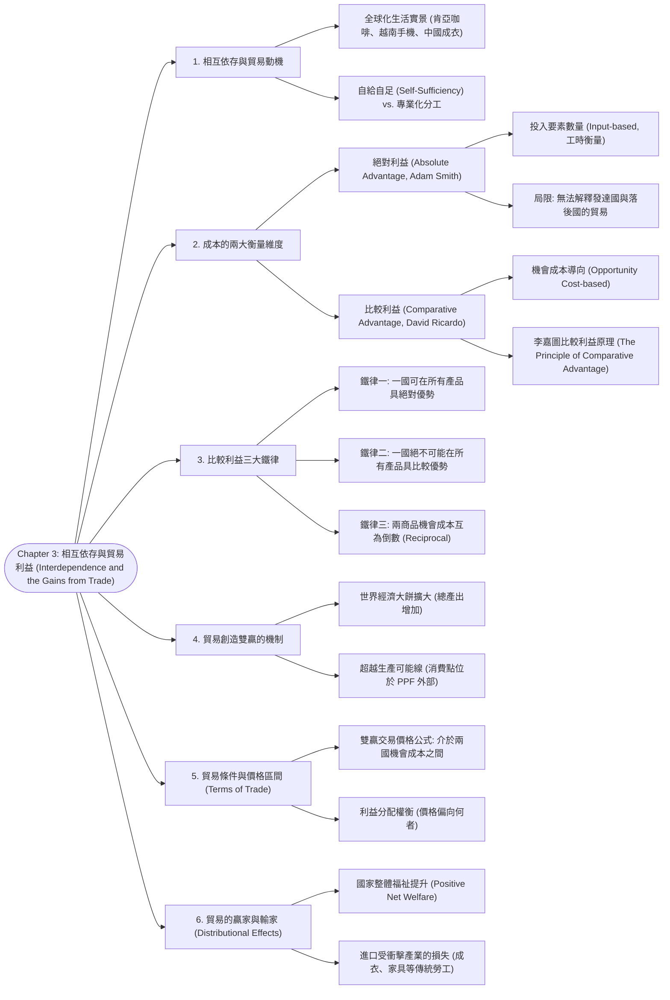

# Chapter 3: 相互依存與貿易利益 (Interdependence and the Gains from Trade)

> 📅 生成日期：2026-10-24  
> 📄 來源檔案：[Reference/NCU_Classes/經濟學/CH3.pdf](file:///c:/Users/Cupid/Downloads/Study-space/Reference/NCU_Classes/經濟學/CH3.pdf)  
> 🎯 適用考試：中央大學經濟學課程期中考、商管研究所/轉學考個體經濟學基礎  

---

## 🗺️ 知識架構總覽 (Tree Diagram)

### 🎯 本章學習進度檢核 (完成後打勾，建立成就反饋)

- [ ] [1. 相互依存與貿易動機](#sec-1)
- [ ] [2. 成本的兩大衡量維度](#sec-2)
- [ ] [3. 比較利益三大鐵律](#sec-3)
- [ ] [4. 貿易創造雙贏的機制](#sec-4)
- [ ] [5. 貿易條件與價格區間 (Terms of Trade)](#sec-5)
- [ ] [6. 貿易的贏家與輸家 (Distributional Effects)](#sec-6)

---

## 📖 知識點教材

### 3.1 相互依存與自給自足的代價 (Interdependence vs. Self-Sufficiency)

#### 📌 核心概念

- **經濟相互依存（Economic Interdependence）**：在現代社會中，個人每天都仰賴世界各地數以百萬計素未謀面的人，來為我們提供日常消費的物品與服務（如喝肯亞的咖啡、穿中國製造的襯衫、使用越南組裝的智慧型手機、用俄亥俄州的髮膠）。
- **兩條根本道路的選擇**：
  1. **自給自足（Self-Sufficiency）**：一個個人或國家完全不與外界交易，只消費自己所生產的物品。其結果是**消費可能性嚴格受限於自身的生產可能線（PPF）**，生活水準低下且選擇極其匱乏。
  2. **專業化分工與貿易（Specialization & Trade）**：各人或各國專注於自身擅長的生產領域，透過市場進行跨國/跨區域交易。其結果是**消費點能夠突破原本的 PPF 限制，落在 PPF 的外部**！

#### 💡 重要觀念提醒

- **熱身回顧題（講義第 3 頁）**：
  - 瑪麗亞（Maria）每天讀書 5 小時。她每小時能讀 20 頁經濟學，或 50 頁社會學。
  - 若瑪麗亞決定讀 100 頁社會學，她的機會成本是多少？
  - **解析**：讀 100 頁社會學需要耗費 $100 / 50 = 2\text{ 小時}$。在這 2 小時中，她原本可以讀 $2 \times 20 = \mathbf{40\text{ 頁經濟學}}$。因此機會成本是 40 頁經濟學。

---

### 3.2 絕對利益 vs. 比較利益：亞當斯密與李嘉圖的交鋒 (Absolute vs. Comparative Advantage)

#### 📌 核心概念

衡量生產一件物品的成本有兩種截然不同的方式，分別對應兩大經濟學優勢理論：

| 優勢理論 | 提出學者 | 成本衡量指標 | 定義與判別基準 | 理論地位與局限 |
| :--- | :--- | :--- | :--- | :--- |
| **絕對利益 (Absolute Advantage)** | 亞當·斯密 (Adam Smith, 1776) | **投入要素數量（工時）** | 生產同一單位產品所需使用的**投入要素（如勞動工時）較少**的生產者。 | 只能解釋技術互有長短之國家的分工；**無法解釋先進發達國與落後發展中國家之間的貿易！** |
| **比較利益 (Comparative Advantage)** | 大衛·李嘉圖 (David Ricardo, 1817) | **機會成本（放棄的另一種商品產出）** | 生產同一單位產品所需承擔的**機會成本較小**的生產者。 | **國際貿易與專業化分工的最核心基石**！即使一國在所有產品上皆處於絕對劣勢，依然能從貿易中獲益。 |

#### 📐 核心公理：比較利益的三大鐵律 (Three Golden Rules)

1. **鐵律一：一國可以在「所有」產品上皆擁有絕對優勢**。
   - 例：先進國科技與資本發達，生產每台電腦與每噸穀物所需工時皆低於落後國。
2. **鐵律二：一國「絕不可能」在所有產品上都擁有比較優勢！**
   - 只要兩種產品在兩國間的機會成本存在差異，一國在某產品具比較利益，另一國就**必定**在另一產品具比較利益。
3. **鐵律三：機會成本的倒數關係（Reciprocal Rule）**：
   $$\text{商品 X 的機會成本} = \frac{1}{\text{商品 Y 的機會成本}}$$
   - 若美國生產 1 台電腦的機會成本為 10 噸小麥，則生產 1 噸小麥的機會成本必定是 $1/10 = 0.1$ 台電腦。

#### 💡 重要觀念提醒
>
> ⚠️ **考試最致命陷阱**：
> 決定貿易分工方向與跨國貿易雙贏的**充要條件是「比較利益」，而不是「絕對利益」**！絕對利益僅能反映生產力高低，完全不決定誰應該專精生產什麼。

#### 📊 範例（講義 Active Learning 4 改編）

**已知條件**：阿根廷與巴西每月皆有 10,000 小時勞動：

- **阿根廷**：生產 1 磅咖啡需 2 小時；生產 1 瓶葡萄酒需 4 小時。
- **巴西**：生產 1 磅咖啡需 1 小時；生產 1 瓶葡萄酒需 5 小時。

**步驟一：判斷絕對利益（看工時誰少）**

- 咖啡：巴西（1hr）$<$ 阿根廷（2hr）$\to$ **巴西具絕對利益**。
- 葡萄酒：阿根廷（4hr）$<$ 巴西（5hr）$\to$ **阿根廷具絕對利益**。

**步驟二：計算機會成本與比較利益（看放棄誰少）**

- **阿根廷**：
  - 產 1 瓶葡萄酒需 4 小時，若把這 4 小時改去產咖啡，可產 $4 / 2 = 2\text{ 磅咖啡}$。
  - 即：$\text{阿根廷 1 葡萄酒} = 2\text{ 咖啡}$（$\text{1 咖啡} = 0.5\text{ 葡萄酒}$）。
- **巴西**：
  - 產 1 瓶葡萄酒需 5 小時，若改產咖啡，可產 $5 / 1 = 5\text{ 磅咖啡}$。
  - 即：$\text{巴西 1 葡萄酒} = 5\text{ 咖啡}$（$\text{1 咖啡} = 0.2\text{ 葡萄酒}$）。
- **比較利益歸屬**：
  - 葡萄酒機會成本：阿根廷（2 咖啡）$<$ 巴西（5 咖啡）$\to$ **阿根廷在葡萄酒具有比較利益**！
  - 咖啡機會成本：巴西（0.2 葡萄酒）$<$ 阿根廷（0.5 葡萄酒）$\to$ **巴西在咖啡具有比較利益**！

---

### 3.3 貿易創造雙贏的數值推導：美日電腦與小麥模型 (Numerical Proof of Gains from Trade)

#### 📌 核心模型設定（講義第 7～22 頁經典案例）

- **兩國與資源**：
  - **美國（U.S.）**：擁有 50,000 小時勞動。產 1 台電腦需 100 小時；產 1 噸小麥需 10 小時。
  - **日本（Japan）**：擁有 30,000 小時勞動。產 1 台電腦需 125 小時；產 1 噸小麥需 25 小時。

#### 📐 第一階段：無貿易時的自給自足 (Without Trade)

假設兩國皆將自身工時的 50% 投入兩項產品：

- **美國（25,000 hr 各自分配）**：
  $$\text{電腦} = \frac{25,000}{100} = \mathbf{250\text{ 台}}, \quad \text{小麥} = \frac{25,000}{10} = \mathbf{2,500\text{ 噸}}$$
- **日本（15,000 hr 各自分配）**：
  $$\text{電腦} = \frac{15,000}{125} = \mathbf{120\text{ 台}}, \quad \text{小麥} = \frac{15,000}{25} = \mathbf{600\text{ 噸}}$$
- **世界總產出（自給自足）**：電腦 $= 250 + 120 = \mathbf{370\text{ 台}}$；小麥 $= 2,500 + 600 = \mathbf{3,100\text{ 噸}}$。

#### 📐 第二階段：機會成本分析與專業化分工 (Specialization)

1. **計算各自的機會成本**：
   - **美國**：產 1 台電腦需 100hr，等同放棄 $100 / 10 = \mathbf{10\text{ 噸小麥}}$（1 噸小麥 $= 0.1$ 台電腦）。
   - **日本**：產 1 台電腦需 125hr，等同放棄 $125 / 25 = \mathbf{5\text{ 噸小麥}}$（1 噸小麥 $= 0.2$ 台電腦）。
2. **比較利益確定**：
   - 電腦機會成本：日本（5 噸）$<$ 美國（10 噸）$\implies$ **日本在電腦具比較利益**。
   - 小麥機會成本：美國（0.1 台）$<$ 日本（0.2 台）$\implies$ **美國在小麥具比較利益**。
3. **依比較利益分工生產（Production with Trade）**：
   - **日本**：將全部 30,000 工時完全專精生產電腦：
     $$\text{日本產出} = \frac{30,000}{125} = \mathbf{240\text{ 台電腦}}, \quad \mathbf{0\text{ 噸小麥}}$$
   - **美國**：將 34,000 工時投入小麥，剩餘 16,000 工時投入電腦：
     $$\text{美國小麥} = \frac{34,000}{10} = \mathbf{3,400\text{ 噸}}, \quad \text{美國電腦} = \frac{16,000}{100} = \mathbf{160\text{ 台}}$$
4. **世界總產出變化（經濟大餅擴大）**：
   - 世界電腦總量：$160 + 240 = \mathbf{400\text{ 台}}$（淨增加 $+30$ 台！）。
   - 世界小麥總量：$3,400 + 0 = \mathbf{3,400\text{ 噸}}$（淨增加 $+300$ 噸！）。

#### 📐 第三階段：貿易交換與最終消費福祉 (Consumption Under Trade)

- **貿易協定條款**：美國出口 **700 噸小麥** 給日本，換取日本出口的 **110 台電腦**。
- **最終消費量對照表**：

| 國家 | 商品 | (A) 無貿易自給自足消費 | (B) 專業化國內產量 | (C) 貿易淨進出口 | (D) 貿易後消費量 (B+C) | 貿易淨獲益 (D - A) |
| :--- | :--- | :---: | :---: | :---: | :---: | :---: |
| **美國** | **電腦** | 250 台 | 160 台 | 進口 +110 台 | **270 台** | **多得 +20 台** |
| | **小麥** | 2,500 噸 | 3,400 噸 | 出口 -700 噸 | **2,700 噸** | **多得 +200 噸** |
| **日本** | **電腦** | 120 台 | 240 台 | 出口 -110 台 | **130 台** | **多得 +10 台** |
| | **小麥** | 600 噸 | 0 噸 | 進口 +700 噸 | **700 噸** | **多得 +100 噸** |

> 🌟 **核心結論**：
> 儘管美國在兩種產品上皆具有**絕對優勢**，但透過比較利益分工與貿易，**美日兩國同時享受了比自給自足時更多數量的電腦與更多數量的小麥**！兩國的消費組合皆成功**跨越到了原本各自 PPF 的外圍**！

---

### 3.4 貿易條件與雙贏價格區間 (Terms of Trade)

#### 📌 核心概念

- **貿易條件 / 交易價格（Terms of Trade）**：兩國在進行商品交換時的**相對價格比率**（例如：1 台電腦能兌換多少噸小麥）。
- **雙贏價格區間基本準則**：
  $$\text{進口國的機會成本} > \text{貿易交易價格} > \text{出口國的機會成本}$$
- **直覺經濟學邏輯**：
  1. 對**買方（進口國）**而言：交易價格必須**低於自己國內自行生產的機會成本**，否則不如自己造。
  2. 對**賣方（出口國）**而言：交易價格必須**高於自己國內生產該產品的機會成本**，否則無利可圖。

#### 📐 美日案例的價格檢驗

- 美國產 1 電腦成本 $= 10\text{ 噸小麥}$（美國是電腦買方/進口國）。
- 日本產 1 電腦成本 $= 5\text{ 噸小麥}$（日本是電腦賣方/出口國）。
- **雙贏的電腦交易價格區間**：
  $$5\text{ 噸小麥} < \text{1 台電腦的價格} < 10\text{ 噸小麥}$$
- 在美日合約中，以 110 台電腦換 700 噸小麥，換算單價：
  $$P_{\text{computer}} = \frac{700}{110} \approx \mathbf{6.36\text{ 噸小麥}}$$
  因為 $5 < 6.36 < 10$，落在雙贏區間內，故兩國皆大歡喜！

#### 💡 重要觀念提醒

- **利益如何瓜分？**：
  - 若成交價格極度接近 5 噸小麥（如 5.1 噸），則貿易利益絕大部分被美國賺走（用極便宜代價買到電腦）；
  - 若成交價格極度接近 10 噸小麥（如 9.9 噸），則貿易利益絕大部分被日本賺走。

---

### 3.5 經典考試題型解析專題 (Advanced Worked Problems)

#### 📊 題型一：Pat 與 Kris 的披薩與沙士貿易定價（講義第 34 頁）

**題目情境**：Pat 與 Kris 是室友：

- **Pat**：釀造 1 加侖沙士（Root beer）需 4 小時；製作 1 個披薩（Pizza）需 2 小時。
- **Kris**：釀造 1 加侖沙士需 6 小時；製作 1 個披薩需 4 小時。
- 請問使兩人皆能獲利的「1 個披薩之最高價格」與「最低價格」各為何（以沙士加侖數表示）？

**逐步推導**：

1. **計算生產 1 個披薩的機會成本**：
   - **Pat**：做 1 披薩需 2hr，若改釀沙士可釀 $2 / 4 = \mathbf{0.5\text{ 加侖沙士}}$。
   - **Kris**：做 1 披薩需 4hr，若改釀沙士可釀 $4 / 6 = \mathbf{\frac{2}{3}\text{ 加侖沙士}}$。
2. **比較利益與分工**：
   - 披薩機會成本：Pat（$0.5$）$<$ Kris（$2/3 \approx 0.67$）$\implies$ **Pat 專精做披薩，出口給 Kris**。
   - Kris 專精釀沙士，出口給 Pat。
3. **決定披薩價格區間**：
   - 賣方 Pat 要求價格必須高於自身成本：$P_{\text{pizza}} > 0.5\text{ 加侖沙士}$。
   - 買方 Kris 要求價格必須低於自身成本：$P_{\text{pizza}} < \frac{2}{3}\text{ 加侖沙士}$。
   - **答案**：
     - **最低價格** $= \mathbf{0.5\text{ 加侖沙士}}$（低於此價 Pat 拒絕交易）。
     - **最高價格** $= \mathbf{\frac{2}{3}\text{ 加侖沙士}}$（高於此價 Kris 選擇自己做）。

---

#### 📊 題型二：德法兩國汽車與葡萄酒參數 X 求解（講義第 36 頁）

**題目情境**：

- 德國勞工生產 1 輛汽車需 400 小時；生產 1 箱葡萄酒需 2 小時。
- 法國勞工生產 1 輛汽車需 600 小時；生產 1 箱葡萄酒需 $X$ 小時。
- **子問題 1**：當 $X$ 為何值時，兩國能夠從貿易中獲利？
- **子問題 2**：當 $X$ 為何值時，德國將「出口汽車、進口葡萄酒」？

**逐步推導**：

1. **計算生產 1 輛汽車的機會成本**：
   - **德國**：$400 / 2 = \mathbf{200\text{ 箱葡萄酒}}$。
   - **法國**：$600 / X\text{ 箱葡萄酒}$。
2. **解答子問題 1（貿易獲益條件）**：
   - 只要兩國機會成本不相等，比較利益即存在，貿易即可獲益：
     $$\frac{600}{X} \ne 200 \implies X \ne \mathbf{3\text{ 小時}}$$
   - **結論**：只要 $X \ne 3$ 小時，兩國便能從貿易中獲益。
3. **解答子問題 2（德國出口汽車條件）**：
   - 德國要出口汽車，必須在汽車生產上具有**比較利益（機會成本較低）**：
     $$\text{德國汽車機會成本 } (200) < \text{法國汽車機會成本 } \left(\frac{600}{X}\right)$$
     $$200 < \frac{600}{X} \implies 200X < 600 \implies X < \mathbf{3\text{ 小時}}$$
   - **結論**：當 $X < 3$ 小時（例如法國產 1 箱酒只需 1 小時），德國將出口汽車、進口法國葡萄酒。

---

### 3.6 貿易的國內分配效果：贏家與輸家 (Winners and Losers from Trade)

#### 📌 核心概念

- 經濟學專家共識調查（Mankiw 經典問卷）：
  > 「與中國貿易使大部分美國人生活變好，因為他們能買到更便宜的商品。」（學界共識贊同）
  > 「然而，部分在受衝擊產業（如成衣、鞋類、低階家具）工作的美國勞工，其福利因貿易而顯著受損。」（學界共識贊同）
- **總體利益 vs. 個體分配**：
  1. 自由貿易創造的**國家總利益必然大於總損失（Net Positive Gain）**。
  2. 但自由貿易會引起**國內所得與財富的巨大重分配**：
     - **贏家**：廣大消費者（享有低物價）、出口導向產業（如半導體、軟體、商用客機）的資本家與高技術勞工。
     - **輸家**：國內缺乏國際競爭力的進口替代產業勞工（面臨減薪、失業或被迫轉行）。
  3. **政策解方**：不應盲目推動保護主義關稅，而是應透過貿易調整協助（Trade Adjustment Assistance）、再就業培訓與社會安全網，將貿易帶來的超額紅利補償受害勞工。

---

---

## 📝 實戰練習題 (三層遞進式強化測驗)

### 🟢 Tier 1：必懂基礎 (Must-Know Fundamentals)

> 💡 **學習目標**：確認自己「會算、會辨識」——給數字就能做對、給名稱就能配對。

#### Q1. (基礎絕對利益計算) 絕對利益 (Absolute Advantage) 判定

設甲國與乙國每名工人每日的生產能力如下表所示：

| 國家 | 每人每日牛肉產量 ($X$) | 每人每日小麥產量 ($Y$) |
|:---:|:---:|:---:|
| **甲國** | 10 單位 | 5 單位 |
| **乙國** | 6 單位 | 4 單位 |

請問在牛肉與小麥的生產上，兩國的「絕對利益」歸屬為何？

(A) 甲國在牛肉具絕對利益，乙國在小麥具絕對利益  
(B) 甲國在牛肉與小麥的生產上，皆具備絕對利益（因為 $10 > 6$ 且 $5 > 4$）  
(C) 乙國在牛肉與小麥的生產上，皆具備絕對利益  
(D) 兩國皆無絕對利益  

👉 [查看 Q1 答案與詳細解析](#ans-q1)

---

#### Q2. (基礎機會成本計算) 機會成本 (Opportunity Cost) 數值換算

承接上一題數據（甲國每人日產 10 牛肉或 5 小麥；乙國每人日產 6 牛肉或 4 小麥）：
(1) 甲國生產 1 單位牛肉的機會成本是多少單位小麥？  
(2) 乙國生產 1 單位牛肉的機會成本是多少單位小麥？  

(A) (1) 0.5 單位小麥, (2) 約 0.67 單位小麥（即 $2/3$ 單位）  
(B) (1) 2.0 單位小麥, (2) 1.5 單位小麥  
(C) (1) 0.5 單位小麥, (2) 1.5 單位小麥  
(D) (1) 5 單位小麥, (2) 4 單位小麥  

👉 [查看 Q2 答案與詳細解析](#ans-q2)

---

#### Q3. (基礎比較利益配對) 比較利益判定與分工方向

承接前兩題分析：
依據李嘉圖的比較利益理論（生產某商品機會成本較低者具備比較利益）：
(1) 哪一國在「牛肉」生產上具備比較利益？  
(2) 哪一國在「小麥」生產上具備比較利益？  
(3) 兩國應當如何進行專業化分工（Specialization）？

(A) 甲國牛肉具比較利益，乙國小麥具比較利益；甲國專門生產牛肉，乙國專門生產小麥  
(B) 乙國牛肉具比較利益，甲國小麥具比較利益；乙國生產牛肉，甲國生產小麥  
(C) 甲國在兩項商品上皆具備比較利益；甲國包辦所有生產，乙國完全不生產  
(D) 兩國皆無比較利益，無法進行分工  

👉 [查看 Q3 答案與詳細解析](#ans-q3)

---

#### Q4. (基礎貿易價格區間) 互利貿易價格 (Terms of Trade) 範圍判定

承接前題，兩國達成協議開展國際貿易：
若兩國約定以「1 單位小麥換取 $P$ 單位牛肉」進行跨國交換，此貿易價格 $P$ 必須介於兩國各自生產小麥的機會成本之間，雙方才願意自願進行貿易。
請問互利貿易價格 $P$ 的合理數值區間為何？

(A) $0.5 < P < 0.67$ 單位牛肉  
(B) $1.5 < P < 2.0$ 單位牛肉  
(C) $P > 2.0$ 單位牛肉  
(D) $P < 1.0$ 單位牛肉  

👉 [查看 Q4 答案與詳細解析](#ans-q4)

---

#### Q5. (基礎概念正誤判別) 一國是否可能在所有商品上皆具比較利益？

某評論員宣稱：「甲國在科技、農業、工業所有領域的生產力都遠超乙國，因此甲國在所有商品上皆具備絕對利益與比較利益，乙國注定在貿易中被全面剝削淘汰。」
從經濟學比較利益原理來看，此說法在邏輯上何以**必定荒謬錯誤**？

(A) 因為乙國可以發行更多貨幣來反制  
(B) 一國可能在所有商品上皆具備「絕對利益」，但在邏輯上**絕對不可能在所有商品上皆具備「比較利益」**！因為兩商品的機會成本互為倒數，一國在某商品的機會成本較低，其在另一商品的機會成本就必定相對較高，另一國必然在該商品上享有比較利益  
(C) 因為聯合國憲章禁止一國享有所有比較利益  
(D) 因為世界貿易組織會對甲國課徵反傾銷稅  

👉 [查看 Q5 答案與詳細解析](#ans-q5)

---

### 🟡 Tier 2：基礎 + 實際應用 (Application & Scenario Matching)

> 💡 **學習目標**：確認自己「會用」——能正確換算勞動工時之機會成本、解析消費可能線突破 PPF 與名人工時案例。

#### Q6. (工時成本換算陷阱) 生產 1 單位所需工時的機會成本推導

荒島上的魯賓遜與星期五各自生產「魚（條）」與「椰子（顆）」。下表給出的是「**生產 1 單位商品所需的勞動工時（Hours needed to make 1 unit）**」：

| 人員 | 生產 1 條魚所需工時 | 生產 1 顆椰子所需工時 |
|:---:|:---:|:---:|
| **魯賓遜** | 1 小時 | 2 小時 |
| **星期五** | 6 小時 | 4 小時 |

請注意此表為「**投入工時**」而非「產出數量」！請問：
(1) 魯賓遜生產 1 顆椰子的機會成本是多少條魚？  
(2) 星期五生產 1 顆椰子的機會成本是多少條魚？  
(3) 誰在「椰子」生產上擁有比較利益？

(A) (1) 2 條魚, (2) $2/3$ 條魚；(3) 星期五在椰子生產上擁有比較利益  
(B) (1) 0.5 條魚, (2) 1.5 條魚；(3) 魯賓遜在椰子生產上擁有比較利益  
(C) (1) 2 條魚, (2) 1.5 條魚；(3) 星期五在椰子生產上擁有比較利益  
(D) (1) 1 條魚, (2) 1 條魚；(3) 兩人完全相同  

👉 [查看 Q6 答案與詳細解析](#ans-q6)

---

#### Q7. (貿易利得的幾何體現) 消費可能線 (CPF) 突破 PPF

在閉關自守、自給自足（Autarky）的經濟體中，該國國民所能享受的最大「消費組合」，嚴格受限於其自身本國的「生產可能曲線 (PPF)」。
一旦該國打開國門參與國際自由貿易，並依據比較利益原則進行專業化分工：
該國在國際貿易後的**實際消費點（Consumption Point）**，在幾何圖形上會呈現何種突破性變動？

(A) 依然被牢牢鎖定在原本 PPF 的邊界上  
(B) 退縮至本國 PPF 的內部（缺乏效率）  
(C) 突破本國 PPF 邊界，成功座落於原本在國內技術下「不可達成（Infeasible）」的 **PPF 外部區域**  
(D) 轉變成一個三維立體球體  

👉 [查看 Q7 答案與詳細解析](#ans-q7)

---

#### Q8. (名人時間價值案例) 頂尖專利律師是否應該自己打字？

某知名王牌專利律師每小時的客戶諮詢費高達 10,000 元台幣。同時她也是打字奇才，打字速度高達每分鐘 120 字（比市面上所有普通秘書快上一倍）。
市面上普通專業秘書的打字時薪為 400 元台幣，打字速度為每分鐘 60 字。
依據經濟學機會成本與比較利益原理，該律師是否應該自己親自打法律公文？

(A) 應該自己打，因為她在打字上享有「絕對利益」，自己打字速度最快且最不浪費時間  
(B) 不應該自己打！因為律師打字的機會成本是高達每小時 10,000 元的律師諮詢費，而秘書打字的機會成本僅為每小時 400 元。律師在諮詢上具備壓倒性的比較利益，她應當雇用秘書打字，將全部精力集中於法律業務  
(C) 應該自己打，這樣可以省下 400 元的秘書薪水  
(D) 兩者皆可，完全沒有差別  

👉 [查看 Q8 答案與詳細解析](#ans-q8)

---

#### Q9. (非互利條件後果) 貿易價格落於機會成本區間外的市場破局

承接 Q1~Q4 的甲乙兩國模型（甲國小麥機會成本為 2 單位牛肉；乙國小麥機會成本為 1.5 單位牛肉）：
若乙國代表團在談判時強烈堅持：「1 單位小麥必須換取 2.6 單位牛肉，否則免談！」
請問在此貿易條件下，會發生什麼市場後果？

(A) 甲國會欣然同意，因為甲國牛肉產量很大  
(B) 兩國貿易破局！因為甲國在國內自己生產 1 單位小麥只需犧牲 2.0 單位牛肉。若向乙國購買小麥卻要付出 2.6 單位牛肉，代價遠高於國內自產，理性經濟體必然拒絕貿易  
(C) 乙國會遭受嚴重的貿易逆差  
(D) 世界銀行會強制沒收甲國的牛肉  

👉 [查看 Q9 答案與詳細解析](#ans-q9)

---

### 🔴 Tier 3：概念講述與深度分析 (Conceptual & Analytical)

> 💡 **學習目標**：確認自己「會講」——能推導李嘉圖貿易非零和賽局、剖析貿易衝擊下的所得分配與動態競爭優勢。

#### Q10. (古典貿易數理推導題) 李嘉圖 (David Ricardo) 比較利益理論與非零和賽局證明

設世界由甲國（A）與乙國（B）組成，生產商品 $X$ 與 $Y$。每生產 1 單位商品所需的勞動投入工時分別為 $a_{LX}, a_{LY}$ 與 $b_{LX}, b_{LY}$：
(1) 假設甲國在兩項商品上皆具備絕對優勢（即 $a_{LX} < b_{LX}$ 且 $a_{LY} < b_{LY}$）。請以代數比值嚴格證明：只要兩國的相對技術比例不完全相同（即 $\frac{a_{LX}}{a_{LY}} \ne \frac{b_{LX}}{b_{LY}}$），則乙國必然在其中一種商品上享有比較利益。  
(2) 請以代數推導證明：當兩國各自將 1 單位勞動從比較劣勢部門轉移至比較優勢部門，並以合適的貿易條件交換時，全球的商品總產量增量 $\Delta X + \Delta Y$ 為什麼必定嚴格大於零（即自由貿易是「非零和賽局 (Non-zero-sum game)」創造實質新財富，而非掠奪）？

👉 [查看 Q10 答案與詳細解析](#ans-q10)

---

#### Q11. (政治經濟學深思題) 自由貿易的贏家、輸家與所得重分配 (Income Redistribution)

大衛·李嘉圖證明了自由貿易能使參與國的「國家整體總福利（National Welfare）」達到最大化。然而在現代歐美各國的選舉中，鋼鐵、紡織等傳統製造業工人卻組成了強大的「反全球化保護主義聯盟」：
(1) 既然自由貿易創造了貿易利得，為什麼現實中仍有一大群國民成為貿易自由化的「實質受害者」？請從「**特定要素模型（Specific Factors Model）**」與要素流動僵固性，剖析出口擴張產業與進口競爭產業在要素報酬上的劇烈分化。  
(2) 從福利經濟學的補償原則（Kaldor-Hicks Compensation Principle）出發，政府在擁抱自由貿易的同時，為什麼**必須**設計配套的「貿易調整援助（Trade Adjustment Assistance, TAA）」機制？

👉 [查看 Q11 答案與詳細解析](#ans-q11)

---

#### Q12. (貿易戰略論述題) 靜態比較利益 (Static) vs. 動態競爭優勢 (Dynamic Advantage)

古典李嘉圖貿易理論假設各國的生產技術係數是固定不變的（例如英國天生適合織布、葡萄牙天生適合釀酒）：
(1) 若在二戰後的 1950 年代，東亞經濟體（如台灣、南韓、日本）完全固守古典李嘉圖的「靜態比較利益」，它們應當永遠專注於生產何種商品？這種靜態分工會對發展中國家的長期產業升級帶來何種貧困陷阱？  
(2) 台灣與南韓在 1970~1980 年代是如何透過「幼稚產業保護、政府引導研發投資、技職教育深化與動態學習曲線（Learning-by-doing）」，強行跨越靜態比較劣勢，在半導體光刻、記憶體與重工業中人為創造出強大的「動態比較利益（Dynamic Comparative Advantage）」？

👉 [查看 Q12 答案與詳細解析](#ans-q12)

---

## 🔑 本章練習題答案與詳細解析 (Answer Key)

### 🟢 Tier 1 解析

### Q1 答案與詳細解析

* **正確答案**：**(B)**
* **絕對利益 (Absolute Advantage) 定義**：
  * 當一個生產者使用**較少數量的投入品（或在相同時間內生產出更多產出）** 來生產某種商品時，該生產者在該商品上享有絕對利益（亞當·斯密提出）。
  * **牛肉生產能力對比**：甲國每人日產 10 單位，乙國每人日產 6 單位。因 $10 > 6$，**甲國在牛肉上具絕對利益**。
  * **小麥生產能力對比**：甲國每人日產 5 單位，乙國每人日產 4 單位。因 $5 > 4$，**甲國在小麥上亦具絕對利益**。
  * 選項 (B) 正確。

[🔙 返回題目 Q1](#q1) ｜ [🔝 返回知識架構圖](#tree-diagram)

---

### Q2 答案與詳細解析

* **正確答案**：**(A)**
* **機會成本逐步換算**：
  * **甲國**：1 日工時可產 10 牛肉或 5 小麥。
    * 生產 10 牛肉的代價是放棄 5 小麥。
    * 生產 1 單位牛肉的機會成本 $= \frac{5}{10} = 0.5\text{ 單位小麥}$。
  * **乙國**：1 日工時可產 6 牛肉或 4 小麥。
    * 生產 6 牛肉的代價是放棄 4 小麥。
    * 生產 1 單位牛肉的機會成本 $= \frac{4}{6} = \frac{2}{3} \approx 0.67\text{ 單位小麥}$。
  * 選項 (A) 完全正確。

[🔙 返回題目 Q2](#q2) ｜ [🔝 返回知識架構圖](#tree-diagram)

---

### Q3 答案與詳細解析

* **正確答案**：**(A)**
* **比較利益判定與分工原則**：
  * **比較利益 (Comparative Advantage)**：生產某種商品具有**較低機會成本**的生產者，在該商品上享有比較利益（大衛·李嘉圖提出）。
  * **牛肉比較**：甲國成本（0.5 小麥）$<$ 乙國成本（0.67 小麥），**甲國在牛肉上具比較利益**。
  * **小麥比較**：
    * 甲國生產 1 小麥成本 $= \frac{10}{5} = 2.0\text{ 單位牛肉}$。
    * 乙國生產 1 小麥成本 $= \frac{6}{4} = 1.5\text{ 單位牛肉}$。
    * 乙國成本（1.5 牛肉）$<$ 甲國成本（2.0 牛肉），**乙國在小麥上具比較利益**。
  * **分工原則**：各國應完全專業化生產自己具備比較利益的商品，然後進行國際貿易。故甲國專業化生產牛肉，乙國專業化生產小麥。選項 (A) 正確。

[🔙 返回題目 Q3](#q3) ｜ [🔝 返回知識架構圖](#tree-diagram)

---

### Q4 答案與詳細解析

* **正確答案**：**(B)**
* **貿易條件 (Terms of Trade) 區間法則**：
  * 雙方能達成互利自願貿易的充要條件是：**貿易價格必須嚴格介於兩國各自的機會成本之間**。
  * 對於小麥（乙國出口、甲國進口）：
    * 乙國自產 1 單位小麥的成本為 $1.5$ 單位牛肉，因此乙國賣出 1 小麥換回的牛肉必須 $> 1.5$ 單位才有利可圖。
    * 甲國在國內自產 1 單位小麥的成本為 $2.0$ 單位牛肉，因此甲國買入 1 小麥願付的牛肉代價上限為 $< 2.0$ 單位。
    * 聯立可得互利價格區間：$1.5 < P < 2.0\text{ 單位牛肉}$。例如以 $1.75$ 牛肉成交，乙國多賺 $0.25$ 牛肉，甲國少花 $0.25$ 牛肉，雙方皆大歡喜。選項 (B) 正確。

[🔙 返回題目 Q4](#q4) ｜ [🔝 返回知識架構圖](#tree-diagram)

---

### Q5 答案與詳細解析

* **正確答案**：**(B)**
* **機會成本互為倒數之數學必然**：
  * 設有商品 $X$ 與 $Y$：
    * 生產 $X$ 的機會成本 $= \frac{\text{放棄的 } Y}{\text{獲得的 } X}$
    * 生產 $Y$ 的機會成本 $= \frac{\text{放棄的 } X}{\text{獲得的 } Y} = \frac{1}{\text{生產 } X \text{ 的機會成本}}$
  * 兩商品的機會成本**嚴格互為倒數**！
  * 若甲國在生產 $X$ 上的機會成本低於乙國（$C_{AX} < C_{BX}$），則其倒數必然大於乙國（$\frac{1}{C_{AX}} > \frac{1}{C_{BX}} \implies C_{AY} > C_{BY}$），這意味著乙國在生產 $Y$ 上的機會成本必然低於甲國！
  * 因此在數學邏輯上，**任何一個國家絕對不可能在所有商品上同時具備比較利益**。即使一個國家貧困弱小至極，在所有商品上的技術都落後，也必然會在某項商品上擁有比較利益！選項 (B) 正確。

[🔙 返回題目 Q5](#q5) ｜ [🔝 返回知識架構圖](#tree-diagram)

---

### 🟡 Tier 2 解析

### Q6 答案與詳細解析

* **正確答案**：**(A)**
* **工時投入表格換算核心步驟（必考陷阱）**：
  * 當題目表格為「**生產 1 單位所需的工時**」時，數值越小代表生產力越高！
  * **魯賓遜**：
    * 採 1 顆椰子需 2 小時。若將這 2 小時拿去抓魚（每小時抓 1 條），可抓 2 條魚。
    * 故魯賓遜生產 1 椰子的機會成本 $= \frac{2\text{ 小時}}{1\text{ 小時/魚}} = 2\text{ 條魚}$。
  * **星期五**：
    * 採 1 顆椰子需 4 小時。若將這 4 小時拿去抓魚（抓 1 條需 6 小時），可抓 $\frac{4}{6} = \frac{2}{3}$ 條魚。
    * 故星期五生產 1 椰子的機會成本 $= \frac{4\text{ 小時}}{6\text{ 小時/魚}} = \frac{2}{3} \approx 0.67\text{ 條魚}$。
  * **比較利益歸屬**：
    * 星期五的機會成本（$2/3$ 條魚）遠低於魯賓遜（2 條魚）！
    * 故**星期五在椰子生產上具備顯著的比較利益**（而魯賓遜在捕魚上具備比較利益）。選項 (A) 完全正確。

[🔙 返回題目 Q6](#q6) ｜ [🔝 返回知識架構圖](#tree-diagram)

---

### Q7 答案與詳細解析

* **正確答案**：**(C)**
* **消費可能線超越生產邊界之幾何意義**：
  * 在封閉無貿易狀態下（Autarky）：
    $$\text{消費集合 (Consumption)} \equiv \text{生產集合 (Production)} \subseteq \text{PPF 內部與邊界}$$
  * 展開自由貿易後：
    * 國家集中全部要素只生產比較利益商品（產量極大化）。
    * 透過以有利於本國的國際比價（Terms of Trade）進行跨國交換，國家所能換回並消費的商品組合軌跡，形成了一條斜率等於國際比價的**消費可能線（Consumption Possibilities Frontier, CPF）**。
    * 此消費可能線完全凌駕於本國 PPF 之外，國民得以享受到本國即使竭盡全力也絕對無法單獨製造出的繁榮富足物資。選項 (C) 正確。

[🔙 返回題目 Q7](#q7) ｜ [🔝 返回知識架構圖](#tree-diagram)

---

### Q8 答案與詳細解析

* **正確答案**：**(B)**
* **絕對優勢不等於應親力親為**：
  * 律師打字速度 120 字/分，秘書 60 字/分，律師在打字上有絕對優勢。
  * 但考慮**機會成本**：
    * 律師自己花 1 小時打字，為事務所節省了秘書 2 小時工資（$400 \times 2 = 800\text{ 元}$）。
    * 但律師為此放棄了 1 小時可以向客戶收費的專利諮詢費（$10,000\text{ 元}$）。
    * 律師自己打字的淨損失 $= 10,000 - 800 = 9,200\text{ 元}$！
  * 結論：律師在法律諮詢上的比較利益如此之大，以致於哪怕她打字比全世界所有秘書都快，她親自打字也是巨大的經濟浪費。比較利益原理告訴我們：**永遠要把時間投入到自己相對優勢最大（機會成本最高）的核心領域，其餘工作透過外包交易完成**。選項 (B) 正確。

[🔙 返回題目 Q8](#q8) ｜ [🔝 返回知識架構圖](#tree-diagram)

---

### Q9 答案與詳細解析

* **正確答案**：**(B)**
* **自願交易的個人理性界限**：
  * 國際貿易的基本前提是「**自願交換（Voluntary Exchange）**」。自願交換只有在對雙方皆有利益時才會發生。
  * 甲國自己種 1 單位小麥，只需放棄 2.0 單位牛肉。
  * 若乙國索價 2.6 單位牛肉，甲國若答應，等於「多付出了 0.6 單位牛肉才換得 1 單位小麥」，貿易反而使其福利受損。甲國理智上必然會終止談判、閉關自產小麥。選項 (B) 正確。

[🔙 返回題目 Q9](#q9) ｜ [🔝 返回知識架構圖](#tree-diagram)

---

### 🔴 Tier 3 解析

### Q10 答案與詳細解析

* **(1) 李嘉圖比較優勢存在性之代數證明**：
  * 設 $a_{LX}, a_{LY}$ 為國 A 生產 1 單位 $X, Y$ 的工時；$b_{LX}, b_{LY}$ 為國 B 的工時。
  * 國 A 生產 $X$ 的機會成本為 $C_{AX} = \frac{a_{LX}}{a_{LY}}$；國 B 生產 $X$ 的機會成本為 $C_{BX} = \frac{b_{LX}}{b_{LY}}$。
  * 只要兩國技術比例存在差異（$\frac{a_{LX}}{a_{LY}} \ne \frac{b_{LX}}{b_{LY}}$），則實數軸上必定有大小之分：
    * 若 $\frac{a_{LX}}{a_{LY}} < \frac{b_{LX}}{b_{LY}}$，則國 A 在 $X$ 具比較優勢。
    * 取其倒數，必然有 $\frac{a_{LY}}{a_{LX}} > \frac{b_{LY}}{b_{LX}} \implies C_{AY} > C_{BY}$，這嚴格導出國 B 在 $Y$ 上具備比較優勢！
  * 結論：**不論絕對技術差距多麼巨大，只要相對技術矩陣不共線，比較優勢必然成對存在**。

* **(2) 全球總產出淨增長代數證明（非零和賽局）**：
  * 設國 A 在 $X$ 具比較優勢（$\frac{a_{LX}}{a_{LY}} < \frac{b_{LX}}{b_{LY}}$）。
  * 國 A 將 $a_{LX} \cdot a_{LY}$ 單位工時自 $Y$ 部門抽調至 $X$ 部門：
    * 國 A 的產出變動：$\Delta X_A = +a_{LY}$，$\Delta Y_A = -a_{LX}$。
  * 國 B 相應地將 $b_{LX} \cdot b_{LY}$ 單位工時自 $X$ 部門抽調至 $Y$ 部門：
    * 國 B 的產出變動：$\Delta X_B = -b_{LY}$，$\Delta Y_B = +b_{LX}$。
  * 透過按比例縮放要素配置，兩國分工後使全球 $X$ 商品淨增量剛好為零（$\Delta X_{\text{world}} = 0$）：
    此時全球 $Y$ 商品的淨增量必為：
    $$\Delta Y_{\text{world}} > 0$$
  * 這證明了：在不增加全球一分一秒額外勞動投入的前提下，**僅僅透過生產要素在不同比較優勢國別間的重新擺放，全球可消費的實體商品總量無中生有地創造出了純增量！** 自由貿易創造了實質總財富，是嚴格的非零和賽局。

[🔙 返回題目 Q10](#q10) ｜ [🔝 返回知識架構圖](#tree-diagram)

---

### Q11 答案與詳細解析

* **(1) 特定要素模型與輸贏家分化**：
  * 李嘉圖模型假設勞動力可以瞬間、零成本在各產業間自由流動。但現實世界並非如此：
    * 一個在美國五大湖區汽車廠組裝鋼板 30 年的 55 歲工人，其技能是專門綁定在「汽車製造」這一特定要素上的。
    * 當自由貿易使外國便宜汽車湧入、美國擴大出口高科技軟體時：
      * 矽谷的軟體工程師、半導體股東成為巨大的贏家（薪資暴增）。
      * 傳統汽車工人無法在 1 個月內變成軟體架構師，面臨長久失業與工廠關閉，成為殘酷的「貿易淨受害者（Losers）」。
  * 貿易使國家總體大餅變大，但進口競爭產業的要素擁有者遭受了實質所得縮水的沉重打擊。

* **(2) 卡爾多-希克斯補償原則與 TAA 機制**：
  * **Kaldor-Hicks 準則**：只要自由貿易為贏家帶來的收益總額（$\Delta W_{\text{gain}}$）大於輸家遭受的損失總額（$|\Delta W_{\text{loss}}|$），理論上贏家就有能力全額補償輸家，且補償後全社會依然有淨福利盈餘。
  * **政策必要性**：如果政府任由贏家獨享全部紅利、任由輸家承擔全部結構轉型代價，遭受苦難的勞工階級必然會在民主政治中投票支持民粹主義保護主義者，發動關稅戰，摧毀整個國際貿易體系。
  * 因此，政府**必須從貿易贏家的暴利中抽取部分稅收，建立「貿易調整援助（TAA）」**，提供失業轉職培訓、提早退休年金與再就業薪資保險，使自由貿易的宏觀紅利真正轉化為全社會分享的包容性增長。

[🔙 返回題目 Q11](#q11) ｜ [🔝 返回知識架構圖](#tree-diagram)

---

### Q12 答案與詳細解析

* **(1) 靜態比較利益的貧困陷阱**：
  * 若在 1960 年代嚴格遵循古典靜態比較利益：
    * 台灣與南韓當時資本極其匱乏、無技術積累，唯一便宜充沛的資源是大量廉價勞工。
    * 靜態比較利益要求兩國永久鎖定在「代工縫製球鞋、玩具組裝、香蕉蔗糖出口」等低附加價值勞力密集型初級產業。
    * 這會陷入發展經濟學所謂的「**貧困的比較利益陷阱**」：初級產品的國際貿易條件（Terms of Trade）長期隨時間呈惡化趨勢（Prebisch-Singer 假說），國家永遠無法脫離第三世界。

* **(2) 動態比較利益的人為創造歷程**：
  * 台灣與南韓打破了靜態神話，採用「戰略性貿易與產業政策（Strategic Trade Policy）」：
    1. **幼稚產業定向保護與扶植**：在產業萌芽初期（如工研院創立台積電與聯電），給予租稅減免與政策性貸款，避免幼苗被歐美既有跨國巨頭在市場萌芽期扼殺。
    2. **規模經濟與學習曲線（Learning Curve）攀升**：透過高強度研發補貼與專注代工良率提升，每當累計產量翻倍時，晶片生產成本便呈幾何級數急遽下降。
    3. **人力資本與基礎設施跨越式投資**：普及高等工程教育、設立科學園區，培育數十萬具備極高紀律與專業素養的晶圓工程師。
  * 經過 30 年的動態要素重構，台灣將原本在半導體製造上的極端劣勢，逆轉為掌控全球 90% 最先進製程的無敵霸主。這證明了**比較利益不是大自然永恆不變的恩賜，而是國家戰略與創新資本可以主動鍛造的動態競爭優勢**。

[🔙 返回題目 Q12](#q12) ｜ [🔝 返回知識架構圖](#tree-diagram)

---
## 📋 本章重點速記表

| # | 核心觀念 | 核心一句話定義 | 判別公式與黃金法則 |
| :---: | :--- | :--- | :--- |
| **1** | **相互依存本質** | 現代社會依賴全球分工以極大化消費品多樣性與數量 | 自給自足消費受制於 PPF；貿易消費突破 PPF |
| **2** | **絕對利益** | 以生產同一單位產品所需的**「投入要素工時」**衡量 | $\text{工時較少者} \implies \text{具絕對優勢}$（Adam Smith） |
| **3** | **比較利益** | 以生產同一單位產品所放棄的**「機會成本」**衡量 | $\text{機會成本較小者} \implies \text{具比較優勢}$（David Ricardo） |
| **4** | **機會成本倒數律** | 兩種商品之間的機會成本必然互為倒數關係 | $OC_X = \frac{1}{OC_Y}$ |
| **5** | **比較利益不可獨占** | 任何國家或個人絕不可能囊括所有產品的比較利益 | 必定各自在特定產品擁有相對優勢 |
| **6** | **雙贏價格區間** | 兩國貿易成交比率必須界於兩國機會成本之間 | $OC_{\text{出口國}} < \text{成交價格} < OC_{\text{進口國}}$ |
| **7** | **世界產出大餅** | 依比較利益分工能消弭配置無效率，擴大全球總產出 | 全球產量總和增加，兩國消費點落於各自 PPF 外 |
| **8** | **所得重分配** | 貿易創造淨國家利益，但使進口競爭產業勞工受損 | 消費者贏、出口業贏、進口替代業受衝擊 |

---

## 🃏 考前速查卡片

| 正面 (問題) | 背面 (答案) |
| :--- | :--- |
| **什麼是「絕對利益」與「比較利益」的最根本差異？** | **絕對利益**比的是「投入要素數量（誰花更少工時/原料）」；**比較利益**比的是「機會成本（誰放棄的另一物產出更少）」。貿易分工完全取決於**比較利益**！ |
| **一個國家可能在所有產品上都具有「比較優勢」嗎？為什麼？** | **不可能**！因為兩種產品的機會成本互為倒數（$OC_X = 1 / OC_Y$）。若一國在 X 具有較低成本，則其在 Y 的成本必相對較高。 |
| **一國在所有產品上都具有「絕對優勢」時，貿易還能創造好處嗎？** | **可以**！只要兩國生產不同產品的機會成本不同，兩國各自專精於機會成本相對較低的領域，便能擴大世界總產出並創造互利雙贏（如美日電腦小麥模型）。 |
| **使貿易雙方皆能自願進行交易的價格（貿易條件）必須滿足什麼條件？** | 交易價格必須**介於兩國各自生產該商品的機會成本之間**（高於出口國成本，且低於進口國成本）。 |
| **既然貿易使國家整體獲益，為什麼各國政壇常有強烈的保護主義聲浪？** | 因為貿易利益在國內的分配是不均勻的。貿易衝擊產業的本國勞工與業主會遭受失業與減薪，因而形成強大政治遊說力量要求課徵關稅。 |
| **英格蘭工人生產 1 司康需 0.02 小時，產 1 毛衣需 1 小時。求 1 毛衣的機會成本。** | 生產 1 毛衣需 1 小時，改產司康可產 $1 / 0.02 = \mathbf{50\text{ 個司康}}$。因此 1 毛衣的機會成本為 50 個司康。 |

---

## ⚠️ 本章常見考試陷阱

1. **混淆「產出法」與「投入法」計算機會成本**：
   - ❌ 誤區：看到「生產 1 台電腦需 100 小時，1 噸小麥需 10 小時」，直接用 $10 / 100 = 0.1$ 算電腦成本。
   - ✅ 正確做法：這是「投入法（給予單位投入工時）」。產 1 電腦花 100hr，這 100hr 改產小麥可得 $100 / 10 = \mathbf{10\text{ 噸小麥}}$！
   - 📌 **速記口訣**：
     - 若題目給「每小時產出量（產出法）」：$\text{X 的機會成本} = \frac{Y \text{ 產出}}{X \text{ 產出}}$（他人除以自己）。
     - 若題目給「生產一單位所需工時（投入法）」：$\text{X 的機會成本} = \frac{X \text{ 工時}}{Y \text{ 工時}}$（自己除以他人）。
2. **誤以為絕對優勢國必定包辦所有出口**：
   - ❌ 誤區：美國產電腦比日本快、產小麥也比日本快，所以美國應該同時出口電腦與小麥。
   - ✅ 正確做法：看機會成本！日本產電腦成本（5 噸小麥）低於美國（10 噸小麥），日本出口電腦，美國進口電腦。
3. **誤判貿易條件的上下限歸屬**：
   - ❌ 誤區：將最高價與最低價對應的國家搞反。
   - ✅ 正確做法：最高價永遠是**買方的機會成本**（高於此買方寧可自己做）；最低價永遠是**賣方的機會成本**（低於此賣方不願賣）。
4. **混淆「國家整體獲益」與「人人獲益」**：
   - ❌ 誤區：選擇題中將「自由貿易必定使該國所有國民皆獲益」選為真。
   - ✅ 正確做法：國家整體福祉增加，但國內進口替代產業從業人員是受損者。

---

## 📊 本章練習題統計

| 難度 | 題數 | 分布知識點 |
| :---: | :---: | :--- |
| **Easy** | 2 | 自給自足限制 (Q1)、絕對優勢判定 (Q1) |
| **Medium** | 5 | 名醫打字機會成本 (Q2)、世界產出大餅來源 (Q1)、Pat & Kris 定價 (題型一)、德法參數求解 (題型二)、英蘇模型 (講義 Q35) |
| **Hard** | 3 | 比較利益邏輯真偽 (Q1)、五大命題全面思辨 (Q1)、中美貿易分配效應 (Q2) |
| **合計** | **10 題** | 涵蓋絕對利益、比較利益、美日模型、貿易條件區間與國內分配全考點 |
