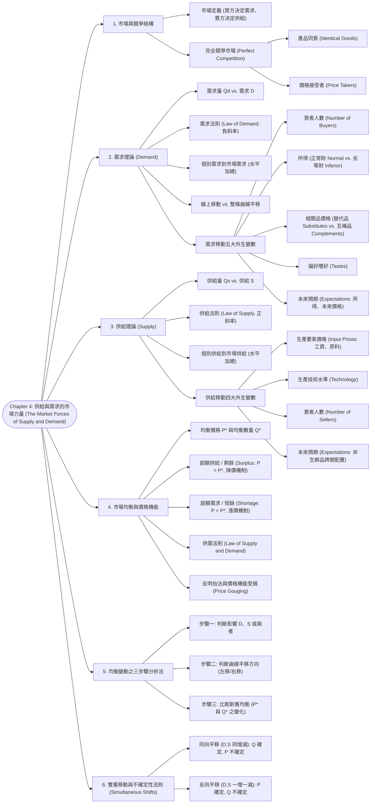

# Chapter 4: 供給與需求的市場力量 (The Market Forces of Supply and Demand)

> 📅 生成日期：2026-10-24  
> 📄 來源檔案：[Reference/NCU_Classes/經濟學/CH4.pdf](file:///c:/Users/Cupid/Downloads/Study-space/Reference/NCU_Classes/經濟學/CH4.pdf)  
> 🎯 適用考試：中央大學經濟學課程期中考、商管研究所/轉學考個體經濟學基礎  

---

## 🗺️ 知識架構總覽 (Tree Diagram)



<a id="tree-diagram"></a>

### 🎯 本章學習進度檢核 (完成後打勾，建立成就反饋)

- [ ] [1. 市場與競爭結構](#sec-1)
- [ ] [2. 需求理論 (Demand)](#sec-2)
- [ ] [3. 供給理論 (Supply)](#sec-3)
- [ ] [4. 市場均衡與價格機能](#sec-4)
- [ ] [5. 均衡變動之三步驟分析法](#sec-5)
- [ ] [6. 雙重移動與不確定性法則 (Simultaneous Shifts)](#sec-6)

---

## 📖 知識點教材

<a id="sec-1"></a>

### 4.1 市場與完全競爭結構 (Markets and Competition)

#### 📌 核心概念

- **市場（Market）**：某種特定物品或服務的**買者與賣者群體**（不必然需要實體交易場所）。
  - **買者群體（Buyers as a group）**：共同決定了該產品的**市場需求（Demand）**。
  - **賣者群體（Sellers as a group）**：共同決定了該產品的**市場供給（Supply）**。
- **競爭市場（Competitive Market）**：擁有眾多買者與眾多賣者，以至於任何單一買者或賣者對市場價格的影響力皆**微不足道（Negligible impact）**。
- **完全競爭市場（Perfectly Competitive Market）的兩大基石**：
  1. **產品完全同質（Homogeneous / Exactly the same）**：各賣方提供的商品毫無差異（如小麥、未精煉原油）。
  2. **買賣雙方人數極多**：沒有任何單一人具有市場力量（Market Power），全體參與者皆為**「價格接受者（Price Takers）」**，只能被動接受市場供需決定的市價。

#### 💡 重要觀念提醒

- 現實世界中許多市場並非完全競爭（如獨占 Monopoly、寡占 Oligopoly 或獨占性競爭 Monopolistic Competition），但完全競爭模型是經濟分析中最基礎、最優美且預測力極強的標準基準（Benchmark）。

---

<a id="sec-2"></a>

### 4.2 需求理論：法則、曲線與移動因素 (The Theory of Demand)

#### 📌 核心概念

- **需求量（Quantity Demanded, $Q^D$）**：在特定價格下，買者**願意且有能力購買（Willing and able to purchase）**的商品數量。
- **需求法則（Law of Demand）**：在其他條件不變（*Ceteris Paribus*）的前提下：
  $$\text{價格 } P \uparrow \implies \text{需求量 } Q^D \downarrow; \quad \text{價格 } P \downarrow \implies \text{需求量 } Q^D \uparrow$$
  因此，需求曲線必為一條**負斜率（向右下方傾斜）**的曲線。
- **個別需求到市場需求（Horizontal Summation）**：
  - 市場需求是全體消費者個別需求的**水平加總**。在每一個給定價格 $P$ 下，將所有個人的需求量相加：
    $$Q^D_{\text{Market}}(P) = \sum_{i=1}^{n} Q^D_i(P)$$

#### 📐 核心考點辨析：線上點的移動 vs. 曲線本身的平移

這是全章乃至整個經濟學中**最關鍵的觀念**（考試陷阱出現率第一名！）：

```
 價格 P                       價格 P
   ▲                            ▲
   │   A                        │        D1      D2
P1 │──●                         │         \       \
   │   \                        │          \       \
   │    \ 沿著曲線移動           │           \       \ 整條曲線向右平移
P2 │─────● B                    │            \       \ (需求增加)
   │      \                     │             \       \
   └───────\────────► 數量 Q    └──────────────\───────\────► 數量 Q
           D1
 (需求量的變動: 自身價格變動)            (需求的變動: 非價格外生變數變動)
```

| 比較項目 | 需求量的變動 (Change in Quantity Demanded) | 需求的變動 (Change in Demand) |
| :--- | :--- | :--- |
| **定義** | 在既定需求關係下，因**該商品自身價格（Own Price）**改變而引起的購買量調整。 | 因自身價格以外的**外生非價格因素**變動，導致在每一價格下的購買意願皆改變。 |
| **圖形表現** | **沿著同一條既有需求曲線「線上點的移動」 (Movement along the curve)** | **整條需求曲線本身的平移 (Shift of the curve)**（增加右移、減少左移） |
| **誘發主因** | 該商品自身價格 $P$ 的上漲或下跌。 | 所得、相關品價格、偏好、預期、買者人數。 |

#### 📐 需求曲線移動的五大外生變數 (Demand Curve Shifters)

1. **買者人數（Number of Buyers）**：買者增加 $\to D$ 右移；人口外流或高齡少子化 $\to D$ 左移。
2. **所得水準（Income）**：
   - **正常財（Normal Good）**：所得上升 $\implies$ 需求增加（$D$ 右移）。（如高檔餐廳、新智慧手機、出國旅遊）。
   - **劣等財（Inferior Good）**：所得上升 $\implies$ 需求減少（$D$ 左移）。（如講義舉例早年貧窮時的主食地瓜、泡麵、二手衣物、長途公車）。
3. **相關商品的價格（Prices of Related Goods）**：
   - **替代品（Substitutes）**：兩商品可互相取代。當商品 A 價格上漲時，消費者轉買商品 B $\implies$ **商品 B 需求增加（$D_B$ 右移）**。
     $$\text{替代品特徵：} P_A \uparrow \implies D_B \uparrow$$
     *實例*：披薩與漢堡、可口可樂與百事可樂、音樂 CD 與數位下載。
   - **互補品（Complements）**：兩商品通常搭配共同使用。當商品 A 價格上漲時，A 購買量下降，連帶導致搭配品 B 的需求萎縮 $\implies$ **商品 B 需求減少（$D_B$ 左移）**。
     $$\text{互補品特徵：} P_A \uparrow \implies D_B \downarrow$$
     *實例*：電腦與軟體、iPod 與音樂下載、熱狗與番茄醬、大學學費與教科書。
4. **嗜好與偏好（Tastes）**：流行風潮轉變。如 1990 年代「阿金低碳飲食法（Atkins Diet）」風行，促使雞蛋與肉類需求大幅右移。
5. **對未來的預期（Expectations）**：
   - **預期未來價格上漲**（如中油預告下週油價大漲 2 元）$\implies$ **現期需求大幅增加（右移，引發排隊搶購）**。
   - **預期未來關稅調降（Upcoming Tariff Reduction）** $\implies$ 消費者預期進口車下月將大跌價，**現期需求大幅縮減（左移，延後消費觀望）**。
   - **預期未來所得增加**（如確定下月升遷加薪）$\implies$ 現期高級消費品需求右移。

#### 📊 範例（講義 Active Learning 1 改編）

**題目**：畫出數位音樂下載（Music Downloads）的需求曲線，並分析下列各事件對曲線的影響：  

1. **iPod（播放器）價格大幅下跌**：  
   - iPod 與音樂下載為**互補品（Complements）**。播放器降價使更多人購買 iPod，進而刺激音樂下載 $\implies$ **需求曲線整條向右平移（Shift right, $D \uparrow$）**。
2. **數位音樂下載自身的價格由 1.29 美元降至 0.99 美元**：  
   - 這是**自身價格變動**！需求曲線**不發生平移**，而是**沿著原需求曲線向下移動（Movement down along the curve）**，表現為「需求量增加（$Q^D \uparrow$）」。
3. **實體音樂 CD 的價格大幅下跌**：  
   - CD 與數位下載為**替代品（Substitutes）**。CD 變得更便宜，吸引部分消費者回流購買 CD $\implies$ 數位下載**需求曲線整條向左平移（Shift left, $D \downarrow$）**。

---

<a id="sec-3"></a>

### 4.3 供給理論：法則、曲線與移動因素 (The Theory of Supply)

#### 📌 核心概念

- **供給量（Quantity Supplied, $Q^S$）**：賣者在特定價格下**願意且能夠出售（Willing and able to sell）**的商品數量。
- **供給法則（Law of Supply）**：在其他條件不變下：
  $$\text{價格 } P \uparrow \implies \text{供給量 } Q^S \uparrow; \quad \text{價格 } P \downarrow \implies \text{供給量 } Q^S \downarrow$$
  因此，供給曲線必為一條**正斜率（向右上方傾斜）**的曲線（價格越高，生產邊際利潤越大，廠商越有誘因增產）。
- **市場供給（Market Supply）**：所有個別賣者供給曲線的**水平加總**：
  $$Q^S_{\text{Market}}(P) = \sum_{j=1}^{m} Q^S_j(P)$$

#### 📐 供給曲線移動的四大外生變數 (Supply Curve Shifters)

1. **生產要素價格（Input Prices / Costs）**：
   - 工資（Wages）、原物料價格（Raw materials）、租金、能源費用。
   - 要素價格上漲 $\implies$ 生產成本上升、邊際利潤壓縮 $\implies$ **供給減少（$S$ 左移）**。
   - 例：牛奶價格下跌 $\implies$ 星巴克拿鐵咖啡的供給曲線向右平移。
2. **生產技術（Technology）**：
   - 節約能源設備、自動化機器人、製程改良 $\implies$ 降低單位生產成本 $\implies$ **供給增加（$S$ 右移）**。
3. **賣者人數（Number of Sellers）**：
   - 新競爭廠商加入市場 $\implies$ 在每一價格下的總供應量增加 $\implies$ **供給增加（$S$ 右移）**。
4. **對未來的預期（Expectations about Future Prices）**：
   - 若商品**具備耐久儲存性（非生鮮品 Non-perishable）**，當賣方預期未來價格將大幅飆漲時（如中東局勢動盪導致預期下月油價暴漲），產油國油商會將現有石油存入儲油槽「惜售」留待未來賣高價 $\implies$ **現期供給減少（$S$ 左移）**！

#### 📊 範例（講義 Active Learning 2 改編）

**題目**：分析報稅試算軟體（Tax Preparation Software）的供給曲線在下列情境下的變動：  

1. **零售商降低該軟體的市面售價**：  
   - 這是**自身價格下降** $\to$ 供給曲線**不平移**，沿原供給曲線向下移動至較低 $P$ 與較低 $Q$（供給量減少）。
2. **軟體工程技術進步，大幅降低程式碼編譯與雲端伺服器成本**：  
   - 技術進步降低成本 $\to$ 供給曲線**整條向右平移（$S$ 右移）**。
3. **會計師事務所的專業人工報稅服務大幅漲價**：  
   - ⚠️ **高陷阱題**！人工報稅服務是報稅軟體的「替代品（Substitutes）」，其漲價影響的是**「軟體的需求端」而非供給端**！這會使報稅軟體的需求曲線右移，供給曲線本身不動。

---

<a id="sec-4"></a>

### 4.4 供需均衡與市場調節力量 (Market Equilibrium & Adjustment)

#### 📌 核心概念

- **市場均衡（Equilibrium）**：市場價格達到使**供給量等於需求量**的水準（$Q^S = Q^D$）。
  - **均衡價格（Equilibrium Price, $P^*$）**：又稱「市場結清價格（Market-Clearing Price）」，此時無買不到商品的買者，亦無賣不掉庫存的賣者。
  - **均衡數量（Equilibrium Quantity, $Q^*$）**：均衡價格下的成交量。

#### 📐 市場失衡時的自動自我修正機制

```
 價格 P
   ▲              S
   │      \      /
$5 │───────●────●──── 超額供給 (Surplus: 廠商降價出清)
   │        \  /
$3 │─────────●────── 均衡點 (Equilibrium: QS = QD)
   │        /  \
$1 │───────●────●──── 超額需求 (Shortage: 買方競價推升價格)
   │      /      \
   └─────/────────\──► 數量 Q
        D
```

| 失衡狀態 | 價格特徵 | 數量關係 | 市場現象 | 市場自發調節力量 (供需法則) |
| :--- | :--- | :--- | :--- | :--- |
| **超額供給 / 剩餘 (Surplus / Excess Supply)** | $P > P^*$ (如拿鐵價格為 $5，均衡為 $3) | $Q^S > Q^D$<br>($Q^S=25, Q^D=9$) | 貨架商品滯銷、庫存堆積嚴重。 | 賣方為了出清庫存**自發性調降價格**。隨著價格下跌：$Q^D \uparrow$ 且 $Q^S \downarrow$，直到消除剩餘回歸 $P^*$。 |
| **超額需求 / 短缺 (Shortage / Excess Demand)** | $P < P^*$ (如拿鐵價格為 $1，均衡為 $3) | $Q^D > Q^S$<br>($Q^D=21, Q^S=5$) | 買方大排長龍搶購、甚至出現黃牛黑市。 | 買方願意加價搶購，賣方順勢**調高售價**。隨著價格上揚：$Q^D \downarrow$ 且 $Q^S \uparrow$，直到消除短缺回歸 $P^*$。 |

> 🌟 **供需法則（Law of Supply and Demand）**：
> 任何物品的價格都會自發性調整，使該物品的供給量與需求量在市場機制下趨於平衡。

#### 💡 深度專題：天災搶購與「反哄抬物價法」之經濟學辯證

講義第 49 頁提出康乃狄克州參議院法案（Senate Bill 60，嚴禁天災緊急狀態下哄抬物價）：

- **法律觀點（防哄抬）**：出於公平（Equality）與道德考量，避免不肖商人藉暴風雪發災難財。
- **經濟學家共識視角**：
  - 暴風雪使發電機、瓶裝水嚴重短缺（$Q^D \gg Q^S$）。若法律強制凍結價格在原價（限制價格上漲），價格信號失靈，**短缺永遠無法解決**！
  - 價格被壓低會導致「先排隊者整批囤積掃光，真正急需救援者買不到」；
  - 允許價格上漲能**抑制恐慌性浪費囤積**（需求端約束），並提供強大誘因促使外地商人冒著風雪長途運送發電機進災區支援（供給端擴大），加速救災！

---

<a id="sec-5"></a>

### 4.5 均衡變動之三步驟分析法 (Three Steps to Analyzing Changes in Equilibrium)

#### 📌 分析準則

當任何外生事件發生時，嚴格依照以下三步驟推導：

1. **步驟一**：判斷該事件是使**需求曲線移動**、**供給曲線移動**，或**兩者同時移動**。
2. **步驟二**：判斷曲線移動的方向是**向右（增加）**還是**向左（減少）**。
3. **步驟三**：利用供需座標圖，比對最初均衡點與新均衡點，確認**均衡價格 $P^*$ 與均衡數量 $Q^*$ 的最終變化方向**。

#### 📐 單一曲線移動的四大基礎法則 (The Four Basic Rules)

1. **需求增加（$D \uparrow$）**：需求曲線右移 $\implies \mathbf{P^* \uparrow, \quad Q^* \uparrow}$
2. **需求減少（$D \downarrow$）**：需求曲線左移 $\implies \mathbf{P^* \downarrow, \quad Q^* \downarrow}$
3. **供給增加（$S \uparrow$）**：供給曲線右移 $\implies \mathbf{P^* \downarrow, \quad Q^* \uparrow}$
4. **供給減少（$S \downarrow$）**：供給曲線左移 $\implies \mathbf{P^* \uparrow, \quad Q^* \downarrow}$

---

<a id="sec-6"></a>

### 4.6 雙重移動與不確定性法則 (Simultaneous Shifts & The Ambiguity Rule)

#### 📌 核心考點定理

當市場受到兩個事件同時衝擊，導致**供給與需求曲線同時平移**時，**必有一個變數（$P^*$ 或 $Q^*$）的方向是確定的，而另一個變數的方向是「不確定的（Ambiguous）」**（其變動方向取決於哪條曲線的平移幅度較大）：

| 供需移動組合 | 需求變動 | 供給變動 | 均衡價格 $P^*$ | 均衡數量 $Q^*$ | 幾何直覺與成因解析 |
| :---: | :---: | :---: | :---: | :---: | :--- |
| **情境 I** | **增加 ($\uparrow$)** | **增加 ($\uparrow$)** | ❓ **不確定 (Ambiguous)** | ⬆️ **必然增加 ($\uparrow$)** | 兩者皆促使成交量擴張；但 $D \uparrow$ 推升價格，$S \uparrow$ 壓低價格，價格相互抵銷。若 $D$ 移動幅度大則 $P \uparrow$，若 $S$ 移動幅度大則 $P \downarrow$。 |
| **情境 II** | **減少 ($\downarrow$)** | **減少 ($\downarrow$)** | ❓ **不確定 (Ambiguous)** | ⬇️ **必然減少 ($\downarrow$)** | 兩者皆促使成交量萎縮；但 $D \downarrow$ 壓低價格，$S \downarrow$ 推升價格，價格方向取決於相對移動幅度。 |
| **情境 III** | **增加 ($\uparrow$)** | **減少 ($\downarrow$)** | ⬆️ **必然上漲 ($\uparrow$)** | ❓ **不確定 (Ambiguous)** | 買方搶購（$D \uparrow$）與賣方缺貨（$S \downarrow$）同時將價格大幅推高；但數量上一增一減，成交量方向不確定。 |
| **情境 IV** | **減少 ($\downarrow$)** | **增加 ($\uparrow$)** | ⬇️ **必然下跌 ($\downarrow$)** | ❓ **不確定 (Ambiguous)** | 買方棄買（$D \downarrow$）與賣方大甩賣（$S \uparrow$）雙重摜壓價格；但數量上一減一增，成交量方向不確定。 |

#### 📊 範例（講義第 64～65 頁：油電混合車市場雙重移動）

- **事件 A**：國際汽油價格暴漲 $\to$ 混合動力車是燃油車的替代品，消費者轉向油電車 $\to$ **需求增加（$D$ 右移）**。
- **事件 B**：新電池與晶片技術大幅降低油電車製造成本 $\to$ **供給增加（$S$ 右移）**。
- **綜合推導**：
  - 根據雙重移動情境 I：$D \uparrow$ 且 $S \uparrow \implies$ **均衡數量 $Q^*$ 必然大幅增加**！
  - 均衡價格 $P^*$：若需求增長幅度大於供給（大眾瘋搶），則 $P^* \uparrow$；若技術突破幅度大於需求增長（成本大幅跳水），則 $P^* \downarrow$。因此 **$P^*$ 變動方向不確定**。

---

<a id="sec-7"></a>

### 4.7 經典實戰跨市場連鎖外溢專題 (Multi-Market Spillover Analysis)

#### 📊 題型：熱狗、番茄醬與果汁連鎖效應（講義第 74 頁）

**題目情境**：

- 番茄醬（Ketchup）是熱狗（Hot dogs）的互補品（調味品），同時番茄醬是以番茄（Tomatoes）為原料製成。
- 番茄汁（Tomato juice）也是以番茄為原料（與番茄醬競爭番茄原料）。
- 柳橙汁（Orange juice）是番茄汁的早餐飲品替代品。
- **震撼衝擊**：若「熱狗的價格大幅上漲」，請推導下列四個市場的連鎖均衡變化：

**逐步連鎖推導鏈**：

1. **熱狗自身市場**：
   - 熱狗價格 $P \uparrow \implies$ 根據需求法則，熱狗的**需求量減少**。
2. **番茄醬市場（Ketchup）**：
   - 熱狗與番茄醬為互補品。熱狗變貴吃的人變少 $\implies$ 番茄醬**需求減少（$D$ 左移）**。
   - 結果：番茄醬的 **$P^* \downarrow, \quad Q^* \downarrow$**。
3. **番茄市場（Tomatoes 原料市場）**：
   - 番茄醬產量萎縮，工廠對原料番茄的採購減少 $\implies$ 原料番茄的**引申需求減少（$D$ 左移）**。
   - 結果：番茄的 **$P^* \downarrow, \quad Q^* \downarrow$**。
4. **番茄汁市場（Tomato Juice）**：
   - 番茄是番茄汁的主要原料。番茄價格下跌 $\implies$ 番茄汁的生產成本下降 $\implies$ 番茄汁**供給增加（$S$ 右移）**！
   - 結果：番茄汁的 **$P^* \downarrow, \quad Q^* \uparrow$**。
5. **柳橙汁市場（Orange Juice）**：
   - 柳橙汁與番茄汁為早餐替代品。番茄汁價格下跌變得便宜，部分消費者轉喝番茄汁 $\implies$ 柳橙汁的**需求減少（$D$ 左移）**。
   - 結果：柳橙汁的 **$P^* \downarrow, \quad Q^* \downarrow$**！

---

---

## 📝 實戰練習題 (三層遞進式強化測驗)

### 🟢 Tier 1：必懂基礎 (Must-Know Fundamentals)

> 💡 **學習目標**：確認自己「會算、會辨識」——給數字就能做對、給名稱就能配對。

<a id="q1"></a>

#### Q1. (基礎數值計算) 市場均衡價格 $P^*$ 與均衡數量 $Q^*$ 解方程式

設某地區手搖手作奶茶的市場需求函數與市場供給函數分別為：
* 需求函數：$Q_D = 100 - 2P$
* 供給函數：$Q_S = 20 + 2P$
其中 $P$ 為每杯奶茶價格（元），$Q$ 為每日交易數量（千杯）。
在自由競爭市場達到均衡時（$Q_D = Q_S$），請問該市場的均衡價格 $P^*$ 與每日均衡交易量 $Q^*$ 分別為多少？

(A) $P^* = 25\text{ 元}, Q^* = 50\text{ 千杯}$  
(B) $P^* = 20\text{ 元}, Q^* = 60\text{ 千杯}$  
(C) $P^* = 15\text{ 元}, Q^* = 70\text{ 千杯}$  
(D) $P^* = 30\text{ 元}, Q^* = 40\text{ 千杯}$  

👉 [查看 Q1 答案與詳細解析](#ans-q1)

---

<a id="q2"></a>

#### Q2. (基礎失衡計算) 超額供給 (Surplus) 與超額需求 (Shortage) 計算

承接上一題的手搖飲市場（$Q_D = 100 - 2P, Q_S = 20 + 2P$，已知均衡市價為 $P^* = 20$ 元）：
(1) 若飲料公會試圖哄抬價格，將市價強行定為 $P = 25\text{ 元}$，市場會出現超額供給還是超額需求？失衡數量為多少？  
(2) 若政府為平抑物價，下令將價格限制為 $P = 15\text{ 元}$，市場會出現何種情況？數量為多少？

(A) (1) 超額需求 20 千杯, (2) 超額供給 20 千杯  
(B) (1) 超額供給（過剩）20 千杯, (2) 超額需求（短缺）20 千杯  
(C) (1) 超額供給 10 千杯, (2) 超額需求 10 千杯  
(D) (1) 市場自動平衡, (2) 市場自動平衡  

👉 [查看 Q2 答案與詳細解析](#ans-q2)

---

<a id="q3"></a>

#### Q3. (基礎觀念辨析) 「需求量變動」vs. 「需求變動」的本質差異

在經濟學嚴謹術語中，「需求量的變動（Change in Quantity Demanded）」與「需求的變動（Change in Demand）」具備截然不同的幾何意義。下列何種情境會造成「**整條需求曲線向右平移（Change in Demand）**」，而非沿著既有需求曲線的線上點移動？

(A) 該商品本身的市售價格大幅折扣降價  
(B) 該商品本身的市售價格飆漲  
(C) 消費者的所得普遍實質增加（且該商品為正常品），或該商品的替代品價格大幅調漲  
(D) 該商品生產原料成本下降使得廠商擴大生產  

👉 [查看 Q3 答案與詳細解析](#ans-q3)

---

<a id="q4"></a>

#### Q4. (基礎關聯商品判定) 替代品 (Substitutes) vs. 互補品 (Complements)

市場觀測顯示：當「現煮義式咖啡」的市售價格顯著上揚時，許多上班族轉而購買「手搖現泡茶」，導致手搖茶的需求曲線明顯向右平移；與此同時，搭配咖啡食用的「法式牛角可頌麵包」的需求量卻急遽萎縮。
依據交叉關聯商品定義：
(1) 咖啡與手搖茶互為什麼關係？  
(2) 咖啡與牛角可頌麵包互為什麼關係？

(A) (1) 互補品 (Complements), (2) 替代品 (Substitutes)  
(B) (1) 替代品 (Substitutes), (2) 互補品 (Complements)  
(C) (1) 劣等品, (2) 正常品  
(D) (1) 替代品, (2) 替代品  

👉 [查看 Q4 答案與詳細解析](#ans-q4)

---

<a id="q5"></a>

#### Q5. (基礎市場加總) 個人需求曲線之水平加總 (Horizontal Summation)

設某微型市場上只有兩位消費者小明與小美：
* 小明的個人需求函數為 $Q_{\text{明}} = 10 - P$
* 小美的個人需求函數為 $Q_{\text{美}} = 15 - 2P$
當市場價格為 $P = 4\text{ 元}$ 時，整個市場的總需求量（Market Quantity Demanded）是多少？

(A) $6$ 單位  
(B) $7$ 單位  
(C) $13$ 單位  
(D) $25$ 單位  

👉 [查看 Q5 答案與詳細解析](#ans-q5)

---

### 🟡 Tier 2：基礎 + 實際應用 (Application & Scenario Matching)

> 💡 **學習目標**：確認自己「會用」——能分析供需雙重平移的未定性、辨析劣等品情境與市場自動出清歷程。

<a id="q6"></a>

#### Q6. (雙重平移未定性分析) 供給與需求同時向右平移時的市場衝擊

在智慧型平板電腦市場中，同時發生了以下兩項重大衝擊：
1. **技術創新（供給面）**：面板良率大幅提升，零組件成本大幅暴跌（供給曲線顯著**向右平移**）。
2. **偏好增強（需求面）**：企業遠距辦公與無紙化作業普及，消費者對平板的需求大幅湧現（需求曲線顯著**向右平移**）。
在未告知兩者平移相對幅度大小的前提下，依據供需分析三步驟，新市場均衡的價格 $P^*$ 與交易數量 $Q^*$ 的變動方向何者為「確定」，何者為「未定（無法確定）」？

(A) 均衡價格 $P^*$ 必然上漲，均衡數量 $Q^*$ 變動方向未定  
(B) 均衡數量 $Q^*$ 必然確定增加；而均衡價格 $P^*$ 的變動方向未定（可能上升、下降或不變）  
(C) 均衡價格 $P^*$ 必然下跌，均衡數量 $Q^*$ 必然減少  
(D) 兩者皆百分之百確定增加  

👉 [查看 Q6 答案與詳細解析](#ans-q6)

---

<a id="q7"></a>

#### Q7. (所得彈性與商品性質) 景氣蕭條下的劣等品 (Inferior Good) 逆勢擴張

在總體經濟遭遇嚴重衰退、國民平均可支配所得普遍下滑的時期：
市場調查發現「高級日料餐廳與進口豪華轎車」的銷售額大幅暴跌；然而「連鎖平價泡麵、二手中古自行車與快餐便當」的市場需求曲線卻逆勢大幅向右平移、價量齊揚。
從所得與需求變動的關係來看：
(1) 高級日料餐廳屬於何種商品？  
(2) 平價泡麵與二手自行車屬於何種商品？

(A) (1) 劣等品 (Inferior Good), (2) 正常品 (Normal Good)  
(B) (1) 季芬財 (Giffen Good), (2) 替代品  
(C) (1) 正常品 (Normal Good), (2) 劣等品 (Inferior Good)  
(D) (1) 公共財, (2) 私有財  

👉 [查看 Q7 答案與詳細解析](#ans-q7)

---

<a id="q8"></a>

#### Q8. (市場自我修復機制) 亞當·斯密「看不見的手」如何消除市場過剩？

某季因氣候異常溫暖，導致全台羽絨保暖外套在冬季結束時面臨嚴重的庫存積壓（市場定價 $P > P^*$，庫存數量遠大於消費者的購買意願，呈現巨大「超額供給」）。
在沒有任何政府公文干預與價格管制的完全競爭市場中，市場機制是如何自動自發將庫存過剩消除、恢復市場均衡的？

(A) 廠商會集體將外套全數銷毀以維持高價  
(B) 庫存積壓佔用倉儲與資金成本，競爭廠商自發性發動「換季出清大降價」；降價誘使消費者沿需求線增加購買量，同時促使成衣廠沿供給線縮減後續投產，直到市價跌回出清均衡價 $P^*$，過剩完全自然消弭  
(C) 政府會印製鈔票將多餘外套全數買下  
(D) 消費者會主動多付錢給成衣廠  

👉 [查看 Q8 答案與詳細解析](#ans-q8)

---

<a id="q9"></a>

#### Q9. (上游要素衝擊傳導) 原物料上漲對下游產品均衡的連鎖影響

全球可可豆主要產區西非遭遇嚴重極端乾旱與病蟲害，國際可可豆期貨價格飆漲 $250\%$。
已知可可豆是生產巧克力糖果不可或缺的核心原物料。請問在零售終端市場中，這場乾旱會對「巧克力糖果」的市場均衡價格與交易數量產生何種衝擊？

(A) 需求曲線向左平移，價格下跌、數量減少  
(B) 供給曲線向左（向上）平移，使得新市場均衡價格 $P^*$ 上漲，且均衡交易量 $Q^*$ 萎縮  
(C) 供給曲線向右平移，價格下跌、數量增加  
(D) 供需雙方皆不受任何影響  

👉 [查看 Q9 答案與詳細解析](#ans-q9)

---

### 🔴 Tier 3：概念講述與深度分析 (Conceptual & Analytical)

> 💡 **學習目標**：確認自己「會講」——能推導一般化供需比較靜態解、闡述價格配給哲學與破解辨識難題。

<a id="q10"></a>

#### Q10. (數理推導題) 一般化供需均衡模型之比較靜態分析 (Comparative Statics)

設市場需求函數與供給函數為一般線性方程式：
$$Q_D = a - bP \quad (a > 0, b > 0)$$
$$Q_S = -c + dP \quad (c > 0, d > 0)$$
其中 $a$ 代表市場總容量基礎，$b$ 為需求對價格的敏感度，$-c$ 為截距，$d$ 為供給對價格的敏感度。
(1) 請以代數聯立方程，解出市場結清均衡價格 $P^*$ 與均衡交易量 $Q^*$ 的一般化表達式。  
(2) 若消費偏好增強使需求截距 $a$ 發生外生擴張（$\Delta a > 0$），請以偏微分（Partial Derivatives）$\frac{\partial P^*}{\partial a}$ 與 $\frac{\partial Q^*}{\partial a}$，嚴格證明為什麼需求擴張必然導致均衡價格與數量同步嚴格上揚？

👉 [查看 Q10 答案與詳細解析](#ans-q10)

---

<a id="q11"></a>

#### Q11. (經濟哲學深究題) 價格作為「配給器 (Rationing Mechanism)」與「資源配置信號」

在人類社會面對資源稀少性的永恆困境中，市場經濟體系利用自由浮動的價格機制（Price System）完成了兩大不可思議的歷史任務：
(1) **作為消費配給器**：在突發天災物資匱乏時，為什麼由自由價格配給，相比於政府配給券（Ration Coupons）或實體排隊（First-come, first-served），能確保稀少性物資「優先流入對該物資評價最高、最亟需」的使用者手中？排隊機制的本質浪費是什麼？  
(2) **作為生產信號燈**：價格高漲如何向全社會的潛在投資人發出最強烈的信號，引導稀少資本自發從夕陽產業撤出、湧入最受消費者渴求的朝陽產業？

👉 [查看 Q11 答案與詳細解析](#ans-q11)

---

<a id="q12"></a>

#### Q12. (計量實證思辨題) 實證分析中的「辨識難題 (The Identification Problem)」與價量齊揚迷思

某位缺乏統計經濟訓練的財經名嘴在電視上指著房地產走勢圖宣稱：
「過去二十年台灣房價每坪從 20 萬元飆漲到 80 萬元，但全國房屋成交總量非但沒有減少，反而從每年 15 萬戶暴增至 35 萬戶（價量齊揚）！這無可辯駁地證明了『需求法則完全是錯的，房價越貴大家反而買得越瘋狂』！」
(1) 請運用本章供需曲線的移動模型，嚴厲駁斥該名嘴的荒謬邏輯。  
(2) 請在圖形與理論上深入剖析：在觀測到的時間序列數據中，「價量同向劇增」到底是哪一條曲線的主導平移所引發的結果？計量經濟學中的「辨識難題（Identification Problem）」為什麼告誡我們不能單憑市場歷史成交點直接勾勒出真實的需求曲線？

👉 [查看 Q12 答案與詳細解析](#ans-q12)

---

## 🔑 本章練習題答案與詳細解析 (Answer Key)

### 🟢 Tier 1 解析

<a id="ans-q1"></a>

### Q1 答案與詳細解析

* **正確答案**：**(B)**
* **解聯立方程式步驟**：
  * 市場達到競爭均衡時，市場需求量等於市場供給量：
    $$Q_D = Q_S$$
  * 代入函數：
    $$100 - 2P = 20 + 2P$$
  * 移項整理：
    $$4P = 80 \implies P^* = 20\text{ 元}$$
  * 將 $P^* = 20$ 代回需求函數（或供給函數）驗算數量：
    $$Q^* = 100 - 2(20) = 100 - 40 = 60\text{ 千杯}$$
    $$Q_S = 20 + 2(20) = 20 + 40 = 60\text{ 千杯}$$
  * 故均衡價格為 20 元，均衡交易量為 60 千杯。選項 (B) 正確。

[🔙 返回題目 Q1](#q1) ｜ [🔝 返回知識架構圖](#tree-diagram)

---

<a id="ans-q2"></a>

### Q2 答案與詳細解析

* **正確答案**：**(B)**
* **數值失衡推導**：
  * **(1) 當市價定為 $P = 25\text{ 元}$ 時**（高於均衡市價 20 元）：
    * 需求量：$Q_D = 100 - 2(25) = 100 - 50 = 50\text{ 千杯}$
    * 供給量：$Q_S = 20 + 2(25) = 20 + 50 = 70\text{ 千杯}$
    * 因 $Q_S (70) > Q_D (50)$，市場發生**超額供給（Surplus / 過剩）**：
      $$\text{超額供給} = 70 - 50 = 20\text{ 千杯}$$
  * **(2) 當市價定為 $P = 15\text{ 元}$ 時**（低於均衡市價 20 元）：
    * 需求量：$Q_D = 100 - 2(15) = 100 - 30 = 70\text{ 千杯}$
    * 供給量：$Q_S = 20 + 2(15) = 20 + 30 = 50\text{ 千杯}$
    * 因 $Q_D (70) > Q_S (50)$，市場發生**超額需求（Shortage / 短缺）**：
      $$\text{超額需求} = 70 - 50 = 20\text{ 千杯}$$
  * 選項 (B) 完全正確。

[🔙 返回題目 Q2](#q2) ｜ [🔝 返回知識架構圖](#tree-diagram)

---

<a id="ans-q3"></a>

### Q3 答案與詳細解析

* **正確答案**：**(C)**
* **幾何平移 vs. 線上點移動辨析**：
  * **需求量的變動 (Change in Quantity Demanded)**：
    * **成因**：唯一的原因是「**該商品自身的價格變動（Change in the price of the good itself）**」。
    * **幾何表現**：沿著同一條固定的需求曲線向左上（價漲量縮）或向右下（價跌量增）移動。選項 (A)、(B) 屬之。
  * **需求的變動 (Change in Demand)**：
    * **成因**：價格以外的「外生變數變動」（如所得、偏好、替代品價格、互補品價格、預期、買者人數）。
    * **幾何表現**：整條需求曲線向右平移（需求增加）或向左平移（需求減少）。選項 (C) 屬之。
  * 選項 (D) 是供給面的變動，會引發供給曲線平移。選項 (C) 正確。

[🔙 返回題目 Q3](#q3) ｜ [🔝 返回知識架構圖](#tree-diagram)

---

<a id="ans-q4"></a>

### Q4 答案與詳細解析

* **正確答案**：**(B)**
* **相關商品跨度定義**：
  * **替代品 (Substitutes)**：當一種商品的價格上漲，導致另一種商品的需求量增加（需求曲線向右平移）。咖啡變貴使人們改喝手搖茶，手搖茶需求增加，故兩者為替代品。
  * **互補品 (Complements)**：當一種商品的價格上漲，導致另一種商品的需求減少（需求曲線向左平移）。咖啡變貴使喝咖啡的人變少，連帶使搭配咖啡的可頌麵包銷量減少，故兩者為互補品。選項 (B) 正確。

[🔙 返回題目 Q4](#q4) ｜ [🔝 返回知識架構圖](#tree-diagram)

---

<a id="ans-q5"></a>

### Q5 答案與詳細解析

* **正確答案**：**(C)**
* **水平加總計算**：
  * 市場需求量是所有個人在「**同一個給定市價**」下的需求數量之代數總和：
    $$Q_{\text{market}}(P) = Q_{\text{明}}(P) + Q_{\text{美}}(P)$$
  * 當 $P = 4$ 時：
    * 小明需求量：$Q_{\text{明}} = 10 - 4 = 6$
    * 小美需求量：$Q_{\text{美}} = 15 - 2(4) = 15 - 8 = 7$
  * 市場總需求量 $= 6 + 7 = 13\text{ 單位}$。選項 (C) 正確。

[🔙 返回題目 Q5](#q5) ｜ [🔝 返回知識架構圖](#tree-diagram)

---

### 🟡 Tier 2 解析

<a id="ans-q6"></a>

### Q6 答案與詳細解析

* **正確答案**：**(B)**
* **供需雙重平移未定性推導**：
  * **分析兩力量的方向**：
    1. 需求向右平移（$D \uparrow$）：具有推升價格（$P \uparrow$）與推升數量（$Q \uparrow$）的作用。
    2. 供給向右平移（$S \uparrow$）：具有壓低價格（$P \downarrow$）與推升數量（$Q \uparrow$）的作用。
  * **疊加效應**：
    * **對數量的影響**：兩股力量都在推升數量（$Q \uparrow + Q \uparrow \implies Q^*$ **必然增加**）。
    * **對價格的影響**：需求想把價格拉高，供給想把價格拉低，兩者產生了方向相反的衝突拉扯！
      * 若需求增加幅度大於供給增加幅度，則價格最終上漲。
      * 若供給增加幅度大於需求增加幅度，則價格最終下跌。
      * 若兩者幅度完全相同，價格保持不變。
  * 因此在未告知具體幅度時，**均衡數量 $Q^*$ 必然確定增加，而均衡價格 $P^*$ 變動方向未定**。選項 (B) 完全正確。

[🔙 返回題目 Q6](#q6) ｜ [🔝 返回知識架構圖](#tree-diagram)

---

<a id="ans-q7"></a>

### Q7 答案與詳細解析

* **正確答案**：**(C)**
* **正常品 vs. 劣等品定義**：
  * **正常品 (Normal Good)**：在其他條件不變下，當消費者所得增加時，對該商品的需求增加；**當所得減少時，需求減少（整條曲線向左平移）**。高檔日料與進口轎車在所得下降時需求萎縮，為典型正常品。
  * **劣等品 (Inferior Good)**：在其他條件不變下，**當消費者所得減少時，對該商品的需求反而逆勢增加（整條曲線向右平移）**。因為口袋沒錢，人們吃不起大餐只能吃平價泡麵、買不起汽車只能買二手自行車代步，故平價泡麵與二手車為劣等品。選項 (C) 正確。

[🔙 返回題目 Q7](#q7) ｜ [🔝 返回知識架構圖](#tree-diagram)

---

<a id="ans-q8"></a>

### Q8 答案與詳細解析

* **正確答案**：**(B)**
* **自由市場自我出清動態歷程**：
  * 當市場出現「超額供給（過剩）」時，賣方庫存堆積，每一件賣不出去的外套都壓死企業的週轉資金。
  * 在完全競爭下，個別賣家無法改變全體市場，但可以透過降價搶奪客人。競爭壓力迫使廠商紛紛降價出清。
  * **價格下降觸發雙向調整**：
    1. 沿著需求曲線：原本嫌貴不買的消費者見到半價折扣，紛紛掏腰包購買（需求量增加）。
    2. 沿著供給曲線：利潤縮水促使製造商削減加班工時、減少投產（供給量減少）。
  * 價格持續跌落，直到超額供給縮小為 0，市場重新在 $P^*$ 達到出清平衡。沒有任何中央委員會指導，價格自發完成了資源的最佳再配置。選項 (B) 正確。

[🔙 返回題目 Q8](#q8) ｜ [🔝 返回知識架構圖](#tree-diagram)

---

<a id="ans-q9"></a>

### Q9 答案與詳細解析

* **正確答案**：**(B)**
* **要素成本衝擊傳導分析**：
  * 原料（可可豆）價格暴漲是製造巧克力糖果的「投入要素價格上升」。
  * 要素成本增加降低了製造商在任何給定市價下的生產意願與邊際利潤，使得**巧克力的供給曲線向左（向上）平移**。
  * 需求曲線維持不變。
  * 供需圖顯示：舊價格下出現超額需求，推動新均衡的**市價 $P^*$ 顯著上漲，且市場交易數量 $Q^*$ 明顯萎縮**。選項 (B) 正確。

[🔙 返回題目 Q9](#q9) ｜ [🔝 返回知識架構圖](#tree-diagram)

---

### 🔴 Tier 3 解析

<a id="ans-q10"></a>

### Q10 答案與詳細解析

* **(1) 一般化線性模型閉環解推導**：
  * 市場均衡條件：$Q_D = Q_S$。
    $$a - bP = -c + dP$$
  * 移項合併：
    $$(b + d)P = a + c \implies P^* = \frac{a + c}{b + d}$$
  * 將 $P^*$ 代回需求函數求 $Q^*$：
    $$Q^* = a - b\left(\frac{a + c}{b + d}\right) = \frac{a(b + d) - ab - bc}{b + d} = \frac{ad - bc}{b + d}$$

* **(2) 偏微分比較靜態分析**：
  * 對外生需求規模參數 $a$ 進行偏微分：
    $$\frac{\partial P^*}{\partial a} = \frac{1}{b + d}$$
    $$\frac{\partial Q^*}{\partial a} = \frac{d}{b + d}$$
  * 因題幹假設 $b > 0, d > 0$（需求負斜率、供給正斜率）：
    * 分母 $b + d > 0$，故 $\frac{\partial P^*}{\partial a} > 0$（**均衡價格必嚴格上漲**）。
    * 分子 $d > 0$，故 $\frac{\partial Q^*}{\partial a} > 0$（**均衡數量必嚴格增加**）。
  * 數學證明顯示：只要供給曲線具備正常正斜率（$d > 0$），需求曲線向右平移（$\Delta a > 0$）必然推動價量同步上揚。

[🔙 返回題目 Q10](#q10) ｜ [🔝 返回知識架構圖](#tree-diagram)

---

<a id="ans-q11"></a>

### Q11 答案與詳細解析

* **(1) 價格配給 vs. 排隊配給的效率深層對比**：
  * **價格配給機制**：
    * 價格浮動確保了「願付價格最高（Willingness to Pay）」的人獲得商品。在微觀理論中，願付價格代表消費者從該商品所能獲得的邊際效用（Marginal Utility）。因此價格確保了有限資源流入能創造最大主觀效用的人手中。
  * **排隊機制的本質浪費（Deadweight Loss of Queuing）**：
    * 排隊配給（先搶先贏）看似公平，實則造成了全社會巨大的無謂浪費。
    * 排隊所消耗的時間與體力純粹是「純損耗（Dissipation of Rent）」——成千上萬人在烈日下排隊 5 小時所消耗的生命與生產力，沒有任何人因此獲益（不同於付錢買東西，錢流向了賣方可再投資，而排隊消耗的時間直接灰飛煙滅）。

* **(2) 價格作為資本重新配置的信號燈**：
  * 價格是利潤的風向標。當某行業商品價格飆漲，意味著消費者對該領域的邊際評價極高，廠商享有超額利潤。
  * 這個超額利潤就像一盞耀眼的信號燈，吸引全球投資人將土地、勞動力與技術資本自發從利潤微薄的夕陽產業撤出，排山倒海般湧入該緊缺行業，直到增產使價格回落至合理水準。價格機制在完全去中心化的狀態下，完成了全人類資本在數萬個產業間的最優配置。

[🔙 返回題目 Q11](#q11) ｜ [🔝 返回知識架構圖](#tree-diagram)

---

<a id="ans-q12"></a>

### Q12 答案與詳細解析

* **(1) 名嘴荒謬邏輯之駁斥**：
  * 需求法則表述的是：「在**其他條件保持不變（Ceteris Paribus）** 的前提下，商品自身價格與需求量呈反向變動。」
  * 名嘴的根本錯誤在於**將「曲線本身的平移」與「沿曲線點的移動」混為一談**！
  * 過去二十年間，「其他條件」發生了天翻地覆的改變：國民所得暴增 3 倍、通貨膨脹使貨幣貶值、城市人口大量集中、低利率房貸盛行。這些強烈的外生變數，使得全台灣的房地產**需求曲線年年在劇烈向右平移（需求急遽膨脹）**！

* **(2) 計量經濟學「辨識難題 (The Identification Problem)」**：
  * 在真實市場的時間序列散布圖中，我們所觀測到的每一個歷史成交點 $(P_t, Q_t)$，都只不過是「當時那一年」特定的需求曲線 $D_t$ 與供給曲線 $S_t$ 的交點。
  * 當需求曲線大幅向右平移的同時，供給曲線受限於土地稀少性僅微幅平移，所有的交點軌跡在二維平面上自然連成了一條由左下向右上的「價量齊揚」軌跡。
  * **計量教訓**：這條向右上傾斜的軌跡，**根本不是需求曲線，而是需求曲線不斷右移後在供給曲線上踩出的足跡！** 需求法則在任何一個給定年份依舊牢不可破。不能控制外生平移變數而妄加斷言需求法則失效，屬於計量經濟學最經典的「聯立方程辨識失敗謬誤」。

[🔙 返回題目 Q12](#q12) ｜ [🔝 返回知識架構圖](#tree-diagram)

---
## 📋 本章重點速記表

| # | 核心概念 | 一句話定義 | 核心法則 / 幾何表現 |
| :---: | :--- | :--- | :--- |
| **1** | **需求法則** | 價格上升需求量下降；價格下跌需求量增加 | 負斜率；自身價格變動＝沿線點移動 |
| **2** | **供給法則** | 價格上升供給量增加；價格下跌供給量減少 | 正斜率；自身價格變動＝沿線點移動 |
| **3** | **需求移位變數** | 買者人數、所得、相關品價格、偏好、未來預期 | 非價格因素改變 $\implies$ 整條 $D$ 曲線平移 |
| **4** | **正常財 vs 劣等財** | 所得增加買更多為正常財；所得增加買更少為劣等財 | 正常財：$I \uparrow \implies D \uparrow$；劣等財：$I \uparrow \implies D \downarrow$ |
| **5** | **替代品 vs 互補品** | 替代品同向連動；互補品反向連動 | 替代品：$P_A \uparrow \implies D_B \uparrow$；互補品：$P_A \uparrow \implies D_B \downarrow$ |
| **6** | **供給移位變數** | 要素成本、生產技術、賣者人數、未來價格預期 | 成本降/技術進步 $\implies S$ 右移 |
| **7** | **超額供給 (剩餘)** | 市價高於均衡價 ($P > P^*$)，廠商削價競爭出清 | $Q^S > Q^D \implies P \downarrow$ 直至供需平衡 |
| **8** | **超額需求 (短缺)** | 市價低於均衡價 ($P < P^*$)，買方搶購推升價格 | $Q^D > Q^S \implies P \uparrow$ 直至供需平衡 |
| **9** | **雙重同向平移** | $D$ 與 $S$ 同時增加（或同時減少） | $Q^*$ 方向確定，**$P^*$ 變動不確定 (Ambiguous)** |
| **10** | **雙重反向平移** | $D$ 與 $S$ 一增一減 | $P^*$ 方向確定，**$Q^*$ 變動不確定 (Ambiguous)** |

---

## 🃏 考前速查卡片

| 正面 (問題) | 背面 (答案) |
| :--- | :--- |
| **「需求量的變動」與「需求的變動」在圖形與成因上有何本質差異？** | - **需求量的變動**：由**該商品自身價格**引起，表現為**沿著同一條需求曲線線上點的移動**；<br>- **需求的變動**：由**非價格因素（所得、偏好、替代品等）**引起，表現為**整條需求曲線本身的向左或向右平移**。 |
| **若商品 A 與商品 B 為替代品，當 A 的價格上漲時，B 的市場會如何變動？** | A 變貴促使消費者轉向購買 B，導致 **B 的需求曲線整條向右平移**，使 B 的均衡價格上漲、均衡數量增加。 |
| **什麼是「劣等財（Inferior Good）」？請舉出兩個典型實例。** | 指消費者**所得增加時，對該商品的需求反而減少**（$D$ 左移）的商品。常見實例包括：泡麵、早期的番薯籤主食、二手衣物、長途慢速公車。 |
| **當市場價格低於均衡價格時，會產生何種失衡？市場如何自我調節？** | 會產生**超額需求（短缺，Shortage, $Q^D > Q^S$）**。買方競相出價搶購，賣方順勢提高售價，隨著價格上漲，需求量減少且供給量增加，直至回歸均衡。 |
| **若一項商品的供給與需求同時大幅增加，則其均衡價格與數量會如何變化？** | **均衡數量必然增加**；但**均衡價格的變動方向不確定（Ambiguous）**，取決於需求增加與供給增加何者的平移幅度更大。 |
| **反哄抬法（Price Gouging Laws）強制在天災時凍結商品價格，會帶來什麼經濟後果？** | 價格無法上漲會破壞價格信號，導致**嚴重短缺長久無法解決**。既無法遏止排隊囤積，也消滅了外地商人冒險運補物資的獲利誘因。 |

---

## ⚠️ 本章常見考試陷阱

1. **混淆「需求曲線平移」與「沿曲線點移動」**：
   - ❌ 誤區：咖啡豆價格下跌，所以大家多喝咖啡，咖啡的需求曲線向右平移。
   - ✅ 正確做法：咖啡豆價格下跌是自身價格下降，是**沿著原需求曲線向下移動（需求量增加）**，需求曲線不動！
2. **搞錯替代品與互補品價格變動的連動方向**：
   - ❌ 誤區：直覺認為「既然是互補品，一個漲價另一個也跟著漲價」。
   - ✅ 正確做法：互補品是「反向連動」！例如熱狗變貴 $\implies$ 熱狗少吃 $\implies$ **番茄醬需求減少（$D$ 左移）$\implies$ 番茄醬價格下跌**！
3. **忽略雙重移動時的「不確定性（Ambiguity）」**：
   - ❌ 誤區：題目說「需求與供給同時增加」，考生自己在草稿紙上隨手畫了一張圖，看圖上價格上升，就毅然選了「價格必上漲」。
   - ✅ 正確做法：兩線同時平移時，若題意未給定平移幅度，**必有一維度不確定**！$D, S$ 同增時，價格絕對是「不確定」。
4. **混淆原料價格變動對「供給」與「需求」的影響**：
   - ❌ 誤區：牛奶價格上漲，消費者覺得拿鐵太貴，所以需求減少。
   - ✅ 正確做法：牛奶是拿鐵的「生產原料投入（Input cost）」，直接衝擊的是**供給端（供給曲線向左平移）**！價格上漲後消費者少買是供給左移後沿著需求曲線的被動調節。
5. **生鮮品與耐久品對「未來預期」的供給反應差異**：
   - ❌ 誤區：以為所有商品在預期未來漲價時，現期供給都會減少。
   - ✅ 正確做法：唯有**可耐久儲存的商品（如原油、金屬）**才能囤積惜售使現期供給減少；若是即將過期的生鮮蔬果，賣方無法儲存，無法透過惜售調節。

---

## 📊 本章練習題統計

| 難度 | 題數 | 分布知識點 |
| :---: | :---: | :--- |
| **Easy** | 3 | 完全競爭特徵 (Q1)、要素價格衝擊供給 (Q1)、市價過高調節機制 (Q1) |
| **Medium** | 5 | 需求平移 vs 點移動 (Q1)、劣等財所得效應 (Q2)、需求增加對供給量影響 (Q2)、連鎖跨市場推導 (題型分析)、音樂下載案例 (Active Learning 1) |
| **Hard** | 3 | 雙重同向移動之不確定性 (Q1)、雙重反向移動之價格壓制 (Q2)、天災反哄抬法效率辯證 (深入專題) |
| **合計** | **11 題** | 涵蓋完全競爭、需求供給外生變數、均衡調節、雙重平移及跨市場連鎖全考點 |
