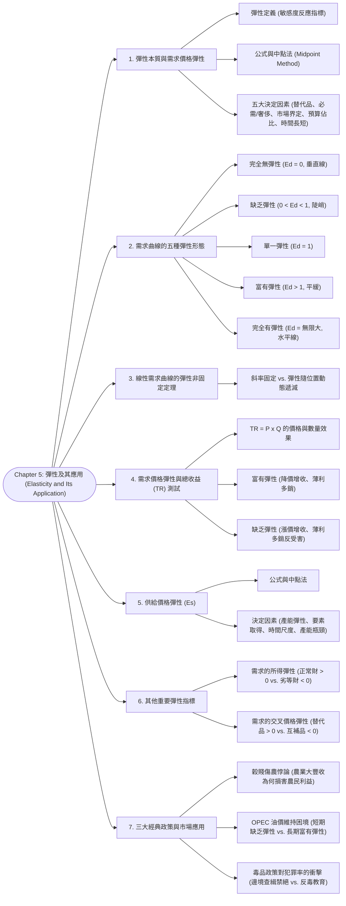

# Chapter 5: 彈性及其應用 (Elasticity and Its Application)

> 📅 生成日期：2026-10-24  
> 📄 來源檔案：[Reference/NCU_Classes/經濟學/CH5.pdf](file:///c:/Users/Cupid/Downloads/Study-space/Reference/NCU_Classes/經濟學/CH5.pdf)  
> 🎯 適用考試：中央大學經濟學課程期中考、商管研究所/轉學考個體經濟學基礎  

---

## 🗺️ 知識架構總覽 (Tree Diagram)



<a id="tree-diagram"></a>

### 🎯 本章學習進度檢核 (完成後打勾，建立成就反饋)

- [ ] [1. 彈性本質與需求價格彈性](#sec-1)
- [ ] [2. 需求曲線的五種彈性形態](#sec-2)
- [ ] [3. 線性需求曲線的彈性非固定定理](#sec-3)
- [ ] [4. 需求價格彈性與總收益 (TR) 測試](#sec-4)
- [ ] [5. 供給價格彈性 (Es)](#sec-5)
- [ ] [6. 其他重要彈性指標](#sec-6)
- [ ] [7. 三大經典政策與市場應用](#sec-7)

---

## 📖 知識點教材

<a id="sec-1"></a>

### 5.1 彈性的本質與需求價格彈性之計算 (Price Elasticity of Demand)

#### 📌 核心概念

- **彈性（Elasticity）**：衡量買者或賣者對市場條件（如價格、所得）變動之**反應敏感程度（Responsiveness / Sensitivity）**的量化指標。
- **需求價格彈性（Price Elasticity of Demand, $E_d$）**：衡量某商品的**需求量對該商品自身價格變動的敏感程度**。
  $$E_d = \left| \frac{\text{需求量變動百分比}}{\text{價格變動百分比}} \right| = \left| \frac{\%\Delta Q^D}{\%\Delta P} \right|$$
  - *經濟學慣例*：由於需求法則下價格與需求量呈反向變動，比值必為負數；在分析需求價格彈性時，**慣例一律去掉負號，以正數（絕對值）呈現**。

#### 📐 計算方法：標準百分比法的缺陷 vs. 中點法 (The Midpoint Method)

1. **傳統百分比變動的矛盾**：
   - 假設價格由 200 元漲到 250 元，需求量由 12 降至 8：
     - 若以 200 元為基期（由 A 到 B）：$\%\Delta P = (250-200)/200 = 25\%$；$\%\Delta Q = (8-12)/12 = -33.3\%$ $\implies E_d = 33.3 / 25 = \mathbf{1.33}$。
     - 若以 250 元為基期（由 B 到 A 降價）：$\%\Delta P = (200-250)/250 = -20\%$；$\%\Delta Q = (12-8)/8 = 50\%$ $\implies E_d = 50 / 20 = \mathbf{2.5}$！
   - 同一段區間，計算方向不同竟得到完全不同的彈性數值！
2. **中點法公式（Midpoint Method，考試必考指定方法）**：
   - 以**起點與終點的平均值（中點）**作為百分比分母，確保由 A 到 B 或由 B 到 A 計算結果完全相同：
     $$\%\Delta P = \frac{P_2 - P_1}{(P_1 + P_2) / 2} \times 100\%, \quad \%\Delta Q = \frac{Q_2 - Q_1}{(Q_1 + Q_2) / 2} \times 100\%$$
     $$E_d = \frac{\left| \frac{Q_2 - Q_1}{(Q_1 + Q_2) / 2} \right|}{\left| \frac{P_2 - P_1}{(P_1 + P_2) / 2} \right|}$$

#### 📊 範例（講義第 9～11 頁中點法計算）

**題目**：某電商平台 iPhone 銷售數據如下：當價格 $P_1 = \$400$ 時，銷量 $Q_1 = 10,600$ 台；當價格調漲至 $P_2 = \$600$ 時，銷量降至 $Q_2 = 8,400$ 台。請以中點法計算 iPhone 的需求價格彈性。  
**解題推導**：

1. 計算價格變動百分比：
   $$\text{價格中點} = \frac{400 + 600}{2} = 500$$
   $$\%\Delta P = \frac{600 - 400}{500} \times 100\% = \frac{200}{500} \times 100\% = \mathbf{40\%}$$
2. 計算數量變動百分比：
   $$\text{數量中點} = \frac{10,600 + 8,400}{2} = 9,500$$
   $$\%\Delta Q = \frac{|8,400 - 10,600|}{9,500} \times 100\% = \frac{2,200}{9,500} \times 100\% \approx \mathbf{23.16\%}$$
3. 計算需求價格彈性：
   $$E_d = \frac{23.16\%}{40\%} \approx \mathbf{0.58}$$
   - 因 $E_d = 0.58 < 1$，顯示 iPhone 在此價格區間之需求屬於**缺乏彈性（Inelastic）**。

<a id="q-sec-1"></a>

---

<a id="sec-2"></a>

### 5.2 需求價格彈性的五大決定因素 (Determinants of Price Elasticity)

#### 📌 核心概念

為什麼某些商品價格一漲買者作鳥獸散，某些商品價格翻倍大家依然照買不誤？取決於五大關鍵經濟特徵：

| 決定因素 | 彈性較大（富有彈性 $E_d > 1$） | 彈性較小（缺乏彈性 $E_d < 1$） | 講義代表實例與理由 |
| :--- | :--- | :--- | :--- |
| **1. 替代品的可得性**<br>(Close Substitutes) | **有眾多相近替代品**<br>(買者容易轉移消費) | **缺乏相近替代品**<br>(買者別無選擇) | 早餐麥片（替代品眾多，富有彈性） vs. **防曬乳**（缺乏替代品，缺乏彈性）。 |
| **2. 必需品 vs. 奢侈品**<br>(Necessities vs. Luxuries) | **奢侈品**<br>(非必要，可有可無) | **生活必需品**<br>(攸關生存或剛性需求) | 豪華遊艇（奢侈品，彈性大） vs. **糖尿病患的胰島素**（必需品，接近完全無彈性）。 |
| **3. 市場界定的寬廣度**<br>(Market Definition) | **狹義界定之商品**<br>(範圍小，替代品多) | **廣義界定之商品**<br>(範圍廣，難以替代) | 藍色牛仔褲/星巴克拿鐵（狹義，彈性大） vs. **全體服飾/所有咖啡**（廣義，缺乏彈性）。 |
| **4. 支出佔所得比重**<br>(Budget Share) | **佔所得比重大之高單價財**<br>(價格波動很有感) | **佔所得比重微小之低價財**<br>(花費極少，不在乎) | 房屋、汽車、高額學費（彈性大） vs. **牙籤、食用鹽**（支出微不足道，缺乏彈性）。 |
| **5. 時間長短的維度**<br>(Time Horizon) | **長期（Long Run）**<br>(消費者有時間調整行為) | **短期（Short Run）**<br>(短時間內無法立刻應變) | 汽油價格暴漲：短期只能硬著頭皮加（缺乏彈性，0.2）；長期可換省油車或搬家（富有彈性，0.7）。 |

<a id="q-sec-2"></a>

---

<a id="sec-3"></a>

### 5.3 需求曲線的五種幾何形態與線性曲線彈性定理 (Shapes & Linear Demand)

#### 📌 核心概念：五大幾何形態

需求曲線的平緩程度，直接反映了消費者的價格敏感度：
$$\text{口訣：需求曲線越平緩（Flatter），彈性越大；曲線越陡峭（Steeper），彈性越小！}$$

```
  價格 P            價格 P            價格 P            價格 P            價格 P
    ▲                 ▲                 ▲                 ▲                 ▲
    │ D (垂直線)      │  D (陡峭)        │   D (斜度適中)   │    D (平緩)      │
    │ │               │   \             │    \            │     \           │  P1 ──────── D (水平)
    │ │               │    \            │     \           │      \          │
    └─┴────────► Q    └─────\──────► Q  └──────\─────► Q  └───────\────► Q  └───┴────────► Q
      Ed = 0           0 < Ed < 1          Ed = 1             Ed > 1            Ed = ∞
    完全無彈性          缺乏彈性           單一彈性           富有彈性          完全有彈性
   (如: 胰島素)       (如: 汽油、牛奶)   (%ΔQ = %ΔP)       (如: 藍牙耳機)    (如: 完全競爭小麥)
```

#### 📐 核心定理：線性需求曲線上的「斜率固定，但彈性處處不同！」
>
> ⚠️ **考試最高頻理論陷阱**：
> 線性需求曲線（直線 $P = a - bQ$）的**斜率是固定常數（Constant Slope）**，但其**價格彈性絕對不是常數！**

```
 價格 P
   ▲
$30│──● A (高價、低量區間): Ed = 5.0 (富有彈性 Ed > 1)
   │   \
$20│────\──● M (中點): Ed = 1.0 (單一彈性 Unit Elastic)
   │     \   \
$10│──────\───\──● B (低價、高量區間): Ed = 0.2 (缺乏彈性 Ed < 1)
   │       \   \  \
 $0└───┴────┴───┴──┴────► 數量 Q
   0  10   20  40  60
```

- **幾何本質推導**：
  $$E_d = \left| \frac{\Delta Q}{\Delta P} \times \frac{P}{Q} \right| = \frac{1}{|\text{斜率}|} \times \frac{P}{Q}$$
  - 直線上每一點的 $\frac{1}{|\text{斜率}|}$ 是固定的；
  - 但從左上往右下移動時，**價格 $P$ 不斷下降，數量 $Q$ 不斷擴大**，使得比值 $\frac{P}{Q}$ 持續縮小！
  - **結論**：
    1. **需求曲線上半段（高價格、低數量）**：$\frac{P}{Q}$ 極大 $\implies \mathbf{E_d > 1}$（富有彈性）。
    2. **需求曲線幾何中點**：$\mathbf{E_d = 1}$（單一彈性，此時總收益達到最大值）。
    3. **需求曲線下半段（低價格、高數量）**：$\frac{P}{Q}$ 極小 $\implies \mathbf{E_d < 1}$（缺乏彈性）。

<a id="q-sec-3"></a>

---

<a id="sec-4"></a>

### 5.4 需求價格彈性與總收益測試 (Price Elasticity and Total Revenue)

#### 📌 核心概念

- **總收益（Total Revenue, $TR$）**：買者支付、賣者收取的總金額：
  $$TR = P \times Q$$
- **兩股相反力量的角力**：
  當價格上漲時：
  1. **價格效果（Price Effect）**：每單位賣得更貴（促使 $TR$ 增加）。
  2. **數量效果（Quantity Effect）**：賣出的總數量減少（促使 $TR$ 減少）。
  - 哪股力量佔上風？**完全取決於需求價格彈性 $E_d$！**

#### 📐 總收益測試鐵律 (The Total Revenue Test)

| 需求彈性屬性 | 價格變動方向 | 數量反應幅度 | 總收益 $TR$ 變動方向 | 廠商最佳定價策略 |
| :--- | :---: | :---: | :---: | :--- |
| **富有彈性 ($E_d > 1$)**<br>(買方極度敏感) | **漲價 ($P \uparrow$)**<br>**降價 ($P \downarrow$)** | $Q$ 下跌幅度 $> P$ 漲幅<br>$Q$ 增加幅度 $> P$ 降幅 | **$TR$ 下跌 ($\downarrow$)**<br>**$TR$ 上升 ($\uparrow$)** | **薄利多銷（降價策略）**！<br>降價能吸引排山倒海的客流，增加的銷量足以彌補單價損失。 |
| **缺乏彈性 ($E_d < 1$)**<br>(買方剛性無感) | **漲價 ($P \uparrow$)**<br>**降價 ($P \downarrow$)** | $Q$ 下跌幅度 $< P$ 漲幅<br>$Q$ 增加幅度 $< P$ 降幅 | **$TR$ 上升 ($\uparrow$)**<br>**$TR$ 下跌 ($\downarrow$)** | **大膽調漲售價**！<br>如專利救命藥、水電費。降價只會自損營收（穀賤傷農）。 |
| **單一彈性 ($E_d = 1$)** | 漲價或降價 | $Q$ 變動幅度 $= P$ 變動幅度 | **$TR$ 保持不變 (恆定)** | 處於總收益曲線的**拋物線頂點（$TR$ 最大值）**。 |

#### 📊 範例（講義第 20 頁考題）

**題目**：某商品的價格變動導致其需求量減少了 30%，但該商品的廠商總收益（$TR$）卻反而增加了 15%。請問該商品的需求曲線是富有彈性還是缺乏彈性？請嚴謹說明理由。  
**解析**：

1. 數量減少了 30%（$Q \downarrow$），在需求法則下意味著價格必定是上漲的（$P \uparrow$）。
2. 面對價格上漲，總收益 $TR = P \times Q$ 不減反增（$+15\%$）。
3. 這證明「價格上漲帶來的增收效果」遠大於「銷量萎縮 30% 帶來的損失」，即**價格上漲幅度必定顯著大於 30%**（實際價格漲幅約為 $+64.3\%$）。
4. 因為 $\% \Delta Q (30\%) < \% \Delta P (64.3\%)$，所以 **$E_d < 1$**。
5. **結論**：該商品的需求曲線屬於**缺乏彈性（Inelastic）**。

<a id="q-sec-4"></a>

---

<a id="sec-5"></a>

### 5.5 供給價格彈性及其決定因素 (Price Elasticity of Supply)

#### 📌 核心概念

- **供給價格彈性（Price Elasticity of Supply, $E_s$）**：衡量賣者對商品價格變動的供給量反應敏感程度：
  $$E_s = \frac{\%\Delta Q^S}{\%\Delta P}$$
  （使用中點法計算百分比）。
- **四大核心決定因素**：
  1. **生產要素轉換與產能彈性**：賣方改變產量的難易度。如海灘第一排土地、梵谷名畫無法增產（$E_s = 0$）；工業組裝玩具、教科書印刷容易擴產（$E_s > 1$）。
  2. **時間長短的維度（Time Horizon）**：**長期的供給彈性遠大於短期！** 短期內工廠產能受限無法立刻蓋新廠；長期廠商可添購機械、擴建廠房，新競爭者亦可進入市場。
  3. **產能利用率（Capacity Limits）**：當產量極低時，工廠有大量閒置設備，只要價格微漲即可大幅開工增產（**供給富有彈性**）；當產量逼近滿載極限時，即使價格暴漲也難以擠出產能（**供給缺乏彈性**）。

#### 📊 範例（講義第 50 頁：大爆炸理論情境題）

**情境**：上個月咖啡市場的價格劇烈暴漲，但市場總銷售量卻完全維持不變。五位朋友提出以下假說，誰「可能」是正確的？  

1. **Leonard**：需求增加，但**供給完全無彈性**（垂直的 $S$ 線）。  
   $\to$ **正確**！垂直的供給曲線下，需求右移只會使價格暴漲，成交量鎖死不動。  
2. **Raj**：供給減少，但**需求完全無彈性**（垂直的 $D$ 線）。  
   $\to$ **正確**！垂直的需求曲線下，供給左移只會推升價格，消費量完全不變。  
3. **Penny**：需求增加，同時供給減少。  
   $\to$ **正確**！$D \uparrow$ 推升價格且使 $Q \uparrow$；$S \downarrow$ 推升價格且使 $Q \downarrow$。若兩者平移力道恰好抵銷，將導致價格暴漲而數量不變。  
4. **Sheldon**：需求增加，但需求完全無彈性。  
   $\to$ **錯誤**！需求若為垂直線且右移，在正斜率供給線下數量必然增加。  
5. **Howard**：供給減少，但需求具單一彈性。  
   $\to$ **錯誤**！需求具彈性時，供給左移必然導致數量下滑。  

- **結論**：**Leonard、Raj 與 Penny 皆有可能是對的！**

---

<a id="sec-6"></a>

### 5.6 其他重要彈性：所得彈性與交叉價格彈性 (Income & Cross-Price Elasticity)

#### 📌 核心概念

1. **需求的所得彈性（Income Elasticity of Demand, $E_I$）**：
   $$E_I = \frac{\%\Delta Q^D}{\%\Delta \text{所得 } I}$$
   - **正常財（Normal Goods）**：$E_I > 0$（所得增加，買更多）。
     - **必需品（Necessities）**：$0 < E_I \le 1$（如糧食、自來水、衣服）。
     - **奢侈品（Luxuries）**：$E_I > 1$（如高級跑車、魚子醬、珠寶首飾）。
   - **劣等財（Inferior Goods）**：$E_I < 0$（如二手衣、長途客運、泡麵）。
2. **需求的交叉價格彈性（Cross-Price Elasticity of Demand, $E_{XY}$）**：
   $$E_{XY} = \frac{\%\Delta Q_X^D}{\%\Delta P_Y}$$
   - **替代品（Substitutes）**：$E_{XY} > 0$（Y 漲價 $\implies$ X 需求量增加，正相關。如漢堡與披薩）。
   - **互補品（Complements）**：$E_{XY} < 0$（Y 漲價 $\implies$ X 需求量減少，負相關。如咖啡與甜甜圈、印表機與墨水匣）。
   - **獨立品（Independent）**：$E_{XY} = 0$（兩者毫無關聯）。

<a id="q-sec-6"></a>

---

<a id="sec-7"></a>

### 5.7 三大經典政策與市場實務應用專題 (Major Real-World Applications)

#### 📊 專題一：農業好消息為何是農民的壞消息？（穀賤傷農悖論）

- **情境**：農委會與農業學者研發出基因抗蟲小麥新品種，使每畝小麥產量提高 20%（**好消息**）。
- **供需機制**：
  1. 新技術使小麥**供給大幅增加（$S$ 大幅右移）**。
  2. 但小麥是基本糧食，消費者的胃袋容量有限，**需求極度缺乏彈性（Inelastic Demand, $E_d \ll 1$）**。
  3. 供給擴張導致小麥市場**價格暴跌（跌幅達 33%），而銷售量僅微幅增加 10%**！
  4. 根據總收益測試：在缺乏彈性下，$P \downarrow \implies TR \downarrow$！全體農民總收益由原本的 300 億暴跌至 220 億！
- **政策悖論**：為了保障農民生計，政府往往被迫實施**「休耕補貼（Induce farmers not to plant crops）」**或收購保價，花納稅人的錢阻止農民生產。

---

#### 📊 專題二：OPEC 減產協議為何無法長期維持高油價？

- **短期（Short Run）**：
  - 原油供需雙方皆**極度缺乏彈性**（短時間內工廠與車輛只能照舊耗油；非 OPEC 產油國產能已滿載無法立刻增產）。
  - OPEC 只要小幅限產（$S$ 微左移），即引發恐慌性搶油，**油價狂飆數倍（1973～1981 石油危機），OPEC 總營收暴增**。
- **長期（Long Run）**：
  - 時間拉長後，供需雙方皆**轉為富有彈性**（消費者換開小型油電車、改善隔熱節能；美國頁岩油與深海油田探勘開採新技術成熟）。
  - 此時 OPEC 若再減產，世界油價僅能微幅上升，反而導致自身市占率慘遭非 OPEC 國家瓜分，**總收益不增反減**！

---

#### 📊 專題三：緝毒政策（禁絕供給） vs. 反毒教育（壓制需求）對犯罪率的衝擊

政府打擊毒品犯罪有兩大截然不同的政策工具：

```
 【政策一: 邊境嚴格緝毒 (打擊供給)】          【政策二: 校園反毒教育 (減少需求)】
   價格 P                             價格 P
     ▲         S2     S1                ▲             S
     │          \     /                 │             /
  P2 │───●───────\───/              P1 │─────●──────/
     │    \       \ /                   │      \    /
  P1 │─────\───────●                P2 │───────●──/
     │      \     / \                   │       \ \
     │       \   /   \                  │        \ \ D1
     └────────\─/─────\──► 數量 Q       └─────────\─\────► 數量 Q
              D1                                  D2
  (毒癮缺乏彈性: P暴漲 > Q微降)              (宣導奏效: P與Q同步下降)
  結果: 吸毒總花費 TR 暴增                   結果: 吸毒總花費 TR 銳減
  ==> 偷竊、搶劫犯罪率劇烈飆升!             ==> 毒品相關犯罪率全面下降!
```

- **深度分析**：毒癮成癮性極高，吸毒者對毒品的需求極度**缺乏彈性（Inelastic）**。
  - **政策一（緝毒）**：阻斷走私使供給減少（$S$ 左移）。價格暴漲，數量微降，**吸毒者購買毒品的總支出（$TR$）大幅激增**！成癮者為了每天湊齊數千元昂貴毒資，鋌而走險進行武裝搶劫、竊盜與賣淫，**導致社會犯罪率反而暴增**！
  - **政策二（反毒教育/醫療戒癮）**：降低毒品需求（$D$ 左移）。價格下跌、數量減少，**毒品總支出（$TR$）必然大幅下降**，從根本上瓦解毒品黑市與相關犯罪！

---

## 📝 實戰練習題 (三層遞進式強化測驗)

---

### 🟢 第一層：必懂基礎（計算規則、定義判定與單一概念）

<a id="q1"></a>

#### Q1. (基礎中點法公式手算) 需求價格彈性中點法 (Midpoint Method)

某品牌連鎖咖啡店進行價格調整測試：
當美式咖啡的單杯價格由 $P_1 = 40\text{ 元}$ 調漲至 $P_2 = 60\text{ 元}$ 時，每日的銷售數量由 $Q_1 = 120\text{ 杯}$ 減少至 $Q_2 = 80\text{ 杯}$。
依據經濟學標準的中點法公式：
$$E_d = \left| \frac{(Q_2 - Q_1) / [(Q_1 + Q_2) / 2]}{(P_2 - P_1) / [(P_1 + P_2) / 2]} \right|$$
請問該美式咖啡的需求價格彈性 $E_d$ 數值為何？

(A) $0.50$ (缺乏彈性)  
(B) $1.00$ (單一彈性 Unit Elastic)  
(C) $2.00$ (富於彈性)  
(D) $0.80$ (缺乏彈性)  

👉 [查看 Q1 答案與詳細解析](#ans-q1)

---

<a id="q2"></a>

#### Q2. (基礎總收益測試) 缺乏彈性下的總收益 (Total Revenue) 變動判定

某專利救命降壓藥在市場上的需求價格彈性經實證測量為 $E_d = 0.4$（處於嚴重缺乏彈性狀態，$E_d < 1$）。
若藥廠宣布為了反映原物料上漲，將該藥品的零售價格調漲 $20\%$：
請問該藥廠銷售該藥品的「總銷售收益（$\text{TR} = P \times Q$）」會發生何種變動？

(A) 總收益必然增加（因為價格上漲的百分比幅度大於需求量萎縮的百分比幅度）  
(B) 總收益必然減少  
(C) 總收益完全保持不變  
(D) 總收益會瞬間歸零  

👉 [查看 Q2 答案與詳細解析](#ans-q2)

---

<a id="q3"></a>

#### Q3. (基礎所得彈性符號) 需求所得彈性 (Income Elasticity) 與劣等品判定

計量經濟學家分析某家庭消費資料庫，估算出某種平價冷凍即食食品的需求所得彈性為：
$$E_I = \frac{\%\Delta Q_D}{\%\Delta \text{Income}} = -0.65$$
請問依據所得彈性的正負符號特徵，該食品在經濟學上屬於何種性質的商品？

(A) 奢侈品 (Luxury Good)  
(B) 正常品 (Normal Good)  
(C) 劣等品 (Inferior Good，所得增加時消費量反而減少)  
(D) 季芬財 (Giffen Good)  

👉 [查看 Q3 答案與詳細解析](#ans-q3)

---

<a id="q4"></a>

#### Q4. (基礎交叉彈性符號) 交叉價格彈性 (Cross-Price Elasticity) 與替代關係

若商品 $X$ 與商品 $Y$ 之間的交叉價格彈性經計算為：
$$E_{XY} = \frac{\%\Delta Q_{DX}}{\%\Delta P_Y} = +1.6$$
請問正值（$E_{XY} > 0$）在經濟學上明確代表商品 $X$ 與商品 $Y$ 彼此具備何種關係？

(A) 兩者為互補品 (Complements)  
(B) 兩者為替代品 (Substitutes，即 $Y$ 價格上漲時，消費者轉向購買 $X$，使 $X$ 需求增加)  
(C) 兩者為完全無關的獨立品  
(D) 兩者皆為公共財  

👉 [查看 Q4 答案與詳細解析](#ans-q4)

---

<a id="q5"></a>

#### Q5. (基礎極限圖形特徵) 完全無彈性 (Perfectively Inelastic) 需求曲線

某種罕見遺傳疾病的維持性藥物，病人每日必須嚴格注射 1 劑才能存活（少打會喪命，多打會中毒）。因此無論每劑價格是 100 元還是 100 萬元，全市場的需求量皆恆定固定在 500 劑，其需求價格彈性 $E_d = 0$。
請問該藥品的需求曲線在以價格為縱軸、數量為橫軸的平面座標上，呈現何種幾何圖形？

(A) 一條水平橫線 (Horizontal Line)  
(B) 一條垂直直線 (Vertical Line)  
(C) 一條通過原點的 $45^\circ$ 斜直線  
(D) 一條雙曲線  

👉 [查看 Q5 答案與詳細解析](#ans-q5)

---

### 🟡 Tier 2：基礎 + 實際應用 (Application & Scenario Matching)

> 💡 **學習目標**：確認自己「會用」——能破解穀賤傷農悖論、解析 OPEC 長短期油價與禁毒政策反效果。

<a id="q6"></a>

#### Q6. (農業經濟經典悖論) 穀賤傷農 (Good News for Farming can be Bad News for Farmers)

農業生技的重大突破使得全體小麥農民迎來了歷史罕見的大豐收，小麥總產量暴增 $40\%$。然而小麥作為基本糧食主食，消費者對其需求價格彈性極度缺乏彈性（$E_d = 0.25$）：
(1) 產量大豐收對全體小麥市場的均衡價格會產生何種衝擊？  
(2) 這場技術大豐收最終會使全體小麥農民的總收入（Total Revenue）暴增還是慘烈暴跌？為什麼？

(A) (1) 價格暴漲；(2) 總收入暴增  
(B) (1) 價格暴跌；(2) 總收入慘烈暴跌！因為在需求缺乏彈性下，若要讓市場多消化 40% 的糧食，市價必須崩跌超過 100%，價格崩跌的幅度遠遠大於數量增加的幅度，導致農民血本無歸，出現「穀賤傷農」  
(C) (1) 價格不變；(2) 總收入不變  
(D) (1) 價格下跌；(2) 農民收入翻倍  

👉 [查看 Q6 答案與詳細解析](#ans-q6)

---

<a id="q7"></a>

#### Q7. (時間跨度彈性差異) OPEC 為何短期能輕易拉抬油價，長期卻難以維持？

在 1970 年代石油危機中，石油輸出國組織（OPEC）透過聯合減產，使國際原油價格在短期內暴漲 4 倍，成員國賺取了天量暴利。然而在隨後的十年間，儘管 OPEC 試圖維持限產，國際油價卻一路崩跌回落：
請從「**短期 vs. 長期之需求與供給價格彈性**」的本質差異，分析該策略在長期失效的根本原因：

(A) 因為短期內供需雙方皆極度缺乏彈性（司機無法立刻換車、外部油田無法立刻開採），減產使價格飆升；但在長期中，消費者紛紛更換省油車或改乘大眾運輸（需求彈性變大），且非 OPEC 國家大規模投產深海油田（供給彈性變大），使長期供需皆極富彈性，限產已無法支撐高價  
(B) 因為短期內石油是替代品，長期變成互補品  
(C) 因為 OPEC 在長期忘記了石油的開採技術  
(D) 因為世界銀行在長期中禁止使用燃油  

👉 [查看 Q7 答案與詳細解析](#ans-q7)

---

<a id="q8"></a>

#### Q8. (公共政策非預期後果) 毒品供給面查緝與街頭竊盜搶劫犯罪的關聯

政府為了打擊毒品犯罪，投入數百億警力在邊境嚴格攔截毒品走私，成功查扣了 $50\%$ 的走私毒品（毒品供給曲線向左劇烈平移，黑市毒品單價飆漲 4 倍）。已知重度毒品成癮者對毒品的需求呈現極端缺乏彈性（$E_d \approx 0.1$）：
(1) 這項供給面嚴打政策，會使吸毒者每日購買毒品的「總毒資支出（$P \times Q$）」如何變化？  
(2) 該政策對城市街頭為了籌措毒資而引發的搶劫、竊盜等衍生性財產犯罪率，會造成何種意想不到的負面衝擊？

(A) (1) 總毒資支出暴跌；(2) 街頭搶劫竊盜案徹底絕跡  
(B) (1) 總毒資支出暴增數倍；(2) 成癮者為了籌措暴漲的昂貴買毒資金，被迫鋌而走險犯下更多街頭搶劫與竊盜案，導致衍生犯罪率急遽飆升！若改從需求面進行毒癮勒戒（使需求線左移），才能同時達成降價、減量與消滅犯罪  
(C) (1) 總支出不變；(2) 犯罪率完全不受影響  
(D) (1) 總支出歸零；(2) 所有人自動戒毒  

👉 [查看 Q8 答案與詳細解析](#ans-q8)

---

<a id="q9"></a>

#### Q9. (市場範疇與替代品多寡) 市場定義的廣狹對需求彈性的影響

在分析消費品的需求價格彈性時，請比較下列兩組商品的彈性大小：
* 商品甲：廣義的「飲料市場（Beverages）」
* 商品乙：狹義的「可口可樂（Coca-Cola）」
請問哪一項商品的需求價格彈性顯著較大？其核心經濟學原理為何？

(A) 商品甲彈性較大，因為所有人每天都要喝水喝飲料  
(B) 商品乙（可口可樂）的需求價格彈性顯著大於商品甲！因為**市場定義越狹窄，消費者越容易找到高度親密的替代品**（如百事可樂、茶飲、果汁）；一旦可口可樂單獨調漲 10%，消費者極易轉移至其他品牌，導致銷量大幅流失  
(C) 兩者彈性必然完全相同  
(D) 只有在夏季兩者彈性才不同  

👉 [查看 Q9 答案與詳細解析](#ans-q9)

---

### 🔴 Tier 3：概念講述與深度分析 (Conceptual & Analytical)

> 💡 **學習目標**：確認自己「會講」——能推導直線需求彈性遞減、證明 Amoroso-Robinson 邊際收益公式。

<a id="q10"></a>

#### Q10. (數學幾何嚴密推導題) 直線型負斜率需求曲線上「各點彈性遞減」之數理推導

考慮一條標準的向下傾斜直線型需求曲線：
$$Q = a - bP \quad (a > 0, b > 0)$$
其中反需求函數為 $P = \frac{a}{b} - \frac{1}{b}Q$，斜率為常數 $\frac{dQ}{dP} = -b$。
(1) 請寫出點彈性（Point Price Elasticity）公式 $E_d = \left| \frac{dQ}{dP} \cdot \frac{P}{Q} \right|$，並將其推導整理為僅含有價格 $P$ 的代數表達式。  
(2) 請嚴密推導：當價格由最高垂直截距點 $P = \frac{a}{b}$ 逐漸下滑至數量截距點 $P = 0$ 時，彈性 $E_d$ 是如何由無窮大（$\infty$）單調遞減至零（$0$）？  
(3) 證明該直線需求曲線的中點（Midpoint, $P_m = \frac{a}{2b}, Q_m = \frac{a}{2}$）其彈性恰好等於 1，且廠商的總收益（$\text{TR}$）在中點達到全域最大值。

👉 [查看 Q10 答案與詳細解析](#ans-q10)

---

<a id="q11"></a>

#### Q11. (微積分極限推導題) 邊際收益 (MR) 與 需求價格彈性之 Amoroso-Robinson 公式證明

在微觀經濟學中，廠商的總銷售收益定義為：
$$\text{TR}(Q) = P(Q) \cdot Q$$
其中價格 $P(Q)$ 為向下傾斜的反需求函數。
(1) 請運用微積分乘法法則（Product Rule），對產量 $Q$ 進行微分，嚴格推導出經濟學著名的 **Amoroso-Robinson 關係式**：
$$\text{MR} = \frac{d\text{TR}}{dQ} = P \left( 1 - \frac{1}{E_d} \right)$$
其中 $E_d = -\frac{dQ}{dP} \frac{P}{Q} > 0$ 為需求價格彈性。  
(2) 請利用此公式，深入論述下列三大經典定價定理：
* 為什麼當 $E_d > 1$（富於彈性）時，$\text{MR} > 0$（薄利多銷降價增產能使總收益增加）？
* 為什麼當 $E_d < 1$（缺乏彈性）時，$\text{MR} < 0$（增產反而導致總收益受損）？
* 為什麼追求利潤最大化的獨占廠商，**絕對不可能將產量設定在需求缺乏彈性（$E_d < 1$）的區域運作**？

👉 [查看 Q11 答案與詳細解析](#ans-q11)

---

<a id="q12"></a>

#### Q12. (商業策略實戰整合題) 企業跨維度彈性矩陣 (Elasticity Matrix) 的綜合決策

某跨國航空公司的經營決策小組針對其熱門航線的「商務艙機票」進行了全面的計量經濟模型估算，取得以下三大關鍵彈性數值：
* **自身價格彈性**：$E_d = 0.65$
* **交叉價格彈性（對高鐵商務座價格）**：$E_{XY} = +1.40$
* **需求所得彈性**：$E_I = +2.80$
試整合這三大彈性維度，回答下列策略諮詢問題：
(1) 若國際航空燃油價格飆漲，航司若將商務艙機票價格調漲 $15\%$，其客運總收益會增加還是減少？為什麼？  
(2) 若政府宣布調降高鐵商務座票價 $20\%$，該航空商務艙機票的需求量會遭受多大百分比的流失衝擊？  
(3) 若總體經濟預測明年實質 GDP 成長率將衰退 $-2\%$，該商務艙航線預計會面臨多大幅度的斷崖式雪崩？為什麼高所得彈性商品在景氣反轉時最為脆弱？

👉 [查看 Q12 答案與詳細解析](#ans-q12)

---

## 🔑 本章練習題答案與詳細解析 (Answer Key)

### 🟢 Tier 1 解析

<a id="ans-q1"></a>

### Q1 答案與詳細解析

* **正確答案**：**(B)**
* **中點法逐步計算過程**：
  * **價格中點與變動率**：
    * $\Delta P = 60 - 40 = 20$
    * 價格中點 $\bar{P} = \frac{40 + 60}{2} = 50$
    * 價格變動百分比 $= \frac{20}{50} = 0.40\ (40\%)$
  * **數量中點與變動率**：
    * $\Delta Q = 80 - 120 = -40$
    * 數量中點 $\bar{Q} = \frac{120 + 80}{2} = 100$
    * 數量變動百分比 $= \frac{-40}{100} = -0.40\ (-40\%)$
  * **需求價格彈性計算**：
    $$E_d = \left| \frac{\%\Delta Q}{\%\Delta P} \right| = \left| \frac{-40\%}{+40\%} \right| = 1.00$$
  * 彈性剛好等於 1，屬於**單一彈性（Unit Elastic）**。中點法的優勢在於：無論從 40 元算到 60 元，還是從 60 元算回 40 元，計算結果皆嚴格對稱相等。選項 (B) 正確。

[🔙 返回題目 Q1](#q1) ｜ [🔝 返回知識架構圖](#tree-diagram)

---

<a id="ans-q2"></a>

### Q2 答案與詳細解析

* **正確答案**：**(A)**
* **總收益測試核心準則**：
  * 總收益公式為 $\text{TR} = P \times Q$。
  * 當需求**缺乏彈性 ($E_d < 1$)** 時，需求量的變動百分比小於價格的變動百分比（即 $|\%\Delta Q| < |\%\Delta P|$）。
  * 題幹中價格調漲了 $+20\%$，因 $E_d = 0.4$，需求量僅會萎縮：
    $$\%\Delta Q_D = -E_d \times \%\Delta P = -0.4 \times (+20\%) = -8\%$$
  * 價格上漲帶來的收益增量（$+20\%$）遠遠壓倒了數量微幅流失（$-8\%$）的損失。
  * 總收益約增長 $(1 + 0.20)(1 - 0.08) - 1 = 1.104 - 1 = +10.4\%$，總收益**必然顯著增加**。缺乏彈性的商品擁有強大的定價權。選項 (A) 正確。

[🔙 返回題目 Q2](#q2) ｜ [🔝 返回知識架構圖](#tree-diagram)

---

<a id="ans-q3"></a>

### Q3 答案與詳細解析

* **正確答案**：**(C)**
* **所得彈性符號判別規範**：
  * **正常品 (Normal Good)**：$E_I > 0$（所得增加，購買量增加）。
    * 必需品 (Necessity)：$0 < E_I < 1$
    * 奢侈品 (Luxury)：$E_I > 1$
  * **劣等品 (Inferior Good)**：$E_I < 0$（所得增加，購買量反而減少；所得下降，購買量反而增加）。
  * 題幹所得彈性為負值（$-0.65 < 0$），代表消費者有錢後會轉向購買新鮮現煮大餐，捨棄平價冷凍微波食品，為標準的劣等品。選項 (C) 正確。

[🔙 返回題目 Q3](#q3) ｜ [🔝 返回知識架構圖](#tree-diagram)

---

<a id="ans-q4"></a>

### Q4 答案與詳細解析

* **正確答案**：**(B)**
* **交叉價格彈性符號規範**：
  * **替代品 (Substitutes)**：$E_{XY} > 0$。當 $Y$ 價格上漲時，消費者覺得 $Y$ 變貴，於是大量轉向購買 $X$ 替代之，促使 $X$ 的需求量增加（同向變動，比值為正）。
  * **互補品 (Complements)**：$E_{XY} < 0$。當 $Y$ 價格上漲時，$Y$ 的購買量萎縮，連帶使得與其綁定搭配的 $X$ 也無人問津，導致 $X$ 需求量下降（反向變動，比值為負）。
  * 題幹為正值（$+1.6$），明確代表替代品。選項 (B) 正確。

[🔙 返回題目 Q4](#q4) ｜ [🔝 返回知識架構圖](#tree-diagram)

---

<a id="ans-q5"></a>

### Q5 答案與詳細解析

* **正確答案**：**(B)**
* **完全無彈性幾何意涵**：
  * $E_d = 0$ 代表不論價格 $P$ 如何上天下海地劇烈變動，消費者的需求量 $Q$ 始終恆定在固定數值（$Q = 500$）。
  * 在以 $P$ 為縱軸、$Q$ 為橫軸的直角座標系上，方程式 $Q = 500$ 是一條**嚴格垂直於橫軸的垂直直線（Vertical Line）**。選項 (B) 正確。

[🔙 返回題目 Q5](#q5) ｜ [🔝 返回知識架構圖](#tree-diagram)

---

### 🟡 Tier 2 解析

<a id="ans-q6"></a>

### Q6 答案與詳細解析

* **正確答案**：**(B)**
* **穀賤傷農之數理推導**：
  * 小麥為無可替代的生存必需品，其需求極度缺乏彈性（$E_d = 0.25$）。
  * 當大豐收使供給增加，產量增加 $\%\Delta Q = +40\%$。
  * 為了在市場上將這多出來的 40% 小麥全部賣光，價格必須大幅崩跌：
    $$E_d = \left| \frac{\%\Delta Q}{\%\Delta P} \right| \implies 0.25 = \frac{40\%}{|\%\Delta P|} \implies |\%\Delta P| = \frac{40\%}{0.25} = 160\%$$
  * 價格暴跌的慘烈程度遠超產量增加的幅度，導致全體農民的總收益（$\text{TR} = P \times Q$）斷崖式崩跌！農民辛勤耕作迎來豐收，最終下場卻是集體面臨破產。這正是歐美各國政府對農業實施休耕補貼、保價收購與目標價格干預的根本原因。選項 (B) 完全正確。

[🔙 返回題目 Q6](#q6) ｜ [🔝 返回知識架構圖](#tree-diagram)

---

<a id="ans-q7"></a>

### Q7 答案與詳細解析

* **正確答案**：**(A)**
* **長短期彈性結構差異剖析**：
  * **短期內（1 年以內）**：
    * 需求面：消費者每天仍得開車上班、工廠仍得運轉，短時間內不可能立刻換成電動車或搬家到公司旁邊（需求極度缺乏彈性）。
    * 供給面：非 OPEC 國家現有油井產能已開滿，新油田探勘需要數年（供給極度缺乏彈性）。
    * 雙方缺乏彈性使 OPEC 只要微幅減產 $5\%$，即可推升油價暴漲 $200\%$，總收益暴增。
  * **長期內（5~10 年以上）**：
    * 需求面：高油價誘發了深遠的行為改變——民眾全面換購油電車、建築加強保溫節能、核電與太陽能大規模商轉（長期需求彈性大幅擴大）。
    * 供給面：阿拉斯加與北海油田在天價利潤刺激下全速投產（長期供給彈性大幅增加）。
    * 長期供需皆變得極富彈性，此時 OPEC 若繼續限產，只會將市場份額拱手讓給非 OPEC 產油國，而無法維持高油價。選項 (A) 正確。

[🔙 返回題目 Q7](#q7) ｜ [🔝 返回知識架構圖](#tree-diagram)

---

<a id="ans-q8"></a>

### Q8 答案與詳細解析

* **正確答案**：**(B)**
* **禁毒政策反效果之彈性剖析**：
  * **成癮性生理特徵**：毒品成癮者對毒品有不可遏止的生理依賴，其需求極端缺乏彈性（$E_d \approx 0.1$）。
  * 供給面大緝毒使黑市供給向左平移，毒價飆漲 4 倍（$+300\%$），而成癮者的吸毒量僅微減 $30\%$。
  * 成癮者每天維持毒癮所需的總現金支出（$P \times Q$）暴增至原來的近 3 倍！
  * 成癮者通常沒有正當高薪工作，為填補這暴增數倍的天價毒資缺口，唯一的途徑就是鋌而走險，在街頭發動更密集的持槍搶劫、入室盜竊與詐騙，**導致社會治安與財產犯罪率顯著惡化**。
  * **經濟學良方**：改從「需求面」著手——透過教育宣導、戒毒勒戒與替代療法使需求曲線向左平移。此時黑市毒價與吸毒人數雙雙下跌，總毒資急遽萎縮，才能真正達到消滅毒品與降低犯罪的雙贏目標。選項 (B) 正確。

[🔙 返回題目 Q8](#q8) ｜ [🔝 返回知識架構圖](#tree-diagram)

---

<a id="ans-q9"></a>

### Q9 答案與詳細解析

* **正確答案**：**(B)**
* **市場邊界與替代品效應**：
  * 影響需求價格彈性最核心的第一大因素是「**替代品的多寡與相近程度（Availability of Close Substitutes）**」。
  * **廣義市場（飲料）**：包含水、茶、果汁、汽水。如果全人類的所有飲料集體漲價，人不可能不攝取水分，因此「整體飲料」缺乏替代品，需求極端缺乏彈性。
  * **狹義品牌（可口可樂）**：如果全世界只有可口可樂一家漲價 20%，旁邊貨架上的百事可樂、黑松沙士、冰紅茶價格完全沒變，消費者有大量近乎完美的替代選擇，因此可口可樂的需求量會被暴風式重創，**具備極高的需求價格彈性**。選項 (B) 正確。

[🔙 返回題目 Q9](#q9) ｜ [🔝 返回知識架構圖](#tree-diagram)

---

### 🔴 Tier 3 解析

<a id="ans-q10"></a>

### Q10 答案與詳細解析

* **(1) 點彈性代數推導**：
  * 已知反需求函數為 $P(Q) = \frac{a}{b} - \frac{1}{b}Q$，即 $Q = a - bP$。
  * 導數 $\frac{dQ}{dP} = -b$。
  * 代入點價格彈性公式：
    $$E_d = \left| \frac{dQ}{dP} \cdot \frac{P}{Q} \right| = \left| -b \cdot \frac{P}{a - bP} \right| = \frac{bP}{a - bP}$$

* **(2) 彈性單調遞減特性證明**：
  * 當價格處於最高點 $P \to \frac{a}{b}$ 時：分母 $a - bP \to 0$，故 $\lim_{P \to a/b} E_d = \infty$（完全有彈性）。
  * 當價格處於最低點 $P = 0$ 時：分子為 0，故 $E_d = \frac{0}{a} = 0$（完全無彈性）。
  * 對 $P$ 求導：$\frac{dE_d}{dP} = \frac{b(a - bP) - bP(-b)}{(a - bP)^2} = \frac{ab}{(a - bP)^2} > 0$。
  * 導數為正，證明了：**當價格從高處向下滑落時，直線需求曲線上的彈性 $E_d$ 必定單調嚴格遞減**！

* **(3) 中點幾何與總收益極值**：
  * 令 $E_d = 1$：
    $$\frac{bP}{a - bP} = 1 \implies bP = a - bP \implies 2bP = a \implies P_m = \frac{a}{2b}$$
  * 代回得數量中點 $Q_m = a - b\left(\frac{a}{2b}\right) = \frac{a}{2}$。
  * 總收益函數為 $\text{TR}(P) = P \cdot (a - bP) = aP - bP^2$。
  * 對 $P$ 求一階導並令其為零：$\frac{d\text{TR}}{dP} = a - 2bP = 0 \implies P = \frac{a}{2b} = P_m$。
  * 二階導 $\frac{d^2\text{TR}}{dP^2} = -2b < 0$，數學證明了**廠商總收益剛好在需求曲線的中點（$E_d = 1$）處達到唯一的全域最大值**。

[🔙 返回題目 Q10](#q10) ｜ [🔝 返回知識架構圖](#tree-diagram)

---

<a id="ans-q11"></a>

### Q11 答案與詳細解析

* **(1) Amoroso-Robinson 關係式微積分嚴格證明**：
  * 總收益為 $\text{TR} = P \cdot Q$。對產量 $Q$ 進行微分求邊際收益 $\text{MR}$：
    $$\text{MR} = \frac{d\text{TR}}{dQ} = \frac{d(P \cdot Q)}{dQ} = P \cdot \frac{dQ}{dQ} + Q \cdot \frac{dP}{dQ} = P + Q \frac{dP}{dQ}$$
  * 提出公因式 $P$：
    $$\text{MR} = P \left( 1 + \frac{Q}{P} \frac{dP}{dQ} \right)$$
  * 注意到需求價格彈性定義為 $E_d = -\frac{dQ}{dP} \frac{P}{Q}$，其倒數恰好為 $\frac{1}{E_d} = -\frac{Q}{P} \frac{dP}{dQ}$。
  * 代入立即得證著名的 Amoroso-Robinson 公式：
    $$\text{MR} = P \left( 1 - \frac{1}{E_d} \right)$$

* **(2) 定價三大定理推導**：
  * **定理 1（$E_d > 1$ 富於彈性）**：$\frac{1}{E_d} < 1 \implies 1 - \frac{1}{E_d} > 0 \implies \text{MR} > 0$。邊際收益大於 0，代表每多賣 1 單位商品，總收益都在增加，薄利多銷有效！
  * **定理 2（$E_d < 1$ 缺乏彈性）**：$\frac{1}{E_d} > 1 \implies 1 - \frac{1}{E_d} < 0 \implies \text{MR} < 0$。邊際收益小於 0，增產只會破壞總收益。
  * **定理 3（獨占廠商禁區）**：獨占廠商追求利潤最大化的條件是 $\text{MR} = \text{MC}$。在實體世界中，生產邊際成本永遠為非負值（$\text{MC} \ge 0$）。因此利潤最大化點必定滿足 $\text{MR} \ge 0$，這嚴格限制了 $1 - \frac{1}{E_d} \ge 0 \implies E_d \ge 1$！**獨占廠商絕不可能在需求缺乏彈性（$E_d < 1$）的區域運作**，因為在那裡只要減產提價，成本能下降、同時總收入還能增加，利潤必定能進一步暴增！

[🔙 返回題目 Q11](#q11) ｜ [🔝 返回知識架構圖](#tree-diagram)

---

<a id="ans-q12"></a>

### Q12 答案與詳細解析

* **(1) 自身價格彈性定價決策**：
  * 商務艙的自身價格彈性 $E_d = 0.65 < 1$（缺乏彈性，商務客通常由公司報銷差旅，時間敏感度遠高於價格敏感度）。
  * 在缺乏彈性下，調漲票價 $+15\%$，需求量僅萎縮 $-0.65 \times 15\% = -9.75\%$。
  * 票價漲幅大於銷量跌幅，客運總收益將淨增長 $(1 + 0.15)(1 - 0.0975) - 1 \approx +3.8\%$。航司**完全具備大幅提價以擴大總營收的能力**。

* **(2) 交叉價格彈性衝擊評估**：
  * 高鐵票價調降 $\%\Delta P_{\text{高鐵}} = -20\%$。
  * 交叉彈性 $E_{XY} = +1.40$（高鐵商務座與飛機商務艙為強烈替代品）。
  * 預計航空商務艙機票需求量變動為：
    $$\%\Delta Q_D = E_{XY} \times \%\Delta P_{\text{高鐵}} = (+1.40) \times (-20\%) = -28.0\%$$
  * 該航線將面臨高達 $28\%$ 的嚴重客源流失！

* **(3) 所得彈性與景氣衰退斷崖**：
  * 實質 GDP 下滑 $\%\Delta \text{Income} = -2\%$。
  * 商務艙的所得彈性高達 $E_I = +2.80$（遠大於 1，屬於極端高端的奢侈品性質）。
  * 預估需求量衝擊為：
    $$\%\Delta Q_D = E_I \times \%\Delta \text{Income} = (+2.80) \times (-2\%) = -5.6\%$$
  * **深層哲學總結**：高所得彈性商品（$E_I > 1$）被稱為「景氣放大器」。在景氣繁榮時其需求暴增 3 倍；但在經濟遭遇衰退時，企業首當其衝砍掉高階差旅預算，需求萎縮幅度數倍於 GDP 跌幅。航司管理層必須在衰退期提前將部分商務艙改裝為經濟艙或推出促銷套票進行避險。

[🔙 返回題目 Q12](#q12) ｜ [🔝 返回知識架構圖](#tree-diagram)

---

## 📋 本章重點速記表

| # | 核心指標 / 概念 | 核心一句話定義 | 判別公式與關鍵準則 |
| :---: | :--- | :--- | :--- |
| **1** | **需求價格彈性 ($E_d$)** | 衡量價格變動 1% 時，需求量變動的百分比 | 中點法公式；慣例一律取正值（絕對值） |
| **2** | **彈性五分法** | $E_d=0$ (完全無彈性)、$<1$ (缺乏)、$=1$ (單一)、$>1$ (富有)、$=\infty$ (完全有) | 曲線越平緩彈性越大；越陡峭彈性越小 |
| **3** | **直線需求彈性定理** | 直線需求斜率固定，但彈性隨價格由上至下遞減 | 上半段 $E_d>1$；中點 $E_d=1$；下半段 $E_d<1$ |
| **4** | **總收益測試** | 評估調價對廠商營收的衝擊，由彈性大小主導 | 富有彈性：$P \downarrow \implies TR \uparrow$；缺乏彈性：$P \uparrow \implies TR \uparrow$ |
| **5** | **供給價格彈性 ($E_s$)** | 衡量價格變動對供給量的反應敏感度 | 長期彈性遠大於短期；產能逼近滿載時彈性變小 |
| **6** | **所得彈性 ($E_I$)** | 衡量所得變動對商品需求的影響 | $>0$ 為正常財（$>1$ 為奢侈品）；$<0$ 為劣等財 |
| **7** | **交叉價格彈性 ($E_{XY}$)** | 衡量 Y 商品價格變動對 X 商品需求的影響 | $>0$ 為替代品；$<0$ 為互補品；$=0$ 為獨立品 |
| **8** | **穀賤傷農原理** | 糧食需求缺乏彈性，豐收增產使價格暴跌，總收益慘跌 | 豐產不豐收；缺乏彈性下價格效果壓過數量效果 |
| **9** | **反毒政策比較** | 查緝供給推升價格引發更多犯罪；教育減少需求降低犯罪 | 需求缺乏彈性時，打擊供給會使買方總支出劇增 |

---

## 🃏 考前速查卡片

| 正面 (問題) | 背面 (答案) |
| :--- | :--- |
| **為什麼計算彈性時必須採用「中點法（Midpoint Method）」？** | 傳統百分比法在起點與終點互換時會計算出不同的彈性值。中點法使用**兩點平均值**為分母，確保無論價格上漲或下跌，計算出的彈性結果完全一致。 |
| **一條直線型的負斜率需求曲線，其斜率與價格彈性有何差別？** | **斜率在整條直線上恆定不變**；但**價格彈性處處不同**！上半段富有彈性（$>1$），中點為單一彈性（$=1$），下半段缺乏彈性（$<1$）。 |
| **當商品需求富有彈性（$E_d = 1.8$）時，廠商若想提高總收益，應該漲價還是降價？** | **應該降價（薄利多銷）**！因為富有彈性時，降價引發的銷量增幅（數量效果）大於單價損失（價格效果），總收益 $TR$ 將顯著增加。 |
| **為什麼農業大豐收（產量增加 20%）往往會導致農民集體面臨破產危機？** | 因為小麥等主糧需求**極度缺乏彈性**。供給增加導致價格跌幅遠高於產量增幅，根據總收益測試，農民的總銷售收入不增反減（穀賤傷農）。 |
| **為什麼針對成癮性毒品單純加強「邊境查緝（減少供給）」反而會導致犯罪率上升？** | 成癮毒品需求極度缺乏彈性。查緝使供給減少、毒品價格暴漲，吸毒者購毒的**總支出暴增**，成癮者為了籌措昂貴毒資，鋌而走險進行偷竊搶劫。 |
| **若咖啡與甜甜圈的交叉價格彈性為 $-0.8$，兩者屬於何種關係？若咖啡漲價 10%，甜甜圈銷量如何變動？** | 交叉彈性為負值，兩者為**互補品（Complements）**。咖啡漲價 10%，甜甜圈的需求量將會減少 $0.8 \times 10\% = \mathbf{8\%}$。 |

---

## ⚠️ 本章常見考試陷阱

1. **混淆「需求曲線斜率」與「需求價格彈性」**：
   - ❌ 誤區：看到直線需求曲線，以為整條線的彈性都一樣。
   - ✅ 正確做法：斜率是 $\Delta P / \Delta Q$（幾何傾斜度）；彈性包含比值 $P/Q$。直線需求線越往右下方移動，價格彈性越小。
2. **總收益測試方向判斷顛倒**：
   - ❌ 誤區：以為東西漲價，廠商收到的錢永遠變多。
   - ✅ 正確做法：唯有在**缺乏彈性（$E_d < 1$）**時漲價才能增收；在**富有彈性（$E_d > 1$）**時漲價，客戶大量流失，總收益必定崩跌！
3. **所得彈性與交叉彈性的正負號意義混淆**：
   - ❌ 誤區：以為交叉彈性像需求價格彈性一樣可以隨意去掉負號。
   - ✅ 正確做法：**需求價格彈性才取絕對值**！**所得彈性與交叉彈性的正負號具有關鍵經濟意義**，絕對不能去掉（負號代表劣等財或互補品，正號代表正常財或替代品）。
4. **短期與長期彈性大小倒置**：
   - ❌ 誤區：直覺認為「突發危機時價格漲，大家當下反應最激烈，所以短期彈性大」。
   - ✅ 正確做法：**長期彈性永遠遠大於短期**！因為短期受到合約、既有設備與生活習慣拘束無法立即應變，長期才有時間改裝、換車、搬家或新廠商建廠。

---

## 📊 本章練習題統計

| 難度 | 題數 | 分布知識點 |
| :---: | :---: | :--- |
| **Easy** | 2 | 彈性決定因素 (Q1)、供給彈性基本概念 |
| **Medium** | 5 | 中點法實戰計算 (Q1)、處方藥總收益測試 (Q1)、大爆炸理論供給彈性辨析、所得與交叉彈性綜合判別 (Q1)、咖啡與甜甜圈互補品聯動 |
| **Hard** | 3 | 直線需求曲線點彈性幾何求解 (Q1)、總收益反推彈性本質 (講義 Q20)、禁毒政策與犯罪率福利分析 (專題三) |
| **合計** | **10 題** | 涵蓋中點法、決定因素、幾何形態、線性彈性、總收益測試、所得/交叉彈性及三大經典應用全考點 |
