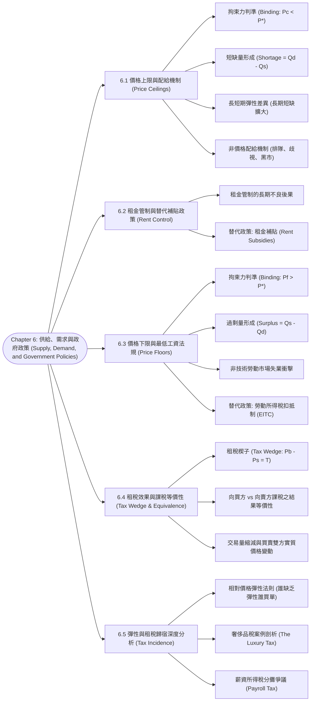

# Chapter 6: 供給、需求與政府政策 (Supply, Demand, and Government Policies)

> 📅 生成日期：2026-10-25  
> 📄 來源檔案：[Reference/NCU_Classes/經濟學/CH6.pdf](file:///c:/Users/Cupid/Downloads/Study-space/Reference/NCU_Classes/經濟學/CH6.pdf)  
> 🎯 適用考試：中央大學經濟學課程期中考、商管研究所/轉學考個體經濟學基礎  

---

## 🗺️ 知識架構總覽 (Tree Diagram)



<a id="tree-diagram"></a>

### 🎯 本章學習進度檢核 (完成後打勾，建立成就反饋)

- [ ] [6.1 價格上限與配給機制 (Price Ceilings)](#sec-1)
- [ ] [6.2 租金管制與替代補貼政策 (Rent Control)](#sec-2)
- [ ] [6.3 價格下限與最低工資法規 (Price Floors)](#sec-3)
- [ ] [6.4 租稅效果與課稅等價性 (Tax Wedge & Equivalence)](#sec-4)
- [ ] [6.5 彈性與租稅歸宿深度分析 (Tax Incidence)](#sec-5)

---

## 📖 知識點教材

<a id="sec-1"></a>

### 6.1 價格上限的市場衝擊與非價格配給機制 (Price Ceilings & Rationing Mechanisms)

#### 📌 核心概念

- **價格上限（Price Ceiling）**：政府透過法律明文規定某項商品或服務的**法定最高售價（Legal maximum price）**。目的通常是為了保護消費大眾免於過高價格剝削（如生活必需品、戰爭時期物價管制）。
- **有效性判別（Binding vs. Not Binding）**：
  1. **無拘束力（Not Binding）**：若法定價格上限**高於**自由市場均衡價格（$P_c \ge P^*$），市場力量自然將價格維持在均衡點 $P^*$，此政策對市場成交價與數量毫無實質影響。
  2. **具拘束力（Binding）**：若法定價格上限**低於**自由市場均衡價格（$P_c < P^*$），此時均衡價格被視為非法，賣方最高只能收取 $P_c$。在較低價格下：
     - 需求量增加至 $Q_D$（消費者願意買更多）。
     - 供給量減少至 $Q_S$（生產者生產利潤受壓縮，減少供應）。
     - 結果必定造成市場**超額需求 / 短缺（Shortage = $Q_D - Q_S$）**。

#### 📐 關鍵公式與長短期彈性動態

$$\text{短缺量（Shortage）} = Q_D(P_c) - Q_S(P_c)$$

> ⚠️ **考試極高頻考點：長短期彈性對短缺量的放大效應**
>
> - **短期（Short-run）**：買賣雙方的供需價格彈性通常較小（缺乏彈性 Inelastic）。租屋者短期不易搬家，房東無法立刻改建或轉售，因此**短期短缺量相對較小**。
> - **長期（Long-run）**：隨著時間拉長，供需雙方彈性變大（富有彈性 Elastic）。房東停止興建新公寓、將房屋改作辦公室或任其年久失修；外地人口見低租金蜂擁移入。供給曲線與需求曲線變得平緩，導致**長期短缺量遠大於短期**！

#### 💡 重要觀念提醒：非價格配給機制的無效率與不公

當市場出現持續性短缺時，自由價格機能無法發揮結清市場（Clear the Market）的作用，必然催生**非價格配給機制（Rationing Mechanisms）**：

1. **漫長排隊（Long Lines）**：依「先到先得（First-come, first-served）」排隊，浪費消費者大量寶貴時間成本。
2. **賣方個人偏見與歧視（Discrimination according to sellers' biases）**：房東依照種族、性別、有無小孩等個人偏好挑選房客。
3. **黑市交易與賄賂（Black Markets & Bribes）**：私下向大樓管理員支付茶水費、強制綑綁昂貴家具出租。
4. **結論**：商品最終往往**沒有**落入「評價最高（Willingness to Pay 最高）」的買者手中，造成嚴重的資源錯配與社會福利淨損失。

#### 📊 範例

**題目**：某觀光景點飯店房間自由市場均衡價格為 $\$100$，均衡數量為 $100$ 間。若市議會通過法令規定飯店每晚租金不得超過 $\$90$。已知在此價格下，消費者需求量增加為 $120$ 間，飯店業者僅願意供應 $90$ 間。請問：

1. 此價格上限是否具拘束力？
2. 市場將產生過剩還是短缺？數量為多少？實際成交量為多少？

**解題過程**：

1. 均衡價格 $P^* = \$100$。法定上限 $P_c = \$90 < P^*$，阻礙了市場回歸均衡，因此**具拘束力（Binding）**。
2. 在 $P_c = \$90$ 時：
   - 需求量 $Q_D = 120$，供給量 $Q_S = 90$。
   - $Q_D > Q_S$，市場產生**短缺（Shortage）**。
   - 短缺量 $= Q_D - Q_S = 120 - 90 = \mathbf{30 \text{ 間}}$。
   - 實際在市場上完成交易的成交量由賣方供給量決定：$\min(Q_D, Q_S) = \min(120, 90) = \mathbf{90 \text{ 間}}$（成交量反而比無管制時減少 10 間！）。

<a id="q-sec-1"></a>

---

<a id="sec-2"></a>

### 6.2 租金管制案例深度剖析與替代性補貼政策 (Rent Control & Housing Subsidies)

#### 📌 核心概念

- **租金管制（Rent Control）的初衷**：幫助低所得家庭能夠負擔市中心住宅費用。
- **經濟學家的實證共識**：美國著名民調中，超過 90% 的專業經濟學家一致反對租金管制。租金管制被經濟學家林德貝克（Assar Lindbeck）譏為：「**除了轟炸之外，摧毀一座城市最有效的方法就是租金管制**。」

#### 💡 重要觀念提醒：好心辦壞事的連鎖負面效應

1. **現有房屋品質快速惡化**：房東在法定租金被鎖死的情況下，完全缺乏修繕屋頂、維護暖氣與油漆外牆的經濟誘因。
2. **未來供給量斷崖式萎縮**：資本家停止投入興建出租公寓，轉為興建自住豪宅或商業辦公室。
3. **租屋黑市盛行與權利金剝削**：租客將被管制的廉價公寓非法轉租（Subletting），從中抽取巨額轉租利潤；或要求新房客私下支付天價的「家具頂讓費（Key Money）」。
4. **資源錯配（Misallocation）**：原本一家四口居住大公寓的長者，即使子女已長大離巢，因貪戀被管制的老租金而不願換至小套房；反之，帶著小孩的新婚家庭卻完全租不到適當房屋。

#### 📐 政策替代方案：價格機能破壞 vs. 直接所得補貼

| 政策手段 | 運作機制 | 對市場機能影響 | 優缺點評價 |
| :--- | :--- | :--- | :--- |
| **租金管制 (Price Ceiling)** | 法律強行限制最高租金上限 | **摧毀市場機能**：引發嚴重短缺、品質低落、歧視配給 | 表面免財政支出，但產生龐大無謂損失與黑市 |
| **租金補貼 (Rent Subsidies)** | 政府直接發放租金兌換券或現金給低所得家庭 | **保留市場機能**：刺激有效需求，價格自由引導供給興建 | 不會引發房屋短缺，但需要政府稅收作為財政支撐 |
| **公營住宅 (Public Housing)** | 政府自行出資建造社會住宅直接出租 | 由政府直接補足供給缺口 | 興建期長、公部門營運效率通常不及民營市場 |

<a id="q-sec-2"></a>

---

<a id="sec-3"></a>

### 6.3 價格下限與最低工資法規 (Price Floors & The Minimum Wage)

#### 📌 核心概念

- **價格下限（Price Floor）**：政府明文規定某項商品或生產要素的**法定最低售價（Legal minimum price）**。目的通常是保障生產者或勞動者的基本收益（如農產品保證收購價格、基本工資法）。
- **有效性判別（Binding vs. Not Binding）**：
  1. **無拘束力（Not Binding）**：若法定價格下限**低於**均衡價格（$P_f \le P^*$），自由市場價格仍能停留在 $P^*$，法令不發生實質作用。
  2. **具拘束力（Binding）**：若法定價格下限**高於**均衡價格（$P_f > P^*$），此時市場價格不得跌破 $P_f$：
     - 供給量增加至 $Q_S$（高價吸引更多生產者進場）。
     - 需求量縮減至 $Q_D$（買方因價格過高縮減採購）。
     - 結果必定造成市場**超額供給 / 過剩（Surplus = $Q_S - Q_D$）**。

#### 📐 最低工資（Minimum Wage）勞動市場模型

在勞動市場中，勞資雙方的角色對調：

- **供給方（Supply）**：勞工 / 家計單位（提供勞務）。
- **需求方（Demand）**：雇主 / 企業（聘僱勞工）。
- **勞動價格（Price）**：工資率（Wage, $W$）。

$$\text{失業人口（Labor Surplus / Unemployment）} = L_S(W_{\min}) - L_D(W_{\min})$$

> 💡 **核心考點：最低工資衝擊的族群差異**
>
> 1. **高技術/專業勞工（High-skilled Workers）**：其市場均衡工資遠高於最低工資門檻（$W^* \gg W_{\min}$），因此最低工資法對其完全**無拘束力**。
> 2. **非技術勞工與青少年（Unskilled & Teenage Workers）**：其市場邊際產值較低，均衡工資原本低於法定最低工資。當政府強制推行高於均衡工資的最低工資時：
>    - 雇主縮減非技術職缺（需求量減少）。
>    - 更多高中輟學生進入職場找工作（供給量增加）。
>    - **實證研究（Empirical Studies）**：最低工資每提高 $10\%$，青少年就業率通常會**下降 $1\% \sim 3\%$**。

#### 💡 替代方案：勞動所得稅扣抵制 (Earned Income Tax Credit, EITC)

最低工資的缺點在於：只讓「保住工作的人」受惠，卻讓「最弱勢、最邊緣的失業勞工」失去工作。因此經濟學家多數更推崇 **EITC（勞動所得稅扣抵制）**：

- 政府依據低所得勞工的實際薪資所得，由財政直接發放負所得稅補貼（Wage Subsidies）。
- **優點**：既能實質改善在職窮人生活，又不會增加企業聘僱成本，反而能鼓勵弱勢族群積極進入職場。

#### 📊 範例

**情境**：某市飛盤（Frisbee）市場的供需資料如下表所示：

| 價格 ($P$) | 需求量 ($Q_D$, 百萬個) | 供給量 ($Q_S$, 百萬個) |
| :---: | :---: | :---: |
| $\$11$ | $1$ | $15$ |
| $\$10$ | $2$ | $12$ |
| $\$9$ | $4$ | $9$ |
| **$\$8$** | **$6$** | **$6$** |
| $\$7$ | $8$ | $3$ |
| $\$6$ | $10$ | $1$ |

**問題**：

1. 自由市場的均衡價格與均衡數量為何？
2. 若國會設定了一個比均衡價格高 $\$2$ 的價格下限，新市場價格為何？實際售出數量為何？市場狀態為何？
3. 若國會廢除上述下限，改設一個比該下限低 $\$1$ 的價格上限，新市場價格為何？實際售出數量為何？

**逐步解題**：

1. 比對表格，當 $P = \$8$ 時，$Q_D = Q_S = 6$ 百萬個。故均衡價格 $P^*= \mathbf{\$8}$，均衡數量 $Q^* = \mathbf{6 \text{ 百萬個}}$。
2. 價格下限比均衡價格高 $\$2$ $\implies P_f = \$8 + \$2 = \$10$：
   - 由於 $P_f = \$10 > P^*$，此價格下限**具拘束力**。
   - 新市場價格法定不得低於下限，故新價格為 $\mathbf{\$10}$。
   - 在 $\$10$ 時，$Q_D = 2$ 百萬個，$Q_S = 12$ 百萬個。
   - 實際成交量受限於買方意願：$\min(2, 12) = \mathbf{2 \text{ 百萬個}}$。
   - 市場產生過剩（Surplus）$= 12 - 2 = \mathbf{10 \text{ 百萬個}}$。
3. 價格上限比前述價格下限（$\$10$）低 $\$1$ $\implies P_c = \$10 - \$1 = \$9$：
   - 由於 $P_c = \$9 > P^* = \$8$（上限高於均衡價格），市場仍可在 $\$8$ 自由結清！
   - 此價格上限**不具拘束力（Not Binding）**。
   - 新市場價格維持在均衡價格 $\mathbf{\$8}$，實際售出數量維持 $\mathbf{6 \text{ 百萬個}}$，市場處於均衡。

<a id="q-sec-3"></a>

---

<a id="sec-4"></a>

### 6.4 租稅效果與課稅等價性定理 (Tax Wedge & Buyer/Seller Tax Equivalence)

#### 📌 核心概念

- **政府課稅目的**：籌措公共財源（國防、道路、教育基礎建設）。
- **從量稅（Per-unit Tax）**：對買賣的每單位商品課徵固定金額 $T$ 的稅金。
- **租稅楔子（Tax Wedge）**：稅收在「買者支付價格（$P_B$）」與「賣者實際獲得價格（$P_S$）」之間打入一道楔子：
  $$P_B - P_S = T$$
  $$P_B = P_S + T$$

#### 📐 課稅對象等價性定理 (Tax Equivalence Theorem)
>
> ⚠️ **大考黃金公理：向買方課稅 vs. 向賣方課稅，經濟實質結果 100% 完全相同！**

| 比較維度 | 向賣方課稅每單位 $\$T$ | 向買方課稅每單位 $\$T$ | 最終比較結果 |
| :--- | :--- | :--- | :---: |
| **圖形位移** | 供給曲線 $S$ 垂直向上平移 $T$ 單位 | 需求曲線 $D$ 垂直向下平移 $T$ 單位 | 幾何面積等價 |
| **市場均衡數量** | 由 $Q_1^*$ 縮減為 $Q_T^*$ | 由 $Q_1^*$ 縮減為 $Q_T^*$ | **完全相同** ($Q$ 下降) |
| **買方實付價格 $P_B$** | 價格上升為 $P_B$ | 加上自付稅款後總付出為 $P_B$ | **完全相同** ($P_B$ 上漲) |
| **賣方實收價格 $P_S$** | 扣除繳稅後實得 $P_S$ | 標籤售價直接下跌為 $P_S$ | **完全相同** ($P_S$ 下跌) |
| **實質租稅歸宿** | 買賣雙方依彈性分攤 | 買賣雙方依彈性分攤 | **完全相同** |

**結論**：國會立法規定由買方還是賣方負責填單繳稅，僅僅是行政手續上的差異，**絲毫無法改變買賣雙方實際承受的稅賦負擔**！

#### 📊 範例：飯店房間課稅數值推導

**情境**：某市飯店房間原本無稅時均衡價格為 $\$100$，成交量為 $100$ 間。現政府決定每間房課徵 $\$30$ 的稅。

- 課稅後市場新均衡為：成交量縮減至 $Q = 80$ 間，買方實付價格變為 $P_B = \$110$，賣方實得價格變為 $P_S = \$80$。

**問題**：

1. 驗證租稅楔子是否吻合？
2. 買賣雙方各自承擔的每單位稅額為多少？
3. 若政府改為向飯店業者課徵 $\$30$，買方的實質負擔會改變嗎？

**解析**：

1. 租稅楔子 $= P_B - P_S = \$110 - \$80 = \$30 = T$，完全吻合。
2. 稅前均衡價為 $\$100$：
   - 買方負擔（Buyer's share）$= P_B - P^* = \$110 - \$100 = \mathbf{\$10}$。
   - 賣方負擔（Seller's share）$= P^* - P_S = \$100 - \$80 = \mathbf{\$20}$。
   - 兩者合計：$\$10 + \$20 = \$30$。
3. 根據**課稅等價性定理**，向業者課稅只會使供給線向上平移，新均衡點所決定的 $P_B$ 依然為 $\$110$，$P_S$ 依然為 $\$80$。買方實質負擔**完全不變**（仍為每間 $\$10$）。

<a id="q-sec-4"></a>

---

<a id="sec-5"></a>

### 6.5 彈性與租稅歸宿深度分析 (Elasticity and Tax Incidence)

#### 📌 核心概念

- **租稅歸宿（Tax Incidence）**：指租稅負擔最終在市場參與者（買方與賣方）之間的實際分配比例。
- **決定租稅歸宿的唯一法則**：**供需兩側的「相對價格彈性（Relative Price Elasticity）」**！
  > **核心口訣：誰缺乏彈性（Elasticity 小、較難逃離市場），誰就承擔較多的租稅！**

#### 📐 兩大經典情境對照

```
【Case 1: 供給富有彈性，需求缺乏彈性】        【Case 2: 需求富有彈性，供給缺乏彈性】
  (Sellers easily leave market)               (Buyers easily leave market)
        P                                           P
        │   \   S (平緩)                             │   \       / S (陡峭)
     PB ├─── ＼                                  PB ├─── ＼   /
        │ Tax  ＼                                   │ Tax  ＼/
     P* ├───    ＼                                P* ├───    /\
     PS ├───      ＼                                PS ├───  /  ＼
        │           ＼ D (陡峭)                      │       /     ＼ D (平緩)
        └───────────────── Q                        └───────────────── Q
   結果：買方承擔絕大部分稅負！                       結果：賣方承擔絕大部分稅負！
```

#### 📐 代數分攤比率公式

$$\frac{\text{買者承擔的稅額負擔 } (\Delta P_B)}{\text{賣者承擔的稅額負擔 } (\Delta P_S)} = \frac{E_S}{E_D}$$

- 若 $E_D < E_S$（需求比供給缺乏彈性）：$\Delta P_B > \Delta P_S$，買方買單多。
- 若 $E_D > E_S$（需求比供給富有彈性）：$\Delta P_B < \Delta P_S$，賣方買單多。

#### 💡 經典案例深度研討

##### 1. 1990 年美國奢侈品稅（The Luxury Tax）的慘痛教訓

- **政策背景**：美國國會通過對遊艇、私人飛機、毛皮大衣、珠寶與豪車課徵 10% 奢侈稅，宣稱「向買得起奢侈品的超級富豪課稅」。
- **經濟現實**：
  - **富人買家（需求端）**：極富價格彈性（$E_D \gg 1$）。富人可以選擇不買遊艇，改買歐洲度假別墅，或去巴哈馬租船。
  - **遊艇造船廠與造船工匠（供給端）**：短期內高度缺乏彈性（$E_S \ll 1$）。造船設備無法輕易改產其他產品，專業造船工匠無法立刻轉行。
- **政策災難**：稅賦絕大部分轉嫁由造船廠和造船工人承受！全美遊艇製造業爆發大裁員潮，工廠倒閉，政府收到的稅收極其微薄，卻重創基層就業。國會最終於 1993 年難堪地廢除該項奢侈稅。

##### 2. 薪資所得稅 / 社會安全稅（The Payroll Tax / FICA）

- **政策規定**：法律規定雇主支付 6.2%，員工工資扣繳 6.2%，表面看似各負擔一半（50% vs. 50%）。
- **經濟現實**：
  - **勞動供給（勞工端）**：多數家庭經濟支柱必須工作以維持生計，勞動供給極度缺乏彈性（接近垂直）。
  - **勞動需求（企業端）**：企業富有彈性，若勞工成本過高，企業可選擇自動化機器人替代或外包。
- **結論**：法律條文規定資方付一半純屬政治修辭；**實質上幾乎全部的薪資稅都由勞工以「實得工資下降」的形式默默買單**！

#### 📊 範例：供需代數聯立方程式求解課稅模型

**已知某市場之供需方程式為**：

- 供給函數：$Q_S = 2P$
- 需求函數：$Q_D = 300 - P$

**問題**：

1. 計算未課稅時的自由市場均衡價格 $P^*$ 與均衡數量 $Q^*$。
2. 若政府對生產者課徵每單位 $T = \$30$ 的稅，求課稅後的新供給函數、新市場交易量 $Q_T$、買者實付價格 $P_B$、賣者實收價格 $P_S$。
3. 計算政府總稅收（Tax Revenue）以及買賣雙方的稅負分攤比例。

**逐步推導解題**：

1. **無稅均衡**：
   - 令 $Q_S = Q_D \implies 2P = 300 - P \implies 3P = 300 \implies P^* = \mathbf{\$100}$。
   - 代入求數量：$Q^* = 2(100) = \mathbf{200}$。
2. **對生產者課徵 $T = \$30$**：
   - 賣方每單位實收價格為 $P - 30$，故新供給函數為：
     $$Q_S' = 2(P - 30) = 2P - 60$$
   - 令新供給等於原需求：
     $$2P - 60 = 300 - P \implies 3P = 360 \implies P_B = \mathbf{\$120}$$
   - 買者支付價格 $P_B = \$120$。
   - 賣者實際獲得價格 $P_S = P_B - T = \$120 - \$30 = \mathbf{\$90}$。
   - 新均衡交易量 $Q_T = 300 - 120 = \mathbf{180}$（交易量減少 20 單位）。
3. **稅收與歸宿分攤**：
   - 政府總稅收 $= T \times Q_T = \$30 \times 180 = \mathbf{\$5,400}$。
   - 買者每單位負擔 $= P_B - P^* = \$120 - \$100 = \mathbf{\$20}$（佔 $\frac{20}{30} = \mathbf{66.7\%}$）。
   - 賣者每單位負擔 $= P^* - P_S = \$100 - \$90 = \mathbf{\$10}$（佔 $\frac{10}{30} = \mathbf{33.3\%}$）。
   - *檢驗*：$Q_S = 2P$ 之供給彈性為 1，$Q_D = 300 - P$ 在均衡點之需求彈性絕對值為 $\frac{100}{200} = 0.5$。需求彈性只有供給彈性的一半，故買者承擔賣者兩倍的稅負，完全精確！

<a id="q-sec-5"></a>

---

## 📝 實戰練習題 (三層遞進式強化測驗)

---

### 🟢 第一層：必懂基礎（計算規則、定義判定與單一概念）

#### <a id="q1"></a>Q1. (價格上限拘束力計算)
設某租屋市場的月需求函數為 $Q_d = 100 - 2P$，月供給函數為 $Q_s = 20 + 2P$（$P$ 單位為千元/月，$Q$ 單位為萬戶）。
1. 求未受管制時的市場均衡租金 $P^*$ 與均衡出租量 $Q^*$。
2. 若市政府立法設定租金價格上限為 $\bar{P} = 15$（千元/月），此價格上限是否具拘束力（Binding）？此時市場將產生超額需求（短缺）還是超額供給（過剩）？數量為多少？
👉 [查看 Q1 答案與詳細解析](#ans-q1)

---

#### <a id="q2"></a>Q2. (價格下限與最低工資失業量計算)
設某非技術勞動市場的勞動需求函數為 $L_d = 200 - 10W$，勞動供給函數為 $L_s = 20 + 20W$（$W$ 為每小時時薪/美元，$L$ 為勞動工時萬小時）。
1. 求市場競爭均衡時薪 $W^*$ 與均衡就業量 $L^*$。
2. 若政府訂定法定最低工資為 $\underline{W} = 8$ 美元，此政策是否具有拘束力（Binding）？
3. 此時市場上的失業量（勞動過剩工時）為多少萬小時？
👉 [查看 Q2 答案與詳細解析](#ans-q2)

---

#### <a id="q3"></a>Q3. (無拘束力之價格下限判定)
承接 Q2 的勞動市場數據，若政府因物價變動評估，將法定最低工資下修設定為 $\underline{W} = 5$ 美元：
1. 此最低工資政策是否具拘束力？
2. 市場實際決定的工資與就業量分別為多少？是否會產生失業人口？
👉 [查看 Q3 答案與詳細解析](#ans-q3)

---

#### <a id="q4"></a>Q4. (單位從量稅之新均衡價格與數量計算)
設某商品市場的需求函數為 $P = 50 - Q$，供給函數為 $P = 10 + Q$。政府決定對賣方每銷售一單位商品課徵 $t = 10$ 元的從量稅。
1. 求課稅前市場的均衡價格 $P^*$ 與均衡交易量 $Q^*$。
2. 求課稅後買方支付價格 $P_b$、賣方實得價格 $P_s$ 及市場實際交易量 $Q_t$。
👉 [查看 Q4 答案與詳細解析](#ans-q4)

---

#### <a id="q5"></a>Q5. (租稅楔子與政府稅收計算)
承接 Q4 的課稅情境：
1. 課稅後形成之租稅楔子（Tax Wedge, $P_b - P_s$）大小為多少？
2. 政府在此市場所獲得的總稅收（Tax Revenue, $T \times Q_t$）為多少元？
3. 買方與賣方每單位各自分攤了多少稅負？
👉 [查看 Q5 答案與詳細解析](#ans-q5)

---

### 🟡 第二層：基礎 + 實際應用（情境比較、政策抉擇與彈性法則）

#### <a id="q6"></a>Q6. (課稅法定歸宿等價性比較)
承接 Q4 之市場情境，若政府改為對「買方」每購買一單位課徵 $t = 10$ 元的從量稅（法定納稅義務人由賣方改為買方）：
1. 列出買方支付意願變動後之有效需求曲線方程式。
2. 計算新的買方支付總價格 $P_b$、賣方實收價格 $P_s$ 以及均衡交易量 $Q_t$。
3. 比較此結果與向賣方課稅（Q4）之異同，並說明「法定課稅對象（Legal Incidence）」能否決定「實質經濟負擔（Economic Incidence）」。
👉 [查看 Q6 答案與詳細解析](#ans-q6)

---

#### <a id="q7"></a>Q7. (租金管制之長短期彈性與不良後果)
經濟學教科書中常指出「租金管制（Rent Control）是除了轟炸之外摧毀一座城市最好的方法」。
1. 試從「供給彈性」與「需求彈性」在短期與長期的演變，解釋為何租金管制在短期看似影響不大，但在長期會造成災難性的房屋短缺？
2. 在長期價格機制被凍結的情況下，市場會演化出哪些非價格配給機制（Non-price Rationing Mechanisms）？
👉 [查看 Q7 答案與詳細解析](#ans-q7)

---

#### <a id="q8"></a>Q8. (相對價格彈性與租稅負擔分配)
已知香菸市場之需求價格彈性為 $|E_d| = 0.4$（高度缺乏彈性），供給價格彈性為 $E_s = 1.6$（相對富有彈性）。現政府對每包香菸加徵 20 元的健康福利捐。
1. 根據租稅歸宿原則，買方所負擔的每單位稅額 $\Delta P_b$ 與賣方所負擔的每單位稅額 $\Delta P_s$ 各為多少元？
2. 買賣雙方的稅負分擔比例與何者成反比？
👉 [查看 Q8 答案與詳細解析](#ans-q8)

---

#### <a id="q9"></a>Q9. (替代政策方案評估：最低工資 vs 勞動所得稅扣抵制 EITC)
各國政府在協助低所得基層勞工時，常在「調高法定最低工資」與「實施勞動所得稅扣抵制（EITC, Earned Income Tax Credit）」之間做政策抉擇：
1. 最低工資政策的成本主要由誰承擔？對低技術勞工的就業機會可能造成什麼負面副作用？
2. EITC 補貼政策由誰買單？它對勞動市場供給量與勞工工作誘因有何正面激勵？
👉 [查看 Q9 答案與詳細解析](#ans-q9)

---

### 🔴 第三層：概念講述與深度分析（數理推導、體制比較與經典案例）

#### <a id="q10"></a>Q10. (租稅歸宿比例與價格彈性之微積分嚴密推導)
設市場原均衡在 $(P^*, Q^*)$，政府課徵從量稅 $t$ 後滿足：
$$P_b - P_s = t, \quad Q_d(P_b) = Q_s(P_s) = Q_t$$
1. 試對上述均衡條件進行全微分（或隱函數微分），求出買方承受價格變動量與賣方承受價格變動量的比值：
$$\frac{dP_b / dt}{|dP_s / dt|}$$
2. 將結果表示為需求價格彈性絕對值 $|E_d|$ 與供給價格彈性 $E_s$ 的關係式，並闡明「彈性即逃避負擔之能力（Elasticity measures the ability to escape）」的深刻經濟意涵。
👉 [查看 Q10 答案與詳細解析](#ans-q10)

---

#### <a id="q11"></a>Q11. (非價格配給機制之社會福利浪費分析)
當價格上限低於市場均衡價格時，買方需求量大於賣方供給量：
1. 比較「價格配給機制（Price Rationing）」與「排隊配給機制（Rationing by Waiting / Queuing）」在資源配置上的根本差異。
2. 為什麼在排隊配給下，消費者為獲取短缺商品所耗費的排隊等待時間，屬於純粹的社會福祉耗損（Pure Social Waste）而非資源移轉？
👉 [查看 Q11 答案與詳細解析](#ans-q11)

---

#### <a id="q12"></a>Q12. (1990年美國遊艇奢侈品稅的經濟學啟示)
1990 年美國國會通過對遊艇、私人飛機、高檔皮草等奢侈品課徵 10% 的奢侈稅，意圖向金字塔頂端富人徵稅以充實國庫。然而該法案實施不到幾年便草草廢除。
試運用供需彈性與租稅歸宿理論，深入分析：
1. 富人對遊艇等奢侈品的需求彈性特徵為何？
2. 遊艇製造業者與造船工人的供給彈性特徵為何？
3. 該項租稅最後實質落在誰的頭上？產生了哪些未預期的反效果？
👉 [查看 Q12 答案與詳細解析](#ans-q12)

---

## 🔑 本章練習題答案與詳細解析 (Answer Key)

### <a id="ans-q1"></a>Q1 答案與詳細解析
1. **未受管制時之市場均衡：**
   - 令需求等於供給：
     $$100 - 2P = 20 + 2P \implies 4P = 80 \implies P^* = 20 \text{ (千元/月)}$$
   - 代入求均衡出租量：
     $$Q^* = 100 - 2(20) = 60 \text{ (萬戶)}$$
2. **價格上限 $\bar{P} = 15$ 之效果判別：**
   - **拘束力判定**：因為政府設定的價格上限 $\bar{P} = 15 < P^* = 20$（上限低於市場均衡價格），市場無法透過價格上漲達到平衡，因此該政策**具有拘束力（Binding）**。
   - **市場短缺量計算**：
     - 在 $P = 15$ 時，租屋需求量 $Q_d = 100 - 2(15) = 70$ 萬戶。
     - 在 $P = 15$ 時，房東願出租量 $Q_s = 20 + 2(15) = 50$ 萬戶。
     - 產生**超額需求（短缺，Shortage）**：
       $$\text{Shortage} = Q_d - Q_s = 70 - 50 = 20 \text{ 萬戶}$$
[🔙 返回題目 Q1](#q1) ｜ [🔝 返回知識架構圖](#tree-diagram)

---

### <a id="ans-q2"></a>Q2 答案與詳細解析
1. **競爭均衡工資與就業量：**
   - 令勞動需求等於勞動供給：
     $$200 - 10W = 20 + 20W \implies 30W = 180 \implies W^* = 6 \text{ (美元/小時)}$$
   - 均衡就業量：
     $$L^* = 200 - 10(6) = 140 \text{ (萬工時)}$$
2. **最低工資 $\underline{W} = 8$ 之拘束力判定：**
   - 由於法定的價格下限 $\underline{W} = 8 > W^* = 6$（下限高於均衡工資），雇主依法不得支付低於 8 美元的時薪，因此該政策**具有拘束力（Binding）**。
3. **失業量（勞動過剩工時）計算：**
   - 在 $W = 8$ 時，企業意願僱用量 $L_d = 200 - 10(8) = 120$ 萬工時。
   - 在 $W = 8$ 時，勞工意願提供工時 $L_s = 20 + 20(8) = 180$ 萬工時。
   - 市場產生**超額供給（勞動過剩/失業量）**：
     $$\text{Unemployment} = L_s - L_d = 180 - 120 = 60 \text{ 萬工時}$$
[🔙 返回題目 Q2](#q2) ｜ [🔝 返回知識架構圖](#tree-diagram)

---

### <a id="ans-q3"></a>Q3 答案與詳細解析
1. **政策拘束力判定：**
   - 市場均衡工資為 $W^* = 6$ 美元。
   - 政府訂定的最低工資為 $\underline{W} = 5$ 美元。
   - 由於 $\underline{W} = 5 < W^* = 6$（法定下限低於市場自由均衡價格），市場自然會依供需機制運行在 $W^* = 6$ 美元，該法律**不具拘束力（Not Binding / Ineffective）**。
2. **實際工資、就業量與失業情況：**
   - 實際市場工資仍為 $W = 6$ 美元。
   - 實際就業量為 $L = 140$ 萬工時。
   - 市場供需相等，**不會產生政策引發的失業過剩**。
[🔙 返回題目 Q3](#q3) ｜ [🔝 返回知識架構圖](#tree-diagram)

---

### <a id="ans-q4"></a>Q4 答案與詳細解析
1. **課稅前市場均衡：**
   - $P = 50 - Q = 10 + Q \implies 2Q = 40 \implies Q^* = 20$。
   - $P^* = 50 - 20 = 30$ 元。
2. **對賣方課徵 $t = 10$ 元從量稅之新均衡：**
   - 賣方提供每一單位商品需額外繳納 10 元稅，供給曲線向上移動 10 單位：
     $$P_b = P_s + t = (10 + Q) + 10 = 20 + Q$$
   - 與需求曲線 $P_b = 50 - Q$ 相交：
     $$50 - Q = 20 + Q \implies 2Q = 30 \implies Q_t = 15$$
   - 買方支付價格：
     $$P_b = 50 - 15 = 35 \text{ 元}$$
   - 賣方實得價格（扣除 10 元稅款後）：
     $$P_s = P_b - t = 35 - 10 = 25 \text{ 元}$$
   - 總結：課稅後交易量由 20 降至 15；買方多付 5 元（$35 - 30$），賣方少收 5 元（$30 - 25$）。
[🔙 返回題目 Q4](#q4) ｜ [🔝 返回知識架構圖](#tree-diagram)

---

### <a id="ans-q5"></a>Q5 答案與詳細解析
1. **租稅楔子（Tax Wedge）：**
   - 租稅楔子即買方支付價格與賣方實得價格之差額：
     $$\text{Tax Wedge} = P_b - P_s = 35 - 25 = 10 \text{ 元}$$
   - 租稅像一個楔子插入供需之間，破壞了原本 $P_b = P_s = P^*$ 的單一均衡價格。
2. **政府總稅收（Tax Revenue）：**
   $$\text{Tax Revenue} = t \times Q_t = 10 \times 15 = 150 \text{ 元}$$
3. **每單位稅負分攤：**
   - 買方負擔：$\Delta P_b = P_b - P^* = 35 - 30 = 5$ 元（佔 50%）。
   - 賣方負擔：$\Delta P_s = P^* - P_s = 30 - 25 = 5$ 元（佔 50%）。
   - 因本題供需曲線斜率絕對值相等（彈性對稱），雙方均攤 10 元稅額。
[🔙 返回題目 Q5](#q5) ｜ [🔝 返回知識架構圖](#tree-diagram)

---

### <a id="ans-q6"></a>Q6 答案與詳細解析
1. **對買方課稅之有效需求曲線：**
   - 買方每購買一單位須自行向政府繳交 10 元，因此買方願意支付給賣方的價格向下平移 10 元：
     $$P_s = (50 - Q) - 10 = 40 - Q$$
2. **新均衡求解：**
   - 令買方出價等於賣方供給價格：
     $$40 - Q = 10 + Q \implies 2Q = 30 \implies Q_t = 15$$
   - 賣方實收價格：$P_s = 10 + 15 = 25$ 元。
   - 買方支付總代價（含 10 元稅）：$P_b = P_s + t = 25 + 10 = 35$ 元。
3. **等價性結論與經濟意涵：**
   - 比較可知，向買方課稅與向賣方課稅之 $P_b = 35$、$P_s = 25$、$Q_t = 15$ **完全一致**。
   - **核心原理**：租稅的實質經濟歸宿（Economic Incidence）由**供需相對彈性**決定，與法律指定誰去繳稅（Legal Incidence）毫無關聯。無論政府向老闆還是勞工課薪資稅，其分攤實質結果完全相同。
[🔙 返回題目 Q6](#q6) ｜ [🔝 返回知識架構圖](#tree-diagram)

---

### <a id="ans-q7"></a>Q7 答案與詳細解析
1. **長短期彈性差異與短缺擴大機制：**
   - **短期（Short-run）**：
     - 房屋供給量在短期固定（現成房屋無法立刻改建或拆除），供給彈性極缺乏（接近垂直線）。
     - 租客短期內難以迅速搬遷或調整居住型態，需求彈性亦較缺乏。
     - 因此短期內租金管制造成的超額需求（短缺）相對有限。
   - **長期（Long-run）**：
     - 房東停止投資新建出租公寓、放任現有房屋折舊衰退、或轉作商用及自住出售，供給彈性變大。
     - 租金被人為壓低吸引外來人口大量湧入，需求彈性變大。
     - 供需曲線長期更趨平坦，導致**租屋短缺急劇擴大**。
2. **長期演化出的非價格配給機制：**
   - **排隊與等待名單（Waiting Lists）**：需排隊數月甚至數年。
   - **非正式與黑市交易（Black Market）**：加收高額「鑰匙費（Key Money）」、強制租客私下現金加價。
   - **房東偏好與歧視（Discrimination）**：因房東無權透過價格挑選房客，轉而依種族、外貌、有無小孩、單身與否進行主觀歧視。
   - **房屋品質急速劣化**：房東失去修繕動機，走廊失修、暖氣停擺，形成貧民窟化。
[🔙 返回題目 Q7](#q7) ｜ [🔝 返回知識架構圖](#tree-diagram)

---

### <a id="ans-q8"></a>Q8 答案與詳細解析
1. **稅負分擔計算：**
   - 租稅歸宿由相對彈性決定，買賣雙方負擔比率滿足：
     $$\frac{\Delta P_b}{\Delta P_s} = \frac{E_s}{|E_d|}$$
   - 代入 $E_s = 1.6$, $|E_d| = 0.4$：
     $$\frac{\Delta P_b}{\Delta P_s} = \frac{1.6}{0.4} = 4 \implies \Delta P_b = 4 \Delta P_s$$
   - 由於 $\Delta P_b + \Delta P_s = t = 20$ 元：
     $$4 \Delta P_s + \Delta P_s = 20 \implies 5 \Delta P_s = 20 \implies \Delta P_s = 4 \text{ 元}$$
     $$\Delta P_b = 4 \times 4 = 16 \text{ 元}$$
   - 買方每包多付 16 元（負擔 80%），賣方每包少收 4 元（負擔 20%）。
2. **反比關係法則：**
   - 稅負的分擔比例與各自主體的**價格彈性大小成反比**（誰越缺乏彈性、越難以逃避市場，誰就負擔越多的稅額）。
[🔙 返回題目 Q8](#q8) ｜ [🔝 返回知識架構圖](#tree-diagram)

---

### <a id="ans-q9"></a>Q9 答案與詳細解析
1. **最低工資法規（Minimum Wage）：**
   - **成本承擔者**：直接由僱用基層勞工的企業（雇主）以及轉嫁後的終端消費者承擔。
   - **負面副作用**：
     - 人為提高工資成本使企業減少非技術勞工聘用量（造成非技術青少年失業）。
     - 促使企業加速導入自動化機器替代人力。
     - 最低工資受益者常包括中產家庭兼職打工的青少年，扶貧精準度有限。
2. **勞動所得稅扣抵制（EITC, Earned Income Tax Credit）：**
   - **成本承擔者**：由全體納稅人透過政府財政稅收支出支應（屬於負所得稅補貼）。
   - **正面激勵效應**：
     - 只有實際就業工作的低收入家庭才能獲得稅額扣抵補貼，強烈提高低所得者的就業意願（鼓勵就業而非躺平）。
     - 不會增加企業的直接用人成本，因此不會引發企業裁員或失業過剩。
[🔙 返回題目 Q9](#q9) ｜ [🔝 返回知識架構圖](#tree-diagram)

---

### <a id="ans-q10"></a>Q10 答案與詳細解析
1. **全微分推導相對價格變動：**
   - 市場均衡條件為：
     $$Q_d(P_b) = Q_s(P_s) \quad \text{且} \quad P_b - P_s = t$$
   - 兩邊對稅率 $t$ 進行微分：
     $$\frac{dP_b}{dt} - \frac{dP_s}{dt} = 1 \implies \frac{dP_s}{dt} = \frac{dP_b}{dt} - 1$$
   - 對數量平衡式全微分：
     $$Q_d'(P_b) \cdot \frac{dP_b}{dt} = Q_s'(P_s) \cdot \frac{dP_s}{dt}$$
   - 將兩邊除以 $Q$，並在分子分母乘以價格以還原彈性定義：
     - 需求彈性 $|E_d| = -\frac{dQ_d}{dP_b} \frac{P}{Q} \implies Q_d'(P_b) = -|E_d| \frac{Q}{P}$
     - 供給彈性 $E_s = \frac{dQ_s}{dP_s} \frac{P}{Q} \implies Q_s'(P_s) = E_s \frac{Q}{P}$
   - 代入微分式：
     $$-|E_d| \frac{Q}{P} \frac{dP_b}{dt} = E_s \frac{Q}{P} \frac{dP_s}{dt}$$
     $$-|E_d| \frac{dP_b}{dt} = E_s \frac{dP_s}{dt}$$
   - 取絕對值比例：
     $$\frac{dP_b / dt}{|dP_s / dt|} = \frac{E_s}{|E_d|}$$
2. **深刻經濟意涵：**
   - **彈性即逃避能力**：價格彈性反映的是當市場條件惡化（被課稅）時，市場參與者「逃離該市場」的能力。
   - 若買方替代品多（$|E_d|$ 大），買方隨時可轉向其他商品，賣方若缺乏彈性（$E_s$ 小，工廠資本無法轉移），賣方只得忍痛自行吞下大部分稅款；反之亦然。
[🔙 返回題目 Q10](#q10) ｜ [🔝 返回知識架構圖](#tree-diagram)

---

### <a id="ans-q11"></a>Q11 答案與詳細解析
1. **價格配給 vs 排隊配給的根本差異：**
   - **價格配給**：商品分配給「評價（支付意願）最高」的人。買方支付的貨幣直接轉移給賣方與生產者，成為激勵其繼續生產的誘因，屬於**具有生產性激勵的經濟轉移**。
   - **排隊配給**：商品分配給「時間機會成本最低」的人（如退休人員、無業者或黃牛），而非真正最重視該商品效用的人，導致配置無效率（Allocative Inefficiency）。
2. **排隊時間為何是純粹的社會福祉浪費：**
   - 消費者排隊數小時所消耗的時間精力，既沒有讓賣方得到任何好處，也沒有化為政府稅收，**在經濟體中純粹蒸發**。
   - 這不是「財富重分配（Redistribution）」，而是純粹的「社會總福祉毀滅（Deadweight Cost）」。
[🔙 返回題目 Q11](#q11) ｜ [🔝 返回知識架構圖](#tree-diagram)

---

### <a id="ans-q12"></a>Q12 答案與詳細解析
1. **富人對奢侈品的需求彈性：**
   - 遊艇並非生活必需品，且全球可替代的消費管道極多（富人可以出國度假、買跑車、買珠寶，或直接前往巴哈馬買船註冊），因此對遊艇的**需求彈性極高（Highly Elastic）**。
2. **造船業者與勞工的供給彈性：**
   - 造船廠需要高額重工業資本設備，造船工人的專屬技能在短期內極難轉移到其他產業，因此在短期內**供給彈性極為缺乏（Inelastic）**。
3. **政策反效果與經濟學啟示：**
   - 根據租稅歸宿法則，當富有彈性的買方（富人）遇到缺乏彈性的賣方（造船廠與工人）時，**稅負幾乎全數轉嫁給造船業者與底層勞工**。
   - 課稅後遊艇銷售量雪崩式暴跌，富人轉移消費幾乎不受影響，反倒是數以萬計的美國造船藍領工人失業，政府收到的稅收遠遠不足以支付失業救濟金，成了經濟學上最諷刺的政策範例。
[🔙 返回題目 Q12](#q12) ｜ [🔝 返回知識架構圖](#tree-diagram)

## 📋 本章重點速記表

| 政策工具 | 法定定義 | 具拘束力條件 | 市場結果與副作用 | 實證典型案例 |
| :--- | :--- | :--- | :--- | :--- |
| **價格上限 (Price Ceiling)** | 法定最高售價 | $P_c < P^*$ | **市場短缺**（$Q_D > Q_S$）、排隊、歧視、黑市、品質衰減 | 租金管制 (Rent Control)、天然氣價格限制 |
| **價格下限 (Price Floor)** | 法定最低售價 | $P_f > P^*$ | **市場過剩**（$Q_S > Q_D$）、資源囤積、低效率生產 | 最低工資 (Minimum Wage)、農產品保證收購價 |
| **從量租稅 (Per-unit Tax)** | 每單位繳交固定稅額 $T$ | 無條件形成楔子 $P_B - P_S = T$ | **交易量萎縮**（$Q \downarrow$）、買方付更多、賣方收更少 | 汽油碳稅、香菸健康捐、奢侈品稅 |
| **課稅等價性 (Tax Equivalence)** | 向買方或賣方課稅無實質差異 | 適用於所有競爭市場 | 最終均衡量、實質買賣價格與稅負分攤**完全相同** | 社會安全薪資所得稅 (Payroll Tax) |
| **租稅歸宿法則 (Tax Incidence)** | 負擔取決於相對彈性 | 彈性越小者負擔越重 | 缺乏彈性的一方無力逃離市場，被迫承擔多數稅金 | 1990 美國遊艇奢侈稅（造船勞工受害最深） |

---

## 🃏 考前速查卡片

| 正面 (問題) | 背面 (答案) |
| :--- | :--- |
| **若政府將價格上限設定在均衡價格「上方」，會發生什麼事？** | **毫無影響（不具拘束力 Not Binding）**！市場力量仍會自由運作並維持在均衡價格與數量。 |
| **為什麼租金管制在「長期」引起的房屋短缺，遠比「短期」嚴重得多？** | 因為長期供需雙方的**價格彈性皆遠大於短期**！房東停止興建與維護，租屋族大量移入，短缺急遽擴大。 |
| **最低工資法規對哪一類勞工的就業衝擊最大？對哪一類勞工毫無影響？** | 對**缺乏經驗的青少年與非技術勞工衝擊最大**（失業增加）；對**高技術與專業勞工毫無影響**（因其均衡工資原本就遠高於法定門檻）。 |
| **法律規定向「買方」課徵每瓶 $\$5$ 飲料稅，與向「賣方」課徵 $\$5$ 有何不同？** | **經濟實質完全相同**！兩者對成交量、買者實付價格、賣者實收價格及稅負分攤比例均 100% 等價。 |
| **「對遊艇等奢侈品課稅，主要由買得起的富豪承擔」，這句話對不對？為什麼？** | **錯誤**！富豪需求極富彈性（可輕易不買），造船廠與勞工供給缺乏彈性，**稅賦絕大部分轉嫁由造船廠和勞工承受**。 |
| **政府想改善貧窮租客或低薪勞工的處境，經濟學家更推薦什麼替代政策？** | 推薦**租金補貼（Rent Subsidies）**與**勞動所得稅扣抵制（EITC）**。直接補貼所得而不破壞價格機能。 |

---

## ⚠️ 本章常見考試陷阱

1. **以為只要設價格上限就一定會短缺**：
   - ❌ 誤區：政府設上限，商品一定買不到。
   - ✅ 正確做法：必須先檢視 $P_c$ 與均衡價 $P^*$ 的高低！只有當 $P_c < P^*$ 時才具拘束力並引發短缺；若 $P_c \ge P^*$ 則不具拘束力，市場維持平衡。
2. **誤把「需求量增加」當成「成交量增加」**：
   - ❌ 誤區：價格上限讓票價降低，想買的人變多，所以去音樂會的人變多。
   - ✅ 正確做法：成交量是由「短邊（Short side）」決定！供給量因低價而縮減，實際成交量 $\min(Q_D, Q_S) = Q_S$ 必然減少。
3. **誤信法律名義上的納稅義務人**：
   - ❌ 誤區：法律規定向資方課徵 6.2% 薪資稅，所以這筆稅完全由老闆出。
   - ✅ 正確做法：實質歸宿由「相對彈性」決定！勞動供給缺乏彈性，資方會透過調降名目工資將絕大部分稅賦轉嫁由勞工承擔。
4. **分不清最低工資引發的是「超額需求」還是「超額供給」**：
   - ❌ 誤區：最低工資造成勞工短缺。
   - ✅ 正確做法：最低工資是具拘束力的價格下限，吸引過量勞工（$L_S$ 增）但企業縮減職缺（$L_D$ 減），形成**超額供給（勞動過剩 = 失業）**。

---

## 📊 本章練習題統計

| 難度 | 題數 | 分布知識點 |
| :---: | :---: | :--- |
| **Easy** | 2 | 租金管制拘束力判別、租稅楔子數值計算 |
| **Medium** | 6 | 音樂會門票上限成交量 (Q1)、租金補貼替代性優勢 (Q1)、最低工資青年就業衝擊 (Q1)、碳排放稅課稅等價性 (Q1)、奢侈品稅富豪避稅分析 (Q1)、飛盤市場長短期上限下限 (範例) |
| **Hard** | 3 | 租金管制長短期彈性深化比較 (Q2)、最低工資代數模型失業求解 (Q2)、工資稅減稅利益分配與彈性定理 (Q2) |
| **合計** | **11 題** | 涵蓋價格上限、價格下限、最低工資、租稅等價性、相對彈性與租稅歸宿全考點 |

---

## 🔗 相關章節索引與導航

* 🔙 **上一章節**：[Chapter 5: 彈性及其應用 (Elasticity and Its Application)](./Chapter_5_教材.md)
* ⏭️ **下一章節**：[Chapter 7: 消費者、生產者與市場效率性 (Consumers, Producers, and Market Efficiency)](./Chapter_7_教材.md)
* 📚 **課程教材總覽**：[經濟學教材總覽 (_INDEX.md)](./_INDEX.md)
* 📂 **原始講義檔案**：[CH6.pdf](file:///c:/Users/Cupid/Downloads/Study-space/Reference/NCU_Classes/經濟學/CH6.pdf)
