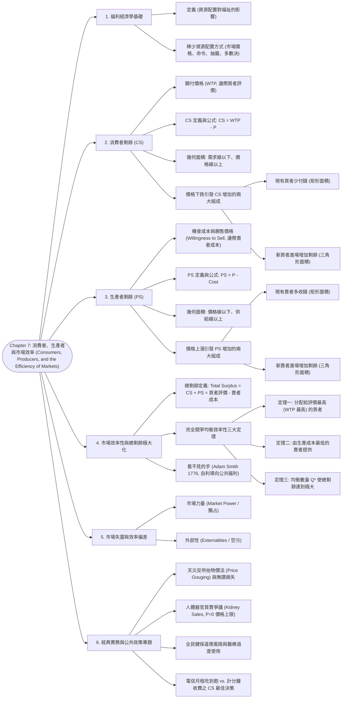

# Chapter 7: 消費者、生產者與市場效率 (Consumers, Producers, and the Efficiency of Markets)

> 📅 生成日期：2026-10-24  
> 📄 來源檔案：[Reference/NCU_Classes/經濟學/CH7.pdf](file:///c:/Users/Cupid/Downloads/Study-space/Reference/NCU_Classes/經濟學/CH7.pdf)  
> 🎯 適用考試：中央大學經濟學課程期中考、商管研究所/轉學考個體經濟學基礎  

---

## 🗺️ 知識架構總覽 (Tree Diagram)



<a id="tree-diagram"></a>

### 🎯 本章學習進度檢核 (完成後打勾，建立成就反饋)

- [ ] [1. 福利經濟學基礎](#sec-1)
- [ ] [2. 消費者剩餘 (CS)](#sec-2)
- [ ] [3. 生產者剩餘 (PS)](#sec-3)
- [ ] [4. 市場效率性與總剩餘極大化](#sec-4)
- [ ] [5. 市場失靈與效率偏差](#sec-5)
- [ ] [6. 經典實務與公共政策專題](#sec-6)

---

## 📖 知識點教材

<a id="sec-1"></a>

### 7.1 福利經濟學與願付價格 (Welfare Economics & Willingness to Pay)

#### 📌 核心概念

- **福利經濟學（Welfare Economics）**：研究**資源配置如何影響社會全體成員的經濟福祉（Economic Well-being）**的科學。主要探討：
  1. 買賣雙方從市場交易中獲得了多少利益？
  2. 社會如何能讓這些總利益達到最大？
- **願付價格（Willingness to Pay, WTP）**：買者願意為某項物品支付的**最高金額（Maximum amount a buyer will pay）**，代表買者對該商品的**主觀價值評價（Value of the good to the buyer）**。
- **邊際買者（Marginal Buyer）**：當價格只要再調高一分錢，就會**第一個選擇離開市場**的買者。
  - **重要幾何定理**：在任何數量 $Q$ 下，**需求曲線的高度恰好等於該數量對應之「邊際買者的願付價格」**！

#### 📐 需求排程到平滑需求曲線的階梯演進

- 當市場上買者數量較少時，需求曲線呈現如階梯般的折線（Staircase Shape）；
- 當市場擴展為完全競爭市場（數百萬名買者）時，無數微小的階梯結合成了一條平滑向下傾斜的連續需求曲線。

<a id="q-sec-1"></a>

---

<a id="sec-2"></a>

### 7.2 消費者剩餘 (Consumer Surplus, CS)

#### 📌 核心概念

- **消費者剩餘（Consumer Surplus, CS）**：買者願意為某物支付的最高金額（WTP）減去其**實際支付金額（Price Paid, $P$）**的差額：
  $$CS = \text{願付價格 (WTP)} - \text{實際支付價格 } P$$
  衡量買者自願參與市場所獲得的**淨利益（Net benefit）**。
- **幾何圖形面積表示**：
  $$\text{市場總消費者剩餘 } CS = \mathbf{\text{需求曲線以下、市場均衡價格線以上的三角形面積}}$$
  $$\text{三角形面積公式：} CS = \frac{1}{2} \times \text{底 (成交數量 } Q) \times \text{高 (最高 WTP 截距} - P^*)$$

#### 📐 價格下跌引發 CS 增加的兩大幾何組成

當市場價格由 $P_1$ 下跌至 $P_2$ 時，消費者剩餘的增加量（$\Delta CS$）由兩個部分構成：

1. **現有買者少付錢帶來的剩餘增加（矩形面積）**：原本在 $P_1$ 就已購買的既有買者，現在每單位少付 $(P_1 - P_2)$。
   $$\Delta CS_{\text{existing}} = Q_1 \times (P_1 - P_2)$$
2. **新買者進場獲得的新剩餘（三角形面積）**：因為降價而被吸引進場的新消費者，其 WTP 高於 $P_2$ 所獲得的滿足。
   $$\Delta CS_{\text{new}} = \frac{1}{2} \times (Q_2 - Q_1) \times (P_1 - P_2)$$

```
 價格 P
   ▲
P截│
   │ \   舊 CS (原有三角形)
P1 │──●────────────────────────
   │  │\  
   │  │ \  [矩形]: 現有買者少付錢   [小三角形]: 新買者進場獲得的剩餘
P2 │──┴──●─────────────────────
   │     │ \  D
   └─────┴──\─────────────────► 數量 Q
         Q1 Q2
```

#### 📊 範例（講義第 19 頁 Melissa 經典考題）

**題目**：梅麗莎（Melissa）花費 240 美元購買了一台 iPhone，獲得了 160 美元的消費者剩餘。  

1. **梅麗莎對這台 iPhone 的願付價格（WTP）是多少？**  
   $$CS = WTP - P \implies 160 = WTP - 240 \implies WTP = \mathbf{400\text{ 美元}}$$
2. **若 iPhone 降價促銷為 180 美元，她的消費者剩餘變為多少？**  
   $$CS = 400 - 180 = \mathbf{220\text{ 美元}}$$
3. **若 iPhone 定價上調至 500 美元，她的消費者剩餘是多少？**  
   - 因市價（$500）大於其最高評價（$400），理性消費者選擇不買，消費者剩餘為 **0 美元**（絕非負數！）。

<a id="q-sec-2"></a>

---

<a id="sec-3"></a>

### 7.3 生產者剩餘 (Producer Surplus, PS)

#### 📌 核心概念

- **成本（Cost / Willingness to Sell）**：賣者為生產一單位商品所必須放棄的**一切資源價值（機會成本 Opportunity Cost）**，包含原料、設備折舊及**賣者自身的時間機會成本**。
- **邊際賣者（Marginal Seller）**：當價格只要再調低一分錢，就會**第一個停產退出市場**的賣者。
  - **重要幾何定理**：在任何數量 $Q$ 下，**供給曲線的高度恰好等於該數量對應之「邊際賣者的生產成本（Marginal Cost）」**！
- **生產者剩餘（Producer Surplus, PS）**：賣者出售商品所實際收到的**金額（Price Received, $P$）**減去其**生產成本（Cost）**的差額：
  $$PS = \text{實際售價 } P - \text{生產成本 (Cost)}$$
  衡量賣者自願參與市場所獲得的**淨福利（Net welfare）**。
- **幾何圖形面積表示**：
  $$\text{市場總生產者剩餘 } PS = \mathbf{\text{市場均衡價格線以下、供給曲線以上的三角形面積}}$$

#### 📐 價格上漲引發 PS 增加的兩大幾何組成

當市場價格由 $P_1$ 上漲至 $P_2$ 時，生產者剩餘的增加量由兩部分構成：

1. **現有賣者每單位多收錢增加的剩餘（矩形面積）**：$Q_1 \times (P_2 - P_1)$。
2. **新賣者因價格高於其成本而進入市場獲得的剩餘（三角形面積）**：$\frac{1}{2} \times (Q_2 - Q_1) \times (P_2 - P_1)$。

<a id="q-sec-3"></a>

---

<a id="sec-4"></a>

### 7.4 市場效率性與總剩餘極大化 (Market Efficiency & Total Surplus)

#### 📌 核心概念

- **總剩餘（Total Surplus, 社會總福祉）**：全體買者與賣者參與市場交易獲得的淨利益總和：
  $$\text{Total Surplus} = CS + PS$$
  $$\text{Total Surplus} = (\text{買者評價} - \text{買者支付金額}) + (\text{賣者收取金額} - \text{賣者成本})$$
  $$\mathbf{\text{Total Surplus} = \text{買者評價 (Value to Buyers)} - \text{賣者成本 (Cost to Sellers)}}$$
- **效率性（Efficiency）**：當一種資源配置方式能夠達到**社會總剩餘（Total Surplus）的最大化**時，該配置即具備生產與配置效率。

#### 📐 完全競爭市場均衡效率性的三大定理

```
 價格 P
   ▲              S
   │      \      /
$40│──●────\────/───── 邊際買者價值 ($40) > 邊際賣者成本 ($25) ==> 增產使總剩餘增加!
   │   \    \  /
$30│────\────●─────── 市場均衡點 (Q*=15): 邊際價值 = 邊際成本 (總剩餘極大化)
   │     \  / \
$20│──────\/───●───── 邊際賣者成本 ($35) > 邊際買者價值 ($20) ==> 減產使總剩餘增加!
   │      /\    \
   └─────/──\────\───► 數量 Q
        0   10 15 20
            D
```

1. **定理一：自由市場將商品分配給對其評價最高（願付價格 WTP 最高）的買者**。
   - 所有 WTP $\ge P^*$ 的買者皆能買到；WTP $< P^*$ 的買者不買。
2. **定理二：自由市場將商品需求交由生產成本最低（機會成本最小）的賣者供應**。
   - 所有成本 $\le P^*$ 的高效廠商皆投入生產；成本 $> P^*$ 的低效廠商被排除。
3. **定理三：自由市場決定的均衡產出數量 $Q^*$ 精確實現了總剩餘極大化**：
   - 當 $Q < Q^*$（如 $Q=10$）：邊際買者價值（$40）大於邊際賣者成本（$25），多生產一單位可為社會創造淨剩餘，應擴大產出。
   - 當 $Q > Q^*$（如 $Q=20$）：邊際賣者成本（$35）大於邊際買者價值（$20），生產該單位會造成社會淨損失（負價值），應縮減產出。
   - 唯有在 **邊際價值 $=$ 邊際成本（$MB = MC$）** 的均衡點 $Q^* = 15$ 下，社會總剩餘達到頂點！

#### 💡 亞當斯密「看不見的手」之真諦
>
> 在《國富論》（1776）中，亞當斯密指出：各個買者與賣者僅僅出於**自私自利（Self-interest）**的動機進行決策，卻在價格機制的導引下，**彷彿被一隻看不見的手所牽引，達成了中央計畫官員竭盡所能也無法企及的「社會總福利最大化」**！

<a id="q-sec-4"></a>

---

<a id="sec-5"></a>

### 7.5 市場失靈的兩大前提邊界 (Market Failures)

#### 📌 核心概念

「看不見的手引導市場達到總剩餘極大化」的結論，完全建立在以下兩大基本假設之上：

1. **假設一：市場必須是完全競爭的（Perfect Competition）**。
   - *失靈狀況*：若市場存在壟斷巨頭（**市場力量 Market Power**），廠商會刻意限制產量並哄抬價格，使 $Q < Q^*$，造成總剩餘縮水與無謂損失。
2. **假設二：市場交易的結果只影響交易雙方本身**。
   - *失靈狀況*：若交易行為波及毫無關係的第三方（**外部性 Externalities**，如工廠排放空污廢水），市場價格將無法反映社會真實成本，導致放任市場配置產出過量公害。

---

<a id="sec-6"></a>

### 7.6 經典實務與前沿公共政策專題 (Advanced Policy Applications)

#### 📊 專題一：人體器官買賣合法化之爭（Supplying Kidneys 爭議，講義第 44～45 頁）

- **現行政策本質**：各國法律全面禁止腎臟買賣，實質上等同於政府設定了**嚴格的價格上限（Price Ceiling at $P=0$）**。
- **市場結果分析**：
  - 價格被鎖死在 0 元，導致**器官極度短缺（Shortage）**。數以萬計的腎病患者必須苦等數年甚至在等待名單中病逝。
- **效率 vs. 平等的終極權衡**：
  - **效率層面**：經濟學家指出，若允許試點補償交易，供給量將大幅激增，消除短缺並拯救無數生命，極大化社會總剩餘。
  - **道德與公平層面**：反對者憂慮這將迫使貧困者出賣器官（剝削窮人），且只有富人能買得起腎臟，嚴重損害社會公平性（Equality）。

---

#### 📊 專題二：全民健保制度下的「醫療過度使用」福利分析（講義第 56～58 頁）

- **情境設定**：某項醫療檢查程序的真實社會生產成本為 **100 美元**。但在全民健保或醫療保險制度下，病患自付額僅需 **20 美元**（剩餘 80 美元由保險公司/健保基金負擔）。
- **福利經濟學推導**：
  1. 病患面對的邊際成本僅為 20 元，因此只要該檢查對病患的**邊際價值大於 20 元（即便只有 25 元，如輕微感冒或看青春痘）**，病患便會要求進行該檢查！
  2. 但該檢查消耗了社會 100 元的真實醫療資源！
  3. **福利損失**：對於每一項「病患評價 25 元、社會成本 100 元」的過度醫療，社會淨虧損達 $100 - 25 = \mathbf{75\text{ 美元}}$！
  4. **結論**：自付額過低引發道德風險（Moral Hazard），使醫療消費量遠大於社會效率數量，**顯著降低了社會總剩餘**。

---

#### 📊 專題三：電信資費方案二選一的消費者剩餘最佳決策（講義第 59 頁壓軸大題）

**題目情境**：
你的朋友正在評估兩家電信業者：

- **方案 A（月租吃到飽）**：每月收取固定月租費 **120 美元**，不限通話分鐘數（每分鐘通話費用為 0 元）。
- **方案 B（按分計費）**：無任何固定月租費，但通話每分鐘收取 **1 美元**。
- 你的朋友每月對通話分鐘數的需求函數為：$$Q^D = 150 - 50P \quad (P \text{ 為每分鐘通話費})$$
請逐步推導並推薦你的朋友應該選擇哪一個方案？

**逐步解題推導**：

1. **求需求曲線的特徵**：
   - 當 $Q^D = 0$ 時，願付價格上限截距 $P = 150 / 50 = \mathbf{3\text{ 美元}}$。
2. **評估方案 A（月租吃到飽）**：
   - 額外通話一分鐘的邊際成本為 $P = 0$ 元。
   - 通話總分鐘數：$Q_A = 150 - 50(0) = \mathbf{150\text{ 分鐘}}$。
   - 通話帶來的總願付價值（需求線下面積）：
     $$\text{總價值} = \frac{1}{2} \times \text{底 (150)} \times \text{高 (3 - 0)} = \frac{1}{2} \times 150 \times 3 = \mathbf{225\text{ 美元}}$$
   - 扣除固定月租費 120 元後的淨消費者剩餘：
     $$CS_A = 225 - 120 = \mathbf{105\text{ 美元}}$$
3. **評估方案 B（按分計費）**：
   - 每分鐘通話邊際成本 $P = 1$ 元。
   - 通話總分鐘數：$Q_B = 150 - 50(1) = \mathbf{100\text{ 分鐘}}$。
   - 每月實際通話帳單付費：$100 \times 1 = \mathbf{100\text{ 美元}}$。
   - 消費者剩餘（需求線以下、價格 1 元以上的三角形面積）：
     $$CS_B = \frac{1}{2} \times \text{底 (100)} \times \text{高 (3 - 1)} = \frac{1}{2} \times 100 \times 2 = \mathbf{100\text{ 美元}}$$
4. **決策建議**：
   - 比較兩者的消費者剩餘：$$CS_A (105\text{ 美元}) > CS_B (100\text{ 美元})$$
   - **結論**：推薦朋友選擇**方案 A（月租 120 元吃到飽）**！雖然每月帳單多付 20 美元，但因邊際通話成本為 0，享受了額外 50 分鐘的自由通話，獲得的淨消費者剩餘多出 5 美元！

---

---

## 📝 實戰練習題 (三層遞進式強化測驗)

---

### 🟢 第一層：必懂基礎（計算規則、定義判定與單一概念）

#### <a id="q1"></a>Q1. (離散型消費者剩餘階梯手算)
有四位熱門演唱會的潛在買者，其對一張門票的最高願付價格（WTP）分別為：Alice 為 100 美元、Bob 為 80 美元、Charlie 為 50 美元、David 為 30 美元。
1. 若主辦單位將門票價格定為 $P = 60$ 美元，有哪些人會買票？市場門票總銷售量為多少張？
2. 計算市場中各購買者的個人消費者剩餘（CS）以及市場總消費者剩餘。
👉 [查看 Q1 答案與詳細解析](#ans-q1)

---

#### <a id="q2"></a>Q2. (線性連續供需模型之 CS、PS 與 Total Surplus 計算)
設某商品市場之反需求函數為 $P = 100 - 2Q$，反供給函數為 $P = 20 + 2Q$（$P$ 單位為元，$Q$ 單位為件）。
1. 求未受干預下的市場競爭均衡價格 $P^*$ 與均衡交易量 $Q^*$。
2. 計算市場均衡時的消費者剩餘（CS）、生產者剩餘（PS）以及社會總剩餘（Total Surplus, TS）。
👉 [查看 Q2 答案與詳細解析](#ans-q2)

---

#### <a id="q3"></a>Q3. (價格下降引發 CS 增加的兩大組成拆解)
承接 Q2 的市場供需條件，若因生產技術突破使市場價格由 $P^* = 60$ 下降至 $P' = 40$：
1. 價格為 40 元時，新的市場購買量與總消費者剩餘分別為多少？
2. 消費者剩餘增加了多少？試將這筆增加額嚴格拆解為「原有消費者多得的剩餘（矩形面積）」與「新進消費者獲得的剩餘（三角形面積）」兩部分。
👉 [查看 Q3 答案與詳細解析](#ans-q3)

---

#### <a id="q4"></a>Q4. (離散型生產者剩餘階梯手算)
有四位油漆師傅提供粉刷房屋服務，每位師傅的機會成本（願售價格下限）分別為：甲師傅 900 元、乙師傅 800 元、丙師傅 600 元、丁師傅 500 元。
1. 若目前市場的粉刷行情價為每間 700 元，有哪些師傅會承接工作？市場總成交間數為何？
2. 計算接案師傅各自的生產者剩餘（PS）與市場總生產者剩餘。
👉 [查看 Q4 答案與詳細解析](#ans-q4)

---

#### <a id="q5"></a>Q5. (數量不足均衡時之總剩餘折損與無謂損失)
承接 Q2 之市場，若政府實施生產配額管制，強制規定市場總交易量不得超過 $Q = 10$ 件：
1. 在 $Q = 10$ 時，邊際買者的願付價格（評價）與邊際賣者的生產成本分別為多少？
2. 計算此配額限制下市場實際實現的總剩餘，以及相較於自由競爭均衡所產生的無謂損失（Deadweight Loss, DWL）。
👉 [查看 Q5 答案與詳細解析](#ans-q5)

---

### 🟡 第二層：基礎 + 實際應用（情境比較、政策抉擇與福利分配）

#### <a id="q6"></a>Q6. (生產過度之無效率性證明：$Q > Q^*$)
承接 Q2 之市場，若政府盲目補貼產業，導致市場實際產量擴大至 $Q = 30$ 件：
1. 在 $Q = 30$ 時，第 30 單位商品的買者評價與賣者邊際成本各為多少？
2. 試比較 $Q = 30$ 期間所生產的單位對社會總剩餘是增加還是減少？總共損失了多少社會福祉？
👉 [查看 Q6 答案與詳細解析](#ans-q6)

---

#### <a id="q7"></a>Q7. (天災反哄抬物價法 Price Gouging 的效率與公平爭議)
颱風或強烈颶風過後，受災區停電，便攜式發電機的市場需求暴增。當地政府隨即實施《反哄抬物價法》，嚴禁發電機漲價，要求維持平時價格：
1. 試從供給、需求與消費者/生產者剩餘圖形，分析該價格上限法令對外地發電機運入災區的供給誘因產生何種衝擊？
2. 該法令雖然名義上保護受災戶免於高價，但會引發什麼資源配置上的無效率後果？
👉 [查看 Q7 答案與詳細解析](#ans-q7)

---

#### <a id="q8"></a>Q8. (人體器官買賣禁令的福利經濟學檢視)
現行各國法律均嚴格禁止人體器官（如腎臟）的有償買賣，實質上將器官交易價格上限強制設定為 $P = 0$：
1. 在價格為零的法律管制下，器官市場呈現何種狀態（短缺還是過剩）？病患需仰賴何種配給機制？
2. 試運用本章消費者剩餘與生產者剩餘觀念，論證若允許合法補償器官捐贈者，在純經濟效率層面將如何改變買賣雙方剩餘與社會總福利？
👉 [查看 Q8 答案與詳細解析](#ans-q8)

---

#### <a id="q9"></a>Q9. (二段式收費與消費者剩餘之完全擷取)
遊樂園（如迪士尼）或電信公司常採用「入園門票 + 遊樂設施免費」或「高額固定月租吃到飽（邊際使用費 $P=0$）」的二段式收費定價策略（Two-part Tariff）：
1. 試從消費者剩餘幾何圖形角度，說明廠商如何決定邊際使用費 $P$ 與固定門票費，以達到利潤最大化？
2. 此定價方式下，市場的總剩餘（社會資源配置效率）是否達到最大？剩餘如何在廠商與消費者之間分配？
👉 [查看 Q9 答案與詳細解析](#ans-q9)

---

### 🔴 第三層：概念講述與深度分析（數理推導、體制比較與經典案例）

#### <a id="q10"></a>Q10. (仁慈社會計畫者與自由市場效率之微積分嚴密推導)
假設存在一位全知全能的「仁慈社會計畫者（Benevolent Social Planner）」，其目標是藉由挑選最佳生產數量 $Q$，最大化全社會的總剩餘（Total Surplus）：
$$\text{TS}(Q) = \int_0^Q P_d(q)\,dq - \int_0^Q P_s(q)\,dq$$
其中 $P_d(q)$ 為反需求函數（買者邊際評價），$P_s(q)$ 為反供給函數（賣者邊際成本）。
1. 試利用微積分基本定理（FTC）對 $Q$ 進行一階微分，求極大化總剩餘的一階條件（FOC）。
2. 解釋為什麼完全競爭市場中的「自利個人」在「看不見的手（Invisible Hand）」引導下，不需要任何中央計畫，便能自動達成計畫者的最大化目標？
👉 [查看 Q10 答案與詳細解析](#ans-q10)

---

#### <a id="q11"></a>Q11. (競爭市場三大效率特質與任意重分配之福利折損論證)
亞當斯密與現代福利經濟學第一定理指出，完全競爭市場均衡具有三大效率特徵：
- 特徵一：商品分配給願付價格（評價）最高的買者。
- 特徵二：商品由生產成本最低的賣者提供。
- 特徵三：均衡數量 $Q^*$ 使總剩餘達到極大。
試嚴格論證：若有一中央權威介入，將一件商品從一位已經在市場購得商品的買者手裡強制收回，轉交給一位原本評價過低而未購得商品的消費者，全社會的總剩餘必定發生何種變化？
👉 [查看 Q11 答案與詳細解析](#ans-q11)

---

#### <a id="q12"></a>Q12. (市場失靈的前提假設與經濟學界限批判)
福利經濟學宣稱「市場自由競爭可實現社會總剩餘極大化」，然而在現實世界中，市場機制常無法達成帕雷托最適（Pareto Optimality）。
試深入闡述達成市場效率的兩大關鍵假設：
1. 「完全競爭假設（無市場力量 Market Power）」被破壞時（如獨占企業壟斷），市場總剩餘如何折損？
2. 「無外部性假設（No Externalities）」被破壞時（如工廠排放空污或疫苗正面外溢效益），自由市場的均衡數量相較於社會最適數量會有何偏差？
👉 [查看 Q12 答案與詳細解析](#ans-q12)

---

## 🔑 本章練習題答案與詳細解析 (Answer Key)

### <a id="ans-q1"></a>Q1 答案與詳細解析
1. **進場購買者與銷售量：**
   - 買者只有在願付價格 $\ge$ 門票價格時才會購票：
     - Alice: $100 \ge 60$（購買）
     - Bob: $80 \ge 60$（購買）
     - Charlie: $50 < 60$（不買）
     - David: $30 < 60$（不買）
   - 購買者為 **Alice** 與 **Bob**，市場總銷售量為 **2 張**。
2. **各別與總消費者剩餘（CS = WTP - P）：**
   - $\text{CS}_{\text{Alice}} = 100 - 60 = 40$ 美元。
   - $\text{CS}_{\text{Bob}} = 80 - 60 = 20$ 美元。
   - 市場總消費者剩餘：
     $$\text{Total CS} = 40 + 20 = 60 \text{ 美元}$$
[🔙 返回題目 Q1](#q1) ｜ [🔝 返回知識架構圖](#tree-diagram)

---

### <a id="ans-q2"></a>Q2 答案與詳細解析
1. **市場競爭均衡：**
   - 令需求等於供給：
     $$100 - 2Q = 20 + 2Q \implies 4Q = 80 \implies Q^* = 20 \text{ 件}$$
   - 代入反需求式求均衡價格：
     $$P^* = 100 - 2(20) = 60 \text{ 元}$$
2. **剩餘計算（幾何三角形面積）：**
   - **消費者剩餘 (CS)**：需求曲線截距為 100，均衡價格為 60，底為 $Q^* = 20$：
     $$\text{CS} = \frac{1}{2} \times (\text{最高願付價格} - P^*) \times Q^* = \frac{1}{2} \times (100 - 60) \times 20 = 400 \text{ 元}$$
   - **生產者剩餘 (PS)**：供給曲線截距為 20，均衡價格為 60，底為 $Q^* = 20$：
     $$\text{PS} = \frac{1}{2} \times (P^* - \text{最低供給成本}) \times Q^* = \frac{1}{2} \times (60 - 20) \times 20 = 400 \text{ 元}$$
   - **社會總剩餘 (TS)**：
     $$\text{TS} = \text{CS} + \text{PS} = 400 + 400 = 800 \text{ 元}$$
[🔙 返回題目 Q2](#q2) ｜ [🔝 返回知識架構圖](#tree-diagram)

---

### <a id="ans-q3"></a>Q3 答案與詳細解析
1. **價格降為 $P' = 40$ 時之新購買量與 CS：**
   - 由反需求式 $40 = 100 - 2Q \implies 2Q = 60 \implies Q' = 30$ 件。
   - 新的總消費者剩餘：
     $$\text{CS}' = \frac{1}{2} \times (100 - 40) \times 30 = \frac{1}{2} \times 60 \times 30 = 900 \text{ 元}$$
2. **CS 增加額的兩大組成拆解：**
   - 總增加額：$\Delta \text{CS} = \text{CS}' - \text{CS} = 900 - 400 = 500$ 元。
   - **組成一（原有買者少付錢之剩餘，矩形面積）**：
     - 原先已購買的 20 單位商品，每單位少付 $60 - 40 = 20$ 元：
       $$\Delta \text{CS}_{\text{現有買者}} = (P^* - P') \times Q^* = (60 - 40) \times 20 = 400 \text{ 元}$$
   - **組成二（新進買者進場所增加的剩餘，三角形面積）**：
     - 新增購買的 $30 - 20 = 10$ 單位商品所產生的剩餘：
       $$\Delta \text{CS}_{\text{新買者}} = \frac{1}{2} \times (P^* - P') \times (Q' - Q^*) = \frac{1}{2} \times 20 \times 10 = 100 \text{ 元}$$
   - 驗證：$400 + 100 = 500$ 元，精確相符。
[🔙 返回題目 Q3](#q3) ｜ [🔝 返回知識架構圖](#tree-diagram)

---

### <a id="ans-q4"></a>Q4 答案與詳細解析
1. **承接工作的師傅與成交間數：**
   - 師傅只有在報酬（價格）$\ge$ 機會成本時才會接案：
     - 甲師傅：成本 900 > 700（拒接）
     - 乙師傅：成本 800 > 700（拒接）
     - 丙師傅：成本 $600 \le 700$（接案）
     - 丁師傅：成本 $500 \le 700$（接案）
   - 接案師傅為 **丙師傅** 與 **丁師傅**，市場總成交間數為 **2 間**。
2. **各別與總生產者剩餘（PS = 價格 - 成本）：**
   - $\text{PS}_{\text{丙}} = 700 - 600 = 100$ 元。
   - $\text{PS}_{\text{丁}} = 700 - 500 = 200$ 元。
   - 市場總生產者剩餘：
     $$\text{Total PS} = 100 + 200 = 300 \text{ 元}$$
[🔙 返回題目 Q4](#q4) ｜ [🔝 返回知識架構圖](#tree-diagram)

---

### <a id="ans-q5"></a>Q5 答案與詳細解析
1. **$Q = 10$ 時之評價與成本：**
   - 邊際買者評價（願付價格）：$P_d(10) = 100 - 2(10) = 80$ 元。
   - 邊際賣者成本：$P_s(10) = 20 + 2(10) = 40$ 元。
   - 邊際效益遠大於邊際成本（$80 > 40$），顯示此時產量不足。
2. **實際總剩餘與無謂損失（DWL）：**
   - 此時實現的總剩餘為梯形面積：
     $$\text{TS}_{Q=10} = \frac{(100 - 20) + (80 - 40)}{2} \times 10 = \frac{80 + 40}{2} \times 10 = 600 \text{ 元}$$
   - 無謂損失（DWL）為產量由 10 到 20 之間未實現的福利三角形：
     $$\text{DWL} = \text{TS}_{\text{自由市場}} - \text{TS}_{Q=10} = 800 - 600 = 200 \text{ 元}$$
     （或直接用三角形面積算：$\frac{1}{2} \times (80 - 40) \times (20 - 10) = \frac{1}{2} \times 40 \times 10 = 200$ 元）。
[🔙 返回題目 Q5](#q5) ｜ [🔝 返回知識架構圖](#tree-diagram)

---

### <a id="ans-q6"></a>Q6 答案與詳細解析
1. **$Q = 30$ 時之評價與邊際成本：**
   - 買者邊際評價：$P_d(30) = 100 - 2(30) = 40$ 元。
   - 賣者邊際成本：$P_s(30) = 20 + 2(30) = 80$ 元。
2. **生產過度的福利損失分析：**
   - 在第 20 到 30 單位之間，每生產一單位的邊際成本均大於買者的願付評價（例如第 30 單位，成本高達 80 元，但消費者僅評價 40 元，產生 40 元淨虧損）。
   - 超額生產期間造成的福利淨損失為三角形面積：
     $$\text{DWL} = \frac{1}{2} \times (\text{成本} - \text{評價}) \times (Q - Q^*) = \frac{1}{2} \times (80 - 40) \times (30 - 20) = \frac{1}{2} \times 40 \times 10 = 200 \text{ 元}$$
   - 結論：不僅產量不足會造成 DWL，過度生產（$Q > Q^*$）同樣會消滅社會總剩餘。
[🔙 返回題目 Q6](#q6) ｜ [🔝 返回知識架構圖](#tree-diagram)

---

### <a id="ans-q7"></a>Q7 答案與詳細解析
1. **對外地供給誘因的致命打擊：**
   - 災後當地的發電機極度稀缺，外地廠商將發電機跨州運入災區需要承擔額外加班費、危險加給與運輸燃料成本。
   - 若禁止漲價（凍結在平時價格），外地商人無利可圖，便不會冒險調配車隊運送物資進災區，導致災區供給曲線無法及時擴張，災民陷入更長期的停電困境。
2. **資源配置上的無效率：**
   - **配給無效率**：在平價限制下，最先排隊買走發電機的人可能是只想給電視或冷氣供電的普通住戶，而真正急需發電機維持呼吸器運作的重症患者或急診診所卻買不到。
   - **黑市與尋租浪費**：引發漏夜排隊浪費時間、黃牛倒賣，純粹損耗社會總剩餘。
[🔙 返回題目 Q7](#q7) ｜ [🔝 返回知識架構圖](#tree-diagram)

---

### <a id="ans-q8"></a>Q8 答案與詳細解析
1. **$P = 0$ 價格上限之市場狀態：**
   - 由於器官捐贈具高度手術風險與健康犧牲，在 $P=0$ 時願無償捐贈者極少（$Q_s$ 極小），但等候移植的需求極大（$Q_d$ 巨大），市場處於**極度嚴重的超額需求（短缺）**。
   - 只能仰賴「非價格配給」：醫療等候排隊名單，導致每年成千上萬的病患在排隊等待中過世。
2. **福利經濟學分析合法補償之效應：**
   - 若建立嚴謹法規下的器官補償金市場，價格上升至使供需相交的均衡點，供給量大幅增加，數萬名病患免於死亡（獲得極高的消費者剩餘），捐贈者亦獲得經濟補償（生產者剩餘）。
   - 社會總剩餘顯著擴大，消除了 $P=0$ 時龐大的無謂損失（DWL）。然而，該政策在現實中面臨貧富不均與倫理道德（剝削窮人身體）的激烈批判。
[🔙 返回題目 Q8](#q8) ｜ [🔝 返回知識架構圖](#tree-diagram)

---

### <a id="ans-q9"></a>Q9 答案與詳細解析
1. **二段式收費最大化利潤機制：**
   - 廠商將**邊際使用費定為邊際成本**（若設施邊際成本為 0，則 $P = 0$），此時消費者使用量擴大至最大滿足點，市場總剩餘達到幾何最大化。
   - 廠商接著收取一筆**等於該消費者全部消費者剩餘（CS 三角形面積）的固定入場費/月租費**。
2. **總剩餘與分配結論：**
   - **效率性**：因為 $P = MC = 0$，交易數量達到完全競爭效率水準，**市場總剩餘達到最大，DWL = 0**。
   - **分配面**：消費者剩餘全數被廠商以固定費形式剝奪，轉化為生產者剩餘（超額利潤），消費者淨剩餘為 0。
[🔙 返回題目 Q9](#q9) ｜ [🔝 返回知識架構圖](#tree-diagram)

---

### <a id="ans-q10"></a>Q10 答案與詳細解析
1. **微積分一階條件（FOC）推導：**
   - 社會總剩餘為：
     $$\text{TS}(Q) = \int_0^Q P_d(q)\,dq - \int_0^Q P_s(q)\,dq$$
   - 根據微積分基本定理，對產量 $Q$ 求導：
     $$\frac{d\text{TS}(Q)}{dQ} = P_d(Q) - P_s(Q)$$
   - 令一階導數為零求極值（FOC）：
     $$\frac{d\text{TS}}{dQ} = 0 \implies P_d(Q^*) = P_s(Q^*)$$
   - 即邊際買者評價等於邊際賣者成本時，總剩餘達到極大值。
2. **看不見的手之經濟奇蹟：**
   - 在自由競爭市場中，買者追求自身利益極大（買到 $P_d(Q) = P$），賣者追求自身利潤極大（生產到 $P_s(Q) = P$）。
   - 透過市場價格機制的撮合，自然達到 $P_d(Q^*) = P^* = P_s(Q^*)$。
   - 每個人僅依據價格信號自私自利地決策，卻在客觀上完美達成了仁慈社會計畫者窮盡心力才能計算出的「全社會總福利極大化」。
[🔙 返回題目 Q10](#q10) ｜ [🔝 返回知識架構圖](#tree-diagram)

---

### <a id="ans-q11"></a>Q11 答案與詳細解析
1. **強制重分配的福利損失推導：**
   - 設自由競爭市場均衡價格為 $P^*$。
   - 原購得商品的買者 $A$ 必定滿足 $\text{WTP}_A \ge P^*$。
   - 未購得商品的潛在買者 $B$ 必定滿足 $\text{WTP}_B < P^*$。
   - 由此可知，$\text{WTP}_A > \text{WTP}_B$。
2. **總剩餘變動分析：**
   - 若將商品強制從 $A$ 奪走轉給 $B$：
     - 買者 $A$ 損失福利：$-\text{WTP}_A$
     - 買者 $B$ 獲得福利：$+\text{WTP}_B$
     - 社會總剩餘變動為：$\Delta \text{TS} = \text{WTP}_B - \text{WTP}_A < 0$
   - 結論：任何偏離自由市場均衡配置的強制重新分配，必定造成全社會總福利淨減少。
[🔙 返回題目 Q11](#q11) ｜ [🔝 返回知識架構圖](#tree-diagram)

---

### <a id="ans-q12"></a>Q12 答案與詳細解析
1. **完全競爭假設破壞（市場力量 Market Power）：**
   - 當市場存在獨占（Monopoly）或寡占時，廠商具有訂價能力，會透過限制產量提高價格（$P > MC$）以牟取超額利潤。
   - 此時 $Q_m < Q^*$，使許多願付價格高於邊際成本的交易無法實現，造成三角形的無謂損失（DWL），市場總剩餘未能極大化。
2. **無外部性假設破壞（Externalities）：**
   - **負外部性（如污染）**：生產者只承擔自身私人生產成本，忽略排污造成的社會外部成本。市場自由產量將高於社會最適產量（$Q_{\text{市場}} > Q_{\text{社會}}$），造成過度生產與福利損失。
   - **正外部性（如疫苗、研發）**：個人只考量自身私人效益，未計入他人獲得的健康保護。自由市場產量將低於社會最適產量（$Q_{\text{市場}} < Q_{\text{社會}}$），造成供給不足與福利損失。
[🔙 返回題目 Q12](#q12) ｜ [🔝 返回知識架構圖](#tree-diagram)

## 📋 本章重點速記表

| # | 核心概念 / 定理 | 核心一句話定義 | 幾何面積與關鍵關係式 |
| :---: | :--- | :--- | :--- |
| **1** | **消費者剩餘 (CS)** | 買者願付價格扣除實際支付金額後的淨利益 | $CS = WTP - P$（需求線以下、市價線以上面積） |
| **2** | **生產者剩餘 (PS)** | 賣者售出商品收到的金額扣除生產成本的淨福利 | $PS = P - Cost$（市價線以下、供給線以上面積） |
| **3** | **社會總剩餘** | 衡量社會經濟全體福祉的總指標 | $\text{Total Surplus} = CS + PS = \text{買者評價} - \text{賣者成本}$ |
| **4** | **市場配置效率性** | 當資源配置使全體社會總剩餘極大化時具備效率 | 完全競爭均衡點 $Q^*$ 處：$MB = MC$（無無謂損失） |
| **5** | **效率定理一** | 自由市場將物品交給**評價最高**的買方 | $WTP \ge P^*$ 者買入；$WTP < P^*$ 者排除 |
| **6** | **效率定理二** | 自由市場將物品交給**成本最低**的賣方 | 成本 $\le P^*$ 者生產；成本 $> P^*$ 者退出 |
| **7** | **過量生產之害** | 當 $Q > Q^*$ 時，$MC > MB$，多生產反而破壞福利 | 產生負剩餘，造成社會無謂損失（DWL） |
| **8** | **天災防哄抬法代價** | 價格被強行凍結在原價，抑制增產誘因造成短缺 | 價格機制失靈，產生無謂損失與資源錯配 |

---

## 🃏 考前速查卡片

| 正面 (問題) | 背面 (答案) |
| :--- | :--- |
| **什麼是「消費者剩餘（CS）」？在幾何圖形上如何計算？** | 消費者願意支付的最高價格（WTP）與實際支付價格的差額。幾何上為**需求曲線以下、市場交易價格線以上的三角形面積**。 |
| **當商品市場價格下跌時，消費者剩餘的增加由哪兩部分構成？** | 1. **既有買者**因每單位商品少付錢而增加的剩餘（矩形面積）；<br>2. 因降價而被吸引進場的**新買者**所獲得的新剩餘（三角形面積）。 |
| **完全競爭市場的均衡價格與產量為何能達成「帕雷托效率」？** | 因為在市場均衡點，**買者的邊際評價精確等於賣者的邊際成本（$MB = MC$）**，任何增產或減產都會縮小社會總剩餘。 |
| **如果市場產量被強制推升到均衡數量之上（$Q > Q^*$），社會福祉會如何變化？** | 社會總剩餘會**減少**！因為超額生產的那幾件商品，其生產成本高於消費者的願付價值（$MC > MB$），多做只會帶來淨福利損失。 |
| **為什麼低自付額的全民健保制度可能導致醫療資源的無效率浪費？** | 當自付額極低時，病患面對的邊際成本遠低於真實醫療成本。病患會過度消費「邊際價值低於社會成本」的醫療程序，造成社會總剩餘的無謂損失。 |
| **已知需求函數 $P = 3 - 0.02Q$。若邊際價格為 0，固定月租 120 元，其 CS 為何？** | $P=0 \implies Q=150$。總價值 $= \frac{1}{2} \times 150 \times 3 = 225$。淨消費者剩餘 $CS = 225 - 120 = \mathbf{105\text{ 元}}$。 |

---

## ⚠️ 本章常見考試陷阱

1. **誤以為願付價格（WTP）就是商品標籤上的價格**：
   - ❌ 誤區：看到題目說商品市價 500 元，就把 500 當作 WTP。
   - ✅ 正確做法：市價是 $P$；WTP 是消費者**心中最高能接受的極限出價**。$CS = WTP - P$。
2. **算錯價格變動時的剩餘增額分割**：
   - ❌ 誤區：降價時只計算三角形面積，漏掉原有買者少付錢的巨額矩形面積。
   - ✅ 正確做法：總增加量＝現有買者少付的矩形 $(Q_1 \times \Delta P)$ ＋ 新買者進場的小三角形 $(\frac{1}{2} \Delta Q \times \Delta P)$。
3. **誤將「自願交易買方佔便宜」當作市場失靈**：
   - ❌ 誤區：認為消費者剩餘高於生產者剩餘時，市場是不公平且無效率的。
   - ✅ 正確做法：效率只看 $CS + PS$ 的**「總和」是否最大化**，不看兩者誰分得多。剩餘的分配比例屬於平等（Equality）問題，非效率問題。
4. **醫療保險分析中誤把「病患自付額」當作「社會真實成本」**：
   - ❌ 誤區：自付額 20 元，病患評價 30 元，因此有 10 元淨剩餘。
   - ✅ 正確做法：必須從全社會角度評估！社會成本為 100 元，病患評價僅 30 元，該決策為社會帶來 $-70$ 元的真實福利淨虧損！

---

## 📊 本章練習題統計

| 難度 | 題數 | 分布知識點 |
| :---: | :---: | :--- |
| **Easy** | 2 | WTP 與需求線高度定理 (Q1)、工讀生割草 PS 計算 (Q1) |
| **Medium** | 5 | Melissa iPhone 案例 (講義 Q19)、平滑需求線降價 CS 拆解 (Q1)、市場效率定義判準 (Q1)、薄型電視成本下降福利分析 (講義 Q31)、電腦與打字機互補替代福利分析 (講義 Q32) |
| **Hard** | 3 | 超額生產（$Q > Q^*$）無謂損失辯證 (Q2)、器官買賣價格上限分析 (專題一)、電信吃到飽 vs 計分收費 CS 決策 (專題三) |
| **合計** | **10 題** | 完整涵蓋 WTP、CS、PS、總剩餘最大化、看不見的手及三大公共政策專題 |
