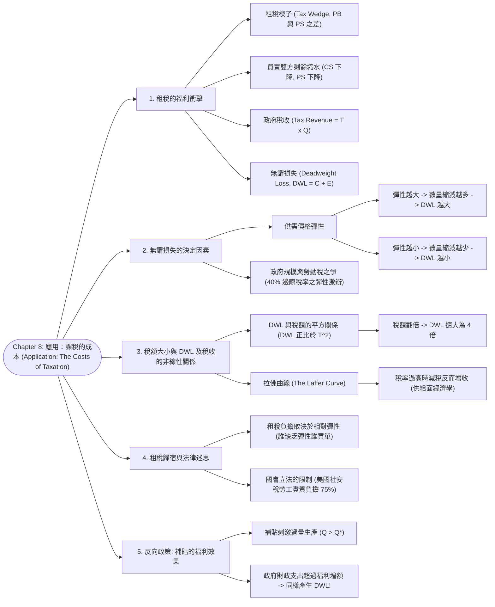

# Chapter 8: 應用：課稅的成本 (Application: The Costs of Taxation)

> 📅 生成日期：2026-10-24  
> 📄 來源檔案：[Reference/NCU_Classes/經濟學/CH8.pdf](file:///c:/Users/Cupid/Downloads/Study-space/Reference/NCU_Classes/經濟學/CH8.pdf)  
> 🎯 適用考試：中央大學經濟學課程期中考、商管研究所/轉學考個體經濟學基礎  

---

## 🗺️ 知識架構總覽 (Tree Diagram)



<a id="tree-diagram"></a>

### 🎯 本章學習進度檢核 (完成後打勾，建立成就反饋)

- [ ] [1. 租稅的福利衝擊](#sec-1)
- [ ] [2. 無謂損失的決定因素](#sec-2)
- [ ] [3. 稅額大小與 DWL 及稅收的非線性關係](#sec-3)
- [ ] [4. 租稅歸宿與法律迷思](#sec-4)
- [ ] [5. 反向政策: 補貼的福利效果](#sec-5)

---

## 📖 知識點教材

<a id="sec-1"></a>

### 8.1 租稅的福利效果與無謂損失 (The Welfare Effects of a Tax & Deadweight Loss)

#### 📌 核心概念

- **租稅楔子（Tax Wedge）**：當政府對某商品每單位課徵 $T$ 元稅額時，會在買者支付價格與賣者實收價格之間硬生生打入一個價差（Wedge）：
  $$P_B = P_S + T \iff P_B - P_S = T$$
  - **重要法理**：**無論法律形式上是向「買方」還是「賣方」課稅，其經濟實質效果完全相同**！
  - 買者支付價格上升（$P_B > P_E$），賣者實收價格下跌（$P_S < P_E$），市場均衡交易量由 $Q_E$ 縮減為 $Q_T$。

#### 📐 課稅前後的福利對照與無謂損失

```
 價格 P
   ▲              S
   │      \      /
PB │──●────\────/───── 買者支付價格
   │  │ A   \  /
PE │──┼──────●─────── 無稅均衡價
   │  │ B │D / \
PS │──●───┴─/───\──── 賣者實收價格
   │  │ C │E     \
   └──┴───┴───────\──► 數量 Q
     0   QT QE    D
```

| 福利組成項目 | (1) 無稅狀態 (Without Tax) | (2) 課稅後狀態 (With Tax) | 淨變動量 (Change: 2 - 1) |
| :--- | :---: | :---: | :---: |
| **消費者剩餘 (CS)** | $A + B + C$ | $A$ | $-(B + C)$ |
| **生產者剩餘 (PS)** | $D + E + F$ | $F$ | $-(D + E)$ |
| **政府稅收 (Tax Revenue)** | $0$ | $B + D$ ($= T \times Q_T$) | $+(B + D)$ |
| **社會總剩餘 (Total Surplus)** | $A + B + C + D + E + F$ | $A + B + D + F$ | $\mathbf{-(C + E)}$ |

> 🌟 **無謂損失（Deadweight Loss, DWL）**：
> 買者與賣者因課稅而損失的總剩餘（$B + C + D + E$），**大於**政府所收取的稅收總額（$B + D$）。兩者之間的差額：
> $$\mathbf{\text{DWL} = C + E = \frac{1}{2} \times \text{單位稅額 } T \times (Q_E - Q_T)}$$
> **成因本質**：租稅扭曲了市場價格信號，阻止了原本對雙方皆有利的互利交易（交易量由 $Q_E$ 縮減至 $Q_T$，這少生產的 $Q_E - Q_T$ 單位本來能創造淨福利，現在憑空蒸發了）。

#### 📊 範例（講義第 7～9 頁機票市場課稅）

**題目**：機票市場原均衡價格 $P_E = \$200$，數量 $Q_E = 100$。政府對每張機票課稅 $T = \$100$。課稅後買者付 $P_B = \$250$，賣者收 $P_S = \$150$，銷量降至 $Q_T = 75$。  
**數值推導**：

1. **無稅狀態**：
   - $CS = \frac{1}{2} \times 100 \times (400 - 200) = \mathbf{\$10,000}$
   - $PS = \frac{1}{2} \times 100 \times (200 - 0) = \mathbf{\$10,000}$
   - 總剩餘 $= \$20,000$。
2. **課稅狀態**：
   - $CS = \frac{1}{2} \times 75 \times (400 - 250) = \mathbf{\$5,625}$（縮水 \$4,375）
   - $PS = \frac{1}{2} \times 75 \times (150 - 0) = \mathbf{\$5,625}$（縮水 \$4,375）
   - 政府稅收 $= 100 \times 75 = \mathbf{\$7,500}$
   - 新總剩餘 $= 5,625 + 5,625 + 7,500 = \mathbf{\$18,750}$
3. **無謂損失（DWL）**：
   - 總剩餘減少量 $= \$20,000 - \$18,750 = \mathbf{\$1,250}$。
   - 以三角形公式驗算：$\text{DWL} = \frac{1}{2} \times 100 \times (100 - 75) = \frac{1}{2} \times 100 \times 25 = \mathbf{\$1,250}$（完全吻合！）。

<a id="q-sec-1"></a>

---

<a id="sec-2"></a>

### 8.2 無謂損失的決定因素：供需價格彈性 (Determinants of Deadweight Loss)

#### 📌 核心概念

- **彈性越大，無謂損失越驚人**：
  - 價格彈性衡量買賣雙方在價格不利時「逃離市場」的能力。
  - **當供給或需求曲線富有彈性（平緩）時**：微小的稅額就會導致交易量**劇烈暴跌**，三角形的「高（交易量縮減量）」極大 $\implies$ **無謂損失（DWL）極為龐大**！
  - **當供給或需求曲線缺乏彈性（陡峭）時**：買賣雙方難以替代或逃離，交易量僅微幅減少 $\implies$ **無謂損失（DWL）非常微小**。

```
 【缺乏彈性 (Inelastic): DWL 極小】           【富有彈性 (Elastic): DWL 極大】
   價格 P             S (陡峭)                 價格 P             S (平緩)
     ▲        \      /                           ▲          \    /
  PB │──●──────\────/                         PB │──●────────\──/
     │  │DWL極小\  /                             │  │  DWL     \/
  PS │──●────────\/                           PS │──●── 龐大   /\
     └──┴─────────\──► 數量 Q                    └──┴─────────/──\──► 數量 Q
       QT QE       D (陡峭)                        QT       QE    D (平緩)
```

#### 📐 政策爭辯：政府規模與勞動所得稅 (Labor Tax & Size of Government)

- 勞動所得稅（Marginal Tax Rate 約 40%）是現代政府最龐大的財政收入來源：
  1. **主張大政府學者觀點**：勞動供給相對**缺乏彈性**（成年男性大部分都必須全職上班賺錢養家），因此課徵勞動稅造成的 DWL 很小，政府應擴大稅收提供更多公共建設。
  2. **主張小政府學者觀點**：勞動供給具有**高度彈性**（許多家庭第二所得者/配偶可自由選擇是否就業、加班兼職可自由增減、高階主管可提早退休、地下經濟逃稅）。因此 40% 的高邊際稅率造成了**毀滅性的無謂損失**，強烈主張應縮減政府規模並降低稅率！

<a id="q-sec-2"></a>

---

<a id="sec-3"></a>

### 8.3 稅額大小與 DWL 及稅收的非線性關係：拉佛曲線 (The Laffer Curve)

#### 📌 核心概念

- **DWL 與稅額的「平方幾何關係」**：
  $$\text{DWL} = \frac{1}{2} \times \text{底 (稅額 } T) \times \text{高 (交易量縮減量 } \Delta Q)$$
  由於在線性供需下，交易量縮減量 $\Delta Q$ 與稅額 $T$ 成正比（$\Delta Q \propto T$），因此：
  $$\mathbf{\text{DWL} \propto T^2}$$
  - **重要倍數鐵律**：
    - **稅額增加為 2 倍（$2T$） $\implies$ 無謂損失擴大為 $2^2 = \mathbf{4\text{ 倍}}$！**
    - **稅額增加為 3 倍（$3T$） $\implies$ 無謂損失擴大為 $3^2 = \mathbf{9\text{ 倍}}$！**
- **拉佛曲線（The Laffer Curve）**：
  - 描述「稅率 / 稅額大小（Tax Size）」與「政府總稅收（Tax Revenue）」之間的倒 U 型拋物線關係：
    $$\text{Tax Revenue} = T \times Q_T$$
  - 當稅率由 0 逐步調升時，稅收初期隨之上升；但當稅率超過臨界點後，極度沉重的稅負迫使市場極度萎縮，**繼續加稅反而導致總稅收崩跌**！

```
     無謂損失 (DWL)                                政府稅收 (Tax Revenue)
       ▲                                             ▲
       │        /                                    │        極大值
       │       /  (呈二次方指數狂飆)                 │       .---.
       │      /                                      │      /     \  (拉佛曲線 Laffer Curve)
       │    ./                                       │     /       \
       │  .'                                         │    /         \
       └──┴────────────────► 稅額 T                  └───┴───────────┴──► 稅額 T
          0                                              0   T*       100%
```

#### 📊 範例（講義第 42 頁飯店房間考題）

**情境**：某小鎮飯店每晚 100 元，每天出租 1,000 間：

1. **課徵 10 元稅額**：房價漲至 108 元，出租量降至 900 間。
   - 稅收 $= 10 \times 900 = \mathbf{\$9,000}$。
   - $\text{DWL} = \frac{1}{2} \times 10 \times (1,000 - 900) = \mathbf{\$500}$。
2. **市長將稅額翻倍至 20 元**：房價漲至 116 元，出租量降至 800 間。
   - 稅收 $= 20 \times 800 = \mathbf{\$16,000}$（未達 2 倍的 \$18,000，因基數縮小）。
   - $\text{DWL} = \frac{1}{2} \times 20 \times (1,000 - 800) = \mathbf{\$2,000}$！
   - **驗證**：稅額由 10 元變 20 元（2 倍），DWL 由 500 元暴增至 2,000 元（**精確為 4 倍！**）。

---

<a id="sec-4"></a>

### 8.4 代數模型求解專題 (Advanced Algebraic Derivation)

#### 📊 講義第 43 頁經典期中考大題精解

**市場供需函數**：$$Q^S = 2P, \quad Q^D = 300 - P$$

1. **求解無稅均衡**：
   $$2P = 300 - P \implies 3P = 300 \implies P^* = \mathbf{100}, \quad Q^* = \mathbf{200}$$
2. **課徵單位稅 $T$ 後之新均衡（以 $T$ 表示）**：
   - 買者支付 $P_B$，賣者實收 $P_S$，且 $P_B = P_S + T$。
   - 代入需求函數：$Q^D = 300 - (P_S + T)$。
   - 供需相等：$2P_S = 300 - P_S - T \implies 3P_S = 300 - T$
     $$\mathbf{P_S = 100 - \frac{T}{3}}, \quad \mathbf{P_B = 100 + \frac{2T}{3}}, \quad \mathbf{Q_T = 200 - \frac{2T}{3}}$$
3. **求解政府稅收函數 $\text{TR}(T)$ 與拉佛曲線極大值**：
   $$\text{TR}(T) = T \times Q_T = T \left(200 - \frac{2}{3}T\right) = 200T - \frac{2}{3}T^2$$
   - 對 $T$ 微分求一階極值條件：
     $$\frac{d\text{TR}}{dT} = 200 - \frac{4}{3}T = 0 \implies \mathbf{T^* = 150\text{ 元}}$$
   - **拉佛曲線最高稅收**：$\text{TR}(150) = 150 \times (200 - 100) = \mathbf{15,000\text{ 元}}$。
4. **求解無謂損失函數 $\text{DWL}(T)$**：
   $$\text{DWL}(T) = \frac{1}{2} \times T \times (Q^* - Q_T) = \frac{1}{2} \times T \times \left(\frac{2T}{3}\right) = \mathbf{\frac{1}{3}T^2}$$
5. **政策評估：若政府課徵 $T = \$200$ 之單位稅**：
   - 此時 $T = 200 > 150$（落在拉佛曲線向右下傾斜的無效率禁區！）。
   - 交易量萎縮至 $Q = 200 - \frac{400}{3} \approx 66.7$；稅收僅為 $\$13,333$（比課 150 元時還少！）；
   - $\text{DWL} = \frac{1}{3} \times (200)^2 = \mathbf{\$13,333}$（無謂損失高得嚇人！）。
   - **政策建議**：這是一項愚蠢透頂的政策！**只要將稅額由 200 元降至 150 元，政府稅收反而會由 13,333 增加至 15,000 元，且無謂損失能從 13,333 巨幅降低至 7,500 元（雙贏減稅！）**。

---

---

## 📝 實戰練習題 (三層遞進式強化測驗)

---

### 🟢 第一層：必懂基礎（計算規則、定義判定與單一概念）

#### <a id="q1"></a>Q1. (課稅福利矩形與無謂損失幾何手算)
設某商品市場之反需求函數為 $P = 100 - Q$，反供給函數為 $P = 20 + Q$。無稅時市場均衡價格 $P^* = 60$ 元，均衡交易量 $Q^* = 40$ 件。現政府對該商品每單位課徵 $T = 20$ 元的從量稅。
1. 求課稅後買方支付價格 $P_b$、賣方實得價格 $P_s$ 及市場均衡交易量 $Q_t$。
2. 計算政府獲得的總稅收（Tax Revenue）與市場產生的無謂損失（Deadweight Loss, DWL）。
👉 [查看 Q1 答案與詳細解析](#ans-q1)

---

#### <a id="q2"></a>Q2. (買賣雙方剩餘變動與總福利帳本驗證)
承接 Q1 的課稅市場條件：
1. 分別計算課稅前與課稅後的消費者剩餘（CS）與生產者剩餘（PS）。
2. 計算消費者剩餘的變動量 $\Delta \text{CS}$ 與生產者剩餘的變動量 $\Delta \text{PS}$。
3. 驗證總福利變動恆等式：$|\Delta \text{CS} + \Delta \text{PS}| - \text{政府稅收} = \text{DWL}$。
👉 [查看 Q2 答案與詳細解析](#ans-q2)

---

#### <a id="q3"></a>Q3. (無謂損失平方倍增法則手算)
假設某市場在每單位課徵 $T_1 = 5$ 元的從量稅時，市場產生的無謂損失為 $\text{DWL}_1 = 100$ 萬元。若市場的供需曲線均為線性：
1. 當政府將每單位稅額提高為 $T_2 = 10$ 元（翻倍）時，預估無謂損失 $\text{DWL}_2$ 為多少萬元？
2. 若政府進一步將每單位稅額提高為 $T_3 = 15$ 元（提高為 3 倍）時，預估無謂損失 $\text{DWL}_3$ 為多少萬元？
👉 [查看 Q3 答案與詳細解析](#ans-q3)

---

#### <a id="q4"></a>Q4. (極端彈性下的無謂損失判定)
設某重症必備處方藥之市場需求為完全無彈性（垂直線，$E_d = 0$），供給曲線為正常正斜率。
1. 若政府對該藥品每盒課徵 50 元的特別稅，繪圖分析此市場之交易數量是否會萎縮？
2. 此時政府稅收由誰完全承擔？市場產生的無謂損失（DWL）為多少？
👉 [查看 Q4 答案與詳細解析](#ans-q4)

---

#### <a id="q5"></a>Q5. (反向政策：從量補貼之福利損失手算)
承接 Q1 之市場條件（$P=100-Q, P=20+Q$），若政府改為對每單位商品提供 $s = 20$ 元的生產補貼：
1. 求補貼後買方支付價格 $P_b$、賣方實得價格 $P_s$ 及市場交易量 $Q_s$。
2. 計算政府在此補貼政策中的總財政支出，以及因過度生產所造成的無謂損失（DWL）。
👉 [查看 Q5 答案與詳細解析](#ans-q5)

---

### 🟡 第二層：基礎 + 實際應用（情境比較、政策抉擇與彈性法則）

#### <a id="q6"></a>Q6. (供需彈性對無謂損失的決定性影響比較)
設有兩完全不同的商品市場 A 與 B，課稅前兩市場的均衡價格與交易量完全相同：
- 市場 A：為奢侈品度假飯店，供需均極富有價格彈性（曲線平坦）。
- 市場 B：為民生必需品食用鹽，供需均極缺乏價格彈性（曲線陡峭）。
1. 若政府分別對兩市場課徵相同的每單位從量稅 $T$，哪一個市場的交易量縮減量較大？哪一個市場產生的無謂損失較大？
2. 若政府的目標是「籌集固定稅收且使全社會的無謂損失最小化」，經濟學家會建議主要對哪類商品課稅？
👉 [查看 Q6 答案與詳細解析](#ans-q6)

---

#### <a id="q7"></a>Q7. (拉弗曲線 Laffer Curve 與供給面經濟學分析)
1. 繪圖或文字說明「拉弗曲線（Laffer Curve）」的橫軸與縱軸變數，並闡釋為何稅率從 0% 上升到 100% 期間，政府稅收會呈現先增後降的倒 U 型軌跡？
2. 若一國目前處於拉弗曲線的「右側高稅率禁區（Prohibitive Range）」，調降所得稅率將會對「政府總稅收」與「市場無謂損失」產生什麼影響？這在經濟政策上有何重大意涵？
👉 [查看 Q7 答案與詳細解析](#ans-q7)

---

#### <a id="q8"></a>Q8. (勞動所得稅爭議與工時彈性之估計分歧)
許多已開發國家的邊際勞動所得稅率高達 40% 至 50%。經濟學界對於高額勞動稅產生的無謂損失大小存在巨大分歧：
1. 主張勞動稅無謂損失很小的一派學者，其立論基礎為何？（針對哪一群勞動者？）
2. 主張勞動稅無謂損失極大的一派學者，列舉了哪些邊際上極具彈性的勞動力供給行為？
👉 [查看 Q8 答案與詳細解析](#ans-q8)

---

#### <a id="q9"></a>Q9. (補貼綠能產業的效率與外部性權衡)
政府對購買電動汽車提供每輛數萬元的補貼：
1. 在單純傳統個體福利模型（無外部性）下，補貼為何必然導致過度生產與無謂損失？
2. 現代環境經濟學為何主張此補貼具經濟合理性？應如何量化最適的每單位補貼額？
👉 [查看 Q9 答案與詳細解析](#ans-q9)

---

### 🔴 第三層：概念講述與深度分析（數理推導、體制比較與經典案例）

#### <a id="q10"></a>Q10. (無謂損失正比於稅額平方 $\text{DWL} \propto T^2$ 之數理幾何嚴格證明)
設市場反需求曲線為 $P = A - bQ$，反供給曲線為 $P = C + dQ$（其中 $A, C, b, d > 0$ 且 $A > C$）：
1. 試以代數精確求解課徵從量稅 $T$ 後，交易量的萎縮幅度 $\Delta Q = Q^* - Q_t$ 與 $T$ 的函數關係。
2. 證明無謂損失公式為：
$$\text{DWL} = \frac{1}{2} \cdot \frac{1}{b + d} \cdot T^2$$
3. 根據此平方關係，深度論述租稅理論中的「稅率平滑原則（Tax Smoothing）」：為何將較低的稅率廣泛課徵於多種商品或多個時期，其總效率成本遠低於對少數商品課徵極高稅率？
👉 [查看 Q10 答案與詳細解析](#ans-q10)

---

#### <a id="q11"></a>Q11. (雷姆西租稅法則 Ramsey Rule 與效率與公平的兩難)
英國經濟學家 Frank Ramsey 於 1927 年推導出政府在籌措特定財政收入下的最適商品稅法則（Ramsey Rule）：
1. 結合需求彈性與無謂損失，說明為何雷姆西法則建議對「需求價格彈性較低」的商品課徵較高稅率？
2. 試批判討論：若完全遵循雷姆西法則設計稅制，將會對社會弱勢族群造成何種衝擊？現實政策如何在「經濟效率」與「垂直公平（Vertical Equity）」之間取得平衡？
👉 [查看 Q11 答案與詳細解析](#ans-q11)

---

#### <a id="q12"></a>Q12. (租稅扭曲與未實現交易利益 Foregone Gains 之本質)
許多人誤以為「課稅的代價就是納稅人把錢轉移給政府，這只是財富重分配，社會總財富並未減少」。
試從微觀經濟學核心視角，反駁上述觀點，深入解析：
1. 租稅如何破壞市場價格信號對邊際買者與邊際賣者的激勵導向？
2. 為什麼無謂損失本質上是「被稅收阻斷的互利互惠交易（Foregone mutually beneficial exchanges）」？
👉 [查看 Q12 答案與詳細解析](#ans-q12)

---

## 🔑 本章練習題答案與詳細解析 (Answer Key)

### <a id="ans-q1"></a>Q1 答案與詳細解析
1. **課稅後均衡計算：**
   - 課稅後形成租稅楔子：$P_b - P_s = T = 20$。
   - 反需求與反供給分別為：$P_b = 100 - Q_t$，$P_s = 20 + Q_t$。
   - 代入楔子式：
     $$(100 - Q_t) - (20 + Q_t) = 20 \implies 80 - 2Q_t = 20 \implies 2Q_t = 60 \implies Q_t = 30 \text{ 件}$$
   - 買方支付價格：$P_b = 100 - 30 = 70$ 元。
   - 賣方實得價格：$P_s = 20 + 30 = 50$ 元。
2. **政府稅收與無謂損失：**
   - **政府稅收 (Tax Revenue, TR)**：
     $$\text{TR} = T \times Q_t = 20 \times 30 = 600 \text{ 元}$$
   - **無謂損失 (DWL)**：三角形底為 $T = 20$，高為交易量縮減量 $\Delta Q = Q^* - Q_t = 40 - 30 = 10$：
     $$\text{DWL} = \frac{1}{2} \times T \times (Q^* - Q_t) = \frac{1}{2} \times 20 \times 10 = 100 \text{ 元}$$
[🔙 返回題目 Q1](#q1) ｜ [🔝 返回知識架構圖](#tree-diagram)

---

### <a id="ans-q2"></a>Q2 答案與詳細解析
1. **課稅前後剩餘數值：**
   - **課稅前（$P^* = 60, Q^* = 40$）**：
     $$\text{CS} = \frac{1}{2} \times (100 - 60) \times 40 = 800 \text{ 元}$$
     $$\text{PS} = \frac{1}{2} \times (60 - 20) \times 40 = 800 \text{ 元}$$
     $$\text{總福利} = 800 + 800 = 1600 \text{ 元}$$
   - **課稅後（$P_b = 70, P_s = 50, Q_t = 30$）**：
     $$\text{CS}' = \frac{1}{2} \times (100 - 70) \times 30 = 450 \text{ 元}$$
     $$\text{PS}' = \frac{1}{2} \times (50 - 20) \times 30 = 450 \text{ 元}$$
2. **剩餘縮水變動量：**
   - $\Delta \text{CS} = 450 - 800 = -350$ 元。
   - $\Delta \text{PS} = 450 - 800 = -350$ 元。
   - 買賣雙方合計損失福祉：$|-350| + |-350| = 700$ 元。
3. **恆等式驗證：**
   - 買賣雙方損失的 700 元中：
     - $600$ 元轉移為**政府稅收**（矩形面積）。
     - 剩餘的 $700 - 600 = 100$ 元化為烏有，即為**無謂損失 DWL**（三角形面積）。
   - 恆等式精確成立。
[🔙 返回題目 Q2](#q2) ｜ [🔝 返回知識架構圖](#tree-diagram)

---

### <a id="ans-q3"></a>Q3 答案與詳細解析
1. **稅額提高為 $T_2 = 10$ 元（2倍）之 DWL：**
   - 在線性供需模型中，交易量縮減量 $\Delta Q$ 與稅額 $T$ 成正比，因此無謂損失 $\text{DWL} = \frac{1}{2} T \Delta Q$ 與 $T^2$ 成正比。
   - 稅額增為原本的 $\frac{10}{5} = 2$ 倍，無謂損失擴大為 $2^2 = 4$ 倍：
     $$\text{DWL}_2 = 100 \times 4 = 400 \text{ 萬元}$$
2. **稅額提高為 $T_3 = 15$ 元（3倍）之 DWL：**
   - 稅額增為原本的 $\frac{15}{5} = 3$ 倍，無謂損失擴大為 $3^2 = 9$ 倍：
     $$\text{DWL}_3 = 100 \times 9 = 900 \text{ 萬元}$$
[🔙 返回題目 Q3](#q3) ｜ [🔝 返回知識架構圖](#tree-diagram)

---

### <a id="ans-q4"></a>Q4 答案與詳細解析
1. **交易量與轉嫁分析：**
   - 因需求完全無彈性（需求曲線垂直），無論價格多高，病患對藥物的需求量完全不變（$\Delta Q = 0$）。
   - 課稅後供給曲線向上平移 50 元，買方支付價格 $P_b$ 恰好上漲整整 50 元，稅負 100% 完全轉嫁給買方。
2. **稅收與無謂損失：**
   - 政府稅收為 $\text{TR} = 50 \times Q^*$，全額來自消費者剩餘之移轉。
   - 由於交易量絲毫未萎縮（$Q_t = Q^*$，$\Delta Q = 0$），沒有任何潛在有益的交易被阻斷，因此**無謂損失 $\text{DWL} = 0$**。
   - 結論：對完全缺乏彈性的市場課稅，經濟效率扭曲最小。
[🔙 返回題目 Q4](#q4) ｜ [🔝 返回知識架構圖](#tree-diagram)

---

### <a id="ans-q5"></a>Q5 答案與詳細解析
1. **補貼後新均衡計算：**
   - 補貼使賣方實得價格高於買方支付價格：$P_s - P_b = s = 20$。
   - $(20 + Q_s) - (100 - Q_s) = 20 \implies 2Q_s - 80 = 20 \implies 2Q_s = 100 \implies Q_s = 50 \text{ 件}$。
   - 買方支付價格：$P_b = 100 - 50 = 50$ 元。
   - 賣方實收價格：$P_s = 20 + 50 = 70$ 元。
2. **政府財政支出與無謂損失：**
   - **政府財政支出**：
     $$\text{Gov Cost} = s \times Q_s = 20 \times 50 = 1000 \text{ 元}$$
   - **無謂損失 (DWL)**：在產量 40 到 50 件之間，賣者生產邊際成本大於買者願付評價。超額生產的三角形面積為：
     $$\text{DWL} = \frac{1}{2} \times s \times (Q_s - Q^*) = \frac{1}{2} \times 20 \times (50 - 40) = 100 \text{ 元}$$
   - 結論：補貼同樣扭曲了邊際價格信號，造成資源浪費與 DWL。
[🔙 返回題目 Q5](#q5) ｜ [🔝 返回知識架構圖](#tree-diagram)

---

### <a id="ans-q6"></a>Q6 答案與詳細解析
1. **兩市場縮減量與 DWL 比較：**
   - **市場 A（彈性極大）**：買賣雙方對價格變動極度敏感，課稅插入租稅楔子後，交易量發生雪崩式萎縮（$\Delta Q_A$ 巨大），形成的三角形無謂損失極為龐大。
   - **市場 B（缺乏彈性）**：買賣雙方幾無替代方案，課稅後交易量僅微幅減少（$\Delta Q_B$ 極小），無謂損失極小。
2. **最小化無謂損失之稅制建議：**
   - 應優先對**缺乏彈性（Inelastic）**的商品（如必需品）課稅。因為在此類市場中，課稅對人們實質生產與消費行為的「扭曲（Distortion）」最小。
[🔙 返回題目 Q6](#q6) ｜ [🔝 返回知識架構圖](#tree-diagram)

---

### <a id="ans-q7"></a>Q7 答案與詳細解析
1. **拉弗曲線原理與倒 U 型機制：**
   - 橫軸為稅率 $t$（0% 到 100%），縱軸為政府總稅收 $TR$。
   - $\text{Tax Revenue} = t \times \text{稅基}(Q)$。
     - 當 $t = 0\%$ 時，稅收為 0。
     - 當稅率由低位上升時，稅率提高的增收效果大於交易量萎縮的減收效果，總稅收增加。
     - 當稅率過高（如 $t > 70\%$）時，重稅嚴重扼殺工作與交易誘因，稅基急劇萎縮（$t = 100\%$ 時無人願意合法工作，產出為 0），稅收反而暴跌至 0。
2. **處於右側禁區之政策啟示：**
   - 若處於拉弗曲線右側，**降低稅率反而會使政府稅收增加**，同時因交易量回升，**市場無謂損失（DWL）大幅縮小**。
   - 這是供給面經濟學（Supply-side Economics，如 1980 年代雷根經濟學）的核心論述：在極端高稅率環境下，減稅是一帖「增稅收、降福利損失」的雙贏解藥。
[🔙 返回題目 Q7](#q7) ｜ [🔝 返回知識架構圖](#tree-diagram)

---

### <a id="ans-q8"></a>Q8 答案與詳細解析
1. **主張勞動稅 DWL 較小者之論點：**
   - 核心勞動力（家庭主要經濟支柱、全職男性成年勞工）每週工時通常固定為 40 小時，缺乏彈性。無論所得稅如何調整，為了養家活口都必須全職上班，因此勞動供給彈性極低，DWL 很小。
2. **主張勞動稅 DWL 巨大者之論點：**
   - 邊際上的許多勞動力具有極高的供給彈性：
     - **次要家庭所得者（二度就業配偶）**：若邊際稅率過高，外出工作的淨報酬不足以支付保母費，選擇退出職場。
     - **加班意願與兼職**：高稅率打擊勞工自願加班的意願。
     - **提早退休決策**：高齡資深高薪族群選擇提早退休。
     - **地下經濟與逃漏稅**：轉向地下非正式現金交易以規避稅負。
[🔙 返回題目 Q8](#q8) ｜ [🔝 返回知識架構圖](#tree-diagram)

---

### <a id="ans-q9"></a>Q9 答案與詳細解析
1. **傳統福利模型下的無謂損失：**
   - 若不考慮外部性，補貼人為降低買方價格，使產量超越邊際效益等於邊際成本的最適點。生產最後幾輛車的社會製造成本遠高於消費者的實質效用評價，產生無謂損失。
2. **環境經濟學的矯正合理性：**
   - 燃油車具有龐大的空氣污染與溫室效應「負外部性（Marginal External Damage, MED）」。
   - 電動車替代燃油車可減少社會環境受損。若將補貼額精確設定為其所產生的「邊際外部效益（Marginal External Benefit）」，則此補貼屬於皮古補貼（Pigouvian Subsidy），剛好內部化外部性，使市場產量精確修正至全社會真正的最適水準，消弭市場失靈。
[🔙 返回題目 Q9](#q9) ｜ [🔝 返回知識架構圖](#tree-diagram)

---

### <a id="ans-q10"></a>Q10 答案與詳細解析
1. **交易量縮減量之代數推導：**
   - 課稅前均衡：$A - bQ^* = C + dQ^* \implies Q^* = \frac{A - C}{b + d}$。
   - 課稅後租稅楔子：$P_b - P_s = T \implies (A - bQ_t) - (C + dQ_t) = T$。
     $$(A - C) - (b + d)Q_t = T \implies Q_t = \frac{(A - C) - T}{b + d} = Q^* - \frac{T}{b + d}$$
   - 交易量縮減量為：
     $$\Delta Q = Q^* - Q_t = \frac{T}{b + d}$$
2. **DWL 正比於 $T^2$ 之幾何證明：**
   - 無謂損失為三角形面積：
     $$\text{DWL} = \frac{1}{2} \times \text{底}(T) \times \text{高}(\Delta Q) = \frac{1}{2} \cdot T \cdot \left(\frac{T}{b + d}\right) = \frac{1}{2(b + d)} \cdot T^2$$
   - 證畢。DWL 嚴格與稅額 $T$ 的二次方成正比。
3. **稅率平滑原則（Tax Smoothing）論述：**
   - 因 DWL 隨稅率加速暴增，若對商品 A 課徵 10% 稅率、對商品 B 課徵 10% 稅率，其產生的總損失遠小於「對 A 免稅、對 B 集中課徵 20% 稅率」。
   - 最佳稅收政策應儘可能維持**稅基寬廣、稅率低平且跨期穩定（平滑化）**，以避免高稅率造成的二次方福利毀滅。
[🔙 返回題目 Q10](#q10) ｜ [🔝 返回知識架構圖](#tree-diagram)

---

### <a id="ans-q11"></a>Q11 答案與詳細解析
1. **雷姆西法則與彈性之關聯：**
   - 為使政府在籌措特定稅收目標下，將全社會總 DWL 最小化，雷姆西法則要求各商品的課稅稅率與其需求價格彈性成反比：
     $$\frac{t_i}{t_j} = \frac{E_{d,j}}{E_{d,i}}$$
   - 彈性越小的商品，課稅引發的消費替代與數量萎縮越小，能以最小的社會福利扭曲換取最大的國庫稅收。
2. **效率與公平的兩難衝突：**
   - **衝突本質**：在現實中，需求彈性最小的商品往往是貧困家庭維生不可或缺的必需品（如米、麵粉、自來水、水電、大眾運輸）；而奢侈品需求彈性最高。
   - 若盲目遵循雷姆西法則，政府將對水電與主食課徵重稅，對富人購買的跑車名錶免稅。這在經濟效率上極優，但在社會公平（垂直公平）上是極端累退與殘忍的。
   - 現代政府通常對必需品給予免稅或低營業稅，寧願承擔微小的效率損失以維護社會公平底線。
[🔙 返回題目 Q11](#q11) ｜ [🔝 返回知識架構圖](#tree-diagram)

---

### <a id="ans-q12"></a>Q12 答案與詳細解析
1. **對價格信號與邊際激勵的扭曲：**
   - 自由市場中，價格同時反映「消費者的邊際效益」與「生產者的邊際成本」。當價格等於兩者時，市場精準引導資源流向價值最高處。
   - 課稅在買賣雙方之間打入楔子，使買方看到的價格高於真實成本（抑制消費），賣方看到的價格低於真實評價（抑制生產）。價格信號失真，導致人們做出次優的經濟選擇。
2. **未實現交易利益（Foregone Gains）之本質：**
   - 課稅使交易量從 $Q^*$ 下降至 $Q_t$。在那消失的 $\Delta Q$ 件商品中，原本買者的願付評價高於賣者的製造成本（每一筆交易都能創造剩餘）。
   - 這些本該發生、雙方皆能獲利的交易，純粹因為政府課稅而被扼殺。買賣雙方沒做成生意，政府也一毛稅都沒收到，這部分化為烏有的福祉就是無謂損失。
[🔙 返回題目 Q12](#q12) ｜ [🔝 返回知識架構圖](#tree-diagram)

## 📋 本章重點速記表

| # | 核心定理 / 關係 | 核心一句話定義 | 數學關係式 / 倍數法則 |
| :---: | :--- | :--- | :--- |
| **1** | **租稅中立性** | 無論向買者或賣者課稅，最終分攤與福利效果完全相同 | $P_B - P_S = T$；形成相同租稅楔子 |
| **2** | **無謂損失公式** | 買賣雙方損失總額扣除政府稅收後憑空蒸發的福利 | $\text{DWL} = \frac{1}{2} \times T \times (Q_E - Q_T)$ |
| **3** | **彈性與 DWL** | 供需彈性越大，交易量縮減越多，無謂損失越大 | 彈性大 $\implies$ 買賣雙方易逃離市場 $\implies$ DWL 大 |
| **4** | **DWL 二次方律** | 無謂損失與稅額的平方成正比 | 稅額變 $k$ 倍 $\implies$ DWL 擴大為 $k^2$ 倍 |
| **5** | **拉佛曲線** | 稅收隨稅率呈倒 U 型拋物線，過高稅率導致稅收萎縮 | 超過 $T^*$ 時減稅可「增加稅收並減少 DWL」 |
| **6** | **補貼的無謂損失** | 政府每單位補貼使產量過剩 ($Q > Q^*$)，同樣產生 DWL | 政府支出大於買賣雙方新增剩餘之和 |

---

## 🃏 考前速查卡片

| 正面 (問題) | 背面 (答案) |
| :--- | :--- |
| **為什麼「對商品課稅」所造成的社會總福利損失，通常大於政府收到的稅收？** | 因為課稅扭曲了價格機制，使交易量減少（$Q_T < Q_E$）。那些原本「買者願付價格高於賣者生產成本」的互利交易被扼殺，這部分未實現的淨剩餘成為了**無謂損失（DWL）**。 |
| **如果政府將香菸稅由每包 10 元調高為 30 元（增加為 3 倍），其無謂損失會擴大幾倍？** | **擴大為 9 倍**（$3^2 = 9$）！因為三角形面積的底和高同時擴大為 3 倍，DWL 與稅額的平方成正比。 |
| **什麼是「拉佛曲線（Laffer Curve）」？何時「減稅反而能增加政府稅收」？** | 描繪稅率與稅收倒 U 型關係的曲線。當原本稅率極高、處於拉佛曲線**右側下坡區間**時，減稅能大幅活絡市場交易，使擴大後的稅基足以彌補稅率調降，從而**增加總稅收**。 |
| **若政府對某商品提供每單位 2 元的補貼，是否也能達成資源的最優配置？** | **不能**！補貼會促使交易量超越均衡數量（$Q > Q^*$），最後生產的幾單位其生產成本高於買者評價（$MC > MB$），政府支出超過剩餘增額，**同樣產生無謂損失**。 |
| **評估：一個完全沒有無謂損失（DWL=0）的租稅，是否可能為政府帶來財政收入？** | **可能**！例如對**「完全無彈性」**的商品（如救命胰島素，或定額人頭稅 Lump-sum Tax）課稅，因交易量完全不變（$\Delta Q = 0$），DWL 為 0，但政府能獲得豐厚稅收。 |

---

## ⚠️ 本章常見考試陷阱

1. **以為向「買方課稅」對買方比較不利**：
   - ❌ 誤區：法律規定買方繳稅，所以買方承擔全部負擔。
   - ✅ 正確做法：稅賦歸宿完全由**供給與需求的相對彈性**決定，與法律名義向誰課徵毫無關聯！
2. **算錯稅額倍增對 DWL 的影響**：
   - ❌ 誤區：稅額由 10 元翻倍至 20 元，DWL 也翻倍。
   - ✅ 正確做法：**DWL 擴大為 4 倍（平方倍數）**！
3. **誤把政府稅收當作社會福祉損失**：
   - ❌ 誤區：政府收了 1 億元稅收，所以社會損失了 1 億元。
   - ✅ 正確做法：稅收是財富從民間移轉給政府，仍屬於社會總剩餘的一部分（$B + D$）；真正的純損失是無人獲得的 **無謂損失（$C + E$）**。
4. **混淆「補貼」與「完全無效率消除」**：
   - ❌ 誤區：課稅不好因為抑制產量，所以補貼刺激產量一定是好政策。
   - ✅ 正確做法：過猶不及！補貼刺激生產至 $MC > MB$ 的無效率區間，同樣產生福利淨損失。

---

## 📊 本章練習題統計

| 難度 | 題數 | 分布知識點 |
| :---: | :---: | :--- |
| **Easy** | 2 | 租稅楔子法理本質、機票無稅剩餘 (Active Learning 1) |
| **Medium** | 5 | 課稅無謂損失成因 (Q1)、麥片 vs 防曬乳彈性與 DWL (Q1)、飯店課稅翻倍數值 (講義 Q42)、橡膠圈與襪子稅賦歸宿 (講義 Q22, Q25)、補貼福利效果 (講義 Q27) |
| **Hard** | 3 | 代數供需模型稅收極大化 $T^*$ 求解 (講義 Q43)、拉佛曲線減稅雙贏論證 (專題 8.4)、無 DWL 稅收哲學思辨 (講義 Q20) |
| **合計** | **10 題** | 涵蓋租稅楔子、DWL 平方律、彈性決定、拉佛曲線、代數求解與補貼全考點 |
