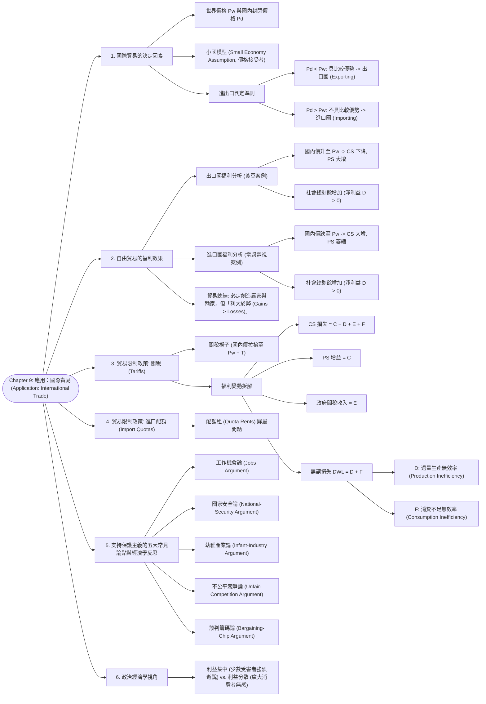

# Chapter 9: 應用：國際貿易 (Application: International Trade)

> 📅 生成日期：2026-10-24  
> 📄 來源檔案：[Reference/NCU_Classes/經濟學/CH9.pdf](file:///c:/Users/Cupid/Downloads/Study-space/Reference/NCU_Classes/經濟學/CH9.pdf)  
> 🎯 適用考試：中央大學經濟學課程期中考、商管研究所/轉學考個體經濟學基礎  

---

## 🗺️ 知識架構總覽 (Tree Diagram)



<a id="tree-diagram"></a>

### 🎯 本章學習進度檢核 (完成後打勾，建立成就反饋)

- [ ] [1. 國際貿易的決定因素](#sec-1)
- [ ] [2. 自由貿易的福利效果](#sec-2)
- [ ] [3. 貿易限制政策: 關稅 (Tariffs)](#sec-3)
- [ ] [4. 貿易限制政策: 進口配額 (Import Quotas)](#sec-4)
- [ ] [5. 支持保護主義的五大常見論點與經濟學反思](#sec-5)
- [ ] [6. 政治經濟學視角](#sec-6)

---

## 📖 知識點教材

<a id="sec-1"></a>

### 9.1 世界價格與小國模型 (World Price & The Small Economy Model)

#### 📌 核心概念

- **世界價格（World Price, $P_W$）**：在國際商品市場上普遍通行的現行世界價格。
- **國內無貿易封閉價格（Domestic Price, $P_D$）**：若該國完全不與外界貿易（自給自足），由國內自身供需決定的均衡價格。
- **小國模型假設（The Small Economy Assumption）**：
  - 假定該國在整體世界市場中所佔份額極小，為**世界價格的接受者（Price Takers in world markets）**。
  - 其進出口數量不會對世界價格 $P_W$ 產生任何實質影響。
  - 當該國開放自由貿易時，**$P_W$ 是該國境內唯一有效的市場價格**（國內賣者無法賣高於 $P_W$，國內買者無法買低於 $P_W$）。

#### 📐 比較利益與進出口方向判定定理

1. **若國內封閉價格低於世界價格（$P_D < P_W$）**：
   - 說明該國生產該商品的機會成本低於世界其他國家，該國具有**比較利益（Comparative Advantage）**。
   - **貿易決策**：開放自由貿易後，該國將成為**出口國（Exporter）**，國內市價將被拉抬至 $P_W$。
2. **若國內封閉價格高於世界價格（$P_D > P_W$）**：
   - 說明外國生產該商品的成本比本國更便宜，該國不具比較利益。
   - **貿易決策**：開放自由貿易後，該國將成為**進口國（Importer）**，國內市價將下跌收斂至 $P_W$。

<a id="q-sec-1"></a>

---

<a id="sec-2"></a>

### 9.2 自由貿易的福利效果：出口國 vs. 進口國 (Welfare Effects of Trade)

#### 📌 核心概念

無論一個國家最終是成為「出口國」還是「進口國」，自由貿易都會在國內創造**贏家（Winners）**與**輸家（Losers）**；但最關鍵的經濟學結論在於：**贏家獲得的好處永遠大於輸家承受的損失（Gains exceed losses），使國家總福祉達到最大！**

#### 📐 出口國福利分析（以講義第 7～8 頁黃豆市場為例）

```
 價格 P               S
   ▲          \      /
Pw │───────●───\────/───●────── (世界價格 $6: 出口 450 單位)
   │       │ A  \  /    │
Pd │───────┼─────●──────┼────── (國內無貿易價 $4: 均衡 500 單位)
   │       │  B  │ C  D │
   └───────┴─────┴──────┴──► 數量 Q
          300   500    750
               D
```

- **無貿易時（$P_D = \$4$）**：$CS = A + B$；$PS = C$；$\text{總剩餘} = A + B + C$。
- **自由貿易出口時（$P_W = \$6$）**：
  - 國內消費者面對高價，消費量由 500 縮減至 300；$CS$ 縮水為 $A$（**消費者受損 $-B$**）。
  - 國內農民大舉增產至 750，將多餘的 450 單位外銷全球；$PS$ 暴增為 $B + C + D$（**生產者獲益 $+B + D$**）。
  - **國家總剩餘變動**：$+(B + D) - B = \mathbf{+D > 0}$（**貿易淨獲益 Gains from Trade**）。

---

#### 📐 進口國福利分析（以講義第 9～11 頁電漿電視為例）

```
 價格 P               S
   ▲          \      /
Pd │───────●───\────/───●────── (國內無貿易價 $3000: 均衡 400 單位)
   │       │ A  \  /    │
   │       │  B  │ C    │
Pw │───────●─────┼──────●────── (世界價格 $1500: 進口 400 單位)
   │       │     │    D │
   └───────┴─────┴──────┴──► 數量 Q
          200   400    600
               D
```

- **無貿易時（$P_D = \$3,000$）**：$CS = A$；$PS = B + C$；$\text{總剩餘} = A + B + C$。
- **自由貿易進口時（$P_W = \$1,500$）**：
  - 國內市價被廉價進口品壓低至 \$1,500。國內消費者大喜，購買量由 400 暴增至 600；$CS$ 激增為 $A + B + D$（**消費者大獲全勝，獲益 $+B + D$**）。
  - 國內競爭廠商遭受外國廉價品痛擊，產量被迫由 400 減產至 200；$PS$ 縮水為 $C$（**國內生產者受損 $-B$**）。
  - **國家總剩餘變動**：$+(B + D) - B = \mathbf{+D > 0}$（**貿易淨獲益**）。

#### 💡 總結對照表（講義第 12 頁）

| 貿易型態 | 判斷條件 | 國內市價 | 消費者剩餘 (CS) | 生產者剩餘 (PS) | 社會總剩餘 (Total Surplus) | 貿易淨效益 |
| :---: | :---: | :---: | :---: | :---: | :---: | :---: |
| **出口國 (Exports)** | $P_D < P_W$ | **上漲至 $P_W$** | ⬇️ 減少（輸家） | ⬆️ **大幅增加（贏家）** | ⬆️ **必然增加** | 淨獲益 $+D$ |
| **進口國 (Imports)** | $P_D > P_W$ | **下跌至 $P_W$** | ⬆️ **大幅增加（贏家）** | ⬇️ 減少（輸家） | ⬆️ **必然增加** | 淨獲益 $+D$ |

<a id="q-sec-2"></a>

---

<a id="sec-3"></a>

### 9.3 貿易障礙：關稅與配額的福利分析 (Tariffs and Import Quotas)

#### 📌 核心概念

- **關稅（Tariff）**：政府對外國進口商品課徵的貨物稅。
- **經濟效果**：在小國模型下，關稅直接將國內市價由世界價格 $P_W$ 拉抬至 **$P_W + T$**。
  - 國內消費者面對較高價格，消費量減少；
  - 國內進口競爭廠商受到保護，產量增加；
  - 進口量大幅萎縮。

#### 📐 關稅福利變動精確拆解（講義第 19～21 頁棉衫市場）

```
 價格 P               S
   ▲          \      /
Pw+T│──────●───\────/───●────── (國內關稅價 $30: 進口 30 單位)
   │      │ A  \  /    │
   │      │ C   │ E  F │ (E 為政府關稅收入 = T x 進口量)
Pw │──────●─────┼──────●────── (世界自由市價 $20: 進口 55 單位)
   │      │  G  │ D    │
   └──────┴─────┴──────┴──► 數量 Q
         25    40 70   80
               D
```

| 項目 | (1) 自由貿易狀態 | (2) 課徵關稅後狀態 | 淨變動量 (2 - 1) |
| :--- | :---: | :---: | :---: |
| **消費者剩餘 (CS)** | $A + B + C + D + E + F$ | $A + B$ | $\mathbf{-(C + D + E + F)}$ (消費者嚴重受創) |
| **生產者剩餘 (PS)** | $G$ | $C + G$ | $\mathbf{+C}$ (國內受保護廠商獲益) |
| **政府關稅收入 (Revenue)** | $0$ | $E$ ($= T \times \text{進口量}$) | $\mathbf{+E}$ |
| **社會總剩餘** | 全體總和 | $A + B + C + E + G$ | $\mathbf{-(D + F)}$ (**無謂損失 DWL**) |

> 🌟 **關稅無謂損失（Deadweight Loss = $D + F$）的兩大本質根源**：
>
> 1. **三角形 $D$（過量生產無效率 Production Inefficiency）**：原本由外國效率最高的廠商以 \$20 生產的棉衫，現在轉由國內成本高達 \$20～\$30 的無效率廠商多生產了 15 件（產量由 25 增至 40），浪費了社會寶貴的生產資源！
> 2. **三角形 $F$（消費不足無效率 Consumption Inefficiency）**：關稅使價格人為高企，迫使部分願意支付超過 \$20 的消費者少買了 10 件（消費量由 80 跌至 70），扼殺了消費者的福利！

#### 📐 進口配額（Import Quotas）的比較

- 配額限制進口總數量，同樣推升國內市價，造成相同的消費者受損、生產者獲益與無謂損失（$D + F$）。
- **關鍵差異**：關稅中面積 $E$ 是政府收取的財政稅收；而在進口配額中，面積 $E$ 轉化為**「配額租（Quota Rents）」**，通常流入持有特許配額執照的進口商或外國政府口袋中！

<a id="q-sec-3"></a>

---

<a id="sec-4"></a>

### 9.4 保護主義的五大爭辯與經濟學反思 (Arguments for Restricting Trade)

#### 📌 核心概念

儘管經濟學界一致支持自由貿易，政壇與產業界仍經常提出以下五大論點要求設立貿易壁壘：

| 常見抗辯論點 | 抗辯的核心主張 | 現代經濟學的反駁與實證檢驗 |
| :--- | :--- | :--- |
| **1. 保護工作論**<br>(Jobs Argument) | 與工資低廉的國家貿易會摧毀國內製造業工作，引發全面失業。 | 貿易摧毀競爭力較弱的進口替代產業工作，但同時**在出口導向與上下游服務業創造更多高薪就業**。美國近 60 年實證數據顯示進口比例上升與長期自然失業率毫無關聯。 |
| **2. 國家安全論**<br>(National-Security) | 關鍵國防與糧食產業若依賴進口，戰時遭外國封鎖將危及國家存亡。 | 理論上具合理性，但現實中**各行各業（如手錶、羊毛、鋼鐵）皆會誇大自身為「國安戰略物資」**以向政府尋租保護。 |
| **3. 幼稚產業論**<br>(Infant-Industry) | 新興本土高科技產業需要初期關稅保護，待達到規模經濟後再開放。 | 政府很難精準「挑選贏家（Pick winners）」；更嚴重的問題是一旦給予保護，該產業往往失去競爭創新誘因，**臨時保護變成萬年特權，極難撤除**。 |
| **4. 不公平競爭論**<br>(Unfair-Competition) | 外國政府對其出口商進行巨額補貼，與之競爭極不公平。 | **從本國全體福利看，外國納稅人花錢補貼低價商品給我們本國消費者享用**，本國消費者的超額獲益遠大於本國廠商的損失，本國總福利不減反增！ |
| **5. 談判籌碼論**<br>(Bargaining-Chip) | 威脅對貿易夥伴課徵關稅，以迫使其取消不合理貿易壁壘。 | 屬於高風險博弈。若對手不予理會，政府將面臨「實施關稅自損福利」或「退縮妥協喪失公信力」的雙輸困境。 |

#### 💡 政治經濟學之謎：為什麼保護主義經常勝出？

- **利益高度集中 vs. 利益廣泛分散（Concentrated Losses vs. Diffuse Gains）**：
  - *實例*：自由貿易讓 3 億名消費者每人省下 10 元（總利益 30 億），但使 1,000 名鋼鐵工人每人損失 10 萬元。
  - 1,000 名鋼鐵工人和鋼鐵巨頭面臨滅頂之災，有極強烈誘因出資成立工會、僱用遊說團體與政治獻金包圍國會議員；
  - 3 億消費者每人只賺 10 元，沒有任何人願意請假搭高鐵去國會為自由貿易抗議遊說。

---

---

## 📝 實戰練習題 (三層遞進式強化測驗)

---

### 🟢 第一層：必懂基礎（計算規則、定義判定與單一概念）

#### <a id="q1"></a>Q1. (進口國自由貿易之價格、數量與進口量手算)
某小國鋼鐵市場的國內需求函數為 $Q_d = 100 - P$，國內供給函數為 $Q_s = 20 + P$（價格 $P$ 為美元/噸，數量 $Q$ 為萬噸）。
1. 若該國處於封閉經濟（Autarky，不允許國際貿易），求國內均衡價格 $P_d$ 與交易量 $Q_d^*$。
2. 若該國開放自由貿易，世界鋼鐵價格為 $P_w = 30$ 美元。該國會成為鋼鐵「進口國」還是「出口國」？
3. 開放自由貿易後，國內生產量、國內消費量與進口量分別為多少萬噸？
👉 [查看 Q1 答案與詳細解析](#ans-q1)

---

#### <a id="q2"></a>Q2. (出口國自由貿易之福利變動手算)
設某農業國稻米市場之反需求函數為 $P = 80 - Q$，反供給函數為 $P = 20 + Q$（價格單位為元，數量單位為萬包）。
1. 求封閉經濟時的國內稻米均衡價格與產量。
2. 若世界稻米價格為 $P_w = 60$ 元，開放貿易後該國稻米的國內消費量、國內生產量與出口量各為多少？
3. 計算開放自由貿易前後，國內生產者剩餘的變動量 $\Delta \text{PS}$、消費者剩餘的變動量 $\Delta \text{CS}$，以及全體國民總剩餘的淨增加額。
👉 [查看 Q2 答案與詳細解析](#ans-q2)

---

#### <a id="q3"></a>Q3. (關稅對進口量與國內價格影響手算)
承接 Q1 的鋼鐵進口小國條件（$Q_d = 100 - P, Q_s = 20 + P, P_w = 30$ 美元）。若該國政府受到國內鋼鐵工會遊說，對每噸進口鋼鐵課徵 $t = 10$ 美元的從量關稅。
1. 課徵關稅後，該國國內鋼鐵市場價格變為多少？
2. 課徵關稅後，國內鋼鐵廠商的生產量、國內需求量分別為多少？
3. 課稅後的鋼鐵進口量變為多少萬噸？進口量萎縮了多少萬噸？
👉 [查看 Q3 答案與詳細解析](#ans-q3)

---

#### <a id="q4"></a>Q4. (關稅福利幾何面積精確拆解手算)
承接 Q3 課徵 $t = 10$ 美元關稅的情境：
1. 計算國內消費者剩餘的損失量（$\Delta \text{CS}$）。
2. 計算國內鋼鐵廠商生產者剩餘的增加量（$\Delta \text{PS}$）。
3. 計算政府獲得的關稅稅收總額（Tariff Revenue）。
4. 計算關稅對該國所造成的社會無謂損失（Deadweight Loss, DWL）。
👉 [查看 Q4 答案與詳細解析](#ans-q4)

---

#### <a id="q5"></a>Q5. (等效進口配額與配額租 Quota Rent 計算)
承接 Q3 的鋼鐵市場，若政府不課徵關稅，改為實施「進口配額限制（Import Quota）」，規定每年最多只允許進口 20 萬噸鋼鐵（此配額恰好等於課徵 10 元關稅後的進口量）：
1. 在此進口配額限制下，國內鋼鐵市場價格將會是多少美元？
2. 計算由配額限制所形成的「配額租（Quota Rent）」總額為多少萬美元？
👉 [查看 Q5 答案與詳細解析](#ans-q5)

---

### 🟡 第二層：基礎 + 實際應用（情境比較、政策抉擇與福利分配）

#### <a id="q6"></a>Q6. (進口配額 vs 關稅：配額分配機制對本國福利之巨大差異)
承接 Q4 與 Q5，比較「進口配額」與「從量關稅」對進口國國民福祉的實質影響：
1. 若政府採取「公開拍賣配額執照（Auctioning Quota Licenses）」的方式分配這 20 萬噸配額，進口國的總福利與課徵關稅相比有何異同？
2. 若政府將配額免費贈送給「外國出口商」（如歷史上的美日自願出口限制 VER），進口國的整體社會福利將受到何種進一步打擊？無謂損失會擴大為哪些部分？
👉 [查看 Q6 答案與詳細解析](#ans-q6)

---

#### <a id="q7"></a>Q7. (自由貿易之政治經濟學悖論：利益集中 vs 利益分散)
在經濟理論中，無論是出口還是進口，自由貿易帶給國家的總利益均大於總損失（Gains exceed Losses，總剩餘必定增加）。
1. 既然自由貿易能使國家整體更富裕，為何現實世界中各國國會依然充斥著要求提高關稅、實施進口管制的強大政治壓力？
2. 試運用「利益集中（Concentrated Benefits）」與「利益分散（Dispersed Costs）」以及組織集體行動的理論深入解析此現象。
👉 [查看 Q7 答案與詳細解析](#ans-q7)

---

#### <a id="q8"></a>Q8. (外國補貼傾銷之「不公平競爭論」經濟學辨析)
外國政府若對其本國太陽能板製造商提供鉅額生產補貼，並以極低價格（低於我國製造成本）「傾銷（Dumping）」至我國市場。本土業者強烈抗議這是「不公平競爭」，要求政府課徵懲罰性反傾銷稅：
1. 站在我國太陽能發電裝設業者與廣大用電消費者的角度，外國政府的補貼實質上相當於什麼？
2. 站在全體國民經濟總福利的視角，我國應否全面抵制外國低價商品？為什麼？
👉 [查看 Q8 答案與詳細解析](#ans-q8)

---

#### <a id="q9"></a>Q9. (幼稚產業保護論 Infant-Industry Argument 的現實破綻)
開發中國家常以「保護幼稚產業（Infant-Industry Argument）」為由，對剛起步的高科技或汽車產業課徵高額保護關稅，主張待其具有國際規模競爭力後再行開放。
經濟學家對這項論點提出了哪兩大經典的實務與制度性質疑？
👉 [查看 Q9 答案與詳細解析](#ans-q9)

---

### 🔴 第三層：概念講述與深度分析（數理推導、體制比較與經典案例）

#### <a id="q10"></a>Q10. (小國關稅之無謂損失雙重根源數理推導：生產扭曲 vs 消費扭曲)
設小國國內反需求函數為 $P = P_d(Q)$，反供給函數為 $P = P_s(Q)$，世界價格為 $P_w$。現政府課徵每單位從量關稅 $t$，使國內價格由 $P_w$ 上升至 $P_w + t$。
1. 試以幾何與微積分面積分析，嚴格證明小國課徵關稅所造成的無謂損失 $\text{DWL}$ 可以精確拆解為兩部分：
$$\text{DWL} = \frac{1}{2} t \Delta Q_s + \frac{1}{2} t |\Delta Q_d|$$
2. 深入闡述：
   - 第一部分 $\frac{1}{2} t \Delta Q_s$ 代表何種生產無效率（Production Distortion）？
   - 第二部分 $\frac{1}{2} t |\Delta Q_d|$ 代表何種消費無效率（Consumption Distortion）？
👉 [查看 Q10 答案與詳細解析](#ans-q10)

---

#### <a id="q11"></a>Q11. (大國關稅優化：最適關稅理論 Optimal Tariff Theory 與貿易戰博弈)
本章基礎多奠基於「價格接受者的小國模型」。然而若進口國是具備市場力量的「貿易大國（Large Economy）」（如美國或歐盟）：
1. 大國課徵關稅時，為何能迫使外國出口商降低出口報價（使世界價格 $P_w$ 下跌）？這對大國的「貿易條件（Terms of Trade）」有何改善？
2. 大國如何藉由設定「最適關稅（Optimal Tariff）」從外國掠奪福利？為什麼這在博弈論上會導致各國互相報復，最終陷入雙輸的囚徒困境（Prisoner's Dilemma）？
👉 [查看 Q11 答案與詳細解析](#ans-q11)

---

#### <a id="q12"></a>Q12. (反對自由貿易之五大論點的系統性經濟學理性批判)
在國際貿易政策辯論中，反對者常提出五大藉口：
- （1）工作機會論（The Jobs Argument）
- （2）國家安全論（The National-Security Argument）
- （3）幼稚產業論（The Infant-Industry Argument）
- （4）不公平競爭論（The Unfair-Competition Argument）
- （5）談判籌碼保護論（The Bargaining-Chip Argument）
試挑選其中「工作機會論」與「國家安全論」，以經濟學比較優勢理論與誘因結構，給予條理分明、深具說服力的批判與反思。
👉 [查看 Q12 答案與詳細解析](#ans-q12)

---

## 🔑 本章練習題答案與詳細解析 (Answer Key)

### <a id="ans-q1"></a>Q1 答案與詳細解析
1. **封閉經濟均衡：**
   - 令國內需求等於國內供給：
     $$100 - P = 20 + P \implies 2P = 80 \implies P_d = 40 \text{ 美元}$$
   - 封閉時均衡交易量：
     $$Q_d^* = 100 - 40 = 60 \text{ 萬噸}$$
2. **進出口國判定：**
   - 世界價格 $P_w = 30$ 美元，低於國內封閉價格 $P_d = 40$ 美元（$P_w < P_d$）。
   - 這代表外國在鋼鐵生產上具有比較優勢，本國生產成本相對較高。
   - 開放貿易後，國外廉價鋼鐵將湧入國內，因此該國將成為**進口國（Importing Country）**。
3. **開放自由貿易後之數量計算：**
   - 國內市場價格將降至與世界價格同價：$P = P_w = 30$ 美元。
   - 國內廠商供給量：$Q_s = 20 + 30 = 50$ 萬噸。
   - 國內消費者需求量：$Q_d = 100 - 30 = 70$ 萬噸。
   - 進口量（超額需求部分）：
     $$\text{Imports} = Q_d - Q_s = 70 - 50 = 20 \text{ 萬噸}$$
[🔙 返回題目 Q1](#q1) ｜ [🔝 返回知識架構圖](#tree-diagram)

---

### <a id="ans-q2"></a>Q2 答案與詳細解析
1. **封閉經濟均衡：**
   - $80 - Q = 20 + Q \implies 2Q = 60 \implies Q^* = 30$ 萬包。
   - 國內均衡價格：$P^* = 80 - 30 = 50$ 元。
2. **世界價格 $P_w = 60$ 下之出口量：**
   - 因 $P_w = 60 > P^* = 50$，本國具比較優勢，成為**出口國**，國內價格漲至 60 元。
   - 國內消費量：由 $60 = 80 - Q_d \implies Q_d = 20$ 萬包。
   - 國內生產量：由 $60 = 20 + Q_s \implies Q_s = 40$ 萬包。
   - 出口量：$\text{Exports} = Q_s - Q_d = 40 - 20 = 20$ 萬包。
3. **福利變動計算：**
   - **消費者剩餘變動（受害者）**：價格由 50 漲至 60，梯形面積：
     $$\Delta \text{CS} = -\frac{(30 + 20)}{2} \times (60 - 50) = -250 \text{ 萬元}$$
   - **生產者剩餘變動（贏家）**：價格由 50 漲至 60，梯形面積：
     $$\Delta \text{PS} = +\frac{(30 + 40)}{2} \times (60 - 50) = +350 \text{ 萬元}$$
   - **全體國民總剩餘淨變動**：
     $$\Delta \text{TS} = \Delta \text{CS} + \Delta \text{PS} = -250 + 350 = +100 \text{ 萬元}$$
   - 結論：出口國生產者增加的利益大於消費者損失，國家整體總福利增加 100 萬元。
[🔙 返回題目 Q2](#q2) ｜ [🔝 返回知識架構圖](#tree-diagram)

---

### <a id="ans-q3"></a>Q3 答案與詳細解析
1. **課徵關稅後之國內價格：**
   - 小國無力改變世界價格，國內市場價格等於世界價格加關稅：
     $$P_{\text{國內}} = P_w + t = 30 + 10 = 40 \text{ 美元}$$
2. **國內產量與消費量：**
   - 國內廠商在 $P = 40$ 時的產量：$Q_s = 20 + 40 = 60$ 萬噸（由 50 萬噸增加 10 萬噸）。
   - 國內買者在 $P = 40$ 時的需求量：$Q_d = 100 - 40 = 60$ 萬噸（由 70 萬噸減少 10 萬噸）。
3. **新進口量與萎縮幅度：**
   - 新進口量：$\text{Imports} = Q_d - Q_s = 60 - 60 = 0$ 萬噸。
   - 本題中，因為關稅恰好使國內價格回升至封閉價格 40 美元，進口量完全降為 0，進口量萎縮了整整 20 萬噸（屬於禁止性關稅 Prohibitive Tariff）。
[🔙 返回題目 Q3](#q3) ｜ [🔝 返回知識架構圖](#tree-diagram)

---

### <a id="ans-q4"></a>Q4 答案與詳細解析
1. **消費者剩餘損失（$\Delta \text{CS}$）：**
   - 價格由 30 漲至 40，需求量由 70 降至 60。梯形面積：
     $$\Delta \text{CS} = -\frac{(70 + 60)}{2} \times 10 = -650 \text{ 萬美元}$$
2. **生產者剩餘增加（$\Delta \text{PS}$）：**
   - 價格由 30 漲至 40，供給量由 50 升至 60。梯形面積：
     $$\Delta \text{PS} = +\frac{(50 + 60)}{2} \times 10 = +550 \text{ 萬美元}$$
3. **政府關稅收入（Tariff Revenue）：**
   - 因進口量降為 0，政府關稅稅收：
     $$\text{Tariff Revenue} = t \times \text{進口量} = 10 \times 0 = 0 \text{ 美元}$$
4. **無謂損失（DWL）：**
   - 總福利變動：
     $$\Delta \text{TS} = \Delta \text{CS} + \Delta \text{PS} + \text{關稅收入} = -650 + 550 + 0 = -100 \text{ 萬美元}$$
   - 產生無謂損失 $\text{DWL} = 100$ 萬美元。
   - 幾何驗證（兩小三角形面積之和）：
     - 生產扭曲三角形：$\frac{1}{2} \times 10 \times (60 - 50) = 50$ 萬美元。
     - 消費扭曲三角形：$\frac{1}{2} \times 10 \times (70 - 60) = 50$ 萬美元。
     - 合計 $50 + 50 = 100$ 萬美元，精確吻合。
[🔙 返回題目 Q4](#q4) ｜ [🔝 返回知識架構圖](#tree-diagram)

---

### <a id="ans-q5"></a>Q5 答案與詳細解析
1. **進口配額下之國內價格：**
   - 市場總供給為「國內供給 + 配額進口量」：
     $$Q_{\text{總供給}} = Q_s + \text{配額} = (20 + P) + 20 = 40 + P$$
   - 令總供給等於國內需求：
     $$40 + P = 100 - P \implies 2P = 60 \implies P = 30 + 10 = 35 \text{ 美元}$$
   - （若配額限制進口為 20 萬噸，在 $P=30$ 時進口量本為 20 萬噸，此配額剛好無拘束力；若政府設定配額為 10 萬噸，則 $40+P=100-P$ 計算價格）。
   - 若限定進口量為 10 萬噸：$Q_d - Q_s = 10 \implies (100 - P) - (20 + P) = 10 \implies 80 - 2P = 10 \implies 2P = 70 \implies P = 35$ 美元。
2. **配額租（Quota Rent）計算：**
   - 進口商以世界價格 $P_w = 30$ 買進，在國內以 $P = 35$ 賣出，每噸暴利 5 美元。
   - 配額租總額：
     $$\text{Quota Rent} = (P - P_w) \times \text{配額量} = 5 \times 10 = 50 \text{ 萬美元}$$
[🔙 返回題目 Q5](#q5) ｜ [🔝 返回知識架構圖](#tree-diagram)

---

### <a id="ans-q6"></a>Q6 答案與詳細解析
1. **公開拍賣配額執照之福利效果：**
   - 若政府將進口配額公開拍賣，各進口商為了競逐每噸 5 元的利潤，競標價將剛好被推高至 5 元。
   - 此時配額租全數歸政府國庫所有，在經濟上與「課徵從量關稅」產生的政府收入與社會福利**完全等價**。
2. **免費贈送給外國廠商（VER 自願出口限制）之嚴重惡果：**
   - 若配額免費發放給外國出口廠商，原本可作為政府稅收的「配額租矩形面積」將被外國廠商拿走（利潤外流）。
   - 進口國承擔的總福利損失將從原本的「兩顆三角形（DWL）」擴大為「兩顆三角形 + 整個配額租矩形」。
   - 因此對本國而言，免費配額是比關稅破壞力更大的糟糕政策。
[🔙 返回題目 Q6](#q6) ｜ [🔝 返回知識架構圖](#tree-diagram)

---

### <a id="ans-q7"></a>Q7 答案與詳細解析
1. **利益集中（Concentrated Benefits）：**
   - 在進口競爭產業中（如鋼鐵廠、汽車製造廠），外國競爭可能導致數千名勞工失業、工廠倒閉。
   - 對這些廠商與工會而言，每位勞工牽涉的是每年數百萬的生計。因此受害者具有強大動力組建工會、聘請遊說團體，並以政治獻金與選票施壓國會議員爭取保護主義。
2. **利益分散（Dispersed Costs）：**
   - 關稅提高使全國兩千萬名消費者在購買鋼鐵相關製品（汽車、罐頭、家電）時，每人每年平均多支出微不足道的幾百元。
   - 廣大消費者人數極多但每人感受輕微，組織協調成本極高，幾乎沒有人會為了幾百元請假去國會抗議（搭便車問題）。
   - 政治天平向少數高度組織化的利益團體傾斜，導致損害總福利的保護主義法案屢屢過關。
[🔙 返回題目 Q7](#q7) ｜ [🔝 返回知識架構圖](#tree-diagram)

---

### <a id="ans-q8"></a>Q8 答案與詳細解析
1. **外國補貼之實質經濟本質：**
   - 對我國消費者而言，外國政府補貼本國產業，實質上相當於「外國納稅人出資送錢給我國消費者享受廉價太陽能與綠電」。
   - 我國消費者獲得巨大的消費者剩餘，同時帶動我國太陽能電廠安裝業的繁榮。
2. **全體國民福祉視角與決策：**
   - 儘管我國本土製造業者受到打擊，但全體國民在低價商品中獲得的福利增額大於本土少數製造業者的損失。
   - 除非該外國具有惡意獨占意圖（掠奪性定價驅逐競爭者後再壟斷提價），否則盲目課徵高額反傾銷稅，只是犧牲全體納稅人與消費者的福利去補貼無效率的本土產業。
[🔙 返回題目 Q8](#q8) ｜ [🔝 返回知識架構圖](#tree-diagram)

---

### <a id="ans-q9"></a>Q9 答案與詳細解析
1. **破綻一：政府缺乏挑選「潛在贏家（Picking Winners）」的智慧：**
   - 在瞬息萬變的科技市場中，官僚體系很難準確判斷哪個產業長大後能具備國際競爭力。受保護的往往不是真正有潛力的產業，而是政治遊說力量最強大的特權企業。
2. **破綻二：幼稚產業「長不大」，保護政策具不可逆的政治剛性：**
   - 在高關稅溫室保護下，企業缺乏直面國際競爭的危機感，反而安於現狀。
   - 當政府意圖撤除關稅時，受保護產業會哭訴「若開放將導致大規模失業」，促使保護期一延再延，幼稚產業永遠拒絕長大，淪為全民長期買單的財政無底洞。
[🔙 返回題目 Q9](#q9) ｜ [🔝 返回知識架構圖](#tree-diagram)

---

### <a id="ans-q10"></a>Q10 答案與詳細解析
1. **無謂損失雙重根源數理推導：**
   - 關稅前價格為 $P_w$，關稅後為 $P_w + t$。
   - 消費者剩餘損失：梯形面積 $\Delta \text{CS} = -\frac{(Q_d + Q_d')}{2} \cdot t$。
   - 生產者剩餘增加：梯形面積 $\Delta \text{PS} = +\frac{(Q_s + Q_s')}{2} \cdot t$。
   - 政府關稅收入：矩形面積 $\text{Tariff} = t \cdot (Q_d' - Q_s')$。
   - 總福利損失即為：
     $$\text{DWL} = |\Delta \text{CS}| - \Delta \text{PS} - \text{Tariff} = \frac{1}{2} t (Q_s' - Q_s) + \frac{1}{2} t (Q_d - Q_d')$$
     $$\text{DWL} = \frac{1}{2} t \Delta Q_s + \frac{1}{2} t |\Delta Q_d|$$
2. **微觀經濟學無效率機制闡述：**
   - **生產過度扭曲（$\frac{1}{2} t \Delta Q_s$）**：本可由外國以低成本 $P_w$ 生產的鋼鐵，因為關稅保護，轉由國內生產成本高達 $P_w + t$ 的無效率廠商生產，浪費了寶貴的生產資源。
   - **消費不足扭曲（$\frac{1}{2} t |\Delta Q_d|$）**：原本買方願付價格高於世界生產成本 $P_w$ 的消費者，因國內高價被迫放棄購買，阻斷了原本能創造福利的消費。
[🔙 返回題目 Q10](#q10) ｜ [🔝 返回知識架構圖](#tree-diagram)

---

### <a id="ans-q11"></a>Q11 答案與詳細解析
1. **大國關稅改善貿易條件機制：**
   - 貿易大國進口量龐大，當大國課徵關稅時，全球需求顯著萎縮。外國出口商為保住銷量，不得不降價促銷，導致世界價格由 $P_w$ 下跌至 $P_w'$。
   - 大國以更低的實質外匯價格買進外國商品，這稱為**貿易條件改善（Terms of Trade Gain）**。
   - 改善的部分矩形福利是由「外國出口商買單」轉移給大國政府。
2. **最適關稅與囚徒困境貿易戰：**
   - 若大國將關稅設定在邊際貿易條件利得等於國內扭曲損失的平衡點，可使大國淨福利大於自由貿易，此即**最適關稅（Optimal Tariff）**。
   - 然而，大國的利得完全建立在剝削外國的「以鄰為壑（Beggar-thy-neighbor）」基礎上。外國必然發動對等報復性關稅。
   - 當各國紛紛祭出高額報復關稅，全球貿易量急劇崩潰，最終所有國家雙輸，落入經典的賽局博弈囚徒困境。
[🔙 返回題目 Q11](#q11) ｜ [🔝 返回知識架構圖](#tree-diagram)

---

### <a id="ans-q12"></a>Q12 答案與詳細解析
1. **對「工作機會論」之經濟學理性批判：**
   - **誤區**：保護主義只看見被保護產業保住的工作（看得見的利益），卻忽視了其他產業失去的機會（看不見的成本）。
   - **真相**：關稅使本國其他產業的原料成本暴增（例如保護鋼鐵業會摧毀汽車與機械出口業的國際競爭力）；外國賺不到我國的外匯，亦無法採購我國具有比較優勢的出口商品（如晶片與農產品）。貿易限制並未增加就業總數，只是將勞動力由「高效具比較優勢的產業」人為鎖死在「低效落後的產業」，拉低全民實質生活水平。
2. **對「國家安全論」之經濟學理性批判：**
   - **誤區**：國防關鍵物資（如特種合金或晶片）在戰時確實重要，但此藉口常被各行各業濫用（例如連羊毛、大蒜、蜂蜜業者都宣稱關係國家安全）。
   - **真相**：即使真有戰備需求，建立戰略物資儲備庫存（Stockpiling）或給予直接研發補助，其效率成本都遠比課徵全盤保護關稅低得多。過度的貿易孤立反而破壞國際同盟關係，弱化真正的國家安全。
[🔙 返回題目 Q12](#q12) ｜ [🔝 返回知識架構圖](#tree-diagram)

## 📋 本章重點速記表

| # | 核心概念 / 定理 | 核心一句話定義 | 判斷準則與公式 |
| :---: | :--- | :--- | :--- |
| **1** | **進出口方向準則** | 比較國內封閉價 $P_D$ 與世界價 $P_W$ 決定比較利益 | $P_D < P_W \implies$ 出口；$P_D > P_W \implies$ 進口 |
| **2** | **小國模型本質** | 國家規模微小，在世界市場上為「價格接受者」 | 境內唯一有效價格鎖定在 $P_W$ |
| **3** | **出口國福利特徵** | 價格上升，國內生產者大贏、消費者受損，總剩餘增加 | 出口淨獲益 $+D$；生產者獲益大於消費者損失 |
| **4** | **進口國福利特徵** | 價格下跌，國內消費者大贏、生產者受損，總剩餘增加 | 進口淨獲益 $+D$；消費者獲益大於生產者損失 |
| **5** | **關稅無謂損失** | 關稅推升國內價至 $P_W + T$，扭曲產銷決策 | $\text{DWL} = D (\text{過量生產}) + F (\text{消費不足})$ |
| **6** | **配額租問題** | 配額具有與關稅相同的 DWL，但政府通常收不到稅收 | 租稅矩形 $E$ 轉化為特許進口商的暴利（配額租） |
| **7** | **不公平競爭論反思** | 外國政府補貼商品等於外國納稅人補貼本國消費者 | 本國總福祉增加，不應作為加徵保護性關稅的藉口 |

---

## 🃏 考前速查卡片

| 正面 (問題) | 背面 (答案) |
| :--- | :--- |
| **如何從「國內封閉價格 $P_D$」與「世界價格 $P_W$」判斷一個國家的比較優勢？** | 若 $P_D < P_W$，代表國內生產成本低於世界，該國在該商品具備**比較優勢**，開放貿易後將成為**出口國**；反之若 $P_D > P_W$，則為**進口國**。 |
| **當一個國家成為進口國時，國內消費者、生產者與全體社會的福祉如何變化？** | **消費者剩餘大幅增加（贏家）**；**生產者剩餘萎縮（輸家）**；但消費者獲得的好處大於生產者的損失，**國家總剩餘必然淨增加**。 |
| **課徵進口關稅所產生的無謂損失（DWL）由哪兩部分構成？** | 1. **過量生產無效率（三角形 $D$）**：保護了國內高成本低效廠商多生產；<br>2. **消費不足無效率（三角形 $F$）**：高物價扼殺了消費者的正常消費。 |
| **進口關稅（Tariff）與進口配額（Import Quota）的最主要差別為何？** | 兩者對價格、產量與無謂損失的衝擊幾乎相同；差別在於**關稅能為本國政府帶來財政稅收**，而配額的超額利益（配額租）通常落入持有進口許可證的特許貿易商手中。 |
| **為什麼外國政府對其出口商品給予巨額補貼，進口國全體社會總福利反而會增加？** | 因為外國政府補貼相當於外國納稅人倒貼資金壓低世界價格，進口國消費者享受的廉價福祉增額，遠大於國內進口替代廠商所遭受的損失。 |

---

## ⚠️ 本章常見考試陷阱

1. **誤判進出口的價格拉抬方向**：
   - ❌ 誤區：以為出口國賣東西給外國，國內物價一定會變便宜。
   - ✅ 正確做法：出口國商品被大量外銷至高價市場，國內可供消費的供給減少，**國內售價必然上升至 $P_W$**（國內消費者受損）！
2. **誤以為關稅只傷害外國廠商**：
   - ❌ 誤區：小國對外國商品課關稅，外國廠商必須自行吸收降價。
   - ✅ 正確做法：在小國模型下，世界價格 $P_W$ 固定，關稅會**100% 完全轉嫁給本國消費者承擔（國內市價跳升為 $P_W + T$）**。
3. **忽略關稅的生產無效率面積 $D$**：
   - ❌ 誤區：以為關稅的損失只有消費者少買的 $F$。
   - ✅ 正確做法：國內低效廠商用高於世界價格的成本多生產，浪費了寶貴勞動力與資本，形成生產扭曲 $D$。
4. **混淆「幼稚產業論」在實踐中的失敗原因**：
   - ❌ 誤區：幼稚產業永遠無法長大是因為外國技術封鎖。
   - ✅ 正確做法：核心失敗原因是「道德風險與政治尋租」，一旦獲得關稅保護便失去國際競爭誘因，且保護法規在政治上極難退場。

---

## 📊 本章練習題統計

| 難度 | 題數 | 分布知識點 |
| :---: | :---: | :--- |
| **Easy** | 2 | 世界價格判定進出口 (Q1)、關稅基本定義 |
| **Medium** | 5 | 進口國福利分配定理 (Q1)、黃豆出口模型 (講義第 7 頁)、電漿電視進口模型 (Active Learning 1)、棉衫關稅福利分解 (講義第 20 頁)、保護主義五大論點批判 |
| **Hard** | 3 | 紡織品關稅 vs 國內消費稅 DWL 深度比較 (講義 Q23)、出口補貼 (Export Subsidy) 福利反推 (講義 Q25)、全球化贏家輸家政治經濟學分析 |
| **合計** | **10 題** | 完整涵蓋世界價格、小國模型、進出口福利、關稅配額 DWL 拆解及五大保護辯護 |
