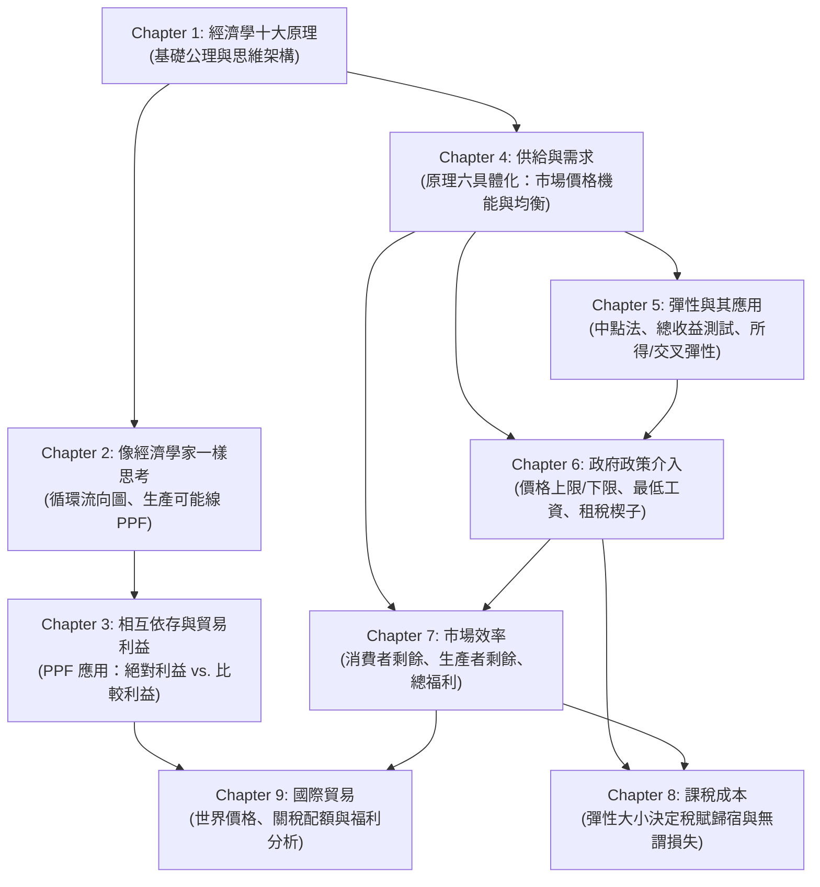

# 經濟學 (Economics) — 教材總覽

> 📅 最新更新日期：2026-10-25  
> 📂 來源目錄：[Reference/NCU_Classes/經濟學/](file:///c:/Users/Cupid/Downloads/Study-space/Reference/NCU_Classes/經濟學/)  
> 📄 共 9 份講義（9 份已全數生成完畢）  

---

## 🚀 最速精通學習路線 (Mastery Roadmap)

> 全 9 章預估 **~30 小時** 可從零到精通。按以下三階段順序學習效率最高：

| 階段 | 章節 | 學習重點 | 里程碑 | 預估時間 |
|:---:|:---|:---|:---|:---:|
| **Phase 1** | Ch1 → Ch2 → Ch3 | 經濟學語感、機會成本、PPF、比較利益 | 能獨立推導貿易雙贏數值 | ~12 hr |
| **Phase 2** | Ch4 → Ch5 → Ch6 | 供需均衡分析、彈性計算、政策干預效果 | 熟練三步驟分析法 + 租稅歸宿 | ~10 hr |
| **Phase 3** | Ch7 → Ch8 → Ch9 | CS/PS 面積分析、DWL、國際貿易福利 | 全圖形福利分析 + 關稅 vs 配額 | ~8 hr |

> 📖 **完整學習路線指南** (含每週計畫、自我檢核表)：詳見 [精通學習路線圖](file:///C:/Users/Cupid/.gemini/antigravity-ide/brain/f84271c2-ce8e-4449-b5b2-a0c50209b0ab/mastery_roadmap.md)

---

## 📚 章節目錄與進度

| 章節 | 來源檔案 | 知識點重點 | 狀態 | 教材連結 |
| :--- | :--- | :--- | :---: | :---: |
| **Chapter 1** | [CH1.pdf](file:///c:/Users/Cupid/Downloads/Study-space/Reference/NCU_Classes/經濟學/CH1.pdf) | 經濟學十大原理 (Ten Principles of Economics) | ✅ 已完成 | [開啟 Chapter 1 教材](./Chapter_1_教材.md) |
| **Chapter 2** | [CH2.pdf](file:///c:/Users/Cupid/Downloads/Study-space/Reference/NCU_Classes/經濟學/CH2.pdf) | 像經濟學家一樣思考 (Thinking Like an Economist) | ✅ 已完成 | [開啟 Chapter 2 教材](./Chapter_2_教材.md) |
| **Chapter 3** | [CH3.pdf](file:///c:/Users/Cupid/Downloads/Study-space/Reference/NCU_Classes/經濟學/CH3.pdf) | 相互依存與貿易利益 (Interdependence & Gains from Trade) | ✅ 已完成 | [開啟 Chapter 3 教材](./Chapter_3_教材.md) |
| **Chapter 4** | [CH4.pdf](file:///c:/Users/Cupid/Downloads/Study-space/Reference/NCU_Classes/經濟學/CH4.pdf) | 供給與需求的市場力量 (Market Forces of Supply & Demand) | ✅ 已完成 | [開啟 Chapter 4 教材](./Chapter_4_教材.md) |
| **Chapter 5** | [CH5.pdf](file:///c:/Users/Cupid/Downloads/Study-space/Reference/NCU_Classes/經濟學/CH5.pdf) | 彈性及其應用 (Elasticity and Its Application) | ✅ 已完成 | [開啟 Chapter 5 教材](./Chapter_5_教材.md) |
| **Chapter 6** | [CH6.pdf](file:///c:/Users/Cupid/Downloads/Study-space/Reference/NCU_Classes/經濟學/CH6.pdf) | 供給、需求與政府政策 (Supply, Demand, and Government Policies) | ✅ 已完成 | [開啟 Chapter 6 教材](./Chapter_6_教材.md) |
| **Chapter 7** | [CH7.pdf](file:///c:/Users/Cupid/Downloads/Study-space/Reference/NCU_Classes/經濟學/CH7.pdf) | 消費者、生產者與市場效率 (Efficiency of Markets) | ✅ 已完成 | [開啟 Chapter 7 教材](./Chapter_7_教材.md) |
| **Chapter 8** | [CH8.pdf](file:///c:/Users/Cupid/Downloads/Study-space/Reference/NCU_Classes/經濟學/CH8.pdf) | 應用：課稅的成本 (Application: The Costs of Taxation) | ✅ 已完成 | [開啟 Chapter 8 教材](./Chapter_8_教材.md) |
| **Chapter 9** | [CH9.pdf](file:///c:/Users/Cupid/Downloads/Study-space/Reference/NCU_Classes/經濟學/CH9.pdf) | 應用：國際貿易 (Application: International Trade) | ✅ 已完成 | [開啟 Chapter 9 教材](./Chapter_9_教材.md) |

---

## 🗺️ 跨章節知識關聯圖

---

## 🎯 全科考前必背精選清單 (陸續更新中)

1. **機會成本（Opportunity Cost）**：為得到某物所必須放棄的最高價值替代方案。＝外顯成本＋隱含成本。
2. **邊際決策準則**：當且僅當 $MB \ge MC$ 時採取行動；**沉沒成本（Sunk Cost）一律忽略**。
3. **看不見的手（The Invisible Hand）**：市場價格機能同時傳遞買者的邊際價值與賣者的邊際成本，導引資源效率配置。
4. **循環流向圖買賣方**：在生產要素市場中，**家計單位是賣方（提供勞動資本），廠商是買方**；在商品市場中則顛倒。
5. **PPF 斜率與機會成本**：$\text{水平軸商品機會成本} = |\text{PPF 斜率}| = MRT$；$\text{垂直軸商品機會成本} = 1 / |\text{PPF 斜率}|$。
6. **比較利益三大鐵律**：
   - 一國可在所有產品擁有絕對優勢，但**絕不可能在所有產品皆具比較優勢**。
   - 兩商品機會成本互為倒數（$OC_X = 1 / OC_Y$）。
   - 貿易專業化分工完全取決於**比較利益（機會成本較低者）**。
7. **需求量變動 vs. 需求變動**：**自身價格變動**引起「線上點移動（Change in Quantity Demanded）」；**非價格外生變數**引起「整條曲線平移（Change in Demand）」。
8. **中點法彈性計算**：以兩點平均數為分母，消除計算基準方向歧異。
9. **直線需求曲線彈性定理**：直線斜率固定，但**價格彈性由左上（富有彈性）隨價格下跌朝右下（缺乏彈性）持續遞減**；中點為單一彈性（$E_d = 1$）。
10. **總收益測試（TR Test）**：
    - 富有彈性（$E_d > 1$）：降價增收（薄利多銷）。
    - 缺乏彈性（$E_d < 1$）：漲價增收（降價反受害，如穀賤傷農）。
11. **所得彈性與交叉彈性正負號**：
    - 所得彈性：$>0$ 為正常財（$>1$ 為奢侈品）；$<0$ 為劣等財。
    - 交叉價格彈性：$>0$ 為替代品；$<0$ 為互補品。
12. **福利與市場效率（Welfare & Efficiency）**：
    - 消費者剩餘 $CS = \text{買者願意支付價格 (WTP)} - \text{實際支付價格 (P)}$。
    - 生產者剩餘 $PS = \text{賣者實際獲得價格 (P)} - \text{生產機會成本 (Cost)}$。
    - 總剩餘 $Total Surplus = CS + PS = \text{買者總評價} - \text{賣者總成本}$。競爭市場均衡時總剩餘最大化，達帕雷托效率。
13. **稅賦歸宿與無謂損失（Taxation & DWL）**：
    - **稅賦負擔落在相對缺乏彈性的一方**（無論法定課稅對象是買者還是賣者）。
    - 稅收帶來的無謂損失（Deadweight Loss, DWL）隨供給與需求彈性增大而**擴大**；DWL 與稅率平方成正比。
    - **拉弗曲線（Laffer Curve）**：稅率由 0 上升時稅收增加，超過臨界點後反而使交易量急劇萎縮致使總稅收下降。
14. **國際貿易與世界價格（International Trade & World Price）**：
    - 若 $P_W > P_{domestic}$：國內具比較利益，成為**出口國**；生產者獲利、消費者受損，但國家總福利增加。
    - 若 $P_W < P_{domestic}$：外國具比較利益，成為**進口國**；消費者獲利、生產者受損，國家總福利依然增加。
15. **關稅 vs. 進口配額（Tariffs vs. Import Quotas）**：
    - 關稅與配額皆使國內價格上升至 $P_W + t$，國內產量增加、消費量減少、進口量縮減。
    - 兩者皆造成過度生產與消費不足之兩塊三角無謂損失。
    - 關稅收入歸政府；進口配額租金歸配額持有者（若政府公開拍賣許可證，兩者福利效果等價）。
