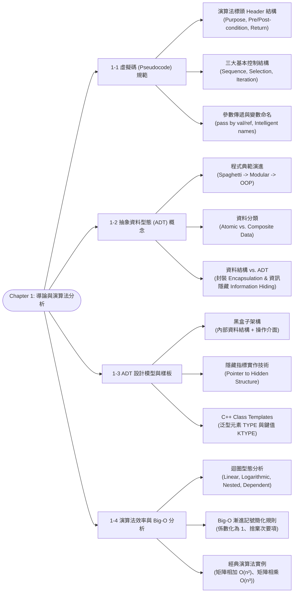

# Chapter 1: Introduction, Pseudocode & Algorithm Efficiency

> 📚 **課程名稱**：資料結構 (Data Structures)  
> 📖 **對應章節**：Chapter 1 Introduction (1-1 Pseudocode ~ 1-4 Algorithm Efficiency)  
> 👨‍🏫 **授課教師**：Kuen-Liang Sue (NCU IM)  
> 📄 **參考講義**：[DS_Ch1.pdf](file:///c:/Users/Cupid/Downloads/Study-space/Reference/NCU_Classes/資料結構/DS_Ch1.pdf)  
> 🔖 **先修觀念**：基礎 C/C++ 語法、指標概念、高中數學級數求和與對數運算

---

## 🗺️ 知識架構心智圖 (Mermaid Tree Diagram)



<a id="tree-diagram"></a>

### 🎯 本章學習進度檢核 (完成後打勾，建立成就反饋)

- [ ] [1-1 虛擬碼 (Pseudocode) 規範](#sec-1)
- [ ] [1-2 抽象資料型態 (ADT) 概念](#sec-2)
- [ ] [1-3 ADT 設計模型與樣板](#sec-3)
- [ ] [1-4 演算法效率與 Big-O 分析](#sec-4)

---

## 📖 核心觀念與理論精解

<a id="sec-1"></a>

### 1-1 虛擬碼 (Pseudocode) 的標準規範

虛擬碼（Pseudocode）是一種介於自然語言（英語）與高階程式語言之間的結構化演算法描述工具。其目的在於**精確傳達演算法邏輯**，同時免除特定語言繁瑣的語法細節。

#### 1. 演算法標頭 (Algorithm Header) 的構成要素

每個合格的演算法都必須具備完整的標頭，讓調用者即使不閱讀內部原始碼，也能正確呼叫：

* **Algorithm Name & Parameter List**：宣告演算法名稱與引數，標明參數傳遞模式：
  * `val` (Pass by Value)：傳值調用，函式內部無法修改外部變數。
  * `ref` (Pass by Reference)：傳參考調用，函式可透過該引數回傳修改後的結果。
* **Purpose**：簡明扼要說明演算法的核心功能與預期任務。
* **Precondition**：執行該演算法前**必須滿足的前提條件**（如：陣列必須已由小到大排序、指標不得為空值等）。若無前置條件亦須明確標示 `None`。
* **Postcondition**：演算法執行完畢後對外部環境所造成的狀態變更（Side Effects），以及輸出參數的最終狀態。
* **Return Condition**：明確宣告回傳值的型態與代表意義（如：回傳布林值表示是否搜尋成功；回傳整數表示索引位置，若失敗回傳 -1）。

> 💡 **核心考點：Output Parameter vs. Return Value 的差異**  
>
> * **Return Value**：透過 `return` 關鍵字將單一數值直接交還給呼叫端表達式（如 `pos = Search(...)`）。  
> * **Output Parameter**：透過傳參考（`ref`）將多個運算結果帶回外部變數，常用於需要回傳多個值或更新大體積結構時。

#### 2. 結構化程式設計的三大控制結構 (Control Constructs)

理論已證實（Böhm-Jacopini 定理），任何演算法皆可且僅可由以下三種結構組合而成：

1. **循序結構 (Sequence)**：不改變執行路徑的一連串循序敘述。
2. **選擇結構 (Selection)**：根據條件判斷執行不同分支（如 `if-else`, `switch-case`）。
3. **重複結構 (Iteration / Loop)**：在滿足特定終止條件前重複執行特定程式區塊（如 `while`, `for`）。

#### 3. 變數命名規範 (Intelligent Data Names)

* **禁止使用單字母變數**（如 `a`, `b`, `x`，但慣用的迴圈計數器 `i`, `j`, `k` 除外）。
* **禁止使用過度通用且缺乏語意的名稱**（Generic names，如 `count`, `sum`, `total`, `row`, `column`, `file`）。
* **提倡具備具體語意的縮寫**：如 `numOfStu` 是良好命名，但過於簡陋的 `noStu` 容易引起混淆（常被誤認為「沒有學生」）。
* **陣列索引預設自 0 開始**（與現代程式語言 C/C++/Java 一致）。

---

<a id="sec-2"></a>

### 1-2 抽象資料型態 (The Abstract Data Type, ADT)

#### 1. 程式設計典範的演進歷史

1. **義大利麵條式程式碼 (Spaghetti Code)**：早期組合語言或非結構化 Basic，大量使用 `GOTO` 無條件跳躍，邏輯破碎難以除錯與維護。
2. **模組化程式設計 (Modular Programming, 1970s)**：將程式依功能拆解為多個獨立函式（Functions），內部維持結構化線性程式碼。
3. **物件導向程式設計 (Object-Oriented Programming, OOP)**：以「物件（Object）」為核心，將資料屬性與對應的操作方法封裝在一起。

#### 2. 資料分類：原子資料 vs. 複合資料

* **原子資料 (Atomic Data)**：被視為單一、不可再分割的實體（如整數 `int`、浮點數 `float`、字元 `char`）。
* **複合資料 (Composite Data)**：由多個原子或複合資料組合而成的實體（如電話號碼包含「國碼+區碼+本碼」；學生記錄包含「學號+姓名+成績清單」）。
* **資料結構 (Data Structure)**：原子與複合資料型態的**聚合體**，並在元素之間定義了明確的邏輯關係。

#### 3. ADT 的正式定義與核心理念
>
> **正式定義**：ADT 是一種將**資料宣告（Data Declaration）**與**作用於該資料的所有有意義操作（Operations）**打包在一起的程式抽象機制。

* **使用者關注點 (What, not How)**：調用者只需了解「該操作能提供什麼功能（What it does）」，而不必知道內部演算法如何執行（How it is done）。
* **封裝 (Encapsulation) 與資訊隱藏 (Information Hiding)**：將內部儲存結構（如使用動態陣列或鏈結串列）封裝於模組內部，對外部呼叫者完全隱藏。
* **經典範例**：銀行排隊系統（Queue ADT）。若直接針對銀行專案撰寫佇列，該程式碼無法重用；若設計通用的 `Queue ADT`（提供 `enqueue`, `dequeue`, `isEmpty`），則該 ADT 能解決所有排隊模擬問題，工程師得以專注於銀行業務邏輯。

---

<a id="sec-3"></a>

### 1-3 ADT 模型與 C++ 樣板 (Templates)

#### 1. ADT 黑盒子模型 (Black Box Model)

```
       ┌────────────────────────────────────────────────────────┐
       │                 ADT Model (Black Box)                  │
       │                                                        │
       │   [ 內部隱藏資料結構 ] <───> [ 內部私有實作演算法 ]    │
       │   (動態陣列/鏈結串列等)      (指標操作/記憶體管理)     │
       │                                    ▲                   │
       └────────────────────────────────────┼───────────────────┘
                                            │ 封裝屏障 (Interface)
                        [ 公開操作介面 (Public Methods) ]
                         如：insert(), delete(), search()
                                            ▲
                                            │ 調用
                                   [ 使用者 / 應用程式 ]

```

* **公開介面 (Interface)**：使用者唯一能看見與操作的僅有函式原型（函式名稱與參數列表）。
* **指標指向隱藏結構 (Pointer to Hidden Structure)**：在 C/C++ 實作中，外部呼叫者通常僅持有一個不透明指標（Opaque Pointer，如 `FILE*` 或 `void*`），內部節點配置與指標指向均無法直接竄改。

#### 2. C++ Class Templates（泛型機制）

為了讓 ADT 不依賴於特定資料型態，現代實作採用泛型樣板：

* `template <class TYPE, class KTYPE>`
  * `TYPE`：代表 ADT 儲存的完整記錄型態（如 `Student` 或 `MoviePicture`）。
  * `KTYPE`：代表搜尋與排序所依賴的**主鍵型態 (Key Type)**（如學號 `int`、年份 `short`）。

---

<a id="sec-4"></a>

### 1-4 演算法效率與 Big-O 漸進分析 (Algorithm Efficiency)

**Algorithmics（演算法學）**：系統性研究演算法設計技巧與效率分析的學門。演算法時間效率分析主要聚焦於**迴圈執行次數隨資料規模 $n$ 的增長趨勢**。

#### 1. 基本迴圈型態分析

| 迴圈型態 | 程式碼特徵 | 執行次數與關係式 | Big-O 複雜度 |
| :--- | :--- | :--- | :---: |
| **線性迴圈 (Linear Loop)** | 迴圈變數每次加減固定常數：<br>`for(int i=0; i<n; i++)` | 執行次數 $= n$ | $O(n)$ |
| **對數迴圈 (Logarithmic Loop)** | 迴圈變數每次乘除固定常數 $c>1$：<br>`for(int i=1; i<n; i*=2)` | $2^k \ge n \implies k = \lceil \log_2 n \rceil$ | $O(\log n)$ |
| **外積線性對數 (Linear Logarithmic)** | 外層線性、內層對數獨立：<br>`for i=0..n: for j=1..n (j*=2)` | 總次數 $= n \times \lceil \log_2 n \rceil$ | $O(n \log n)$ |
| **相依二次迴圈 (Dependent Quadratic)** | 內層終止條件相依於外層變數：<br>`for i=0..n: for j=0..i` | 總次數 $= \sum_{i=0}^{n} i = \frac{n(n+1)}{2} = \frac{1}{2}n^2 + \frac{1}{2}n$ | $O(n^2)$ |
| **獨立二次迴圈 (Quadratic)** | 兩層獨立的線性迴圈：<br>`for i=0..n: for j=0..n` | 總次數 $= n \times n = n^2$ | $O(n^2)$ |
| **獨立三次迴圈 (Cubic)** | 三層獨立的線性迴圈：<br>`for i..n: for j..n: for k..n` | 總次數 $= n \times n \times n = n^3$ | $O(n^3)$ |

#### 2. Big-O 記號的推導化簡步驟

給定精確執行次數函數 $f(n)$，求其漸進上界（Big-O）標準步驟：

1. **各項係數化為 1**：將多項式中每項的常數係數去掉（例如：$3n^2 + 5n + 10 \to n^2 + n + 1$）。
2. **捨棄次要低階項**：保留增長率最高的主導項（Dominant Term），其餘全部捨棄（保留 $n^2$）。
3. **得簡記形式**：$f(n) = O(n^2)$。

#### 3. 常見時間複雜度階層大小比較

當 $n \to \infty$ 時的增長速率（由慢至快，即**演算法由優至劣**）：
$$O(1) < O(\log n) < O(n) < O(n \log n) < O(n^2) < O(n^3) < O(2^n) < O(n!)$$

* **$O(1)$**：常數時間（Constant Time），如陣列直接隨機存取。
* **$O(\log n)$**：對數時間（Logarithmic Time），如二分搜尋法（Binary Search）。
* **$O(n)$**：線性時間（Linear Time），如無序串列的線性搜尋。
* **$O(n \log n)$**：線性對數時間，如合併排序（Merge Sort）、快速排序平均（Quick Sort）。
* **$O(n^2)$**：二次時間，如氣泡排序、選擇排序、矩陣加法。
* **$O(n^3)$**：三次時間，如標準矩陣相乘。
* **$O(2^n)$ / $O(n!)$**：指數與階乘時間（NP-Complete 問題窮舉解，如旅行推銷員問題 TSP）。

---

## 💻 經典範例與演算詳解

<a id="sec-5"></a>

### 範例一：矩陣相加 (Matrix Addition)

設有兩大小皆為 $n \times n$ 的方陣 $A$ 與 $B$，將其相加存入 $C$：

```cpp
// Algorithm: AddMatrices
// Pre: A, B 為 n*n 矩陣; Post: C 為相加結果
for (int i = 0; i < n; i++) {           // 外層迴圈執行 n 次
    for (int j = 0; j < n; j++) {       // 內層迴圈每次執行 n 次
        C[i][j] = A[i][j] + B[i][j];    // 基本操作 (1 次加法與賦值)
    }
}

```

* **分析**：基本操作執行次數為 $n \times n = n^2$ 次。
* **時間複雜度**：$O(n^2)$。

<a id="sec-6"></a>

### 範例二：標準矩陣乘法 (Matrix Multiplication)

設兩 $n \times n$ 矩陣 $A$ 與 $B$ 相乘，$C_{ij} = \sum_{k=0}^{n-1} A_{ik} B_{kj}$：

```cpp
// Algorithm: MultiplyMatrices
for (int i = 0; i < n; i++) {               // 執行 n 次
    for (int j = 0; j < n; j++) {           // 執行 n 次
        C[i][j] = 0;
        for (int k = 0; k < n; k++) {       // 執行 n 次
            C[i][j] += A[i][k] * B[k][j];   // 基本操作 (乘法與累加)
        }
    }
}

```

* **分析**：三層獨立迴圈巢狀嵌套，最內層基本運算執行次數為 $n \times n \times n = n^3$ 次。
* **時間複雜度**：$O(n^3)$。

---

## 📝 實戰練習題 (三層遞進式強化測驗)

### 🟢 Tier 1：必懂基礎 (Must-Know Fundamentals)

> 💡 **學習目標**：確認自己「會算、會辨識」——給數字就能做對、給名稱就能配對。

<a id="q1"></a>

#### Q1. (單選題) 下列時間函數，何者的 Big-O 為 $O(n^2)$？

(A) $f(n) = 3n + 100$  
(B) $f(n) = 7n^2 + 5n + 200$  
(C) $f(n) = 2n^3 + n^2$  
(D) $f(n) = 15n \log n + 8n$  

👉 [查看 Q1 答案與詳細解析](#ans-q1)

---

<a id="q2"></a>

#### Q2. (單選題) 下列迴圈共執行幾次迭代？

```cpp
for (int i = 1; i <= n; i *= 2) {
    sum += i;
}

```

設 $n = 64$，則迴圈共執行幾次？

(A) 6 次  
(B) 7 次  
(C) 32 次  
(D) 64 次  

👉 [查看 Q2 答案與詳細解析](#ans-q2)

---

<a id="q3"></a>

#### Q3. (單選題) 下列相依二次迴圈中，`count++` 精確執行幾次？

```cpp
int count = 0;
for (int i = 1; i <= 5; i++) {
    for (int j = 1; j <= i; j++) {
        count++;
    }
}

```

(A) 10 次  
(B) 15 次  
(C) 20 次  
(D) 25 次  

👉 [查看 Q3 答案與詳細解析](#ans-q3)

---

<a id="q4"></a>

#### Q4. (排序題) 請將下列 Big-O 複雜度由增長最慢到最快排列：

(1) $O(n^2)$　(2) $O(\log n)$　(3) $O(1)$　(4) $O(n \log n)$　(5) $O(2^n)$　(6) $O(n)$　(7) $O(n!)$

👉 [查看 Q4 答案與詳細解析](#ans-q4)

---

<a id="q5"></a>

#### Q5. (單選題) 關於 ADT (抽象資料型態)，下列何者正確？

(A) ADT 僅包含資料宣告，不含操作  
(B) ADT 將資料宣告與操作封裝，對使用者隱藏內部實作細節  
(C) ADT 必須用物件導向語言實作  
(D) ADT 暴露內部指標結構，方便使用者直接存取  

👉 [查看 Q5 答案與詳細解析](#ans-q5)

---

### 🟡 Tier 2：基礎 + 實際應用 (Application & Scenario Matching)

> 💡 **學習目標**：確認自己「會用」——知道什麼情境該用什麼分析方法、能辨別常見陷阱。

<a id="q6"></a>

#### Q6. (單選題) 下列巢狀迴圈的時間複雜度為何？

```cpp
for (int i = 0; i < n; i++) {
    for (int j = 1; j < n; j *= 2) {
        process(i, j); // O(1) 操作
    }
}

```

(A) $O(n)$  
(B) $O(n \log n)$  
(C) $O(n^2)$  
(D) $O(n^2 \log n)$  

👉 [查看 Q6 答案與詳細解析](#ans-q6)

---

<a id="q7"></a>

#### Q7. (單選題) 某演算法有以下兩段獨立迴圈（先後執行，不是巢狀）：

```cpp
// Part A
for (int i = 0; i < n; i++) {
    doA(); // O(1)
}
// Part B
for (int i = 0; i < n; i++) {
    for (int j = 0; j < n; j++) {
        doB(); // O(1)
    }
}

```

該演算法的整體時間複雜度為何？

(A) $O(n)$  
(B) $O(n^2)$  
(C) $O(n^3)$  
(D) $O(n + n^2)$，不可化簡  

👉 [查看 Q7 答案與詳細解析](#ans-q7)

---

<a id="q8"></a>

#### Q8. (陷阱辨別題) 小明看到以下程式碼，直覺判定它是 $O(n \log n)$，但其實不是。請問真正的複雜度為何？

```cpp
for (int i = n; i > 1; i = i / 2) {
    for (int j = 0; j < i; j++) {
        doWork(); // O(1)
    }
}

```

(A) $O(n \log n)$  
(B) $O(n^2)$  
(C) $O(n)$  
(D) $O(\log^2 n)$  

👉 [查看 Q8 答案與詳細解析](#ans-q8)

---

<a id="q9"></a>

#### Q9. (多選題) 關於虛擬碼標頭 (Algorithm Header) 的撰寫規範，下列敘述何者正確？

(A) 呼叫者通常只能看到標頭而無法看到實作，因此標頭必須資訊完整  
(B) Precondition 描述呼叫此演算法前必須滿足的前提條件  
(C) 若演算法沒有前置條件，可以直接省略 Precondition 欄位  
(D) 標記為 `ref` 的引數，函式內部的修改會直接影響呼叫端的變數  
(E) Postcondition 描述演算法執行完畢後的狀態與輸出  

👉 [查看 Q9 答案與詳細解析](#ans-q9)

---

<a id="q10"></a>

#### Q10. (情境判斷題) 你拿到兩段程式碼，需要判斷哪段在大規模資料下更快：

- **程式 A**：有一個雙層巢狀迴圈，外層走 $n$ 次、內層每次走 $\log n$ 次（變數獨立）。
- **程式 B**：有一個相依二次迴圈，外層走 $n$ 次、內層走 $1$ 到 $i$ 次。

當 $n = 10000$ 時，程式 A 與 B 分別約做多少次運算？哪個更快？

(A) A 做 $10000 \times 13 \approx 130000$ 次，B 做 $\frac{10000 \times 10001}{2} \approx 50000000$ 次，A 遠快於 B  
(B) 兩者都是 $O(n^2)$，效能相當  
(C) B 更快，因為相依迴圈有些迭代只做很少次  
(D) 無法比較，必須知道具體常數因子  

👉 [查看 Q10 答案與詳細解析](#ans-q10)

---

### 🔴 Tier 3：概念講述與深度分析 (Conceptual & Analytical)

> 💡 **學習目標**：確認自己「會講」——能解釋原理、推導過程、闡述設計哲學。

<a id="q11"></a>

#### Q11. (推導題) 試分析下列迴圈的精確執行次數與 Big-O 複雜度，並寫出完整的數學推導過程。

```cpp
for (int i = 1; i <= n; i *= 3) {
    for (int j = 0; j < i; j++) {
        compute(); // O(1)
    }
}

```

提示：外層的 $i$ 依序為 $1, 3, 9, 27, \dots, 3^k$（其中 $3^k \le n$），內層每輪跑 $i$ 次。

👉 [查看 Q11 答案與詳細解析](#ans-q11)

---

<a id="q12"></a>

#### Q12. (問答題) ADT 的封裝 (Encapsulation) 與資訊隱藏 (Information Hiding) 能為軟體架構帶來哪兩大具體好處？請結合「替換底層資料結構」與「泛型重用」兩個面向說明。

👉 [查看 Q12 答案與詳細解析](#ans-q12)

---

<a id="q13"></a>

#### Q13. (比較分析題) 下列兩段程式碼看起來結構相似，但時間複雜度截然不同。請分別推導其 Big-O 並解釋**為什麼不同**。

**程式 X：**

```cpp
for (int i = 1; i <= n; i++) {        // 外層 O(n)
    for (int j = 1; j <= n; j *= 2) { // 內層 O(log n)
        foo();
    }
}

```

**程式 Y：**

```cpp
for (int i = 1; i <= n; i++) {        // 外層 O(n)
    for (int j = 1; j <= i; j++) {    // 內層 O(i)
        bar();
    }
}

```

👉 [查看 Q13 答案與詳細解析](#ans-q13)

---

---

## 🔑 本章練習題答案與詳細解析 (Answer Key)

### 🟢 Tier 1 解析

<a id="ans-q1"></a>

### Q1 答案與詳細解析

**正確答案**：**(B)**  
**解析**：  
Big-O 化簡步驟：去除常數係數，保留增長最快的支配項。  

* (A) $3n + 100$：支配項為 $n$，故 $O(n)$。  
* (B) $7n^2 + 5n + 200$：支配項為 $n^2$，故 **$O(n^2)$** ✅  
* (C) $2n^3 + n^2$：支配項為 $n^3$，故 $O(n^3)$。  
* (D) $15n \log n + 8n$：支配項為 $n \log n$，故 $O(n \log n)$。

[🔙 返回題目 Q1](#q1) ｜ [🔝 返回知識架構圖](#tree-diagram)

---

<a id="ans-q2"></a>

### Q2 答案與詳細解析

**正確答案**：**(B)**  
**解析**：  
$i$ 依序取值 $1, 2, 4, 8, 16, 32, 64$，共 **7 次**迭代（$2^0$ 到 $2^6$）。  
通用公式：迴圈次數 $k = \lfloor \log_2 n \rfloor + 1$。代入 $n=64$：$\lfloor \log_2 64 \rfloor + 1 = 6 + 1 = 7$。

[🔙 返回題目 Q2](#q2) ｜ [🔝 返回知識架構圖](#tree-diagram)

---

<a id="ans-q3"></a>

### Q3 答案與詳細解析

**正確答案**：**(B)**  
**解析**：  
逐輪計數：$i=1$ 做 1 次、$i=2$ 做 2 次、$i=3$ 做 3 次、$i=4$ 做 4 次、$i=5$ 做 5 次。  
合計 $1+2+3+4+5 = \frac{5 \times 6}{2} = 15$ 次。  
一般化公式：$\sum_{i=1}^{n} i = \frac{n(n+1)}{2}$。

[🔙 返回題目 Q3](#q3) ｜ [🔝 返回知識架構圖](#tree-diagram)

---

<a id="ans-q4"></a>

### Q4 答案與詳細解析

**正確排序**：

$$
(3) < (2) < (6) < (4) < (1) < (5) < (7)
$$

即：$O(1) < O(\log n) < O(n) < O(n \log n) < O(n^2) < O(2^n) < O(n!)$

> 📌 **考試重點**：$O(n \log n)$ 位於 $O(n)$ 和 $O(n^2)$ 之間，很多同學會搞混順序。以 $n = 1024$ 為例：$n \log_2 n = 10240$，而 $n^2 = 1048576$，差距百倍。

[🔙 返回題目 Q4](#q4) ｜ [🔝 返回知識架構圖](#tree-diagram)

---

<a id="ans-q5"></a>

### Q5 答案與詳細解析

**正確答案**：**(B)**  
**解析**：  

* (A) 錯誤：ADT = 資料宣告 + 操作集合（Data + Operations），缺一不可。  
* (B) 正確：封裝 (Encapsulation) + 資訊隱藏 (Information Hiding) 是 ADT 核心精神。  
* (C) 錯誤：ADT 是設計概念，可用 C (struct + 函式) 或 C++ (class) 等任何語言實作。  
* (D) 錯誤：ADT 隱藏內部指標，使用者透過公開介面操作。

[🔙 返回題目 Q5](#q5) ｜ [🔝 返回知識架構圖](#tree-diagram)

---

### 🟡 Tier 2 解析

<a id="ans-q6"></a>

### Q6 答案與詳細解析

**正確答案**：**(B)**  
**解析**：  
外層 `i` 走 $n$ 次（線性迴圈）。  
內層 `j` 每次乘 2，走 $\lfloor \log_2 n \rfloor$ 次（對數迴圈）。  
兩層變數**互相獨立**（內層次數不隨外層 `i` 改變），故直接相乘：$n \times \log n = O(n \log n)$。

> 📌 **對比 Q8**：本題內層固定跑 $\log n$ 次（獨立），而 Q8 的內層次數隨外層遞減（相依），結論完全不同！

[🔙 返回題目 Q6](#q6) ｜ [🔝 返回知識架構圖](#tree-diagram)

---

<a id="ans-q7"></a>

### Q7 答案與詳細解析

**正確答案**：**(B)**  
**解析**：  
Part A 為 $O(n)$，Part B 為 $O(n^2)$。兩段**先後獨立**（非巢狀），取**加法法則**：  
$O(n) + O(n^2) = O(n^2)$（保留增長最快的支配項）。  

> ⚠️ **陷阱**：(D) 看似合理但不正確。Big-O 加法法則明確規定：$O(f) + O(g) = O(\max(f, g))$，不保留低階項。

[🔙 返回題目 Q7](#q7) ｜ [🔝 返回知識架構圖](#tree-diagram)

---

<a id="ans-q8"></a>

### Q8 答案與詳細解析

**正確答案**：**(C)**  
**解析**：  
外層 $i$ 依序為 $n, \frac{n}{2}, \frac{n}{4}, \dots, 1$。  
內層每輪跑 $i$ 次，總執行次數為等比級數求和：  
$$S = n + \frac{n}{2} + \frac{n}{4} + \cdots + 1 = n \sum_{k=0}^{\lfloor\log_2 n\rfloor} \frac{1}{2^k} \le n \times 2 = 2n$$

故 $S = O(n)$，**不是 $O(n \log n)$**！

> ⚠️ **這是考試超級大陷阱**：看到外層對數級（每次除以 2）+ 內層跑 $i$ 次，很多同學會直接乘成 $O(n \log n)$。但內層次數隨外層幾何遞減，總和是**收斂等比級數**，上界為 $2n = O(n)$。

[🔙 返回題目 Q8](#q8) ｜ [🔝 返回知識架構圖](#tree-diagram)

---

<a id="ans-q9"></a>

### Q9 答案與詳細解析

**正確答案**：**(A), (B), (D), (E)**  
**解析**：  

* (A)(B)(D)(E) 皆為講義明文規範。  
* **(C) 錯誤**：即使沒有前置條件，規範要求**必須保留欄位並寫明 `Precondition: None`**，不可省略。這是考試常見扣分點。

[🔙 返回題目 Q9](#q9) ｜ [🔝 返回知識架構圖](#tree-diagram)

---

<a id="ans-q10"></a>

### Q10 答案與詳細解析

**正確答案**：**(A)**  
**解析**：  

* **程式 A**：外層 $n$ 次 × 內層 $\log_2 n$ 次（獨立）→ $O(n \log n)$。  

  代入 $n=10000$：$10000 \times \lfloor\log_2 10000\rfloor \approx 10000 \times 13 = 130000$ 次。  

* **程式 B**：相依二次迴圈 → $\frac{n(n+1)}{2} = O(n^2)$。  

  代入 $n=10000$：$\frac{10000 \times 10001}{2} = 50005000 \approx 5 \times 10^7$ 次。  

$O(n \log n)$ 與 $O(n^2)$ 的差距在大規模資料下極為顯著（本例差 380 倍）。

[🔙 返回題目 Q10](#q10) ｜ [🔝 返回知識架構圖](#tree-diagram)

---

### 🔴 Tier 3 解析

<a id="ans-q11"></a>

### Q11 答案與詳細解析

**詳細數學推導**：

1. 外層 $i$ 取值：$3^0 = 1, 3^1 = 3, 3^2 = 9, \dots, 3^k$，其中 $3^k \le n$，故 $k = \lfloor \log_3 n \rfloor$。  
2. 每輪內層跑 $i$ 次，總執行次數：  
   $$S = 1 + 3 + 9 + 27 + \cdots + 3^k = \sum_{j=0}^{k} 3^j = \frac{3^{k+1} - 1}{3 - 1} = \frac{3^{k+1} - 1}{2}$$  
3. 因為 $3^k \le n < 3^{k+1}$，故 $3^{k+1} \le 3n$，得：  
   $$S \le \frac{3n - 1}{2} < \frac{3n}{2}$$  
4. 結論：$S = O(n)$。

> ⚠️ **關鍵洞察**：此題與 Q8 結構類似——外層對數級、內層跑 $i$ 次——但因等比級數收斂，總和被線性函數界定。不要被「兩層迴圈」的外觀騙了！

[🔙 返回題目 Q11](#q11) ｜ [🔝 返回知識架構圖](#tree-diagram)

---

<a id="ans-q12"></a>

### Q12 答案與詳細解析

**標準解答要點**：

1. **資訊隱藏與模組解耦 (Information Hiding & Low Coupling)**：  
   * 使用者僅透過公開介面操作 ADT，無法觸碰內部指標（如 `next`, `prev`）或陣列結構。  
   * **好處**：若未來需要將底層從「動態陣列」改為「雙向鏈結串列」或「平衡樹」，呼叫端程式完全不需修改，僅需重新編譯程式庫。大幅提升系統可維護性。

2. **泛型重用性 (Generic Reusability)**：  
   * 透過樣板引數 `TYPE`（資料型態）與 `KTYPE`（鍵值型態），同一套演算法（排序串列、堆疊、佇列）可套用於任何自訂物件（學生資料、股票行情等），消除重複程式碼。

[🔙 返回題目 Q12](#q12) ｜ [🔝 返回知識架構圖](#tree-diagram)

---

<a id="ans-q13"></a>

### Q13 答案與詳細解析

**程式 X 分析**：  

* 外層 `i` 走 $n$ 次（線性迴圈）。  
* 內層 `j` 每次乘 2，固定走 $\lfloor \log_2 n \rfloor$ 次，**與外層變數 `i` 無關**。  
* 兩層獨立 → 直接相乘 → **$O(n \log n)$**。

**程式 Y 分析**：  

* 外層 `i` 走 $n$ 次。  
* 內層 `j` 走 $1$ 到 $i$ 次，**相依於外層變數 `i`**。  
* 總次數 = $\sum_{i=1}^{n} i = \frac{n(n+1)}{2}$ → **$O(n^2)$**。

**兩者差異的根本原因**：  

* 程式 X 的內層次數是**常數**（相對於 $n$ 而言，$\log n$ 每輪都一樣），所以「乘法法則」直接相乘。  
* 程式 Y 的內層次數**隨外層遞增**，必須用**求和**計算總量，結果為等差級數。

> 📌 **考試口訣**：「內層獨立用乘法，內層相依用求和！」

[🔙 返回題目 Q13](#q13) ｜ [🔝 返回知識架構圖](#tree-diagram)

---

## 📊 重點速記表 (Summary Table)

| 觀念類別 | 關鍵術語 / 概念 | 核心定義與規格 | 常見錯誤或考點 |
| :--- | :--- | :--- | :--- |
| **虛擬碼** | Header 標頭規範 | 包含 Name, Purpose, Precondition, Postcondition, Return | Precondition 即使為空也必須寫明 None |
| **虛擬碼** | 控制結構 | Sequence (循序), Selection (選擇), Iteration (迴圈) | 僅此三種即可表達任何演算法（Böhm-Jacopini） |
| **虛擬碼** | 引數傳遞 | `val` (傳值) vs. `ref` (傳參考/指標) | 欲修改外部資料或回傳多值必須使用 `ref` |
| **ADT** | 抽象資料型態定義 | 資料宣告 + 有意義的操作集合 (Data + Operations) | 隱藏「How」，僅暴露「What」 |
| **資料分類** | Atomic vs Composite | 原子資料不可分割；複合資料由原子/複合資料聚合而成 | 電話號碼、地址屬於複合資料 |
| **演算法效率** | 線性迴圈 | 步進為加減固定常數 $\implies O(n)$ | 迴圈次數與資料規模成正比 |
| **演算法效率** | 對數迴圈 | 步進為乘除固定常數 $c>1 \implies O(\log n)$ | 底數不影響 Big-O 階層 |
| **演算法效率** | 相依二次迴圈 | 內層終止條件相依於外層變數 $\implies \sum i = O(n^2)$ | 係數 $\frac{1}{2}$ 在 Big-O 分析中被常數捨棄 |
| **經典算力** | 矩陣加法 vs 乘法 | 加法雙層迴圈 $O(n^2)$；標準乘法三層迴圈 $O(n^3)$ | 矩陣乘法極耗算力，促成 Strassen 演算法發展 |

---

## 🗂️ 考前速查卡片 (Flashcards)

<div style="display: grid; grid-template-columns: repeat(auto-fit, minmax(280px, 1fr)); gap: 1rem;">

<div style="border: 1px solid #e2e8f0; border-radius: 8px; padding: 1rem; background-color: #f8fafc;">
  <strong style="color: #2563eb;">Q: 什麼是 ADT 的封裝 (Encapsulation)？</strong>
  <hr style="margin: 0.5rem 0;" />
  <p><strong>A:</strong> 將資料結構宣告與所有相關的操作函式打包成單一模組，對外部使用者隱藏內部具體實作，僅提供公開介面操作。</p>
</div>

<div style="border: 1px solid #e2e8f0; border-radius: 8px; padding: 1rem; background-color: #f8fafc;">
  <strong style="color: #2563eb;">Q: Output Parameter 與 Return Value 有何本質差異？</strong>
  <hr style="margin: 0.5rem 0;" />
  <p><strong>A:</strong> Return Value 透過表達式回傳單一值；Output Parameter 透過傳參考（ref）傳遞，可回傳多個值或更新大體積物件。</p>
</div>

<div style="border: 1px solid #e2e8f0; border-radius: 8px; padding: 1rem; background-color: #f8fafc;">
  <strong style="color: #2563eb;">Q: 如何將 $f(n) = 4n^2 + 7n + 15$ 化簡為 Big-O？</strong>
  <hr style="margin: 0.5rem 0;" />
  <p><strong>A:</strong> 1. 去除常數係數得 $n^2 + n + 1$；2. 僅保留增長速率最高的主導項，得 $O(n^2)$。</p>
</div>

<div style="border: 1px solid #e2e8f0; border-radius: 8px; padding: 1rem; background-color: #f8fafc;">
  <strong style="color: #2563eb;">Q: 為什麼對數複雜度 $O(\log_2 n)$ 寫成 $O(\log n)$？</strong>
  <hr style="margin: 0.5rem 0;" />
  <p><strong>A:</strong> 依換底公式 $\log_a n = \frac{\log_b n}{\log_b a}$，不同對數底數之間僅差一個固定常數因子，在漸進分析中常數倍數一律化簡為 1。</p>
</div>

</div>

---

## ⚠️ 考試常見陷阱題 (Common Traps)

1. **陷阱一：誤以為只要有兩層巢狀迴圈就一定是 $O(n^2)$**  
   * *錯誤示範*：看到外層除以 2、內層走到 $i$ 的迴圈，反射性寫 $O(n \log n)$ 或 $O(n^2)$。  
   * *防坑秘笈*：如練習題 Q9，$\sum n/2^k = 2n = O(n)$，務必寫出求和級數式，驗證是否為收斂幾何級數！
2. **陷阱二：忽略虛擬碼 Precondition 為空時的書寫規範**  
   * *錯誤示範*：標頭中直接刪除 Precondition 段落。  
   * *防坑秘笈*：教授期中考常扣格式分，若無前提條件必須明寫 `Precondition: None`。
3. **陷阱三：混淆變數名稱智慧性 (Intelligent Name) 與簡短性**  
   * *錯誤示範*：以為命名越短越好，使用 `s` 代表 sum、`c` 代表 count。  
   * *防坑秘笈*：評分標準要求名稱必須具備自解釋性（Self-documenting），禁止單一字母與泛用名稱。
4. **陷阱四：Big-O 比較時搞錯 $O(n \log n)$ 與 $O(n^2)$**  
   * *錯誤示範*：認為 $\log n$ 比 $n$ 大。  
   * *防坑秘笈*：牢記 $\log n \ll n$。例如當 $n=1024$ 時，$\log_2 n = 10$，而 $n = 1024$，因此 $n \log n \approx 10240 \ll n^2 \approx 10^6$。

---

## 🔗 相關章節索引與導航

* 🔙 **課程教材總覽**：[資料結構教材目錄 (_INDEX.md)](./_INDEX.md)
* ⏭️ **下一章節**：[Chapter 2: Search Algorithms & Hashing (搜尋與雜湊)](./Chapter_2_教材.md)
* 📂 **原始講義檔案**：[DS_Ch1.pdf](file:///c:/Users/Cupid/Downloads/Study-space/Reference/NCU_Classes/資料結構/DS_Ch1.pdf)
