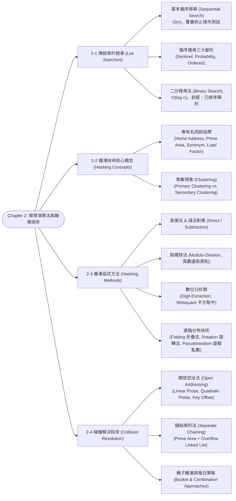
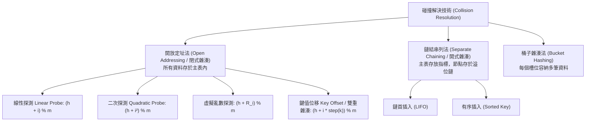

# Chapter 2: Search Algorithms & Hashed List Searches

> 📚 **課程名稱**：資料結構 (Data Structures)  
> 📖 **對應章節**：Chapter 2 Searching (List Searches ~ Collision Resolution)  
> 👨‍🏫 **授課教師**：Kuen-Liang Sue (NCU IM)  
> 📄 **參考講義**：[DS_Ch2.pdf](file:///c:/Users/Cupid/Downloads/Study-space/Reference/NCU_Classes/資料結構/DS_Ch2.pdf)  
> 🔖 **先修觀念**：[Chapter 1 演算法效率與 Big-O 分析](./Chapter_1_教材.md)、指標與陣列、初等數論（同餘模運算與質數性質）

---

## 🗺️ 知識架構心智圖 (Mermaid Tree Diagram)



<a id="tree-diagram"></a>

### 🎯 本章學習進度檢核 (完成後打勾，建立成就反饋)

- [ ] [2-1 傳統串列搜尋 (List Searches)](#sec-1)
- [ ] [2-2 雜湊技術核心概念 (Hashing Concepts)](#sec-2)
- [ ] [2-3 雜湊函式方法 (Hashing Methods)](#sec-3)
- [ ] [2-4 碰撞解決技術 (Collision Resolution)](#sec-4)

---

## 📖 核心觀念與理論精解

<a id="sec-1"></a>

### 2-1 串列搜尋 (List Searches) 與優化變形

搜尋（Searching）是指在一組資料集合中，找出其鍵值（Key）等於特定目標值（Target）之記錄位置或驗證其存在的程序。

#### 1. 基本循序搜尋 (Sequential Search)

* **原理**：從串列的第一個元素開始，逐一比對每個元素的鍵值，直到找到目標或巡訪完整個串列。
* **效能分析**：
  * **成功搜尋（Best Case）**：目標在第 1 個元素，比對 1 次，複雜度 $O(1)$。
  * **成功搜尋（Worst Case）**：目標在最後一個元素，比對 $n$ 次，複雜度 $O(n)$。
  * **成功搜尋（Average Case）**：若各元素被搜尋機率均等（$1/n$），平均比對次數為 $\frac{1+2+\dots+n}{n} = \frac{n+1}{2}$ 次，複雜度 $O(n)$。
  * **失敗搜尋（Unsuccessful Case）**：必須完整掃描整個陣列，固定比對 $n$ 次，複雜度 $O(n)$。

#### 2. 循序搜尋的三大經典變形

傳統循序搜尋的迴圈每輪都必須做**雙重條件測試**：（1）是否到達陣列結尾（`index < size`）；（2）是否找到目標（`target != list[index]`）。電腦科學大師 Donald Knuth 指出：  
> *"When the inner loop of a program tests two or more conditions, an attempt should be made to reduce it to just one condition."*（當內部迴圈測試兩個以上條件時，應設法縮減為僅測試一個條件以極大化迴圈速度。）

1. **哨兵搜尋法 (Sentinel Search)**：
   * **機制**：在陣列尾端（索引 $n$）開闢一個額外空間，放入目標值作為「哨兵（Sentinel）」。
   * **優勢**：迴圈內**完全免除陣列邊界檢查**，僅需判斷 `list[i] != target`。迴圈結束後，僅需一行檢查 `if (i < n)` 即知是否在有效資料中找到目標。
   * **效益**：大幅降低 CPU 分支預測開銷，迴圈執行效能顯著提升。

2. **機率搜尋法 (Probability Search / 自我調整串列)**：
   * **背景**：真實世界中資料存取通常強烈遵循 80/20 法則（少數熱門資料佔據絕大多數搜尋請求）。
   * **啟發式動態重整 (Heuristic Reordering)**：每次成功搜尋到目標時，將該元素與**其前一個元素交換（Swap with predecessor）**。
   * **效果**：常被查詢的高頻元素會逐漸前移至串列前端，使後續查詢的平均比對次數大幅趨近於 $O(1)$。

3. **有序串列搜尋 (Ordered List Search)**：
   * **前提**：資料已由小到大排序。
   * **機制**：循序比對過程中，若當前元素**已大於目標值**，即可判定目標必定不存在於後續陣列中，立即終止搜尋。
   * **效益**：搜尋失敗時不必巡訪至最後一筆，平均比對次數由 $n$ 降至約 $\frac{n}{2}$ 次。

#### 3. 二分搜尋法 (Binary Search)

* **先決條件（極重要考點）**：
  1. 串列資料必須**已經排序 (Sorted)**。
  2. 資料結構必須具備**常數時間隨機存取能力 (Random Access)**，即**陣列（Array）**（鏈結串列無法進行 $O(1)$ 跳躍取中點，不可直接應用二分搜尋）。
* **演算法核心**：
  * 維護三個索引：`first = 0`, `last = n - 1`。
  * 計算中點：`mid = (first + last) / 2`。
  * 比對 `target` 與 `list[mid]`：
    * 若 `target == list[mid]`：搜尋成功。
    * 若 `target < list[mid]`：目標必定在左半部，更新 `last = mid - 1`。
    * 若 `target > list[mid]`：目標必定在右半部，更新 `first = mid + 1`。
  * 終止條件：`first > last`（代表搜尋失敗）。
* **複雜度**：每次比對均排除一半資料，最差與平均搜尋時間為 $O(\log_2 n)$。
* **工程經驗法則**：當資料量大於 16 筆（$n > 16$）時，二分搜尋效率顯著超越循序搜尋；若資料量極小（$n \le 16$），有序循序搜尋可能因常數較小而稍微佔優。

---

<a id="sec-2"></a>

### 2-2 雜湊技術核心概念 (Hashing Concepts)

傳統基於「鍵值比對（Key Comparison）」的搜尋演算法（如二分搜尋 $O(\log n)$、平衡樹 $O(\log n)$），其理論下限受限於決策樹深度。**雜湊法（Hashing）**則打破此限制，透過數學函數直接將鍵值轉換為儲存位址，目標達成平均 $O(1)$ 的直接常數時間存取！

#### 1. 關鍵專有名詞

* **雜湊函式 (Hash Function, $h(k)$)**：將龐大鍵值空間（Key Space）映射至有限陣列索引空間（Address Space）的數學轉換函數。
* **主位址 (Home Address)**：由雜湊函式直接計算出的初次對應位址。
* **主儲存區 (Prime Area)**：包含所有合法主位址的記憶體陣列空間。
* **碰撞 (Collision)**：兩個不同的鍵值經雜湊後產生相同的主位址，即 $k_1 \ne k_2$ 但 $h(k_1) = h(k_2)$。
* **同義詞 (Synonyms)**：映射至同一個主位址的不同鍵值稱為同義詞（$k_1$ 與 $k_2$ 互為同義詞）。
* **探測 (Probe)**：在插入或搜尋過程中，每一次計算位址並檢查該槽位（Slot）內容的動作。
* **負載因子 (Load Factor, $\alpha$)**：
  $$\alpha = \frac{k}{n} = \frac{\text{已填入的資料筆數}}{\text{雜湊表總槽位數}}$$
  * 負載因子直接決定碰撞發生的機率。$\alpha$ 越大，碰撞越頻繁，搜尋效率越低；通常開放定址法會將 $\alpha$ 控制在 0.5 ~ 0.7 之間。
* **溢位 (Overflow)**：當欲存入某槽位的資料超過該槽位所能容納的上限時所產生的現象。

#### 2. 聚集現象 (Clustering)

聚集是指資料在雜湊表中分佈不均勻、結塊累積的傾向。聚集會造成探測長度（Probe Count）大幅上升，使雜湊退化為循序搜尋：

* **一次聚集 (Primary Clustering)**：在**線性探測（Linear Probe）**中，多個不同主位址的鍵值在解決碰撞時連續佔用相鄰槽位，形成連續大區塊；區塊越大，後續鍵值碰撞進該區塊的機率越高，引發惡性循環。
* **二次聚集 (Secondary Clustering)**：多個具備相同主位址的同義詞（Synonyms），使用固定探測序列（如二次探測或虛擬亂數探測），導致它們沿著完全相同的路徑碰撞競爭。

---

<a id="sec-3"></a>

### 2-3 雜湊函式設計方法 (Hashing Methods)

設計良好雜湊函式的黃金法則：**計算速度快、位址分佈均勻（Uniform Distribution）、最小化碰撞**。

#### 1. 直接對應法 (Direct Method)

* 公式：$h(k) = k$。
* 特點：每個鍵值直接對應唯一位址，零碰撞。
* 限制：僅適用於鍵值空間極小且連續的場景。若鍵值為身份證字號或學號，會產生極為巨大的記憶體浪費。

#### 2. 減法對應法 (Subtraction Method)

* 公式：$h(k) = k - c$（其中 $c$ 為基準常數）。
* 適用場合：鍵值連續但不是從 1 開始。例如員工編號為 1001 至 2000，取 $c = 1000$，位址直接映射至 1 至 1000。

#### 3. 取模除法 (Modulo-Division Method) —— 最實用通用方法

* 公式：$h(k) = k \pmod m$。
* **質數選取原則（重要考點）**：除數 $m$ 務必選取**大於等於表長、且與資料分佈無公因數的「質數 (Prime Number)」**！
  * 若 $m$ 為偶數，則所有偶數鍵值映射至偶數位址、奇數鍵值映射至奇數位址，若資料偏重某類將引發嚴重聚集。
  * 若 $m$ 為 $2^p$（2 的冪次方），則 $k \pmod{2^p}$ 相當於只擷取鍵值的「最後 $p$ 個二進位位元」，高位元完全未參與運算，大幅增加碰撞。

#### 4. 數位擷取法 (Digit-Extraction Method)

* 做法：分析所有鍵值的分佈，剔除分佈高度重複的欄位（如身分證首碼性別代號、入學年份），僅擷取分佈最均勻的特定位數作為位址。

#### 5. 平方取中法 (Midsquare Method)

* 做法：將鍵值平方（$k^2$），然後擷取乘積中間的特定位數作為位址。
* 理論基礎：平方運算會使鍵值的**每一個位數都充分參與並影響中間位數的數值**，能產生極佳的均勻分佈效果。

#### 6. 折疊法 (Folding Method)

將鍵值由左至右切割成與位址長度相同的小段，再將各段相加（若溢位則捨棄最高位）：

* **平移折疊 (Fold Shift)**：直接將切割出的各段由左至右對齊相加。
* **邊界折疊 (Fold Boundary)**：如同折紙風琴，將左端段與右端段「左右鏡像反轉（Reverse）」，再與中間段對齊相加。

```
範例：鍵值 123456789，欲產生 3 位數位址 (切為 123, 456, 789)
[Fold Shift]    :  123 + 456 + 789 = 1368  ---> 捨棄進位取 368
[Fold Boundary] :  321 (123反轉) + 456 + 987 (789反轉) = 1764 ---> 捨棄進位取 764
```

#### 7. 旋轉法 (Rotation Method)

* 適用場合：鍵值為連續流水號，前段號碼均相同、僅末尾 1~2 碼相異（如 `600101`, `600102`, `600103`）。
* 做法：將最後一位旋轉移動至最前端（變為 `160010`, `260010`, `360010`），破除連續群聚，再搭配取模除法或折疊法。

#### 8. 虛擬亂數法 (Pseudorandom Method)

* 做法：以鍵值 $k$ 作為亂數種子（Seed），透過線性同餘法（Linear Congruential Generator）計算：
  $$R = (a \times k + c) \pmod m$$
  其中 $a$ 與 $c$ 通常互為質數，以確保亂數週期極大化與分佈均勻。

---

<a id="sec-4"></a>

### 2-4 碰撞解決技術 (Collision Resolution)

無論雜湊函式多麼精巧，根據鴿籠原理（Pigeonhole Principle），只要鍵值數量大於表長，碰撞不可避免。碰撞解決策略分為三大主流：



#### 1. 開放定址法 (Open Addressing)

* **核心機制**：所有元素都存放在雜湊表陣列內部。若主位址已被佔用，則依特定探測演算法在表中循序尋找下一個可用的空槽位。
* **探測序列公式**：$h_i(k) = (h(k) + c_i) \pmod m$，其中 $i = 1, 2, 3, \dots$。
  
1. **線性探測 (Linear Probe)**：
   * 增量 $c_i = i$，即步長固定為 $+1$：$h_i(k) = (h(k) + i) \pmod m$。
   * **優點**：實作最簡單，記憶體快取連續存取局部性（Locality of Reference）極高。
   * **缺點**：極易引發**一次聚集（Primary Clustering）**，導致平均探測次數暴增。
   * **刪除操作陷阱**：在線性探測中，**絕對不能直接將刪除的槽位清空為 NULL**，否則後續同義詞搜尋在此中斷！必須標記為特殊墓碑值（Tombstone / Deleted）。

2. **二次探測 (Quadratic Probe)**：
   * 增量 $c_i = i^2$（或交替 $\pm i^2$）：$h_i(k) = (h(k) + i^2) \pmod m$。
   * **優點**：以平方跨步跳躍，成功消除了一次聚集。
   * **限制**：
     * 存在**二次聚集（Secondary Clustering）**（主位址相同的鍵值依然走完全相同的探測路徑）。
     * **無法探測全部槽位**：若表長 $m$ 未精心設計，二次探測可能永遠無法存取到某些槽位（例如講義 Table 2-2 所示，當 $m=100$ 時，二次探測僅能覆蓋 59 個獨立位址，其餘 41 個位置永遠探測不到）。一般要求 $m$ 為 $4k+3$ 型態的質數，方可保證至少探測半數槽位。

3. **鍵值位移 (Key Offset / Double Hashing)**：
   * 步長不再是常數或固定序列，而是**相依於鍵值本身的二次計算**（例如 $step = \lfloor k / m \rfloor$ 或 $step = 1 + (k \pmod{m-1})$）。
   * **公式**：$h_i(k) = (h(k) + i \times step(k)) \pmod m$。
   * **優勢**：即使兩個鍵值不幸擁有相同的主位址，由於其鍵值不同，計算出的 $step$ 完全不同，碰撞探測路徑徹底分流！**同時消除了 Primary Clustering 與 Secondary Clustering**，是開放定址法中最優越的策略。

#### 2. 鏈結串列法 (Separate Chaining / Linked List Resolution)

* **架構**：將記憶體劃分為「主儲存區 (Prime Area)」與「溢位區 (Overflow Area)」。主表槽位僅儲存鏈結串列的頭指標（Head Pointer），所有碰撞的同義詞串接在該槽位所屬的鏈結串列中。
* **插入順序**：
  * **LIFO (Last-In, First-Out)**：新節點直接插入鏈首，插入耗時 $O(1)$，最為常見。
  * **Key-Sequential**：按鍵值大小排序插入，有助於加速搜尋失敗時的提前判定。
* **核心優缺點比較**：
  * **優點**：
    1. 負載因子 $\alpha$ 可以大於 1（可儲存超過表長容量的資料）。
    2. 真正徹底杜絕 Primary 與 Secondary Clustering。
    3. 節點動態配置，刪除操作極為單純（標準鏈結節點刪除），無墓碑問題。
  * **缺點**：額外消耗指標記憶體空間；指標跳躍存取導致 CPU Cache 局部性不如陣列。

#### 3. 桶子雜湊 (Bucket Hashing)

* 每個雜湊位址（Bucket）分配固定容量的儲存空間（如每個 Bucket 可容納 3 筆資料）。
* 碰撞不會立即引發溢位，唯有當該桶子全滿時才需啟動溢位鏈或線性探測。
* 缺點：若許多桶子未滿，會產生嚴重的內部空間浪費。

---

## 💻 經典範例與演算詳解

<a id="sec-5"></a>

### 範例一：取模除法搭配線性探測 vs. 鍵值位移

設雜湊表長度 $m = 11$，初始為空。雜湊函式為 $h(k) = k \pmod{11}$。  
欲依序插入鍵值序列：`[22, 33, 44, 15]`。

#### 1. 線性探測插入過程：

1. 插入 22：$h(22) = 22 \pmod{11} = 0 \to$ 存入槽位 0。
2. 插入 33：$h(33) = 33 \pmod{11} = 0 \to$ 碰撞！
   * 探測 $(0 + 1) \pmod{11} = 1$（空）$\to$ 存入槽位 1。（探測次數：2）
3. 插入 44：$h(44) = 44 \pmod{11} = 0 \to$ 碰撞！
   * 探測槽位 1（佔用）$\to$ 探測 $(0 + 2) \pmod{11} = 2$（空）$\to$ 存入槽位 2。（探測次數：3）
4. 插入 15：$h(15) = 15 \pmod{11} = 4 \to$ 存入槽位 4。（探測次數：1）

* **最終配置**：`[0: 22, 1: 33, 2: 44, 3: 空, 4: 15, ...]`

#### 2. 若改採鍵值位移（Key Offset），步長 $step = \lfloor k / 11 \rfloor$：

* 對 33：$step = \lfloor 33 / 11 \rfloor = 3$。碰撞後探測位址為 $(0 + 3) \pmod{11} = 3 \to$ 直接避開槽位 1 與 2，存入槽位 3！徹底打破相鄰聚集！

---

## 📝 實戰練習題 (三層遞進式全覆蓋強化測驗)

---

### 🟢 第一層：必懂基礎（全考點地毯式掃盲・一法一題規律練習）

#### <a id="q1"></a>Q1. (基本循序搜尋：比對次數與平均複雜度手算)
有一整數陣列包含 10 個相異數值：`int A[10] = {18, 42, 25, 67, 33, 89, 51, 74, 96, 12};`（索引為 $0 \sim 9$）。
1. 若欲搜尋目標值 `target = 67`，需要經過幾次元素比對（Comparisons）？此時屬於 Best Case 還是 Worst Case？
2. 假設陣列中各元素被搜尋的機率完全均等（皆為 $\frac{1}{10}$），請列出公式並手算「成功搜尋的平均比對次數」。
👉 [查看 Q1 答案與詳細解析](#ans-q1)

---

#### <a id="q2"></a>Q2. (哨兵搜尋法：Sentinel 放置與單一條件比對手算)
承接 Q1 之陣列，若改採 Knuth 推薦的「哨兵搜尋法 (Sentinel Search)」，在陣列尾端擴充配置一格 `A[10]`：
1. 若欲搜尋目標 `target = 51`，哨兵應存入哪一個索引？迴圈內部比對條件為何？需要執行陣列索引邊界檢查（`index < 10`）嗎？
2. 走訪終止時的索引 $i$ 為何？演算法如何以一行程式碼判定「在原陣列中成功找到」還是「只命中哨兵宣告失敗」？
👉 [查看 Q2 答案與詳細解析](#ans-q2)

---

#### <a id="q3"></a>Q3. (機率搜尋法：啟發式自我調整動態交換手算)
一自適應循序串列初始狀態由左至右為：`[A, B, C, D, E]`。現採用「成功搜尋後與前項對調（Swap with Predecessor）」之啟發式規則：
1. 依序執行搜尋：`C`，接著搜尋 `D`，再搜尋 `C`。請逐步追蹤每次搜尋完成後的串列元素排列順序。
2. 說明此法則如何利用 80/20 法則，使高頻熱門資料的後續搜尋時間趨近於 $O(1)$。
👉 [查看 Q3 答案與詳細解析](#ans-q3)

---

#### <a id="q4"></a>Q4. (有序串列搜尋：失敗提前終止手算)
有一已遞增排序的陣列：`A[8] = {12, 25, 38, 47, 56, 69, 78, 91};`。
1. 若欲搜尋目標值 `target = 40`（不在陣列中），在傳統無序搜尋下需要比對幾次？
2. 在有序串列搜尋機制下，比對到哪一個數值時即可提前宣告失敗？總共比對了幾次？
👉 [查看 Q4 答案與詳細解析](#ans-q4)

---

#### <a id="q5"></a>Q5. (二分搜尋法：指標更新與走訪次數手算)
有一已排序陣列共 11 個元素：`A[0...10] = {5, 12, 19, 27, 34, 45, 56, 68, 79, 88, 95}`。若欲搜尋目標值 `target = 68`：
1. 請逐輪列出每一回合的 `first`、`last`、`mid = (first + last) / 2` 索引值及 `A[mid]` 之數值。
2. 總共比對了幾次找到目標？若改搜尋不存在的值 `target = 20`，會在第幾輪終止並判定失敗？
👉 [查看 Q5 答案與詳細解析](#ans-q5)

---

#### <a id="q6"></a>Q6. (雜湊核心專有名詞：同義詞、碰撞與溢位嚴密判定)
某雜湊表共有 10 個 Bucket（索引 $0 \sim 9$），每個 Bucket 配置有 **2 個 Slots**。雜湊函式為 $h(k) = k \pmod{10}$。
依序插入鍵值：$k_1 = 23, k_2 = 43, k_3 = 83$。
1. $k_1$ 與 $k_2$ 的 Home Address 分別為何？兩者互稱為什麼關係？
2. 插入 $k_2$ 時，是否發生「碰撞（Collision）」？是否發生「溢位（Overflow）」？
3. 插入 $k_3$ 時，是否發生「碰撞」？是否發生「溢位」？請闡明碰撞與溢位的本質區別。
👉 [查看 Q6 答案與詳細解析](#ans-q6)

---

#### <a id="q7"></a>Q7. (負載因子 Load Factor 手算與儲存架構極限)
某系統欲維護 $n = 120$ 筆使用者資料，雜湊表配置有 $m = 160$ 個可用槽位：
1. 計算此時雜湊表的負載因子 $\alpha = \frac{n}{m}$ 數值。
2. 若採用「開放定址法（Open Addressing）」，負載因子 $\alpha$ 在理論上的最大極限值為何？若採用「鏈結串列法（Separate Chaining）」，$\alpha$ 可以大於 1 嗎？為什麼？
👉 [查看 Q7 答案與詳細解析](#ans-q7)

---

#### <a id="q8"></a>Q8. (雜湊函式：減法對應法與取模除法手算)
1. **減法對應法 (Subtraction Method)**：某工廠員工工號範圍為 $3001 \sim 3500$，若欲將資料連續映射至陣列索引 $0 \sim 499$，其基準常數 $c$ 與映射公式為何？
2. **取模除法 (Modulo-Division)**：設表長 $m = 13$，雜湊函式為 $h(k) = k \pmod{13}$。計算鍵值 $k = 48, 65, 92$ 的主位址（Home Address）。
👉 [查看 Q8 答案與詳細解析](#ans-q8)

---

#### <a id="q9"></a>Q9. (雜湊函式：平方取中法 Midsquare 手算)
欲將 2 位數鍵值映射至 $0 \sim 99$ 的雜湊表（位址為 2 位數）：
1. 若鍵值 $k = 45$，計算 $k^2$ 之數值。
2. 擷取乘積之「中間 2 位數」作為雜湊位址，所得 Home Address 為何？
3. 為什麼平方取中法能使鍵值的每一位數都參與並影響最終雜湊結果？
👉 [查看 Q9 答案與詳細解析](#ans-q9)

---

#### <a id="q10"></a>Q10. (雜湊函式：移位折疊 vs 邊界折疊精確手算)
給定一個 6 位數鍵值 $k = 385271$，雜湊表位址為 2 位數（取模 100，捨棄百位進位）。若將鍵值由左至右切為 3 組 2 位數：$P_1 = 38, P_2 = 52, P_3 = 71$：
1. 使用**移位折疊法 (Fold Shift)**，計算最終雜湊位址。
2. 使用**邊界折疊法 (Fold Boundary)**，將兩側邊界鏡像反轉後，計算最終雜湊位址。
👉 [查看 Q10 答案與詳細解析](#ans-q10)

---

#### <a id="q11"></a>Q11. (雜湊函式：旋轉法 Rotation 手算)
某批流水號條碼為連續號碼：`700101`, `700102`, `700103`, `700104`。前 4 碼完全相同，僅最後 2 碼變動：
1. 若直接取模除以 100，會引發何種群聚問題？
2. 若採用「將最後 2 碼旋轉移動至最前端」的旋轉法（Rotation），轉換後的 4 組鍵值分別為何？說明其破除連續性的原理。
👉 [查看 Q11 答案與詳細解析](#ans-q11)

---

#### <a id="q12"></a>Q12. (碰撞解決：線性探測 Linear Probing 逐步手算)
設雜湊表長度 $m = 7$，索引為 $0 \sim 6$，初始全為空。雜湊函式為 $h(k) = k \pmod 7$。
若依序插入鍵值序列：`[15, 22, 8, 29]`：
1. 請逐步追蹤每個鍵值的 Home Address、碰撞情況、實際存入之槽位索引，以及各自所需的探測次數（Probe Count）。
2. 計算插入這 4 筆資料的「平均插入探測次數」。
👉 [查看 Q12 答案與詳細解析](#ans-q12)

---

#### <a id="q13"></a>Q13. (碰撞解決：二次探測 Quadratic Probing 逐步手算)
設雜湊表長度 $m = 11$，索引為 $0 \sim 10$，初始為空。雜湊函式為 $h(k) = k \pmod{11}$，碰撞探測序列公式為 $h_i(k) = (h(k) + i^2) \pmod{11}$（$i = 1, 2, 3, \dots$）。
現欲插入鍵值序列：`[24, 35, 13]`：
1. 計算 24 與 35 的存放槽位。
2. 當插入 13 時，$h(13) = 2$ 發生碰撞，請逐步計算 $i=1$ 及 $i=2$ 的探測位址，並確定 13 最終存入的槽位。
👉 [查看 Q13 答案與詳細解析](#ans-q13)

---

#### <a id="q14"></a>Q14. (碰撞解決：鍵值位移 / 雙重雜湊 Double Hashing 逐步手算)
設雜湊表長度 $m = 7$，主雜湊函式為 $h(k) = k \pmod 7$。
若發生碰撞，使用鍵值位移步長函式：$step(k) = 1 + (k \pmod 5)$，探測公式為 $h_i(k) = (h(k) + i \times step(k)) \pmod 7$。
欲依序插入兩筆具有相同 Home Address 的同義詞：`k_1 = 16` 與 `k_2 = 23`：
1. 計算 $k_1$ 的 Home Address，以及其存入的槽位。
2. 計算 $k_2$ 的 Home Address、位移步長 $step(23)$，以及其在第幾次探測成功存入哪一個槽位？
👉 [查看 Q14 答案與詳細解析](#ans-q14)

---

### 🟡 第二層：基礎 + 實際應用（情境比較、方法選型與優缺點深度剖析）

#### <a id="q15"></a>Q15. (聚集現象成因對比：一次聚集 vs 二次聚集)
在開放定址法（Open Addressing）中，聚集（Clustering）是導致搜尋效能退化的罪魁禍首：
1. 什麼是「一次聚集 (Primary Clustering)」？為什麼線性探測（步長固定為 1）會引發相鄰區塊如滾雪球般迅速擴大的惡性循環？
2. 什麼是「二次聚集 (Secondary Clustering)」？二次探測（步長為 $i^2$）雖然成功消滅了一次聚集，為什麼依然無法擺脫二次聚集？
3. 哪一種碰撞解決策略能「同時徹底消滅一次聚集與二次聚集」？其核心機制為何？
👉 [查看 Q15 答案與詳細解析](#ans-q15)

---

#### <a id="q16"></a>Q16. (實戰架構選型：高負載 $\alpha > 1$ 與頻繁刪除情境)
某分散式大數據快取團隊正在挑選鍵值儲存引擎的底層碰撞策略，系統運作特徵如下：
- 特徵一：資料刪除（Delete）操作極度頻繁。
- 特徵二：尖峰負載時資料筆數常超過預先配置的槽位數（即負載因子 $\alpha > 1$）。
- 特徵三：系統不允許停機重新雜湊（Rehashing）。
請問在「線性探測法」、「二次探測法」、「雙重雜湊法」與「鏈結串列法 (Separate Chaining)」中，唯一符合需求的架構為何？請逐一分析其他方法淘汰的原因。
👉 [查看 Q16 答案與詳細解析](#ans-q16)

---

#### <a id="q17"></a>Q17. (除數選擇禁忌：為什麼取模除數 $m$ 絕不能選為 $2$ 的冪次 $2^p$？)
在取模除法 $h(k) = k \pmod m$ 中，工程規範嚴格禁止選擇 $m = 2^p$（例如 $m = 256, 1024, 4096$）：
1. 試從電腦底層二進位位元（Bitwise AND）運算角度，證明 $k \pmod{2^p}$ 在數學上等價於什麼操作？
2. 若鍵值的大多數資訊包含在高位元（如前綴固定的編號），選擇 $2^p$ 為除數會引發何種災難性後果？
👉 [查看 Q17 答案與詳細解析](#ans-q17)

---

#### <a id="q18"></a>Q18. (二次探測無法探測全表之數學限制與表長要求)
在開放定址法中，線性探測只要表未滿，必定能遍歷表中所有 $m$ 個槽位：
1. 為什麼二次探測 $h_i(k) = (h(k) + i^2) \pmod m$ 在隨意選擇表長 $m$（例如 $m=100$）時，存在「永遠無法探測到的盲區槽位」？
2. 為了保證二次探測至少能夠遍歷雜湊表中至少一半（$\lceil m/2 \rceil$）的獨立槽位，表長 $m$ 必須滿足何種數論數學規範？
👉 [查看 Q18 答案與詳細解析](#ans-q18)

---

#### <a id="q19"></a>Q19. (開放定址法之墓碑 Tombstone 標記機制與搜尋斷鏈)
在線性探測雜湊表中，若要刪除槽位 3 中的鍵值：
1. 為什麼工程實作上**絕對不能直接將該槽位重設為 `NULL`（空槽）**？若直接設為 `NULL`，對後續搜尋原本已存入的同義詞會造成什麼災難？
2. 說明「墓碑值（Tombstone / Deleted）」在（1）搜尋（Search）、（2）插入（Insert）時各自扮演什麼截然不同的判斷角色？
👉 [查看 Q19 答案與詳細解析](#ans-q19)

---

#### <a id="q20"></a>Q20. (桶子雜湊 Bucket Hashing 適用場景與內部破碎分析)
1. 桶子雜湊（每個 Bucket 包含 $S$ 個 Slots）在外部儲存媒體（如傳統硬碟磁區 Sector 或固態硬碟 Page）的存取設計中有何巨大優勢？
2. 若將每個 Bucket 的容量 $S$ 設得很大（例如 $S = 20$），雖然碰撞溢位的機率大幅降低，但會對記憶體利用率引發何種負面後果（內部碎裂）？
👉 [查看 Q20 答案與詳細解析](#ans-q20)

---

### 🔴 第三層：概念講述與深度分析（數理推導、極限複雜度與架構哲學）

#### <a id="q21"></a>Q21. (Knuth 單條件測試法則與哨兵搜尋之 CPU 管線效能推導)
電腦科學巨擘 Donald Knuth 提出：「當迴圈內部測試兩個以上條件時，應設法縮減為僅測試一個條件以極大化速度」：
1. 寫出一般循序搜尋在組合語言/機器碼層級中，迴圈內部每一輪必須執行的兩次比較與跳躍指令（`cmp` + `jxx`）。
2. 深入說明哨兵搜尋如何消除邊界比較指令，以及其如何降低現代深管線（Deep Pipeline）超純量 CPU 的「分支預測失敗懲罰（Branch Misprediction Penalty）」？
👉 [查看 Q21 答案與詳細解析](#ans-q21)

---

#### <a id="q22"></a>Q22. (極限複雜度分析題：鏈結串列法 Separate Chaining 搜尋複雜度嚴密推導)
若使用鏈結串列法（Separate Chaining）解決碰撞，雜湊表共有 $m$ 個槽位，總共儲存了 $n$ 筆資料，負載因子為 $\alpha = \frac{n}{m}$：
1. 在**最差情況（Worst Case）**下（所有 $n$ 筆資料不幸全數映射至同一個主位址），搜尋成功與搜尋失敗的時間複雜度分別為何？
2. 在**簡單均勻雜湊假設（Simple Uniform Hashing Assumption, SUHA）**下，每一條鏈結串列的期望長度為多少？
3. 嚴格數學推導：在平均情況下，鏈結串列法「搜尋失敗（Unsuccessful Search）」與「搜尋成功（Successful Search）」的平均比對次數公式分別為何？
👉 [查看 Q22 答案與詳細解析](#ans-q22)

---

#### <a id="q23"></a>Q23. (雙重雜湊互質條件與全表遍歷性之數論證明)
在雙重雜湊法中，第 $i$ 次探測位址為 $h_i(k) = (h_0 + i \cdot c) \pmod m$，其中步長 $c = step(k)$：
1. 試以初等數論嚴密證明：**唯有當步長 $c$ 與表長 $m$ 互質（即 $\gcd(c, m) = 1$）時，探測序列 $\{h_i(k) \mid i = 0, 1, \dots, m-1\}$ 才能構成模 $m$ 的完全剩餘系（即保證能遍歷全表每一個槽位）**。
2. 若 $\gcd(c, m) = d > 1$，探測序列會陷入何種困境？試舉一組具體數字說明死循環現象。
👉 [查看 Q23 答案與詳細解析](#ans-q23)

---

#### <a id="q24"></a>Q24. (開放定址法各策略之平均探測次數理論模型對比)
依據 Donald Knuth 與現代演算法理論，在均勻雜湊假設下，各碰撞策略的「成功搜尋平均探測次數 $S(\alpha)$」理論公式如下：
- **線性探測法 (Linear Probing)**：$S_{\text{LP}}(\alpha) \approx \frac{1}{2} \left( 1 + \frac{1}{1 - \alpha} \right)$
- **雙重雜湊法 (Double Hashing)**：$S_{\text{DH}}(\alpha) \approx \frac{1}{\alpha} \ln \left( \frac{1}{1 - \alpha} \right)$
- **鏈結串列法 (Separate Chaining)**：$S_{\text{SC}}(\alpha) \approx 1 + \frac{\alpha}{2}$
1. 當負載因子由 $\alpha = 0.5$ 上升至 $\alpha = 0.9$ 時，分別計算線性探測與雙重雜湊的平均探測次數。
2. 比較兩者隨著 $\alpha \to 1$ 時的發散速率，並闡述為何工程實務上開放定址法強烈建議將負載因子嚴格壓制在 $0.7$ 以下？
👉 [查看 Q24 答案與詳細解析](#ans-q24)

---

## 🔑 本章練習題答案與詳細解析 (Answer Key)

### <a id="ans-q1"></a>Q1 答案與詳細解析
1. **特定目標比對次數與案例判定：**
   - 陣列：`A = [18, 42, 25, 67, 33, 89, 51, 74, 96, 12]`。
   - `target = 67` 位於索引 3（第 4 個元素）。
   - 依序比對：18（第1次）、42（第2次）、25（第3次）、67（第4次命中）。
   - **比對次數為 4 次**。既非 Best Case（第 1 個元素，1 次），亦非 Worst Case（第 10 個元素，10 次），屬於一般情況。
2. **平均比對次數計算：**
   - 假設各元素被搜尋機率均等為 $P(x_i) = \frac{1}{n} = \frac{1}{10}$。
   - 平均比對次數公式：
     $$\bar{C} = \sum_{i=1}^n i \cdot P(x_i) = \frac{1 + 2 + \dots + n}{n} = \frac{\frac{n(n+1)}{2}}{n} = \frac{n+1}{2}$$
   - 代入 $n = 10$：
     $$\bar{C} = \frac{10 + 1}{2} = 5.5 \text{ 次}$$
[🔙 返回題目 Q1](#q1) ｜ [🔝 返回知識架構圖](#tree-diagram)

---

### <a id="ans-q2"></a>Q2 答案與詳細解析
1. **哨兵放置與迴圈條件：**
   - 在陣列末端額外配置的索引 `A[10]` 放入目標值：`A[10] = 51`。
   - 迴圈內部**完全不需要邊界條件 `i < 10`**，僅需撰寫：
     ```cpp
     int i = 0;
     while (A[i] != target) {
         i++;
     }
     ```
   - 因為目標值必定存在於 `A[10]`，迴圈絕不可能發生陣列越界，徹底消除了每次迭代的邊界判斷。
2. **終止索引與成功判定：**
   - 目標值 `51` 原本位於索引 6，因此當 $i = 6$ 時即命中終止。
   - 終止後的判定程式碼：
     ```cpp
     if (i < 10) {
         // 在原有效資料範圍內找到（索引 6）
     } else {
         // i == 10，代表掃描完整個陣列都沒找到，只命中了哨兵（宣告失敗）
     }
     ```
[🔙 返回題目 Q2](#q2) ｜ [🔝 返回知識架構圖](#tree-diagram)

---

### <a id="ans-q3"></a>Q3 答案與詳細解析
1. **逐步追蹤動態交換過程：**
   - 初始狀態：`[A, B, C, D, E]`
   - **第一步：搜尋 C**
     - C 位於位置 3，命中！與其前一個元素 B 交換：
     - 串列變為：`[A, C, B, D, E]`
   - **第二步：搜尋 D**
     - D 位於位置 4，命中！與其前一個元素 B 交換：
     - 串列變為：`[A, C, D, B, E]`
   - **第三步：搜尋 C**
     - C 位於位置 2，命中！與其前一個元素 A 交換：
     - 串列變為：`[C, A, D, B, E]`
2. **80/20 法則效益說明：**
   - 真實環境中 $20\%$ 的資料佔據 $80\%$ 的存取頻率。
   - 透過「每次命中前移一位」的緩步微調，高頻查詢的元素會自然聚集在串列頭部，低頻資料沉降至尾部，後續查詢常數時間即可命中。
[🔙 返回題目 Q3](#q3) ｜ [🔝 返回知識架構圖](#tree-diagram)

---

### <a id="ans-q4"></a>Q4 答案與詳細解析
1. **無序搜尋比對次數：**
   - 無序陣列無法預測數值走向，必須走訪完整個陣列 8 筆資料後方能確認不存在，需要 **8 次** 比對。
2. **有序循序搜尋比對次數：**
   - 陣列：`{12, 25, 38, 47, 56, 69, 78, 91}`。
   - 第 1 次：比對 12（$12 < 40$，繼續）
   - 第 2 次：比對 25（$25 < 40$，繼續）
   - 第 3 次：比對 38（$38 < 40$，繼續）
   - 第 4 次：比對 47。此時 $47 > 40$！
   - 因為陣列已遞增排序，後續元素必大於等於 47，絕不可能存在 40。因此**比對到 47 時立即提前終止**。
   - 總比對次數僅需 **4 次**（效率提升一倍）。
[🔙 返回題目 Q4](#q4) ｜ [🔝 返回知識架構圖](#tree-diagram)

---

### <a id="ans-q5"></a>Q5 答案與詳細解析
1. **搜尋 `target = 68` 逐步追蹤：**
   - 陣列：`A[0...10] = {5, 12, 19, 27, 34, 45, 56, 68, 79, 88, 95}`
   - **Round 1**：
     - `first = 0`, `last = 10`
     - `mid = (0 + 10) / 2 = 5` $\implies A[5] = 45$
     - 比對：$68 > 45$，目標在右半部，更新 `first = mid + 1 = 6`。
   - **Round 2**：
     - `first = 6`, `last = 10`
     - `mid = (6 + 10) / 2 = 8` $\implies A[8] = 79$
     - 比對：$68 < 79$，目標在左半部，更新 `last = mid - 1 = 7`。
   - **Round 3**：
     - `first = 6`, `last = 7`
     - `mid = (6 + 7) / 2 = 6` $\implies A[6] = 56$
     - 比對：$68 > 56$，目標在右半部，更新 `first = mid + 1 = 7`。
   - **Round 4**：
     - `first = 7`, `last = 7`
     - `mid = (7 + 7) / 2 = 7` $\implies A[7] = 68$
     - 比對：$68 == 68$，**搜尋成功！** 總共比對 **4 次**。
2. **搜尋 `target = 20` 失敗追蹤：**
   - Round 1: `mid = 5 (45) > 20` $\implies last = 4$
   - Round 2: `mid = 2 (19) < 20` $\implies first = 3$
   - Round 3: `first = 3, last = 4 \implies mid = 3 (27) > 20 \implies last = 2`
   - 此時 `first = 3 > last = 2`，在第 4 輪開頭迴圈條件破裂，宣告搜尋失敗。
[🔙 返回題目 Q5](#q5) ｜ [🔝 返回知識架構圖](#tree-diagram)

---

### <a id="ans-q6"></a>Q6 答案與詳細解析
1. **$k_1$ 與 $k_2$ 之關聯：**
   - $h(23) = 23 \pmod{10} = 3$。
   - $h(43) = 43 \pmod{10} = 3$。
   - 兩者的 Home Address 皆為槽位 3。因此 $k_1$ 與 $k_2$ 互為**同義詞 (Synonyms)**。
2. **插入 $k_2 = 43$：**
   - 槽位 3 原本已存入 $k_1$，但每個 Bucket 有 2 個 Slots。
   - 映射到同一個 Home Address 的現象稱為**碰撞 (Collision)**，故**發生碰撞**！
   - 但因該 Bucket 的第 2 個 Slot 仍空閒，可順利存入 $k_2$，尚未超出桶容量，故**未發生溢位 (No Overflow)**。
3. **插入 $k_3 = 83$：**
   - $h(83) = 83 \pmod{10} = 3$，再次映射至槽位 3，**發生碰撞**。
   - 此時槽位 3 的 2 個 Slots 皆已客滿，無法再容納新資料，因此**發生溢位 (Overflow)**！
   - **本質區別**：碰撞是指「雜湊位址相同」；溢位是指「儲存桶空間已滿」。只有在 1 Bucket = 1 Slot 時兩者才會同時發生。
[🔙 返回題目 Q6](#q6) ｜ [🔝 返回知識架構圖](#tree-diagram)

---

### <a id="ans-q7"></a>Q7 答案與詳細解析
1. **負載因子計算：**
   $$\alpha = \frac{n}{m} = \frac{120}{160} = \frac{3}{4} = 0.75$$
2. **理論極限與架構差異：**
   - **開放定址法（Open Addressing）**：所有資料必須直接儲存在這 $m$ 個槽位內，槽位填滿即無法再存入，因此理論極限為 $\alpha \le 1.0$。實務上超過 $0.7$ 效能即急遽崩塌。
   - **鏈結串列法（Separate Chaining）**：槽位內僅存放指標，資料節點透過 Dynamic Memory 動態配置於 Heap 區並串接成鏈，因此資料總筆數 $n$ 可以遠大於表長 $m$，**負載因子 $\alpha$ 可以任意大於 1**。
[🔙 返回題目 Q7](#q7) ｜ [🔝 返回知識架構圖](#tree-diagram)

---

### <a id="ans-q8"></a>Q8 答案與詳細解析
1. **減法對應法：**
   - 工號起點為 3001，目標起始位址為 0。
   - 基準常數 $c = 3001$。
   - 映射公式：$h(k) = k - 3001$（例如工號 3001 映射至 0，工號 3500 映射至 499）。
2. **取模除法計算：**
   - $h(48) = 48 \pmod{13} = 9$（因為 $48 = 13 \times 3 + 9$）
   - $h(65) = 65 \pmod{13} = 0$（因為 $65 = 13 \times 5 + 0$）
   - $h(92) = 92 \pmod{13} = 1$（因為 $92 = 13 \times 7 + 1$）
   - Home Address 分別為 9, 0, 1。
[🔙 返回題目 Q8](#q8) ｜ [🔝 返回知識架構圖](#tree-diagram)

---

### <a id="ans-q9"></a>Q9 答案與詳細解析
1. **計算平方值：**
   $$k^2 = 45^2 = 2025$$
2. **擷取中間 2 位數：**
   - 乘積為 4 位數 `2025`，中間兩位為 `02`。
   - 故雜湊位址 Home Address 為 **`02`（即位址 2）**。
3. **理論基礎優勢：**
   - 依據多項式乘法直式展開，乘積的中間數位是由鍵值的每一位數互相交錯乘積並相加進位而成。因此，原始鍵值的任何一個單一數位發生變更，都會劇烈牽動中間數位，達成絕佳的散列均勻度。
[🔙 返回題目 Q9](#q9) ｜ [🔝 返回知識架構圖](#tree-diagram)

---

### <a id="ans-q10"></a>Q10 答案與詳細解析
1. **移位折疊法 (Fold Shift)：**
   - 區段：$P_1 = 38, P_2 = 52, P_3 = 71$。
   - 直接對齊相加：$38 + 52 + 71 = 161$。
   - 捨棄最高位進位（取模 100）：$161 \pmod{100} = 61$。
   - 位址為 **61**。
2. **邊界折疊法 (Fold Boundary)：**
   - 邊界反轉：$P_1 = 38 \to 83$，$P_3 = 71 \to 17$。中間 $P_2 = 52$ 保持不變。
   - 反轉後加總：$83 + 52 + 17 = 152$。
   - 取模 100：$152 \pmod{100} = 52$。
   - 位址為 **52**。
[🔙 返回題目 Q10](#q10) ｜ [🔝 返回知識架構圖](#tree-diagram)

---

### <a id="ans-q11"></a>Q11 答案與詳細解析
1. **直接取模之群聚缺陷：**
   - 若直接除以 100 取後兩碼，映射位址分別為 1, 2, 3, 4，全數擠在相鄰的連續槽位中，在線性探測下會立即觸發嚴重的一次聚集。
2. **旋轉法轉換與原理：**
   - 末 2 位移動至最前端：
     - `700101` $\to$ **`017001`**
     - `700102` $\to$ **`027001`**
     - `700103` $\to$ **`037001`**
     - `700104` $\to$ **`047001`**
   - 變動數位由尾端轉移至高位，再搭配折疊法或質數取模，位址將大幅分散至表的各個角落。
[🔙 返回題目 Q11](#q11) ｜ [🔝 返回知識架構圖](#tree-diagram)

---

### <a id="ans-q12"></a>Q12 答案與詳細解析
1. **逐筆插入追蹤：**
   - 表長 $m = 7$，初始槽位 0~6 全空。
   - **(1) 插入 15**：$h(15) = 15 \pmod 7 = 1$。Slot 1 空閒，存入 **Slot 1**（探測 1 次）。
   - **(2) 插入 22**：$h(22) = 22 \pmod 7 = 1$。Slot 1 佔用碰撞！
     - 探測 $(1 + 1) \pmod 7 = 2$。Slot 2 空閒，存入 **Slot 2**（探測 2 次）。
   - **(3) 插入 8**：$h(8) = 8 \pmod 7 = 1$。Slot 1 碰撞！
     - 探測 Slot 2（佔用）$\to$ 探測 $(1 + 2) \pmod 7 = 3$（空閒），存入 **Slot 3**（探測 3 次）。
   - **(4) 插入 29**：$h(29) = 29 \pmod 7 = 1$。Slot 1 碰撞！
     - 探測 Slot 2（佔用）$\to$ Slot 3（佔用）$\to$ 探測 $(1 + 3) \pmod 7 = 4$（空閒），存入 **Slot 4**（探測 4 次）。
2. **平均探測次數：**
   $$\text{Avg Probes} = \frac{1 + 2 + 3 + 4}{4} = \frac{10}{4} = 2.5 \text{ 次}$$
[🔙 返回題目 Q12](#q12) ｜ [🔝 返回知識架構圖](#tree-diagram)

---

### <a id="ans-q13"></a>Q13 答案與詳細解析
1. **插入 24 與 35：**
   - 插入 24：$h(24) = 24 \pmod{11} = 2 \implies$ 存入 **Slot 2**（探測 1 次）。
   - 插入 35：$h(35) = 35 \pmod{11} = 2 \implies$ 碰撞！
     - $i = 1 \implies (2 + 1^2) \pmod{11} = 3$。Slot 3 空閒，存入 **Slot 3**（探測 2 次）。
2. **插入 13：**
   - $h(13) = 13 \pmod{11} = 2 \implies$ 碰撞！
   - $i = 1 \implies (2 + 1^2) \pmod{11} = 3$。Slot 3 已被 35 佔用，再次碰撞！
   - $i = 2 \implies (2 + 2^2) \pmod{11} = (2 + 4) \pmod{11} = 6$。Slot 6 空閒，存入 **Slot 6**（探測 3 次）。
[🔙 返回題目 Q13](#q13) ｜ [🔝 返回知識架構圖](#tree-diagram)

---

### <a id="ans-q14"></a>Q14 答案與詳細解析
1. **插入 $k_1 = 16$：**
   - $h(16) = 16 \pmod 7 = 2$。Slot 2 空閒，存入 **Slot 2**。
2. **插入 $k_2 = 23$：**
   - $h(23) = 23 \pmod 7 = 2 \implies$ 與 16 發生碰撞！
   - 計算專屬位移步長：
     $$step(23) = 1 + (23 \pmod 5) = 1 + 3 = 4$$
   - 啟動探測：
     - $i = 1 \implies (2 + 1 \times 4) \pmod 7 = 6 \pmod 7 = 6$。
   - 檢查 Slot 6：此時 Slot 6 為空，立即存入 **Slot 6**！
   - 僅需 2 次探測即成功避開聚集。
[🔙 返回題目 Q14](#q14) ｜ [🔝 返回知識架構圖](#tree-diagram)

---

### <a id="ans-q15"></a>Q15 答案與詳細解析
1. **一次聚集 (Primary Clustering)：**
   - 線性探測每步固定 $+1$。只要不同 Home Address 的資料因解決碰撞而佔用相鄰槽位，這些原本不相干的資料就會聚集成連續長區塊。任何新鍵值只要初次落在該區塊的任何一個位置，都必須完整走訪到區塊末端，導致區塊越來越長，搜尋退化為 $O(n)$。
2. **二次聚集 (Secondary Clustering)：**
   - 二次探測步長為 $+i^2$。它跳躍式前進，消除了相鄰連續區塊（消除一次聚集）。
   - 但若兩個同義詞擁有相同的 Home Address（$h(k_1) = h(k_2)$），兩者的探測序列皆為 $h+1, h+4, h+9, \dots$，完全重疊！這稱為二次聚集。
3. **徹底消除兩者之策略：**
   - **雙重雜湊 / 鍵值位移 (Double Hashing / Key Offset)**。
   - 因為它的步長取決於鍵值本身的二次運算 $step(k)$。即使 $h(k_1) = h(k_2)$，只要 $k_1 \ne k_2$，步長即不相同，碰撞探測路徑徹底分流。
[🔙 返回題目 Q15](#q15) ｜ [🔝 返回知識架構圖](#tree-diagram)

---

### <a id="ans-q16"></a>Q16 答案與詳細解析
1. **唯一首選架構：鏈結串列法 (Separate Chaining)**。
2. **淘汰原因與鏈結串列法優勢對比：**
   - **開放定址法全數淘汰（線性探測、二次探測、雙重雜湊）**：
     - 其一：受限於陣列容量，$\alpha$ 絕對無法超過 1.0，無法滿足尖峰時期 $\alpha > 1$ 且不擴容的要求。
     - 其二：開放定址法頻繁刪除必須大量寫入墓碑（Tombstones），墓碑佔據探測路徑會使搜尋效能嚴重衰退，最終仍需停機清理。
   - **鏈結串列法之勝出理由**：
     - 節點動態配置於 Heap 區，$\alpha$ 可任意擴展（$\alpha > 1$ 完全合法）。
     - 刪除操作為標準的指標重接與記憶體釋放，完全沒有墓碑累積問題。
[🔙 返回題目 Q16](#q16) ｜ [🔝 返回知識架構圖](#tree-diagram)

---

### <a id="ans-q17"></a>Q17 答案與詳細解析
1. **位元運算等價性證明：**
   - 在二進位制中，除以 $2^p$ 取餘數，等價於與二進位遮罩 $(2^p - 1)$ 進行位元且（Bitwise AND）運算：
     $$k \pmod{2^p} = k \ \& \ (2^p - 1)$$
   - 例如 $m = 2^8 = 256$，二進位為 `100000000`，$m - 1 = 255$（二進位 `00000000 11111111`）。
   - 這代表 $k \pmod{256}$ **純粹只是擷取了鍵值 $k$ 的最低 8 個位元**，第 9 位元以上的所有高位元資訊完全被丟棄！
2. **引發之災難：**
   - 若資料具有共通規律（例如學號皆以入學年 `112...` 開頭），高位元資訊完全無法對雜湊產生任何分散作用，鍵值大量集中在末碼相同的少數槽位，造成災難性碰撞。
[🔙 返回題目 Q17](#q17) ｜ [🔝 返回知識架構圖](#tree-diagram)

---

### <a id="ans-q18"></a>Q18 答案與詳細解析
1. **二次探測盲區成因：**
   - 二次探測產生的餘數序列為 $i^2 \pmod m$。在模運算中，完全平方數模 $m$ 的二次剩餘（Quadratic Residues）個數通常遠小於 $m$。
   - 例如當 $m = 100$ 時，$i^2 \pmod{100}$ 只能產生特定個數的尾數，其餘數十個槽位在數學上**永遠不可能被任何探測序列選中**，形成探測死角。
2. **數論規範與保證：**
   - 為了保證二次探測在表未滿時能至少探測到 $\lceil m/2 \rceil$ 個相異槽位，除數 $m$ 必須選用**型態為 $4k + 3$ 的質數 (Prime of form $4k+3$)**（如 7, 11, 19, 23, 31...）。
[🔙 返回題目 Q18](#q18) ｜ [🔝 返回知識架構圖](#tree-diagram)

---

### <a id="ans-q19"></a>Q19 答案與詳細解析
1. **不能直接設為 NULL 之原因（搜尋斷鏈）：**
   - 線性探測在搜尋資料時，是以「遇見第一個 NULL 空槽」作為搜尋失敗的終止條件。
   - 設鍵值 A 與 B 碰撞，B 透過線性探測存放在 A 的後續槽位。若刪除 A 時直接清空為 NULL，後續搜尋 B 時，演算法在 A 的原位置遇到 NULL 便誤判定為「B 不存在」而提早放棄，**導致原本存在的資料 B 永遠失聯（搜尋斷鏈）**。
2. **墓碑值之雙重角色：**
   - **搜尋時（Search）**：將墓碑視為「佔用中」，演算法**必須繼續往前探測**，不得中斷。
   - **插入時（Insert）**：將墓碑視為「可使用的空槽」，新資料**可以直接覆蓋該墓碑槽位**，回收空間。
[🔙 返回題目 Q19](#q19) ｜ [🔝 返回知識架構圖](#tree-diagram)

---

### <a id="ans-q20"></a>Q20 答案與詳細解析
1. **外部硬碟儲存優勢：**
   - 傳統磁碟或 SSD 都是以「區塊（Block / Page）」為最小 I/O 讀取單位（例如 4KB）。
   - 將一個 Bucket 規劃為剛好容納一個磁碟區塊大小的多個 Slots，磁碟只需執行**一次物理 I/O 讀取**，就能將整個桶子內的資料一次載入快取，大幅縮減昂貴的磁頭尋道時間。
2. **內部碎裂（Internal Fragmentation）代價：**
   - 若 $S$ 設得過大，當大量 Bucket 僅存入 1~2 筆資料時，剩餘未使用的 Slots 依然預先佔用了固定的磁碟或記憶體空間，造成嚴重的內部空間閒置浪費。
[🔙 返回題目 Q20](#q20) ｜ [🔝 返回知識架構圖](#tree-diagram)

---

### <a id="ans-q21"></a>Q21 答案與詳細解析
1. **組合語言層級雙重條件比較：**
   - 標準迴圈在底層展開為：
     ```assembly
     loop_start:
         cmp  eax, [size]       ; 測試條件一：陣列邊界 index < size
         jge  loop_end_not_found; 條件跳躍 1
         cmp  ebx, [edi + eax*4]; 測試條件二：比對 list[index] == target
         je   loop_end_found    ; 條件跳躍 2
         inc  eax
         jmp  loop_start
     ```
   - 每一輪迴圈必須耗費兩個比較指令與兩個分支跳躍指令。
2. **哨兵搜尋之管線效益：**
   - 哨兵搜尋完全消除了 `cmp eax, [size]` 與 `jge`，迴圈體精簡了近一半。
   - 現代 CPU 具備分支預測器。雙重跳躍會增加分支歷史暫存器負擔，一旦預測失敗，CPU 必須清空整條指令管線（Pipeline Flush），造成數十個時脈週期的延遲。哨兵搜尋大幅降低分支預測失敗率，吞吐量顯著飆升。
[🔙 返回題目 Q21](#q21) ｜ [🔝 返回知識架構圖](#tree-diagram)

---

### <a id="ans-q22"></a>Q22 答案與詳細解析
1. **最差情況（Worst Case）：**
   - 所有 $n$ 筆資料皆碰撞至同一個槽位，雜湊表退化為單一條長度為 $n$ 的鏈結串列。
   - 搜尋成功最差需比對 $n$ 次，時間複雜度為 **$O(n)$**；
   - 搜尋失敗必須巡訪整條鏈到底，時間複雜度亦為 **$O(n)$**。
2. **簡單均勻雜湊假設（SUHA）：**
   - 任何給定鍵值等機率映射至 $m$ 個槽位中的任意一個，且與其他鍵值無關。
   - 每個槽位鏈結串列的期望節點數嚴格為負載因子：$E[n_j] = \alpha = \frac{n}{m}$。
3. **平均比對次數嚴格數學推導：**
   - **搜尋失敗 (Unsuccessful Search)**：
     - 目標值不在表中，演算法計算主位址後，必須走訪該槽位鏈結串列的所有節點直到鏈尾 NULL。
     - 平均走訪節點數即為鏈的期望長度 $\alpha$。加上最後檢查 NULL，平均比對次數為：
       $$C_{\text{unsuccessful}} = 1 + \alpha = \Theta(1 + \alpha)$$
   - **搜尋成功 (Successful Search)**：
     - 假設搜尋目標等機率為已存入的 $n$ 筆資料中的任一筆。
     - 目標節點在鏈中的平均位置為其前面節點數加 1。
     - 數學期望值推導為：$1 + \frac{\alpha}{2} - \frac{\alpha}{2n}$。當 $n$ 較大時：
       $$C_{\text{successful}} \approx 1 + \frac{\alpha}{2} = \Theta(1 + \alpha)$$
   - 結論：只要將 $\alpha = O(1)$（即維持 $n = O(m)$），鏈結串列法平均搜尋時間為常數時間 **$O(1)$**。
[🔙 返回題目 Q22](#q22) ｜ [🔝 返回知識架構圖](#tree-diagram)

---

### <a id="ans-q23"></a>Q23 答案與詳細解析
1. **數論嚴密證明（完全剩餘系遍歷性）：**
   - 探測序列產生的位址為 $h_i = (h_0 + i \cdot c) \pmod m$（$i = 0, 1, \dots, m-1$）。
   - 欲證這 $m$ 個探測位址互不相同（即遍歷全表 $0 \sim m-1$）。
   - **反證法**：假設存在兩個相異索引 $j$ 與 $k$（$0 \le j < k < m$），使其探測位址相同：
     $$(h_0 + j \cdot c) \equiv (h_0 + k \cdot c) \pmod m$$
     $$(k - j) \cdot c \equiv 0 \pmod m \implies m \mid (k - j) \cdot c$$
   - 已知 $\gcd(c, m) = 1$（$c$ 與 $m$ 互質），根據歐幾里得引理（Euclid's Lemma），$m$ 必須整除 $(k - j)$：
     $$m \mid (k - j)$$
   - 然而由假設 $0 \le j < k < m$，可知 $0 < k - j < m$。一個小於 $m$ 的正整數絕對不可能被 $m$ 整除！
   - 矛盾！故假設不成立。探測序列必產生 $m$ 個兩兩互異的位址，**保證能探測全表每一個槽位**。
2. **不互質之死循環困境：**
   - 若 $\gcd(c, m) = d > 1$，探測步長只會在大小為 $\frac{m}{d}$ 的子群中循環。
   - **具體範例**：設表長 $m = 6$，若步長不慎選為 $c = 2$（$\gcd(2, 6) = 2 \ne 1$）。
   - 設初始 $h_0 = 1$：
     - $i = 0 \to 1$
     - $i = 1 \to (1 + 2) \pmod 6 = 3$
     - $i = 2 \to (1 + 4) \pmod 6 = 5$
     - $i = 3 \to (1 + 6) \pmod 6 = 1$（陷入 1, 3, 5 循環！）
   - 演算法永遠只能探測槽位 1, 3, 5，即便槽位 0, 2, 4 全空，演算法也會因死循環誤判為「表已滿」而崩潰。
[🔙 返回題目 Q23](#q23) ｜ [🔝 返回知識架構圖](#tree-diagram)

---

### <a id="ans-q24"></a>Q24 答案與詳細解析
1. **不同負載因子下的數值計算：**
   - **當 $\alpha = 0.5$（半滿狀態）**：
     - 線性探測：$S_{\text{LP}} = \frac{1}{2}\left(1 + \frac{1}{1 - 0.5}\right) = \frac{1}{2}(1 + 2) = \mathbf{1.50 \text{ 次}}$
     - 雙重雜湊：$S_{\text{DH}} = \frac{1}{0.5}\ln\left(\frac{1}{1 - 0.5}\right) = 2 \ln(2) \approx 2 \times 0.693 = \mathbf{1.39 \text{ 次}}$
     - （兩者在半滿時差距微小，表現皆極優）。
   - **當 $\alpha = 0.9$（重載狀態）**：
     - 線性探測：$S_{\text{LP}} = \frac{1}{2}\left(1 + \frac{1}{1 - 0.9}\right) = \frac{1}{2}(1 + 10) = \mathbf{5.50 \text{ 次}}$（失敗搜尋更暴增至 50.5 次！）
     - 雙重雜湊：$S_{\text{DH}} = \frac{1}{0.9}\ln\left(\frac{1}{1 - 0.9}\right) = 1.11 \ln(10) \approx 1.11 \times 2.302 = \mathbf{2.56 \text{ 次}}$
2. **發散速率與 $\alpha \le 0.7$ 工程規範理由：**
   - 線性探測的失敗探測次數與 $\frac{1}{(1-\alpha)^2}$ 成正比，當 $\alpha \to 1$ 時呈現二次方爆炸發散。
   - 雙重雜湊消除了聚集，但當 $\alpha > 0.7$ 時探測次數亦快速攀升。
   - 為了維持常數時間 $O(1)$ 的查詢保證，開放定址法系統（如 Python dict、Java ThreadLocalMap）均設置動態擴容閥值，強制在 $\alpha \ge 0.66 \sim 0.7$ 時即刻自動分配 2 倍大的新陣列並執行 Rehashing。
[🔙 返回題目 Q24](#q24) ｜ [🔝 返回知識架構圖](#tree-diagram)


## 📊 重點速記表 (Summary Table)

| 技術類別 | 方法名稱 | 核心計算公式 / 原理 | 優點與特徵 | 缺點或潛在風險 |
| :--- | :--- | :--- | :--- | :--- |
| **串列搜尋** | 哨兵搜尋 (Sentinel) | 陣列結尾放置目標值 | 省略每輪迴圈的邊界檢查 | 需額外 1 格陣列空間 |
| **串列搜尋** | 機率搜尋 (Probability) | 成功搜尋後與前項對調 | 熱門資料自動前移至前端 | 依賴資料存取的局部性分佈 |
| **串列搜尋** | 二分搜尋 (Binary) | `mid = (low + high) / 2` | 搜尋速度極快 $O(\log n)$ | 必須已排序且需支援隨機存取 |
| **雜湊函數** | 取模除法 (Modulo) | $h(k) = k \pmod m$ | 運算迅速且分佈良好 | 除數 $m$ 必須選用質數 |
| **雜湊函數** | 平方取中法 (Midsquare) | 取 $k^2$ 的中間數位 | 鍵值所有位數皆參與運算 | 鍵值過大時平方可能溢位 |
| **雜湊函數** | 折疊法 (Folding) | 切割各段相加 (Shift/Boundary) | 適合長字元或長數值鍵值 | 需決定切割段數與進位處理 |
| **碰撞解決** | 線性探測 (Linear Probe) | 步長固定為 $+1$ | 快取連續性佳、實作簡單 | 嚴重一次聚集 (Primary Clustering) |
| **碰撞解決** | 二次探測 (Quadratic) | 步長為 $+i^2$ | 消除一次聚集 | 二次聚集；無法探測全表 |
| **碰撞解決** | 鍵值位移 (Key Offset) | 步長相依於鍵值 $step(k)$ | 同時消除一次與二次聚集 | 步長需確保與表長互質 |
| **碰撞解決** | 鏈結串列法 (Chaining) | 主表存放指標，節點存溢位鏈 | $\alpha > 1$、無聚集、刪除容易 | 額外指標記憶體開銷 |

---

## 🗂️ 考前速查卡片 (Flashcards)

<div style="display: grid; grid-template-columns: repeat(auto-fit, minmax(280px, 1fr)); gap: 1rem;">

<div style="border: 1px solid #e2e8f0; border-radius: 8px; padding: 1rem; background-color: #f8fafc;">
  <strong style="color: #2563eb;">Q: 二分搜尋可以用在單向鏈結串列上嗎？</strong>
  <hr style="margin: 0.5rem 0;" />
  <p><strong>A:</strong> 不可以！因為鏈結串列不具備常數時間 $O(1)$ 隨機存取能力，跳至中點需走訪 $O(n)$ 步，整體效率降至 $O(n)$。</p>
</div>

<div style="border: 1px solid #e2e8f0; border-radius: 8px; padding: 1rem; background-color: #f8fafc;">
  <strong style="color: #2563eb;">Q: 為什麼取模除法 $h(k) = k \pmod m$ 的 $m$ 不能選 $2^p$？</strong>
  <hr style="margin: 0.5rem 0;" />
  <p><strong>A:</strong> 因為取模 $2^p$ 等價於只擷取最低 $p$ 個二進位位元，高位元變化完全失效，將造成極嚴重的聚集與碰撞。</p>
</div>

<div style="border: 1px solid #e2e8f0; border-radius: 8px; padding: 1rem; background-color: #f8fafc;">
  <strong style="color: #2563eb;">Q: 什麼是一次聚集 (Primary Clustering)？</strong>
  <hr style="margin: 0.5rem 0;" />
  <p><strong>A:</strong> 線性探測中，碰撞資料在主表連續相鄰填入形成大區塊，區塊越大吸引越多的鍵值碰撞進來，形成惡性循環。</p>
</div>

<div style="border: 1px solid #e2e8f0; border-radius: 8px; padding: 1rem; background-color: #f8fafc;">
  <strong style="color: #2563eb;">Q: 線性探測刪除節點時為什麼不能直接填 NULL？</strong>
  <hr style="margin: 0.5rem 0;" />
  <p><strong>A:</strong> 直接填 NULL 會讓後續同義詞搜尋遇到 NULL 提早判定失敗而中斷，必須設置墓碑值（Tombstone）。</p>
</div>

</div>

---

## ⚠️ 考試常見陷阱題 (Common Traps)

1. **陷阱一：誤以為鏈結串列也能執行二分搜尋**  
   * *防坑秘笈*：二分搜尋的前提是「已排序」**且**「支援隨機存取（陣列）」。鏈結串列即使排序也只能做循序搜尋。
2. **陷阱二：計算探測次數（Probes）漏算主位址第 1 次**  
   * *防坑秘笈*：檢查主位址本身算作第 1 次探測；若主位址佔用再檢查下一個槽位算作第 2 次探測。很多同學常誤寫為「碰撞次數」，考試請嚴格看清題目問的是 Probes（檢查次數）還是 Collisions（碰撞次數 = Probes - 1）。
3. **陷阱三：折疊法平移折疊 (Shift) 與邊界折疊 (Boundary) 混淆**  
   * *防坑秘笈*：Boundary 折疊一定要記得把「邊界兩段」像鏡子一樣倒轉（反轉字串）後再相加！
4. **陷阱四：開放定址法負載因子 $\alpha$ 大於 1**  
   * *防坑秘笈*：開放定址法所有元素皆塞在表內，$\alpha = k/n$ 絕不可能大於 1；只有鏈結串列法（Separate Chaining）因為擁有動態溢位鏈，負載因子 $\alpha$ 才可以大於 1。

---

## 🔗 相關章節索引與導航

* 🔙 **上一章節**：[Chapter 1: 導論、虛擬碼與演算法效率](./Chapter_1_教材.md)
* 🔙 **課程教材總覽**：[資料結構教材目錄 (_INDEX.md)](./_INDEX.md)
* ⏭️ **下一章節**：[Chapter 3: 線性串列與鏈結串列實作 (Linked Lists)](./Chapter_3_教材.md)
* 📂 **原始講義檔案**：[DS_Ch2.pdf](file:///c:/Users/Cupid/Downloads/Study-space/Reference/NCU_Classes/資料結構/DS_Ch2.pdf)
