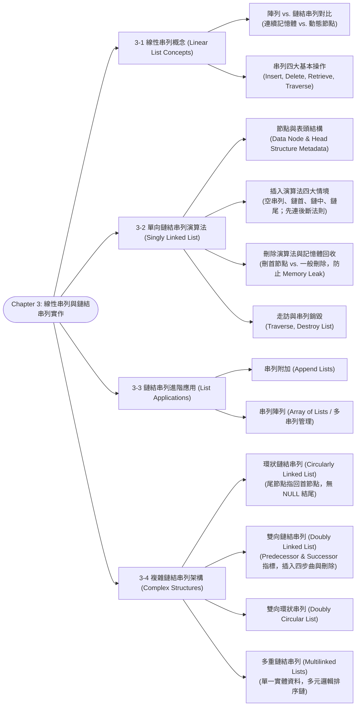

# Chapter 3: Linear Lists & Linked List Implementations

> 📚 **課程名稱**：資料結構 (Data Structures)
> 📖 **對應章節**：Chapter 3 Linked Lists (Linear List Concepts ~ Complex Linked List Structures)
> 👨‍🏫 **授課教師**：Kuen-Liang Sue (NCU IM)
> 📄 **參考講義**：[DS_Ch3.pdf](file:///c:/Users/Cupid/Downloads/Study-space/Reference/NCU_Classes/資料結構/DS_Ch3.pdf)
> 🔖 **先修觀念**：[Chapter 1 ADT 模型與 C++ 樣板](./Chapter_1_教材.md)、[Chapter 2 搜尋演算法](./Chapter_2_教材.md)、C/C++ 動態記憶體配置（`new`/`delete`, `malloc`/`free`）與指標運算

---

## 🗺️ 知識架構心智圖 (Mermaid Tree Diagram)



<a id="tree-diagram"></a>

### 🎯 本章學習進度檢核 (完成後打勾，建立成就反饋)

- [ ] [3-1 線性串列概念 (Linear List Concepts)](#sec-1)
- [ ] [3-2 單向鏈結串列演算法 (Singly Linked List)](#sec-2)
- [ ] [3-3 鏈結串列進階應用 (List Applications)](#sec-3)
- [ ] [3-4 複雜鏈結串列架構 (Complex Structures)](#sec-4)

---

## 📖 核心觀念與理論精解

<a id="sec-1"></a>

### 3-1 線性串列 (Linear Lists) 與實作架構對比

線性串列（Linear List）是由 $n \ge 0$ 個具有相同型態的資料元素組成的有限序列：$(a_1, a_2, \dots, a_n)$。其主要實作架構包含**連續儲存（陣列 Array）**與**鏈結儲存（鏈結串列 Linked List）**。

#### 1. 陣列 vs. 鏈結串列本質特性比較

| 評估維度                   | 循序陣列 (Array)                                                                    | 鏈結串列 (Linked List)                            |
| :------------------------- | :---------------------------------------------------------------------------------- | :------------------------------------------------ |
| **記憶體配置方式**   | 靜態配置或固定連續記憶體區塊                                                        | 動態分散配置（Dynamic Allocation，堆積區 Heap）   |
| **隨機存取能力**     | 支援常數時間隨機存取：$O(1)$ (`list[i]`) | 不支援隨機存取，需循序走訪：$O(n)$ |                                                   |
| **插入與刪除節點**   | 需大量搬移後續元素：$O(n)$                                                        | 僅需調整相鄰指標：已知位置下為$O(1)$            |
| **記憶體利用彈性**   | 固定容量，容易溢位（Overflow）或浪費空間                                            | 隨插隨配、隨刪隨釋，大小動態調整                  |
| **額外空間開銷**     | 零額外空間（純儲存資料欄位）                                                        | 每個節點均需額外負擔指標（`link/next`）空間開銷 |
| **CPU Cache 局部性** | 高（空間局部性 Spatial Locality 優異）                                              | 低（節點位址分散，Cache Miss 機率高）             |

#### 2. 線性串列的四大基本操作

1. **插入 (Insertion)**：在串列特定位置加入新節點，並維持其邏輯順序（有序串列維持順序；無序串列通常插入前端或尾端）。
2. **刪除 (Deletion)**：從串列中移除指定節點，並重新接合前後中斷的鏈結，同時釋放記憶體。
3. **檢索 (Retrieval)**：尋找特定鍵值的節點並傳回其資料複本，**但不改變串列結構**。
4. **走訪 (Traversal)**：依序訪問串列中的每一個節點恰好一次，並對每個節點執行特定操作（如列印、計數、批次更新）。

---

<a id="sec-2"></a>

### 3-2 單向鏈結串列 (Singly Linked List) 演算法精解

#### 1. 資料節點與表頭結構 (Head Node Structure)

* **資料節點 (Data Node)**：

  ```cpp
  template <class TYPE>
  struct Node {
      TYPE data;
      Node<TYPE>* next;
  };
  ```

* **表頭結構 (Head Structure Metadata)**：
  為了強化 ADT 的管理效能，現代實作常設計獨立的 Head Structure，內含元數據：

  * `count`：記錄目前串列中的節點總數（使取得串列長度由 $O(n)$ 降為 $O(1)$）。
  * `head`：指向串列第一個節點的指標。
  * `rear` / `tail`（可選）：指向串列最後一個節點的指標（使尾端插入由 $O(n)$ 降為 $O(1)$）。

```
        Head Structure                    Data Nodes
     ┌──────────────────┐           ┌──────────────┐     ┌──────────────┐
     │ count: 2         │     ┌────>│ data: "A"    │┌───>│ data: "B"    │
     │ head:  ──────────┼─────┘     │ next: ───────┼┘    │ next: NULL   │
     └──────────────────┘           └──────────────┘     └──────────────┘
```

#### 2. 插入節點演算法四大情境與「先連後斷」黃金法則

給定待插入的新節點指標 `pNew`，以及由搜尋演算法定位出的前驅指標 `pPre`：

##### 核心法則：先連後斷（Prevent Memory Leak & Lost Link）

> ⚠️ **死記鐵律**：永遠必須**先讓新節點的指標指向後續節點**，確認鏈結安全後，**再將前驅節點的指標改指向新節點**！若順序顛倒，後續整個鏈結串列將永遠遺失在記憶體中（造成致命 Memory Leak）！

1. **情境一：插入空串列 (Insert into Empty List)**
   * `pNew->next = NULL;`
   * `list->head = pNew;`
2. **情境二：插入串列首端 (Insert at Beginning)**
   * `pNew->next = list->head;`
   * `list->head = pNew;`
   * *注意：邏輯上，插入空串列可完美歸納為「插入首端」的特例！*
3. **情境三：插入串列中間 (Insert in Middle)**
   * `pNew->next = pPre->next;`
   * `pPre->next = pNew;`
4. **情境四：插入串列尾端 (Insert at End)**
   * 若無尾指標，`pPre` 即為尾節點（`pPre->next == NULL`）。
   * `pNew->next = NULL;`（亦即 `pNew->next = pPre->next`）。
   * `pPre->next = pNew;`
   * *注意：程式碼完全與情境三相同！*

#### 3. 刪除節點演算法情境

給定欲刪除的節點指標 `pCur`，以及其前驅指標 `pPre`：

1. **情境一：刪除首節點 (Delete First Node / `pPre == NULL`)**
   * `list->head = pCur->next;`
   * `delete pCur;`（或回收至記憶體池）
   * *若串列只有一個節點，刪除後 `list->head` 自動變為 `NULL`，邏輯完全一致！*
2. **情境二：一般刪除（刪除中間或末端節點 / `pPre != NULL`）**
   * `pPre->next = pCur->next;`
   * `delete pCur;`

#### 4. 串列銷毀 (Destroy List)

當 ADT 物件生命週期結束時，必須釋放動態記憶體。不能只將 `head = NULL`，必須使用暫存指標逐一走訪釋放：

```cpp
void destroyList(Node*& head) {
    Node* pCur = head;
    while (pCur != NULL) {
        Node* pTemp = pCur;
        pCur = pCur->next;
        delete pTemp;
    }
    head = NULL;
}
```

---

<a id="sec-3"></a>

### 3-3 鏈結串列進階應用 (List Applications)

#### 1. 串列附加 (Append Lists)

* **任務**：將串列 $L_2$ 整體接續在串列 $L_1$ 的尾端，形成單一串列。
* **演算法步驟**：
  1. 若 $L_1$ 為空，直接將 $L_1$ 的表頭指標指向 $L_2$ 的首節點。
  2. 若 $L_1$ 非空，巡訪 $L_1$ 直到其最後一個節點（其 `next == NULL`）。
  3. 將該節點的 `next` 賦值為 $L_2$ 的首節點。
  4. 更新 $L_1$ 的 `count = L_1->count + L_2->count`。
  5. 將 $L_2$ 表頭的 `head` 設為 `NULL`，防止重複釋放。
* **時間複雜度**：若無尾指標，需走訪 $L_1$，耗時 $O(\text{length}(L_1))$；若維護有尾指標 `rear`，僅需 $O(1)$！

#### 2. 串列陣列 (Array of Lists)

* **概念**：建立一個元素型態為「鏈結串列表頭指標」的一維陣列：`Node<TYPE>* listArray[MAX_CLASS];`。
* **應用場景**：
  * 全校班級名冊：陣列索引代表班級編號，每個陣列槽位指向該班級的學生鏈結串列。
  * 雜湊表鏈結法 (Separate Chaining)：雜湊表主陣列即為典型串列陣列。

---

<a id="sec-4"></a>

### 3-4 複雜鏈結串列結構 (Complex Linked List Structures)

#### 1. 環狀鏈結串列 (Circularly Linked List)

* **結構特點**：普通單向串列的最後一個節點指向 `NULL`；環狀串列的**最後一個節點的 `next` 指向第一個節點（或表頭節點）**。
* **核心優勢**：
  * **全覆蓋巡訪**：從串列中的**任何一個節點出發**，都能沿著指標走訪到串列中的所有其他節點。
  * **高效率雙端存取**：若外部僅維護一個**尾指標 `rear`**（指向最後一個節點）：
    * 取得尾節點：`rear`（時間 $O(1)$）。
    * 取得首節點：`rear->next`（時間 $O(1)$）。
    * 尾端插入與首端插入均可在 $O(1)$ 時間內完成！

```
                      ┌─────────────────────────────────┐
                      │                                 ▼
                 ┌──────────┐     ┌──────────┐     ┌──────────┐
      rear ─────>│ data: 30 │     │ data: 10 │<────│ data: 20 │
                 │ next: ───┼────>│ next: ───┼────>│ next: ───┼──┐
                 └──────────┘     └──────────┘     └──────────┘  │
                      ▲                                          │
                      └──────────────────────────────────────────┘
```

#### 2. 雙向鏈結串列 (Doubly Linked List)

* **節點結構**：每個節點均包含兩個指標欄位：
  * `prev`（或 `back`）：指向直接前驅節點（Predecessor）。
  * `next`（或 `fore`）：指向直接後繼節點（Successor）。
* **表頭結構元數據**：包含 `count`、`head`、`rear`。

```cpp
struct DNode {
    TYPE data;
    DNode* prev;
    DNode* next;
};
```

##### 雙向鏈結串列插入四部曲 (Double Linked Insert)

要在前驅節點 `pPre` 與後繼節點 `pSucc` 之間插入新節點 `pNew`：

```cpp
// 步驟 1: 新節點向右連
pNew->next = pSucc;
// 步驟 2: 新節點向左連
pNew->prev = pPre;
// 步驟 3: 前驅節點向右連新節點
if (pPre != NULL)
    pPre->next = pNew;
else
    list->head = pNew; // 插入首端特例
// 步驟 4: 後繼節點向左連新節點
if (pSucc != NULL)
    pSucc->prev = pNew;
else
    list->rear = pNew; // 插入尾端特例
```

##### 雙向鏈結串列刪除兩部曲 (Double Linked Delete)

給定欲刪除的節點 `pCur`：

```cpp
// 步驟 1: 前驅節點跨過 pCur 指向後繼
if (pCur->prev != NULL)
    pCur->prev->next = pCur->next;
else
    list->head = pCur->next; // 刪除首節點特例

// 步驟 2: 後繼節點跨過 pCur 指向前驅
if (pCur->next != NULL)
    pCur->next->prev = pCur->prev;
else
    list->rear = pCur->prev; // 刪除尾節點特例

// 步驟 3: 釋放節點記憶體
delete pCur;
```

#### 3. 雙向環狀串列 (Doubly Circularly Linked List)

* 首節點的 `prev` 指向尾節點；尾節點的 `next` 指向首節點。
* 不存在任何 `NULL` 指標，邊界處理極度對稱優雅。

#### 4. 多重鏈結串列 (Multilinked Lists)

* **核心哲學**：**資料實體只存放一份，但節點中擁有多組獨立的指標欄位**。
* **應用價值**：
  * 允許同一組資料集合以**多種不同的邏輯順序**進行高效率巡訪。
  * 例如：大學生註冊系統中，每個節點包含學生基本資料，以及兩組指標：
    * `nextByID`：依學號排序的鏈結串列。
    * `nextByGPA`：依學業成績排序的鏈結串列。
  * 避免了複製多份龐大資料所造成的記憶體膨脹與「資料不一致（Data Inconsistency）」風險！

---

## 💻 經典範例與演算詳解

<a id="sec-5"></a>

### 範例：單向鏈結串列反轉 (Reverse a Singly Linked List)

給定一個單向鏈結串列的表頭指標 `head`，就地（In-place）將其反轉，空間複雜度必須為 $O(1)$。

```cpp
// Algorithm: ReverseLinkedList
// Pre: head 指向串列首節點; Post: 回傳反轉後的全新首節點
Node* reverseList(Node* head) {
    Node* pPre = NULL;
    Node* pCur = head;
    Node* pNext = NULL;
  
    while (pCur != NULL) {
        pNext = pCur->next; // 1. 先暫存下一個節點，防止斷鏈
        pCur->next = pPre;  // 2. 將當前節點指針轉向，指向前驅節點
        pPre = pCur;        // 3. 前驅指標前移
        pCur = pNext;       // 4. 當前指標前移
    }
    return pPre; // pPre 最終即為反轉後的全新表頭
}
```

* **分析**：僅巡訪串列一次，時間複雜度為 $O(n)$，僅耗費三個輔助指標變數，空間複雜度為嚴格 $O(1)$。

---

## 📝 實戰練習題 (三層遞進式強化測驗)

### 🟢 Tier 1：必懂基礎 (Must-Know Fundamentals)

> 💡 **學習目標**：確認自己「會算、會辨識」——給數字就能做對、給名稱就能配對。

<a id="q1"></a>

#### Q1. (基礎指標操作) 單向鏈結串列節點插入

在單向鏈結串列（Singly Linked List）中，若已知前驅節點指標為 `pPre`，欲在其後方插入一個新節點 `pNew`。下列何組 C++ 指標指派順序能正確完成插入且**絕對不會造成記憶體斷鏈**？

(A) `pPre->next = pNew;` 然後 `pNew->next = pPre->next;`
(B) `pNew->next = pPre->next;` 然後 `pPre->next = pNew;`
(C) `pNew->next = pPre;` 然後 `pPre = pNew;`
(D) `pPre = pNew;` 然後 `pNew->next = pPre->next;`

👉 [查看 Q1 答案與詳細解析](#ans-q1)

---

<a id="q2"></a>

#### Q2. (基礎指標操作) 單向串列首節點刪除

設 `head` 為指向單向鏈結串列第一個節點的指標。欲正確刪除第一個節點並妥善釋放其動態記憶體（防止 Memory Leak），下列操作步驟順序何者正確？

(A) `delete head;` 然後 `head = head->next;`
(B) `head = head->next;` 然後 `delete head;`
(C) `Node* pDel = head; head = head->next; delete pDel;`
(D) `head->next = nullptr; delete head;`

👉 [查看 Q2 答案與詳細解析](#ans-q2)

---

<a id="q3"></a>

#### Q3. (基礎結構特徵) 環狀鏈結串列 (Circular Linked List) 終端辨識

在傳統單向環狀鏈結串列中，走訪串列時判斷是否已經回到首節點（或串列結尾）的終止條件為何？

(A) 當前節點的 `next == nullptr`
(B) 當前節點的 `next == head`
(C) 當前節點的資料欄位為 0
(D) 當前節點的 `prev == nullptr`

👉 [查看 Q3 答案與詳細解析](#ans-q3)

---

<a id="q4"></a>

#### Q4. (基礎複雜度計算) 首指標 vs. 尾指標的操作複雜度

某單向鏈結串列包含 $n$ 個節點：
(1) 若外部**僅維護一個首指標 `head`**，在串列尾端插入一個新節點的時間複雜度為何？
(2) 若外部**同時維護首指標 `head` 與尾指標 `rear`**，在串列尾端插入一個新節點的時間複雜度為何？

(A) (1) $O(1)$, (2) $O(1)$
(B) (1) $O(n)$, (2) $O(1)$
(C) (1) $O(n)$, (2) $O(n)$
(D) (1) $O(1)$, (2) $O(n)$

👉 [查看 Q4 答案與詳細解析](#ans-q4)

---

<a id="q5"></a>

#### Q5. (基礎雙向指標操作) 雙向鏈結串列插入四部曲

在雙向鏈結串列（Doubly Linked List）中，欲在前驅節點 `pPre` 與後繼節點 `pSucc` 之間插入新節點 `pNew`。依據「先連後斷（先設定新節點兩側指標，再修改相鄰舊節點指標）」原則，下列哪一步驟**屬於錯誤或危險的指派**？

(A) `pNew->prev = pPre;`
(B) `pNew->next = pSucc;`
(C) `pPre->next = pSucc;`
(D) `pPre->next = pNew;`

👉 [查看 Q5 答案與詳細解析](#ans-q5)

---

### 🟡 Tier 2：基礎 + 實際應用 (Application & Scenario Matching)

> 💡 **學習目標**：確認自己「會用」——能辨別錯誤順序的後果、在不同場景選擇最適串列架構。

<a id="q6"></a>

#### Q6. (陷阱順序辨析) 違反「先連後斷」的後果分析

某初學者在撰寫單向串列插入演算法時，誤將指標指派順序寫反：

```cpp
// 欲在 pPre 後方插入 pNew
pPre->next = pNew;         // Step 1
pNew->next = pPre->next;   // Step 2
```

請問執行這兩行程式碼後，會造成下列哪種災難性後果？

(A) 程式在編譯時期直接報錯，無法編譯
(B) `pNew` 會形成「指向自己的無限自環（Self-loop）」，且原本 `pPre` 後方的整個子串列徹底斷鏈並造成記憶體洩漏
(C) `pNew` 成功插入，但 `pPre` 的資料被覆蓋
(D) 串列反轉，`pNew` 變成了第一個節點

👉 [查看 Q6 答案與詳細解析](#ans-q6)

---

<a id="q7"></a>

#### Q7. (實戰架構選型) 環狀串列中 `rear` 指標的壓倒性優勢

在實作佇列（Queue，先進先出 FIFO）時，如果採用單向環狀鏈結串列實作，軟體架構師通常「**僅維護一個指向最後節點的 `rear` 指標**」，而不需要額外維護指向第一個節點的 `front` 指標。其最關鍵的實務理由為何？

(A) 因為維護兩個指標會消耗雙倍的 CPU 運算時間
(B) 因為透過 `rear` 可以 $O(1)$ 時間存取尾端，且透過 `rear->next` 也能以 $O(1)$ 時間直接存取首端節點
(C) 因為環狀串列不允許存在兩個外部指標
(D) 因為只有單一指標才能避免死結 (Deadlock)

👉 [查看 Q7 答案與詳細解析](#ans-q7)

---

<a id="q8"></a>

#### Q8. (多重鏈結應用情境) 多重鏈結串列 (Multilinked Lists) 的適用場景

大學教務處需要管理 10,000 名學生的資料，並且需要頻繁支援以下兩種操作：

1. 依照「學號」由小到大順序循序列印全體名冊。
2. 依照「總成績」由高到低順序循序列印獎學金名冊。
   若要求記憶體中「每位學生的基本資料（姓名、地址等）僅能儲存一份」，且不希望在每次列印前重新執行昂貴的排序演算法，應採用何種資料結構架構？

(A) 兩個完全獨立的動態陣列，資料複製兩份
(B) 單向環狀鏈結串列搭配二分搜尋
(C) 多重鏈結串列（Multilinked List），每個學生節點包含一份資料實體與兩組指標：`nextByID` 與 `nextByGrade`
(D) 靜態固定長度陣列搭配取模雜湊法

👉 [查看 Q8 答案與詳細解析](#ans-q8)

---

<a id="q9"></a>

#### Q9. (邊界防禦程式碼) 雙向串列刪除的 Null 指標陷阱

考慮雙向鏈結串列節點 `pLoc` 的刪除操作，標準邏輯如下：

```cpp
pLoc->prev->next = pLoc->next;
pLoc->next->prev = pLoc->prev;
delete pLoc;
```

若被刪除的節點 `pLoc` 恰好是「**串列中的最後一個節點**」，執行上述程式碼會發生什麼嚴重錯誤？

(A) 邏輯完全正常，能順利刪除
(B) 在執行 `pLoc->next->prev` 時會因為解引用空指標（Null Pointer Dereference）而導致程式崩潰 (Segmentation Fault)
(C) 串列會變成環狀串列
(D) 會刪除到前一個節點

👉 [查看 Q9 答案與詳細解析](#ans-q9)

---

### 🔴 Tier 3：概念講述與深度分析 (Conceptual & Analytical)

> 💡 **學習目標**：確認自己「會講」——能精確推導演算法歷程、論述虛擬頭節點設計哲學與快取架構取捨。

<a id="q10"></a>

#### Q10. (演算法推導題) 單向鏈結串列就地反轉 (In-place Reversal)

給定一單向鏈結串列的首節點指標 `head`，要求在不配置額外節點空間的前提下（即空間複雜度為 $O(1)$），將整條串列方向就地反轉：
(1) 請以 C++ 虛擬碼寫出使用三指標（`pPre`、`pCurr`、`pNext`）的反轉迴圈核心邏輯。
(2) 請詳細說明在迴圈的單一輪迭代中，指標如何一步一步轉移，並說明迴圈終止時新的首指標是哪一個指標變數。

👉 [查看 Q10 答案與詳細解析](#ans-q10)

---

<a id="q11"></a>

#### Q11. (架構設計哲學) 虛擬表頭節點 (Dummy Head Node / Sentinel) 的工程效益

在 Linux 核心原始碼（如 `list_head`）或現代資料結構程式庫中，幾乎所有鏈結串列實作皆強制採用「虛擬表頭節點（Dummy Head / Sentinel Node）」：
(1) 試論述虛擬頭節點在軟體架構層面，消除了哪些繁瑣的特殊邊界情況（Edge Cases）判斷？
(2) 請分別以「在首端插入新節點」為例，展示有 Dummy Head 與無 Dummy Head 時，演算法邏輯複雜度的對比差異。

👉 [查看 Q11 答案與詳細解析](#ans-q11)

---

<a id="q12"></a>

#### Q12. (系統效能論述題) 動態陣列 (Vector) vs. 鏈結串列 (Linked List) 的現代硬體效能評估

在傳統演算法教科書中，常標榜「鏈結串列在任意位置插入元素只需 $O(1)$，優於動態陣列的 $O(n)$」。然而在現代 CPU 硬體架構下，即使需要頻繁在中間插入資料，工程師也極少使用 Linked List，絕大多數情況下動態陣列（如 C++ `std::vector`）的效能反而大幅超越鏈結串列。
請從 **CPU 快取行（Cache Line & Locality）**、**分支預測（Branch Prediction）** 與 **記憶體分配器開銷（Heap Allocation & Memory Fragmentation）** 三個底層維度，深入闡述箇中原委。

👉 [查看 Q12 答案與詳細解析](#ans-q12)

---

## 🔑 本章練習題答案與詳細解析 (Answer Key)

### 🟢 Tier 1 解析

<a id="ans-q1"></a>

### Q1 答案與詳細解析

* **正確答案**：**(B)**
* **解析**：
  * **先連後斷黃金法則**：
    1. 第一步：先將新節點的 `next` 接上原本後方的節點：`pNew->next = pPre->next;`
    2. 第二步：再將前驅節點的 `next` 轉向新節點：`pPre->next = pNew;`
  * **錯誤選項辨析**：
    * 選項 (A)：若先執行 `pPre->next = pNew`，則原本指向後續節點的指標直接被覆蓋丟失，此時再執行 `pNew->next = pPre->next` 只會讓 `pNew` 指向自己，造成後方串列永遠失聯（Memory Leak）！

[🔙 返回題目 Q1](#q1) ｜ [🔝 返回知識架構圖](#tree-diagram)

---

<a id="ans-q2"></a>

### Q2 答案與詳細解析

* **正確答案**：**(C)**
* **解析**：
  * 刪除首節點必須有暫存指標（如 `pDel`）記住要刪除的記憶體位址，否則一旦 `head = head->next`，原本首節點的位址就找不回來了，無法釋放記憶體。
  * 若先 `delete head;`（選項 A），則 `head` 內部成員已遭破壞，再去讀取 `head->next` 是未定義行為（Use-After-Free）。
  * 正確三步：暫存首節點 → 首指標後移 → 釋放暫存節點。選項 (C) 完全正確。

[🔙 返回題目 Q2](#q2) ｜ [🔝 返回知識架構圖](#tree-diagram)

---

<a id="ans-q3"></a>

### Q3 答案與詳細解析

* **正確答案**：**(B)**
* **解析**：
  * 環狀鏈結串列（Circular Linked List）的結構特性是**不存在任何節點的 `next` 為 `nullptr`**。
  * 最後一個節點的 `next` 會重新繞回指向首節點 `head`。因此巡迴走訪時，終止或換圈的判斷條件為 `p->next == head`。

[🔙 返回題目 Q3](#q3) ｜ [🔝 返回知識架構圖](#tree-diagram)

---

<a id="ans-q4"></a>

### Q4 答案與詳細解析

* **正確答案**：**(B)**
* **解析**：
  * (1) 僅有 `head`：必須從第 1 個節點開始往後遍歷走訪 $n-1$ 步抵達尾端，才能修改尾節點的 `next` 指標，耗時與 $n$ 成正比，為 **$O(n)$**。
  * (2) 擁有 `rear`：可直接透過 `rear->next = pNew; rear = pNew;` 在常數時間內完成尾端插入，為 **$O(1)$**。

[🔙 返回題目 Q4](#q4) ｜ [🔝 返回知識架構圖](#tree-diagram)

---

<a id="ans-q5"></a>

### Q5 答案與詳細解析

* **正確答案**：**(C)**
* **解析**：
  * 雙向鏈結串列插入四部曲：
    1. `pNew->prev = pPre;`（建立新節點前向指標）
    2. `pNew->next = pSucc;`（建立新節點後向指標）
    3. `pPre->next = pNew;`（前驅節點接上新節點）
    4. `pSucc->prev = pNew;`（後繼節點接上新節點）
  * 選項 (C) `pPre->next = pSucc;` 是節點刪除時跳過新節點的動作，出現在插入邏輯中完全錯誤。

[🔙 返回題目 Q5](#q5) ｜ [🔝 返回知識架構圖](#tree-diagram)

---

### 🟡 Tier 2 解析

<a id="ans-q6"></a>

### Q6 答案與詳細解析

* **正確答案**：**(B)**
* **深入剖析**：
  * 執行 Step 1 `pPre->next = pNew;`：此時 `pPre` 的後繼指標改為指向 `pNew`。注意：**原本 `pPre` 後方節點的位址在此時已經沒有任何指標指著它了！**
  * 執行 Step 2 `pNew->next = pPre->next;`：因為前一步已將 `pPre->next` 設為 `pNew`，所以等價於 `pNew->next = pNew;`。
  * 結果：`pNew` 的 `next` 指向自己形成死循環；後續全部節點失去進入點，造成嚴重的孤兒節點記憶體洩漏。

[🔙 返回題目 Q6](#q6) ｜ [🔝 返回知識架構圖](#tree-diagram)

---

<a id="ans-q7"></a>

### Q7 答案與詳細解析

* **正確答案**：**(B)**
* **實務架構分析**：
  * 環狀串列最後一個節點的 `next` 指向第一個節點。
  * 若我們維護 `rear` 指標：
    * 尾端節點 = `rear`（存取時間 $O(1)$）
    * 首端節點 = `rear->next`（存取時間 $O(1)$）
  * 如此一來，僅需維護單一指標 `rear`，便同時獲得了「快速存取尾端（Enqueue 入列）」與「快速存取首端（Dequeue 出列）」的全部能力！
  * 反之，若只維護 `front`，找尾端必須繞一整圈 $n$ 步（耗時 $O(n)$）。因此實作佇列時「只留 rear」是標準且高效的業界設計模式。

[🔙 返回題目 Q7](#q7) ｜ [🔝 返回知識架構圖](#tree-diagram)

---

<a id="ans-q8"></a>

### Q8 答案與詳細解析

* **正確答案**：**(C)**
* **實戰場景分析**：
  * **多重鏈結串列 (Multilinked List)** 的定義：同一個節點包含多組指針欄位，每個指針欄位各自將所有節點串連成不同的邏輯順序。
  * 每個學生節點實體僅在 Heap 配置一次（內含學生完整資料），節點內設計 `Node* nextByID;` 與 `Node* nextByGrade;`。
  * 建立資料時分別維護兩條鏈的有序插入，列印時只需依照對應指標巡迴走訪即可，既節省大量記憶體又免除動態排序開銷。

[🔙 返回題目 Q8](#q8) ｜ [🔝 返回知識架構圖](#tree-diagram)

---

<a id="ans-q9"></a>

### Q9 答案與詳細解析

* **正確答案**：**(B)**
* **底層崩潰剖析**：
  * 若 `pLoc` 是最後一個節點，則其 `pLoc->next` 為 `nullptr`。
  * 執行 `pLoc->next->prev` 相當於 `nullptr->prev`，這會觸發非法記憶體存取（Null Pointer Dereference），作業系統會立即對行程送出 SIGSEGV 信號並異常終止。
  * **防禦寫法**：必須判斷邊界：

    ```cpp
    if (pLoc->next != nullptr) {
        pLoc->next->prev = pLoc->prev;
    }
    ```

[🔙 返回題目 Q9](#q9) ｜ [🔝 返回知識架構圖](#tree-diagram)

---

### 🔴 Tier 3 解析

<a id="ans-q10"></a>

### Q10 答案與詳細解析

* **(1) C++ 虛擬碼核心邏輯**：

  ```cpp
  Node* reverseList(Node* head) {
      Node* pPre = nullptr;
      Node* pCurr = head;
      Node* pNext = nullptr;

      while (pCurr != nullptr) {
          pNext = pCurr->next;  // 1. 暫存原後繼節點，防止斷鏈
          pCurr->next = pPre;   // 2. 反轉當前節點指針，指向前驅
          pPre = pCurr;         // 3. pPre 前進至當前節點
          pCurr = pNext;        // 4. pCurr 前進至下一個待處理節點
      }
      return pPre;              // 5. 終止時 pPre 恰好指向新的首節點
  }
  ```

* **(2) 推導與狀態轉移分析**：

  * 初始時 `pPre = nullptr`（保證原首節點反轉後其 `next` 變為 `nullptr` 成為尾節點）。
  * 每一輪迭代精確執行四步轉移：**暫存後繼 → 轉向反接 → 前驅步進 → 當前步進**。
  * 當 `pCurr` 抵達原本串列尾端的 `nullptr` 時迴圈終止，此時 `pPre` 正好停留在原本的最後一個節點上，它就是反轉後的全新首節點，直接回傳 `pPre`。
  * 全程僅動態使用三個指針變數，輔助空間複雜度嚴格為 **$O(1)$**，時間複雜度為 **$O(n)$**。

[🔙 返回題目 Q10](#q10) ｜ [🔝 返回知識架構圖](#tree-diagram)

---

<a id="ans-q11"></a>

### Q11 答案與詳細解析

* **(1) 消除邊界特殊情況 (Edge Cases)**：

  * **無 Dummy Head 的困境**：串列可能為空（`head == nullptr`）；在首端插入或刪除首節點時，必須修改外部變數 `head` 本身；而在中間或尾端操作時，修改的是內部節點的 `next` 欄位。這迫使每一段插入/刪除函式開頭都必須寫 `if (head == nullptr)` 或 `if (pLoc == head)` 的特殊分支。
  * **有 Dummy Head 的優勢**：串列永遠至少有一個節點（即 Dummy Head，不儲存有效資料），`head` 指標永遠不會改變。所有的首端插入等價於「在 Dummy 節點之後插入」，完全統一為一般節點的插入邏輯，徹底消滅條件判斷分支！
* **(2) 首端插入程式碼對比**：

  * **無 Dummy Head（需特判分支）**：

    ```cpp
    void insertFront(Node*& head, int val) {
        Node* pNew = new Node(val);
        if (head == nullptr) {
            head = pNew;
        } else {
            pNew->next = head;
            head = pNew;
        }
    }
    ```

  * **有 Dummy Head（無條件統一為兩行）**：

    ```cpp
    void insertFront(Node* dummyHead, int val) {
        Node* pNew = new Node(val);
        pNew->next = dummyHead->next;
        dummyHead->next = pNew;
    }
    ```

[🔙 返回題目 Q11](#q11) ｜ [🔝 返回知識架構圖](#tree-diagram)

---

<a id="ans-q12"></a>

### Q12 答案與詳細解析

* **(1) CPU 快取行與局部性 (Cache Locality)**：

  * 現代 CPU 存取 L1 Cache 需約 1 ns，而存取主記憶體（DRAM）需約 50~100 ns。
  * 動態陣列（Vector）佔用連續記憶體。當讀取第 1 個元素時，CPU 晶片自動將連續的 64-byte Cache Line（約 16 個整數）預先快取進 L1/L2。走訪陣列幾乎是 $100\%$ Cache Hit。
  * 鏈結串列節點是由作業系統隨機分配在堆疊（Heap）的各個角落。走訪下一個節點意味著讀取任意指標位址，會引發連續的 **Cache Miss（快取不命中）**，迫使 CPU 頻繁停頓（Pipeline Stall）等待記憶體載入。
* **(2) 記憶體搬移 vs. 節點分配開銷**：

  * 雖然 Vector 在中間插入需要搬移元素，但現代 CPU 擁有極其強大的向量指令集（如 `memmove` / AVX-512），搬移數千個位元組只需幾十個奈秒。
  * 相比之下，Linked List 插入節點必須呼叫 `malloc` / `new` 向作業系統核心索取記憶體，涉及 Heap 鎖競爭與記憶體池演算法，單次分配耗時往往就已超過 Vector 整段記憶體搬移的時間。
* **(3) 記憶體開銷與碎片化**：

  * 鏈結串列中每個節點都要額外儲存 8 bytes 指針（若為雙向串列則需 16 bytes），加上 Heap 分配器的 8~16 bytes 區塊標頭（Chunk Header），儲存一個 4 bytes 整數可能需要消耗 32 bytes 記憶體，有效載荷率僅 $12.5\%$，且會造成嚴重的記憶體碎片化。因此在現代高效能系統中，連續記憶體結構（如 Vector）幾乎完勝 Linked List。

[🔙 返回題目 Q12](#q12) ｜ [🔝 返回知識架構圖](#tree-diagram)

---

## 📊 重點速記表 (Summary Table)

| 串列型態                             | 結構定義與特徵                |             尾端插入時間             |     首端插入時間     | 隨機存取時間 | 典型應用場景                        |
| :----------------------------------- | :---------------------------- | :-----------------------------------: | :------------------: | :----------: | :---------------------------------- |
| **陣列 (Array)**               | 連續記憶體配置                |           $O(1)$ (未滿時)           |  $O(n)$ (需後移)  |   $O(1)$   | 資料量固定、頻繁隨機查詢            |
| **單向鏈結串列 (Singly)**      | 單一`next` 指針，尾指 NULL  | $O(n)$ (無rear) / $O(1)$ (有rear) |       $O(1)$       |   $O(n)$   | 頻繁動態增刪、大小未知              |
| **環狀鏈結串列 (Circular)**    | 尾節點`next` 指回首節點     |         $O(1)$ (維護 rear)         | $O(1)$ (維護 rear) |   $O(n)$   | 輪詢調度 (Round Robin)、緩衝區      |
| **雙向鏈結串列 (Doubly)**      | 具備`prev` 與 `next` 指標 |         $O(1)$ (維護 rear)         |       $O(1)$       |   $O(n)$   | 瀏覽器上一頁/下一頁、文字編輯器游標 |
| **多重鏈結串列 (Multilinked)** | 單一資料實體，多組指標欄位    |            相依於各排序鏈            |    相依於各排序鏈    |   $O(n)$   | 多鍵值索引系統、學生學籍管理        |

---

## 🗂️ 考前速查卡片 (Flashcards)

<div style="display: grid; grid-template-columns: repeat(auto-fit, minmax(280px, 1fr)); gap: 1rem;">

---

## ⚠️ 考試常見陷阱題 (Common Traps)

1. **陷阱一：指標連線順序寫反導致全串列遺失**
   * *錯誤示範*：`pPre->next = pNew; pNew->next = pPre->next;`
   * *防坑秘笈*：一旦先覆寫 `pPre->next`，後續節點記憶體位址就永遠找不回來了。記住：新節點先抓住下家，上家再抓住新節點！
2. **陷阱二：刪除首節點時先 delete 再取 next**
   * *錯誤示範*：`delete head; head = head->next;`
   * *防坑秘笈*：釋放後的指標不可再做成員存取（Segmentation fault）。必須用臨時指標 `pTemp = head; head = head->next; delete pTemp;`。
3. **陷阱三：雙向串列首尾刪除未判斷 NULL 引發當機**
   * *防坑秘笈*：考試手寫題務必檢查 `pCur->prev != NULL` 與 `pCur->next != NULL`，並妥善處理 `list->head` 與 `list->rear` 的更新。
4. **陷阱四：環狀串列走訪終止條件寫成 `p != NULL`**
   * *錯誤示範*：環狀串列中永遠沒有 NULL，寫 `while(p != NULL)` 會陷入無限死迴圈！
   * *防坑秘笈*：終止條件應以走回起始節點為判定（如 `do { p = p->next; } while (p != head);`）。

---

## 🔗 相關章節索引與導航

* 🔙 **上一章節**：[Chapter 2: 搜尋演算法與雜湊技術](./Chapter_2_教材.md)
* 🔙 **課程教材總覽**：[資料結構教材目錄 (_INDEX.md)](./_INDEX.md)
* 📂 **原始講義檔案**：[DS_Ch3.pdf](file:///c:/Users/Cupid/Downloads/Study-space/Reference/NCU_Classes/資料結構/DS_Ch3.pdf)
