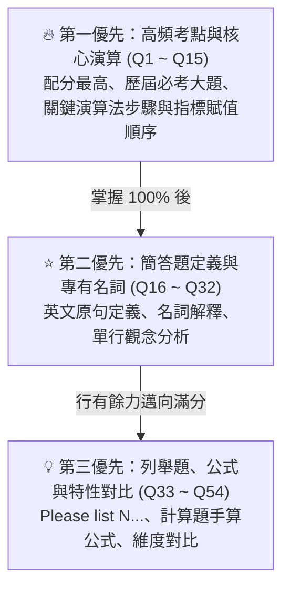

# 資料結構 (Data Structures) 期中複習與背誦教材指引

本目錄收錄中央大學資工系／軟體工程所「**資料結構 (Data Structures)**」期中考必背知識體系、主動回想背誦表（Active Recall Sheet）以及各章節精析筆記。

---

## 📂 檔案清單與功能說明

| 檔案名稱 | 格式 | 用途說明 | 建議使用時機 |
|:---|:---:|:---|:---|
| [**DS_期中背誦表.html**](./DS_期中背誦表.html) | HTML | **互動式主動回想網頁**。支援「遮住答案」、「標記背熟」、「進度百分比」、「章節篩選」與「全文即時搜尋」（含講義出處關鍵字搜尋）。所有打勾狀態自動存於瀏覽器 LocalStorage。 | 上機衝刺、考前 3 天自我默背檢驗 |
| [**DS_期中背誦表.md**](./DS_期中背誦表.md) | Markdown | **Obsidian / 離線閱讀完整背誦表**。內建目錄跳轉（TOC）、54 題總覽索引表、講義精準頁碼出處、標準 C++ 虛擬碼高亮與 `<details>` 摺疊答案。 | 日常課堂複習、筆記整合、考前速查 |
| [**Chapter_1_教材.md**](./Chapter_1_教材.md) | Markdown | 第一章完整概念教材：演算法虛擬碼標準、ADT 概念、Big-O 數學定義與漸進分析、迴圈分析陷阱。 | 建立 Ch1 完整觀念架構 |
| [**Chapter_2_教材.md**](./Chapter_2_教材.md) | Markdown | 第二章完整概念教材：循序搜尋變形（哨兵／機率／有序）、二分搜尋法、8 大雜湊函式、碰撞處理與聚集分析。 | 深入研讀 Ch2 演算法與雜湊細節 |
| [**Chapter_3_教材.md**](./Chapter_3_教材.md) | Markdown | 第三章完整概念教材：線性串列 vs 鏈結串列、表頭結構、單向/雙向/環狀串列指標操作、Destroy List 等。 | 徹底搞懂指標賦值順序與圖解 |
| [**_INDEX.md**](./_INDEX.md) | Markdown | 課程教材總覽與章節導讀索引。 | 快速跳轉各單元教材 |

---

## 🎯 期中考考試範圍界定

依據課程授課進度與教授命題範圍：
- **Chapter 1**：全章完整範圍（投影片 Slide 1 ~ 50 / PDF 1 ~ 25 頁）。
- **Chapter 2**：全章完整範圍（投影片 Slide 1 ~ 98 / PDF 1 ~ 49 頁）。
- **Chapter 3**：讀至講義 Slide 65~67「**Destroy List**」（`DS_Ch3.pdf` PDF 第 33~34 頁）。
  - *註：Slide 68 之後的進階結構（單向環狀串列尾指標、雙向鏈結串列完整指標操作、多重鏈結串列）已於題目標註出處頁碼，若期末考或後續考試涵蓋可無縫複習。*

---

## 🧠 背誦表架構與三級優先級分流

背誦表遵循「**由重要度最高向次要逐步擴展**」的原則，全卷共收錄 **54 個核心考點**，分為三大優先級：



1. **第一優先 (Priority 1, 15 題)**：
   - 核心考點：單向鏈結串列插入「先連後斷」、雙向鏈結串列 4 步插入／刪除指標操作、雜湊取模除數必選質數原因、一次聚集 vs 二次聚集、鍵值位移（雙重雜湊）優勢、Big-O 數學定義、二分搜尋兩大嚴格前提、環狀串列單尾指標設計等。
2. **第二優先 (Priority 2, 17 題)**：
   - 核心考點：ADT 標準英文定義、資訊隱藏與封裝、結構化三要素、原子資料 vs 複合資料、合格虛擬碼標頭 5 元素、哨兵搜尋優點、機率搜尋、Home Address / Synonyms / Collision 定義、負載因子 α 公式、折疊法、平方取中法、有序搜尋提前終止條件等。
3. **第三優先 (Priority 3, 22 題)**：
   - 核心考點：良好命名禁忌與原則、程式典範演進歷史、矩陣相加 vs 相乘複雜度、8 種雜湊法名稱列舉、二次探測缺點、桶子雜湊機制、循序搜尋平均次數公式、旋轉法、數位擷取法、陣列 vs 鏈結串列 6 大維度對比、Destroy List 釋放細節等。

---

## 📍 講義精準出處標註規範

為確保考生研讀時「**每一題都有憑有據、可精確查證講義原文**」，所有題目皆嚴格附帶 `📍 講義出處` 資訊：

- **標準格式**：  
  `DS_Ch<章節>.pdf 投影片 Slide <投影片印出頁碼> (PDF p.<檔案頁碼>) [<章節小節 / 演算法名稱 / 圖表標號>]`
  - 範例：`DS_Ch3.pdf 投影片 Slide 32 (PDF p.16) [Add Node in Middle] & Slide 36 (PDF p.18) [Algorithm 3-1 Insert Node]`
- **課外延伸題特殊警示**：  
  凡非投影片直接收錄之延伸概念（例如 Q7 Tombstone 墓碑標記、Q13 單向鏈結串列三指標原地反轉），均加上 `⚠️【講義未收錄／課外延伸題】` 明確提示，防止考生因講義翻找不到而浪費複習時間。

---

## 💻 互動網頁版 (`DS_期中背誦表.html`) 使用指南

直接以任何現代瀏覽器（Chrome, Edge, Firefox, Safari）雙擊打開 `DS_期中背誦表.html` 即可使用：

1. **遮住答案 (Active Recall Mode)**：
   - 點擊頂端「**遮住答案**」按鈕，全卷答案將預設摺疊收合。點擊每張卡片或「點一下看答案」即可個別展開。
2. **背熟打勾 (Self-Check Progress)**：
   - 當某一題可在腦中流暢默背後，點擊卡片右上角的圓圈打勾。卡片將變為淺綠色，並即時更新頂端的背熟進度條（如 `42 / 54 背熟 (78%)`）。
3. **隱藏已背熟**：
   - 點擊「**隱藏已背熟**」，專注於尚未攻克的盲點題目，大幅節省考前最後衝刺時間。
4. **章節過濾**：
   - 點擊 `Ch1`、`Ch2`、`Ch3` 按鈕可迅速切換至單一章節複習。
5. **即時檢索**：
   - 搜尋框支援題目、答案與出處之全文比對。例如輸入 `Slide 32`、`Primary` 或 `質數` 即可秒速定位考點。

---

## 🛠️ 維護與重新生成腳本指南

本教材由獨立 Python 腳本動態生成，若日後題庫有增修，請依循以下步驟：

1. **腳本位置**：[`_Tools/generate_ds_recitation.py`](../../_Tools/generate_ds_recitation.py)
2. **重新編譯指令**：
   ```bash
   python _Tools/generate_ds_recitation.py
   ```
3. **產出成果**：
   - 自動同步更新 `Study_Materials/資料結構/DS_期中背誦表.html`
   - 自動同步更新 `Study_Materials/資料結構/DS_期中背誦表.md`（含目錄、索引表與精確出處）
