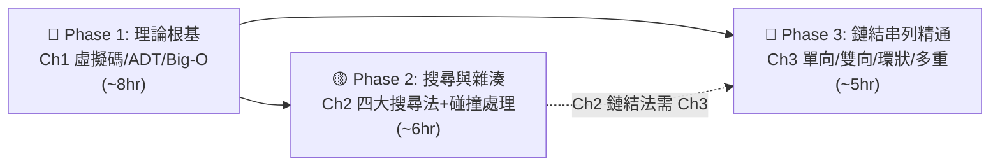
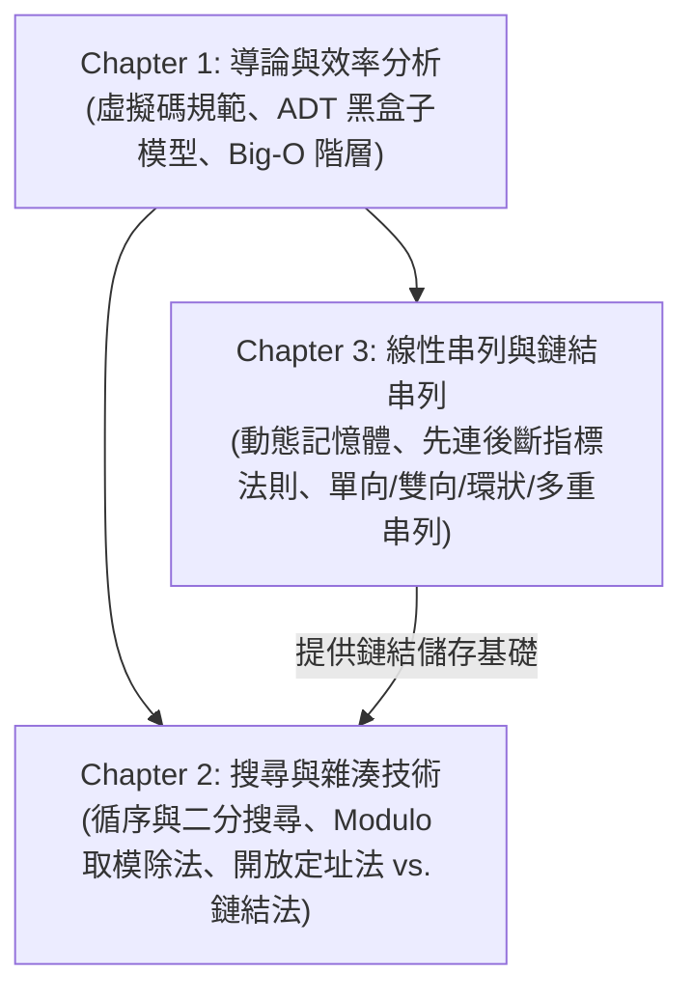

# 資料結構 (Data Structures) — 教材總覽

> 📅 最新更新日期：2026-10-24  
> 📂 來源目錄：[Reference/NCU_Classes/資料結構/](file:///c:/Users/Cupid/Downloads/Study-space/Reference/NCU_Classes/資料結構/)  
> 👨‍🏫 授課教師：Kuen-Liang Sue (NCU IM)  
> 📄 共 3 份講義（3 份已全數生成完畢）  

---

## 🚀 最速精通學習路線 (Mastery Roadmap)

> 全 3 章預估 **~19 小時** 可從零到精通。按以下三階段順序學習：

| 階段 | 章節 | 學習重點 | 里程碑 | 預估時間 |
|:---:|:---|:---|:---|:---:|
| **Phase 1** | Ch1 | 虛擬碼標頭、ADT 封裝原則、Big-O 巢狀迴圈分析 | 能手動分析任意迴圈 Big-O | ~8 hr |
| **Phase 2** | Ch2 | 循序/哨兵/機率/二分搜尋 + 取模除法 + 碰撞解決 | 能手動模擬雜湊探測過程 | ~6 hr |
| **Phase 3** | Ch3 | 先連後斷法則、雙向插入四部曲、環狀串列 rear 指標 | 能默寫所有指標操作順序 | ~5 hr |

> ⚡ **衝刺利器**：搭配 [📱 互動背誦表 (54 題)](./DS_期中背誦表.html) 進行主動回憶訓練  
> 📖 **完整學習路線指南** (含每週計畫、自我檢核表)：詳見 [精通學習路線圖](file:///C:/Users/Cupid/.gemini/antigravity-ide/brain/f84271c2-ce8e-4449-b5b2-a0c50209b0ab/mastery_roadmap.md)

---

## 📚 章節目錄與進度

| 章節 | 來源檔案 | 知識點核心 | 狀態 | 教材連結 |
| :--- | :--- | :--- | :---: | :---: |
| **Chapter 1** | [DS_Ch1.pdf](file:///c:/Users/Cupid/Downloads/Study-space/Reference/NCU_Classes/資料結構/DS_Ch1.pdf) | 導論、虛擬碼規範、ADT 模型、演算法效率分析與 Big-O | ✅ 已完成 | [開啟 Chapter 1 教材](./Chapter_1_教材.md) |
| **Chapter 2** | [DS_Ch2.pdf](file:///c:/Users/Cupid/Downloads/Study-space/Reference/NCU_Classes/資料結構/DS_Ch2.pdf) | 串列搜尋 (循序/哨兵/機率/二分)、雜湊方法與碰撞解決技術 | ✅ 已完成 | [開啟 Chapter 2 教材](./Chapter_2_教材.md) |
| **Chapter 3** | [DS_Ch3.pdf](file:///c:/Users/Cupid/Downloads/Study-space/Reference/NCU_Classes/資料結構/DS_Ch3.pdf) | 線性串列概念、單向鏈結串列指標運算、環狀串列、雙向串列、多重鏈結串列 | ✅ 已完成 | [開啟 Chapter 3 教材](./Chapter_3_教材.md) |
| ⚡ **期中速記** | **Ch1 ~ Ch3 全考點** | 54 核心考點背誦表、互動卡片、遮答案主動回憶、背熟進度追蹤 | 🔥 最新發布 | [📱 開啟互動背誦網頁](./DS_期中背誦表.html) / [📄 閱讀背誦表 Markdown](./DS_期中背誦表.md) |

---

## 🗺️ 跨章節知識關聯圖

---

## 🎯 全科考前必背精選清單

1. **結構化程式設計三大結構**：循序（Sequence）、選擇（Selection）、重複（Iteration / Loop）。任何演算法僅需此三種結構即可實作。
2. **ADT (抽象資料型態) 核心**：將資料宣告與有意義的操作打包封裝（Encapsulation），隱藏實作細節（Information Hiding）。使用者只在乎「能做什麼（What）」，不在乎「如何實作（How）」。
3. **Big-O 漸進階層排序**：
   $$O(1) < O(\log n) < O(n) < O(n \log n) < O(n^2) < O(n^3) < O(2^n) < O(n!)$$
4. **相依二次迴圈求和**：$\sum_{i=1}^n i = \frac{n(n+1)}{2} = O(n^2)$。
5. **收斂幾何級數迴圈陷阱**：外層除以 2、內層走到 $i$，總次數 $n + n/2 + n/4 + \dots \le 2n = O(n)$，非 $O(n \log n)$！
6. **哨兵搜尋 (Sentinel Search)**：在陣列結尾開闢額外空間放置目標值，省去每輪迴圈檢查「是否越界」的判斷條件，降低常數因子與分支預測開銷。
7. **機率搜尋 (Probability Search)**：遵循 80/20 法則，搜尋成功後將元素與前驅元素交換（Swap with predecessor），動態將熱門元素聚集至串列前端。
8. **二分搜尋 (Binary Search) 兩大前提**：必須「已排序」且必須「具備 $O(1)$ 隨機存取能力（陣列）」。鏈結串列即使排序亦無法做二分搜尋！
9. **雜湊取模除法 $h(k) = k \pmod m$ 質數原則**：除數 $m$ 必須選用質數以打破公因數週期性；若選 $2^p$ 相當於只擷取最低 $p$ 個二進位位元，會引發極度嚴重的碰撞。
10. **一次聚集 vs. 二次聚集**：
    - **一次聚集 (Primary Clustering)**：線性探測引發，碰撞元素在主表中連續相鄰堆疊成大區塊，造成探測步數暴增。
    - **二次聚集 (Secondary Clustering)**：二次探測引發，同義詞走完全相同的探測序列。
    - **鍵值位移 (Key Offset / Double Hashing)**：步長相依於鍵值本身，同時消除一次與二次聚集。
11. **開放定址法 vs. 鏈結串列法**：
    - 開放定址法負載因子 $\alpha = k/n \le 1$，刪除時需放置墓碑（Tombstone）。
    - 鏈結串列法（Separate Chaining）負載因子 $\alpha$ 可大於 1，刪除操作簡單，但額外消耗指標空間。
12. **鏈結串列插入黃金法則**：**先連後斷！**新節點必須先指向後續節點（`pNew->next = pPre->next`），再將前驅節點指向新節點（`pPre->next = pNew`），順序顛倒將造成後續整條鏈遺失與記憶體洩漏。
13. **鏈結串列刪除首節點三部曲**：`pTemp = head; head = head->next; delete pTemp;`。絕對不可先 `delete head` 再取 `next`。
14. **單向環狀串列只保留 rear 指標的威力**：透過 `rear` 可以在 $O(1)$ 存取尾節點，透過 `rear->next` 可以在 $O(1)$ 存取首節點，同時支援雙端 $O(1)$ 插入與存取。
15. **多重鏈結串列 (Multilinked Lists)**：同一實體資料僅儲存一份，透過多組獨立指標欄位提供多種邏輯走訪順序，兼顧省記憶體與確保資料一致性。
